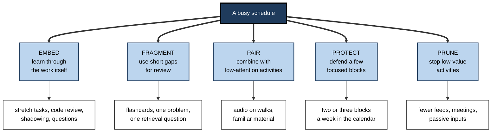
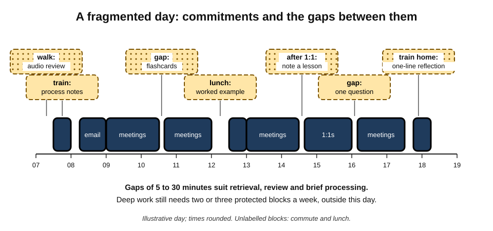
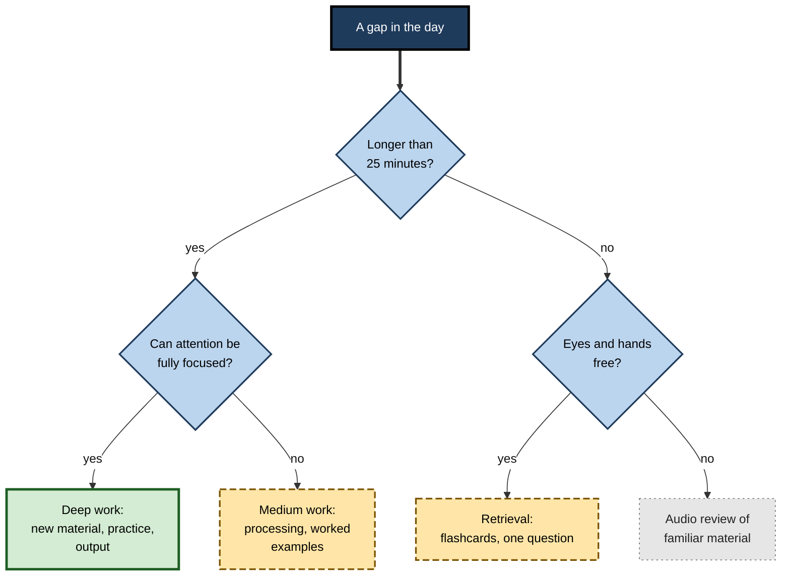
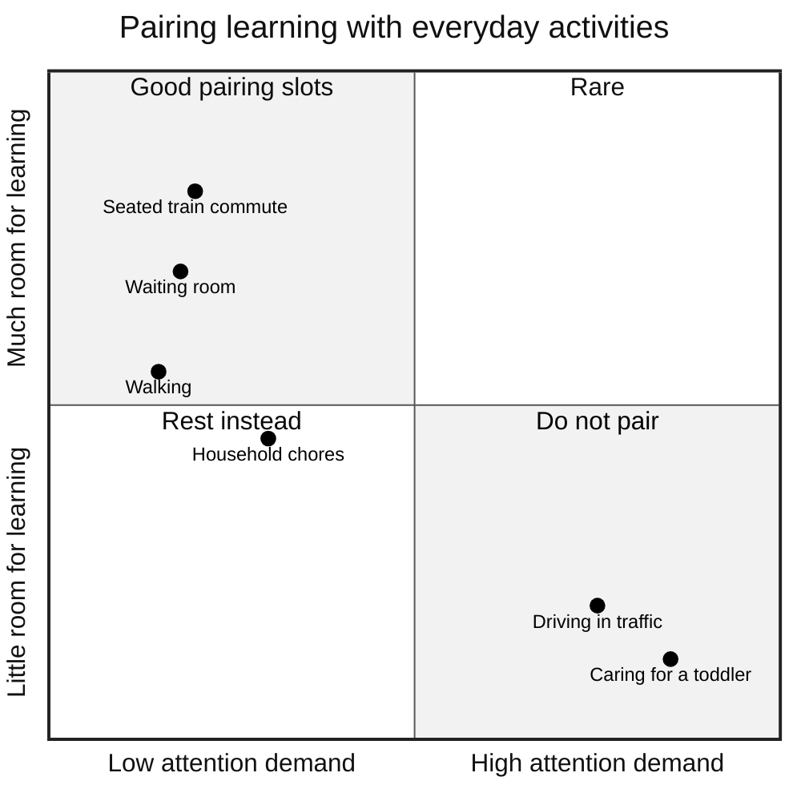
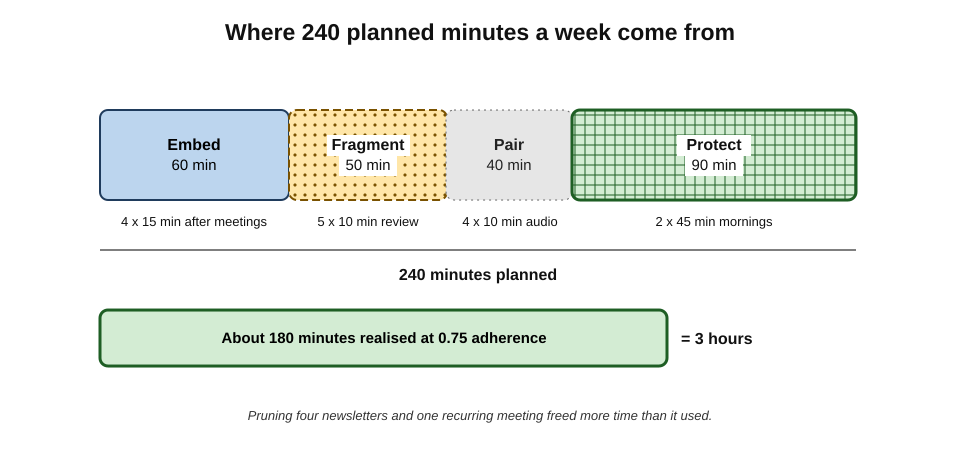

# H.7. Integrating Learning Into Busy Schedules

A newly promoted engineering manager has back-to-back meetings from nine to five, two young children and an hour's commute. For six months she has learned nothing deliberately; every plan to "find an hour" has failed, because there is no hour to find. What eventually works is not a free hour but a different question: not "when can I add learning?" but "**where can learning live inside what I already do?**"

> **Definition — Integrating learning into a busy schedule:** designing learning so that it is embedded in, fitted between, paired with or protected within existing commitments — rather than depending on large additional blocks of free time.

**Why it matters**

- **The busiest professionals often most need to learn** — new managers, people changing roles, those in fast-moving fields.
- **Waiting for free time means waiting indefinitely.** Busy periods rarely end; they change shape.
- **Small, frequent learning suits memory.** Spacing across days benefits retention, so fragments are not merely a compromise.
- **Learning embedded in work transfers better** — it is learned in the context where it will be used.

---

## The Arithmetic of a Busy Life

### Time, attention and energy

- **Time** — the hours available.
- **Attention** — the capacity to focus; fragmented by meetings, messages and caring duties.
- **Energy** — physical and mental reserves; depleted by long days, poor sleep and stress.
- A schedule may contain minutes of **time** without the **attention** or **energy** to use them for demanding learning.

> **Key point:** the constraint for most busy professionals is not only time but **usable attention**. Integration therefore matches each kind of learning to the kind of time available.

### Scarcity narrows attention

- **Sendhil Mullainathan and Eldar Shafir (2013)** argued that scarcity — of money or time — captures attention and produces **tunnelling**: focus on urgent demands, neglect of important but non-urgent ones.
- Learning is the classic **important, non-urgent** activity; under time scarcity it is the first to be dropped.

> **Definition — Tunnelling:** the narrowing of attention onto pressing demands under scarcity, at the expense of longer-term priorities.

> **Watch out:** some laboratory studies associated with the wider scarcity hypothesis have had mixed replication results, and the size of its cognitive effects is debated. The practical observation — that urgent demands crowd out learning unless it is protected or embedded — is widely shared.

---

## Five Strategies for Integration

**Figure 1.** Five strategies for fitting learning into a busy schedule.

> **Mnemonic — "Every Free Pocket Pays Profit":** Embed, Fragment, Pair, Protect, Prune.

---

## Embed: Learning Through the Work

### Learning in the flow of work

- The phrase **"learning in the flow of work"**, popularised by the industry analyst Josh Bersin from 2018, describes learning that happens within working tasks rather than in separate courses.
- Much professional capability already grows this way; the aim is to make it **deliberate**.

**Ways to embed learning**

- **Stretch assignments** — volunteering for tasks just beyond current capability.
  - *e.g.* a data analyst offers to build the first forecast model the team needs.
- **Learning-oriented questions** — asking "why is it done this way?" and "what would an expert notice here?" during routine tasks.
- **Working alongside experts** — pairing, shadowing, sitting in on difficult calls.
- **Reviews as lessons** — treating code reviews, editorial comments and audit findings as teaching material.
- **Teaching as part of the job** — explaining a process to a new colleague forces consolidation.
- **Small experiments** — trying one new technique in a real task each week.

| Work activity | How it becomes learning | Extra time needed |
|---|---|---|
| Routine report | Try one new analysis method each month | 10–30 minutes |
| Code review received | Note each recurring comment as a principle to practise | 5 minutes |
| Client meeting | Write one observation about what the senior colleague did well | 3 minutes |
| Incident or complaint | Record the cause and the lesson in a shared log | 10 minutes |
| Onboarding a new hire | Prepare a short explanation of a process | 20 minutes |

> **Key point:** embedded learning costs **minutes**, not hours, because the main work is already being done; the added cost is the **reflection** that turns experience into learning.

> **Watch out:** experience alone does not produce expertise. Repeating the same tasks without stretch, feedback or reflection can leave capability flat for years. Embedding works only when tasks are chosen to stretch and the lessons are made explicit.

---

## Fragment: Using Short Gaps

A busy day is rarely empty; it is **fragmented**. The gaps between commitments are short, but there are many of them.

**Figure 2.** A manager's fragmented working day, with the gaps between commitments used for short learning activities.

### What fits into five to ten minutes

- **Fits well:**
  - retrieval practice — answering review questions or flashcards;
  - re-solving one familiar problem;
  - reading one worked example;
  - writing a one-paragraph explanation of yesterday's idea;
  - capturing and tagging.
- **Fits poorly:**
  - first encounters with difficult material;
  - deep processing of complex ideas;
  - producing substantial output.

**Figure 3.** Matching learning activities to the length and quality of available time.

### The cost of switching

**Study card — Sophie Leroy (2009): attention residue**

- **Design:** participants switched from a first task to a second, with the first either completed or left unfinished, and under more or less time pressure.
- **Results:** after switching from an **unfinished** task, people performed worse on the next task; thoughts about the first task lingered — "attention residue".
- **Conclusion:** switching between tasks carries a cognitive cost that persists after the switch.

- Laboratory studies of task switching (for example by Joshua Rubinstein, David Meyer and Jeffrey Evans, 2001) found measurable time costs each time attention moved between tasks, larger for complex or unfamiliar tasks.
- **Implications for fragments:**
  - choose fragment activities that are **self-contained** and quick to start;
  - close each fragment with a clear stopping point, to reduce residue;
  - avoid starting complex material in a gap that will be interrupted.

### What the microlearning evidence shows

- **Microlearning** — short, focused learning units — is widely promoted in corporate training.
- Recent meta-analyses report generally **positive** effects on retention and outcomes compared with conventional instruction, but the underlying studies vary greatly in quality, and many compare well-designed short units with poorly designed long ones.
- Much of the benefit is plausibly explained by **spacing** and **retrieval** — established effects that short units make easy to schedule.

> **Watch out:** the popular claim that human attention spans have fallen to "eight seconds — less than a goldfish" has no sound research basis. Short units are useful because they fit fragmented time and support spacing, not because adults can no longer concentrate.

---

## Pair: Combining With Low-Attention Activities

### Dual-task limits

- Two tasks can be combined well only when **at least one is highly automatic** and they do not compete for the same resources.
  - Walking and listening — compatible for most people.
  - Driving and listening — compatible for **simple** material in **easy** traffic; demanding conversation while driving impairs driving.
  - Reading and listening to unrelated speech — incompatible; both use language processing.
- **David Strayer and William Johnston (2001)** showed in driving simulations that holding a phone conversation, even hands-free, slowed reactions and increased missed signals — a reminder that "listening while driving" has a cost.

| Activity | Compatible learning | Incompatible learning |
|---|---|---|
| Walking, running | Audio review; listening to familiar material; rehearsing a talk aloud | Anything requiring notes or visuals |
| Commuting by train or bus (seated) | Reading; flashcards; processing notes | Work needing a large screen or quiet |
| Driving | Light audio on familiar topics, in easy conditions | Demanding new material; anything visual |
| Household chores | Audio review; listening to discussions | Note-taking; problem-solving |
| Waiting (queues, appointments) | Flashcards; one review question | Deep reading |

**Figure 4.** Everyday activities placed by the attention they demand and the learning they leave room for.

### Temptation bundling

**Study card — Katherine Milkman, Julia Minson and Kevin Volpp (2014)**

- **Design:** gym members were given compelling audiobooks they could listen to **only at the gym**, compared with a control group.
- **Results:** gym visits increased substantially at first; the effect faded over the following weeks, notably after a holiday break.
- **Conclusion:** pairing a "want" (an enjoyable activity) with a "should" (a beneficial one) can raise the frequency of the beneficial one.

> **Watch out:** a much larger follow-up with a gym chain (Erika Kirgios and colleagues, 2020) found a **smaller** effect than the original. Temptation bundling is a useful tactic, not a powerful one.

- **Applied to learning:** keeping a favourite coffee, music or location reserved for study sessions; listening to an engaging learning podcast only during exercise.

---

## Protect: Defending a Few Focused Blocks

### Why some blocks must be protected

- Fragments and pairing support **review** and **maintenance**; they rarely support **deep processing**, **difficult practice** or **substantial output**.
- These need **protected blocks** — typically 45–90 minutes, two or three times a week.

### How professionals protect blocks

- **Calendar blocking** — booking learning as a meeting with oneself, visible to colleagues.
- **Meeting hygiene** — declining or shortening meetings without clear purpose; consolidating meetings onto certain days.
- **Maker's and manager's schedules** — the programmer and investor Paul Graham (2009) observed that people who make things need long uninterrupted blocks, while managers work in hour-long slots; mixing the two destroys the maker's time.
  - Learning is maker's work: it needs maker's blocks.
- **Time-boxing** — fixing a start and end time.
  - **Parkinson's law** (C. Northcote Parkinson, 1955) — the observation, offered half in jest, that "work expands so as to fill the time available for its completion" — suggests that unbounded learning sessions sprawl; boxes keep them focused.
- **Environmental protection** — a different room, headphones, a "do not disturb" signal, phone elsewhere.

> **In practice:** two protected 60-minute blocks a week, defended as firmly as a client meeting, often produce more deep learning than seven unprotected evening intentions.

---

## Prune: Making Room by Stopping

- **Every new commitment displaces something.** Integration often requires deciding what to stop.
- **Candidates for pruning:**
  - passive information inputs that produce little learning — redundant newsletters, endless feeds;
  - meetings attended out of habit;
  - low-value perfectionism in routine work;
  - recreational screen time beyond what is genuinely restorative.
- **A "not-to-do" list** — an explicit list of things one has decided not to do — makes pruning stick.

> **Formula — Opportunity cost of an activity:** the value of the best alternative use of the same time. Example: 40 minutes a day of news commentary = about **4.7 hours a week** that could fund two protected learning blocks and daily review.

> **Watch out:** pruning **rest and sleep** to make room for learning is self-defeating. Sleep supports memory consolidation, and exhausted learners process shallowly. Prune passive inputs, not recovery.

---

## Support From Employers

### What to ask for

- **Protected learning time** — some organisations set aside regular hours; for example, structured teaching time for junior doctors and off-the-job training requirements for apprentices in some countries.
- **Learning budgets** — for courses, books, conferences.
- **Stretch assignments** — learning embedded in real responsibilities.
- **Mentoring and pairing** — access to experienced colleagues.
- **Flexible timing** — e.g. a later start on study days.

### Making the case

1. **Link learning to a business need** — "learning cloud cost management will let me lead the migration review".
2. **Specify the ask** — time, money or opportunity, and for how long.
3. **Offer visible outputs** — a briefing for the team, a working prototype, a revised process.
4. **Propose a review point** — agree to report back after a quarter.

> **Key point:** employers fund learning more readily when it is framed as **capability the organisation needs**, with a defined output, than as personal development in the abstract.

---

## Life Stages and Constraints

- **Caregivers of young children** — unpredictable time; fragmented attention.
  - Emphasis on fragments, pairing (walks, naps) and a single protected early-morning or late-evening block.
- **Shift workers** — irregular schedules.
  - Event anchors ("after handover") and separate routines for each shift pattern.
- **Working students** — formal study plus employment.
  - Embedding coursework in workplace projects where permitted; strict pruning.
- **Senior leaders** — fragmented calendars, heavy decision load.
  - Learning through people (briefings from experts, reverse mentoring), short daily review, quarterly deep-dive days.
- **People managing health conditions or disability** — fluctuating energy.
  - Flexible minimum versions; energy-aware scheduling; accessible formats.

> **Remember:** integration is not one recipe. It is the **matching** of learning types to the shape of a particular life.

---

## How Little Is Enough? Maintenance and Minimum Doses

- **Acquiring** new capability needs substantial, focused effort.
- **Maintaining** existing capability needs much less — but not zero.
- **Skill decay:** a meta-analysis by Winfred Arthur and colleagues (1998) found that skills decline with periods of non-use, more steeply for **cognitive** skills than for physical, continuous ones, and that longer non-use produces greater loss.
- **Long-term retention is possible:** Harry Bahrick (1984) found that people who had learned Spanish at school retained substantial knowledge for decades, especially when it had been learned well and studied over several years — what he called a **permastore**.

> **Definition — Minimum effective dose:** the smallest amount of regular practice that keeps a capability from declining.

> **In practice:** in busy seasons, switch from **acquisition** to **maintenance** deliberately — a few minutes of retrieval on key skills each day — rather than stopping entirely and losing the base.

---

## Worked Example (illustrative): Three Hours a Week for a New Manager

The engineering manager from the opening wants to learn people management and budgeting. Her realistic ceiling is **about three hours a week**.

**Step 1 — find the shapes of available time:**

- Train commute: 2 × 30 minutes × 5 days, seated; attention moderate.
- Gaps between meetings: several 5–10-minute gaps daily.
- One-to-ones and budget meetings: built-in learning opportunities.
- Early morning: 6:15–7:00 on two days, if protected.

**Step 2 — assign strategies:**

| Strategy | Allocation | Learning activity |
|---|---|---|
| Embed | 4 × 15 min | After two one-to-ones and two budget meetings, note one lesson and one question |
| Fragment | 5 × 10 min | Review questions on management and finance concepts between meetings |
| Pair | 4 × 10 min | Audio review of familiar topics on the walk to the station |
| Protect | 2 × 45 min | Tuesday and Thursday mornings: one chapter processed and one practice case |
| Prune | — | Unsubscribe from four newsletters; decline one recurring status meeting |

> **Formula — Weekly total:** (4 × 15) + (5 × 10) + (4 × 10) + (2 × 45) = 60 + 50 + 40 + 90 = **240 minutes** planned. At 0.75 adherence → **180 minutes** — her three-hour ceiling.

**Figure 5.** Where the manager's three weekly learning hours come from.

**Step 3 — make the commute count:** she uses the train for processing notes from her one-to-ones, not for new reading, because her attention is too fragmented for difficult material.

**Step 4 — negotiate:** her director agrees to fund a short management course on condition that she runs a session for other new managers afterwards.

**Result after a quarter:** she has processed four core texts, written a short guide to running one-to-ones for her team leads and reduced budget-review preparation time by a third.

> **Watch out:** her first plan put all three hours into evenings "after the children are asleep". The plan was arithmetically possible and practically impossible — evening energy was her lowest. Integration begins from the **shape** of time, not its total.

---

## Guilt, Comparison and Sustainability

- **Comparison with idealised routines** — widely shared accounts of early-rising, multi-hour learning routines set standards that few lives can support.
- **Self-criticism after lapses** tends to reduce rather than increase persistence.
  - Juliana Breines and Serena Chen (2012) found that participants encouraged to take a **self-compassionate** view of a weakness or failure were more motivated to improve and spent longer studying for a retest than those who received self-esteem boosting or no intervention.
- **Sustainable integration** accepts lower volume in exchange for continuity: three hours every week for a year is about 150 hours; ten hours a week for six weeks followed by collapse is 60.

> **Key point:** the goal is **continuity across busy periods**, not heroic volume in rare quiet ones.

---

## Case Study (illustrative): A Nurse Completing a Master's Degree

### Case study (illustrative): integrating study with shift work and family

- **Situation:** a senior staff nurse on rotating shifts began a part-time master's in advanced clinical practice, with two school-age children.
- **Problem:** the course assumed about fifteen hours of study a week; her first term's plan of "study on days off" collapsed when days off were absorbed by family and extra shifts; she fell three assignments behind.
- **Diagnosis / Actions:**
  1. **Embed:** with her manager's agreement, she chose an assignment topic — sepsis recognition on her ward — that drew directly on her clinical work, so ward observations became course material.
  2. **Fragment:** review questions on pharmacology and physiology during breaks, ten minutes, three times per shift.
  3. **Pair:** recorded lectures replayed during the school run on foot.
  4. **Protect:** two four-hour study blocks a fortnight, negotiated with her partner and placed in the rota request system.
  5. **Prune:** stepped back from a voluntary committee for the year.
  6. **Employer support:** the trust granted three study days per term as protected learning time.
- **Result:** she caught up within a term and completed the degree on schedule; her sepsis project was adopted as a ward audit.
- **Side effects:** less social time; she scheduled one study-free weekend a month to avoid exhaustion.
- **Lesson:** fifteen hours a week did not come from one source but from **five strategies combined**, with embedding contributing the most valuable hours.

---

## Common Integration Mistakes

- **Using fragments for the wrong work.**
  - Trying to read a difficult chapter in eight-minute gaps produces frustration and shallow processing.
  - Remedy: fragments for retrieval; protected blocks for first encounters.
- **Pairing beyond capacity.**
  - Listening to a dense lecture while cooking for a family or driving in traffic yields little and may be unsafe.
  - Remedy: pair only familiar, light material with activities that need attention.
- **Embedding without reflection.**
  - Taking on stretch assignments but never extracting lessons; capability grows slowly.
  - Remedy: a three-minute note after each stretch task — what worked, what to try next time.
- **Protecting blocks on paper only.**
  - Calendar blocks that are overridden whenever a meeting request arrives.
  - Remedy: treat the block as a commitment to another person; move it, never delete it.
- **Pruning recovery.**
  - Cutting sleep, exercise or family time to make room; energy and mood fall, and learning quality with them.
- **All strategies at once.**
  - Introducing five new habits in one week overwhelms; most collapse together.
  - Remedy: add one strategy at a time, starting with the one that fits the person's day most naturally.
- **Measuring hours, not learning.**
  - Celebrating minutes logged while nothing is retained or applied.
  - Remedy: check periodically what can now be done unaided and what has been produced.

> **Key point:** integration succeeds when each strategy is used for **the kind of learning it suits**. Fragments maintain; protected blocks build; embedding transfers; pairing adds volume to the easy parts; pruning makes room for all four.

### Learning while travelling for work

- **Before the trip** — download materials; choose fragment-sized tasks; set a minimum version.
- **In transit** — flights and trains suit reading and processing if seated; airports and taxis suit flashcards.
- **At the destination** — hotel evenings can host one protected block, if energy allows; client work offers embedded lessons worth noting the same day.
- **After the trip** — a short processing session to turn travel notes into usable material before they go stale.

---

## Organisational Practices That Help

- **Protected learning time** — regular hours set aside and defended by managers.
- **Meeting-free blocks** — agreed periods without internal meetings, which create maker's time for everyone.
- **Learning as part of objectives** — stretch goals and capability outputs recorded in performance plans.
- **Communities of practice** — regular short sessions where staff teach one another, embedding learning in the working week.
- **Leaders modelling learning** — when senior people visibly block time for learning, others feel permitted to do so.

> **In practice:** individual integration strategies are much easier where the organisation protects time; where it does not, the individual's most powerful tools are **embedding** and **negotiation**.

---

## Open Questions

- **How effective is microlearning once spacing and retrieval are controlled for?**
  - Many studies compare short, well-designed units with long, poorly designed ones.
- **Does learning embedded in work transfer better, and by how much?**
  - Context-matched learning is theoretically favoured; rigorous comparisons in workplaces are rare.
- **What is the minimum effective dose for maintaining professional skills?**
  - Skill decay is documented; maintenance doses for complex cognitive skills are poorly mapped.
- **How do digital interruptions affect long-term learning in busy schedules?**
  - Switching costs are well established in laboratories; effects on long-term professional learning are less studied.
- **How should organisations measure protected learning time's value?**
  - Hours are easy to count; capability gains are harder.

---

## Summary

- **Integration** fits learning into existing commitments — embedded, fragmented, paired, protected — rather than waiting for free time.
- The constraint is **time, attention and energy**; **scarcity** produces **tunnelling**, so important, non-urgent learning is crowded out unless designed in.
- Five strategies — **Embed, Fragment, Pair, Protect, Prune** ("Every Free Pocket Pays Profit").
- **Embed:** learning in the flow of work through stretch tasks, questions, reviews, teaching; costs minutes but needs reflection to work.
- **Fragment:** short gaps suit **retrieval and review**, not first encounters; **attention residue** (Leroy, 2009) and switch costs favour self-contained fragments; microlearning evidence is positive but uneven; the "goldfish" claim is a myth.
- **Pair:** combine learning with low-attention activities; respect **dual-task limits**; **temptation bundling** helps modestly.
- **Protect:** two or three 45–90-minute blocks a week for deep work; maker's schedule; time-boxing.
- **Prune:** stop low-value inputs and meetings; never prune sleep.
- Ask employers for time, budget, stretch work and mentoring, linked to **business needs** and **visible outputs**.
- In busy seasons switch to **maintenance** at a **minimum effective dose**; skills decay with non-use, but well-learned knowledge can persist for decades.
- Favour **continuity over heroic volume**; self-compassion after lapses supports persistence.

---

## Self-Check

1. Define integrating learning into a busy schedule and explain why waiting for free time fails.
2. Distinguish time, attention and energy, and explain why the distinction matters.
3. What is tunnelling, and why is learning especially vulnerable to it?
4. Name the five integration strategies and give an example of each.
5. Why does embedded learning still require reflection?
6. Which learning activities fit five-minute gaps, and which do not?
7. Describe Leroy's (2009) attention-residue findings and their implications for fragments.
8. What does the microlearning evidence show, and what is wrong with the "goldfish" claim?
9. Explain dual-task limits and classify listening to a new, difficult lecture while driving in heavy traffic.
10. Summarise the temptation-bundling evidence, including the later replication.
11. Why do deep processing and output need protected blocks, and how can they be protected?
12. Calculate the opportunity cost in weekly hours of 25 minutes a day of social media, and suggest how it might be reallocated.
13. What does the research on skill decay and permastore imply for busy seasons?
14. A consultant travelling four days a week says she can only learn on Sundays. Using the five strategies, redesign her approach.

### Answer Key

1. Designing learning to be embedded in, fitted between, paired with or protected within existing commitments. Busy periods rarely end; they change shape, so free time seldom appears.
2. Time is hours; attention is capacity to focus; energy is physical and mental reserves. Minutes without attention or energy cannot support demanding learning, so activities must be matched to the kind of time available.
3. The narrowing of attention onto urgent demands under scarcity. Learning is important but rarely urgent, so it is dropped first unless protected or embedded.
4. Embed (a stretch assignment), Fragment (flashcards between meetings), Pair (audio review while walking), Protect (two calendar-blocked mornings), Prune (cancelling redundant newsletters).
5. Experience alone can leave capability flat; the learning comes from stretch, feedback and making lessons explicit through brief reflection.
6. Fit: retrieval practice, one familiar problem, one worked example, a short explanation, capture. Do not fit: first encounters with difficult material, deep processing, substantial output.
7. Switching away from an unfinished task impaired performance on the next because thoughts lingered. Choose self-contained fragment activities and end with a clear stopping point.
8. Meta-analyses report positive effects, but study quality varies and much of the benefit likely comes from spacing and retrieval. The eight-second goldfish claim has no sound research basis.
9. Two tasks combine only when one is automatic and they do not compete for the same resources. A difficult new lecture in heavy traffic is incompatible — both need attention, and driving safety suffers.
10. Milkman et al. (2014) found audiobooks available only at the gym raised visits initially, with fading over time. A larger replication (Kirgios et al., 2020) found a smaller effect: useful but modest.
11. They need sustained, uninterrupted attention. Protect by calendar blocking, meeting hygiene, maker's-schedule blocks, time-boxing and environmental measures.
12. 25 × 7 = 175 minutes ≈ 2.9 hours a week; e.g. one protected 60-minute block, daily ten-minute reviews and an hour of processing.
13. Skills decay with non-use, especially cognitive ones, so busy seasons need a maintenance dose rather than a stop; well-learned, spaced knowledge can persist for decades, so earlier investment protects capability.
14. Embed: learn through client work (stretch tasks, notes after client meetings). Fragment: review questions in airports and taxis. Pair: audio on familiar material during walks. Protect: two hotel-evening or early-morning blocks plus a shorter Sunday session. Prune: passive inputs during travel. Maintain continuity across the week rather than massing on Sunday.

---

## Glossary

| Term | Meaning |
|---|---|
| Attention residue | Lingering thoughts about a previous task that impair performance on the next. |
| Dual-task interference | Reduced performance when two tasks compete for the same mental resources. |
| Embedded learning | Learning deliberately built into working tasks. |
| Learning in the flow of work | Learning that happens within everyday work rather than in separate courses. |
| Maker's schedule | Working in long uninterrupted blocks, as needed for creating and deep learning. |
| Microlearning | Learning delivered in short, focused units. |
| Minimum effective dose | The smallest regular practice that prevents a capability from declining. |
| Opportunity cost | The value of the best alternative use of the same time or resources. |
| Parkinson's law | The observation that work expands to fill the time available. |
| Permastore | Bahrick's term for very long-lasting retention of well-learned knowledge. |
| Protected learning time | Regular time set aside and defended for learning. |
| Skill decay | Loss of skill during periods of non-use. |
| Temptation bundling | Pairing an enjoyable activity with a beneficial one to increase the latter. |
| Time-boxing | Fixing a start and end time for an activity. |
| Tunnelling | Narrowing of attention onto urgent demands under scarcity. |
