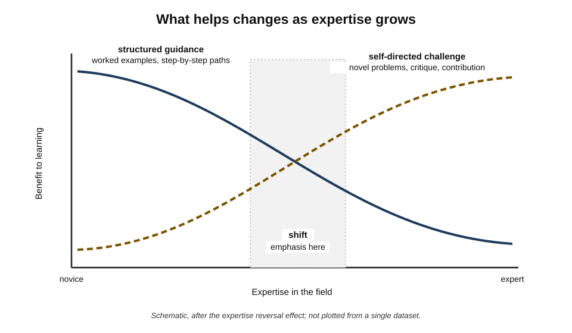
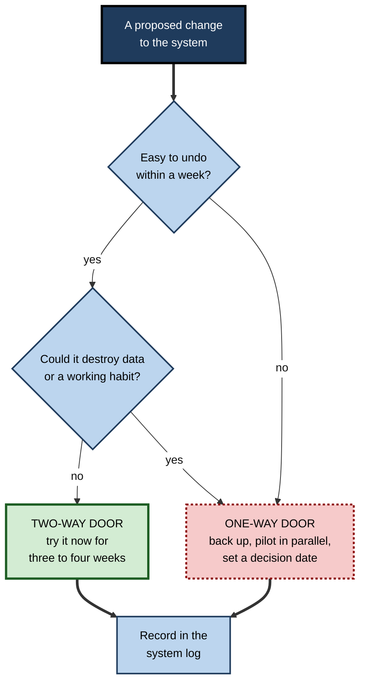
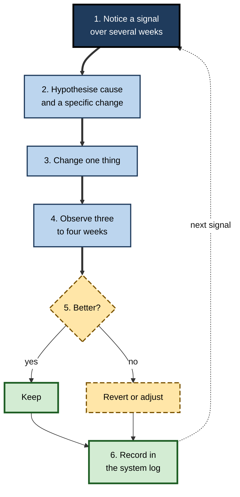
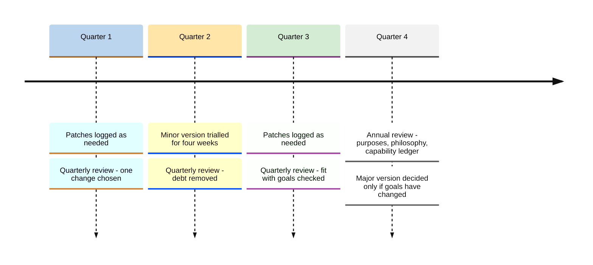
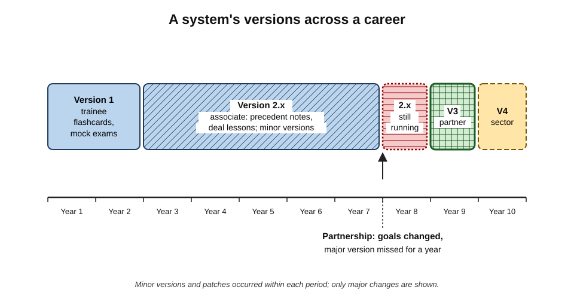

# H.8. Customizing Your System Over Time

As a trainee solicitor, a lawyer built a learning system around flashcards of statutes and weekly case summaries — exactly right for passing qualification exams. Eight years later, as a newly made partner, she was still running it. It was flawless and almost useless: her work now needed judgement about clients, commercial strategy and people, and none of it fitted on a flashcard. Her system had not failed; it had **stopped fitting the person she had become**.

> **Definition — System evolution:** the deliberate, incremental adaptation of a personal learning system's purposes, workflows, cadences and tools in response to changing goals, circumstances, capability and evidence.

**Why it matters**

- **People change faster than their systems.** Roles, responsibilities, families, health and fields all shift over a career.
- **What helps a novice can hinder an expert.** Structures that support early learning become redundant or obstructive later.
- **Systems decay if left alone.** Small frictions accumulate, tools change, and unused parts linger.
- **Well-managed change preserves what works.** Haphazard change destroys working habits along with the broken ones.

---

## Why Systems Must Change

### Six drivers of change

- **Goals** — new roles, new fields, new ambitions.
  - *e.g.* moving from individual contributor to manager shifts learning from technical depth to people and organisational skills.
- **Context** — new employer, location, working pattern, family responsibilities, health.
  - *e.g.* a move from office work to remote work removes commuting slots and adds home interruptions.
- **Domain** — the field itself changes.
  - *e.g.* generative AI changing what a copywriter or programmer must know.
- **Capability** — growing expertise changes what kind of learning helps.
- **Tools** — products change price, features, terms or disappear.
- **Evidence** — the learner's own records show what is and is not working.

> **Mnemonic — "Good Cooks Don't Cling To Errors":** Goals, Context, Domain, Capability, Tools, Evidence.

### Systems drift and accumulate complexity

**Study card — Meir Lehman's laws of software evolution (from 1974)**

- **Setting:** Lehman studied how large software systems, such as IBM's OS/360, changed over successive releases.
- **Findings, expressed as "laws":**
  - **continuing change** — a system in real use must be continually adapted, or it becomes progressively less satisfactory;
  - **increasing complexity** — as it evolves, its complexity increases unless work is done to maintain or reduce it.
- **Relevance:** personal learning systems behave similarly. Unless simplified deliberately, each new subject, tool and template adds complexity that is never removed.

> **Definition — System debt:** the accumulated cost of past shortcuts, workarounds and unremoved parts in a personal system, which makes every later change harder — by analogy with the **technical debt** metaphor introduced by the programmer Ward Cunningham in 1992.

**Examples of system debt**

- Three overlapping tagging schemes from different eras.
- A review deck full of cards about a job held years ago.
- Templates nobody fills in but nobody deletes.
- Workarounds for a tool limitation that no longer exists.

> **Key point:** a system needs two kinds of change: **adaptation** to new needs and **maintenance** that removes accumulated debt. Neglecting the second makes the first progressively harder.

---

## Expertise Changes What Helps

### The expertise reversal effect

**Study card — Kalyuga, Ayres, Chandler and Sweller (2003)**

- **Finding reviewed:** instructional methods that help novices — worked examples, integrated explanations, step-by-step guidance — become **less effective, or even harmful**, as learners gain expertise.
- **Mechanism:** experts already hold the relevant schemas; redundant guidance forces them to process information they do not need, adding cognitive load.
- **Conclusion:** the optimal level of structure and guidance **decreases** as expertise grows; methods must be adapted to the learner's current level.

> **Definition — Expertise reversal effect:** the finding that instructional support beneficial to novices loses its benefit, or becomes counter-productive, for more knowledgeable learners.

**Figure 1.** How the value of structured guidance and of self-directed challenge changes as expertise grows.

### What changes in a system as expertise grows

| Aspect | Earlier in a field | Later in a field |
|---|---|---|
| Inputs | Textbooks, structured courses, curated paths | Primary sources, research, conversations with peers, edge cases |
| Processing | Summaries and worked examples | Critiques, comparisons, synthesis across sources |
| Practice | Standard problems with answers | Novel, ill-defined problems; deliberate work on rare cases |
| Review | Many facts and procedures to retain | Fewer, higher-level principles and exceptions |
| Output | Exercises, explanations for oneself | Teaching, writing, design, contributions to the field |
| Feedback | Answer keys, instructors | Clients, peers, outcomes, critics |
| Reflection | "Did I learn it?" | "What do I see that others miss? Where am I stale?" |

> **Watch out:** experts sometimes keep novice systems out of habit — summarising everything, memorising detail they can look up — while neglecting what expertise now needs: exposure to **hard cases**, **critical feedback** and **contribution**. The reverse error, skipping structure too early, is just as costly for novices.

---

## Signals That a System Needs Changing

### Noise and signal

- **Noise** — a bad week, a holiday, an illness, a deadline.
  - Handled by minimum versions; no redesign needed.
- **Signal** — a pattern persisting for **four weeks or more**, or a clear change in goals or context.
  - Calls for deliberate adjustment.

| Signal | Likely cause | Typical adjustment |
|---|---|---|
| One component consistently skipped | Friction, wrong slot, or no longer useful | Reduce friction, move it, or remove it |
| Rising backlog | Capture outgrowing processing | Cut capture; tighten pull targets |
| Reviews feel pointless | Items no longer relevant to current work | Prune; refocus review on current outputs |
| Capability plateau | Practice too easy; feedback too weak | Harder problems; new sources of critique |
| Boredom | Repetitive formats; mastered material | New formats or challenges; retire mastered items |
| System time rising | Accumulated complexity and debt | Simplify; remove tools and templates |
| Learning unrelated to goals | Goals changed, system did not | Revisit purpose and philosophy |

> **Remember:** change the system in response to **patterns**, not to individual bad days.

---

## Evolution, Not Revolution

### Why incremental change works better

- **Working parts are preserved.** Wholesale redesign discards habits that were working along with those that were not.
- **Effects can be attributed.** One change at a time shows which change made the difference.
- **Reversibility.** Small changes can be undone if they fail.
- The political scientist **Charles Lindblom (1959)** argued, in "The Science of 'Muddling Through'", that complex policy is usually improved best by **successive limited comparisons** — small steps evaluated against experience — rather than by comprehensive redesign; the same holds for personal systems.
- A complementary principle, associated with the systems writer John Gall, holds that complex systems that work tend to have evolved from simpler systems that worked.

### One-way and two-way doors

- In his letter to shareholders for 2015, Jeff Bezos distinguished **Type 1 decisions** — consequential and hard to reverse ("one-way doors") — from **Type 2 decisions** — reversible ("two-way doors"), which should be made quickly.
- **In a learning system:**
  - **two-way doors** — moving a session slot, trying a new template, changing review frequency;
  - **one-way doors** — deleting an archive, migrating to a proprietary format, abandoning a long-built practice.

**Figure 2.** Deciding how carefully to make a change to the system.

### The change cycle

1. **Notice** a signal persisting over several weeks.
2. **Hypothesise** a cause and a specific change ("reviews are skipped because they come at 9 p.m.; moving them to the morning train will raise completion").
3. **Change one thing.**
4. **Observe** for three to four weeks, using the log.
5. **Keep, adjust or revert.**
6. **Record** the change, the reason and the result.

- The cycle resembles the plan–do–check–act cycle used in quality improvement; here it is applied to the design of the learning system itself.

**Figure 3.** The cycle for making and evaluating one change to a learning system.

> **Watch out:** changes often seem to work at first simply because they are new. The so-called **Hawthorne effect** — improved performance because people know they are being studied or something has changed — is often cited, but a reanalysis of the original Hawthorne factory data by Steven Levitt and John List (2011) found little evidence for the effect as popularly told. The practical caution stands on firmer ground in the **novelty effect**: judge a change after several weeks, not several days.

---

## The System Log and Versioning

### Keeping a system log

- A **system log** is a short dated record of changes to the system.
- Each entry:
  - **date**;
  - **change** — what was altered;
  - **reason** — the signal that prompted it;
  - **expected effect**;
  - **result** — added after the observation period.

> **Example (illustrative) — log entry:** "12 March — moved flashcard review from 21:00 to the morning train. Reason: completion 35% over six weeks. Expected: completion above 80%. Result (9 April): 88%; keep."

### Versions of a system

Software developers often number releases as **major.minor.patch**, a convention known as semantic versioning: major for incompatible changes, minor for added features, patch for fixes. The same idea clarifies how much review a system change needs.

| Version level | What changes | Example | Review needed |
|---|---|---|---|
| Major (2.0) | Purpose, philosophy or overall architecture | Moving from exam preparation to leadership development | Full redesign; audit first |
| Minor (2.1) | A workflow or cadence | Adding a monthly output; replacing evening reviews with morning ones | Three-to-four-week trial |
| Patch (2.1.1) | A small adjustment | A new template field; a renamed folder; a shorter card | None beyond the log |

> **Key point:** most changes should be **patches and minor versions**. Major versions are rare — typically at career transitions — and should follow an audit and a revised philosophy.

---

## Scheduled System Reviews

### Quarterly review — about one hour

- **Component by component:** is each still working? what is skipped? what is friction?
- **Debt:** what can be removed — tools, templates, tags, stale review items?
- **Fit:** does the system still serve current goals?
- **One or two changes** to try next quarter.

### Annual review — about half a day

- **Purposes and philosophy** — still right? what has changed in life, role or field?
- **Capability ledger** — what can now be done that could not a year ago?
- **Major-version decision** — keep the architecture, or redesign?

- A **weekly learning review** — looking back at what was learned that week — is a different practice; system reviews look at the **machinery**, not the content.

**Figure 4.** The cadence of system reviews across one year.

---

## Customising Each Component

Change rarely affects the whole system at once. Most customisation happens component by component.

- **Inputs**
  - Early: curated courses and textbooks.
  - Later: primary sources, practitioner communities, conversations with experts, the learner's own data and cases.
  - Typical customisation: replacing broad feeds with a few deep sources; adding a source of **dissent** — a critic or rival school — to avoid an echo chamber.
- **Capture**
  - Early: capture much, because almost everything is new.
  - Later: capture only what is surprising, contradicts current beliefs or serves a current output.
  - Typical customisation: tightening capture rules as expertise makes most material familiar.
- **Processing**
  - Early: summaries, definitions, worked examples.
  - Later: comparisons, critiques, syntheses, notes on exceptions and edge cases.
  - Typical customisation: changing the processing template from "What does it say?" to "Where does it disagree with what I know, and who is right?"
- **Practice**
  - Early: standard problems with known answers.
  - Later: novel, messy problems; simulations; deliberate practice on rare but critical situations.
  - Typical customisation: seeking out harder cases and external critique as routine tasks become easy.
- **Review**
  - Early: many items, short intervals.
  - Later: fewer items — principles, rare facts, recent changes in the field.
  - Typical customisation: regular pruning of mastered or obsolete items.
- **Output**
  - Early: private explanations and exercises.
  - Later: teaching, writing, designing, advising, contributing to standards.
  - Typical customisation: shifting from outputs that test the learner to outputs that serve others.
- **Reflection**
  - Early: "Have I understood?"
  - Later: "What am I not seeing? Where has my expertise become stale?"
  - Typical customisation: adding external perspectives — mentors, peers, clients — because expert self-assessment develops blind spots.

> **Key point:** over a career, the system's centre of gravity moves **from inputs and review towards practice on hard cases, output and critical reflection**.

---

## Pruning and Archiving

Removal is the most neglected form of customisation.

**What to prune**

- **Review items** that have been answered correctly for a long time and are no longer needed in work.
- **Review items** about superseded rules, retired products or past jobs.
- **Notes** never opened in several years and unconnected to anything current.
- **Templates and fields** that are always left blank.
- **Tags and categories** that duplicate others.
- **Tools** whose use has fallen to zero.

**How to prune safely**

1. **Archive rather than delete** where storage is cheap — move items out of active use but keep them searchable.
2. **Prune in small batches** during the quarterly review, rather than in occasional purges.
3. **Record** what was pruned and why in the system log.
4. **Keep a "retired" folder** so that anything genuinely needed again can be restored.

> **Formula — Active review load:** items due per day ≈ total active items ÷ average review interval in days. Example: 4,000 active items at an average interval of 60 days ≈ **67 items a day**; pruning to 1,500 items ≈ **25 a day** — the difference between a burden and a ten-minute habit.

> **Watch out:** the effort that went into creating an item is a **sunk cost**. The only question is whether reviewing it serves current and likely future work.

---

## Customising as Tools Gain AI Features

- **New capabilities appear inside existing tools** — automatic linking, summarising, question generation, conversational search.
- **Treat each new feature as a proposed change**, subject to the same cycle: hypothesis, trial, observation, decision.
- **Questions for each feature:**
  - Does it remove friction from a hand-off, or remove the learner's effortful thinking?
  - Does it change where data goes?
  - After four weeks, is capability — not just convenience — better?
- **A reasonable default:** adopt AI features that **test, question or connect** the learner's own material; be cautious with features that **replace** processing or output.

---

## Customising for Life and Career Stages

| Stage | Learning priority | System emphasis | Typical change |
|---|---|---|---|
| Student or trainee | Foundations; qualifications | Structured inputs; heavy review; exam practice | Spaced review of many facts; worked examples |
| Early-career specialist | Depth in one area; credibility | Practice on real problems; feedback from seniors | Shift from courses to projects and code review |
| Mid-career expert | Staying current; distinctive depth | Primary sources; hard cases; teaching | Retire novice structures; add output and critique |
| New manager | People, organisation, judgement | Embedded learning; reflection; mentoring | Fewer facts to memorise; more structured reflection |
| Career changer | Rapid acquisition in a new field | Structured paths again; intensive season | Temporarily return to novice-style structure |
| New parent or carer | Maintenance; continuity | Minimum versions; fragments | Smaller budget; protect a single block |
| Later career | Synthesis; mentoring; legacy | Teaching, writing, advising | Output-dominated system |

> **Key point:** customisation is not a one-way journey from structure to freedom. A career changer becomes a **novice again** in the new field and benefits from returning, temporarily, to more structured methods.

---

## Changing Tools Without Losing the System

### Worked example (illustrative): migrating a notes archive

A product manager decides to move eight years of notes from a proprietary application to plain-text files, after the vendor raises prices and restricts exports.

1. **Inventory:** the application reports **3,400 notes**, **620 attachments** and **95 tags**.
2. **Export:** the vendor's export produces 3,400 files; 588 attachments are found.
3. **Verify completeness:**

> **Formula — Export completeness:** items verified in the new location ÷ items in the original. Notes: 3,400 ÷ 3,400 = **100%**. Attachments: 588 ÷ 620 ≈ **94.8%** — 32 attachments missing.

4. **Investigate the gap:** the missing attachments were embedded in notes created before a format change; she exports them individually.
5. **Map structure:** tags converted to keywords in each file; notebooks to folders.
6. **Run in parallel** for two weeks: new captures go to the new system; the old one is read-only.
7. **Cut over:** archive the original export with a date stamp; record the migration in the system log as a **minor version** (the workflow is unchanged).
8. **Prune during migration:** 900 notes not opened in five years are moved to an archive folder rather than the active collection.

> **Watch out:** migrations are **one-way doors**. Never delete the original until the new system has been used successfully for several weeks and the export has been verified item by item for anything important.

---

## Who Customises: Self or Algorithm?

- **Self-customisation** — the learner adjusts the system based on reflection and evidence.
  - Strength: uses knowledge of goals and context that no algorithm has.
  - Weakness: susceptible to novelty, preference and wishful thinking.
- **Algorithmic adaptation** — software adjusts schedules, difficulty or content from performance data.
  - Strength: responsive to fine-grained performance; consistent.
  - Weakness: optimises what it can measure; blind to purposes it cannot see.
- **Best combination:** let software adapt **within** components (for example review intervals) and let the person decide the **architecture** (which components, what for).

> **In practice:** the learner sets the purpose and structure; tools tune the details. When a tool's adaptation starts to drive the learner's goals — studying what the app rewards rather than what the work needs — it is time to change the configuration or the tool.

---

## Case Study (illustrative): Ten Years, Four Versions

### Case study (illustrative): a lawyer's system from trainee to partner

- **Situation:** a corporate lawyer, followed from her training contract to partnership.
- **Version 1 (trainee, years 1–2):** structured courses; flashcards on statutes and procedure; weekly case summaries; mock exams.
  - **Fit:** excellent for qualification.
- **Version 2 (associate, years 3–6):** patches and minor versions —
  - flashcards narrowed to the practice area;
  - case summaries replaced by **precedent notes** on deals she worked on;
  - a monthly "lessons from the deal" note added.
  - **Fit:** good; capability grew steadily.
- **Problem (year 8, newly a partner):** she continued Version 2 unchanged. Reviews felt pointless; she was learning nothing about business development, team leadership or client strategy — her new core work.
- **Diagnosis:**
  1. **Goals changed; system did not** — a missed major version.
  2. **System debt** — 4,000 flashcards, most on detail she now looked up or delegated.
  3. **Expertise reversal** — summaries of standard material added little for an expert.
- **Actions (Version 3):**
  1. Annual review and a rewritten philosophy: "learn through clients, people and deals".
  2. Retired 3,500 flashcards; kept 500 on genuinely needed principles and recent law changes.
  3. Added a fortnightly conversation with a senior partner (mentoring as input).
  4. Added a **post-pitch reflection** after every client pitch.
  5. Began teaching associates monthly (output).
- **Result:** within a year, her client pitches converted at a higher rate, and associates rated her supervision highly. A later **Version 4** added a sector focus (renewable energy) using a temporary return to structured inputs — the career-changer pattern within one career.
- **Lesson:** the system's greatest risk was not failure but **successful obsolescence** — continuing to run well while serving goals she no longer had.

**Figure 5.** The lawyer's system versions over ten years, with the missed major version marked. (illustrative)

---

## Pitfalls in Customisation

- **Change for its own sake** — novelty-driven redesigns that discard working habits.
- **Never changing** — loyalty to a system that served an earlier self.
- **Many changes at once** — impossible to tell what helped.
- **Ignoring evidence** — changing because a method sounds better rather than because the log shows a problem.
- **Sentimental hoarding** — keeping obsolete review items, templates and archives because of the effort they once took.
- **Copying another person's latest set-up** — their changes answer their signals, not one's own.
- **Neglecting maintenance** — adding without removing, until the system becomes heavy.

> **Remember:** **adapt to patterns, change one thing, judge after weeks, record the result, remove as well as add**.

---

## Open Questions

- **How should learners judge when expertise has grown enough to drop structure?**
  - Expertise reversal is established in instruction; self-assessment of when it applies is unreliable.
- **How much system change is optimal?**
  - Too little leads to obsolescence, too much to churn; no research defines the balance for individuals.
- **Can algorithms detect when a learner's goals have changed?**
  - Adaptive tools respond to performance, not to purposes; combining both is an open design problem.
- **How large is the novelty effect in personal system changes?**
  - Widely assumed; rarely measured in self-directed adult learning.
- **What maintenance burden is sustainable over decades?**
  - Long-term studies of personal systems across careers are almost non-existent.

---

## Summary

- **System evolution** is the deliberate, incremental adaptation of purposes, workflows, cadences and tools to changing goals, context, domain, capability, tools and evidence ("Good Cooks Don't Cling To Errors").
- Systems **drift** and accumulate complexity (Lehman's laws); unremoved parts form **system debt** (after Cunningham's technical debt).
- The **expertise reversal effect** (Kalyuga et al., 2003) means guidance that helps novices can hinder experts; systems should shift from structure to hard cases, critique and contribution — and back again when entering a new field.
- Respond to **signals** (patterns over about four weeks), not noise.
- Prefer **evolution over revolution**: incremental change (Lindblom's "muddling through"), one change at a time, distinguishing **two-way** from **one-way doors**.
- The change cycle: **notice → hypothesise → change one thing → observe → keep or revert → record**.
- Keep a **system log**; version changes as **major, minor and patch**.
- Hold **quarterly** reviews of the machinery and an **annual** review of purposes and philosophy.
- Customise for **life and career stages**; career changers return temporarily to structure.
- Migrate tools carefully: inventory, export, **verify completeness**, run in parallel, then cut over.
- Let **algorithms tune details**, while the **person sets the architecture**.
- Beware **novelty effects**; the popular Hawthorne story is weaker than usually told.

---

## Self-Check

1. Define system evolution and list the six drivers of change.
2. State Lehman's first two laws and explain their relevance to personal learning systems.
3. What is system debt? Give three examples.
4. Explain the expertise reversal effect and its implications for how a system should change.
5. Compare a system's inputs and practice early and later in a field.
6. Distinguish noise from signal, and give two signals that warrant change.
7. Why is incremental change usually better than wholesale redesign?
8. Classify as one-way or two-way doors: moving a review slot; deleting an old archive; trying a new template; migrating to a proprietary format.
9. Describe the six steps of the change cycle.
10. What does a system log entry contain? Write an example.
11. Explain major, minor and patch versions with an example of each.
12. What does the reanalysis of the Hawthorne data imply for evaluating changes?
13. Calculate export completeness when 1,450 of 1,500 notes verify, and state what should happen next.
14. A data scientist promoted to head of analytics keeps a daily routine of coding exercises and paper summaries, but feels unprepared for budgeting and stakeholder work. Diagnose and propose a new version.

### Answer Key

1. Deliberate, incremental adaptation of purposes, workflows, cadences and tools in response to change. Drivers: goals, context, domain, capability, tools, evidence.
2. Continuing change — a system in use must be adapted or it becomes less satisfactory; increasing complexity — complexity grows unless work is done to reduce it. Personal systems must be adapted and simplified deliberately.
3. The accumulated cost of shortcuts and unremoved parts that makes change harder. Examples: overlapping tag schemes; review items from a past job; unused templates; obsolete workarounds.
4. Support that helps novices becomes redundant or harmful for experts because they already hold the schemas. Systems should reduce structure and add hard cases, critique and contribution as expertise grows, and reinstate structure in new fields.
5. Early: textbooks, courses, standard problems with answers. Later: primary sources, peers, edge cases, novel ill-defined problems.
6. Noise: short disruptions handled by minimum versions. Signal: patterns over four weeks or a change in goals. Examples: a component consistently skipped; a rising backlog; a capability plateau.
7. It preserves working parts, allows effects to be attributed and keeps changes reversible.
8. Moving a slot — two-way; deleting an archive — one-way; new template — two-way; proprietary migration — one-way.
9. Notice a persistent signal; hypothesise cause and change; change one thing; observe three to four weeks; keep, adjust or revert; record.
10. Date, change, reason, expected effect, result. E.g. "3 May — added Friday 30-minute output session. Reason: no outputs for two months. Expected: one output a fortnight. Result (31 May): three outputs; keep."
11. Major — purpose or architecture (exam preparation → leadership development). Minor — a workflow or cadence (adding a monthly output). Patch — a small tweak (a new template field).
12. Little evidence for the effect as popularly told; nonetheless novelty can make changes look effective briefly, so judge after several weeks with records.
13. 1,450 ÷ 1,500 ≈ 96.7%. Investigate the 50 missing notes and export them before cutting over; keep the original until verified.
14. Goals changed but the system did not — a missed major version; expertise reversal makes coding drills less valuable. New version: annual-style review; philosophy centred on leading analytics; inputs from finance partners and mentors; embedded learning in budget cycles; reflection after stakeholder meetings; reduced technical drills to maintenance level; teaching the team as output.

---

## Glossary

| Term | Meaning |
|---|---|
| Active review load | Approximate items due per day: active items divided by average review interval. |
| Archive | Moving items out of active use while keeping them searchable and recoverable. |
| Expertise reversal effect | Instructional support that helps novices becomes ineffective or harmful for experts. |
| Export completeness | Items verified in a new location divided by items in the original. |
| Hawthorne effect | The contested claim that performance improves because people know they are being observed. |
| Incrementalism | Improving a system through small, successive, evaluated changes. |
| Lehman's laws | Observations that systems in use must keep changing and grow more complex unless simplified. |
| Major version | A change to purpose, philosophy or overall architecture. |
| Minor version | A change to a workflow or cadence. |
| Novelty effect | Temporary improvement or enthusiasm caused by something being new. |
| One-way door | A decision that is costly or impossible to reverse. |
| Patch | A small adjustment to a system. |
| Semantic versioning | Numbering versions as major.minor.patch according to the size of change. |
| System debt | Accumulated cost of shortcuts and unremoved parts that makes a system harder to change. |
| System evolution | Deliberate, incremental adaptation of a learning system over time. |
| System log | A dated record of changes to a system, with reasons and results. |
| Technical debt | Ward Cunningham's metaphor for the future cost of expedient shortcuts in software. |
| Two-way door | A decision that can easily be reversed. |
