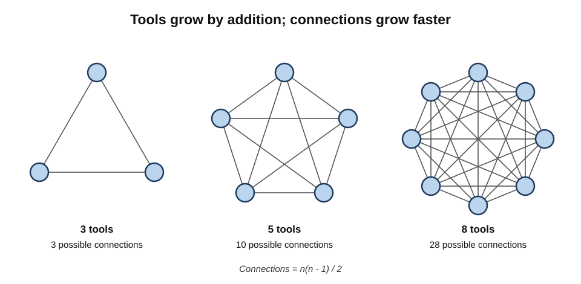
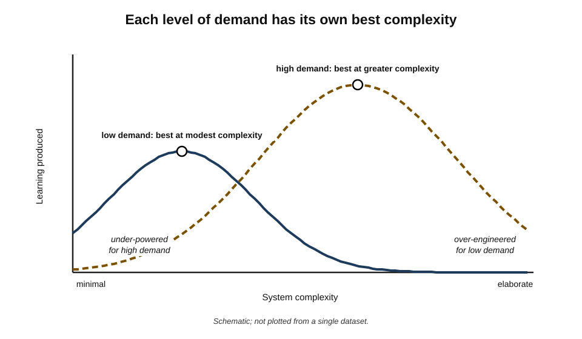
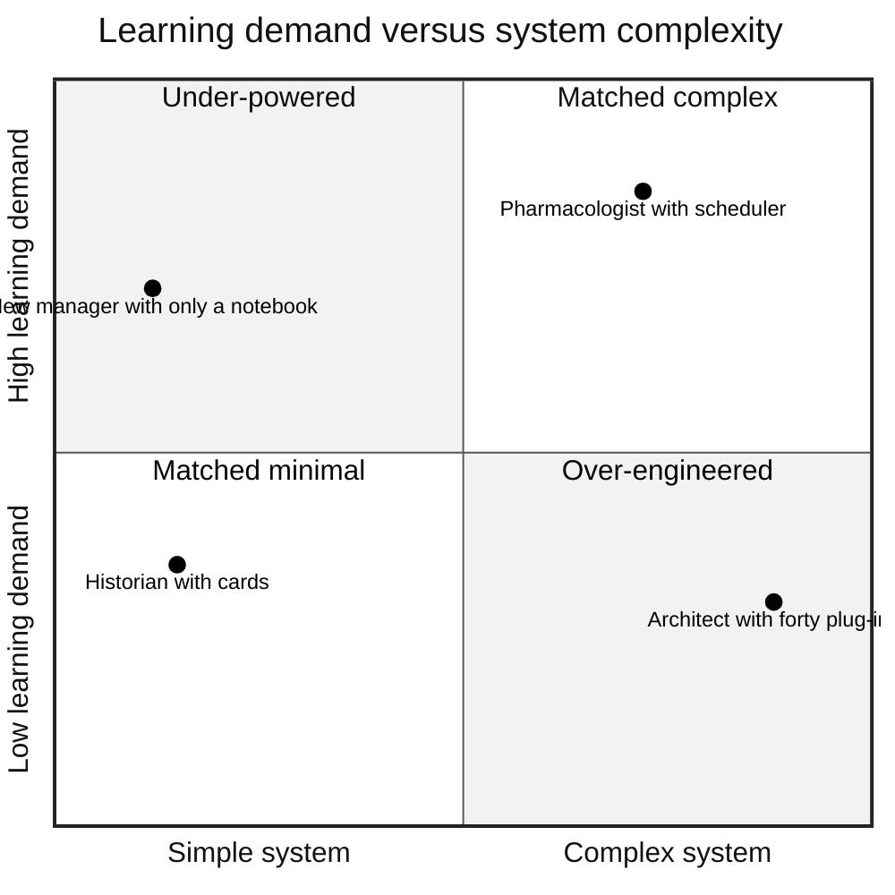
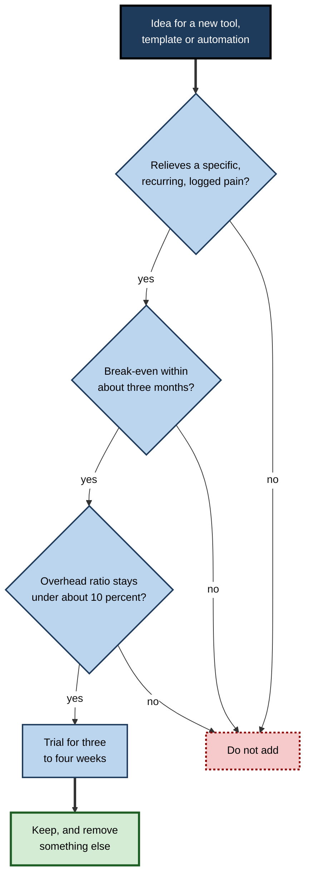

# H.9. Minimalist vs. Complex Learning Systems

One historian works with a paper notebook, index cards and a wall calendar, and publishes a well-regarded book every few years. A software architect runs a linked-notes graph with forty plug-ins and spends more time tending the system than learning with it. A clinical pharmacologist must keep thousands of drug interactions at her fingertips and needs a carefully configured toolset. The question is never "simple or complex?" but "**how much complexity does this learning demand, and how much is self-inflicted?**"

> **Definition — System complexity:** the number of tools, artefact types, rules and interconnections a learner must operate and maintain in a learning system, together with the effort required to keep them working.

> **Definition — Minimalist learning system:** the smallest set of tools and practices that still closes every loop — inputs to processing to practice, review, output and reflection.

**Why it matters**

- **Complexity has a running cost.** Every tool, rule and link must be maintained; the cost is paid in time taken from learning.
- **Too little structure also fails.** A learner managing large volumes of knowledge, several fields or collaborative work can drown without adequate machinery.
- **Complexity tends to grow by itself.** Each addition looks small and sensible; the total rarely gets reviewed.
- **The right level changes** with role, volume and expertise.

---

## What Complexity Is

### Dimensions of complexity

- **Tools** — how many separate applications, notebooks and services.
- **Artefact types** — notes, cards, highlights, drafts, tasks, logs, dashboards.
- **Rules and templates** — naming conventions, tagging schemes, required fields, processing steps.
- **Interconnections** — links, syncs and automations between tools.
- **Maintenance frequency** — how often the system needs attention merely to keep working.
- **Operating load** — how much the learner must remember about how the system works.

### How interconnections multiply

> **Formula — Possible pairwise connections:** n(n − 1) ÷ 2, for *n* tools. Example: 3 tools → 3 possible connections; 5 tools → 10; 8 tools → **28**. Each connection is a potential hand-off to define, sync or break.

- Adding tools increases possible connections **faster than** it increases tools — one reason complex systems become fragile.

**Figure 1.** Possible connections among three, five and eight tools.

### Essential and accidental complexity

**Fred Brooks, "No Silver Bullet" (1986)**

- The computer scientist Fred Brooks distinguished two kinds of complexity in software:
  - **essential complexity** — inherent in the problem being solved;
  - **accidental complexity** — introduced by the tools and methods chosen.
- Only accidental complexity can be removed by better tools; essential complexity must be handled.

> **Definition — Essential complexity:** the complexity inherent in what must be learned and managed.

> **Definition — Accidental complexity:** complexity added by the way the system is built, which could be removed without loss.

> **Example (illustrative):** a pharmacologist's need to retain thousands of interactions is **essential**; three overlapping tag systems in her notes are **accidental**.

| Learner | Essential complexity | Typical accidental complexity | Remedy |
|---|---|---|---|
| Hospital pharmacist | Thousands of drugs, doses and interactions | Duplicate notes in three apps | One reference store plus one review queue |
| Doctoral researcher | Hundreds of sources to cite and synthesise | Overlapping tag schemes; unused templates | Reference manager plus simple linked notes |
| Language learner | Thousands of words and forms; listening practice | Five vocabulary apps with separate decks | One scheduler; one listening routine |
| New manager | Judgement about people and organisation | Elaborate dashboards of reading statistics | Notebook for reflection; mentor conversations |
| Software engineer | Fast-changing tools; deep concepts | Automations syncing every highlight to every tool | Plain-text notes; sandbox projects |

### Complexity is conserved, not abolished

- The interface designer **Larry Tesler** is credited with the **law of conservation of complexity**: every task has an irreducible amount of complexity; the only question is **who handles it** — the user or the system.
- **Applied to learning:** a minimalist system does not remove the complexity of a demanding field; it moves it into the learner's head and habits. A complex system moves some of it into tools — at the price of maintaining them.

> **Key point:** the aim is to **remove accidental complexity** and to **place essential complexity** where it is cheapest to handle — sometimes in tools, often in simple habits.

---

## The Case for Minimalism

### Lower overhead, fewer failures

- **Less maintenance** — fewer tools to update, sync and configure.
- **Fewer failure points** — fewer connections to break.
- **Easier restarts** — after illness, travel or a busy season, a simple system can be resumed in minutes.
- **Portability** — few tools, ideally in open formats, move easily between jobs and devices.
- **Less temptation to tinker** — fewer settings to adjust.
- **Lower operating load** — the learner's attention goes to the material, not the machinery.

> **Formula — Overhead ratio:** time spent operating and maintaining the system ÷ total learning time. Example: 40 minutes of tagging, configuring and syncing in a 5-hour learning week → 40 ÷ 300 ≈ **13%**.

> **Remember:** a common working ceiling is an overhead ratio of about **10%**. Beyond that, the system is consuming a meaningful share of the learning it exists to support.

### Gall's law

- In *Systemantics* (1975), the paediatrician and systems writer **John Gall** observed: "A complex system that works is invariably found to have evolved from a simple system that worked."
- He added the converse: a complex system designed from scratch **never works** and cannot be patched to make it work; one must start again with a working simple system.

> **Watch out:** Gall wrote partly in a humorous register, and his "law" is an observation, not a tested finding. Its practical lesson — **start simple and grow only what proves useful** — is nonetheless widely confirmed by experience in software and organisational design.

### The cost of choices inside a system

**Study card — Sheena Iyengar and Mark Lepper (2000)**

- **Design:** shoppers in a supermarket encountered a tasting display of either **6** or **24** jams.
- **Results:** the larger display attracted more visitors, but a much smaller proportion of visitors to it bought jam.
- **Conclusion:** more options can reduce the likelihood of choosing at all — **choice overload**.

> **Watch out:** later research complicates this. A meta-analysis by Benjamin Scheibehenne, Rainer Greifeneder and Peter Todd (2010) found the average effect of choice overload across studies to be **close to zero**, with large variation. A later meta-analysis by Alexander Chernev, Ulf Böckenholt and Joseph Goodman (2015) identified when it appears: with complex choice sets, difficult decisions, uncertain preferences and a goal of choosing the single best option. Choice overload is **conditional**, not universal.

- **Relevance to learning systems:** the conditions identified for choice overload — many similar options, unclear preferences, a wish to choose "correctly" — describe exactly the situation of choosing among fifteen tags, six templates or four places to file a note.

### Decision time grows with the number of options

> **Formula — Hick–Hyman law (William Hick, 1952; Ray Hyman, 1953):** reaction time ≈ a + b × log₂(n + 1), where *n* is the number of equally likely choices. Example: with b = 0.2 seconds, going from 3 filing choices (log₂4 = 2) to 15 (log₂16 = 4) adds about **0.4 seconds per decision** — and far more in practice, because filing decisions are not simple reactions but judgements.

- The law was established for simple choice reactions; the broader point — that each additional option adds decision cost — is what matters for system design.

> **Key point:** minimalism is valuable not only because it saves maintenance time, but because it removes **micro-decisions** that interrupt learning many times a day.

---

## The Case for Complexity

### Requisite variety

**W. Ross Ashby, *An Introduction to Cybernetics* (1956): the law of requisite variety**

- A regulator — anything that keeps a system on course — must be able to produce **at least as much variety** in its responses as the disturbances it faces.
- **Applied to learning:** a learner facing high variety — many domains, enormous volumes, collaborative work, regulatory evidence — needs a system with enough variety in its components and routines to cope.

> **Definition — Requisite variety:** the principle that a controlling system needs at least as many distinct responses as the situations it must handle.

### When complexity pays

- **High volume of facts to retain** — medicine, pharmacy, law, languages.
  - A dedicated spaced-repetition scheduler handles thousands of items more reliably than any manual system.
- **Long-horizon research and synthesis** — doctoral work, policy analysis, book writing.
  - A reference manager and linked notes allow sources to be found, cited and combined across years.
- **Several fields at once** — a consultant serving many sectors; an engineer spanning hardware and software.
- **Collaboration** — shared knowledge bases, version control, team review.
- **Evidence requirements** — regulated professions requiring portfolios, logs and reflective records.
- **High output volume** — writers, educators and analysts producing frequent material benefit from reusable components.

### Automation economics

> **Formula — Break-even time for an automation or extra tool:** setup time ÷ (time saved per week − added maintenance per week). Example: setup 6 hours (360 minutes); saves 60 minutes a week; adds 15 minutes of maintenance → 360 ÷ (60 − 15) = **8 weeks** to break even.

- If the saving is small or the hand-off rare, the break-even point may never arrive.
- Automations that break silently can cost more than they save, because losses go unnoticed.

> **In practice:** add complexity where a **specific, recurring, measured pain** exists and the break-even point is short; never add it because a feature might be useful someday.

---

## Comparing the Approaches

| | Minimalist system | Complex system |
|---|---|---|
| Typical tools | 2–4 | 6 or more, plus automations |
| Setup time | Hours | Days to weeks |
| Maintenance | Minutes a week | Often an hour or more a week |
| Handles large volumes | Poorly beyond a few hundred items | Well, if maintained |
| Retrieval of old material | Weak to moderate | Strong |
| Resilience to disruption | High — easy to restart | Lower — more parts to fail |
| Portability | High | Varies; often lower |
| Temptation to tinker | Low | High |
| Best suited to | Focused learning in one or two areas; busy lives; restarts | High-volume, multi-domain, research or team learning |
| Characteristic failure | Under-powered for real demand | Over-engineered; maintenance displaces learning |

**Figure 2.** Learning produced as system complexity rises, for low and high learning demands.

- **For any demand, there is a point beyond which extra complexity reduces learning** — maintenance and decisions displace the work.
- **Higher demand moves the optimum to the right** — more complexity is worth carrying.
- **Both errors are common:** under-powered systems in demanding roles and over-engineered systems in simple ones.

**Figure 3.** Matching system complexity to learning demand.

---

## Three Archetypes

**Figure 4.** Three archetypal learning systems, from minimal to complex.

```mermaid
%%{init: {'theme':'base','themeVariables':{'fontFamily':'Arial, Helvetica, sans-serif','fontSize':'15px','primaryColor':'#FFFFFF','primaryTextColor':'#111111','primaryBorderColor':'#222222','lineColor':'#333333','secondaryColor':'#F2F2F2','tertiaryColor':'#FFFFFF','clusterBkg':'#FAFAFA','clusterBorder':'#555555','edgeLabelBackground':'#FFFFFF','titleColor':'#111111'}}}%%
flowchart TD
    classDef key     fill:#BCD5EE,stroke:#1F3B5C,stroke-width:2px,color:#000000
    classDef detail  fill:#FFFFFF,stroke:#333333,stroke-width:1.5px,color:#000000
    classDef accent  fill:#FFE6A8,stroke:#7A5200,stroke-width:2px,stroke-dasharray:8 4,color:#000000

    subgraph MIN["Minimal"]
        M1["Notebook"] --> M2["Index cards<br/>in review boxes"] --> M3["Calendar"]
    end
    subgraph MOD["Moderate"]
        D1["Plain-text notes<br/>with one inbox"] --> D2["Spaced-repetition app"] --> D3["Calendar<br/>and work editor"]
    end
    subgraph CPX["Complex"]
        C1["Reference manager"] --> C2["Linked notes graph"]
        C2 --> C3["Spaced repetition"]
        C2 --> C4["Task and project manager"]
        C5["Automations<br/>and dashboards"] -.-> C2
    end

    class M1,M2,M3 detail
    class D1,D2,D3 key
    class C1,C2,C3,C4 accent
    class C5 accent
```

### The minimal system

- **Parts:** a notebook for capture and processing; index cards with questions, sorted into boxes by how well they are known; a calendar marking sessions and outputs.
- **Suits:** focused learning in one area; people who think on paper; busy seasons; restarts after a lapse.
- **Strength:** almost no overhead; robust.
- **Limit:** retrieval beyond a few hundred items; reuse in digital outputs.

### The moderate system

- **Parts:** plain-text notes in one synchronised folder with an inbox file; a spaced-repetition app; the calendar; the normal work editor for outputs.
- **Suits:** most knowledge workers learning steadily across one to three areas.
- **Strength:** search, portability and automated review with modest maintenance.
- **Limit:** less suited to large research literatures or team knowledge.

### The complex system

- **Parts:** a reference manager for sources; a linked-notes graph; spaced repetition; a task and project manager; automations moving highlights and tasks; dashboards.
- **Suits:** researchers, writers, multi-domain consultants and people under formal evidence requirements.
- **Strength:** handles volume, variety and long horizons.
- **Limit:** high maintenance, fragility, and the constant temptation to improve the system rather than use it.

---

## Tinkering: When the System Becomes the Hobby

- **Meta-work** — work about work: configuring, reorganising, comparing tools, watching videos about systems.
- **Why it is tempting:**
  - it produces visible, satisfying progress;
  - it avoids the discomfort of hard learning;
  - online communities reward elaborate set-ups with admiration.
- **Warning signs:**
  - the overhead ratio is rising;
  - more time is spent reading about systems than using one;
  - reorganisation recurs every few months;
  - outputs have not increased despite system improvements.

> **Definition — Meta-work:** activity spent organising and improving the means of doing work rather than doing the work itself.

> **Watch out:** elaborate published set-ups suffer from **survivorship and selection bias** — they are shown by people for whom the system has become an interest in itself, and rarely by those whose elaborate systems collapsed. Their visibility is not evidence of their value.

> **Key point:** an hour spent improving the system is justified only if it saves more than an hour of future overhead, or produces more learning than an hour of studying would have.

---

## Choosing the Level

### The procedure

1. **Start minimal** — the smallest set that closes every loop.
2. **Run it for a month**, keeping a log of friction.
3. **Identify a specific, recurring pain** — "I cannot find sources I read last year", "I cannot keep up with 2,000 drug names by hand".
4. **Propose the smallest addition** that relieves that pain.
5. **Estimate break-even** and maintenance cost.
6. **Trial it** for three to four weeks.
7. **Keep it only if** the pain is relieved and the overhead ratio stays within budget.
8. **One in, one out** — when adding a component, look for one to remove.

**Figure 5.** Deciding whether to add a component to a learning system.

### A complexity budget

- **Time budget:** maintenance under about 10% of learning time.
- **Tool budget:** a ceiling on the number of tools (for many people, five).
- **Rule budget:** a small number of templates and tags, reviewed quarterly.
- **Automation budget:** only automations whose failure would be noticed quickly.

> **Remember:** **start simple, add only for logged pain, check break-even, keep within budget, remove as you add.**

### Matching a pain to the smallest addition

| Logged pain | Smallest addition that may relieve it | What not to add yet |
|---|---|---|
| Cannot find sources read months ago | A reference manager or a single sources file with consistent names | A full linked-notes graph |
| Forgetting facts needed weekly | A spaced-repetition app with a few hundred focused items | Several decks across apps |
| Notes never reused in outputs | A weekly output session and links from outputs to notes | Automations or new note types |
| Losing track of what to study next | A short list of current topics at the top of the notes | A project-management system |
| Captures scattered across devices | One inbox reachable from every device | Clippers for every source type |

### Diagnosing which error is present

| | Under-powered system | Over-engineered system |
|---|---|---|
| Typical feeling | "I keep losing things and forgetting" | "I spend my time maintaining the system" |
| Overhead ratio | Very low | Above about 10% |
| Retrieval | Slow or failing | Fast, but rarely needed |
| Outputs | Limited by lost material | Limited by time spent on upkeep |
| Remedy | Add the smallest component for the logged pain | Remove accidental complexity; set a budget |

---

## Worked Example (illustrative): Should a Researcher Automate Highlight Import?

A health-economics researcher reads about **30 papers a month**, highlighting each. She currently copies highlights by hand into her notes, taking about **8 minutes a paper**. An automation would import highlights directly.

**Step 1 — time saved:**

- Manual: 30 × 8 = 240 minutes a month ≈ **60 minutes a week**.
- With automation, she still reviews imports: about 2 minutes a paper → 30 × 2 = 60 minutes a month ≈ 15 minutes a week.
- **Saving:** about **45 minutes a week**.

**Step 2 — costs:**

- **Setup:** 5 hours (300 minutes), including testing.
- **Maintenance:** about 10 minutes a week fixing failures and updates.

> **Formula — Break-even:** 300 ÷ (45 − 10) ≈ **8.6 weeks**.

**Step 3 — overhead check:** her learning week is about 6 hours (360 minutes). Current maintenance is 20 minutes; adding 10 → 30 ÷ 360 ≈ **8%**, within budget.

**Step 4 — learning check:** manual copying had one benefit — it was a moment of re-reading. She replaces it with a deliberate step: for each imported paper, write two sentences in her own words.

**Step 5 — decision:** adopt the automation, remove an unused tagging template (one in, one out), and review after a month.

> **Watch out:** if she read only five papers a month, the saving would be about 8 minutes a week; after maintenance, break-even would never arrive. The **same automation** is sensible at one volume and wasteful at another.

---

## Case Study (illustrative): The Doctoral Researcher Who Simplified

### Case study (illustrative): from forty plug-ins to four tools

- **Situation:** a second-year doctoral student in sociology, studying migration and labour markets.
- **Problem:** her linked-notes system had grown to forty plug-ins, a dozen templates, three tagging schemes and several automations; she spent an estimated **six hours a week** on maintenance and reorganisation; her literature review was a year behind schedule.
- **Diagnosis:**
  1. **Overhead ratio** about 6 ÷ 15 = **40%** of her study time.
  2. Most complexity was **accidental**: overlapping schemes, unused templates, automations built for hypothetical needs.
  3. Some complexity was **essential**: hundreds of sources needed reliable citation and retrieval.
  4. She had followed elaborate online set-ups rather than her own logged needs.
- **Actions:**
  1. Kept a **reference manager** (essential: sources and citations).
  2. Collapsed her notes into **one plain-text folder** with one note per source and one per concept, with simple links.
  3. Removed all but three plug-ins, all but two templates and all automations.
  4. Set a **complexity budget**: maintenance under 1.5 hours a week; no new tools for a year.
  5. Replaced reorganisation time with a **weekly writing session** drafting the literature review from her notes.
- **Result:** maintenance fell to about one hour a week; she drafted the literature review in four months; her supervisor described the chapters as the clearest she had produced.
- **Side effects:** she missed some automatic connections the graph had shown, and occasionally searched longer for a note; she judged the trade worthwhile.
- **Lesson:** the system was not too complex for the **work** — research does need some complexity — but far too complex for the **essential** demands. Removing accidental complexity returned time to learning and writing.

> **Example (illustrative) — the opposite case:** a clinical pharmacologist began with a notebook and found she could not retain the thousands of interactions her work demanded. Adding a spaced-repetition scheduler and a structured reference database — a move from minimal to moderate complexity — reduced her look-up errors. Her demand had **requisite variety** that a notebook could not meet.

---

## Simplicity as a Professional Value

- **Engineering** — "keep it simple" principles warn against unnecessary components because each adds failure modes.
- **Design** — the designer Dieter Rams's principle of "as little design as possible" favours removing the inessential.
- **Science** — the principle of parsimony, often called **Occam's razor**, prefers the simplest explanation that fits the evidence.
- **Learning systems** — the same discipline applies: every component must earn its place by the learning it enables.

> **In practice:** many highly productive experts describe remarkably plain systems. Their sophistication lies not in their tools but in **what they do** with them — deep processing, demanding practice and steady output.

---

## Open Questions

- **Is there an optimal complexity for a given learning demand?**
  - The inverted-U pattern is plausible and consistent with experience, but has not been measured for personal learning systems.
- **Do complex linked-note systems produce better thinking?**
  - Practitioners report serendipitous connections; controlled evidence is scarce.
- **How large is choice overload inside personal systems?**
  - Meta-analyses show choice overload is conditional; its size for filing and tagging decisions is unknown.
- **Why do people over-engineer?**
  - Explanations include enjoyment, procrastination, identity and social signalling; their relative weight is not established.
- **How will AI change the trade-off?**
  - AI may absorb accidental complexity — automatic organisation and retrieval — or add new layers of configuration and dependence.

---

## Summary

- **System complexity** is the number of tools, artefact types, rules and interconnections, plus the effort to maintain them; a **minimalist system** is the smallest set that closes every loop.
- Connections grow as **n(n − 1) ÷ 2**; complexity is **essential** (inherent in the demand) or **accidental** (added by design) — Brooks (1986); per **Tesler**, complexity is moved, not abolished.
- **Minimalism**: lower overhead, fewer failures, easy restarts, portability, little tinkering, fewer micro-decisions. Keep the **overhead ratio** under about 10%. **Gall's law**: working complex systems evolve from working simple ones.
- **Choice overload** (Iyengar and Lepper, 2000) is **conditional** — near-zero on average (Scheibehenne et al., 2010) but present under complex, uncertain choices (Chernev et al., 2015); the **Hick–Hyman law** shows decision cost rising with options.
- **Complexity pays** under **requisite variety** (Ashby, 1956): high fact volumes, long research horizons, several fields, collaboration, evidence requirements, high output.
- Judge additions by **break-even**: setup ÷ (time saved − added maintenance).
- Learning produced follows an **inverted U** with complexity; higher demand moves the optimum right.
- Archetypes: **minimal**, **moderate**, **complex** — each suited to different demands.
- Beware **meta-work** and elaborate published set-ups (survivorship and selection bias).
- Procedure: **start minimal, add only for logged pain, check break-even, keep within budget, one in, one out**.

---

## Self-Check

1. Define system complexity and a minimalist learning system.
2. How many possible pairwise connections exist among 6 tools? Why does this matter?
3. Distinguish essential and accidental complexity, with an example of each in a learning system.
4. What is the law of conservation of complexity, and how does it apply to minimalist systems?
5. List four advantages of minimalism.
6. Calculate the overhead ratio for 75 minutes of maintenance in an 8-hour learning week, and interpret it.
7. State Gall's law and its practical lesson, noting its status as evidence.
8. Summarise the jam study and what later meta-analyses found.
9. Explain the law of requisite variety and give two situations in which complexity pays.
10. Calculate break-even for an automation with 4 hours' setup, 30 minutes saved a week and 10 minutes' added maintenance.
11. Compare minimalist and complex systems on resilience, retrieval and maintenance.
12. What is meta-work, and what are its warning signs?
13. Describe the eight-step procedure for choosing the level of complexity.
14. A sales manager learning negotiation and finance uses nine tools, six automations and a dashboard, spending two hours a week on upkeep in a five-hour learning week. Diagnose and redesign.

### Answer Key

1. Complexity: the number of tools, artefact types, rules and interconnections a learner operates and maintains, plus the effort to keep them working. Minimalist system: the smallest set that still closes every loop.
2. 6 × 5 ÷ 2 = 15. Each is a potential hand-off to define, sync or break; connections grow faster than tools, making systems fragile.
3. Essential: inherent in the demand (retaining thousands of drug interactions). Accidental: added by design (three overlapping tag schemes).
4. Each task has irreducible complexity that is moved between user and system, not removed. Minimalist systems move essential complexity into the learner's habits; complex systems move some into tools at a maintenance cost.
5. Any four: less maintenance, fewer failure points, easier restarts, portability, less tinkering, lower operating load, fewer micro-decisions.
6. 75 ÷ 480 ≈ 15.6% — above the 10% ceiling; the system is consuming a meaningful share of learning time.
7. A complex system that works evolved from a simple system that worked; complex systems designed from scratch tend not to work. Lesson: start simple and grow what proves useful. It is an observation, not a tested finding.
8. Shoppers saw 6 or 24 jams; the larger display attracted more but far fewer bought. Scheibehenne et al. (2010) found an average effect near zero; Chernev et al. (2015) found overload under complex choice sets, difficult decisions, uncertain preferences and best-option goals.
9. A regulator needs at least as much response variety as the disturbances it faces. Complexity pays for high fact volumes (pharmacology, languages) and long-horizon research synthesis (doctoral work), among others.
10. 240 ÷ (30 − 10) = 12 weeks.
11. Minimalist: high resilience, weaker retrieval at volume, low maintenance. Complex: lower resilience, strong retrieval if maintained, high maintenance.
12. Work about work — configuring and reorganising rather than learning. Warning signs: rising overhead ratio; more reading about systems than using one; recurrent reorganisation; no increase in outputs.
13. Start minimal; run a month with a friction log; identify a specific recurring pain; propose the smallest addition; estimate break-even and maintenance; trial three to four weeks; keep only if it works within budget; one in, one out.
14. Overhead ratio 120 ÷ 300 = 40%; most complexity is accidental for a modest demand. Redesign: reduce to a moderate system — notes with one inbox, a review app, calendar; remove automations and dashboard; set a 10% budget; use freed time for practice negotiations and finance problems with a weekly output.

---

## Glossary

| Term | Meaning |
|---|---|
| Accidental complexity | Complexity added by the way a system is built, removable without loss. |
| Break-even time | Setup time divided by net weekly time saved. |
| Choice overload | Reduced likelihood or quality of choice when options are many, under certain conditions. |
| Complexity budget | Explicit limits on maintenance time, tools, rules and automations. |
| Essential complexity | Complexity inherent in what must be learned and managed. |
| Gall's law | The observation that working complex systems evolve from working simple ones. |
| Hick–Hyman law | Reaction time increases with the logarithm of the number of choices. |
| Law of conservation of complexity | Tesler's principle that complexity is moved between user and system, not eliminated. |
| Meta-work | Effort spent organising the means of work rather than doing the work. |
| Minimalist learning system | The smallest set of tools and practices that closes every loop. |
| Occam's razor | The principle of preferring the simplest adequate explanation. |
| Overhead ratio | System maintenance time divided by total learning time. |
| Requisite variety | Ashby's principle that a regulator needs as much variety as the situations it handles. |
| System complexity | The tools, artefact types, rules and connections a learner must operate and maintain. |
