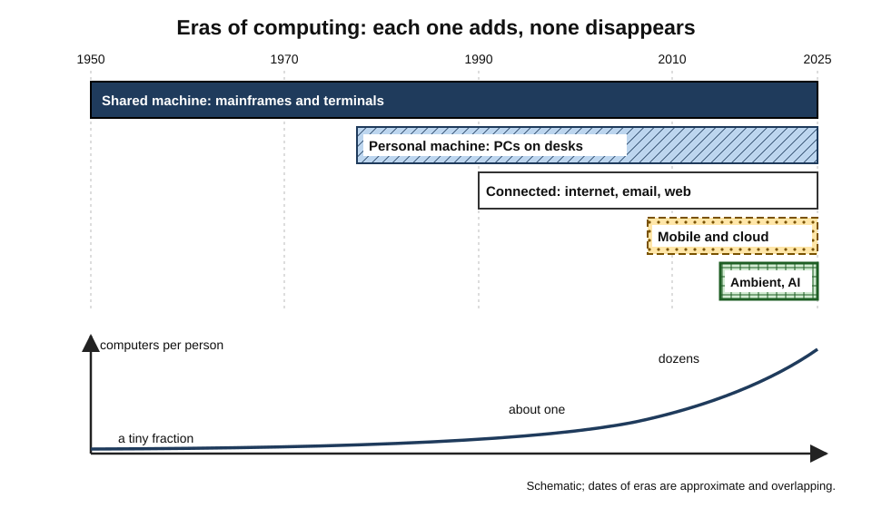
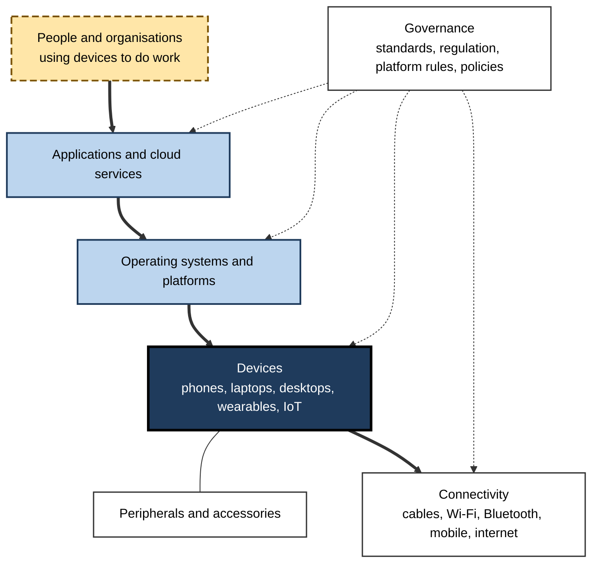
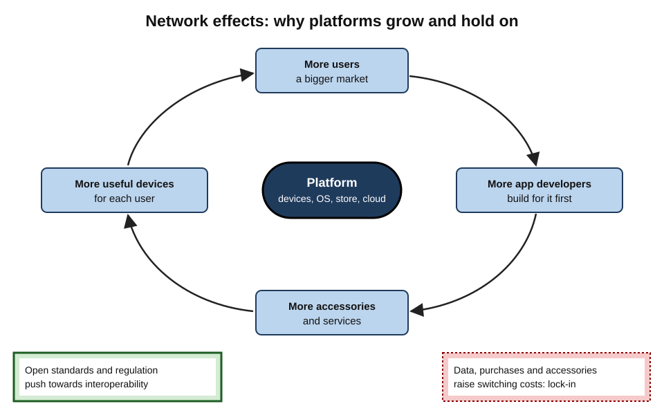
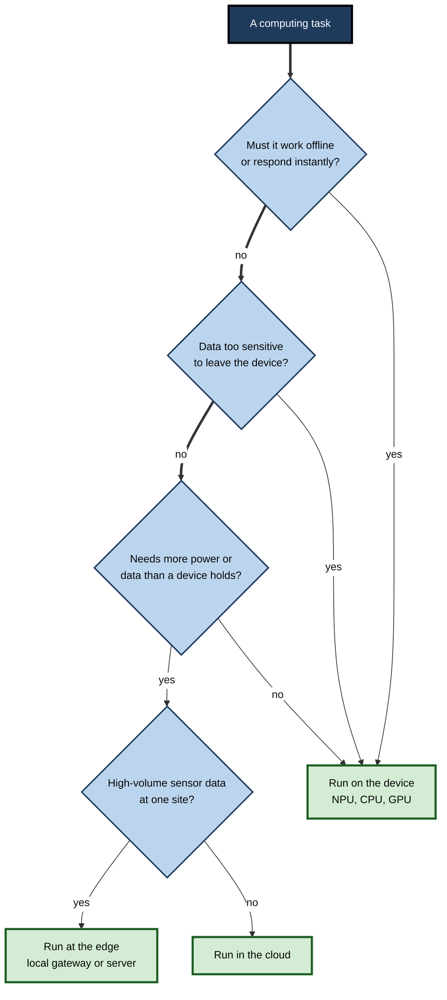
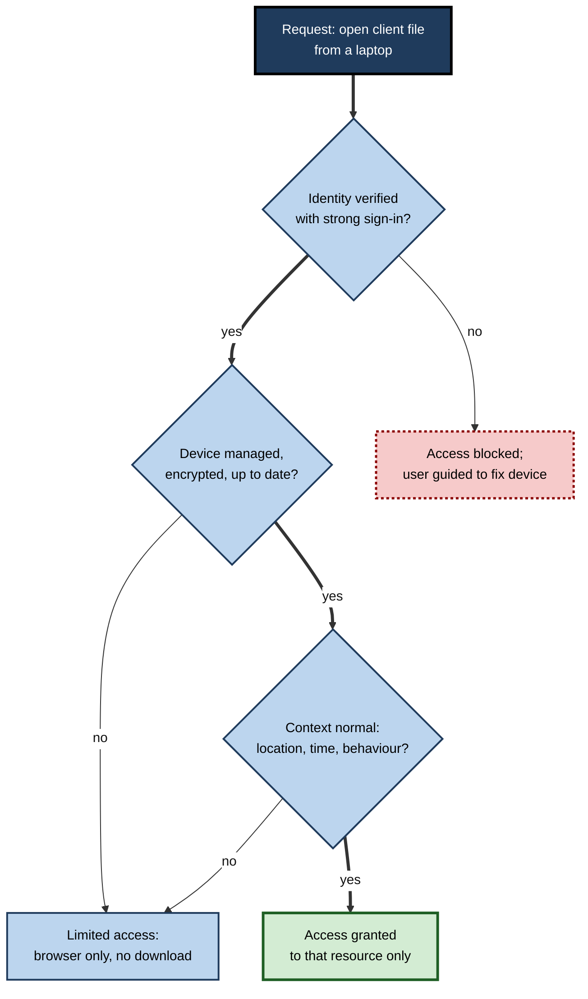
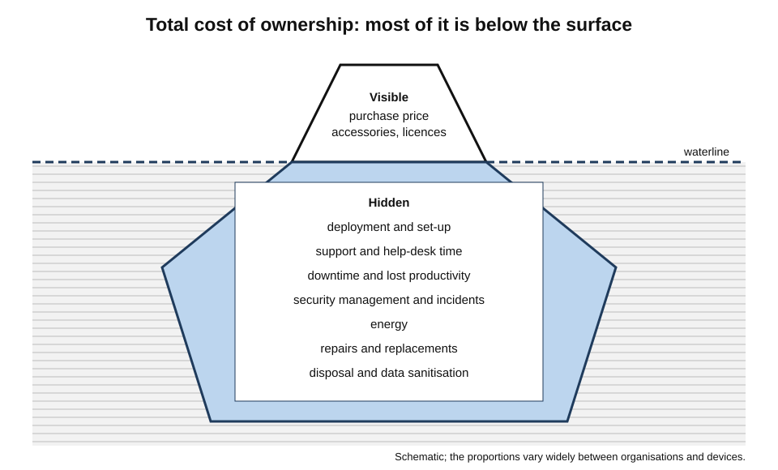

# A. Digital Devices & Computing Ecosystem

A sales director starts the day on her phone, approves an invoice from her watch on the train, drafts a proposal on a laptop docked at a hot desk, presents it on a meeting-room screen, and that evening asks a speaker in her kitchen to remind her of tomorrow's flight.

She has used six computers and never thought of any of them separately. What she experiences is not a set of devices but an **ecosystem** — devices, software, services, networks and standards woven together so tightly that the boundaries between them disappear.

> **Definition — Computing ecosystem:** the interdependent system of computing devices, operating systems, applications, cloud services, accessories, networks, standards and the organisations that make and govern them, within which any single device delivers its value.

**Why the ecosystem view matters**

- **Value is relational** — a phone without apps, a laptop without cloud services or a sensor without a network is worth little; devices are judged by what they connect to.
- **Choices compound** — choosing one device often commits a person or organisation to a platform, its services and its accessories for years.
- **Risk is shared** — the weakest connected device can expose all the others.
- **Professionals manage portfolios** — an organisation's laptops, phones, printers, sensors and cloud services must be planned, secured and retired as one estate.
- **Society is shaped by it** — who controls platforms, who has access to devices and what happens to them at end of life are economic, ethical and environmental questions.

---

## From Single Machines to Ecosystems

### The eras of computing

- **The shared machine (1950s–1970s)** — mainframes in air-conditioned rooms; users submitted jobs or worked at terminals; the computer was an institution's asset, run by specialists.
- **The personal machine (late 1970s–2000s)** — personal computers put a general-purpose computer on each desk; users installed their own software; networks connected offices.
- **The connected machine (1990s–2000s)** — the internet linked personal computers to one another and to servers worldwide; email and the web became core work tools.
- **The mobile and cloud era (2007 onward)** — smartphones and tablets, always connected, with software from app stores and data held in cloud services; the personal computer became one device among several.
- **The ambient and intelligent era (2015 onward)** — wearables, smart speakers, connected buildings and vehicles; and from the 2020s, **on-device AI** in phones and laptops working alongside AI in the cloud.

**Figure 1.** From one computer for many people to many computers for each person.

> **Key point:** each era added devices rather than replacing them. Mainframes still process bank transactions; desktops still run laboratories; phones did not abolish laptops. The modern ecosystem is **layered history**.

### What a computing device is, in one sentence

- Every device in the ecosystem — server, laptop, phone, watch or thermostat — **takes input, processes it according to stored instructions, stores data, produces output and communicates**; what differs is scale, form and purpose.
- Devices also share an anatomy of **hardware components** — processors, memory, storage, power and cooling — whose balance decides what each can do.

---

## The Anatomy of the Ecosystem

### Six layers

- **Devices** — the endpoints people use and the embedded devices that sense and act.
- **Peripherals and accessories** — screens, keyboards, headsets, docks, chargers and specialised tools that extend devices.
- **Operating systems and platforms** — the software foundation that manages hardware and hosts applications; a subject in its own right.
- **Applications and services** — locally installed software and cloud services, increasingly the same thing seen from different sides.
- **Connectivity** — cables, Wi-Fi, Bluetooth, mobile networks and the internet that link everything.
- **Governance** — standards bodies, regulators, platform owners, employers and users who set the rules.

**Figure 2.** The layers of a computing ecosystem.

### The device families

| Family | Typical role in the ecosystem | Typical number per professional | Main management concern |
|---|---|---|---|
| Servers and cloud | Host shared data and services | Shared by thousands | Availability, security, cost |
| Desktops | Fixed, heavy or shared work | 0–1 | Energy, refresh, ergonomics |
| Laptops and workstations | Main production device | 1 | Security on the move, TCO |
| Smartphones and tablets | Communication, authentication, frontline work | 1–2 | Updates, ownership model, loss |
| Wearables | Sensing, notifications, safety | 0–2 | Health data, privacy |
| Smart home and IoT | Sensing and control of spaces and machines | Dozens, mostly unseen | Inventory, security, support life |

> **Watch out:** the family that receives least attention — embedded and IoT devices — is the largest by number and often the least secure. Ecosystem thinking starts with **knowing what is there**.

---

## How Ecosystems Work: Platforms, Standards and Lock-in

### Platforms and network effects

- A **platform** brings together groups who benefit from one another — device users, app developers, accessory makers, service providers.
- **Network effects** — each additional user makes the platform more attractive to developers, and each additional app makes it more attractive to users.
- **Complementary products** — accessories, apps and services that work best within one platform reinforce its pull.
- The result: markets for operating systems and app stores tend towards **a few dominant platforms**.

> **Definition — Network effect:** the increase in a product's value to each user as more people use it, or as more complementary products are built for it.

> **Definition — Platform:** a technology on which other parties build products and services — such as a mobile operating system with its app store — linking users, developers and suppliers.

**Figure 3.** The self-reinforcing loop of a device platform.

### Lock-in and switching costs

- **Data** — photos, messages, notes and settings stored in a platform's cloud.
- **Purchases** — apps, media and subscriptions that do not transfer.
- **Accessories** — watches, earbuds and chargers designed for one platform.
- **Skills and habits** — users and support staff trained on one system.
- **Integration** — organisational systems built around one vendor's management and identity tools.

> **Definition — Switching cost:** the money, time, effort and risk involved in moving from one product or platform to another.

> **Key point:** lock-in is not inherently bad — integrated ecosystems often deliver **better security, simplicity and seamless hand-over** between devices. The risk lies in losing **bargaining power and choice** without noticing.

### Open and closed ecosystems

- **More integrated (closed)** — one company controls hardware, operating system, store and key services.
  - Strengths: consistency, tight security integration, polished experience.
  - Weaknesses: less choice, platform rules and fees set by one company.
- **More open** — operating system licensed to many hardware makers; alternative stores or software sources possible.
  - Strengths: variety of devices and prices, competition among manufacturers.
  - Weaknesses: fragmentation of updates and quality; more variable security.
- **Open standards** cut across both — USB-C, Wi-Fi, Bluetooth, Matter, web standards — letting devices from different ecosystems work together.

| | More integrated ecosystem | More open ecosystem |
|---|---|---|
| Who makes the devices | Mainly one company | Many manufacturers |
| Software sources | Mainly the platform's store | Store plus other sources |
| Update consistency | High | Varies by manufacturer |
| Device choice and price range | Narrower | Wider |
| Switching away | Harder | Easier, though still costly |
| Typical strength | Seamlessness and integration | Choice and competition |

> **Watch out:** "open" and "closed" are positions on a spectrum, not two boxes. Each major platform is open in some respects and closed in others, and regulation is moving all of them.

### Regulation of ecosystems

- **Competition law** — authorities have challenged app-store rules, default settings and bundling.
  - The **European Union's Digital Markets Act** (adopted 2022, obligations applying from 2024) designated the largest platforms as "gatekeepers" with duties such as allowing alternative app stores and payment options and enabling interoperability.
- **Product rules** — EU requirements for common USB-C chargers, longer software support and repairability for phones and tablets, and replaceable batteries in coming years.
- **Security rules** — minimum security for connected products, such as the United Kingdom's regime in force from 2024 and the EU Cyber Resilience Act phasing in towards 2027.

> **Definition — Gatekeeper (Digital Markets Act):** a large platform designated under EU law as controlling an important gateway between businesses and consumers, and therefore subject to specific obligations on fairness and interoperability.

---

## Lessons from Ecosystem Contests

### The open PC architecture

- **1981** — IBM built its Personal Computer largely from parts supplied by others, with a processor from Intel and an operating system licensed from Microsoft, and published much of its technical design.
- **Consequence** — other manufacturers produced compatible machines; the "PC-compatible" standard grew far beyond IBM's control.
- **Who captured the value** — the companies controlling the scarce layers, the **processor** and the **operating system**, rather than the assembler of the box.
- **Lesson** — in an ecosystem, power tends to sit with whoever controls the layer that others must build on.

### The smartphone turn

- **Before 2007** — leading handset makers such as Nokia and BlackBerry dominated with excellent hardware, battery life and, for BlackBerry, secure email much loved by organisations.
- **After 2007–2008** — platforms with large app stores and developer communities attracted users and developers in a self-reinforcing loop.
- **2011** — Nokia's chief executive, Stephen Elop, wrote an internal memo describing the company as standing on a "burning platform"; Nokia abandoned its own smartphone software for a partner's, and later sold its handset business.
- **BlackBerry** — lost most of its smartphone market share over the following years despite strong security and keyboards, and eventually stopped making its own phones.
- **Lesson** — **ecosystems beat devices**. A superior device on a platform without developers and complements loses to an adequate device in a thriving ecosystem.

> **Key point:** for buyers, the same logic applies in reverse — choosing a device on a declining platform risks losing apps, updates and accessories long before the hardware wears out.

### Standards that ended format wars

- **USB** replaced a confusion of serial, parallel and proprietary ports in the late 1990s.
- **Wi-Fi certification** let any certified laptop join any certified network.
- **USB-C and USB Power Delivery** — now reinforced by regulation — are replacing proprietary chargers.
- **Matter** aims to do the same for smart-home devices.

> **Remember:** when a market is fragmented, look for the **emerging open standard** — buying into it protects the value of accessories and devices across future platform changes.

---

## The Device–Cloud Continuum

### Where computation happens

- **On the device** — fast, private, works offline; limited by battery, heat and memory.
- **At the edge** — gateways and local servers near where data is produced.
- **In the cloud** — vast shared capacity, accessible anywhere; depends on networks and providers.
- **Most tasks are split** across these locations, and the split changes over time.

**Figure 4.** Choosing where a task should run.

### The pendulum of centralisation

- Computing has swung repeatedly between **central** and **local**:
  - mainframes (central) → personal computers (local) → web and cloud (central) → on-device AI (partly local again).
- **Drivers of each swing** — the cost of processing, the cost and speed of networks, security and control, privacy expectations and energy.

> **In practice:** a mature organisation decides deliberately which workloads belong on devices, which in its own data centres and which in public cloud services — revisiting the decision as costs and capabilities change, particularly for AI.

---

## Devices in Organisations: Endpoint Strategy

### What an endpoint strategy covers

- **Portfolio** — which device types and models are offered, for which roles.
- **Ownership** — corporate-owned, personally enabled, bring-your-own, shared devices.
- **Platforms** — which operating systems and ecosystems are supported.
- **Management** — how devices are enrolled, configured, updated, monitored and wiped.
- **Security** — encryption, identity, compliance checks, threat protection.
- **Lifecycle** — procurement, deployment, support, refresh and disposal.
- **Experience** — how well devices let people do their work.
- **Sustainability** — durability, repair, reuse and responsible disposal.

> **Definition — Endpoint strategy:** an organisation's plan for which devices people use, how those devices are provided, secured and supported, and how they are renewed and retired.

### Unified management and zero trust

- **Unified endpoint management (UEM)** — one set of tools to manage laptops, phones, tablets and some IoT devices, whatever their operating system.
- **Zero trust** — no device or user is trusted simply because it is inside the network; every access request is checked.
  - Described in the United States National Institute of Standards and Technology's zero trust architecture guidance (SP 800-207, 2020).
  - **Device posture** — whether the device is managed, encrypted, updated and free of detected threats — becomes part of every access decision.

> **Definition — Zero trust:** a security approach in which no user or device is trusted by default; access to each resource is granted only after verifying identity, device health and context, and is continually re-evaluated.

**Figure 5.** How device health shapes access under zero trust.

### Standardisation versus choice

- **Standardisation** — few models, one platform: cheaper support, simpler security, bulk pricing.
- **Choice** — staff choose among platforms and models: higher satisfaction and productivity for some roles, especially developers and creatives; more complex support.
- **The modern compromise** — a small catalogue across two or three platforms, all managed by the same tools to the same security baseline.

> **Watch out:** organisations sometimes cite large support-cost savings from one platform over another. Such figures often come from vendors or from the organisation's own early programmes, and depend heavily on context. Measure locally before generalising.

### Total cost of ownership

- **Visible costs** — purchase price, accessories, software licences.
- **Hidden costs** — deployment, support time, downtime, lost productivity from slow or failing devices, security incidents, energy, disposal.
- Studies and practitioner experience generally find the purchase price is **a minority** of lifetime cost for business devices, though the share varies widely.

**Figure 6.** The visible and hidden costs of a business device.

> **Formula — Total cost of ownership per year:** TCO per year = (purchase + deployment + accessories − resale) ÷ years of use + annual (support + software + energy + downtime + management). Comparing options on this basis, rather than on price, usually favours durable, well-managed devices.

### Refresh, renewal and the AI-PC question

- **Refresh cycles** — typically three to five years for laptops, longer for desktops and monitors; driven by battery wear, warranty, performance and **security support**.
- **Forced refreshes** — operating-system requirements can end the life of working hardware; the end of Windows 10 support in October 2025 was a large recent example.
- **The AI-PC era** — from 2024, laptops with neural processing units of at least 40 TOPS were marketed as a new class; analysts expected such machines to account for around half of PC shipments during 2026.
  - **Key questions for organisations** — which AI features staff will actually use; whether they run locally or in the cloud; whether existing devices should be replaced early to gain them, or simply as part of normal refresh.

> **Key point:** for most organisations, AI capability is best acquired **through the normal refresh cycle**, prioritising roles that will use local AI heavily, rather than by replacing working devices early.

---

## Using and Sustaining the Ecosystem Well

### The individual's responsibilities

- **Care** — maintaining devices, updating them, troubleshooting methodically and escalating well.
- **Security** — locking, encrypting and reporting loss; keeping work data within approved tools.
- **Respect** — for colleagues' privacy and attention in shared and connected spaces.
- **Sustainability** — keeping devices longer, repairing them and disposing of them responsibly.

### The organisation's responsibilities

- **Provide fit-for-purpose devices** and accessible alternatives.
- **Secure and support them** throughout their life.
- **Respect privacy** — monitoring proportionate, transparent and lawful.
- **Close the loop** — redeploy, refurbish and recycle; record sanitisation.

### The environmental reality

- Electronic waste reached about **62 million tonnes** worldwide in 2022, with only about **22%** documented as properly collected and recycled, according to the United Nations' Global E-waste Monitor 2024.
- For most personal devices, the **majority of lifetime emissions come from manufacturing**, so the strongest lever is **keeping devices in use longer**.

| Lever | Effect on cost | Effect on emissions and waste | Effect on security |
|---|---|---|---|
| Longer device life within support | Lower | Lower | Neutral if supported |
| Repair and battery replacement | Lower | Lower | Neutral |
| Refurbished devices for suitable roles | Lower | Lower | Depends on remaining support |
| Fewer, standardised models | Lower | Slightly lower | Better |
| Keeping unsupported devices | Lower short-term | Lower | Much worse |

> **Watch out:** extending device life is sustainable **only while security support lasts**. Beyond that point, the risk usually outweighs the benefit for any device handling sensitive data.

### Access and the digital divide

- Many people still lack a suitable device or connection. The International Telecommunication Union estimated that around **2.6 billion people** remained offline in 2024, overwhelmingly in lower-income regions.
- **Device type matters** — a phone-only internet user can communicate and pay, but writing a CV, completing coursework or doing office work is far harder without a larger screen and keyboard.
- **Affordability, skills and support** matter as much as hardware.

> **In practice:** refurbished-device donation schemes, device lending in libraries and schools, and accessible design narrow the gap — provided donated devices are wiped, supported and suitable for the recipients' needs.

---

## Case Study (illustrative): Rebuilding a Device Ecosystem After a Merger

- **Situation:** two engineering consultancies merged, creating a firm of 6,000 people with incompatible device estates — one standardised on a single laptop platform with tight management, the other a mixture of personally chosen laptops, unmanaged phones and ageing office printers.
- **Problems:**
  - two management systems, two identity systems and inconsistent security;
  - engineers in the second firm running specialist software on unsupported machines;
  - meeting rooms with different video systems; incompatible docks across offices;
  - no reliable inventory of IoT and building devices.
- **Actions:**
  1. **Inventory first** — discovered every connected device, including printers, cameras and building systems.
  2. **One identity and one management platform** covering laptops, phones and tablets across two operating systems.
  3. **A small catalogue** — standard laptop, performance laptop, workstation (local or cloud), a corporate phone option and BYOD with work profiles.
  4. **Zero-trust access** — device health checks before access to client data.
  5. **Common accessories** — one USB-C dock standard, certified headsets and one meeting-room system.
  6. **Lifecycle discipline** — condition-based refresh, battery replacement, certified disposal and refurbishment.
  7. **AI readiness** — new purchases specified with NPUs; heavy AI work directed to shared cloud workstations rather than individual machines.
- **Result:** within eighteen months, nearly all devices were managed and compliant; support calls fell; the firm passed client security audits it had previously struggled with; the number of device models fell sharply.
- **Side effects:** some staff in the second firm resented losing device choice; a defined exception process and the BYOD option eased the transition.
- **Lesson:** an ecosystem is managed as a **whole** — identity, devices, accessories, connectivity and lifecycle together. Optimising any part alone leaves gaps at the joins.

---

## Worked Example (illustrative): Choosing an Ecosystem for a New Organisation

**Situation:** a 120-person design and research charity is setting up from scratch. Staff include designers, researchers, fundraisers and field workers in two countries.

1. **Map the work**
   - Designers: graphics and video — powerful laptops with colour-accurate screens.
   - Researchers: documents, statistics, interviews — standard laptops; secure recording tools.
   - Fundraisers: email, CRM, calls — standard laptops and phones.
   - Field workers: data collection offline — rugged tablets or phones.
2. **Choose platforms** — allow two laptop platforms (designers prefer one; others the other), one phone platform for corporate phones, BYOD with work profiles.
3. **Choose services** — one cloud productivity suite with identity, storage and meetings that works across both platforms.
4. **Management and security** — one UEM tool, encryption and updates enforced, zero-trust access.
5. **Accessories** — USB-C standard throughout; one dock model; certified headsets.
6. **Lifecycle and sustainability** — four- to five-year laptop life with battery replacement; refurbished phones for field staff; supplier take-back.
7. **Review annually.**

| Decision | Option chosen | Main reason |
|---|---|---|
| Laptop platforms | Two, both centrally managed | Designers' tools and preferences; manageable |
| Phones | Corporate phones for field and senior staff; BYOD for others | Data sensitivity and cost |
| Cloud suite | One cross-platform suite | Works on every device; single identity |
| Accessories | USB-C everywhere | Interoperability across platforms |
| Refresh | Condition-based, 4–5 years | Cost and sustainability |

> **Watch out:** the most expensive mistake in a new organisation is letting device choices happen **one purchase at a time**. Early, deliberate ecosystem decisions are far cheaper than later consolidation.

---

## Device Literacy as a Professional Capability

### Three levels of competence

- **Confident user** — chooses suitable settings, keeps devices updated and secure, connects peripherals and networks, solves common problems methodically and asks for help with precise information.
- **Informed specifier** — reads specifications in relation to tasks, recognises bottlenecks, compares total cost of ownership, understands ownership models and data risks, and contributes sensibly to purchasing decisions.
- **Ecosystem steward** — designs and governs device portfolios, endpoint security, lifecycle and sustainability for a team or organisation, and anticipates shifts such as on-device AI, regulation and platform change.

| | Confident user | Informed specifier | Ecosystem steward |
|---|---|---|---|
| Typical question | "How do I connect this?" | "Which model suits this role?" | "What should our device estate look like in five years?" |
| Key knowledge | Settings, care, safety | Components, TCO, ownership models | Platforms, zero trust, lifecycle, regulation |
| Typical evidence used | Error messages, guides | Benchmarks, pilots, support data | Inventory, telemetry, cost and carbon data |
| Typical failure | Ignoring updates | Buying the biggest number | Optimising one layer and neglecting the joins |

> **In practice:** most professionals need to be confident users and, increasingly, informed specifiers — because they choose their own devices, set up home offices, advise clients and take part in technology decisions even outside IT roles.

---

## Open Questions

- **Will one device become the hub of personal computing again?**
  - Phones, laptops, glasses and AI assistants compete to be the primary interface; the balance may shift as on-device AI improves.
- **How open should ecosystems be?**
  - Regulators push for interoperability and choice; platform owners argue that control protects security and quality. The results of recent regulation are still being assessed.
- **Where will AI run?**
  - On devices, at the edge or in the cloud — the answer depends on model sizes, energy, privacy expectations and cost, and is changing rapidly.
- **Can device lives be doubled?**
  - Regulation, refurbishment and repair are lengthening lives; whether business models and software requirements will allow much longer support is uncertain.
- **How should employers balance device security with privacy?**
  - Zero trust relies on detailed device and behaviour data; the limits of acceptable workplace monitoring are contested and differ between jurisdictions.
- **How can the device divide be closed?**
  - Cheap phones have spread connectivity widely, but larger devices, skills and affordable data remain unevenly distributed.

---

## Summary

- A **computing ecosystem** is the interdependent system of devices, platforms, applications, cloud services, accessories, networks, standards and governance in which every device delivers its value.
- Computing has moved through eras — **shared, personal, connected, mobile and cloud, ambient and intelligent** — each adding devices rather than replacing them.
- Every device takes input, processes, stores, outputs and communicates; families differ in scale, form and purpose, from servers to embedded sensors.
- Ecosystems have **six layers**: devices, peripherals, operating systems and platforms, applications and services, connectivity and governance.
- **Platforms** grow through **network effects** and complements, producing **lock-in** and **switching costs**; integrated and open ecosystems trade seamlessness against choice; **open standards** let them interoperate.
- Regulation — the **Digital Markets Act**, common chargers, repairability and connected-product security — is reshaping ecosystems.
- Work is split along a **device–edge–cloud continuum**, and the pendulum between central and local computing keeps swinging, now with on-device AI.
- Organisations need an **endpoint strategy**: portfolio, ownership, platforms, **unified endpoint management**, **zero trust**, lifecycle, experience and sustainability, judged by **total cost of ownership**.
- AI-capable PCs are best adopted through **normal refresh**, prioritising heavy users.
- Responsible use covers care, security, respect and sustainability; e-waste and embodied emissions make **longer, supported device life** the strongest lever; device access remains unequal worldwide.

---

## Self-Check

1. Define a computing ecosystem and explain why a device's value depends on it.
2. Describe the eras of computing and explain why each added devices rather than replacing earlier ones.
3. Name the six layers of an ecosystem and give an example of each.
4. Explain network effects and how they lead to a few dominant platforms.
5. List four sources of switching costs and explain why lock-in is not always harmful.
6. Compare integrated and open ecosystems on three attributes.
7. What does the Digital Markets Act require of gatekeepers, in outline?
8. Decide where each task should run — device, edge or cloud — and justify: live captions in a meeting; analysis of vibration data from 500 machines in one factory; training a large AI model.
9. What does an endpoint strategy cover?
10. Explain zero trust and the role of device posture in it.
11. Using the TCO formula, explain why a more expensive device can be cheaper over its life.
12. How should an organisation approach AI PCs?
13. Why is extending device life sustainable only within security support?
14. A newly merged firm has two device estates. Outline the first five actions you would take and why.

### Answer Key

1. The interdependent system of devices, operating systems, applications, cloud services, accessories, networks, standards and governing organisations. A device's usefulness depends on the apps, services, networks and accessories it works with; isolated, it does little.
2. Shared mainframes; personal computers; connected PCs and the internet; mobile and cloud; ambient and intelligent devices with on-device AI. Earlier devices kept roles they did best (mainframes for transactions, desktops for fixed heavy work), so the ecosystem accumulated layers.
3. Devices (laptop); peripherals (dock); operating systems and platforms (a mobile OS with its store); applications and services (cloud office suite); connectivity (Wi-Fi); governance (EU common-charger rules, company policy).
4. Each extra user makes a platform more attractive to developers and accessory makers, whose products in turn attract more users. The self-reinforcing loop concentrates markets on a few platforms.
5. Data in platform clouds, purchased apps and media, accessories, skills and habits, integration with organisational systems. Integrated ecosystems can deliver better security and seamless use; the harm is reduced choice and bargaining power.
6. Device makers (one company versus many); update consistency (high versus variable); switching (harder versus easier); choice and price range (narrower versus wider).
7. Designated large platforms must meet obligations on fairness and interoperability, such as allowing alternative app stores and payment options and enabling interoperability with rival services.
8. Live captions: device (instant, private, NPU-efficient). Factory vibration: edge (high-volume local data; send summaries). Training a large model: cloud (needs massive compute).
9. Device portfolio, ownership models, platforms, management, security, lifecycle, user experience and sustainability.
10. No user or device is trusted by default; each access request is verified using identity, device health and context. Device posture — managed, encrypted, updated, threat-free — determines whether access is granted fully, limited or blocked.
11. TCO per year adds purchase and other one-off costs spread over years of use to annual support, downtime, energy and management. A durable, manageable device with lower support and downtime and longer life can cost less per year despite a higher price.
12. Identify which AI features staff will use and where they run; specify NPUs in normal refresh purchases; prioritise heavy users; avoid early replacement of working devices without a clear benefit.
13. Beyond security support, known vulnerabilities go unfixed; a device handling sensitive data then poses risks of breach that usually outweigh the environmental and cost benefits of keeping it.
14. Inventory every device including IoT; unify identity and device management; define a small catalogue; enforce baseline security with zero-trust access; standardise accessories and set lifecycle and disposal processes — because gaps at the joins between estates are where risk and cost concentrate.

---

## Glossary

| Term | Meaning |
|---|---|
| Ambient computing | Computing embedded in surroundings, used with little conscious effort. |
| Cloud computing | Computing resources delivered over a network on demand from providers' data centres. |
| Computing ecosystem | The interdependent system of devices, software, services, networks, standards and governance. |
| Device posture | A device's security state — managed, encrypted, updated, threat-free — used in access decisions. |
| Digital divide | Unequal access to devices, connectivity and skills. |
| Digital Markets Act | EU law imposing obligations on large designated platforms. |
| Edge computing | Processing data near where it is produced. |
| Endpoint | A device at the edge of a network used directly by people or processes. |
| Endpoint strategy | An organisation's plan for providing, securing, supporting and renewing devices. |
| Gatekeeper | A large platform designated under the Digital Markets Act. |
| Interoperability | The ability of products from different makers to work together. |
| Lock-in | Dependence on a platform that makes switching difficult. |
| Network effect | The rise in a product's value as more people or complements use it. |
| On-device AI | AI models running locally on a phone, laptop or other device. |
| Open standard | A publicly available specification any maker can implement. |
| Platform | A technology on which others build products and services. |
| Refresh cycle | The planned interval for replacing devices. |
| Switching cost | The cost and effort of moving to another product or platform. |
| Total cost of ownership | The full lifetime cost of a device. |
| Unified endpoint management | One set of tools for managing many kinds of device. |
| Zero trust | Security in which every access request is verified, with no default trust. |
