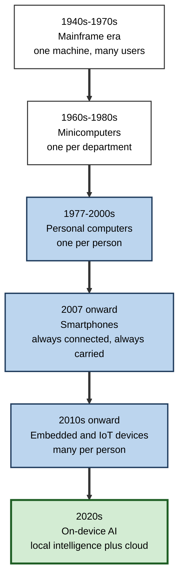
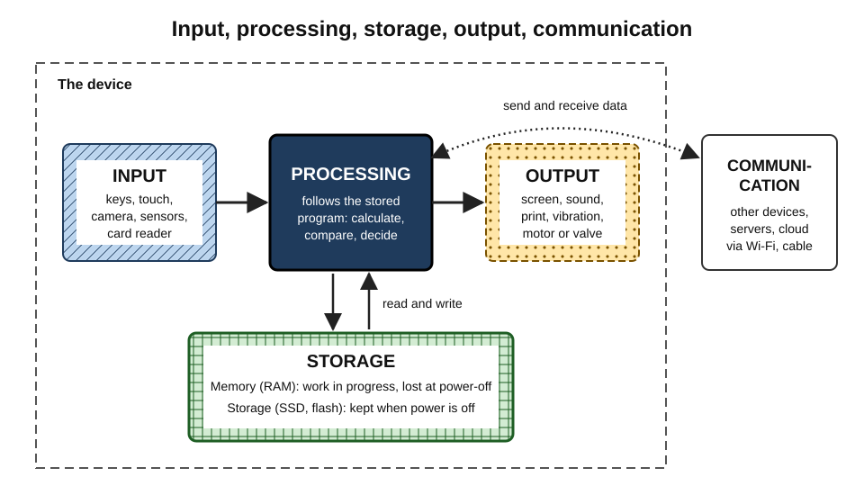
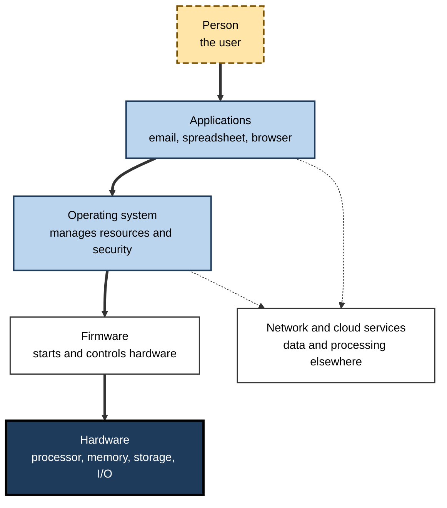
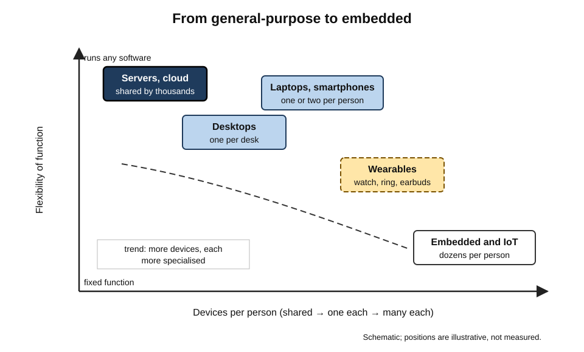
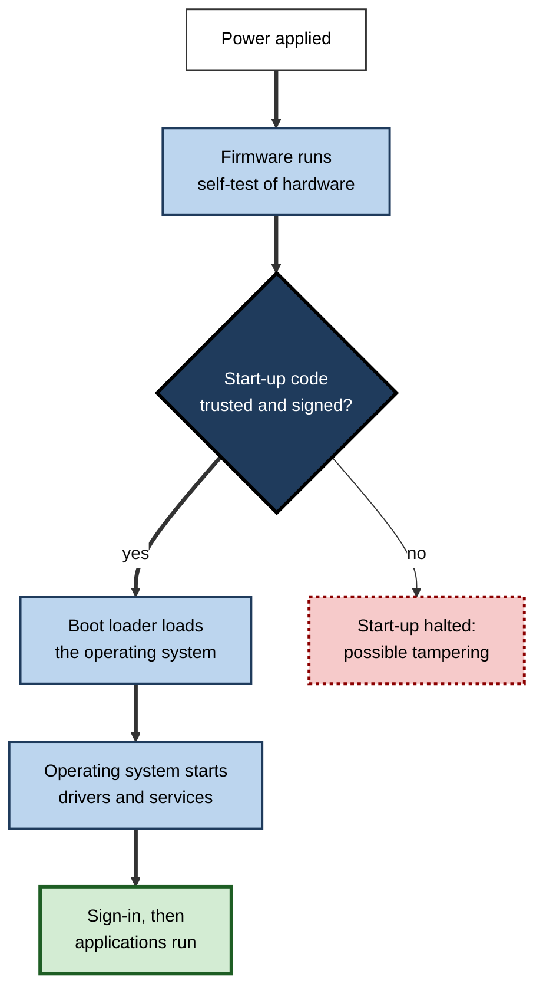

# B.1. What is a Computing Device?

A nurse scans a wristband before giving a drug. A delivery driver's phone recalculates a route around a closed road. A washing machine weighs the load and chooses how much water to use. An accountant's laptop reconciles ten thousand bank transactions in a second. None of these people would call all four objects "computers", yet each object does the same four things: it **takes in data, processes it according to stored instructions, keeps information, and produces a result**.

> **Definition — Computing device:** a machine that accepts data as input, processes it automatically according to a stored, changeable set of instructions (a program), stores data and instructions, and produces output — usually while communicating with other devices.

**Why the definition matters**

- It lets a person recognise a computer in disguise — in a car, a thermostat, a payment terminal or a hearing aid — and therefore recognise where data is collected, where failures can occur and where security matters.
- It explains why very different devices share the same weaknesses: anything programmable can be misprogrammed, updated, attacked or abandoned by its maker.
- It gives buyers, managers and auditors a common vocabulary for comparing a phone, a laptop and a factory sensor.
- It underpins every later decision about devices in an organisation: what to buy, how to secure it, how long to keep it and how to dispose of it.

---

## From Calculating Machine to Computing Device

The idea of a machine that follows instructions is older than electricity. What changed over two centuries was not the idea but its **speed, size, cost and reach**.

### Before electronics

- **Mechanical calculators** — Blaise Pascal's adding machine (1642) and Gottfried Leibniz's stepped reckoner (1670s) performed arithmetic, but a human chose every operation.
  - They **calculated**; they did not **compute** in the modern sense, because they could not follow a stored sequence of steps on their own.
- **The Jacquard loom (1804)** — punched cards controlled which threads were lifted, so the pattern of a fabric could be changed by changing the cards.
  - The key idea: **behaviour set by replaceable instructions**, not by rebuilding the machine.
- **Charles Babbage's Analytical Engine (designed from 1837)** — a general-purpose mechanical computer with a "mill" (processor) and a "store" (memory), programmed by cards.
  - Never completed in his lifetime.
  - **Ada Lovelace (1843)** wrote notes describing how it could calculate Bernoulli numbers, and argued that such a machine could manipulate symbols of any kind, not only numbers — often called the first published computer program.

### The theoretical foundation

- **Alan Turing (1936)** described an abstract machine that reads and writes symbols on a tape according to a table of rules.
  - He showed that a single **universal machine** could imitate any other such machine if given its description as data.
  - This is the theoretical reason one laptop can be a word processor, a calculator and a video editor: it is a universal machine running different programs.

> **Definition — General-purpose computer:** a machine that can perform any computation that can be described as a program, given enough time and memory; its function is set by software, not by its physical construction.

### Electronic computers

- **ENIAC (completed 1945, unveiled 1946)** — an electronic computer in the United States built with about 18,000 vacuum tubes; it filled a large room and was reprogrammed by re-plugging cables.
- **The stored-program idea (1945)** — the "First Draft of a Report on the EDVAC", circulated under John von Neumann's name, described keeping **instructions in the same memory as data**.
  - Changing the program became a matter of loading new data, not rewiring.
  - Early machines built on this design include the Manchester "Baby" (1948) and EDSAC in Cambridge (1949).
- **The transistor (1947, Bell Laboratories)** — a small, reliable electronic switch replacing the vacuum tube.
- **The integrated circuit (1958–59, Jack Kilby and Robert Noyce independently)** — many transistors made together on one piece of semiconductor.
- **The microprocessor (1971, Intel 4004)** — a whole processor on one chip, with about 2,300 transistors.

> **Definition — Von Neumann architecture:** a computer design in which a processing unit, a control unit and a single memory hold both instructions and data, connected to input and output; nearly all general-purpose devices still follow its logic.

### Computing spreads outwards

- **Mainframes (1950s–1970s)** — one large machine shared by many users through terminals; owned by governments, banks and large firms.
- **Minicomputers (1960s–1980s)** — smaller machines for a department or laboratory.
- **Personal computers (late 1970s onward)** — the Apple II (1977) and the IBM PC (1981) put a computer on a single person's desk.
- **Laptops (1980s onward)** — portable personal computers, mainstream in offices from the 1990s.
- **Smartphones (2007 onward)** — the iPhone (2007) and Android phones (from 2008) put an always-connected computer in the pocket.
- **Embedded and connected devices (2010s onward)** — sensors, appliances, vehicles and wearables with processors and network links.
- **On-device artificial intelligence (2020s)** — phones and laptops with dedicated chips for running AI models locally.

**Figure 1.** The spread of computing from shared machines to everyday objects.

> **Key point:** the history moves from **many people per computer** to **many computers per person**. A professional in the 2020s may rely on a dozen or more processors in a working day without noticing most of them.

### Moore's law and its limits

- **Gordon Moore (1965)** observed that the number of components on an integrated circuit was doubling roughly every year; in 1975 he revised the pace to roughly every **two years**.
- The trend held, broadly, for about five decades and drove falling cost per unit of computing.
- **Dennard scaling** — the related observation that smaller transistors used proportionally less power — broke down in the mid-2000s.
  - Processors stopped getting much faster per core and instead gained **more cores** and **specialised units** (graphics processors, AI accelerators).

> **Watch out:** Moore's law is an **observation about industry progress**, not a law of nature. Transistor counts continue to rise, but more slowly and at much higher manufacturing cost; claims that it is either "dead" or "alive and well" usually depend on which measure is chosen.

---

## The Core Model: Input, Processing, Storage, Output, Communication

Every computing device, from a smartwatch to a data-centre server, can be understood through five functions.

### The five functions

- **Input** — getting data in.
  - *e.g.* a keystroke, a touch, a photo, a temperature reading, a card tap.
- **Processing** — transforming data according to instructions.
  - *e.g.* adding up an invoice; recognising a face; compressing a video.
- **Storage** — keeping data and instructions.
  - **Memory (RAM)** holds what is being worked on now and is lost when power is removed.
  - **Storage (drives, flash)** keeps data when the power is off.
- **Output** — presenting results.
  - *e.g.* a screen image, a printed page, a sound, a vibration, a motor turning a valve.
- **Communication** — exchanging data with other devices.
  - *e.g.* Wi-Fi, mobile networks, Bluetooth, cables.

> **Mnemonic — "I Prefer Strong Output Connections":** Input, Processing, Storage, Output, Communication.

**Figure 2.** The five functions of a computing device.

> **Definition — Volatile memory:** memory that loses its contents when power is removed, such as RAM; **non-volatile** storage, such as a solid-state drive, keeps them.

### The model applied to everyday devices

| Device | Input | Processing | Storage | Output | Communication |
|---|---|---|---|---|---|
| Laptop | Keyboard, trackpad, camera, microphone | Processor runs office, browser and other programs | RAM; solid-state drive | Screen, speakers | Wi-Fi, Bluetooth, USB-C |
| Smartphone | Touchscreen, cameras, GPS, motion sensors | System-on-a-chip | RAM; flash storage | Screen, speaker, vibration | Mobile network, Wi-Fi, NFC |
| Smart thermostat | Temperature and motion sensors, dial | Small microcontroller compares readings with a schedule | Flash holding settings and firmware | Display; signal to boiler | Wi-Fi or Thread |
| Card payment terminal | Card chip, contactless antenna, keypad | Secure processor encrypts transaction | Small secure storage for keys | Screen, receipt printer, beep | Mobile network or Ethernet |
| Hospital infusion pump | Keypad, barcode scanner, flow sensor | Controller calculates dose rate | Drug library in flash | Display, alarm, pump motor | Wi-Fi to hospital systems |

> **Key point:** once the five functions are seen, every device can be questioned the same way: *what does it take in, what does it decide, what does it keep, what does it do, and whom does it talk to?*

### Data as numbers: bits and bytes

- **Bit** — the smallest unit of data: a single 0 or 1, held physically as a voltage, a magnetic direction or a stored electrical charge.
- **Byte** — 8 bits; enough to represent 256 different values, such as one letter of basic Latin text.
- **Everything is encoded as numbers.**
  - Text: each character has a numeric code (Unicode covers almost every writing system).
  - Images: a grid of picture elements (pixels), each holding numbers for red, green and blue.
  - Sound: thousands of measurements of air pressure per second.
  - Instructions: the program itself is also stored as numbers.

> **Definition — Binary:** the base-2 number system, using only 0 and 1; computing devices use it because electronic switches have two reliable states, on and off.

**Units of quantity**

- Kilobyte (KB) ≈ a thousand bytes — a short email.
- Megabyte (MB) ≈ a million — a high-quality photo is a few MB.
- Gigabyte (GB) ≈ a billion — an hour of high-definition video is a few GB.
- Terabyte (TB) ≈ a trillion — a typical large laptop drive.

> **Formula — Bits to bytes:** bytes = bits ÷ 8. A connection advertised at 100 megabits per second can move at most about 100 ÷ 8 = **12.5 megabytes per second**, before overheads.

> **Watch out:** network speeds are quoted in **bits** (Mb/s) and file sizes in **bytes** (MB). Confusing the two makes downloads seem eight times slower than promised.

---

## Hardware, Software and Firmware

A computing device is a partnership of physical parts and the instructions that bring them to life.

### Three layers

- **Hardware** — the physical components: processor, memory, storage, screen, circuit boards, battery, case.
- **Software** — programs that run on the hardware.
  - **System software**, chiefly the **operating system**, manages hardware and offers common services to programs.
  - **Application software** ("apps") does the user's tasks: email, spreadsheets, design, games.
- **Firmware** — low-level software stored permanently on the device's own chips, which starts the hardware and controls simple devices directly.
  - *e.g.* the start-up code in a laptop; the whole program of a microwave oven.

> **Definition — Firmware:** software stored in non-volatile memory on a device's hardware that controls it at the lowest level; it is updated rarely and usually by the manufacturer.

**Figure 3.** The layers between a person and the physical machine.

> **Example:** when a person types a letter in a document, the **application** receives the keystroke from the **operating system**, which received it from the keyboard's **firmware** and driver, which detected an electrical signal from the **hardware** switch under the key.

### Why the layers matter to non-specialists

- **Updates happen at every layer.**
  - App updates add features; operating-system updates fix security holes; firmware updates fix hardware-level flaws.
  - A device can be "up to date" in its apps yet dangerously out of date in its firmware.
- **Problems are diagnosed by layer.**
  - A faulty program, a corrupted operating system and a failing drive produce similar symptoms but need different remedies.
- **Support ends layer by layer.**
  - When a manufacturer stops issuing operating-system or firmware updates, the hardware may still work but becomes progressively unsafe to connect.

> **Remember:** hardware is what can be **touched**; software is what can be **changed**; firmware is software that **lives inside** the hardware.

---

## Kinds of Computing Device

Devices differ less in *what* they do than in **how much, for whom, and where**.

### General-purpose and embedded devices

- **General-purpose devices** — designed to run whatever software the owner installs.
  - Desktops, laptops, tablets, smartphones, servers.
- **Embedded devices** — a computer built into a larger product to perform a fixed set of functions.
  - Car engine controllers, washing machines, routers, medical monitors, lifts, traffic lights.
  - Usually run firmware or a small operating system; the owner rarely installs anything.
- **The boundary is blurring.**
  - Cars, televisions and watches now run app stores; smartphones are embedded in larger systems such as payment networks.

> **Definition — Embedded system:** a computer that forms part of a larger device and is dedicated to controlling it, often with tight limits on power, cost and size, and often with no conventional screen or keyboard.

> **Definition — Microcontroller:** a small, low-power chip combining a processor, memory and input/output on one die, designed to control a single product such as a remote control or a sensor.

**Figure 4.** Computing devices arranged by flexibility and by how many exist per person.

### Classes by size and role

- **Supercomputers** — the fastest machines, used for climate modelling, physics and large AI training; built from thousands of linked processors.
- **Servers** — computers that provide services to other devices over a network: websites, email, databases, files.
  - Usually housed in **data centres**; rented by the hour in **cloud computing**.
- **Personal computers** — desktops and laptops for an individual's productive work.
- **Mobile devices** — smartphones and tablets: battery-powered, touch-driven, always connected.
- **Wearables** — watches, rings, earbuds and glasses worn on the body.
- **Embedded and IoT devices** — sensors and controllers in homes, buildings, vehicles and factories.

> **Definition — Server:** a computer, or program on a computer, that provides data or services to other computers, called **clients**, across a network.

### Comparing the main classes

| Class | Typical user | Main strength | Main limitation | Typical working life |
|---|---|---|---|---|
| Server / cloud | Thousands of users at once | Scale, reliability, central management | Depends on network access | 4–7 years in a data centre |
| Desktop | One person at a fixed desk | Performance per cost, upgradeability, ergonomics | Not portable | 5–7 years |
| Laptop | One mobile professional | Portability with full software | Cost, battery wear, harder to repair | 3–5 years |
| Smartphone | One person, everywhere | Always with the user, sensors, connectivity | Small screen, limited input | 3–6 years, set by software support |
| Wearable | One person, on the body | Continuous sensing | Tiny battery, limited display | 2–4 years |
| Embedded / IoT | A product or building | Low cost, low power, dedicated | Rarely updated, often insecure | 5–20 years |

> **Watch out:** the "working life" figures are typical ranges seen in organisations, not physical limits. Many devices last far longer; the real limit is often the end of **security updates**, not the hardware.

---

## How a Device Runs a Program

A computing device does only very simple operations — but billions of them per second.

### The fetch–decode–execute cycle

1. **Fetch** — the processor reads the next instruction from memory.
2. **Decode** — it works out what the instruction means (add, compare, move data, jump elsewhere).
3. **Execute** — it carries out the operation, perhaps reading or writing memory.
4. **Repeat** — the cycle runs continuously while the device is on.

> **Definition — Clock speed:** the rate at which a processor's internal clock ticks, measured in gigahertz (billions of cycles per second); one cycle allows part of an instruction to be processed.

- **Modern processors do far more than one instruction per tick.**
  - Several **cores** each run their own stream of instructions.
  - Each core overlaps the stages of many instructions (pipelining) and may guess which way a decision will go.
  - Specialised units handle graphics, video and AI calculations.

> **Key point:** clock speed alone is a poor measure of performance. Two processors at the same gigahertz can differ several-fold in real work, depending on their design, number of cores and memory.

### From power button to working screen

**Figure 5.** What happens between pressing the power button and seeing the desktop.

- **Secure boot** — modern devices check a digital signature on each piece of start-up code, so that malicious code cannot load before the operating system's defences.
- **Power-on self-test** — the firmware checks memory and essential hardware; beeps or coded lights on failure.

---

## Computing Devices as an Ecosystem

A device on its own is rarely useful any more. Its value comes from the **software, services, accessories and other devices** it works with.

### The device–cloud continuum

- **Local computing** — the work is done on the device itself.
  - Fast, private, works offline; limited by the device's power and battery.
- **Cloud computing** — the work is done on remote servers, reached over the internet.
  - Vast capacity, accessible from anywhere; needs a connection and trust in the provider.
- **Edge computing** — the work is done close to where data is produced, such as a factory gateway or a phone.
  - Lower delay and less data sent; a middle path.
- **Most real tasks are split.**
  - *e.g.* a phone takes a photo locally, enhances it with an on-device AI chip, backs it up to the cloud and shares it through a server.

> **Definition — Cloud computing:** the delivery of computing resources — processing, storage, software — over a network on demand, typically paid for by use, from data centres owned by a provider.

> **Definition — Edge computing:** processing data near its source rather than in a distant data centre, to reduce delay, bandwidth and exposure of raw data.

### Thin and thick devices

- **Thick (or fat) client** — a device that runs most software itself, such as a standard laptop.
- **Thin client** — a device that does little more than display a desktop or app running on a server.
  - Common in call centres, banks and hospitals.
  - Easier to secure and manage centrally; useless without the network.
- **The pendulum swings.**
  - Computing has moved between central and local several times — mainframe terminals, personal computers, cloud services, and now on-device AI pulling some work back to the device.

| | Thin client with server-hosted desktop | Thick client (standard laptop) |
|---|---|---|
| Where applications run | Central servers | The device |
| Data stored | Centrally | On the device and in cloud services |
| Works offline | No | Yes |
| Loss or theft impact | Low — no data on the device | Higher — depends on encryption |
| Management effort | Low per device, high centrally | Higher per device |
| Best fit | Fixed, repetitive, regulated tasks | Mobile, varied, creative work |

### Platforms and lock-in

- Major **platforms** combine hardware, operating system, app store, cloud services and accessories.
  - Each works best with its own family of devices — phone, laptop, watch, earbuds and cloud storage that recognise one another.
- **Benefits** — seamless hand-over between devices, consistent security, simple setup.
- **Costs** — switching becomes expensive because data, purchases and habits are tied to the platform; this is **lock-in**.

> **Definition — Device ecosystem:** a family of devices, software and services from one provider or standard that are designed to work together, so that the value of each grows with the others.

> **In practice:** organisations deliberately decide how far to commit to one platform. Committing simplifies support and security; mixing platforms preserves bargaining power and suits different roles, at the cost of more management effort.

---

## The Computing Device Today: Specialisation and On-Device AI

### Why devices now contain several processors

- A modern laptop or phone contains a **system-on-a-chip** combining:
  - a **CPU** (central processing unit) for general tasks;
  - a **GPU** (graphics processing unit) for images and highly parallel maths;
  - an **NPU** (neural processing unit) for running AI models efficiently;
  - dedicated engines for video, image processing, security and wireless links.
- Each unit does its own kind of work using far less energy than the CPU would.

> **Definition — Neural processing unit (NPU):** a processor specialised for the matrix arithmetic used by machine-learning models, delivering high AI performance per watt; its speed is often quoted in **TOPS** (trillions of operations per second).

### The AI-capable device

- From 2024, Microsoft defined a class of "Copilot+ PCs" requiring an NPU of at least **40 TOPS**, along with minimum memory and storage.
- Industry analysts projected that AI-capable PCs would form around half of global PC shipments during 2026; the exact share depends on how "AI PC" is defined.
- **Typical on-device AI tasks:**
  - live captions and translation;
  - background blur and eye-contact correction in video calls;
  - photo search and editing;
  - summarising documents without sending them to the cloud.

> **Watch out:** "AI PC" is partly a **marketing category**. Many AI features still run in the cloud, and the benefit of a powerful NPU depends on whether the organisation's actual software uses it. Buyers should ask *which tasks*, not *how many TOPS*.

---

## Worked Example: Recognising the Computers in a Small Clinic

**Situation:** a manager of a three-doctor clinic is asked by an insurer to list every "computing device" connected to the clinic network, as part of a cyber-security questionnaire. Her first answer is "five PCs and the receptionist's laptop".

1. **Apply the definition** — anything that takes input, follows stored instructions, stores data and communicates is a computing device.
2. **Walk through the building** with the five functions in mind:
   - consulting-room PCs and the reception laptop (general-purpose);
   - three smartphones used for appointment reminders (general-purpose, personal and clinic-owned);
   - a network printer-scanner with its own storage of scanned documents (embedded);
   - a Wi-Fi router and a network switch (embedded);
   - a blood-pressure monitor that uploads readings (embedded medical device);
   - a card payment terminal (embedded, managed by the payment provider);
   - a smart television in the waiting room (embedded, runs apps);
   - CCTV cameras and their recorder (embedded, store video);
   - a smart thermostat installed by the landlord (IoT).
3. **Count again** — at least **eighteen** devices, not six.
4. **Classify by risk** — devices that store patient data (PCs, printer-scanner, monitor, CCTV recorder) and devices that are rarely updated (router, television, thermostat) need the most attention.

| | First answer | After applying the definition |
|---|---|---|
| Devices listed | 6 | 18 or more |
| Devices storing personal data | 6 | 10 |
| Devices never updated by clinic staff | 0 | 7 |
| Questions for suppliers | None | Update policy for printer, monitor, cameras and thermostat |

> **Watch out:** the most commonly forgotten computers are the ones without a keyboard — printers, cameras, routers and building systems. Attackers know this and often enter through them.

---

## Computing Devices in Professional Practice

### Devices as organisational assets

- **Endpoint** — any device that connects to an organisation's network and is used by a person or process: laptops, phones, tablets, printers, sensors.
- Organisations keep an **asset inventory** listing each device, owner, location, software and support status.
- **Why the inventory matters:**
  - security — what is not known cannot be protected;
  - finance — devices are depreciated and replaced on a schedule;
  - compliance — regulators and insurers ask for it;
  - sustainability — disposal must be recorded and data destroyed.

> **Definition — Endpoint:** a computing device at the edge of a network that people or processes use directly, as opposed to the network equipment and servers in the middle.

### Judging a device: the professional's questions

- **Function** — what tasks must it perform, now and in three to five years?
- **Fit** — does it suit the user, the place and the way of working?
- **Compatibility** — does it work with the organisation's software, accessories and networks?
- **Security** — does it support encryption, secure boot, remote wiping and central management?
- **Support life** — how long will the maker provide security updates?
- **Total cost** — purchase plus support, energy, accessories, downtime and disposal.
- **Sustainability** — repairability, energy use, recycled content, take-back schemes.

> **Mnemonic — "Fine Fittings Can Secure Smart Total Savings":** Function, Fit, Compatibility, Security, Support life, Total cost, Sustainability.

> **Definition — Total cost of ownership (TCO):** the full cost of a device across its life — purchase, deployment, software, support, energy, repairs, downtime and disposal — rather than the purchase price alone.

### Case study: the warehouse that bought tablets

- **Situation:** a distribution company replaced paper pick lists with consumer tablets to save money.
- **Problem:** within a year many tablets were broken from drops, batteries failed during long shifts, barcode scanning through the camera was slow, and the consumer models stopped receiving updates.
- **Diagnosis:**
  - the buyers had compared purchase prices, not the **five functions in context** — input (fast barcode scanning), output (screens readable in bright light), storage and communication (reliable roaming Wi-Fi) and durability;
  - **support life** had not been checked.
- **Actions:**
  1. Defined requirements from the task: scans per hour, shift length, drop height, glove use.
  2. Trialled ruggedised handheld computers with built-in scanners and hot-swappable batteries.
  3. Chose models with a published multi-year update commitment.
  4. Enrolled every device in central management so lost units could be located and wiped.
- **Result:** purchase cost per device roughly tripled, but breakages, lost picking time and replacements fell sharply; the cost per year of use ended lower.
- **Lesson:** a device is chosen for its **task and its life**, not its price tag.

---

## Open Questions

- **Where will computing happen?**
  - Cloud, edge and on-device processing are all growing; the balance for AI workloads, set by cost, privacy and energy, is unsettled.
- **What is the next general-purpose form factor?**
  - Smart glasses, AI assistants without screens and mixed-reality headsets each have advocates; none has yet displaced the phone.
- **Can transistor progress continue?**
  - New transistor shapes, chip stacking and new materials extend progress, but at rising cost; quantum computers solve only particular kinds of problem.
- **How long should devices last?**
  - Regulations increasingly require longer software support and repairability; how far manufacturers' business models will adapt is open.
- **Who controls a device?**
  - As devices depend on cloud services, the owner's ability to repair, modify or keep using them after a service closes is contested.

---

## Summary

- A **computing device** takes **input**, **processes** it by a stored, changeable **program**, **stores** data, produces **output** and usually **communicates** (IPSOC).
- Key ideas from history: replaceable instructions (Jacquard), the general-purpose machine (Babbage, Lovelace), the **universal machine** (Turing, 1936), the **stored program** (1945), the transistor (1947), integrated circuit (1958–59) and microprocessor (1971).
- Computing moved from many people per computer to **many computers per person**; Moore's law described the falling cost that drove this, and has slowed.
- Data is held as **binary**; 8 bits make a byte; speeds are quoted in bits, files in bytes.
- Devices combine **hardware, firmware, operating system and applications**; each layer is updated and fails differently.
- **General-purpose** devices run any software; **embedded** devices control a larger product and are often neglected.
- Processors repeat **fetch–decode–execute** billions of times a second; clock speed alone is a poor guide to performance.
- Value comes from the **ecosystem**: cloud, edge and local processing, platforms and their lock-in.
- Modern chips combine **CPU, GPU and NPU**; "AI PC" claims should be judged against real tasks.
- Professionals treat devices as **endpoints** and assets, judged on function, fit, compatibility, security, support life, **total cost of ownership** and sustainability.

---

## Self-Check

1. State the definition of a computing device and name its five functions.
2. Why is the Jacquard loom important to the history of computing, even though it calculated nothing?
3. What did Turing's universal machine show, and why does it explain the versatility of a laptop?
4. What was new about the stored-program design of 1945?
5. Distinguish memory from storage, using the idea of volatility.
6. A connection is advertised at 400 Mb/s. Roughly how many seconds will a 1 GB file take at best?
7. Distinguish hardware, software and firmware, with one example of each.
8. Why can a device be "up to date" yet unsafe?
9. Distinguish a general-purpose device from an embedded system and give two examples of each.
10. Why is clock speed a poor single measure of processor performance?
11. Explain the difference between local, edge and cloud computing with one example of a task split between them.
12. What is a device ecosystem, and what are its benefits and costs to an organisation?
13. A supplier claims its laptop is "the most powerful AI PC" because its NPU has the highest TOPS figure. What should a buyer ask?
14. A school says it has "forty computers". List kinds of computing device it has probably not counted and explain why they matter.

### Answer Key

1. A machine that accepts input, processes it automatically according to a stored, changeable program, stores data and instructions, and produces output, usually while communicating. Functions: input, processing, storage, output, communication.
2. It showed that a machine's behaviour could be set by **replaceable instructions** (punched cards) rather than by rebuilding it — the core idea of programmability, later used by Babbage.
3. That one machine, given the description of another as data, can perform any computation the other could. A laptop is such a universal machine: its function changes with the program loaded, not its hardware.
4. Instructions were stored in the same memory as data, so changing the program meant loading new data rather than rewiring the machine.
5. Memory (RAM) holds data in use and is **volatile** — lost when power is removed. Storage (drives, flash) is **non-volatile** and keeps data without power.
6. 400 Mb/s ÷ 8 = 50 MB/s. 1 GB ≈ 1,000 MB, so about 1,000 ÷ 50 = **20 seconds**, ignoring overheads.
7. Hardware: physical parts (a processor). Software: programs that run on it (a spreadsheet application, an operating system). Firmware: software stored on the hardware that controls it at the lowest level (laptop start-up code).
8. Its applications may be updated while its operating system or firmware no longer receives security fixes, leaving known weaknesses open.
9. General-purpose: runs any software the owner installs (laptop, smartphone). Embedded: dedicated to controlling a larger product (washing-machine controller, router).
10. Real performance depends also on design (work per cycle), number of cores, specialised units and memory speed; two chips at equal gigahertz can differ several-fold.
11. Local: on the device; edge: near the data source; cloud: in remote data centres. A smart camera might detect motion locally, send short clips to an edge gateway for recognition and store footage in the cloud.
12. A family of devices, software and services designed to work together. Benefits: seamless use, consistent security, simple setup. Costs: lock-in, dependence on one supplier, weaker bargaining power.
13. Which of the organisation's actual tasks use the NPU; whether its software supports it; performance and battery life in those tasks; total cost; security and support life. TOPS alone says little about real benefit.
14. Phones and tablets, printers and copiers, routers and switches, interactive whiteboards, projectors, CCTV, door-entry and alarm systems, smart heating, payment terminals in the canteen, pupils' personal devices. They hold or transmit data and are often unmanaged and rarely updated — common routes for attack and data leakage.

---

## Glossary

| Term | Meaning |
|---|---|
| Binary | Base-2 number system using only 0 and 1. |
| Bit | The smallest unit of data, a single 0 or 1. |
| Byte | Eight bits. |
| Client | A device or program that requests services from a server. |
| Clock speed | The rate of a processor's internal clock, in gigahertz. |
| Cloud computing | Computing resources delivered over a network on demand from providers' data centres. |
| Computing device | A machine that takes input, processes it by a stored program, stores data, produces output and usually communicates. |
| Core | An independent processing unit within a processor. |
| Device ecosystem | Devices, software and services designed to work together. |
| Edge computing | Processing data near its source rather than in a distant data centre. |
| Embedded system | A dedicated computer built into a larger product. |
| Endpoint | A device at the edge of a network used directly by people or processes. |
| Fetch–decode–execute cycle | The repeating sequence by which a processor runs instructions. |
| Firmware | Low-level software stored on a device's hardware. |
| General-purpose computer | A machine whose function is set by the software it runs. |
| GPU | Graphics processing unit; a processor for images and parallel maths. |
| Hardware | The physical parts of a device. |
| Integrated circuit | Many electronic components made together on one piece of semiconductor. |
| Lock-in | The cost or difficulty of switching away from a platform. |
| Microcontroller | A small chip combining processor, memory and I/O to control one product. |
| Microprocessor | A complete processor on a single chip. |
| Moore's law | The observation that components per chip double roughly every two years. |
| NPU | Neural processing unit; a processor specialised for AI calculations. |
| Operating system | System software that manages hardware and provides services to applications. |
| Secure boot | Checking digital signatures on start-up code before running it. |
| Server | A computer that provides services to clients over a network. |
| Software | Programs that run on hardware. |
| Stored-program design | Keeping instructions in the same memory as data. |
| System-on-a-chip | A single chip combining CPU, GPU, NPU and other units. |
| Thin client | A device that mainly displays software running on a server. |
| TOPS | Trillions of operations per second; a measure of AI processing speed. |
| Total cost of ownership | The full lifetime cost of a device. |
| Transistor | A small electronic switch, the basic building block of chips. |
| Universal machine | Turing's machine able to simulate any other computing machine. |
| Volatile memory | Memory that loses its contents without power. |
| Von Neumann architecture | A design in which one memory holds both instructions and data. |
