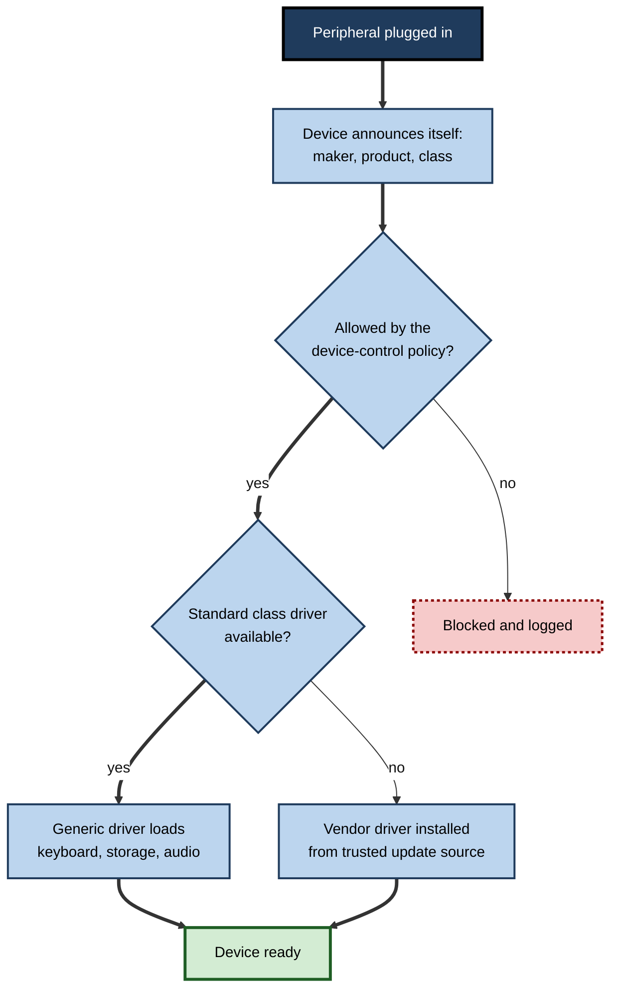
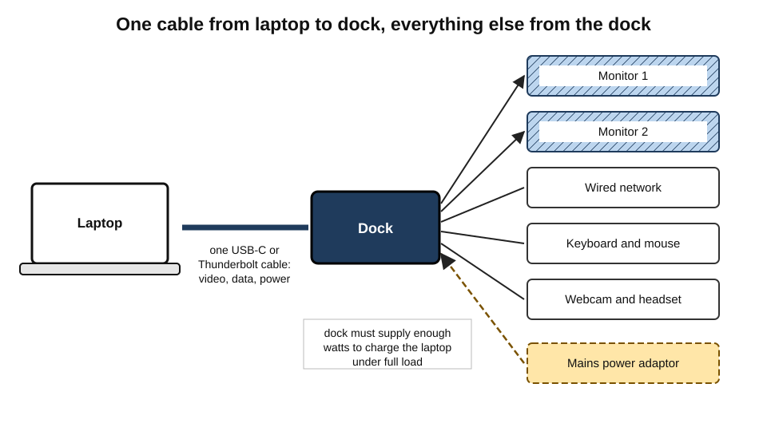
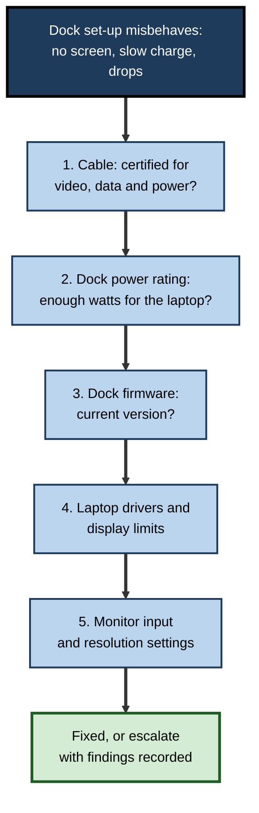
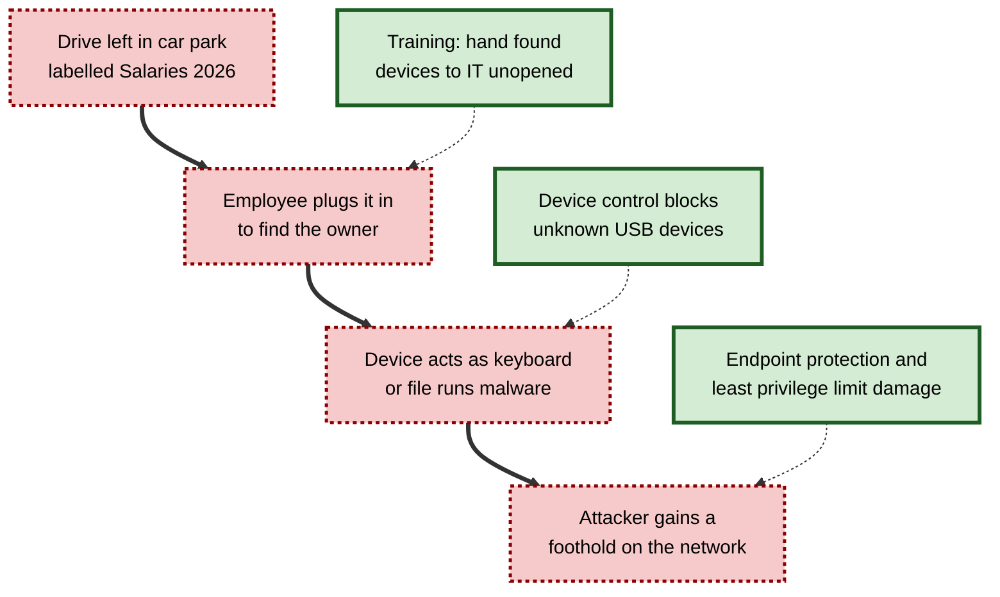
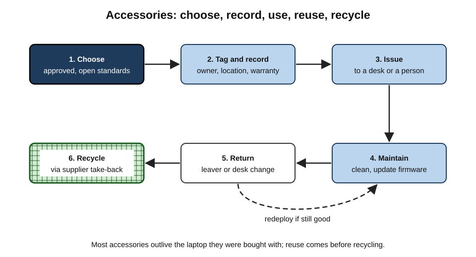

# B.11. Peripheral Devices

A consultant arrives at a hot desk, plugs one cable into her laptop, and two monitors, a keyboard, a webcam, a headset, wired network and power all spring to life.

A colleague working from home sounds as though he is speaking from inside a biscuit tin, and clients judge his ideas less kindly as a result. A visitor picks up a USB stick found in the car park and plugs it in "to find the owner". All three stories are about **peripherals** — the devices that surround a computer and connect it to people, places and, sometimes, attackers.

> **Definition — Peripheral device:** an external device that connects to a computer to add input, output, storage, connectivity or power capabilities, without being part of the computer's core processing and memory.

**Why peripherals matter**

- **Productivity** — screens, docks, keyboards and headsets shape hours of work every day.
- **Impression** — in remote and hybrid work, the camera, microphone and lighting are the person as others see and hear them.
- **Compatibility** — mismatched cables, docks and drivers are a leading cause of everyday support calls.
- **Security** — anything plugged in can carry data out or malicious code in.
- **Cost and waste** — accessories are bought in large numbers, frequently lost and quickly discarded.

---

## What Counts as a Peripheral

### Kinds of peripheral

- **Input** — external keyboards, mice, webcams, microphones, scanners, barcode readers, drawing tablets.
- **Output** — external monitors, printers, speakers, headphones, projectors.
- **Storage** — external drives, USB flash drives, card readers.
- **Connectivity** — docking stations, USB hubs, network adaptors, Wi-Fi and mobile dongles, display adaptors.
- **Power** — chargers, power banks, uninterruptible power supplies.
- **Specialised** — signature pads, card-payment terminals, label printers, smart-card readers, security keys, musical and laboratory instruments.

> **Key point:** the line between "built-in" and "peripheral" moves. A webcam is built into a laptop but a peripheral on a desktop; a keyboard is built into a laptop but often replaced by an external one at a desk.

### Internal, external, wired, wireless

- **Internal expansion** — cards added inside a desktop (graphics, capture, network).
- **External wired** — USB, Thunderbolt, HDMI, DisplayPort, Ethernet, audio jacks.
- **External wireless** — Bluetooth, proprietary radio dongles, Wi-Fi, and wireless display standards.

---

## How a Computer Recognises a Peripheral

### Plug and play

1. **Connection** — the device is plugged in or paired.
2. **Enumeration** — it identifies itself: maker, product, the class of device it is.
3. **Driver selection** — the operating system finds suitable software to talk to it.
4. **Configuration** — resources and settings are assigned.
5. **Ready** — the device appears and can be used.

> **Definition — Device driver:** software that lets the operating system communicate with a particular piece of hardware, translating general commands into the device's own instructions.

> **Definition — Plug and play:** the ability of a computer to detect and configure a newly connected device automatically, without manual settings.

**Figure 1.** What happens when a peripheral is plugged in.

### Device classes

- USB defines standard **classes** — human interface devices (keyboards, mice), mass storage, audio, video, printers, communications.
- Devices that follow a class work with the operating system's **built-in drivers**; no installation needed.
- Specialised devices (some printers, scanners, docks, professional audio) need **vendor drivers** and sometimes **firmware updates**.

> **Watch out:** downloading drivers from unofficial "driver download" websites is a common route for malware. Drivers should come from the operating system's update service or the manufacturer directly.

---

## Docking Stations and Hubs

### What a dock does

- Connects a laptop through **one cable** to many devices: monitors, wired network, USB peripherals, audio and power.
- Lets hybrid workers and hot-deskers move between locations quickly.

> **Definition — Docking station:** a peripheral that connects a laptop to monitors, network, power and other devices through a single connection, so the laptop can serve as a desktop.

### Kinds

- **USB-C docks** — use the USB-C connector with video and power delivery; widely compatible.
- **Thunderbolt docks** — higher bandwidth for multiple high-resolution monitors and fast storage.
- **Proprietary docks** — specific to one laptop maker or model; increasingly rare.
- **Simple hubs and adaptors** — add a few ports; may not carry power or video.
- **Monitors with built-in docks** — a USB-C monitor that powers the laptop and passes through keyboard, mouse and network.

**Figure 2.** A docked laptop and the devices reached through one cable.

### Common dock problems

- **Not enough power** — a dock supplying 65 W cannot charge a laptop that needs 100 W under load.
- **Monitor limits** — the laptop or cable may not support as many displays, or as high a resolution, as the dock promises.
- **Firmware mismatches** — docks have firmware that must be kept up to date alongside laptop drivers.
- **Cable confusion** — identical-looking USB-C cables differ greatly in speed, power and video capability.

> **Remember:** when a docked set-up misbehaves, check in order: **the cable, the dock's power rating, dock firmware, laptop drivers, then the monitor settings**.

**Figure 3.** Working through a misbehaving docked set-up.

---

## Peripherals for Hybrid and Remote Work

### The home office kit

- **Monitor** — a larger screen at eye height; often the single biggest productivity and comfort gain.
- **Keyboard and mouse** — so the laptop screen can be raised.
- **Headset or speakerphone** — clear voice, reduced echo and background noise.
- **Webcam** — if the built-in camera is poor or badly placed.
- **Lighting** — a light source in front of the face, not behind.
- **Laptop stand** — brings the built-in screen and camera to eye level.

### Why audio and video quality matter

**Study card — Newman and Schwarz (2018)**

- **Design:** participants listened to recordings of scientists speaking at conferences and on a radio programme, presented with either good audio quality or slightly degraded audio (echo and muffling); the content was identical.
- **Results:** with poorer audio, listeners rated the research as less important and the researchers as less intelligent and competent.
- **Conclusion:** the **ease of processing** what someone says shapes judgements of the person and their ideas — so poor sound has a real professional cost.

> **In practice:** in remote meetings, **audio first, then light, then camera**. A modest headset or speakerphone usually improves how a person comes across more than an expensive webcam.

| Item | Typical problem it solves | Priority for heavy video users |
|---|---|---|
| Headset or speakerphone | Echo, background noise, unclear voice | Highest |
| Front lighting | Face in shadow, grainy image | High |
| External monitor | Cramped screen, poor posture | High |
| Keyboard and mouse | Laptop screen too low when typing | High |
| External webcam | Poor or low-angle built-in camera | Moderate |
| Laptop stand | Camera looking up the nose | Moderate |

### Meeting rooms

- **Video bars** — camera, microphones and speakers in one unit, often with automatic framing of speakers.
- **Ceiling and table microphones** — capture everyone in larger rooms.
- **Room systems** — dedicated computers and touch controllers that start meetings in one tap.
- **Certified devices** — many headsets, cameras and room systems are certified for the main meeting platforms, reducing compatibility problems.

> **Watch out:** "hybrid meeting equity" — people on screens often struggle to hear and be heard in rooms built for in-person meetings. Good room peripherals help, but so do practices such as everyone joining on their own device and a chair managing turn-taking.

---

## Power Peripherals

- **Chargers** — USB Power Delivery chargers can charge laptops, tablets and phones; wattage must match the device's needs.
- **Power banks** — portable batteries; airline limits apply to large ones.
- **Uninterruptible power supplies (UPS)** — keep desktops, network equipment and servers running through short power cuts and allow clean shutdown.
- **Surge protectors** — protect against voltage spikes; quality varies greatly.

> **Watch out:** counterfeit and uncertified chargers can overheat, damage devices and start fires. Buy chargers from the device maker or reputable brands with recognised safety markings.

---

## Peripherals and Security

### Attacks through ports

- **Malicious storage** — a USB drive carrying malware, or simply tempting a user to open a booby-trapped file.
- **BadUSB** — research presented in 2014 showed that the firmware of ordinary USB devices could be reprogrammed so that, for example, a flash drive pretends to be a keyboard and types commands.
- **Keystroke-injection tools** — devices that look like flash drives or even charging cables but act as keyboards typing attack commands at superhuman speed.
- **Hardware keyloggers** — small adaptors between keyboard and computer that record everything typed.
- **"Juice jacking"** — the theoretical risk of data theft or malware through public USB charging points; reported real-world cases are rare, but caution is sensible.
- **Data exfiltration** — staff copying data to personal drives, deliberately or carelessly.

> **Definition — BadUSB:** a class of attacks in which a USB device's firmware is reprogrammed so that it behaves as a different kind of device — typically a keyboard — to issue commands or steal data.

**Study card — Tischer and colleagues (2016)**

- **Design:** researchers dropped nearly 300 USB flash drives around a university campus; the drives contained files that reported back when opened.
- **Results:** almost all drives were picked up, and for nearly half of them someone plugged the drive in and opened files — often within hours. Many said they wanted to find the owner.
- **Conclusion:** curiosity and helpfulness make dropped devices an effective attack route; awareness alone does not stop people plugging them in.

**Figure 4.** How a dropped USB device can lead to compromise, and where it can be stopped.

### Controls

- **Device-control policies** — allow only approved classes or specific models of USB device; block unknown storage; make storage read-only or require encryption.
- **Port blocking** — physically or by policy on high-security machines.
- **Security keys allowed, storage blocked** — keyboards, mice and hardware security keys permitted; mass storage restricted.
- **Data-loss prevention** — monitoring and blocking copying of sensitive data to external media.
- **Endpoint protection** — scanning newly connected media; detecting suspicious keystroke injection.
- **Awareness** — found devices go to IT, unopened; public charging with a data-blocking adaptor or own charger.

> **Definition — Device control:** security policies and tools that decide which external devices may connect to a computer and what they may do.

> **Example:** a hardware **security key** — a small USB or NFC device used for phishing-resistant sign-in — is itself a peripheral. Organisations typically allow these while blocking unknown storage devices.

---

## Compatibility and Standards

### Why peripherals fail to work

- **Wrong connector or adaptor** — older devices on newer ports.
- **Right connector, wrong capability** — a USB-C port without video or charging support; a cable rated for slow data only.
- **Driver unavailable** — especially for new operating systems or processor types (for example on ARM-based laptops).
- **Wireless interference** — crowded radio bands affecting Bluetooth and wireless dongles.
- **Power limits** — bus-powered drives or hubs drawing more power than a port supplies.

> **In practice:** organisations reduce compatibility problems by publishing a short **approved accessories list** — tested docks, cables, headsets, monitors and keyboards — and by buying cables certified for the speed and power needed.

---

## Worked Example: Equipping 200 Hybrid Workers

**Situation:** a professional-services firm moves 200 staff to hybrid work: three days in the office at hot desks, two at home. Budget is limited.

1. **Define the office set-up per desk (shared):** USB-C monitor with built-in dock and power delivery, keyboard, mouse, wired network through the monitor.
2. **Define the home kit per person:** 24–27-inch USB-C monitor, keyboard and mouse, laptop stand, certified headset.
3. **Choose standards:** one model of USB-C monitor-dock for all desks; certified cables; headsets certified for the firm's meeting platform.
4. **Size the office:** with three office days a week and staggered attendance, around 130 desks rather than 200.
5. **Plan support:** spares of cables and docks at reception; a short "first plug-in" guide; firmware updates scheduled through device management.
6. **Plan the end of life:** asset tags on monitors and docks; take-back and recycling through the supplier.

| Item | Quantity | Reason |
|---|---|---|
| Office USB-C monitor-docks | 130 desks | Shared hot desks; one cable to the laptop |
| Home monitors | 200 | Posture and productivity at home |
| Keyboards and mice | 330 sets | Office desks plus home kits |
| Certified headsets | 200 | Personal, hygienic, best gain for calls |
| Laptop stands | 200 | Eye-level camera and screen at home |
| Spare cables and docks | About 5% | Fast replacement at reception |

> **Watch out:** headsets are personal for hygiene and fit; shared office headsets are commonly unused. Keyboards and mice at hot desks need cleaning routines.

---

## Case Study: The Dock Rollout that Went Wrong — and Was Rescued

- **Situation:** a bank bought 1,500 USB-C docks from a single supplier for its new hot-desk floors.
- **Problems in the first month:**
  - laptops intermittently lost their second monitor;
  - some laptops charged slowly or not at all under load;
  - network connections dropped after sleep;
  - support calls tripled.
- **Diagnosis:**
  - the docks supplied 65 W but the analysts' laptops needed up to 100 W;
  - dock firmware was out of date and conflicted with a recent laptop driver update;
  - several batches of cables supplied with the docks did not support the needed display bandwidth.
- **Actions:**
  1. Replaced docks on analyst floors with higher-power models.
  2. Brought docks under central firmware management; tested firmware and driver updates together before release.
  3. Replaced cables with certified ones and labelled them.
  4. Added docks and cables to the approved-accessories list with tested combinations.
- **Result:** support calls returned to normal levels within weeks.
- **Lesson:** peripherals are part of the **endpoint system**. Test them with the actual laptops, manage their firmware, and treat cables as components, not afterthoughts.

---

## Peripherals and Sustainability

- **Volume** — organisations buy many more accessories than computers, and accessories are rarely tracked.
- **Short lives** — cables, chargers and headsets are often discarded when a laptop changes.
- **Common standards reduce waste** — the European Union's common-charger rules, applying to phones, tablets and other small devices from December 2024 and to laptops from April 2026, require USB-C charging and allow devices to be sold without a charger.
- **Reuse** — monitors, keyboards and docks usually outlast several laptops; redeploy before replacing.
- **Take-back and recycling** — accessories contain plastics, metals and sometimes batteries that need proper handling.

> **Key point:** the most sustainable accessory is the one that is **kept and reused** — chosen on open standards so that it works with the next device as well as this one.

---

## Specialised Peripherals in Professional Settings

Every profession has its own peripherals, and many of them are regulated, certified or safety-critical.

### Examples by sector

- **Healthcare**
  - **Barcode scanners** at the bedside for wristbands and medicines.
  - **Smart-card and badge readers** for fast, secure sign-in on shared ward computers.
  - **Medical peripherals** — electrocardiogram carts, ultrasound probes, dictation microphones — some regulated as medical devices.
  - **Cleanable keyboards and mice** — sealed, wipeable designs for infection control.
- **Retail and hospitality**
  - **Point-of-sale peripherals** — receipt printers, cash drawers, customer displays, card terminals, scales and scanners.
  - **Payment terminals** — certified under card-industry security standards; usually managed by the payment provider, not the shop's IT team.
- **Finance and government**
  - **Smart-card readers** for digital signatures and secure sign-in.
  - **Hardware security keys** for phishing-resistant authentication.
  - **Signature pads** capturing handwritten signatures with timing and pressure data.
- **Engineering, science and media**
  - **Laboratory instruments** connected by USB or network to data-capture software.
  - **3D mice** for navigating models; **colour calibrators** for displays; **audio interfaces** for recording.
  - **Capture cards** for video production and streaming.
- **Logistics and field work**
  - **Mobile printers** for labels and receipts; **rugged scanners**; **vehicle-mounted terminals**.

> **Definition — Point-of-sale (POS) system:** the combination of computer, software and peripherals — scanner, card terminal, printer, cash drawer, display — used to complete sales transactions.

> **Watch out:** specialised peripherals often depend on **specific drivers and older software**, and can block operating-system upgrades or a move to new processor types. They should be listed in the asset inventory with their software dependencies, so that upgrades are tested before they are rolled out.

### Hardware security keys

- Small USB, NFC or Bluetooth devices that prove identity using public-key cryptography.
- Resistant to **phishing**: the key checks the website's genuine address before responding, so a fake site receives nothing usable.
- Usually certified to the FIDO standards developed by an industry alliance; the same technology underlies **passkeys** on phones and laptops.
- Common for administrators, executives, journalists and anyone at elevated risk.

> **In practice:** organisations issue **two keys** per person — one carried, one stored safely — so that losing one does not lock the person out.

---

## Wireless Peripherals

### Choices

- **Bluetooth** — no dongle; connects to phones and tablets as well as computers; pairing needed; occasionally unreliable in crowded radio environments.
- **Proprietary radio receivers** — a small USB receiver paired at the factory; often more reliable and lower-latency, but uses a port and is easily lost.
- **Wi-Fi peripherals** — printers, wireless displays, conference equipment.

### Trade-offs

- **Convenience** — no cables across the desk; easy to move.
- **Batteries** — need charging or replacing; a flat mouse during a presentation is a familiar failure.
- **Latency** — usually negligible for office work; matters for gaming, music and fast drawing.
- **Security** — some older wireless keyboards and mice used weak or no encryption, allowing nearby attackers to inject or capture keystrokes; reputable current models encrypt their links, and firmware updates have fixed many published flaws.

> **Remember:** for keyboards used to type passwords and confidential data, choose models with **encrypted** wireless links from reputable makers, keep receiver firmware updated, or use cables in high-security settings.

---

## Managing Peripherals as Assets

### Why accessories need management

- **Volume** — an organisation of 1,000 may own several thousand peripherals: monitors, docks, headsets, keyboards, mice, cables and chargers.
- **Value** — monitors and docks together can cost as much as a laptop.
- **Loss** — headsets, chargers and adaptors disappear quickly, especially with hybrid work.
- **Security and firmware** — docks, monitors with USB hubs and conference systems run firmware that needs updating.

### Practices

- **Tag and record** higher-value items — monitors, docks, conference equipment — in the asset inventory with location and owner.
- **Standardise** — a short catalogue of approved models simplifies spares, support and compatibility.
- **Issue and return** — record home-office kits issued to individuals and collect them when people leave.
- **Firmware management** — bring docks and conference systems into central update tools where possible.
- **Hygiene** — cleaning schedules for shared keyboards, mice and meeting-room equipment.
- **Reuse first** — redeploy returned monitors, docks and keyboards before buying new.

| Peripheral | Track individually? | Typical life | Main management concern |
|---|---|---|---|
| Monitor | Yes | 6–10 years | Location, ergonomics, reuse |
| Docking station | Yes | 4–6 years | Firmware, power rating, compatibility |
| Conference room system | Yes | 5–7 years | Firmware, security, support contract |
| Headset | Often, for home kits | 2–4 years | Hygiene, personal issue, battery |
| Keyboard and mouse | Usually not | 3–6 years | Cleaning, ergonomic choice |
| Cables and chargers | No; stock levels only | Varies | Certification, safety, stock control |

**Figure 5.** The life of an accessory in a well-run organisation.

### Procurement questions

- Does it follow **open standards** (USB-C, DisplayPort, Bluetooth, USB PD) rather than proprietary connectors?
- Is it **certified** for the organisation's meeting platform or security needs?
- What **warranty and support** apply, and are spare parts such as ear cushions and cables available?
- Will the maker provide **firmware updates**, and for how long?
- Does it carry recognised **safety** and **environmental** labels?
- Can it be **returned or recycled** through the supplier?

> **Key point:** peripherals are often chosen in minutes but used for years. A few minutes spent on standards, certification and support saves many hours of later troubleshooting.

---

## Peripherals and Health

- **Monitors** at eye level and about an arm's length away reduce neck strain; the laptop screen alone is too low for long sessions.
- **Keyboards and mice** close to the body, with straight wrists, reduce shoulder and forearm load.
- **Headsets** — comfortable, lightweight models at moderate volume protect hearing during long call days; noise cancellation allows lower volumes in noisy places.
- **Lighting** — task lights reduce glare and eye strain.
- **Adjustable equipment** — stands, arms and height-adjustable desks allow posture changes through the day.

> **Key point:** at a desk, peripherals turn a laptop into an ergonomic workstation. Without them, people adapt their bodies to the laptop — usually by hunching over it.

### Peripherals for accessibility

- **Alternative keyboards and pointing devices** — large-key keyboards, trackballs, joysticks, head pointers and switches.
- **Braille displays and embossers** — tactile output for blind users.
- **Magnifiers and large monitors** — for people with low vision.
- **Hearing loops and compatible headsets** — for hearing-aid users in meeting rooms.

> **In practice:** employers in many countries must make reasonable adjustments for disabled staff; accessible peripherals are often among the cheapest and most effective adjustments available.

---

## Peripherals on the Move

- **Travel kit** — a compact USB-C charger that powers both laptop and phone, one multi-purpose cable, a USB-C-to-HDMI adaptor, earbuds with a microphone, and a privacy screen.
- **Portable monitors** — slim USB-C screens powered by the laptop; useful for consultants working on client sites.
- **Presentation clickers** — wireless remotes with laser pointers; check batteries before every talk.
- **Hotel and client sites** — assume unknown screens use HDMI; carry the adaptor rather than relying on the venue.

> **Remember:** for travel, the best peripheral set is **small, standard and charged** — one charger, one cable type, one adaptor.

---

## Open Questions

- **Will wireless replace cables at the desk?**
  - Wireless displays, docking and charging are improving, but reliability, latency and security still favour cables for many set-ups.
- **How should organisations balance device control with flexibility?**
  - Blocking peripherals reduces risk but frustrates users; the right balance differs by role and sector.
- **Who pays for home-office peripherals?**
  - Practice and law on employer responsibilities for home workstations vary between countries.
- **Will AI change meeting peripherals?**
  - Automatic framing, voice isolation and live translation are moving into cameras and headsets; their effects on meeting equity and privacy are still emerging.

---

## Summary

- A **peripheral** is an external device adding input, output, storage, connectivity or power; the boundary with built-in parts moves.
- Computers recognise peripherals by **plug and play**: enumeration, **device driver** selection and configuration; standard **USB classes** use built-in drivers.
- **Docking stations** connect laptops to monitors, network, power and peripherals through one cable; problems usually involve cables, power, firmware or display limits.
- Hybrid work kits: monitor, keyboard and mouse, headset, lighting, stand; **audio quality** affects how competent a speaker seems (Newman and Schwarz, 2018).
- Power peripherals: certified chargers, power banks, **UPS**, surge protection.
- Security risks: malicious storage, **BadUSB**, keystroke injection, keyloggers, exfiltration; dropped drives are often plugged in (Tischer and colleagues, 2016). Use **device control**, data-loss prevention, endpoint protection and awareness.
- Reduce incompatibility with approved accessories lists and certified cables.
- Sustainability: common standards such as the EU's USB-C charger rules, reuse across devices, take-back and recycling.

---

## Self-Check

1. Define a peripheral and give one example from each of five kinds.
2. Why can the same device be built-in on one computer and a peripheral on another?
3. Describe the steps of plug and play.
4. What is a device driver, and why should drivers not be downloaded from unofficial sites?
5. A docked laptop charges slowly and loses one monitor. List the checks in order.
6. Summarise the Newman and Schwarz study and its implication for remote workers.
7. Rank headset, webcam, lighting and monitor for someone who spends five hours a day in video calls, with reasons.
8. What is BadUSB, and why does antivirus scanning of files not stop it?
9. What did the 2016 USB drop study find?
10. Describe a sensible device-control policy for an accounts department.
11. Why do identical-looking USB-C cables behave differently?
12. How many hot desks might a firm of 300 staff with two office days a week need, and what else must be considered?
13. Why are chargers a safety issue?
14. How does the EU common-charger rule reduce waste?

### Answer Key

1. An external device adding input, output, storage, connectivity or power. Input: webcam; output: monitor; storage: external SSD; connectivity: dock; power: UPS.
2. Because the category depends on whether the function is integrated: a laptop has a built-in keyboard and webcam, while a desktop needs external ones.
3. Connection; enumeration (identity and class); driver selection; configuration; ready.
4. Software that lets the operating system communicate with a device. Unofficial driver sites often bundle malware; drivers should come from OS updates or the manufacturer.
5. Cable capability; dock power rating against laptop needs; dock firmware; laptop drivers; monitor settings and the laptop's display limits.
6. Degraded audio led listeners to rate research as less important and researchers as less competent, despite identical content. Remote workers should invest in good audio.
7. Headset (voice clarity shapes judgements and reduces fatigue); lighting (clear image cheaply); monitor (posture and multi-window work); webcam (useful only if the built-in one is poor).
8. Reprogrammed firmware makes a USB device act as another device such as a keyboard; it types commands rather than containing infected files, so file scanning misses it.
9. Nearly all dropped drives were picked up and nearly half were plugged in with files opened, often quickly, frequently by people wanting to return them.
10. Allow keyboards, mice, headsets and security keys; block unknown mass storage or allow only encrypted, approved drives; log connections; apply data-loss prevention to financial data.
11. They differ in supported data speed, power wattage and video capability, despite sharing a connector.
12. Average attendance 300 × 2/5 = 120; with peaks and uneven days, perhaps 140–160. Consider peak days, team days, meeting rooms, lockers and dock standardisation.
13. Counterfeit or uncertified chargers can overheat, damage devices and start fires.
14. Standard USB-C charging lets one charger serve many devices and allows devices to be sold without chargers, reducing duplicate chargers discarded.

---

## Glossary

| Term | Meaning |
|---|---|
| BadUSB | Attacks reprogramming USB device firmware to impersonate other devices. |
| Data-loss prevention | Tools that detect and block unauthorised transfer of sensitive data. |
| Device class | A standard category of USB device with a common driver. |
| Device control | Policies deciding which external devices may connect and what they may do. |
| Device driver | Software enabling an operating system to communicate with hardware. |
| Docking station | A device linking a laptop to many peripherals through one connection. |
| Enumeration | A device identifying itself to the computer when connected. |
| Hardware keylogger | A device that secretly records keystrokes. |
| Hot desk | A desk used by different people on different days. |
| Hub | A device adding extra ports from one connection. |
| Juice jacking | Possible data theft or malware through public USB charging points. |
| Keystroke injection | An attack in which a device poses as a keyboard to type commands. |
| Peripheral device | An external device adding capabilities to a computer. |
| Plug and play | Automatic detection and configuration of connected devices. |
| Point-of-sale system | Computer, software and peripherals used to complete sales. |
| Power Delivery | The USB standard for negotiating charging power. |
| Security key | A hardware device used for phishing-resistant sign-in. |
| Surge protector | A device protecting equipment from voltage spikes. |
| UPS | Uninterruptible power supply. |
| Video bar | A combined camera, microphone and speaker unit for meeting rooms. |
