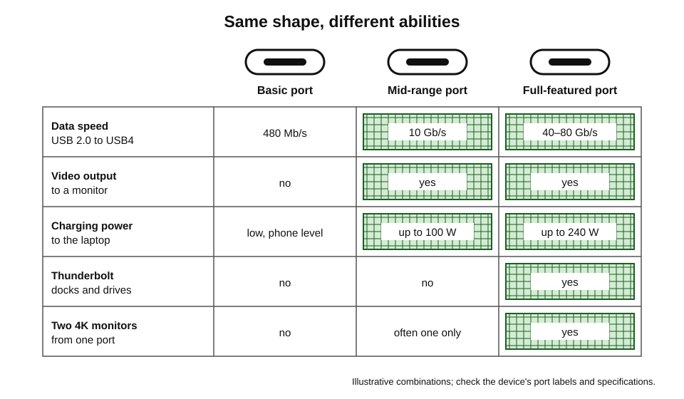
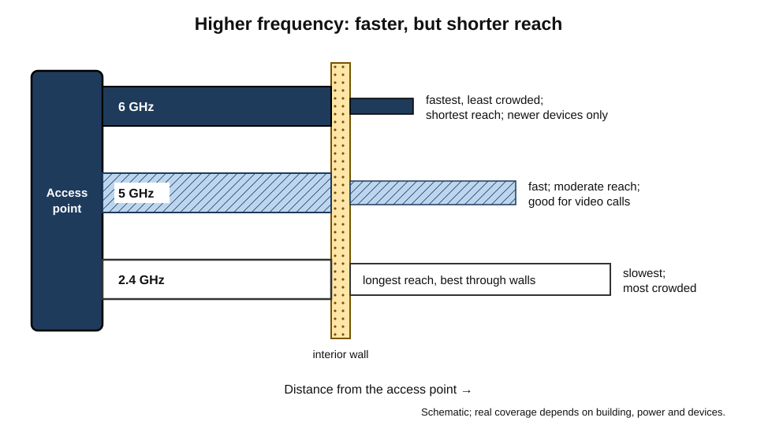
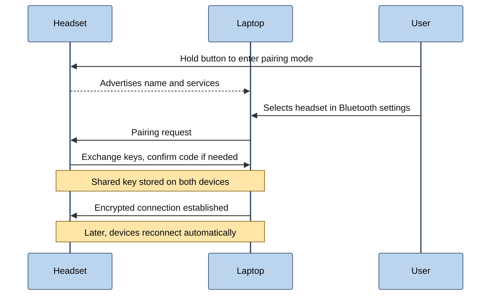
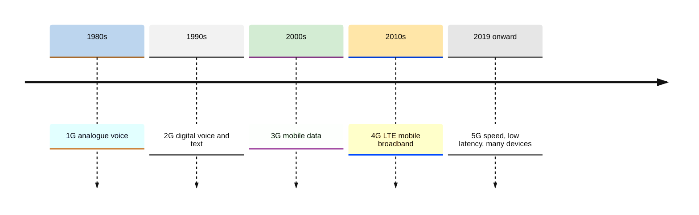
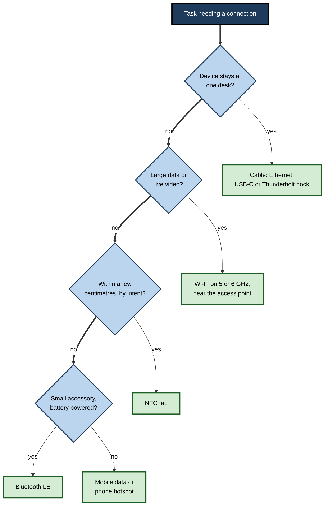

# A.12. Device Connectivity

A presenter arrives at a client's boardroom and discovers that her laptop has only USB-C ports and the projector only an old video socket. A pair of earbuds switches seamlessly from a phone call to a laptop meeting. A phone pays for a coffee when held near a terminal and unlocks a car from a pocket. A team's video calls stutter every afternoon when the office fills up. Every one of these moments depends on **how devices connect** — by cable or by radio, over centimetres or kilometres.

> **Definition — Device connectivity:** the physical and radio links by which a computing device exchanges data and power with peripherals, other devices and networks — including cables and connectors such as USB, HDMI and Ethernet, and wireless technologies such as Wi-Fi, Bluetooth, NFC and mobile networks.

**Why connectivity matters**

- **Productivity** — slow or unreliable links waste time in every meeting, transfer and call.
- **Compatibility** — the wrong cable, adaptor or standard leaves equipment unusable.
- **Security** — every wireless link is a potential route in, and every cable a potential route out.
- **Cost and waste** — confusing standards fill drawers with adaptors and chargers; common standards reduce them.

---

## The Vocabulary of Connection

### Measuring a link

- **Bandwidth (throughput)** — how much data per second; measured in bits per second (Mb/s, Gb/s).
- **Latency** — delay before data arrives, in milliseconds; matters for calls, gaming and control.
- **Range** — how far the link reaches.
- **Reliability** — how consistently it performs, given interference and obstacles.
- **Power** — energy used by the link, and whether it can also **deliver** power.

> **Definition — Bandwidth:** the maximum rate at which a link can carry data, usually expressed in bits per second.

> **Definition — Latency:** the time taken for data to travel from sender to receiver, usually in milliseconds.

> **Remember:** links are quoted in **bits** per second; files in **bytes**. Divide by 8: a 1 Gb/s link moves at most about 125 MB/s before overheads.

### Connector and protocol are not the same

- **Connector** — the physical plug and socket shape.
- **Protocol** — the rules for the signals carried through it.
- One connector can carry several protocols; *e.g.* a USB-C socket may carry USB data, DisplayPort video, Thunderbolt and charging power — or only some of them.

> **Key point:** most connection confusion comes from assuming that **the same shape means the same capability**.

---

## Wired Connections

### USB: the universal serial bus

- **1996 — USB 1.0** replaces a tangle of serial, parallel, keyboard and mouse ports.
- **2000 — USB 2.0** at 480 Mb/s; still common for keyboards, mice and simple devices.
- **2008 onward — USB 3.x** at 5, 10 and 20 Gb/s, under a succession of confusing names.
- **2014 — the USB-C connector**: small, reversible, able to carry data, video and power.
- **2019 — USB4** at up to 40 Gb/s, based on Thunderbolt 3 technology; **USB4 version 2.0** (2022) at up to 80 Gb/s.
- **USB Power Delivery** — negotiates charging power between devices; the extended range defined in 2021 allows up to **240 W**, enough for most laptops.

> **Definition — USB Power Delivery (USB PD):** a standard by which a charger and device agree a voltage and current over USB-C, allowing anything from earbuds to laptops to charge from compatible chargers.

**Figure 1.** One USB-C connector, many possible capabilities.

### Thunderbolt

- Developed by **Intel with Apple**, first appearing in 2011.
- **Thunderbolt 3** (2015) adopted the USB-C connector at 40 Gb/s.
- **Thunderbolt 4** (2020) raised minimum requirements — for example support for two 4K displays and charging.
- **Thunderbolt 5** (announced 2023) offers 80 Gb/s, with a boost mode up to 120 Gb/s for displays.
- Used for high-end docks, fast external storage and multiple high-resolution monitors.

### Video connections

- **VGA** (1987) — analogue; still found on old projectors.
- **DVI** (1999) — digital successor; largely obsolete.
- **HDMI** (from 2002) — the television and projector standard, carrying video and audio; HDMI 2.1 supports very high resolutions and refresh rates.
- **DisplayPort** (from 2006, by the standards body VESA) — the computer-monitor standard; supports daisy-chaining monitors; carried over USB-C as **DisplayPort Alternate Mode**.

> **Watch out:** an adaptor converts connectors, not always capabilities. A USB-C-to-HDMI adaptor works only if the laptop's port outputs video, and it may limit resolution or refresh rate.

### Ethernet

- Invented at **Xerox PARC in 1973** by Robert Metcalfe and colleagues; standardised as **IEEE 802.3**.
- Common speeds: 100 Mb/s, **1 Gb/s** (standard on desktops and docks), 2.5 and 10 Gb/s for demanding users and networks.
- **Advantages over Wi-Fi** — more consistent speed, lower latency, less interference, harder to intercept.
- **Power over Ethernet (PoE)** — delivers power and data on one cable to cameras, phones and wireless access points.
- **Cable categories** — Cat 5e supports 1 Gb/s; Cat 6 and 6A support higher speeds over suitable distances.

> **Definition — Power over Ethernet (PoE):** delivering electrical power along with data over a network cable, so devices such as cameras need no separate power supply.

### Common wired connections compared

| Connection | Typical maximum speed | Carries power? | Typical use |
|---|---|---|---|
| USB 2.0 | 480 Mb/s | Small amounts | Keyboards, mice, simple devices |
| USB 3.x (USB-C or USB-A) | 5–20 Gb/s | Yes; up to 240 W with USB PD on USB-C | External drives, hubs, charging |
| USB4 / Thunderbolt 4 | 40 Gb/s | Yes | Docks, fast storage, two monitors |
| Thunderbolt 5 / USB4 v2 | 80 Gb/s (more for displays) | Yes | High-end docks, multiple 4K+ displays |
| HDMI | Tens of Gb/s in recent versions | No | Televisions, projectors |
| DisplayPort | Tens of Gb/s in recent versions | No (except over USB-C) | Computer monitors |
| Ethernet | 1–10 Gb/s typical | With PoE | Desktops, docks, cameras, access points |

---

## Wireless Connections

### How wireless links work

- Data is carried on **radio waves** at particular frequencies.
- **Higher frequencies** carry more data but travel less far and pass through walls less well.
- **Shared airwaves** — devices on the same frequencies interfere; crowded places slow everyone.
- **Licensed spectrum** (mobile networks) is reserved for operators; **unlicensed bands** (Wi-Fi, Bluetooth) are shared by anyone.

> **Definition — Radio frequency band:** a range of radio frequencies, such as 2.4 GHz or 5 GHz, allocated for a particular use; it determines range, speed and how crowded the airwaves are.

### Wi-Fi

- Based on the **IEEE 802.11** family of standards (first published 1997); "Wi-Fi" is the industry alliance's brand.
- **Generations:**
  - **Wi-Fi 4** (802.11n, 2009) — 2.4 and 5 GHz.
  - **Wi-Fi 5** (802.11ac) — faster on 5 GHz.
  - **Wi-Fi 6** (802.11ax, 2019) — efficiency in crowded places, better battery life.
  - **Wi-Fi 6E** — Wi-Fi 6 extended into the new **6 GHz** band, where permitted by national regulators.
  - **Wi-Fi 7** (802.11be, certification from January 2024) — wider channels and the ability to use several bands at once for higher speed and lower latency.
- **Bands:**
  - **2.4 GHz** — longest range, best through walls, slowest and most crowded.
  - **5 GHz** — faster, shorter range.
  - **6 GHz** — fastest and least crowded, shortest range, needs newer devices.
- **Security** — **WPA2** and its successor **WPA3** (introduced 2018) encrypt traffic between device and access point; older WEP and WPA are broken.

**Figure 2.** Wi-Fi bands trade range against speed.

> **Definition — Access point:** a device that provides a Wi-Fi network, connecting wireless devices to a wired network; homes usually combine it with a router.

> **Watch out:** the speed printed on a Wi-Fi router's box is a theoretical maximum across all bands combined. Real speeds for one device are typically a fraction of it, and depend on distance, walls, interference, the device's own Wi-Fi generation and the internet connection behind the router.

### Bluetooth

- Created by an industry group formed in 1998; named after a tenth-century Danish king, Harald "Bluetooth", who united tribes — as the technology was meant to unite devices.
- **Bluetooth Classic** — continuous audio streaming, older accessories.
- **Bluetooth Low Energy (LE)** — very low power; wearables, sensors, trackers, keyboards.
- **LE Audio and Auracast** — newer audio standards for better efficiency and **broadcast** to many listeners, such as in airports, gyms and hearing loops.
- **Range** — typically up to about 10 metres indoors, more in open space with suitable devices.

**Figure 3.** Pairing a Bluetooth headset with a laptop.

> **Definition — Pairing:** the process by which two Bluetooth devices exchange keys and agree to trust each other, so that future connections are automatic and encrypted.

### NFC and ultra-wideband

- **NFC (near-field communication)** — works over a few centimetres.
  - Contactless payments, access cards, transport tickets, tapping to pair headphones.
  - The very short range is itself a security feature: a deliberate tap signals intent.
- **Ultra-wideband (UWB)** — measures distance and direction precisely, to within centimetres.
  - Digital car keys that unlock as the owner approaches, finding lost items, hands-free door access.

> **Watch out:** small Bluetooth and UWB item trackers have been misused to follow people secretly. Platform makers introduced alerts for unknown trackers travelling with a person, and in 2024 major platforms adopted a shared approach so that alerts work across phone brands.

### Mobile networks

- **1G (1980s)** — analogue voice.
- **2G (1990s; GSM from 1991)** — digital voice and **text messages**.
- **3G (2000s)** — mobile data and early smartphones.
- **4G LTE (from about 2009–2010)** — broadband speeds; video and apps everywhere.
- **5G (from 2019)** — higher speeds, lower latency, many more connected devices; some bands very fast but short range.
- **Network switch-offs** — many operators have shut down 2G and 3G networks to reuse the spectrum, disabling old phones, alarms and vehicle systems that relied on them.
- **Hotspot and tethering** — a phone shares its mobile data connection with a laptop by Wi-Fi, Bluetooth or cable.

**Figure 4.** Generations of mobile network.

> **In practice:** organisations with old alarm panels, lift phones, payment terminals or vehicle trackers on 2G or 3G must replace or upgrade them before local switch-off dates; these devices are easy to forget because they rarely fail until the network disappears.

### Wireless technologies compared

| Technology | Typical range | Typical speed | Power use | Typical use |
|---|---|---|---|---|
| NFC | A few centimetres | Very low | Very low | Payments, access cards, tap-to-pair |
| Bluetooth LE | Up to ~10 m indoors | Low | Very low | Wearables, keyboards, trackers |
| Bluetooth Classic | Up to ~10 m | Moderate | Low | Audio streaming |
| UWB | Tens of metres | Moderate | Low | Precise location, car keys |
| Wi-Fi 6 / 7 | Tens of metres | High to very high | Moderate | Laptops, phones, home and office networks |
| 4G / 5G | Kilometres | High | Moderate to high | Mobile data anywhere with coverage |

---

## Choosing the Right Connection

### Rules of thumb

- **Fixed desk with heavy use** — wired Ethernet through a dock; monitors by USB-C or DisplayPort.
- **Video calls** — wired if possible; otherwise 5 or 6 GHz Wi-Fi close to the access point.
- **Large file transfers between devices** — fast cable (USB 3.x, USB4 or Thunderbolt) or wired network rather than Bluetooth.
- **Peripherals** — Bluetooth LE for keyboards and mice; a radio dongle if Bluetooth is unreliable.
- **Travel** — phone hotspot or eSIM data instead of unknown public Wi-Fi for sensitive work.

**Figure 5.** Choosing a link for a task.

### Worked example (illustrative): moving 50 GB of video

**Situation:** a video producer must move 50 GB of footage from a laptop to a colleague's machine in the same office.

> **Formula — Transfer time:** time (seconds) ≈ file size in bits ÷ effective link speed in bits per second. 50 GB = 50 × 8 = 400 gigabits.

| Link | Effective speed (assumed) | Time for 400 gigabits |
|---|---|---|
| Bluetooth | ≈ 2 Mb/s | 200,000 s ≈ **55 hours** |
| Wi-Fi in a busy office | ≈ 200 Mb/s | 2,000 s ≈ **33 minutes** |
| Gigabit Ethernet | ≈ 900 Mb/s | ≈ 444 s ≈ **7.5 minutes** |
| External SSD over USB 3.2 (10 Gb/s port) | ≈ 8 Gb/s (drive-limited in practice) | ≈ 50 s, plus copying off again |
| Thunderbolt direct link | ≈ 20 Gb/s effective | ≈ 20 s |

- **Conclusion:** for large transfers, the choice of link changes the wait from hours to seconds; Bluetooth is for small files and audio, not bulk data.

> **Watch out:** effective speeds above are illustrative. Real transfers are often limited by the **slowest part** — the storage drive, the other computer or the network — not by the link's headline speed.

---

## Connectivity and Security

### Wireless risks

- **Public Wi-Fi** — networks may be fake ("evil twins") or monitored; modern websites encrypt traffic, but captive sign-in pages and unencrypted services remain risks.
- **Auto-joining** — devices that remember network names can be lured to a fake network with the same name.
- **Bluetooth vulnerabilities** — flaws such as the "BlueBorne" family disclosed in 2017 allowed attacks on unpatched devices with Bluetooth switched on.
- **Unsolicited sharing** — wireless file-sharing features set to accept from "everyone" have been used to send offensive or malicious content to strangers.
- **Tracking** — fixed wireless identifiers can reveal a device's movements; modern phones use **randomised hardware addresses** to reduce this.

> **Definition — Evil twin:** a malicious Wi-Fi access point that imitates a legitimate network name in order to intercept users' connections.

### Good practice

- Keep devices **updated**, including Bluetooth and Wi-Fi firmware.
- Turn off Bluetooth and wireless sharing when not needed, or restrict sharing to contacts.
- Prefer **trusted networks**, a phone hotspot or the organisation's VPN for sensitive work.
- Forget networks no longer used; avoid auto-joining open networks.
- Use **WPA3** (or at least WPA2) with strong passphrases on home and office Wi-Fi.

> **In practice:** organisations commonly separate Wi-Fi into **staff**, **guest** and **device** networks, use certificate-based sign-in for staff devices rather than shared passwords, and monitor for rogue access points.

---

## Standards, Regulation and Waste

- **Standards bodies** — the IEEE (Ethernet, Wi-Fi), the USB Implementers Forum, the Bluetooth Special Interest Group, VESA (DisplayPort), 3GPP (mobile networks) — create the specifications that let devices from different makers connect.
- **Regulators** — allocate radio spectrum and set power limits; this is why 6 GHz Wi-Fi availability differs between countries.
- **Common charger rules** — the European Union required USB-C charging for phones, tablets, cameras, headphones and similar devices from December 2024, and for laptops from 28 April 2026; devices must also be offered without a charger in the box.
  - Aim: interoperability, fewer chargers, less electronic waste.
- **Logos and labels** — the USB Implementers Forum has simplified logos to show speed and power ratings on cables and ports, because naming had become confusing.

> **Key point:** open standards are the reason a keyboard bought today will work with a computer bought in five years. Proprietary connectors lock buyers in and multiply waste.

---

## Case Study (illustrative): The Office Whose Calls Failed Every Afternoon

- **Situation:** a 120-person office in a dense city building had complaints that video calls froze every afternoon.
- **Initial assumption:** the internet connection was too slow; the firm was about to buy a much faster line.
- **Diagnosis:**
  1. Measurements showed the internet line was only half used even at peak.
  2. A wireless survey found that most laptops were connecting on the **crowded 2.4 GHz band**, competing with dozens of neighbouring networks.
  3. Access points were too few and placed in a cupboard; at peak more than 60 devices shared some of them.
  4. Many staff used old USB-A dongles with poor Wi-Fi adaptors.
- **Actions:**
  1. Added ceiling-mounted Wi-Fi 6E access points, steering capable devices to 5 and 6 GHz.
  2. Installed docks with Ethernet at every desk, so seated workers used cables.
  3. Reserved Wi-Fi capacity for meeting rooms and mobile devices.
  4. Replaced old adaptors.
- **Result:** call quality complaints largely disappeared without a faster internet line; the money saved paid for most of the access points.
- **Lesson:** "slow internet" is often **slow local connectivity**. Measure each link — device, Wi-Fi, local network, internet — before spending.

---

## Connecting on the Move

### eSIM and international travel

- An **eSIM** lets a traveller add a local or regional data plan by scanning a QR code or using an app, without a physical SIM card.
- **Dual SIM** — keep the home number active for calls and authentication codes while using local data.
- **Roaming** — convenient but can be expensive; check the plan before travelling.
- **Organisational travel** — corporate plans, travel eSIMs and policies on which networks to use for sensitive work.

### Satellite connectivity

- **Satellite positioning (GNSS)** — receive-only signals used for location; works almost everywhere outdoors.
- **Satellite messaging and emergency SOS** — some phones since 2022 can send short messages or emergency alerts by satellite when there is no mobile signal.
- **Direct-to-phone satellite services** — operators are beginning to offer text and limited data from satellites to ordinary phones in remote areas.
- **Satellite broadband** — dishes connected to low-orbit satellite constellations provide internet to ships, aircraft, rural sites and disaster zones.

> **In practice:** field teams in remote areas — engineers, surveyors, aid workers — increasingly carry a satellite-capable phone or messenger as a safety measure, alongside a plan for regular check-ins.

### Phone as hotspot

- **Wi-Fi hotspot** — easiest; drains the phone's battery quickly.
- **USB tethering** — charges the phone while sharing; more stable.
- **Bluetooth tethering** — slow but low power.
- **Security** — set a strong hotspot password; switch the hotspot off after use.

---

## Connecting to Meeting Rooms and Displays

### Ways to present

- **Cable** — HDMI or USB-C at the table; reliable when the right adaptor is present.
- **Wireless presentation systems** — a dedicated receiver on the screen and a button, app or browser connection from the laptop.
- **Screen mirroring standards** — built-in wireless display features in operating systems and televisions; convenient at home, less predictable on managed corporate networks.
- **Room systems** — the meeting itself runs on a computer in the room; the laptop shares its screen through the meeting software.

> **Remember:** before an important presentation in an unfamiliar room, carry **a USB-C-to-HDMI adaptor**, arrive early, and have the slides available on a second route — a shared file link or a colleague's device.

### Security of shared displays

- **Wireless presentation receivers** on the corporate network should be updated and isolated like any other IoT device.
- **Guests** — give visitors a way to present without joining the staff network.
- **Notifications** — switch on "do not disturb" while presenting so that private messages do not appear on the big screen.

---

## Diagnosing Connection Problems

### A layered approach

1. **Physical** — is the cable seated? Is Wi-Fi or Bluetooth switched on? Is airplane mode off?
2. **Link** — is the device connected to the right network or paired with the right device? What is the signal strength?
3. **Addressing** — has the device received a network address? (A self-assigned address usually means the network did not respond.)
4. **Reachability** — can it reach the local router? Can it reach other sites?
5. **Service** — is the problem only with one application or website?

> **Example (illustrative):** a laptop shows "connected, no internet". Physical and link checks pass; the laptop has an address; other devices on the same Wi-Fi work. The problem lies in the laptop — a VPN client stuck in a failed state. Disconnecting the VPN restores access.

### Bluetooth problems

- **Device connected elsewhere** — earbuds often reconnect to the last phone used; disconnect there first.
- **Too many paired devices** — some accessories remember only a few; remove old pairings.
- **Interference** — crowded 2.4 GHz environments, USB 3 ports near receivers and metal desks can disrupt links.
- **Re-pair** — remove the device from both sides and pair again.

---

## Cables Worth Knowing

- **Certified cables** — carry logos showing speed and power ratings; uncertified cables may underperform or, in rare cases, damage devices.
- **Length limits** — the highest speeds over passive USB-C cables are possible only over short lengths; long high-speed cables need active electronics.
- **Charging-only cables** — some cheap USB cables carry power but little or no data, causing "device not recognised" confusion.
- **Labelling** — organisations that tag cables by capability (for example, "40 Gb/s, 100 W") save hours of support time.

> **Remember:** when a connection fails mysteriously, **swap the cable first** — it is the cheapest component and the most frequent culprit.

---

## Setting Up Connectivity for a Home Office

- Router placed centrally and high, away from microwaves and thick walls.
- Laptop connected by **Ethernet** through a dock where possible.
- Wi-Fi on **5 or 6 GHz** for calls when cables are impractical.
- Router firmware updated and default administrator password changed.
- A phone hotspot available as a fallback for important meetings.

---

## Open Questions

- **Will wireless replace cables entirely?**
  - Wi-Fi 7 and later standards approach wired speeds, but interference, latency and power delivery keep cables essential for many uses.
- **How should the 6 GHz band be shared?**
  - Regulators differ on how much 6 GHz spectrum to give to Wi-Fi versus mobile networks; the decision affects future device capability.
- **Can connector confusion be solved?**
  - USB-C unified the shape, but capability differences persist; clearer labelling helps only if buyers read it.
- **What follows 5G?**
  - Research on 6G aims at even lower latency and integrated sensing; practical benefits for ordinary users are still uncertain.
- **How can trackers be useful without enabling stalking?**
  - Cross-platform alerts are a start; balancing anti-theft and anti-stalking remains difficult.

---

## Summary

- **Device connectivity** covers cables and radio links for data and power; judge links by **bandwidth**, **latency**, range, reliability and power.
- **Connector ≠ protocol**: one USB-C socket may or may not carry fast data, video, Thunderbolt and power.
- **USB** (1996 onward): 480 Mb/s USB 2.0, 5–20 Gb/s USB 3.x, 40–80 Gb/s USB4; **USB PD** up to 240 W. **Thunderbolt** 3/4 at 40 Gb/s, 5 at 80 Gb/s.
- Video: VGA (legacy), **HDMI** (TVs, projectors), **DisplayPort** (monitors, over USB-C alt mode).
- **Ethernet** gives consistent speed and low latency; **PoE** powers devices over the cable.
- Wireless: higher frequency = faster but shorter range. **Wi-Fi** 4–7 on 2.4, 5 and 6 GHz; secure with **WPA3**. **Bluetooth** Classic and LE; **pairing** exchanges keys. **NFC** for deliberate taps; **UWB** for precise location; mobile networks 1G–5G, with 2G/3G switch-offs.
- Choose: cable at desks, 5/6 GHz Wi-Fi for mobile video, NFC for taps, Bluetooth LE for accessories, mobile data on the move.
- Transfer time = bits ÷ bits per second; the slowest part limits real speed.
- Risks: evil twins, auto-joining, Bluetooth flaws, unsolicited sharing, tracking; mitigate with updates, trusted networks, VPN, separate staff/guest/device networks.
- Open standards and the EU **common charger** rules (2024, laptops 2026) improve interoperability and reduce waste.

---

## Self-Check

1. Define bandwidth and latency and give a task where each matters most.
2. Explain the difference between a connector and a protocol, using USB-C.
3. How long, at best, would a 10 GB file take over a 1 Gb/s link?
4. What is USB Power Delivery and what is its maximum power in the extended range?
5. Compare HDMI and DisplayPort.
6. Give three reasons to use Ethernet at a desk rather than Wi-Fi.
7. Compare the 2.4, 5 and 6 GHz Wi-Fi bands.
8. Why is the speed on a router's box misleading?
9. Describe Bluetooth pairing and why it matters for security.
10. Why is NFC's short range a security advantage?
11. Why have 2G and 3G switch-offs created risks for organisations?
12. A colleague must send 30 GB to a client in the same building by the end of the day and plans to use Bluetooth. Advise.
13. What is an evil twin, and how can a traveller protect themselves?
14. Explain how the EU common-charger rules aim to reduce waste.

### Answer Key

1. Bandwidth: data per second (large file transfers, 4K video). Latency: delay (video calls, gaming, remote control).
2. The connector is the plug shape; the protocol is the signalling rules. A USB-C port may carry USB 2.0 only, or USB 3.x, DisplayPort video, Thunderbolt and power — the shape does not show which.
3. 10 GB = 80 gigabits; at 1 Gb/s → **80 seconds** at best, longer with overheads.
4. A standard by which charger and device negotiate voltage and current over USB-C; the extended power range allows up to **240 W**.
5. HDMI: TV and projector standard with audio; DisplayPort: monitor standard, supports daisy-chaining and runs over USB-C alt mode. Both carry high-resolution video.
6. More consistent speed, lower latency, less interference, harder to intercept, frees Wi-Fi capacity for mobile users.
7. 2.4 GHz: longest range, best through walls, slowest, crowded. 5 GHz: faster, shorter range. 6 GHz: fastest, least crowded, shortest range, needs newer devices.
8. It is a theoretical maximum summed across bands; one device gets far less depending on distance, walls, interference, its own Wi-Fi generation and the internet line.
9. One device advertises; the user selects it; devices exchange keys and confirm; the shared key allows automatic encrypted reconnection. It prevents strangers' devices connecting or eavesdropping.
10. A transaction requires a deliberate tap within centimetres, making accidental or remote interception much harder.
11. Old alarms, lift phones, trackers and terminals stop working when networks shut, often unnoticed until failure.
12. Bluetooth would take more than a day. Use a fast external SSD, a wired network share, or a secure file-sharing service over the office network.
13. A fake Wi-Fi access point imitating a legitimate name to intercept traffic. Use a phone hotspot or VPN, avoid auto-joining open networks, verify network names with staff, rely on encrypted sites.
14. Requiring USB-C charging lets one charger serve many devices, and selling devices without chargers reduces duplicate chargers produced and discarded.

---

## Glossary

| Term | Meaning |
|---|---|
| Access point | A device providing a Wi-Fi network. |
| Bandwidth | The maximum data rate of a link. |
| Bluetooth LE | A low-power variant of Bluetooth. |
| Connector | The physical plug and socket. |
| DisplayPort | A digital video standard for monitors. |
| Dual SIM | A phone able to use two mobile subscriptions at once. |
| Ethernet | The standard for wired local networks. |
| Evil twin | A fake Wi-Fi access point imitating a real one. |
| HDMI | A digital video and audio standard for TVs and projectors. |
| Hotspot | A phone or device sharing its mobile data connection. |
| Latency | The delay before data arrives. |
| LE Audio | A newer, efficient Bluetooth audio standard supporting broadcast. |
| NFC | Near-field communication over a few centimetres. |
| Pairing | Establishing a trusted, encrypted Bluetooth relationship. |
| Power over Ethernet | Supplying power with data on a network cable. |
| Protocol | The rules governing signals on a link. |
| Radio frequency band | A range of radio frequencies allocated for a use. |
| Tethering | Sharing a phone's mobile data with another device. |
| Thunderbolt | A high-speed interface carried over USB-C. |
| USB | Universal Serial Bus, the standard for connecting peripherals. |
| USB Power Delivery | Negotiated charging power over USB-C. |
| USB-C | A small, reversible connector carrying data, video and power. |
| UWB | Ultra-wideband radio for precise distance and direction. |
| Wi-Fi | Wireless local networking based on IEEE 802.11. |
| Wireless presentation system | Equipment for sharing a laptop screen to a room display without cables. |
| WPA3 | The current Wi-Fi security standard. |
