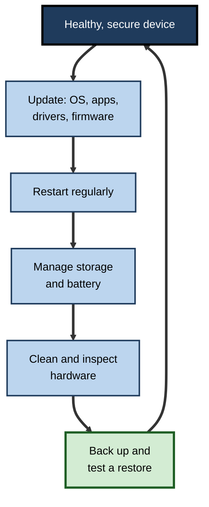
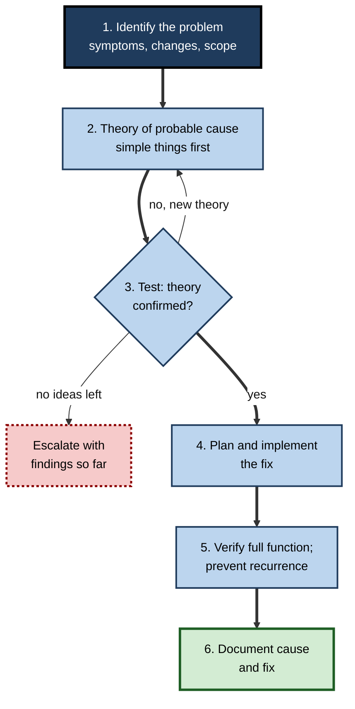
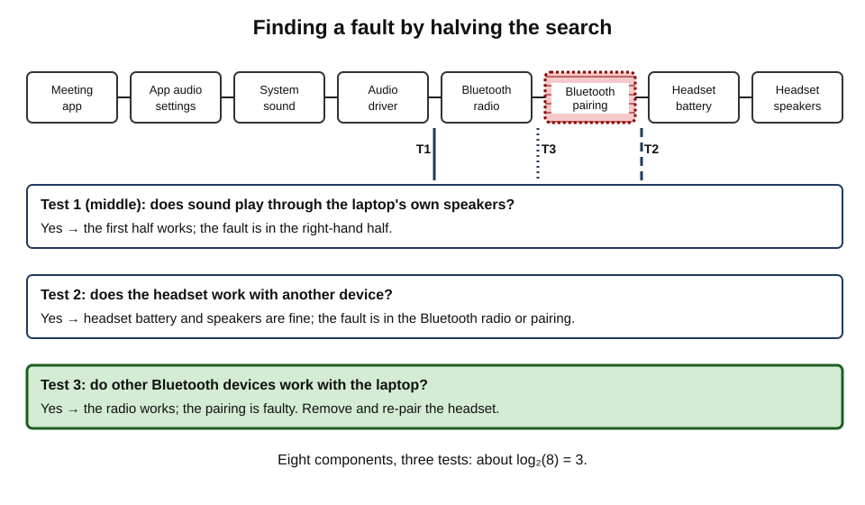
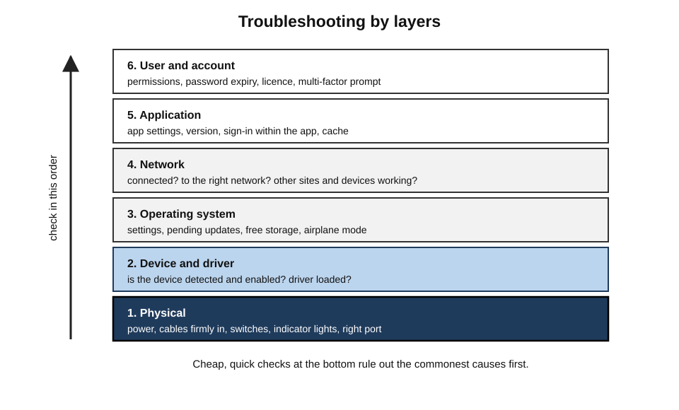
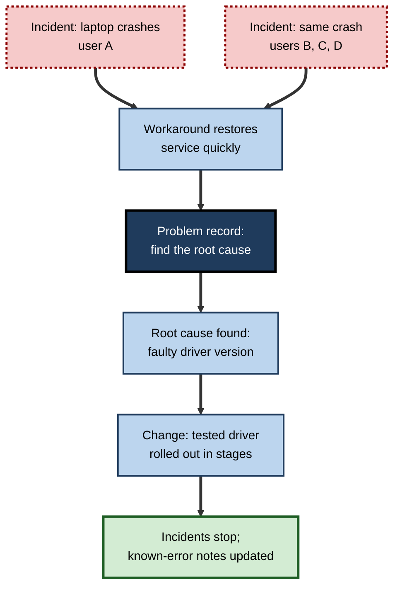
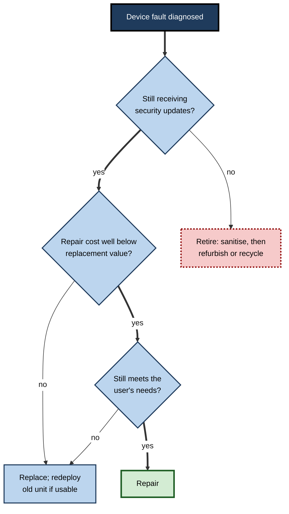

# A.13. Device Maintenance & Troubleshooting

Five minutes before a client presentation, a laptop refuses to show anything on the projector. One person unplugs everything, restarts twice, reinstalls a driver and runs out of time. Another checks the input setting on the projector, swaps the adaptor, and is presenting within ninety seconds. The difference is not luck or technical genius. It is **method** — and behind it, the habits of maintenance that stop most problems happening at all.

> **Definition — Device maintenance:** the routine actions that keep a device secure, reliable and performing well over its life — updating software, managing storage, caring for batteries, cleaning hardware and verifying backups.

> **Definition — Troubleshooting:** a systematic process of identifying, diagnosing and resolving a fault, moving from symptoms to cause to a verified fix.

**Why it matters**

- **Most security breaches exploit known flaws** for which fixes already exist; updating is the single most effective maintenance task.
- **Downtime is expensive** — every hour a professional cannot work costs the organisation, and problems tend to strike at the worst moments.
- **Method saves time** — systematic troubleshooting resolves common faults in minutes and produces clear reports when specialists are needed.
- **Longer device life** — well-maintained devices last longer, reducing cost and electronic waste.

---

## Preventive Maintenance

### Keeping software up to date

- **What to update:**
  - **operating system** — security fixes and features;
  - **applications** — including browsers, office suites, PDF readers, meeting software;
  - **drivers** — for graphics, network, audio, docks;
  - **firmware** — the device's start-up code (UEFI), docks, monitors, routers, phones.
- **Why it matters:** attackers study published fixes and target devices that have not applied them; the window between a fix's release and widespread attacks can be days.
- **Patch cycles** — Microsoft has released routine security updates on the second Tuesday of each month ("Patch Tuesday") since 2003; other vendors release on their own schedules or continuously.

> **Definition — Patch:** an update that fixes a security vulnerability or software bug.

**Incident card — WannaCry (May 2017)**

- **What happened:** ransomware spread automatically between Windows computers using a vulnerability in file-sharing software, encrypting files and demanding payment.
- **Background:** Microsoft had released a fix for the vulnerability in **March 2017**, two months earlier.
- **Impact:** hundreds of thousands of computers in many countries were affected; in the United Kingdom, parts of the National Health Service cancelled appointments and diverted ambulances.
- **Lesson:** the devices hit were largely those **not yet updated** — or running old operating systems no longer supported. Maintenance is a safety issue, not housekeeping.

> **Remember:** turn on **automatic updates**, **restart** when asked (many fixes apply only on restart), and treat **end-of-support** devices as unsafe for sensitive work.

> **Watch out:** a small minority of updates cause problems. Organisations reduce this risk by testing updates on a pilot group first ("update rings") — not by delaying updates indefinitely.

### Restarting regularly

- Long-running devices accumulate problems: memory not released by programs (**memory leaks**), stuck processes, half-applied updates.
- A restart clears working memory, reloads drivers and completes updates.
- **Shutting the lid or sleeping is not a restart**; many laptops go weeks without one.

### Managing storage

- Keep a healthy margin of **free space** — operating systems need room for updates, temporary files and virtual memory.
- Remove unused applications; empty downloads; move large archives to shared or cloud storage.
- Check drive **health indicators** where tools provide them.

### Batteries

- Avoid heat; avoid constant 100% charge when docked (use charge-limit settings); avoid repeated deep discharge.
- Check battery health reports; plan replacement when capacity has fallen substantially.
- Replace **swollen** batteries immediately; stop using the device.

### Physical cleaning and care

- **Power off and unplug** before cleaning.
- **Screens** — soft microfibre cloth, lightly dampened with water or a cleaner approved by the maker; never spray liquid directly on the screen.
- **Keyboards and mice** — shaken out, brushed or blown gently; disinfectant wipes approved by the maker in shared spaces.
- **Vents and fans** — remove dust with short bursts of compressed air, holding fans still.
- **Ports** — remove lint gently with non-metal tools.
- **Cables** — avoid sharp bends and pulling by the cord.

> **Watch out:** household cleaners containing ammonia, bleach or abrasives can damage screen coatings; excess moisture can enter keyboards and ports.

### Backups and their testing

- Important data should exist in more than one place, including a copy protected from ransomware.
- **A backup that has never been restored is untested.** Periodically restore a file or folder to prove it works.

### A maintenance rhythm

| Frequency | Personal device | Organisation |
|---|---|---|
| Daily | Let updates install; save work to synced storage | Automated patching; monitoring alerts |
| Weekly | Restart; check storage space | Review failed updates and device compliance |
| Monthly | Clean screen and keyboard; review apps and permissions | Patch cycle; firmware review; backup restore test |
| Quarterly | Check battery health; clear out old files | Asset inventory check; unsupported-device report |
| Yearly | Deep clean vents; review accounts and recovery options | Refresh planning; disaster-recovery exercise |

**Figure 1.** The cycle of preventive maintenance.

---

## A Method for Troubleshooting

### The six-step process

A widely taught method, used in the CompTIA A+ certification for support technicians, has six steps:

1. **Identify the problem** — gather information: what exactly happens, since when, what changed, who is affected, any error messages.
2. **Establish a theory of probable cause** — start with the simple and obvious; question assumptions.
3. **Test the theory** — confirm or reject it; if rejected, form a new theory or escalate.
4. **Plan and implement the solution** — consider side effects; back up first where needed.
5. **Verify full functionality** — confirm the original problem is gone and nothing else broke; add preventive measures.
6. **Document** — record symptoms, cause, fix and lessons.

> **Mnemonic — "I Expect To Plan, Verify, Document":** Identify, Establish a theory, Test, Plan and implement, Verify, Document.

**Figure 2.** The troubleshooting cycle.

### Principles that make the method work

- **Reproduce the problem** — a fault that can be made to happen on demand can be diagnosed; an intermittent one needs patient logging of when it occurs.
- **Ask what changed** — a new update, cable, location, password, application or setting is the most common cause.
- **Read the error message** — and copy it exactly; it is the device's own diagnosis.
- **Change one thing at a time** — otherwise it is impossible to know what fixed (or broke) it.
- **Start simple** — power, cables, settings and connections before drivers and reinstallation.
- **Divide and conquer** — split the system in half to locate the fault.
- **Work by layers** — from physical connections up through operating system to application.
- **Stop before causing harm** — back up data before risky steps; do not open hardware or erase systems without authority.

> **Key point:** most faults are found by **narrowing the search space** rather than by knowing the answer in advance. Experts are fast because they eliminate possibilities in the right order.

### Divide and conquer

- Also called **half-splitting**: test at a point in the middle of a chain; the fault lies on whichever side fails.
- *e.g.* no sound from a meeting:
  - Does sound play from another application? If yes, the fault is in the meeting app's settings; if no, it is in the device, driver or headset.
  - Does the headset work on another device? If yes, the computer side is at fault; if no, the headset.

**Figure 3.** Half-splitting a chain of components to find a fault.

> **Formula — Steps to isolate a fault by half-splitting:** with n possible points of failure in a chain, about log₂(n) tests are needed. For 16 components: log₂(16) = **4 tests**, against up to 15 testing one by one.

### Working by layers

- **Physical** — power, cables, switches, lights, connections.
- **Device and driver** — is the device recognised by the system?
- **Operating system** — settings, updates, services, storage space.
- **Network** — is there a connection, and to what?
- **Application** — settings, account, version.
- **User and account** — permissions, passwords, licences.

**Figure 4.** Checking from the physical layer upwards.

> **Example (illustrative):** a user reports "email is down". Checking upwards: laptop powered and online (physical, network) → other websites work (network fine) → email works in a browser but not in the desktop app (application) → the app's password prompt was hidden behind another window (account). Five minutes, no specialist needed.

---

## Common Problems and First Checks

| Symptom | Likely causes | First checks |
|---|---|---|
| Will not power on | Flat battery, faulty charger, power socket, hardware fault | Different socket and charger; charging light; hold power button 15 seconds |
| Very slow | Memory full, storage full, overheating, updates running, malware | Task or activity monitor; free space; restart; vents |
| No Wi-Fi | Wi-Fi switched off, wrong network, router problem, driver | Other devices on the network; toggle Wi-Fi; forget and rejoin; restart |
| No sound or microphone in calls | Wrong device selected, muted, permissions, Bluetooth | App's audio settings; system sound settings; app microphone permission |
| External monitor blank | Input source, cable, adaptor capability, dock power | Monitor input button; other cable; direct connection without dock |
| Printer not printing | Offline, paper or toner, queue stuck, wrong printer | Printer display; other user can print; clear queue |
| Battery drains fast | Brightness, background apps, ageing battery | Battery usage report; brightness; battery health |
| Crashes or blue screens | Driver, failing memory or storage, overheating | Recent changes; error code; built-in diagnostics |
| Device not recognised | Port, cable, driver, policy blocking it | Other port; other computer; device manager; ask IT about policy |
| "Storage almost full" | Downloads, caches, large media, old backups | Storage settings tools; move or delete large files |

### Why "turn it off and on again" works

- Clears temporary states: stuck processes, memory leaks, hung drivers.
- Re-establishes connections and reloads configuration.
- Completes pending updates.
- **Limit:** it fixes symptoms, not causes; if a restart is needed often, there is an underlying problem to investigate.

### Built-in tools

- **Task Manager or Activity Monitor** — which programs use processor, memory, disk and network.
- **Event logs and reliability history** — records of errors and crashes with times.
- **Hardware diagnostics** — many manufacturers include tests that run before the operating system starts, checking memory, storage, battery and fans.
- **Safe mode** — starts the operating system with minimal drivers and programs; if the problem disappears, a driver or startup program is likely to blame.
- **Network checks** — connection status, signal strength, simple reachability tests.
- **Recovery options** — system restore points, resetting the operating system while keeping files, or full reinstallation.

> **Definition — Safe mode:** a diagnostic start-up mode that loads only essential drivers and services, used to determine whether a problem is caused by additional software.

---

## Worked Example (illustrative): "No One Can Hear Me in Meetings"

**Situation:** an employee's colleagues cannot hear her in video calls since Monday. She uses a laptop docked to a monitor, with a Bluetooth headset.

1. **Identify** — problem started Monday; only in the meeting app; she can hear others; no error message. What changed? The IT department pushed a laptop update over the weekend, and she bought a new monitor with a built-in webcam and microphone.
2. **Theory 1 (simple)** — the meeting app is using the wrong microphone.
3. **Test** — in the app's audio settings, the selected microphone is "Monitor microphone", which is muted on the monitor. **Confirmed.**
4. **Implement** — select the headset microphone; run the app's test call.
5. **Verify** — test call records her voice clearly; a colleague confirms in a real call; she sets the headset as the default communications device in system settings so the choice persists.
6. **Document** — she adds a note to the team's help page: new monitors with microphones can take over as the default input.

| Step | Action | Result |
|---|---|---|
| Identify | Questions: when, where, what changed | New monitor with microphone; weekend update |
| Theory | Wrong input device selected | Most likely, simplest |
| Test | Check app audio settings | Monitor microphone selected and muted |
| Fix | Select headset; set system default | Voice clear in test call |
| Verify | Real call with colleague | Confirmed working |
| Document | Note on help page | Prevents repeat calls |

> **Watch out:** the tempting first move — reinstalling the meeting app or the audio driver — would have taken longer, risked new problems and **not fixed** the cause.

---

## When to Escalate

### Signs a problem needs specialists

- **Hardware damage** — liquid spills, swollen batteries, burning smells, clicking drives, cracked screens.
- **Security concerns** — unexpected pop-ups demanding payment, unfamiliar accounts, files renamed or encrypted, signs of remote control.
- **Data at risk** — the only copy of important data may be on the failing device.
- **Repeated failures** — the same problem after the obvious fixes.
- **Affects many users** — likely a wider service problem.
- **Outside authority** — changing security settings, installing unapproved software, opening the case.

> **Remember:** in a suspected **security incident**, disconnect from the network (unplug or disable Wi-Fi), **do not switch off** unless told to (memory can hold evidence), and report immediately.

### Writing a good support request

- **What** — the exact symptom and error message (screenshot if possible).
- **When** — first occurrence, how often, under what conditions.
- **Scope** — only this device, or others too?
- **Changes** — anything new before it started.
- **Tried** — steps already taken and their results.
- **Impact** — what work is blocked and how urgent it is.

> **Example:** poor — "Laptop broken, please fix." Good — "Since Tuesday's update, my laptop shows error 0x… and restarts when I connect to the office dock; it works without the dock; two colleagues on the same floor report the same; I have restarted twice and tried another cable; I have a client presentation at 3 pm."

### How service desks work

- **Tiered support** — first-line staff resolve common issues; second-line specialists handle complex ones; third-line experts or vendors handle the hardest.
- **Incident management** — restoring normal service as quickly as possible.
- **Problem management** — finding and removing the **root cause** of repeated incidents.
- **Change management** — controlling changes to systems so that fixes do not cause new failures.
- These practices are described in the widely used **ITIL** framework for IT service management.

> **Definition — Incident versus problem:** an **incident** is an unplanned interruption or degradation of service; a **problem** is the underlying cause of one or more incidents.

**Figure 5.** From incidents to a permanent fix.

### Five whys

- A root-cause technique associated with **Taiichi Ohno** and the Toyota Production System: ask "why?" repeatedly until reaching a cause that can be fixed systematically.
- *e.g.* laptop overheats → fan clogged → dust → laptops used on carpeted floors in the warehouse office → no stands provided → **provide stands and a cleaning schedule**.

> **Watch out:** five whys can oversimplify — real failures often have several contributing causes. Use it as a prompt for thinking, not a rigid formula.

---

## Repair, Replace or Retire

### The decision

- **Repair** when the fault is isolated, parts are available, the device still receives security updates and repair cost is well below replacement.
- **Replace** when repairs are frequent, costs approach a new device, or the device no longer meets the work.
- **Retire** when security support has ended or the hardware cannot run required software — then sanitise and reuse, refurbish or recycle.

**Figure 6.** Deciding whether to repair, replace or retire a device.

> **Formula — Simple repair threshold:** repair if repair cost < (replacement cost × remaining useful life ÷ expected total life). A laptop costing 1,200 new, expected to last 4 years, with 2 years remaining: threshold = 1,200 × 2 ÷ 4 = **600**. A 250 battery and keyboard repair passes; a 700 mainboard repair does not.

### Handing a device in for repair

- **Back up** first.
- **Protect data** — use encryption; some phones offer a **repair mode** that hides personal data from technicians.
- **Use authorised or reputable repairers**; keep records for organisational devices.
- **Remove or record accessories** and note the device's condition.

### Safety while maintaining hardware

- **Electrostatic discharge (ESD)** — static from the body can damage components; use an anti-static strap or touch a grounded metal object before handling internal parts.
- **Batteries** — never puncture, bend or heat lithium batteries; a swelling or hissing battery is a fire risk.
- **Mains power** — never open power supplies; capacitors can hold dangerous charges after unplugging.

> **Definition — Electrostatic discharge (ESD):** a sudden flow of static electricity between objects, which can damage sensitive electronic components even when no spark is felt.

---

## Remote Support and Scams

- **Legitimate remote support** — IT staff connect to a device with permission, through approved tools, usually after the user raises a ticket.
- **Tech-support scams** — callers or pop-ups claiming to be from well-known companies say the device is infected and ask to connect remotely or for payment.
  - Genuine companies **do not** cold-call about infections.
  - Pop-ups with phone numbers and alarms are a common lure.

> **Remember:** never give remote access to an **unsolicited** caller or a pop-up's phone number; contact IT or the vendor through known channels.

---

## Maintenance at Scale

### How organisations maintain thousands of devices

- **Unified endpoint management** — central consoles push updates, settings and software, and report compliance.
- **Update rings** — updates go first to IT staff, then a pilot group, then everyone, so problems are caught early.
- **Telemetry and digital employee experience (DEX) tools** — collect data on crashes, boot times, battery health and application performance to spot problems before users report them.
- **Self-service portals** — users install approved software and fix common problems themselves.
- **Automation and AI** — scripts and AI assistants diagnose and fix common faults; generative AI helps users and support staff interpret error messages.

> **Watch out:** AI troubleshooting suggestions can be confidently wrong. Check that suggested commands and settings changes are safe and appropriate before applying them, especially on organisational devices.

### Case study (illustrative): the crash nobody could reproduce

- **Situation:** over three weeks, about 8% of a firm's 4,000 laptops crashed several times a week, seemingly at random.
- **First response:** each incident was handled individually — reinstalling, replacing some laptops — without improvement.
- **Diagnosis through problem management:**
  1. Crash reports were collected centrally and compared.
  2. All affected laptops shared a single model of dock and a specific graphics-driver version.
  3. Crashes happened when laptops were undocked while asleep.
- **Actions:**
  1. Workaround published: shut the lid only after undocking, pending a fix.
  2. Vendor contacted with crash data; a corrected driver was released.
  3. The new driver was tested with the dock in a pilot ring, then rolled out in stages.
  4. Dock firmware and graphics drivers added to a joint testing checklist for future updates.
- **Result:** crashes fell to normal background levels within a fortnight of the rollout; laptops wrongly replaced earlier were returned to stock.
- **Lesson:** individual incidents hide patterns. **Problem management**, data and controlled change fix root causes that heroic one-off fixes cannot.

---

## The Troubleshooter's Mind

### Thinking traps

- **Confirmation bias** — seizing on the first plausible cause and ignoring evidence against it.
  - Remedy: ask "what would I expect to see if this theory were **wrong**?"
- **Recency bias** — blaming the most recent change even when the timing does not fit.
  - Remedy: check exactly when the problem began.
- **The expensive fix first** — reinstalling or replacing hardware before checking cables and settings.
  - Remedy: cheapest, quickest, least risky checks first.
- **Fixing without understanding** — a problem that vanishes after random changes will often return.
  - Remedy: find the cause, or at least record what changed.
- **Assuming the user is wrong** — or that they are right.
  - Remedy: observe the problem happening where possible.

> **Key point:** good troubleshooting is applied **scientific thinking** — observation, hypothesis, test, conclusion — carried out quickly and recorded.

### Questions that find causes fast

- **What exactly happens?** Ask for the exact message, or to see it happen.
- **When did it start, and what changed then?**
- **Does it happen everywhere, or only here?** Other devices, networks, rooms, accounts.
- **Does it happen to everyone, or only this person?**
- **Is it constant or intermittent?** If intermittent, what is different when it happens?

> **Mnemonic — "What, When, Where, Who, How often":** the five questions that open almost every diagnosis.

---

## Maintenance for Specific Devices

### Phones and tablets

- Automatic updates; weekly restart; storage clean-up; case and screen protector; battery settings; clear charging ports gently.

### Printers and multifunction devices

- Keep firmware updated; replace consumables before they run out; clean paper paths as the maker directs; review the device's stored-job and storage settings.

### Networking equipment at home or in a small office

- Update router firmware or replace routers no longer supported; change default administrator passwords; restart occasionally; check connected-device lists for unknown devices.

### Peripherals

- Update dock and monitor firmware where supported; replace frayed cables; clean shared keyboards and headsets.

| Device | Most important maintenance | Most common neglected step |
|---|---|---|
| Laptop | Updates and restarts | Firmware and dock updates |
| Phone | Updates and storage space | Weekly restart |
| Router | Firmware updates | Replacing when unsupported |
| Printer | Firmware and secure settings | Wiping storage at disposal |
| Smart devices | Updates and unique passwords | Inventory: knowing they exist |

> **Watch out:** "it still works" is not the same as "it is still safe". Routers, cameras and printers often keep working for years after their makers stop fixing security flaws.

---

## Documentation That Pays Back

- **Personal notes** — a simple log of fixes that worked (for example, how to reset the dock or re-pair a headset) saves repeating the same investigation.
- **Team knowledge bases** — short articles with symptoms in the title, steps and screenshots, written in users' language.
- **Known-error records** — service desks record problems with workarounds so first-line staff can resolve repeats in minutes.

> **Key point:** the sixth troubleshooting step — documentation — turns one person's solved problem into an organisation's capability.

---

## Open Questions

- **Can devices maintain themselves?**
  - Automated updates and AI-driven repair are spreading; how far human oversight can be reduced safely is unclear.
- **How fast should updates be applied?**
  - Speed closes security gaps; caution avoids faulty updates; the right balance varies by sector and system.
- **Will right-to-repair laws change device maintenance?**
  - Requirements for parts, manuals and replaceable batteries may extend lives; their practical effect is still emerging.
- **How should AI be trusted in troubleshooting?**
  - AI assistants accelerate diagnosis but can mislead; evaluating their accuracy in real support work is an open area.

---

## Summary

- **Maintenance** keeps devices secure and reliable: **updates** (OS, apps, drivers, firmware), restarts, storage and battery care, careful cleaning, backups with **restore tests**.
- **WannaCry** (2017) hit devices that had not applied a fix released two months earlier; unsupported devices are unsafe.
- **Troubleshooting** follows six steps: **identify, theorise, test, plan and implement, verify, document**.
- Principles: reproduce, ask what changed, read errors, one change at a time, start simple, **half-split** (≈ log₂ n tests), work **by layers** from physical upwards, avoid harm.
- Restarting clears temporary faults but does not fix root causes; use built-in tools, logs, diagnostics and **safe mode**.
- Escalate hardware damage, security concerns, at-risk data, repeated or widespread faults; write clear requests (what, when, scope, changes, tried, impact).
- Service desks separate **incidents**, **problems** and **changes** (ITIL); five whys prompts root-cause thinking.
- Decide **repair, replace or retire** on security support, cost against remaining value and fitness for work; protect data during repair; respect **ESD** and battery safety.
- Never give remote access to unsolicited callers. At scale, use central management, **update rings**, telemetry and careful use of AI.

---

## Self-Check

1. Define maintenance and troubleshooting.
2. Why is applying updates the most important maintenance task? Use WannaCry in your answer.
3. Why does a restart fix many problems, and when is it not enough?
4. List six maintenance actions and how often each should be done on a personal laptop.
5. State the six troubleshooting steps.
6. Why should only one thing be changed at a time?
7. How many half-splitting tests are needed to isolate a fault among 32 components?
8. A user says "the internet is down". Work through the layers.
9. What does safe mode reveal?
10. List four signs that a problem should be escalated.
11. Rewrite "My computer doesn't work" as a good support request for a laptop that will not connect to the office Wi-Fi.
12. Distinguish an incident from a problem with an example.
13. Using the repair threshold formula, should a 400 repair be done on a 1,500 laptop with a 5-year life and 1 year remaining?
14. A pop-up says the computer is infected and shows a phone number. What should the user do?

### Answer Key

1. Maintenance: routine actions keeping a device secure, reliable and performing well. Troubleshooting: systematic identification, diagnosis and resolution of faults.
2. Most attacks exploit known flaws with available fixes. WannaCry spread in May 2017 through a vulnerability fixed in March 2017, hitting unpatched and unsupported systems.
3. It clears stuck processes, memory leaks and hung drivers and completes updates. Not enough if the problem recurs — a root cause remains.
4. Updates (automatic, daily); restart (weekly); check storage (weekly); clean screen and keyboard (monthly); battery health (quarterly); deep-clean vents (yearly); test backup restore (monthly or quarterly).
5. Identify the problem; establish a theory; test it; plan and implement; verify full functionality; document.
6. Otherwise it is impossible to know which change fixed or caused the problem, and new problems may be introduced unnoticed.
7. log₂(32) = **5 tests**.
8. Physical: is the device on, Wi-Fi switched on, cable connected? Network: connected to the right network; other devices working? OS: settings, airplane mode, VPN? Application: other websites or apps working? Account: sign-in or proxy prompts?
9. Whether the problem is caused by additional drivers or startup programs: if it disappears in safe mode, they are the likely cause.
10. Physical damage or swollen battery; security concerns; important data at risk; repeated failure after basic fixes; many users affected; action outside the user's authority.
11. E.g. "Since this morning my laptop cannot join the office Wi-Fi on floor 3 (message: 'Can't connect to this network'). It worked yesterday. My phone connects fine; a colleague's laptop also fails. I restarted and forgot and rejoined the network. I need access for a 2 pm deadline."
12. Incident: an interruption — a user cannot print today. Problem: the underlying cause — a faulty print-server update causing repeated failures for many users.
13. Threshold = 1,500 × 1 ÷ 5 = **300**; the 400 repair exceeds it, so replacement (or redeployment) is likely better.
14. Do not call the number or allow remote access; close the browser (force-quit if needed); report to IT or contact the vendor through official channels; run a scan if advised.

---

## Glossary

| Term | Meaning |
|---|---|
| Change management | Controlling changes to systems to avoid new failures. |
| Confirmation bias | Favouring evidence that supports a first idea and ignoring evidence against it. |
| Digital employee experience | Monitoring device and application performance from the user's perspective. |
| Electrostatic discharge | Static electricity that can damage electronic parts. |
| Escalation | Passing a problem to more specialised support. |
| Five whys | Asking "why" repeatedly to reach a root cause. |
| Half-splitting | Testing at the midpoint of a chain to locate a fault. |
| Incident | An unplanned interruption or degradation of service. |
| ITIL | A widely used framework for IT service management. |
| Maintenance | Routine actions keeping devices secure and reliable. |
| Memory leak | A program failing to release memory it no longer needs. |
| Patch | An update fixing a vulnerability or bug. |
| Patch Tuesday | Microsoft's monthly security update day. |
| Problem | The underlying cause of one or more incidents. |
| Root cause | The fundamental reason a fault occurs. |
| Safe mode | A start-up mode loading only essential components. |
| Tech-support scam | Fraud posing as technical support to gain access or payment. |
| Troubleshooting | Systematic diagnosis and resolution of faults. |
| Unified endpoint management | Central management of many kinds of device. |
| Update ring | A staged group receiving updates before wider rollout. |
| WannaCry | 2017 ransomware that spread through unpatched Windows systems. |
| Workaround | A temporary way to restore service before a permanent fix. |
