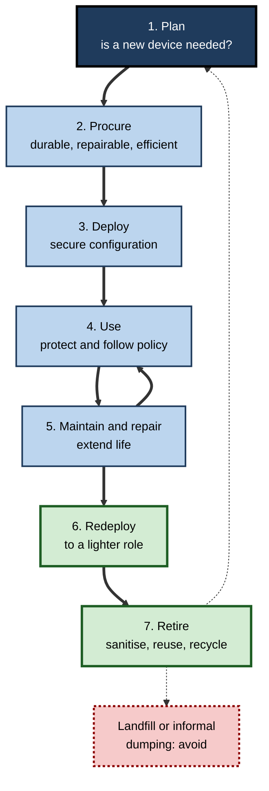
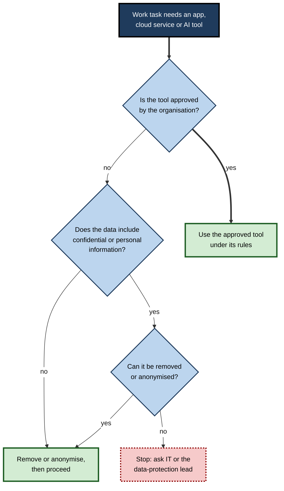
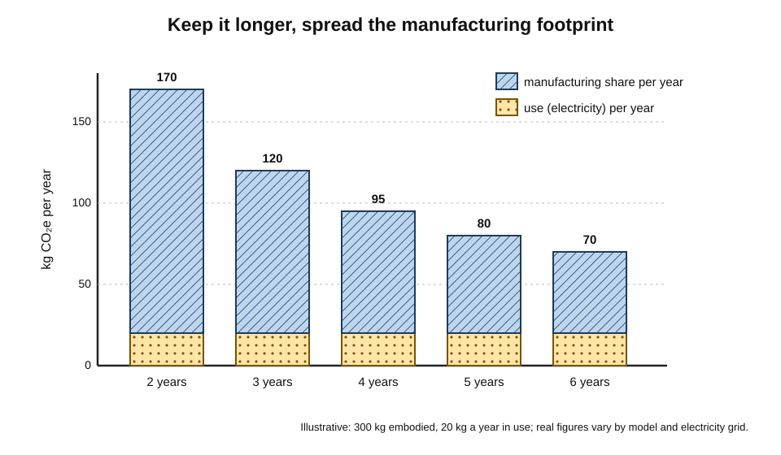
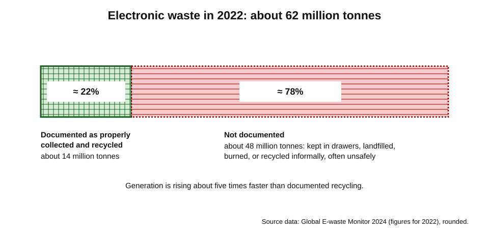
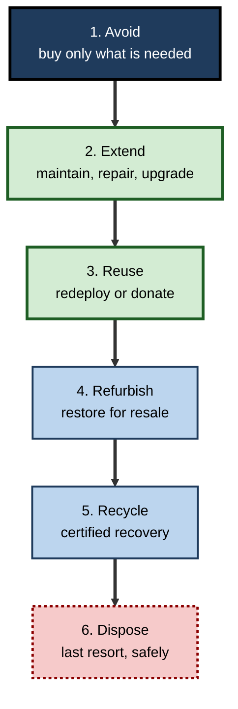

# B.14. Responsible Device Usage

A consultant leaves her unlocked laptop on a café table while she queues for coffee.

An engineer pastes confidential source code into a public AI chatbot to fix a bug. A manager replaces a working phone every year because the new one is slightly faster. A drawer in every office holds a tangle of chargers, dead phones and old laptops nobody knows how to get rid of. None of these people is malicious; each is using a device **without thinking about its wider consequences** — for data, colleagues, the organisation and the planet.

> **Definition — Responsible device usage:** using, managing and disposing of computing devices in ways that protect the data they hold, respect other people, follow the organisation's rules and the law, and minimise environmental and social harm across the device's whole life.

**Why it matters**

- **Data protection** — most devices carry personal and confidential data; carelessness causes breaches, fines and harm to real people.
- **Trust** — clients, patients and colleagues trust professionals to handle their information and their privacy carefully.
- **Cost** — lost, damaged and prematurely replaced devices are expensive.
- **Environment** — devices have a large environmental footprint, most of it created before they are ever switched on.
- **Social impact** — mining, manufacturing and disposal of electronics affect workers and communities worldwide.

---

## The Device Lifecycle

Responsible use is not a single act; it runs through every stage of a device's life.

### Stages

1. **Plan** — is a new device needed at all? What must it do, and for how long?
2. **Procure** — choose durable, repairable, efficient models from responsible suppliers; consider refurbished.
3. **Deploy** — configure securely: encryption, updates, management, accounts.
4. **Use** — protect, maintain and use within policy.
5. **Maintain and repair** — updates, battery replacement, repairs that extend life.
6. **Redeploy** — pass to another user whose needs it still meets.
7. **Retire** — sanitise data, then reuse, refurbish or recycle through certified channels.

**Figure 1.** The responsible device lifecycle.

> **Key point:** the most responsible decision is often made **before purchase** — buying less, buying better and keeping devices longer.

---

## Protecting the Device and Its Data

### Physical security

- **Never leave devices unattended** in public places, cars or unlocked rooms.
- **Lock the screen** every time the device is left, even briefly — on Windows, Windows key + L; on a Mac, Control + Command + Q.
- **Carry discreetly** — laptop bags that do not advertise the contents; devices as hand luggage when travelling.
- **Privacy screens** — prevent "shoulder surfing" on trains and in cafés.
- **Clean-desk practice** — no passwords on sticky notes; papers and devices locked away at the end of the day.
- **Report loss immediately** — fast remote locking and wiping limit harm.

> **Definition — Shoulder surfing:** obtaining information by watching someone's screen or keyboard, for example in a public place.

### Built-in protections to keep switched on

- **Full-disk encryption** — makes a lost device's data unreadable.
- **Automatic updates.**
- **Strong sign-in** — biometrics or a long PIN; passkeys where possible; multi-factor authentication for accounts.
- **Find-my-device and remote wipe.**
- **Automatic screen lock** after a short idle time.

> **Remember:** **Lock it, encrypt it, update it, report it.**

> **Mnemonic — LEUR ("Leave Every Unit Ready"):** Lock, Encrypt, Update, Report.

### Travelling with devices

- **Public Wi-Fi** — prefer a phone hotspot or the organisation's VPN for sensitive work.
- **Charging** — use own charger and socket rather than unknown USB ports.
- **Borders** — border officials in some countries may inspect devices; organisations sometimes issue clean "travel" devices for high-risk destinations.
- **Conversations** — calls in public spaces can be overheard; confidential matters wait for private places.

---

## Using Devices Within the Rules

### Acceptable use policies

- Most organisations publish an **acceptable use policy** covering:
  - permitted and forbidden uses of devices, networks and accounts;
  - personal use limits;
  - software installation;
  - handling of confidential data;
  - monitoring the organisation may carry out;
  - consequences of misuse.

> **Definition — Acceptable use policy (AUP):** an organisation's rules for how its devices, networks, systems and data may be used, which users agree to follow.

### Shadow IT and unapproved tools

- **Shadow IT** — devices, apps or cloud services used for work without the organisation's approval.
  - *e.g.* personal file-sharing accounts, unapproved messaging apps, free online converters.
- **Risks** — data stored where the organisation cannot protect, find or delete it; breaches of client contracts and data-protection law.
- **Generative AI tools** — pasting confidential information into public AI services may send it to a provider whose terms allow storage or use for training.
  - *e.g.* in 2023, after engineers at a large electronics company were reported to have pasted confidential source code into a public chatbot, the company restricted staff use of such tools.

> **In practice:** responsible professionals use **organisation-approved** AI tools and storage, remove or anonymise sensitive data before using any external service, and ask when unsure rather than assuming.

**Figure 2.** Questions before putting work data into an external tool.

### Personal devices for work

- Use only within the organisation's **BYOD** rules — usually a work profile, passcode, current operating system and approved apps.
- Keep work data in managed apps; do not forward work email to personal accounts.
- On leaving the organisation, allow work data to be removed.

---

## Respecting Other People

### Devices in shared spaces

- **Calls and meetings** — headphones in open-plan offices and public transport; take long calls in meeting rooms or booths.
- **Notifications** — silence devices in meetings, theatres, hospitals, places of worship.
- **Screens in meetings** — attention to the people present; laptops open only when needed for the task.
- **Shared devices** — sign out, clear personal data, clean surfaces after use.

### Cameras, microphones and recording

- **Consent** — recording conversations, meetings or people often requires consent; laws differ between countries and between one-party and all-party consent regimes.
- **Meeting recordings and AI note-takers** — announce them, allow objections, and follow rules on storage and access.
- **Photography** — avoid capturing others' screens, documents or faces without permission, especially in workplaces, hospitals and schools.
- **Smart glasses and wearable cameras** — raise particular concerns because recording is less obvious.

> **Watch out:** AI meeting assistants that join calls automatically can record clients or colleagues who have not agreed. Check the settings, and switch off automatic joining for external meetings unless consent is clear.

### Accessibility and inclusion

- Share files in **accessible formats** and switch on captions in meetings.
- Do not assume everyone can use the same device in the same way; support alternatives.

### Wellbeing and attention, briefly

- Constant notifications fragment attention; responsible use includes **managing notifications, focus time and after-hours availability** for oneself and respecting them in others.
- Organisations increasingly set norms on out-of-hours messages; in some countries, such as France, employees have a legal "right to disconnect".

---

## The Environmental Footprint of Devices

### Where the footprint comes from

- **Manufacturing** — mining and refining metals, making chips (very energy- and water-intensive), assembling and transporting devices.
- **Use** — electricity for charging and running devices, plus the data centres and networks they rely on.
- **End of life** — collection, recycling, or harm when dumped or burned.
- **For phones and laptops, manufacturing usually dominates** — life-cycle assessments typically attribute a large majority of lifetime greenhouse-gas emissions to production rather than use.

> **Definition — Embodied carbon:** the greenhouse-gas emissions caused by making, transporting and disposing of a product, as distinct from emissions from using it.

> **Watch out:** life-cycle figures vary considerably between studies, models and electricity grids. Manufacturers' own product footprints use different methods; comparisons across brands are unreliable. The robust conclusion is qualitative: **for most personal devices, keeping them longer reduces total impact**.

### Keeping devices longer

> **Formula — Annualised footprint:** annual footprint = embodied emissions ÷ years of use + annual use emissions. A laptop with 300 kg CO₂e embodied and 20 kg CO₂e per year in use: kept 3 years → 300 ÷ 3 + 20 = **120 kg a year**; kept 5 years → 300 ÷ 5 + 20 = **80 kg a year** — a third lower.

**Figure 3.** How keeping a laptop longer lowers its yearly footprint.

### The electronic-waste problem

- **Global E-waste Monitor 2024** (United Nations bodies):
  - the world generated about **62 million tonnes** of electronic waste in 2022;
  - only about **22%** was documented as properly collected and recycled;
  - e-waste was rising roughly five times faster than documented recycling, with the recycling rate projected to fall towards 20% by 2030.
- **Valuable materials** — gold, copper, cobalt, rare-earth elements — are lost when devices are not recycled.
- **Hazards** — lead, mercury, flame retardants and battery chemicals harm people and environments when devices are burned or dismantled informally, often in lower-income countries without protection.

**Figure 4.** Electronic waste generated in 2022 and the share documented as properly recycled.

> **Definition — E-waste (WEEE):** discarded electrical and electronic equipment; in the European Union governed by the Waste Electrical and Electronic Equipment (WEEE) rules, which require producers to finance collection and recycling.

### The waste hierarchy for devices

1. **Avoid** — do not buy what is not needed; share devices where suitable.
2. **Extend** — maintain, repair and upgrade.
3. **Reuse** — redeploy within the organisation or donate (after sanitisation).
4. **Refurbish** — professional restoration for resale.
5. **Recycle** — certified recyclers recover materials safely.
6. **Dispose** — only what cannot be recovered, safely.

**Figure 5.** The waste hierarchy applied to devices, from most to least preferable.

### Repair, regulation and labels

- **Right to repair** — movements and laws requiring makers to provide parts, tools and manuals.
  - **France** introduced a repairability index for some electronics in 2021.
  - **EU ecodesign rules for phones and tablets (June 2025)** require spare parts for seven years, durable batteries and a repairability score on the energy label.
  - **The EU Right to Repair Directive (2024)**, to apply from 2026, obliges makers of certain products to offer repair and makes repair a more attractive option.
  - **EU Battery Regulation** — user-replaceable portable batteries in devices such as phones from 2027, with exemptions.
- **Common chargers** — EU USB-C rules for small devices (2024) and laptops (2026).
- **Eco-labels for buyers** — EPEAT, TCO Certified and Energy Star signal energy efficiency, durability, hazardous-substance limits and take-back.

### Refurbished devices

- **Refurbished** — used devices tested, repaired, cleaned and resold, often with warranty.
- **Benefits** — lower price; avoids most of the embodied emissions of a new device.
- **Checks** — reputable refurbisher, warranty, battery health, remaining years of software support.

> **Watch out:** a refurbished device near the end of its **software support** may be cheap but short-lived for secure use. Check how many years of updates remain before buying.

---

## Responsible Sourcing

### Minerals and manufacturing

- Devices use **tin, tantalum, tungsten and gold** (often called **3TG**), and **cobalt**, lithium and other materials.
- Some have been mined in conflict zones or under abusive conditions — including child labour in parts of artisanal cobalt mining.
- **Regulation:**
  - **United States, Dodd–Frank Act section 1502 (2010)** — listed companies must report use of 3TG from the Democratic Republic of the Congo and neighbouring countries.
  - **European Union Conflict Minerals Regulation (applying from 2021)** — importers of 3TG must carry out supply-chain due diligence.
  - **EU Corporate Sustainability Due Diligence Directive (2024)** — wider human-rights and environmental due-diligence duties for large companies, being phased in.
- **Manufacturing labour** — working conditions in device assembly have been the subject of investigations and industry codes of conduct.

> **Definition — Supply-chain due diligence:** the process by which a company identifies, prevents and accounts for human-rights and environmental risks in its suppliers and their suppliers.

> **In practice:** procurement teams ask suppliers for responsible-minerals reporting, labour audits, recycled-content figures, take-back schemes and product carbon footprints, and give weight to these in tenders alongside price.

---

## Worked Example: Comparing Refresh Policies for 1,000 Laptops

**Situation:** a firm replaces its 1,000 laptops every three years. The sustainability team proposes five years, with a battery replacement at year three. Assume (illustratively) 300 kg CO₂e embodied per laptop, 20 kg CO₂e per year in use, a 1,200 purchase price, a battery replacement costing 120, and slightly higher support costs for older machines.

| Per laptop, per year | 3-year refresh | 5-year refresh with battery |
|---|---|---|
| Embodied emissions share | 300 ÷ 3 = 100 kg | (300 + 10 for battery) ÷ 5 = 62 kg |
| Use emissions | 20 kg | 20 kg |
| **Total emissions** | **120 kg** | **82 kg** |
| Purchase cost share | 1,200 ÷ 3 = 400 | (1,200 + 120) ÷ 5 = 264 |
| Extra support (older devices) | 0 | 30 |
| **Total cost** | **400** | **294** |

1. **Emissions** — for 1,000 laptops, about (120 − 82) × 1,000 = **38 tonnes CO₂e less** each year.
2. **Cost** — about (400 − 294) × 1,000 = **106,000 less** each year.
3. **Conditions** — the laptops must stay within **security support** for five years and meet users' needs; power users may still need earlier replacement.

> **Watch out:** all inputs are illustrative. Real decisions should use measured support costs, actual product footprints and the support dates of the chosen models.

---

## Case Study: An Organisation-Wide Device Responsibility Programme

- **Situation:** a 5,000-person professional-services firm found that devices were lost at a high rate, accessories were bought without control, laptops were replaced every three years regardless of condition, and old devices accumulated in cupboards for years.
- **Actions:**
  1. **Policy** — a short, plain-language acceptable use policy and a "lock, encrypt, update, report" campaign; approved AI tools introduced with clear rules on data.
  2. **Procurement** — fewer models, chosen for durability, repairability, long support and eco-labels; refurbished devices offered for lighter roles.
  3. **Lifecycle** — laptops moved to a condition-based refresh with battery replacement; returned devices redeployed, then refurbished.
  4. **End of life** — certified disposal partner with per-device sanitisation certificates; quarterly collection of devices from every office.
  5. **Measurement** — devices lost per 1,000 staff, average device age, share reused or refurbished, e-waste tonnage and estimated emissions reported to the board.
- **Result (over two years):** fewer lost devices, a longer average device life, most retired devices reused or refurbished rather than recycled, and lower spending on devices and accessories.
- **Side effects:** some staff disliked keeping laptops longer; a faster "exception" route was created for genuine performance needs.
- **Lesson:** responsible usage is a **system** — policy, procurement, lifecycle and measurement — not a poster campaign.

---

## Energy Use in Everyday Practice

Use-phase energy is smaller than manufacturing for most personal devices, but across an organisation, and for desktops, monitors and servers, it is still significant.

### Simple settings that save energy

- **Sleep after short idle periods** — screens after a few minutes, computers after 15–30 minutes.
- **Power-saving modes** — balanced or efficiency settings for routine work.
- **Screen brightness** — matched to the room; screens are often the largest consumers in laptops and phones.
- **Monitors off at night** — monitors left in standby across an office add up.
- **Chargers** — modern chargers draw very little when idle, but multi-socket power strips with switches make it easy to cut power to whole desks.
- **Video and streaming** — lower resolutions where high definition adds nothing, such as audio-focused calls.

> **Formula — Office monitor standby:** 300 monitors × 0.5 W standby × 6,500 out-of-hours hours ≈ 975 kWh a year. Small per screen; worth switching off as part of a wider power policy.

### Digital habits and data centres

- Every file stored and every video streamed uses some energy in data centres and networks.
- Individual habits matter less than **organisational choices** — retention policies, efficient applications, data-centre location and renewable energy — but avoiding pointless storage and duplication helps both cost and footprint.

> **Watch out:** widely shared claims about the carbon cost of a single email or hour of streaming vary by orders of magnitude between studies, because they depend on assumptions about networks, devices and electricity. Treat precise per-action figures with caution.

---

## Donating and Passing On Devices Safely

- **Back up** anything needed from the device.
- **Sign out of accounts** — cloud, app store, find-my-device and messaging services — so the new owner is not blocked by activation locks.
- **Remove from management** — organisational devices must be released from device management by IT.
- **Erase properly** — a full factory reset on an encrypted phone or laptop is effective because the encryption keys are destroyed; for unencrypted or high-risk devices use certified sanitisation.
- **Remove SIM and memory cards.**
- **Check support life** — a device that no longer receives updates may be unsafe for the recipient's banking or schoolwork; recycling may be more responsible.
- **Use reputable channels** — certified refurbishers, charities with data-wiping processes, manufacturer and retailer take-back schemes.

> **Example:** a school receiving donated laptops from a company asked that each be wiped with a certificate, upgraded to a supported operating system and fitted with a fresh battery where needed. The donation then provided several more years of safe use instead of passing on a security and support problem.

---

## Measuring Responsible Device Use

Organisations that take device responsibility seriously measure it, because what is reported to leaders tends to improve.

### Useful indicators

- **Security**
  - percentage of devices encrypted, updated and enrolled in management;
  - devices lost or stolen per 1,000 staff;
  - number of unsupported devices still in use.
- **Lifecycle**
  - average age of devices at retirement;
  - share of retired devices reused, refurbished or recycled with certificates;
  - repair rate compared with replacement rate.
- **Environment**
  - estimated embodied and use-phase emissions of the device estate;
  - share of purchases with recognised eco-labels;
  - e-waste tonnage and recovery rate.
- **People**
  - accessibility requests met;
  - satisfaction with devices and support.

| Indicator | What it reveals | Typical direction of improvement |
|---|---|---|
| Devices encrypted and up to date | Exposure to data loss and attack | Towards 100% |
| Lost devices per 1,000 staff | Physical security habits | Down |
| Average age at retirement | Lifecycle discipline | Up, within support limits |
| Share of retired devices reused or refurbished | Circularity | Up |
| Unsupported devices in use | Hidden security risk | Towards zero |

> **Key point:** these indicators link security, cost and sustainability. A longer device life with full support and good maintenance usually improves all three at once.

---

## Personal and Family Devices

- **The same principles apply at home** — lock screens, updates, backups, strong sign-in, careful disposal.
- **Children's devices** — age-appropriate settings, purchase controls and open conversation about online life; specific approaches to children's wellbeing and safety are a large subject of their own.
- **Shared family computers** — separate user accounts so that each person's data and settings stay private.
- **Old phones in drawers** — billions are estimated to sit unused worldwide; they contain recoverable materials and sometimes personal data. Wipe them and pass them on or recycle them.

---

## Responsible Procurement in Practice

### Writing sustainability into a device tender

- **Durability and support** — minimum years of security updates; availability of batteries, keyboards and screens as spare parts; warranty length.
- **Repairability** — repairability scores where available; access to manuals and parts for in-house or third-party repairers.
- **Energy** — Energy Star or equivalent efficiency; efficient power supplies.
- **Materials** — recycled content; restricted hazardous substances; responsibly sourced minerals with reporting.
- **Packaging** — reduced and recyclable packaging; bulk delivery.
- **End of life** — supplier take-back with certified data sanitisation and recycling reports.
- **Transparency** — product carbon footprints calculated with stated methods.

> **In practice:** many public bodies give sustainability criteria a defined share of the evaluation score — for example a fifth or a quarter — so that the cheapest bid does not win automatically if it performs poorly on durability or take-back.

### Device-as-a-service

- Some suppliers lease devices with support, refresh and take-back bundled into a monthly fee.
- **Potential benefits** — predictable costs, guaranteed return of devices for refurbishment, simpler disposal.
- **Potential drawbacks** — total cost may be higher; short contract cycles can encourage replacing devices more often than needed unless the contract specifies longer lives.

> **Watch out:** "as a service" models are only as sustainable as their contract terms. Check refresh intervals, what happens to returned devices, and whether data sanitisation is certified.

---

## A Personal Code for Responsible Use

- **Before buying** — do I need it? Will a repair, battery or refurbished device do?
- **Every day** — lock, update, back up, keep work data in approved tools.
- **With others** — ask before recording; mind volume, screens and notifications.
- **When done** — wipe, sign out, pass on or recycle through trusted channels.

> **Key point:** responsible device use is a small set of habits repeated consistently. The habits protect data, people and the planet at the same time.

---

## Open Questions

- **How long should devices last?**
  - Regulation pushes longer support and repairability; manufacturers' business models and users' expectations may resist.
- **How can e-waste exports be controlled?**
  - Much e-waste is shipped as "used goods" to countries with informal recycling; enforcement is difficult.
- **How should AI's footprint be counted?**
  - On-device and cloud AI add energy use; how to attribute and reduce it is still being worked out.
- **Can supply chains be made fully transparent?**
  - Tracing minerals from mine to device across many intermediaries remains imperfect despite regulation.
- **Where is the line between monitoring and trust?**
  - Organisations need to protect devices and data; excessive monitoring of employees' device use harms trust and may breach law.

---

## Summary

- **Responsible device usage** protects data, respects people, follows rules and minimises environmental and social harm across the **whole lifecycle**: plan, procure, deploy, use, maintain, redeploy, retire.
- Physical security: never unattended, **lock the screen**, privacy screens, clean desks, report loss; keep **encryption**, updates, strong sign-in and remote wipe on — **Lock, Encrypt, Update, Report**.
- Follow the **acceptable use policy**; avoid **shadow IT**; use approved AI tools and keep confidential data out of public services.
- Respect others: calls and notifications in shared spaces, **consent** for recordings and AI note-takers, accessible sharing, healthy availability norms.
- Most of a phone's or laptop's footprint is **embodied carbon**; keeping devices longer cuts annual impact (**embodied ÷ years + use**).
- E-waste: about **62 million tonnes** in 2022, only about **22%** documented as properly recycled.
- Follow the **waste hierarchy**: avoid, extend, reuse, refurbish, recycle, dispose; support **right to repair** and use eco-labels and refurbished devices wisely.
- **Responsible sourcing**: 3TG and cobalt risks; Dodd–Frank 1502, EU Conflict Minerals Regulation, due-diligence duties.
- Organisations make responsibility real through **policy, procurement, lifecycle management and measurement**.

---

## Self-Check

1. Define responsible device usage and name its four main concerns.
2. List the seven stages of the device lifecycle and the responsible action at each.
3. Why is a screen lock important even when stepping away for one minute in the office?
4. Give the four elements of "Lock, Encrypt, Update, Report".
5. What is shadow IT, and why is pasting confidential data into a public AI tool risky?
6. What should be checked before recording a client meeting with an AI note-taker?
7. What is embodied carbon, and why does it matter for decisions about replacing phones?
8. Calculate the annual footprint of a phone with 60 kg CO₂e embodied and 3 kg per year in use, kept 2 years and kept 4 years.
9. What did the Global E-waste Monitor 2024 report?
10. Put the waste hierarchy in order and explain why reuse comes before recycling.
11. Give three EU measures that support longer device lives.
12. What should a buyer check before choosing a refurbished laptop?
13. What are 3TG minerals, and what does supply-chain due diligence require?
14. A department head wants all staff to receive new phones every year as a perk. Evaluate the proposal.

### Answer Key

1. Using, managing and disposing of devices so that data is protected, people are respected, rules and law are followed and environmental and social harm is minimised.
2. Plan (need?), procure (durable, repairable, efficient, refurbished), deploy (secure configuration), use (protect, follow policy), maintain and repair (extend life), redeploy (lighter role), retire (sanitise, reuse, recycle).
3. Anyone passing can read or send messages, access files or install software under the user's identity in seconds.
4. Lock the screen; encrypt the device; keep it updated; report loss or suspicious activity immediately.
5. Devices, apps or services used without approval. Public AI tools may store or use inputs, placing confidential data outside the organisation's control and possibly breaching contracts and law.
6. Whether participants have been told and consent, what the law requires in the relevant jurisdictions, the organisation's policy, where recordings and transcripts are stored and who can access them.
7. Emissions from making, transporting and disposing of a product. For phones, manufacturing dominates lifetime emissions, so replacing early adds a large footprint regardless of efficiency gains.
8. 2 years: 60 ÷ 2 + 3 = **33 kg** a year; 4 years: 60 ÷ 4 + 3 = **18 kg** a year.
9. About 62 million tonnes of e-waste in 2022, only about 22% documented as properly collected and recycled, with generation rising about five times faster than documented recycling.
10. Avoid, extend, reuse, refurbish, recycle, dispose. Reuse keeps the whole device and its embodied value in use; recycling recovers only some materials, with energy and losses.
11. Ecodesign rules for phones and tablets (spare parts, durable batteries, repairability label, updates); Right to Repair Directive; Battery Regulation requiring user-replaceable batteries; common USB-C charger rules.
12. Reputable refurbisher, warranty, battery health, remaining years of security support, specification adequate for the role.
13. Tin, tantalum, tungsten and gold, some sourced from conflict areas. Due diligence requires identifying, preventing and accounting for human-rights and environmental risks throughout the supply chain.
14. Annual replacement greatly increases embodied emissions, e-waste and cost for little productivity gain; it conflicts with sustainability commitments. Better: replace on need or condition, offer battery replacement, choose long-support models, and offer other benefits.

---

## Glossary

| Term | Meaning |
|---|---|
| 3TG | Tin, tantalum, tungsten and gold, minerals subject to conflict-sourcing rules. |
| Acceptable use policy | Rules for how an organisation's devices, systems and data may be used. |
| Activation lock | A feature tying a device to its owner's account so it cannot be reused without sign-out. |
| Clean-desk practice | Securing papers and devices and leaving no sensitive information visible. |
| Due diligence | Identifying and addressing human-rights and environmental risks in supply chains. |
| E-waste | Discarded electrical and electronic equipment. |
| Eco-label | A certification signalling environmental performance, such as EPEAT. |
| Embodied carbon | Emissions from making, transporting and disposing of a product. |
| Indicator | A measure used to track performance over time. |
| Lifecycle | The stages of a device from planning to retirement. |
| Redeployment | Reassigning a device to another user or role. |
| Refurbished device | A used device tested, repaired and resold. |
| Remote wipe | Erasing a lost device's data over the network. |
| Right to disconnect | A legal or policy right not to respond to work messages out of hours. |
| Right to repair | Rules giving owners and repairers access to parts, tools and information. |
| Shadow IT | Technology used for work without organisational approval. |
| Shoulder surfing | Watching someone's screen or keyboard to obtain information. |
| Waste hierarchy | Priority order: avoid, extend, reuse, refurbish, recycle, dispose. |
| WEEE | The EU rules on waste electrical and electronic equipment. |
