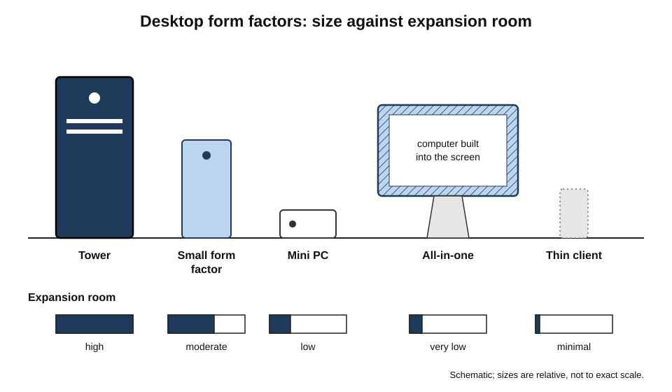
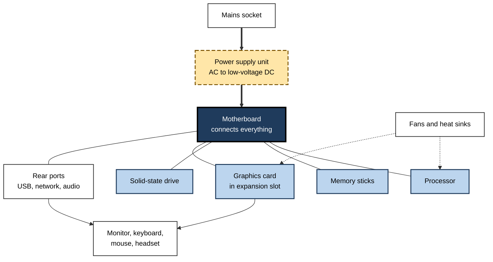
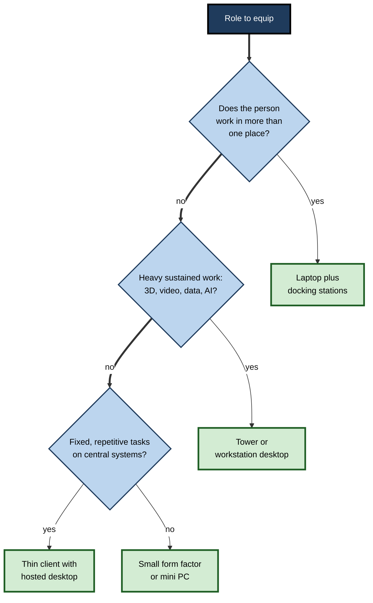
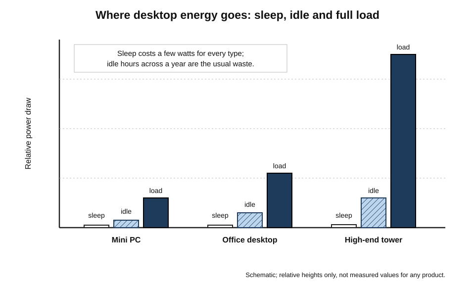
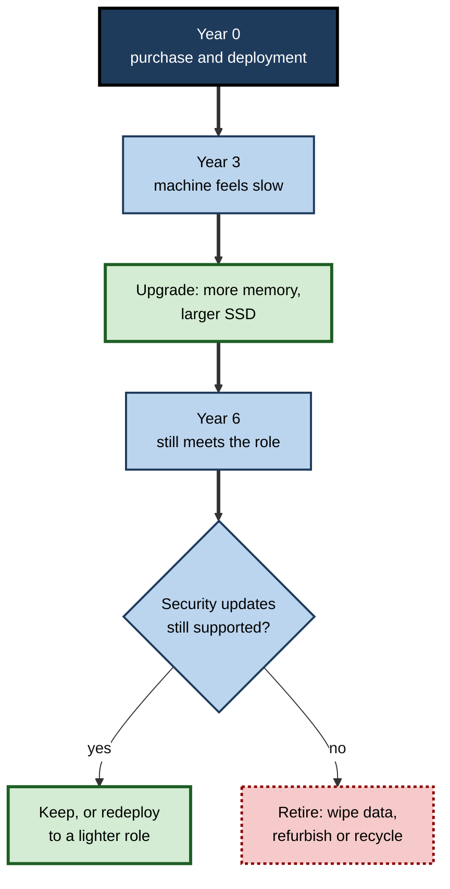
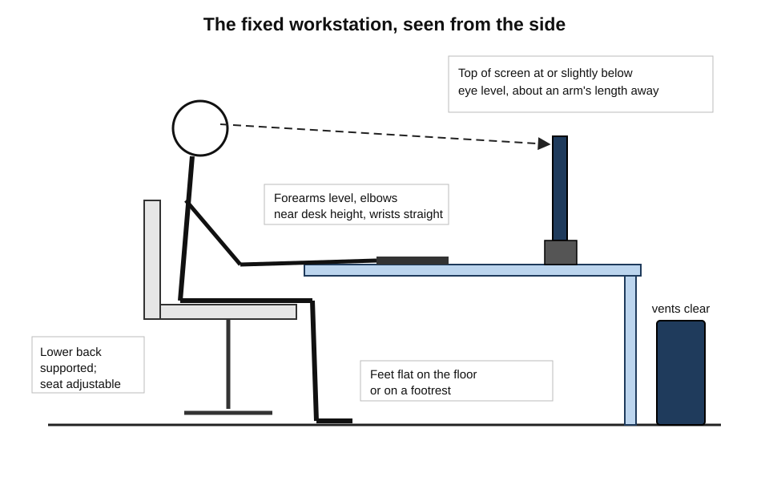

# A.2. Desktop Computers

An architect renders a building overnight on a machine under her desk. A bank's call-centre agents work on small boxes bolted behind their monitors. A video editor adds a second graphics card to a tower that is already six years old. A school laboratory runs thirty identical machines that pupils cannot carry home. In each case the computer **stays in one place** — and that single fact shapes its power, price, lifespan and use.

> **Definition — Desktop computer:** a personal computer designed to be used at a fixed location, powered from the mains, with a separate (or built-in but non-portable) display, keyboard and pointing device.

**Why desktops still matter**

- They deliver the **most performance per unit of cost** among personal computers, because space, power and cooling are not tightly limited.
- They are the **easiest to repair and upgrade**, which lengthens their life and lowers their environmental footprint.
- They remain the standard in fixed workplaces: call centres, laboratories, trading floors, reception desks, design studios, factories and classrooms.
- Understanding them clarifies every other device: a laptop or phone is essentially a desktop's parts squeezed into a smaller, battery-powered package, with compromises.

---

## What Makes a Desktop a Desktop

### The defining features

- **Mains power** — no battery limits; the machine can draw as much power as its components need.
- **Separate peripherals** — the user chooses screen, keyboard and mouse independently.
  - Exception: the **all-in-one**, which builds the computer into the display.
- **Room to cool** — larger fans and heat sinks let processors run at full speed for long periods.
- **Standard parts** — many desktops use industry-standard sizes of case, board and power supply, so parts from different makers fit together.
- **Fixed location** — physical security, wired networking and ergonomic set-up are easier.

> **Key point:** the desktop's advantages all come from **not having to move**. Remove the need for portability and every engineering trade-off — heat, power, size, repair — becomes easier.

### A short history of the desktop

- **1977 — the "1977 trinity"**: the Apple II, Commodore PET and Tandy TRS-80 bring computers to homes and small offices.
- **1981 — the IBM Personal Computer.**
  - Built largely from off-the-shelf parts with a published technical design.
  - Other makers soon built compatible "clones", creating the **IBM PC-compatible** standard that most Windows desktops descend from.
- **1984 — the Apple Macintosh.**
  - A compact computer with built-in screen, a mouse and a graphical interface; an early **all-in-one**.
- **1990s — the beige tower.**
  - Desktops move from flat cases under the monitor to upright towers beside or under the desk.
  - **1995: Intel publishes the ATX specification** for motherboards and cases, still the basis of most self-built and many business desktops.
- **2000s — the decline in share.**
  - Laptops become cheap enough for mass office use; desktop shipments fall as a share of all PCs.
- **2010s–2020s — specialisation.**
  - **Mini PCs** the size of a paperback; powerful compact desktops built on laptop-style chips.
  - **Gaming and creative towers** with high-end graphics cards.
  - **Thin clients** for centrally hosted desktops.

> **Definition — Form factor:** the physical size, shape and layout standard of a device or component, which determines what fits where and what can be swapped.

---

## Kinds of Desktop

### Main form factors

- **Full tower and mid tower** — tall cases with room for many drives, large graphics cards and several fans.
  - Typical for gaming, engineering, video and data-science work.
- **Small form factor (SFF)** — a slim case, often laid flat or upright, with limited expansion.
  - The classic office desktop.
- **Ultra-small form factor and mini PC** — a box from roughly the size of a hardback book down to a coaster.
  - Often mounted behind the monitor; quiet and frugal; usually uses mobile-class processors.
- **All-in-one (AIO)** — the computer is built into the back of the display.
  - Tidy and space-saving; but if the screen fails, the whole computer goes for repair.
- **Thin client and zero client** — minimal desktops that display a desktop running on central servers.
  - Little or no local storage; managed centrally.
- **Compact high-performance desktops** — small cases containing powerful chips, popular with creative professionals.

**Figure 1.** Desktop form factors compared by size and expansion room.

### Comparing the form factors

| Form factor | Size (typical) | Upgradeability | Typical power at idle | Best fit |
|---|---|---|---|---|
| Mid or full tower | Large; floor-standing | High: graphics, memory, drives, power supply | Moderate to high | Rendering, gaming, engineering, AI experiments |
| Small form factor | Medium; slim case | Moderate: memory, drives, low-profile cards | Low to moderate | General office work |
| Mini PC / ultra-small | Very small | Low: often memory and drive only | Low | Reception, kiosks, light office work, digital signage |
| All-in-one | Display-sized | Very low | Low to moderate | Shared spaces, front desks, homes |
| Thin client | Very small | Minimal | Very low | Call centres, banks, hospitals, regulated work |

> **Watch out:** the idle-power column gives **relative** bands, not fixed figures. Real consumption varies widely with components and settings; a powerful tower may idle quietly yet draw several hundred watts under full load.

---

## Inside the Box, at a Glance

A desktop contains the same families of part as any computer; what differs is their **size, power and accessibility**.

### The main parts

- **Case (chassis)** — houses and protects the parts and guides airflow.
- **Motherboard** — the main circuit board connecting all parts.
- **Processor (CPU)** — runs programs; desktop versions draw more power than laptop versions and run faster for longer.
- **Memory (RAM)** — usually in removable sticks, so it can be added later.
- **Storage** — one or more solid-state drives; towers also take large hard drives.
- **Graphics** — either built into the processor or a separate **graphics card** in an expansion slot.
- **Power supply unit (PSU)** — converts mains alternating current into the low-voltage direct current the parts need.
- **Cooling** — heat sinks, fans and sometimes liquid coolers.

> **Definition — Expansion slot:** a socket on the motherboard (today mainly PCI Express) into which add-in cards such as graphics, network or capture cards can be fitted.

> **Definition — Power supply unit (PSU):** the component that converts mains electricity into the stable, low-voltage direct current used by a computer's parts; its efficiency determines how much power is lost as heat.

**Figure 2.** How the main parts of a desktop connect.

### Integrated and dedicated graphics

- **Integrated graphics** — the graphics processor is part of the main processor chip and shares system memory.
  - Enough for office work, web browsing, video calls and multiple monitors.
- **Dedicated graphics card** — a separate board with its own processor and fast memory.
  - Needed for 3D design, games, video effects and, increasingly, local AI work.
  - Can draw more power than the rest of the computer combined.

> **Key point:** for most office workers, a dedicated graphics card adds cost, noise and power use with no benefit. For a 3D designer or data scientist it may be the most important part of the machine.

---

## Why Choose a Desktop

### Strengths

- **Performance per cost** — the same money buys more speed than in a laptop, because desktop parts are cheaper to make and are not constrained by size.
- **Sustained performance** — large coolers allow full speed for hours; laptops often slow down when hot.
- **Upgradeability** — memory, storage, graphics and even the processor can be replaced.
- **Repairability** — standard parts, screws rather than glue, and easy access.
- **Ergonomics** — screens, keyboard and chair can be arranged correctly, rather than around a hinged lid.
- **Multiple displays** — many desktops drive three or four monitors natively.
- **Physical security** — machines can be locked to desks, kept in secure rooms, or have no removable storage.
- **Longevity** — business desktops are commonly kept five to seven years.

### Weaknesses

- **No mobility** — useless for travel, client visits or flexible work.
- **Space and cabling** — towers occupy floor or desk space and gather dust.
- **Power cuts** — no battery; unsaved work is lost unless an uninterruptible power supply is fitted.
- **Hybrid working** — staff who split time between home and office may need two set-ups, or a laptop instead.

> **Definition — Uninterruptible power supply (UPS):** a battery unit between the mains and a computer that keeps it running for minutes during a power cut, long enough to save work and shut down safely.

### Desktop or laptop?

| | Desktop | Laptop |
|---|---|---|
| Mobility | None | Full |
| Performance for the price | Higher | Lower |
| Sustained heavy work | Excellent | Often limited by heat |
| Upgrade and repair | Easy, standard parts | Limited; many parts soldered or glued |
| Ergonomics | Good by default | Needs a stand, keyboard and mouse to match |
| Power use | Higher for towers; low for mini PCs | Low |
| Typical business life | 5–7 years | 3–5 years |
| Exposure to loss and theft | Low | High |

> **In practice:** many organisations give hybrid workers a laptop and a **docking station** at each workplace, while fixed-location roles — reception, laboratory, call centre, trading, design — keep desktops.

**Figure 3.** Choosing between a desktop, a laptop and a thin client for a role.

---

## Power, Energy and Noise

Desktops plug into the wall, so their energy use is easy to overlook — and, across a large organisation, easy to waste.

### How much power a desktop uses

- **Power** is measured in **watts (W)**; **energy** over time in **kilowatt-hours (kWh)**.
- Consumption depends on the state of the machine:
  - **Off** — near zero, though some power may still be drawn.
  - **Sleep** — a few watts; memory is kept alive so work resumes in seconds.
  - **Idle** — on but doing little; small office desktops idle at modest wattage, large towers more.
  - **Full load** — rendering or gaming; a high-end tower with a powerful graphics card can draw several hundred watts.
- **Monitors** add their own consumption and are easily forgotten.

> **Formula — Annual energy cost:** cost = power (kW) × hours per year × price per kWh. A desktop and monitor drawing 0.06 kW for 2,000 working hours at 0.30 per kWh cost 0.06 × 2,000 × 0.30 = **36** a year. Left on idle all year (8,760 hours) at the same draw: 0.06 × 8,760 × 0.30 ≈ **158**.

### Worked example (illustrative): switching off a 1,000-desktop office

**Situation:** an insurer's facilities manager notices that most desktops stay on overnight and at weekends "so updates can run".

1. **Measure** — a sample shows desktop plus monitor averages about 50 W when idle and 2 W when asleep.
2. **Count hours** — about 2,200 working hours a year; the remaining 6,560 hours are idle.
3. **Calculate waste per machine** — (0.050 − 0.002) kW × 6,560 h ≈ **315 kWh** a year.
4. **Scale up** — 315 kWh × 1,000 machines ≈ **315,000 kWh** a year.
5. **Cost** — at 0.25 per kWh ≈ **79,000** a year, before cooling costs.
6. **Solution** — set machines to sleep after 30 minutes idle; use **wake-on-LAN** or scheduled wake-ups so updates still run at night, then return to sleep.

| | Before | After power policy |
|---|---|---|
| Overnight state | Idle, about 50 W | Asleep, about 2 W; woken briefly for updates |
| Out-of-hours energy (1,000 machines) | ≈ 328,000 kWh, mostly waste | ≈ 13,000 kWh asleep, plus brief update windows |
| Update compliance | High | Unchanged |
| User complaints | None | Few; resumes in seconds |

> **Watch out:** the figures are illustrative. Measure real consumption before quoting savings, and remember that machines woken for updates must be allowed to complete them.

> **Definition — Wake-on-LAN:** a feature that lets a sleeping computer be woken by a special signal sent over the network, so it can be maintained without being left on.

### Efficiency labels

- **Energy Star** — a voluntary programme launched by the United States Environmental Protection Agency in 1992; computers that qualify meet limits on typical energy use, including sleep modes.
- **80 PLUS** — a certification for power supply efficiency, from basic up to Bronze, Silver, Gold, Platinum and Titanium levels; a basic 80 PLUS unit is at least 80% efficient at specified loads.
- **EPEAT** — a register used by public and corporate buyers that rates electronics against environmental criteria, including energy, materials and end-of-life handling.

> **Formula — Power supply losses:** electricity drawn = power delivered to parts ÷ efficiency. Parts needing 200 W from an 85%-efficient supply draw 200 ÷ 0.85 ≈ **235 W**; the 35 W difference becomes heat.

**Figure 4.** Typical power draw of desktop types in different states.

### Noise

- Fans are the main source; heavier loads mean faster, louder fans.
- Quiet desktops use larger, slower fans, good airflow and efficient parts; mini PCs and thin clients are often near-silent.
- In open-plan offices and recording studios, noise is a genuine selection criterion.

---

## Building, Buying and Upgrading

### Three routes to a desktop

- **Business desktop from a major manufacturer**
  - Consistent models for years, so one software image fits many machines.
  - Next-business-day on-site support contracts.
  - Management features for remote updating and asset tracking.
- **Consumer or gaming desktop from a retailer or system builder**
  - Often more performance for the money; shorter model life; consumer support.
- **Self-built from parts**
  - Full control of every component; good value for enthusiasts.
  - The builder becomes the support desk; mixed warranties; unsuitable for most organisations.

| | Business model | Consumer / gaming | Self-built |
|---|---|---|---|
| Purchase price for performance | Moderate | Good | Best |
| Model stability over years | High | Low | Not applicable |
| Support | On-site contracts | Return to retailer | The builder |
| Remote management features | Yes | Rarely | Depends on parts |
| Suited to an organisation of 500 | Yes | Rarely | No |

### Upgrades that pay

- **Adding memory** — the cheapest way to help a machine that slows down with many programs or browser tabs open.
- **Replacing a hard drive with a solid-state drive** — transforms an older desktop's start-up and loading times.
- **Adding or upgrading a graphics card** — for new creative, engineering or AI tasks.
- **Replacing the power supply** — when adding power-hungry parts or when an old supply is failing.

> **Remember:** upgrade in this order of value for most users: **SSD → memory → graphics → processor**. Replacing a processor often also means a new motherboard and memory, at which point a new machine may be better value.

> **Watch out:** a faster part does not always make a faster computer. Performance is limited by the slowest part for the task — the **bottleneck**. A powerful graphics card in a machine with too little memory will still feel slow.

**Figure 5.** A desktop's working life with upgrades compared with replacement.

### Specifying a desktop for three roles

A specification is a short list of minimum requirements written from the work, not from a catalogue.

- **Receptionist in a medical practice**
  - Tasks: booking system in a browser, email, card-reader sign-in, label printer.
  - Specification: mini PC mounted behind a monitor; mainstream processor; 16 GB memory; 256–512 GB SSD; integrated graphics; two USB ports reachable from the front; wired network.
  - Priorities: silence, small footprint, reliability, central management.
- **Financial analyst**
  - Tasks: large spreadsheets, business-intelligence dashboards, several applications side by side.
  - Specification: small form factor desktop; mid-range processor with several cores; 32 GB memory; 1 TB SSD; integrated graphics able to drive three monitors.
  - Priorities: memory first, because large spreadsheets and many open windows exhaust it before the processor is stretched.
- **3D visualisation artist**
  - Tasks: modelling, rendering, video output, occasional local AI image tools.
  - Specification: tower; high-core-count processor; 64–128 GB memory; fast 2 TB SSD plus bulk storage; powerful dedicated graphics card with large graphics memory; high-efficiency power supply sized with headroom; strong cooling.
  - Priorities: graphics and sustained performance; noise control in a shared studio.

> **Key point:** each specification names the **bottleneck of the work** first — management and silence for reception, memory for analysis, graphics for 3D. Over-specifying the other parts wastes money; under-specifying the bottleneck wastes people's time.

> **Watch out:** specifications copied from "the best machine available" are a common source of waste. A top-end tower bought for email will spend almost its entire life idle, drawing more power and costing more than a mini PC that would serve equally well.

### Reliability

- **Fewer moving parts, fewer failures** — desktops with SSDs and fewer, larger fans fail less often than older machines with spinning drives.
- **Typical failures** — power supplies, fans, and in older machines hard drives; most are cheap, standard parts to replace.
- **Business models** — use components tested for long service and usually come with three- to five-year on-site warranties.
- **Environment matters** — heat, dust and unstable mains power shorten life; surge protection and clean airflow are inexpensive insurance.

---

## Setting Up a Desktop Well

### Ergonomics of the fixed workstation

- **Screen** — top of the screen at or slightly below eye level, about an arm's length away, directly in front.
- **Keyboard and mouse** — at elbow height, close enough that the upper arms hang relaxed; wrists straight.
- **Chair** — adjustable height and back support; feet flat on the floor or a footrest.
- **Lighting** — screen at right angles to windows to avoid glare.
- **Breaks** — regular changes of posture and short breaks from screen work.
- **Multiple monitors** — the main screen directly ahead; secondary screens angled beside it.

> **In practice:** in Great Britain the Health and Safety (Display Screen Equipment) Regulations 1992 require employers to assess workstations of regular screen users, reduce risks and provide eye tests on request. Many other countries have similar rules.

**Figure 6.** A correctly arranged desktop workstation, seen from the side.

### Physical placement of the machine

- **Airflow** — keep vents clear; not inside closed cupboards; not against radiators.
- **Dust** — towers on carpeted floors draw in dust; raise them or clean filters regularly.
- **Cables** — tie and route cables to prevent trips and accidental unplugging.
- **Security** — cable locks, locked cases, and rooms with controlled access where data is sensitive.

---

## Desktops in Organisations

### Where desktops remain the right answer

- **Contact centres** — fixed seats used across shifts; thin clients or small desktops.
- **Finance and trading** — many monitors, low delay, secure floors.
- **Laboratories and manufacturing** — machines connected to instruments; often must stay on old, validated software for years.
- **Engineering, architecture and media** — towers or desktop workstations for rendering and simulation.
- **Education** — shared computer rooms; robust, centrally reset machines.
- **Healthcare** — shared ward and clinic computers with quick sign-in by card.

### Managing a desktop estate

- **Standard images** — one tested software build installed on every machine of a model.
- **Central management** — updates, settings and software pushed from a console.
- **Asset tracking** — each machine recorded with location, user and warranty.
- **Refresh cycles** — replacement every five to seven years, often staggered so that only a fraction of machines is replaced each year.
- **Redeployment** — older but working machines moved to lighter roles, then refurbished or recycled with certified data destruction.

> **Definition — Refresh cycle:** the planned interval after which an organisation replaces its devices, balancing reliability, performance and security support against cost and environmental impact.

### Case study (illustrative): the design studio that kept its towers

- **Situation:** a 60-person architecture practice planned to move everyone to laptops for "flexibility".
- **Problem:** pilot users found that rendering and large building models ran far slower, laptops became hot and loud, and long overnight renders stopped when lids were closed.
- **Diagnosis:**
  - architects' work needed **sustained** heavy processing and powerful graphics — the desktop's strength;
  - flexibility was genuinely needed by partners and site staff, but not by most designers on most days.
- **Actions:**
  1. Kept powerful towers for designers, upgraded with more memory and current graphics cards.
  2. Gave designers lightweight laptops for meetings and site visits that could connect remotely to their towers.
  3. Moved overnight renders to a small pool of shared tower machines.
  4. Gave partners and site staff laptops with docking stations.
- **Result:** rendering times fell; designers kept mobility for meetings; total spending was lower than buying high-end laptops for all.
- **Lesson:** match the device to the **work pattern**, not to a slogan. One organisation can rightly use several device types.

---

## The Desktop Today and Tomorrow

### Current developments

- **Mini PCs with laptop-class chips** — near-silent, frugal machines powerful enough for most office work.
- **Desktops for local AI** — towers with large graphics cards, and compact machines with large shared memory, used by developers to run AI models locally rather than in the cloud.
- **Hosted desktops** — desktops streamed from data centres to thin clients or any device; the "desktop" becomes a service rather than a box.
- **Modular and repairable designs** — some makers emphasise replaceable parts to meet sustainability goals and regulation.

> **Watch out:** "the desktop is dead" has been predicted repeatedly since laptops became mainstream. Desktop **share** of PC shipments has fallen, but desktops persist wherever work is fixed, heavy or shared.

---

## Open Questions

- **How much of the desktop will become a service?**
  - Hosted desktops simplify management but depend on networks and providers; the balance between local and hosted desktops is still moving.
- **Will local AI revive powerful desktops?**
  - Running AI models privately on local hardware favours large memory and powerful graphics; whether this becomes mainstream or stays a specialist niche is unclear.
- **How long can a desktop be kept?**
  - Hardware often outlives software support; operating-system requirements, such as hardware security chips, can force replacement of working machines.
- **Is upgradeability valued enough?**
  - Repairable standard parts reduce waste, yet compact sealed designs are popular; buyer and regulator pressure may shift the balance.

---

## Summary

- A **desktop** is a personal computer used in a fixed place on mains power, usually with separate display, keyboard and mouse.
- Its strengths come from **not moving**: more performance per cost, sustained speed, upgradeability, repairability, ergonomics, multiple monitors and physical security.
- **Form factors** range from towers to small form factor, mini PCs, all-in-ones and thin clients; choose by task, space and expansion need.
- Inside: case, motherboard, CPU, RAM, storage, graphics (integrated or dedicated), **PSU** and cooling.
- Energy use depends on state (off, sleep, idle, load); **sleep policies with wake-on-LAN** save large amounts across an estate. Use **cost = kW × hours × price**.
- **Energy Star**, **80 PLUS** and **EPEAT** signal efficiency and environmental performance.
- Upgrade in order of value: **SSD → memory → graphics → processor**; beware **bottlenecks**.
- Set up workstations ergonomically; employers in many countries must assess screen workstations.
- Organisations manage desktops with standard images, central management, asset tracking and **refresh cycles** of about five to seven years.
- Match device type to work pattern; one organisation may rightly use towers, laptops and thin clients.

---

## Self-Check

1. Define a desktop computer and explain why its advantages come from not being portable.
2. What was significant about the IBM PC of 1981 for later desktops?
3. Compare a mid tower, a mini PC and an all-in-one for a reception desk.
4. What does a power supply unit do, and why does its efficiency matter?
5. When does a dedicated graphics card matter, and when is it waste?
6. Calculate the annual energy cost of a 0.08 kW desktop left on for 8,760 hours at 0.28 per kWh.
7. Explain how wake-on-LAN lets an organisation save energy without delaying updates.
8. Put these upgrades in typical order of value for an ageing office desktop: processor, SSD, memory, graphics card. Justify the order.
9. What is a bottleneck? Give an example.
10. Give four ergonomic rules for a fixed workstation.
11. Why might a business choose a business desktop model over a cheaper consumer model?
12. A company wants to move all 400 contact-centre agents to laptops. What questions should it ask first?
13. Why might a working, six-year-old desktop be retired?
14. Evaluate the claim "the desktop is dead".

### Answer Key

1. A personal computer used at a fixed location on mains power with separate or non-portable peripherals. Without portability limits, power, cooling, size and repair are easier — giving more performance per cost, sustained speed and upgradeability.
2. It used off-the-shelf parts and a published design, so other makers built compatible clones; the resulting PC-compatible standard and its interchangeable parts underlie most Windows desktops.
3. Mid tower: powerful but large and unnecessary. Mini PC: small, quiet, frugal, can mount behind a monitor — usually the best fit. All-in-one: tidy, but a screen fault takes the whole computer away. A mini PC or all-in-one suits; the tower does not.
4. It converts mains AC into low-voltage DC. Inefficiency is lost as heat, raising energy bills and cooling needs; higher-efficiency units waste less.
5. It matters for 3D design, games, video effects and local AI. For office work, browsing and video calls integrated graphics suffice, and a card only adds cost, power and noise.
6. 0.08 × 8,760 × 0.28 ≈ **196** a year.
7. Machines sleep when idle, drawing only a few watts; the management system sends a wake signal at night, the machines install updates and return to sleep.
8. SSD (largest improvement in responsiveness for an older machine with a hard drive), then memory (cheap; helps with many programs open), then graphics (only if tasks need it), then processor (often needs new board and memory — close to a new machine).
9. The slowest part for a task, which limits overall performance. A fast processor waiting on a nearly full hard drive, or a powerful graphics card in a machine short of memory.
10. Top of screen at or slightly below eye level about an arm's length away; keyboard at elbow height with straight wrists; adjustable chair with back support and feet supported; screen at right angles to windows; regular breaks.
11. Stable models for years (one software image), on-site support contracts, remote management and asset features, longer parts availability.
12. Do agents ever work elsewhere? Will laptops be shared across shifts? What is the cost of theft, loss and battery wear? Are docking stations and external screens needed? Would thin clients or small desktops meet the need more cheaply and securely?
13. Its maker no longer provides security updates, or a new operating system requires hardware it lacks; or repair costs and energy use exceed its value.
14. Desktop share of PC shipments has fallen, but desktops remain the best fit for fixed, heavy and shared work — design, trading, laboratories, contact centres, education — and local AI is creating new demand. "Smaller niche" is accurate; "dead" is not.

---

## Glossary

| Term | Meaning |
|---|---|
| 80 PLUS | A certification of power supply efficiency at specified loads. |
| All-in-one | A desktop with the computer built into the display. |
| ATX | A widely used standard for motherboard and case sizes, published by Intel in 1995. |
| Bottleneck | The slowest part of a system for a task, which limits overall performance. |
| Dedicated graphics card | A separate board with its own graphics processor and memory. |
| Desktop computer | A personal computer designed for use at a fixed location on mains power. |
| Energy Star | A voluntary energy-efficiency programme for equipment, launched in 1992. |
| EPEAT | A register rating electronics against environmental criteria. |
| Expansion slot | A motherboard socket for add-in cards. |
| Form factor | The size, shape and layout standard of a device or component. |
| Integrated graphics | A graphics processor built into the main processor chip. |
| Kilowatt-hour | A unit of energy: one kilowatt used for one hour. |
| Mini PC | A very small desktop, often using mobile-class processors. |
| Motherboard | The main circuit board connecting a computer's parts. |
| PC-compatible | Following the hardware standard descended from the IBM PC. |
| Power supply unit | The part converting mains AC into low-voltage DC. |
| Refresh cycle | The planned interval for replacing devices. |
| Small form factor | A slim desktop case with limited expansion. |
| Standard image | A tested software build installed on every machine of a type. |
| Thin client | A minimal device that displays a desktop running on servers. |
| Tower | A tall, upright desktop case with room for expansion. |
| Uninterruptible power supply | A battery unit that keeps a computer running during a power cut. |
| Wake-on-LAN | Waking a sleeping computer by a network signal. |
| Watt | A unit of power. |
