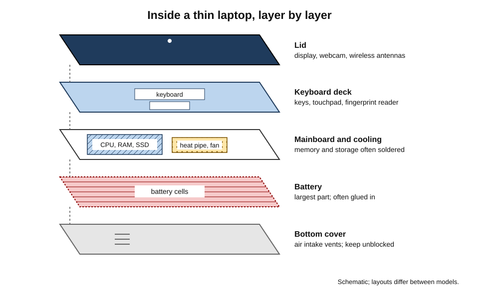
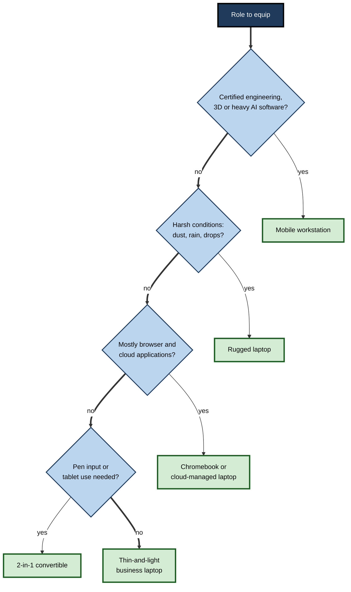
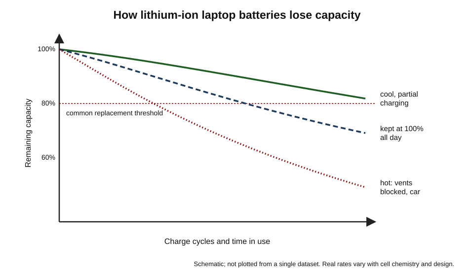
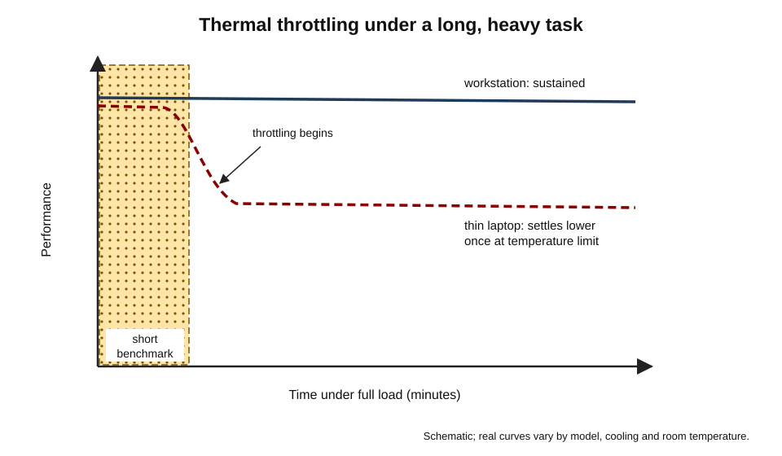
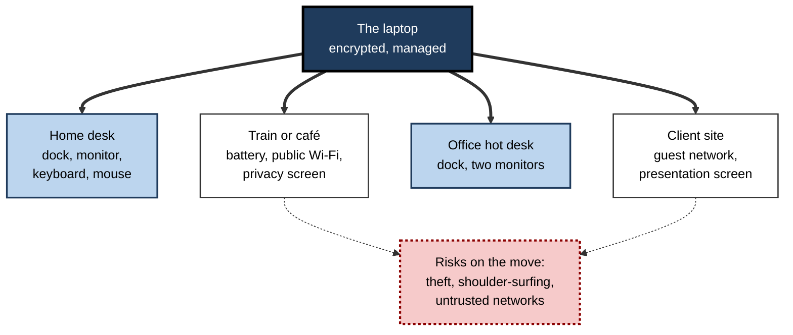

# A.3. Laptops & Workstations

A consultant finishes a client presentation on a train, joins a video call from a hotel and, back at the office, clicks the same machine into a dock that drives two large screens. A structural engineer, meanwhile, runs a simulation of a bridge under wind load on a heavy machine certified for the engineering software her firm depends on. Both are using "laptops and workstations" — one optimised for **going everywhere**, the other for **doing the hardest work reliably**.

> **Definition — Laptop:** a portable personal computer that combines display, keyboard, pointing device, battery and computer in a single hinged unit, designed to run full desktop operating systems and software away from mains power.

> **Definition — Workstation:** a high-performance computer, desktop or mobile, built and certified for demanding professional work such as engineering, 3D design, scientific computing, financial modelling or AI development, with emphasis on sustained performance, reliability and verified compatibility with professional software.

**Why the distinction matters**

- The laptop is now the **default work computer** for most knowledge workers; choosing, configuring and caring for it well affects daily productivity and organisational security.
- Workstations carry a price premium; buying one where it is not needed wastes money, and failing to buy one where it is needed wastes expensive professional time.
- Laptops are the devices most often **lost, stolen, dropped and replaced**, so they dominate the cost and risk of an organisation's device estate.

---

## The Road to the Modern Laptop

### From "luggable" to ultraportable

- **1981 — Osborne 1**: a "portable" computer weighing around 11 kg with a tiny screen and no battery; it had to be plugged in.
- **Mid-1980s — battery-powered laptops**, such as the Toshiba T1100 (1985), established the clamshell layout.
- **1992 — IBM ThinkPad** line launched; its business design, keyboard and pointing stick became a corporate standard.
- **Late 1990s–2000s — Wi-Fi built in**; laptops become practical for work anywhere.
- **2008 — very thin laptops** such as the MacBook Air; solid-state storage and sealed designs follow.
- **2011 — "Ultrabook"** specifications from Intel and the first **Chromebooks**, built around web-based work.
- **2010s — convertibles and detachables** that fold or separate into tablets.
- **2020 — Apple moves its Macs to its own ARM-based chips**, showing that laptop chips derived from phone designs could combine high performance with long battery life.
- **2024 onward — Windows laptops on ARM chips and "AI PCs"** with neural processing units.

> **Key point:** the history of the laptop is a long trade between **performance, battery life, weight and price**. Each generation shifts the balance; none removes it.

---

## Anatomy of a Laptop

### The main parts

- **Display** — usually 13 to 16 inches diagonally; built into the lid with the webcam and wireless antennas.
- **Keyboard deck** — keyboard, touchpad, often a fingerprint reader; sometimes a pointing stick.
- **Mainboard** — processor, memory and often storage, increasingly **soldered** in place to save space.
- **Battery** — lithium-ion or lithium-polymer cells; the largest single part inside.
- **Cooling** — heat pipes carrying heat to one or two small fans; some thin laptops have no fan at all.
- **Ports** — USB-C, sometimes USB-A, HDMI, headphone jack, card reader.
- **Hinge and chassis** — aluminium, magnesium alloy or plastic; determine durability.

**Figure 1.** The layers of a typical thin laptop.

> **Definition — Soldered component:** a part fixed permanently to the circuit board rather than fitted in a socket; it saves space and power but cannot be upgraded or easily replaced.

### Why laptops are harder to repair than desktops

- **Compact design** — parts are custom shapes, not industry standards.
- **Soldered memory and storage** — failure of one chip can mean replacing the whole board.
- **Glued batteries and screens** — removal risks damage.
- **Proprietary screws and clips.**
- **Counter-trend** — some manufacturers now sell modular laptops whose ports, memory, storage and screens can be replaced by the owner; regulation on repair and battery replacement is also pushing designs back towards serviceability.

---

## Kinds of Laptop

### The main categories

- **Thin-and-light (ultraportable)** — about 1–1.4 kg, long battery life, integrated graphics.
  - The standard for consultants, managers and most office roles.
- **Business laptop** — durable chassis, good keyboards, security and management features, long model life, on-site warranty.
- **Convertible (2-in-1)** — the screen folds back or detaches to become a tablet; often supports a stylus.
- **Chromebook** — runs Google's ChromeOS; inexpensive, simple to manage, built around web and cloud applications.
  - Common in schools and for frontline staff.
- **Gaming laptop** — powerful processor and dedicated graphics, high-refresh screen; heavy, loud, short battery life.
- **Mobile workstation** — professional-grade graphics, large memory, certified for engineering and design software.
- **Rugged laptop** — sealed against dust and water, drop-resistant; for field engineers, military, utilities.

| Category | Typical weight | Battery life | Performance | Typical buyer |
|---|---|---|---|---|
| Thin-and-light | 1.0–1.4 kg | Long | Good for office and light creative work | Most knowledge workers |
| Business laptop | 1.2–1.8 kg | Long | Good; strong security and management | Corporate fleets |
| 2-in-1 | 1.0–1.5 kg | Medium to long | Moderate | Sales, education, note-takers |
| Chromebook | 1.0–1.6 kg | Long | Modest; web-centred | Schools, frontline staff |
| Gaming | 2.0–3.0 kg | Short | Very high, especially graphics | Gamers, some creators |
| Mobile workstation | 1.8–3.0 kg | Short to medium | Very high and certified | Engineers, designers, data scientists |
| Rugged | 2.0–4.0 kg | Medium; often swappable batteries | Moderate | Field, utility and defence staff |

> **Watch out:** weights and battery lives are typical bands across the market, not specifications. Manufacturers' battery figures come from standard tests that are usually more forgiving than real use with video calls and bright screens.

**Figure 2.** Matching a laptop category to a role.

---

## Batteries and Power

### Capacity and battery life

- **Capacity** is measured in **watt-hours (Wh)** — the energy the battery holds.
  - Thin laptops typically carry roughly 40–75 Wh; large workstations up to about 99 Wh.
- **Battery life** = capacity ÷ average power drawn.
  - The screen, processor load, wireless radios and video calls dominate consumption.

> **Formula — Battery life estimate:** hours ≈ capacity (Wh) ÷ average draw (W). A 60 Wh battery at an average 8 W lasts about 60 ÷ 8 = **7.5 hours**; during a video call drawing 15 W, about 60 ÷ 15 = **4 hours**.

> **In practice:** airline rules commonly allow lithium-ion batteries up to **100 Wh** in cabin baggage freely, require airline approval between 100 and 160 Wh, and forbid larger ones. This is one reason laptop batteries are rarely made above about 99 Wh.

### How batteries age

- **Charge cycle** — using the equivalent of 100% of capacity once, whether in one go or in several partial discharges.
- **Capacity fades** with cycles, heat and time spent at full charge.
  - Many laptop batteries are designed to keep roughly 80% of their capacity after several hundred cycles.
- **Heat is the biggest enemy** — leaving a laptop in a hot car or using it on a bed that blocks the vents speeds ageing.
- **Full charge for long periods** — a battery kept at 100% while docked all day ages faster; many laptops offer a setting to stop charging at around 80%.
- **Swelling** — a failing lithium battery can swell, lifting the touchpad or case; it must be replaced, not used.

**Figure 3.** How battery capacity typically fades with use, and the effect of heat and constant full charge.

> **Remember:** keep laptops **cool**, avoid **constant 100%** when docked, avoid **deep discharges** to zero, and replace a **swollen battery** immediately.

> **Watch out:** the old advice to "fully drain the battery every time" applied to older nickel-based batteries with a "memory effect". Lithium-ion batteries do not need it and are slightly harmed by frequent deep discharges.

---

## Heat, Performance and Throttling

### Why a laptop slows down when hot

- A processor's power use turns almost entirely into heat.
- A thin laptop can remove only a limited amount of heat — its **thermal envelope**.
- When the chip reaches its safe temperature limit, it reduces its speed: **thermal throttling**.
- Result: a laptop may run at full speed for a short burst, then settle at a lower sustained speed.

> **Definition — Thermal throttling:** the automatic reduction of a processor's speed to keep its temperature within safe limits.

> **Definition — Thermal design power (TDP):** the amount of heat, in watts, that a cooling system is designed to remove from a chip under sustained load; often used loosely as a guide to a chip's sustained power level.

**Figure 4.** Burst and sustained performance in a thin laptop compared with a workstation.

- **Implications:**
  - benchmark scores from short tests can flatter thin laptops;
  - long renders, compilations and simulations favour thicker machines with stronger cooling;
  - blocked vents, dust and soft surfaces cause throttling that users mistake for a "slow computer".

### Processor families

- **x86 processors** (Intel, AMD) — the long-standing standard for Windows PCs, with the broadest compatibility with older business software.
- **ARM-based processors** — originally designed for phones; now used in Apple's Macs and in many Windows and Chrome laptops.
  - Typically very efficient, giving long battery life.
  - Older software built for x86 may run through **emulation** (translation), usually well, sometimes slowly or not at all for specialised drivers and tools.

> **Watch out:** "ARM or x86" is not a question of which is faster in general. The right choice depends on **the organisation's software**: specialised engineering tools, security agents, printer drivers and older applications must be tested before an ARM laptop is adopted.

### AI PCs

- Laptops increasingly contain an **NPU** for running AI tasks efficiently on the device.
- From 2024, Microsoft's **Copilot+ PC** category required an NPU of at least 40 TOPS, with minimum memory and storage.
- Industry analysts expected AI-capable PCs to make up around half of PC shipments during 2026; definitions differ between analysts.
- **Useful today:** background effects and noise suppression in calls, live captions, local transcription and summarisation, image editing, private search of personal files.

> **Key point:** for most buyers the NPU is a **battery-life and privacy feature** — it does AI tasks with less power and without sending data to the cloud — more than a dramatic speed increase.

---

## Workstations

### What makes a computer a workstation

- **Professional graphics processors** — designed and driven for accuracy and stability in design and engineering applications rather than for games.
- **Error-correcting memory (ECC)** — detects and corrects single-bit memory errors, preventing silent corruption in long calculations.
- **Large memory capacity** — tens to hundreds of gigabytes for big models, datasets and simulations.
- **ISV certification** — the manufacturer and the software vendor have tested the exact configuration together.
- **Sustained performance** — cooling and power sized for hours at full load.
- **Reliability and support** — tested components, long availability of parts, priority service.

> **Definition — ISV certification:** confirmation by an independent software vendor — the maker of a professional application such as a CAD or simulation package — that a particular hardware configuration has been tested and is supported for that software.

> **Definition — ECC memory:** error-correcting code memory, which stores extra check bits so that common memory errors are detected and corrected automatically.

### Who needs a workstation

- **Engineers** — CAD, finite-element analysis, computational fluid dynamics.
- **Architects** — building information modelling and rendering.
- **Media professionals** — high-resolution video editing, colour grading, visual effects.
- **Scientists and quants** — simulation, statistical modelling, large datasets.
- **AI developers** — training and testing models locally; workstations with large graphics memory.
- **Not**: most office, sales, management and consulting roles — a good business laptop is sufficient.

### Laptop, mobile workstation and desktop workstation

| | Business laptop | Mobile workstation | Desktop workstation |
|---|---|---|---|
| Purpose | General professional work anywhere | Certified heavy work on the move | Heaviest certified work at a desk |
| Graphics | Integrated | Professional mobile GPU | One or more professional GPUs |
| Memory | 16–32 GB typical | 32–128 GB | 64 GB to over 1 TB |
| ECC memory | Rarely | Sometimes | Usually available |
| Sustained performance | Moderate | High | Highest |
| Weight and battery | Light, long battery | Heavy, short battery | Not portable |
| Relative price | 1× | 2–4× | 2–10× |

> **In practice:** many engineering firms give heavy users a **desktop workstation** in the office or a data centre and a light laptop to connect to it remotely, rather than a heavy mobile workstation that is carried everywhere.

---

## Working Well with a Laptop

### The docked laptop

- At a desk, a laptop alone is ergonomically poor: the screen is too low if the keyboard is at the right height.
- **Docking station** — a single cable connects the laptop to monitors, keyboard, mouse, network, power and peripherals.
- **Hot-desking** — any worker can sit at any desk with a dock and be working within seconds.

**Figure 5.** A laptop's working day across locations.

### Security of a device that travels

- **Full-disk encryption** — makes data unreadable if the laptop is lost or stolen.
- **Hardware security chip (TPM)** — stores encryption keys and checks that start-up has not been tampered with.
  - Windows 11 requires TPM 2.0, which forced many organisations to replace otherwise working laptops.
- **Biometric sign-in** — fingerprint readers and face-recognition cameras reduce reliance on passwords.
- **Privacy shutters and screens** — cover the webcam; narrow the viewing angle in public.
- **Remote lock and wipe** — through the organisation's device-management system.
- **Physical care** — never leave a laptop visible in a car; carry it as hand luggage.

> **Definition — Trusted Platform Module (TPM):** a dedicated security chip, or secure function within the processor, that stores cryptographic keys and measures the start-up process so that tampering can be detected.

> **Watch out:** a password on the sign-in screen does **not** protect the data on a stolen laptop's drive. Only encryption does — the drive could otherwise be removed and read on another computer.

### Durability claims

- Many business and rugged laptops are advertised as tested against a United States military test standard (MIL-STD-810) for drops, vibration, temperature and dust.
- These tests are usually performed by the manufacturer itself, with procedures it selects; the label shows effort, not a guaranteed level of toughness.
- For harsh environments, the more meaningful figures are **ingress protection (IP) ratings** and independent drop tests.

### Choosing a laptop: what to weigh

- **Screen** — size and resolution set how much fits on screen; brightness (in nits) matters outdoors and by windows; matte finishes reduce reflections.
  - A 14-inch screen is a common compromise between portability and working space.
- **Keyboard and touchpad** — used for thousands of hours; worth trying before buying for heavy typists.
- **Memory** — 16 GB is a sensible floor for professional use in the mid-2020s; 32 GB or more for analysts, developers and creators; because it is often soldered, it cannot be added later.
- **Storage** — 512 GB is a common business minimum where files live mainly in cloud services; more for video, datasets and local AI models.
- **Ports** — at least two USB-C ports with charging and display support; HDMI or USB-A where meeting rooms and peripherals still need them.
- **Webcam and microphones** — a better camera and noise suppression matter for people who spend hours on calls.
- **Weight and charger** — the true travel weight includes the charger; a USB-C charger shared with a phone saves carrying two.
- **Warranty and repair** — on-site service, accidental-damage cover and the availability of replacement batteries and keyboards.

> **Remember:** because memory and storage are increasingly soldered, a laptop must be specified **for its whole life on the day it is bought**. Under-buying memory is the most common and least reversible mistake.

> **Watch out:** a high processor model number does not guarantee better real performance in a thin laptop. The same chip can be run at very different power levels by different manufacturers; the cooling design often matters as much as the chip.

### Everyday care

- **Carry it closed and padded** — most damage comes from drops, pressure in bags and liquid spills.
- **Lift by the base, not the screen** — hinges and display connections are fragile.
- **Keep liquids away** — a spill on the keyboard can reach the mainboard; switch off and disconnect immediately.
- **Keep vents clear and clean** — dust in fans causes heat, noise and throttling.
- **Use the right charger** — a reputable charger of adequate wattage; cheap counterfeit chargers are a fire risk.
- **Restart regularly** — lets updates install and clears accumulated software faults.
- **Back up and sync** — a laptop's data should never exist only on the laptop.

> **Example (illustrative):** a consultant whose laptop overheated during every afternoon call discovered a blocked fan intake from resting the machine on a sofa cushion. A hard surface and a ten-minute fan cleaning restored full speed — the "slow laptop" was a cooling problem, not a processor problem.

### Accessibility and comfort on the move

- **Laptop stand plus external keyboard and mouse** — raises the screen to eye level and protects neck and wrists during long sessions.
- **Privacy filter** — narrows the viewing angle on trains and in cafés.
- **Built-in accessibility features** — magnification, screen readers, dictation and high-contrast modes help users with differing needs and are increasingly powered by on-device AI.

---

## Laptops in Organisations

### Managing a laptop fleet

- **Standardise** — a small range of models (for example a standard laptop, a power-user laptop and a workstation) simplifies support, spares and images.
- **Provision automatically** — modern management lets a new laptop be shipped straight from the factory to an employee's home; at first sign-in it enrols itself, installs software and applies policies.
- **Refresh** — commonly every three to five years for laptops, driven by battery wear, warranty, performance and software support.
- **Track and recover** — record every device; recover laptops from leavers; wipe and reissue or retire.
- **Repair or replace** — battery replacement at year three can extend life cheaply if the model allows it.

> **Definition — Zero-touch provisioning:** setting up a new device for an organisation automatically over the internet when the user first signs in, without IT staff handling it physically.

### Forced refreshes

- **October 2025 — end of support for Windows 10.**
  - Machines that could not meet Windows 11 requirements, including TPM 2.0 and supported processors, faced replacement or paid extended security updates.
  - Many organisations brought forward laptop purchases into 2024–2025.
- **Lesson:** a laptop's life is often ended by **software requirements**, not by hardware failure.

### Worked example (illustrative): total cost of ownership for two laptop options

**Situation:** a consultancy of 1,000 staff compares a cheaper consumer-grade laptop with a business model over four years.

| Cost item (per laptop, four years) | Consumer model | Business model |
|---|---|---|
| Purchase price | 800 | 1,200 |
| Accessories and dock | 200 | 200 |
| Support hours (at 50 per hour) | 10 h = 500 | 5 h = 250 |
| Downtime (lost billable hours at 100) | 8 h = 800 | 3 h = 300 |
| Battery replacement | Not possible: early replacement, 400 share | 120 |
| Residual (resale) value | −50 | −150 |
| **Total** | **2,650** | **1,920** |

1. **Purchase price alone** favours the consumer model by 400.
2. **Support and downtime** reverse the comparison: business models are more reliable, easier to repair and better managed.
3. **Across 1,000 laptops**, the business model saves about (2,650 − 1,920) × 1,000 = **730,000** over four years.

> **Watch out:** the figures are illustrative. Real comparisons depend on measured failure and support rates; vendors' own TCO studies tend to favour their products.

### Case study (illustrative): the bank that standardised on three models

- **Situation:** a regional bank had accumulated more than twenty laptop models from years of local purchasing.
- **Problems:**
  - each model needed its own drivers and tested software build;
  - spare batteries, chargers and docks were incompatible;
  - security updates for firmware were patchy;
  - staff complained of slow machines and incompatible chargers in meeting rooms.
- **Actions:**
  1. Analysed real workloads with monitoring data: most staff used office and web applications; a small group of analysts ran heavy models.
  2. Defined three models: standard business laptop, performance laptop for analysts, mobile workstation for a handful of quantitative modellers.
  3. Adopted USB-C charging and one dock model across the estate.
  4. Moved to zero-touch provisioning and automatic firmware updating.
  5. Planned staggered four-year replacement with certified data wiping and refurbishment of returned units.
- **Result:** fewer support calls, much faster delivery of new laptops, firmware brought up to date across the fleet, and a simpler budget.
- **Lesson:** **fewer models, chosen from measured need**, beat many models chosen by habit.

---

## Workstations Without the Box

### Remote and cloud workstations

- **Remote desktop workstation** — a powerful machine in the office or data centre, used from a light laptop over a remote-display protocol.
- **Cloud workstation** — a virtual machine with professional GPUs rented by the hour from a cloud provider, started when needed and stopped when not.
- **Benefits:**
  - heavy data stays in the data centre, near storage, rather than on laptops that can be lost;
  - capacity can be scaled up for peaks such as project deadlines;
  - users can work from anywhere with a good connection.
- **Limits:**
  - performance depends on network **latency** and bandwidth; colour-critical and fast interactive work can suffer;
  - hourly costs add up for heavy daily use;
  - licensing of professional software may be complex.

> **Definition — Cloud workstation:** a virtual high-performance computer, often with professional graphics, hosted in a provider's data centre and used remotely over the internet.

| | Mobile workstation | Desktop workstation, remote access | Cloud workstation |
|---|---|---|---|
| Where the power is | In the laptop | In the office or data centre | Provider's data centre |
| Works offline | Yes | No | No |
| Data on lost devices | At risk unless encrypted | Stays central | Stays central |
| Scaling for peaks | No | Limited | Easy |
| Cost pattern | Up-front purchase | Up-front purchase | Pay per hour |

> **In practice:** many firms combine approaches — a light laptop for everyone, a few local workstations for constant heavy users, and cloud workstations for peaks and remote specialists.

---

## Open Questions

- **Will ARM laptops become the norm for Windows?**
  - Efficiency gains are clear; compatibility with specialist software, drivers and security tools is still being proved in each organisation.
- **How much AI will run on the laptop?**
  - NPUs keep growing; whether common AI assistants run locally or in the cloud depends on model sizes, privacy needs and pricing.
- **Can laptops become truly repairable?**
  - Modular designs exist, and regulation is pushing battery and part replacement, but thinness and sealing remain commercially attractive.
- **Mobile workstation or remote workstation?**
  - Streaming a powerful desktop or cloud workstation to a light laptop is improving; heavy local machines may become rarer.

---

## Summary

- A **laptop** integrates screen, keyboard, battery and computer in a portable unit; a **workstation** is a computer built and certified for demanding professional work.
- Laptop history trades **performance, battery life, weight and price**; ARM chips and NPUs are the latest shifts.
- Parts: display lid, keyboard deck, mainboard (often **soldered** memory and storage), battery, cooling, ports, chassis.
- Categories: thin-and-light, business, 2-in-1, Chromebook, gaming, mobile workstation, rugged — choose by role.
- **Battery life ≈ Wh ÷ W**; batteries fade with cycles, heat and constant full charge; keep cool and avoid constant 100%.
- Thin laptops **throttle** under sustained load; short benchmarks can flatter them.
- Workstations offer professional GPUs, **ECC memory**, large RAM, **ISV certification** and sustained performance.
- Docked laptops support hybrid work; protect travelling laptops with **encryption, TPM**, biometrics, privacy screens and remote wipe.
- Fleets are standardised, provisioned **zero-touch**, refreshed every three to five years and judged by **TCO**, not price.
- Software requirements, such as Windows 10's end of support in October 2025, often end a laptop's life before its hardware fails.

---

## Self-Check

1. Define a laptop and a workstation, and explain why a workstation need not be a laptop.
2. What trade-offs have shaped laptop design throughout its history?
3. Why are many modern laptops harder to repair than desktops?
4. A laptop has a 54 Wh battery. Estimate its life at 6 W and during video calls at 18 W.
5. Give three practices that slow battery ageing and explain the reasons.
6. What is thermal throttling, and why can it make a benchmark misleading?
7. What should an organisation test before adopting ARM-based Windows laptops?
8. What is the practical benefit of an NPU for most office users?
9. List four features that distinguish a workstation from a gaming laptop of similar speed.
10. Why does a sign-in password not protect the data on a stolen laptop?
11. What is zero-touch provisioning, and why did it matter for remote hiring?
12. Why did Windows 10's end of support force laptop replacements?
13. A finance team wants mobile workstations "to be safe". How would you assess the request?
14. Using total cost of ownership, explain why the cheapest laptop is often not the cheapest choice.

### Answer Key

1. A laptop is a portable, battery-powered computer integrating screen, keyboard and computer in one hinged unit. A workstation is a high-performance computer certified for demanding professional software; many workstations are desktops, because sustained heavy work is easiest without portability limits.
2. Performance against battery life, weight and price; heat removal in a thin case; durability against thinness.
3. Custom-shaped parts, soldered memory and storage, glued batteries and screens, proprietary fasteners.
4. 54 ÷ 6 = **9 hours**; 54 ÷ 18 = **3 hours**.
5. Keep it cool (heat accelerates chemical ageing); limit charge to about 80% when docked for long periods (high charge stresses cells); avoid frequent deep discharges.
6. The chip slows down to stay within temperature limits. A short benchmark measures the burst before throttling begins, overstating sustained performance.
7. All business applications, security agents, VPN and management tools, printer and peripheral drivers, specialist tools and any software that relies on x86 emulation.
8. Running AI features — call effects, captions, transcription — with lower power use and without sending data to the cloud.
9. Professional graphics drivers tuned for accuracy and stability; ECC memory; ISV certification for professional software; tested reliability, long parts availability and professional support.
10. The drive can be removed and read in another computer; only full-disk encryption makes the data unreadable.
11. Automatic setup of a new device at first sign-in, with software and policies installed over the internet; it lets laptops ship directly to remote new starters securely.
12. After October 2025 Windows 10 stopped receiving free security updates; Windows 11 required TPM 2.0 and newer processors, so many older but working laptops could not be upgraded.
13. Identify the actual software and workloads (spreadsheets, BI tools, models), measure current machine load, check whether any software needs certification or professional graphics. Most finance work runs well on a business laptop; a few modellers may need more memory, or remote access to a powerful machine.
14. Purchase price is only part of the cost; support time, downtime, repairability, battery replacement, management and resale differ. A more reliable, manageable model can cost less across its life.

---

## Glossary

| Term | Meaning |
|---|---|
| 2-in-1 | A laptop that converts into a tablet. |
| ARM | A family of energy-efficient processor designs used in phones and many laptops. |
| Charge cycle | Using the equivalent of a battery's full capacity once. |
| Chromebook | A laptop running ChromeOS, built around web and cloud applications. |
| Cloud workstation | A rented virtual high-performance computer used remotely. |
| Docking station | A unit connecting a laptop to monitors, peripherals, network and power through one cable. |
| ECC memory | Memory that detects and corrects common errors automatically. |
| Emulation | Running software built for one processor type on another by translation. |
| ISV certification | A software vendor's confirmation that a hardware configuration is tested and supported. |
| Laptop | A portable computer integrating screen, keyboard, battery and computer. |
| Mobile workstation | A laptop built and certified for demanding professional software. |
| NPU | Neural processing unit for efficient on-device AI. |
| Rugged laptop | A laptop sealed and built to survive harsh conditions. |
| Soldered component | A part fixed permanently to the circuit board. |
| TDP | Thermal design power: the heat a cooling system is designed to remove. |
| Thermal throttling | Automatic slowing of a processor to control temperature. |
| Thin-and-light | A portable laptop optimised for low weight and long battery life. |
| TPM | Trusted Platform Module: a security chip storing keys and checking start-up integrity. |
| Watt-hour | A unit of energy used to rate battery capacity. |
| Workstation | A high-performance computer certified for demanding professional work. |
| x86 | The processor family long standard in Windows PCs. |
| Zero-touch provisioning | Automatic setup of a new device over the internet at first sign-in. |
