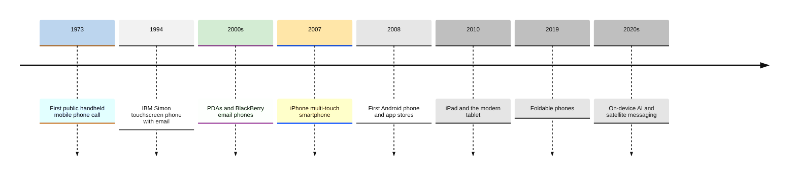
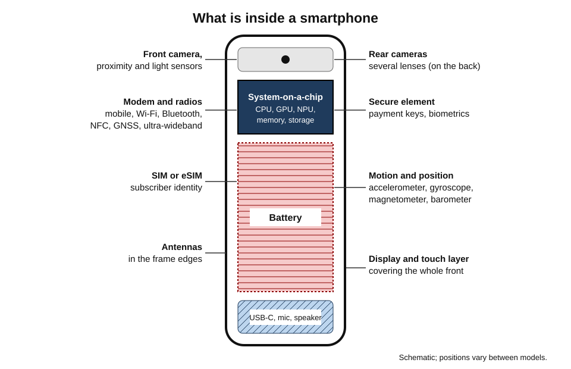
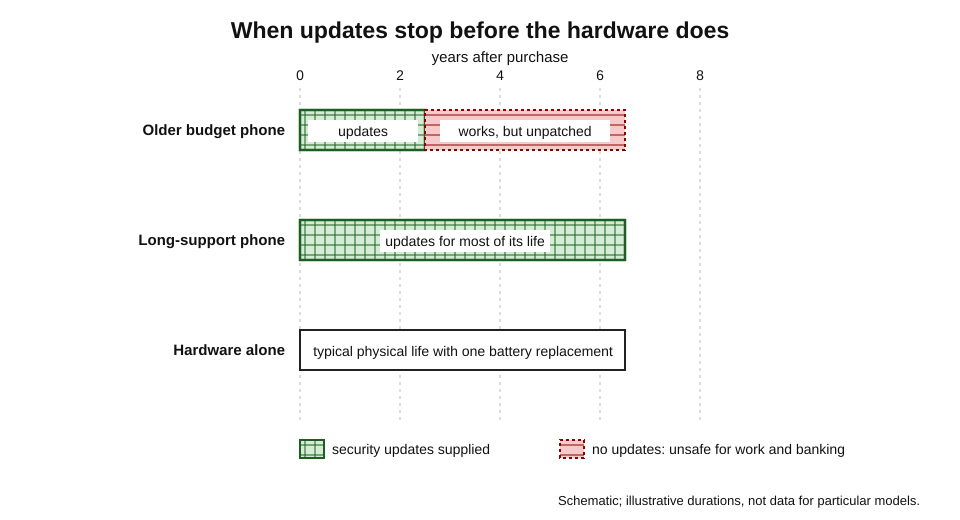
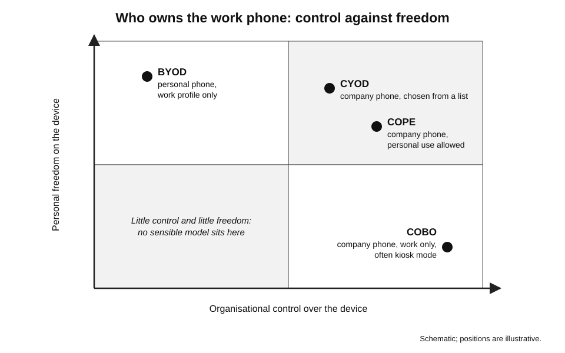
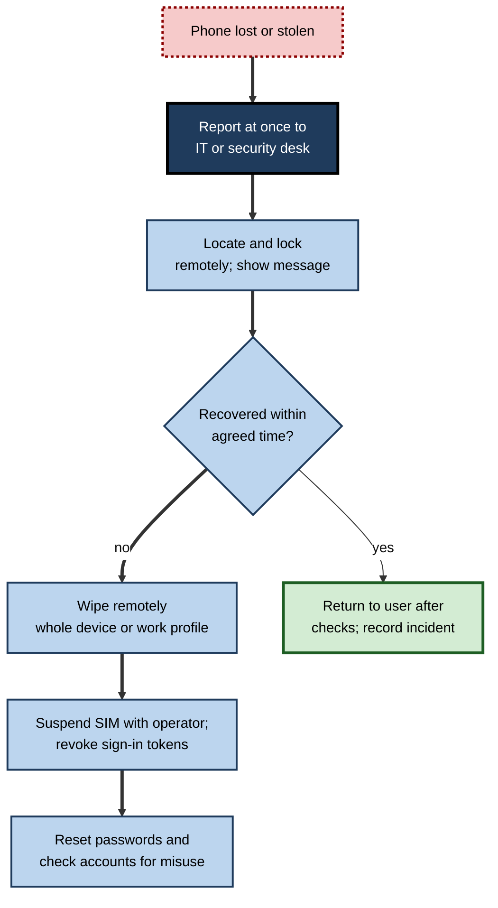

# B.4. Smartphones & Tablets

A farmer checks the market price of grain before deciding when to sell. A surgeon approves a sign-in request to a hospital system with a fingerprint. A shop assistant takes a card payment on a tablet in the middle of the shop floor. A traveller pays for a train ticket, navigates a foreign city and translates a menu — all with the same device. The smartphone is the **most widely owned computer in history**, and for billions of people it is the only one they use.

> **Definition — Smartphone:** a handheld, battery-powered mobile phone that is also a general-purpose computer, with a touchscreen, a mobile operating system, installable applications, internet access, cameras and a set of sensors.

> **Definition — Tablet:** a portable computer with a large touchscreen as its main input and output, typically 8–13 inches diagonally, running a mobile or desktop operating system, usually without a built-in physical keyboard.

**Why these devices matter**

- They are carried **everywhere**, so they hold the most personal data: messages, photographs, location history, health data, payment cards, identity documents.
- They have become the **key to other systems**: authenticator apps, banking approvals, digital identity, door entry.
- In organisations they extend computing to **frontline workers** — drivers, nurses, retail staff, technicians — who never had a desk computer.
- They are the most frequently **lost, stolen and replaced** computers, which makes their management and lifespan important for security and sustainability.

---

## How the Smartphone Came About

### From phone to computer

- **1973** — Martin Cooper of Motorola makes the first public call from a handheld mobile phone.
- **1994 — IBM Simon**: a touchscreen phone with email, calendar and fax, often described as the first smartphone; it sold in small numbers.
- **Late 1990s–2000s — personal digital assistants** (Palm) and email phones (BlackBerry) establish the phone as a work tool, especially for "push" email.
- **2007 — the iPhone**: a large multi-touch screen replacing a physical keyboard, and a full web browser.
- **2008 — the first Android phone** and Apple's **App Store**; installable third-party apps become the centre of the ecosystem.
- **2010 — the iPad** popularises the modern tablet.
- **2010s** — larger screens, high-quality cameras, fingerprint and face recognition, mobile payments.
- **2019 onward — foldable phones**; satellite emergency messaging (from 2022 in some phones); on-device AI.

**Figure 1.** Milestones in the development of smartphones and tablets.

> **Key point:** the decisive change of 2007–2008 was not the touchscreen itself but the **app store**: once anyone could write software for the phone, it became a general-purpose computer with an ecosystem around it.

### Why the smartphone spread so fast

- **Price** — basic smartphones became affordable across the world during the 2010s.
- **Mobile networks** — coverage reached places that never had fixed telephone lines or broadband.
- **Leapfrogging** — in many countries people moved straight from no computer to a smartphone, skipping the personal computer.
  - *e.g.* mobile money services such as Kenya's M-Pesa (from 2007) let people without bank accounts transfer money by phone.
- **One device replacing many** — camera, music player, map, torch, diary, calculator, wallet.

---

## Inside a Smartphone

### The main parts

- **System-on-a-chip (SoC)** — processor cores, graphics, neural processing unit, image processor and security processor on one chip.
- **Modem** — connects to mobile networks; sometimes inside the SoC.
- **Memory and storage** — RAM plus flash storage, both soldered; storage cannot usually be added later on many models.
- **Display** — usually OLED or LCD, with a touch-sensing layer and protective glass.
- **Battery** — a lithium-ion pouch cell, typically about 4,000–5,000 mAh in large phones.
- **Cameras** — several rear cameras with different lenses plus a front camera.
- **Radios** — mobile network, Wi-Fi, Bluetooth, NFC, satellite positioning (GNSS), sometimes ultra-wideband.
- **SIM or eSIM** — identifies the subscriber to the mobile network.
- **Secure element** — an isolated chip or area holding payment keys and biometric data.

> **Definition — eSIM:** an embedded SIM built into the phone that can be programmed with a mobile operator's profile remotely, replacing the removable SIM card.

> **Definition — Secure element:** a tamper-resistant part of a device that stores and uses cryptographic keys, such as payment credentials and biometric templates, isolated from the main operating system.

**Figure 2.** Where the main parts and sensors sit in a typical smartphone.

### Sensors: the phone's senses

| Sensor | What it measures | Typical uses |
|---|---|---|
| Accelerometer | Acceleration and tilt | Screen rotation, step counting, fall and crash detection |
| Gyroscope | Rotation | Gaming, image stabilisation, augmented reality |
| Magnetometer | Earth's magnetic field | Compass, map orientation |
| GNSS receiver | Position from satellite signals (GPS, Galileo and others) | Navigation, delivery tracking, emergency location |
| Barometer | Air pressure | Altitude, floor level for emergency calls |
| Proximity sensor | Nearness of an object | Turning off the screen during calls |
| Ambient light sensor | Brightness of surroundings | Automatic screen brightness |
| Fingerprint and face sensors | Biometric features | Unlocking, approving payments and sign-ins |
| Microphones | Sound | Calls, voice assistants, noise cancellation |

> **Definition — GNSS (global navigation satellite system):** the general term for satellite positioning systems, including the United States' GPS, Europe's Galileo, Russia's GLONASS and China's BeiDou; phones typically use several together.

> **Watch out:** a phone's location does not come only from satellites. Wi-Fi networks and mobile masts nearby also reveal position — so turning off "GPS" alone does not stop a phone being located.

### Battery capacity in comparable units

- Phone batteries are quoted in **milliampere-hours (mAh)**; laptops in **watt-hours (Wh)**.
- To compare, multiply by the battery's voltage.

> **Formula — Converting mAh to Wh:** Wh = mAh × voltage ÷ 1,000. A 5,000 mAh phone battery at 3.85 V holds 5,000 × 3.85 ÷ 1,000 ≈ **19 Wh** — about a third of a typical thin laptop's battery.

---

## Smartphones and Tablets Compared

### The tablet's niche

- **Bigger screen** — reading, drawing, watching, presenting and filling in forms.
- **Touch and pen** — natural for sketching, annotation and signatures.
- **Longer battery life** — a larger battery for a similar processor.
- **Simple and robust** — few moving parts; easily locked down for one purpose.
- **Typical professional uses:**
  - **retail** — point-of-sale and stock checks;
  - **healthcare** — bedside charting, patient check-in, video consultations;
  - **aviation** — electronic flight bags replacing paper manuals and charts for pilots;
  - **field service** — manuals, forms and signatures on site;
  - **education** — reading, creative work and assessment;
  - **hospitality** — order taking and menus.

| | Smartphone | Tablet | Laptop |
|---|---|---|---|
| Screen | 6–7 inches | 8–13 inches | 13–16 inches |
| Main input | Touch, voice | Touch, pen, optional keyboard | Keyboard, touchpad |
| Always with the user | Yes | Often not | No |
| Mobile network built in | Always | Optional | Rarely |
| Long-form writing and complex software | Poor | Moderate | Good |
| Typical role | Communication, authentication, quick tasks | Viewing, forms, sketching, kiosks | Production of documents, analysis |
| Ease of locking to one task | Moderate | High | Moderate |

> **Key point:** tablets are strongest where work is **viewing, touching and signing** rather than **typing and producing**. Attempts to make them full laptop replacements succeed for some users, but rarely for heavy document and spreadsheet work.

### Foldables and other forms

- **Foldable phones** — a flexible display that folds, giving a small-tablet screen in a phone body.
  - Trade-offs: price, weight, crease durability.
- **Rugged phones and handheld computers** — sealed, drop-resistant devices with barcode scanners and replaceable batteries for warehouses and logistics.
- **Feature phones** — basic phones with calls, texts and limited apps; still used for simplicity, battery life, cost and, in some sensitive roles, security.

---

## Platforms, Apps and Updates

### The two dominant platforms

- Almost all smartphones run one of two operating systems: Apple's **iOS** (on iPhones) and Google's **Android** (on phones from many manufacturers).
- Each comes with its own **app store**, cloud services and accessory ecosystem.
- Apps run in **sandboxes** — isolated from one another — and must ask permission for sensitive features such as location, camera, microphone and contacts.

> **Definition — App permission:** a user's grant to an application to access a protected resource or sensor, such as location or the microphone; modern systems allow permission "only while using the app" and can revoke it automatically.

> **Remember:** grant permissions **only when needed**, prefer **"while using the app"**, and review permissions periodically — especially location, microphone, camera and contacts.

### Software support decides the device's life

- A phone that no longer receives security updates becomes unsafe to use for banking or work, however well its hardware works.
- **Historically** many Android phones received only two or three years of updates.
- **Since 2023–2024** some major manufacturers have promised up to seven years of updates for flagship models.
- **European Union ecodesign rules (from 20 June 2025)** for smartphones and tablets sold in the EU require, among other things:
  - operating-system updates for at least **five years** after a model stops being placed on the market;
  - batteries that keep at least **80% of capacity after 800 full cycles**;
  - spare parts for professional repairers and users for **seven years** after the model is withdrawn;
  - resistance to accidental drops and protection against dust and water;
  - an **energy label** that also scores durability and repairability.
- **EU Battery Regulation (from February 2027)** — portable batteries in devices such as phones are to be removable and replaceable by end users with ordinary tools, with certain exemptions for highly durable batteries in water-resistant devices.

**Figure 3.** How update support, not hardware, often sets a phone's useful life.

> **Watch out:** "seven years of updates" promises usually apply to specific models and may cover security fixes more fully than new features. Buyers should check what is promised for the exact model and from what date.

---

## Phones as Keys: Identity and Payment

### Authentication

- **Something you have** — the phone itself, proven by an authenticator app or a cryptographic **passkey** stored on it.
- **Something you are** — fingerprint or face, checked locally by the phone.
- **Push approval** — an app asks "Is this you signing in?"; the user approves with biometrics.
- **Passkeys** — replace passwords with a key pair; the private key never leaves the device and only works on the genuine website, defeating most phishing.

> **Definition — Passkey:** a sign-in credential based on public-key cryptography, stored on a device and unlocked by biometrics or a PIN, that replaces a password and cannot be phished in the usual way.

> **Watch out:** text-message codes are weaker than app-based approval or passkeys. Criminals can persuade a mobile operator to move a victim's number to a new SIM — **SIM swapping** — and then receive the codes.

### Payment and wallet

- **NFC payments** — the phone emulates a contactless card using a token rather than the real card number; each payment is approved by biometrics.
- **Digital wallets** — boarding passes, tickets, loyalty cards, car keys, hotel keys and, in some countries, identity documents and driving licences.
- **QR-code payments** — widespread in parts of Asia; India's **UPI** (launched 2016) processes enormous volumes of everyday payments through phone apps.

---

## Smartphones and Tablets at Work

### Who owns the device?

- **BYOD (bring your own device)** — staff use personal phones for work.
  - Cheap for the employer; convenient; but limited control and privacy tension.
- **CYOD (choose your own device)** — staff choose from an approved list of company devices.
- **COPE (corporate-owned, personally enabled)** — the company owns the phone and allows reasonable personal use.
- **COBO (corporate-owned, business only)** — locked down for work only; typical for frontline and high-security roles.

**Figure 4.** Device ownership models compared by organisational control and personal freedom.

| | BYOD | COPE | COBO |
|---|---|---|---|
| Owner | Employee | Organisation | Organisation |
| Hardware cost to employer | None or allowance | Full | Full |
| Control over device | Work data only | High | Complete |
| Employee privacy concerns | Highest sensitivity | Moderate | Low (no personal use) |
| Remote wipe | Work container only | Whole device | Whole device |
| Typical use | Office staff with light needs | Managers, sales, consultants | Drivers, warehouse, regulated roles |

### Mobile device management

- **Mobile device management (MDM)** — the organisation enrols the device and can enforce passcodes, encryption, updates, app installation and remote wipe.
- **Mobile application management (MAM)** — manages only the work apps and their data, leaving the rest of a personal phone alone.
- **Work profile or container** — a separate, encrypted space on the phone for work apps; it can be wiped without touching personal photos and messages.

> **Definition — Mobile device management (MDM):** software and services that let an organisation configure, secure, monitor and remotely wipe the mobile devices used for its work.

> **In practice:** for BYOD, most organisations use a **work profile with app-level management**; they require a passcode and up-to-date operating system, block copying of work data into personal apps, and can wipe only the work container when someone leaves.

### Mobile threats

- **Loss and theft** — the commonest risk; mitigated by passcodes, encryption (on by default in modern phones) and remote wipe.
- **Phishing by text and messaging apps ("smishing")** — small screens hide suspicious addresses.
- **Malicious or over-privileged apps** — mainly from unofficial sources; sometimes from official stores.
- **Outdated software** — known vulnerabilities in unsupported phones.
- **Public Wi-Fi and fake hotspots.**
- **SIM swapping** — taking over a phone number to intercept codes.
- **Targeted spyware** — rare but serious; used against journalists, activists and executives.

**Figure 5.** What to do when a work phone is lost or stolen.

### Frontline work

- Frontline or "deskless" workers — estimated to be a large majority of the world's workforce — rarely sit at desks.
- **Shared devices** — a pool of phones or tablets charged in a locker; staff sign in at the start of a shift and out at the end.
- **Kiosk mode** — the device runs only one or a few apps.
- **Rugged handhelds** — barcode scanning, push-to-talk, long shifts.

> **Definition — Kiosk mode:** a configuration that locks a device to a single app or a small set of apps, preventing other use.

---

## Worked Example: Choosing an Ownership Model

**Situation:** a 300-person property-management firm has 120 office staff, 150 maintenance technicians and 30 executives. Staff currently use personal phones for email with no controls.

1. **Identify data and tasks by group.**
   - Office staff: email, chat, occasional document viewing.
   - Technicians: job app, photographs of repairs, customer signatures, navigation — all day, in vans and buildings.
   - Executives: confidential board papers, banking approvals.
2. **Assess risk.** Executives hold the most sensitive data; technicians' devices are most often dropped and lost.
3. **Choose a model per group.**
   - Office staff: **BYOD with a work profile**, plus a monthly allowance.
   - Technicians: **COBO rugged phones** in kiosk-style mode with the job app, camera and maps.
   - Executives: **COPE flagship phones** with full management and long update support.
4. **Set common rules.** Passcode, biometrics, current operating system, work data kept in managed apps, remote wipe, lost-device reporting.

| Group | Model | Main reason |
|---|---|---|
| Office staff (120) | BYOD + work profile | Low risk, light use, cost |
| Technicians (150) | COBO rugged | Durability, single-purpose, shared use |
| Executives (30) | COPE | Sensitive data, need for full control |

> **Watch out:** a single policy for everyone is usually wrong — it is either too loose for executives or too intrusive and expensive for office staff.

---

## Case Study: Shared Phones on Hospital Wards

- **Situation:** nurses on a hospital's wards used desk phones, pagers and shared desktop computers; they walked long distances to record observations and answer calls.
- **Problem:** delays in recording vital signs, missed calls, and staff using personal phones to photograph wounds for colleagues — an infection-control and privacy risk.
- **Actions:**
  1. Introduced **shared, managed smartphones** — one per nurse per shift, collected from a charging rack.
  2. Sign-in with a staff badge tap and PIN; the phone showed only that nurse's patients and approved apps.
  3. Built in secure messaging, calling, barcode scanning of patient wristbands and medications, and capture of wound photographs straight into the patient record.
  4. Phones wiped of session data automatically at sign-out; devices cleaned between shifts according to infection-control rules.
- **Result:** observations recorded at the bedside rather than later; fewer missed calls; personal-phone photography ended; staff reported less walking.
- **Side effects:** more alerts reaching nurses, which required careful tuning to avoid **alert fatigue**; battery and rack management became a daily task.
- **Lesson:** the device is the easy part; the **workflow, sign-in, cleaning and alert design** determine success.

---

## Smartphones Today and Tomorrow

### Current developments

- **On-device AI** — translation, photo editing, transcription and assistants running partly or wholly on the phone's NPU.
- **Satellite connectivity** — emergency and short messaging where there is no mobile signal.
- **Digital identity** — national identity cards and driving licences held in phone wallets in a growing number of jurisdictions.
- **Longer life and repair** — regulation, refurbished-phone markets and longer update promises.

> **Watch out:** smartphone **overuse** has been linked to poorer sleep and attention in many studies, but the strength and direction of effects, especially for adolescents' mental health, are **actively debated** among researchers. Claims of large, uniform harm go beyond the evidence; so do claims of no effect.

---

## Choosing and Caring for a Phone or Tablet

### Questions before buying

- **Update promise** — how many years of security updates, from when?
- **Platform fit** — which ecosystem do the user's other devices, apps and organisation support?
- **Storage** — enough for photos, apps and offline files for the device's whole life, since many phones cannot add storage later.
- **Battery and charging** — capacity, charging speed, battery-health tools and replacement options.
- **Durability** — water and dust rating (such as IP68), drop resistance, availability of cases and screen protectors.
- **Repairability** — cost and availability of screen and battery repairs; repairability scores where labels exist.
- **Camera and screen** — matter for some roles (inspection, social media, field reports) more than others.
- **Refurbished option** — a recent refurbished flagship with years of support may beat a new budget phone.

> **Definition — IP rating (ingress protection):** an international code showing protection against dust (first digit) and water (second digit); IP68 means dust-tight and protected against continuous immersion under conditions specified by the maker.

### Everyday care

- **Case and screen protector** — cheap protection against the commonest damage.
- **Battery** — avoid heat, use optimised or limited charging settings, avoid running flat often.
- **Storage** — keep free space; offload photos to a library; remove unused apps.
- **Updates** — automatic; restart weekly.
- **Ports** — clear lint gently from charging ports, a common cause of "broken" charging.
- **Liquids** — even water-resistant phones should be dried before charging after exposure.

### Accessibility features built in

- **Screen readers and voice control** — full operation without seeing the screen or touching it.
- **Magnification, larger text, bold text and high contrast.**
- **Live captions** of calls, videos and conversations.
- **Hearing features** — hearing-aid compatibility, sound amplification; some earbuds paired with phones now offer authorised hearing-aid functions.
- **Assistive touch and switch control** for limited dexterity.

> **Key point:** smartphones have become some of the most powerful **assistive technologies** ever made, because accessibility features are built into the platform rather than bought separately.

---

## Tablets in Depth

### Operating models for tablets at work

- **Personal productivity tablet** — paired with keyboard and pen; email, reading, annotation, light editing.
- **Shared kiosk tablet** — locked to one app, such as check-in, ordering or inspections.
- **Customer-facing tablet** — sign-up forms, signatures, demonstrations; must be wiped of each customer's data.
- **Field data-capture tablet** — offline forms with photographs and location, synchronising when connected.

> **Watch out:** customer-facing tablets that keep previous customers' names, signatures or form data create data-protection breaches. They should reset to a clean state after each session.

### Pens and productivity

- **Annotation** — marking up contracts, drawings and slides directly.
- **Handwriting to text** — searchable notes; useful in meetings where typing feels intrusive.
- **Drawing and design** — illustration and concept sketching, with pressure and tilt.
- **Mathematics and science** — equations and diagrams faster by hand than by keyboard.

| Tablet role | Key requirement | Management setting |
|---|---|---|
| Personal productivity | Keyboard, pen, long support | Full device management |
| Shared kiosk | Robust stand, constant power | Kiosk mode, automatic reset |
| Customer-facing | Privacy between sessions | Session wipe, restricted apps |
| Field data capture | Offline apps, ruggedness, battery | Managed apps, remote wipe |

---

## Phones and Professional Boundaries

- **Separation** — work profiles or separate devices keep work and personal data, apps and notifications apart.
- **Focus modes** — schedule quiet hours and allow only urgent contacts through.
- **Expectations** — teams agree response times for messages, so that constant reachability is not assumed.

---

## Open Questions

- **What will follow the smartphone?**
  - Smart glasses, AI assistants and wearables may take over some tasks; none yet replaces the phone's combination of screen, camera, network and apps.
- **How long can a phone last?**
  - Seven-year update promises and repair rules may lengthen lives, but battery, durability and app requirements will be tested in practice.
- **Who controls the app ecosystem?**
  - Competition authorities in several jurisdictions are forcing changes to app-store rules and allowing alternative stores; effects on security and prices are uncertain.
- **How should BYOD balance control and privacy?**
  - Employers need to protect data; employees resist monitoring of personal devices. Legal expectations differ between countries.
- **What are the real effects on wellbeing?**
  - Research on attention, sleep and mental health is active and contested.

---

## Summary

- A **smartphone** is a mobile phone that is also a general-purpose computer; a **tablet** is a larger touch-first portable computer.
- The decisive 2007–2008 change was the **app store**; smartphones spread through low prices, mobile networks and leapfrogging.
- Inside: **SoC**, modem, memory and storage, display, battery, cameras, radios, **SIM/eSIM**, **secure element** and many **sensors**.
- **Wh = mAh × V ÷ 1,000** lets phone and laptop batteries be compared.
- Tablets excel at **viewing, touching and signing**; phones at communication, authentication and quick tasks.
- Two platforms dominate; apps are **sandboxed** and need **permissions**; **software support** often sets the device's life.
- EU rules from June 2025 require five years of updates, 800-cycle batteries, seven years of spare parts and repairability labels; user-replaceable batteries are due from 2027 with exemptions.
- Phones are keys: authenticators, **passkeys**, NFC payments and digital wallets; beware **SIM swapping**.
- Work models: **BYOD, CYOD, COPE, COBO**, secured with **MDM**, app management and work profiles; frontline teams use shared and kiosk devices.
- Success at work depends on workflow, sign-in and support design, not just the device.

---

## Self-Check

1. Define a smartphone and a tablet and explain how they differ in typical role.
2. Why was the app store more significant than the touchscreen?
3. Name five smartphone sensors and one use for each.
4. Why does turning off satellite positioning not prevent a phone from being located?
5. Convert a 4,500 mAh, 3.87 V battery to watt-hours.
6. Give three professional settings where tablets outperform laptops, with reasons.
7. Why does software support often decide a phone's useful life? What did EU rules change in 2025?
8. What is a passkey, and why is it more resistant to phishing than a password with a text code?
9. Explain SIM swapping and how to reduce its risk.
10. Distinguish BYOD, COPE and COBO, with a suitable role for each.
11. What is the difference between MDM and app-level management, and why does it matter for BYOD?
12. List the steps an organisation should take when a work phone is lost.
13. A logistics company plans to give its drivers consumer phones and let them install any apps. Critique the plan.
14. Evaluate the claim "smartphones are destroying a generation's mental health".

### Answer Key

1. A smartphone is a mobile phone that is also a general-purpose computer with touchscreen, apps, internet, cameras and sensors; a tablet is a larger touch-first portable computer. Phones handle communication, authentication and quick tasks; tablets suit viewing, forms, sketching and kiosk use.
2. It let anyone build software for the phone, turning it into a general-purpose computer and creating an ecosystem of developers and services.
3. Accelerometer (screen rotation, steps), gyroscope (stabilisation), magnetometer (compass), GNSS (navigation), barometer (floor level), proximity (screen off during calls), ambient light (brightness), fingerprint (unlocking).
4. Position can also be estimated from nearby Wi-Fi networks and mobile masts, and the network operator knows which mast the phone uses.
5. 4,500 × 3.87 ÷ 1,000 ≈ **17.4 Wh**.
6. Retail point-of-sale (portable, touch); aviation flight bags (large screen for charts, light); bedside healthcare (quick charting and signatures); field service (forms and signatures on site) — all viewing and touching rather than heavy typing.
7. Without security updates a phone becomes unsafe for banking and work, even if the hardware works. EU rules from June 2025 require at least five years of OS updates after a model leaves the market, durable batteries, spare parts for seven years and repairability labelling.
8. A sign-in credential based on a key pair stored on the device and unlocked by biometrics. It only works with the genuine website and the private key is never typed or sent, so fake sites cannot capture it; text codes can be intercepted or phished.
9. A criminal persuades the operator to move a victim's number to a new SIM and then receives their codes. Reduce it by using authenticator apps or passkeys instead of text codes and by setting an account PIN with the operator.
10. BYOD: personal device used for work (office staff). COPE: company-owned, personal use allowed (managers, sales). COBO: company-owned, work only (drivers, warehouse).
11. MDM manages the whole device; app management manages only work apps and their data. On personal phones, app-level management protects work data while respecting privacy and allows wiping only work data.
12. Report immediately; locate and lock remotely; wipe if not recovered quickly; suspend the SIM; revoke sign-in tokens; reset passwords and check for misuse; record the incident.
13. Consumer phones may break, have short update lives and lack scanning; unrestricted apps add risk and distraction while driving. Better: rugged, managed COBO devices in kiosk-style mode with approved apps, driving-safety features and long support.
14. The evidence is contested: some studies find associations between heavy use and poorer wellbeing, especially sleep; effects are often small on average, vary between individuals and types of use, and causality is debated. Both "destroying" and "harmless" overstate the evidence.

---

## Glossary

| Term | Meaning |
|---|---|
| App permission | A user's grant allowing an app to use a protected resource. |
| App store | A platform's official marketplace for installing applications. |
| BYOD | Bring your own device: personal devices used for work. |
| COBO | Corporate-owned, business only. |
| COPE | Corporate-owned, personally enabled. |
| CYOD | Choose your own device from an approved list. |
| eSIM | An embedded, remotely programmable SIM. |
| Feature phone | A basic mobile phone with limited apps. |
| Foldable phone | A phone with a flexible display that folds. |
| GNSS | Global navigation satellite system, such as GPS or Galileo. |
| IP rating | A code indicating protection against dust and water. |
| Kiosk mode | Locking a device to a single app or a few apps. |
| mAh | Milliampere-hour, a unit of battery charge. |
| MAM | Mobile application management: managing only work apps and data. |
| MDM | Mobile device management: configuring, securing and wiping devices centrally. |
| NFC | Near-field communication, used for contactless payments. |
| Passkey | A phishing-resistant, device-stored sign-in credential. |
| Sandbox | Isolation that keeps each app separate from others and the system. |
| Secure element | A tamper-resistant area storing keys and biometric data. |
| SIM swapping | Fraudulently moving a person's phone number to a new SIM. |
| Smartphone | A mobile phone that is also a general-purpose computer. |
| Smishing | Phishing by text or messaging app. |
| Tablet | A portable, touch-first computer with a large screen. |
| Work profile | A separate, managed space for work apps on a phone. |
