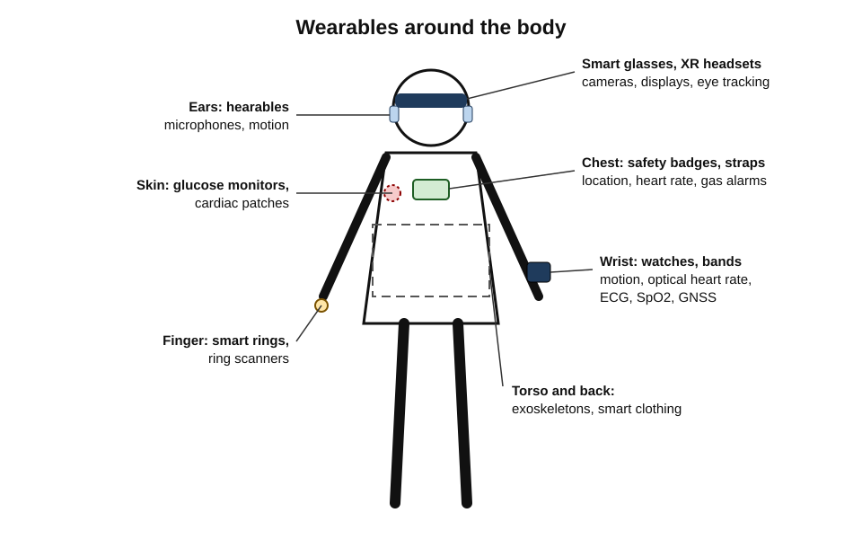
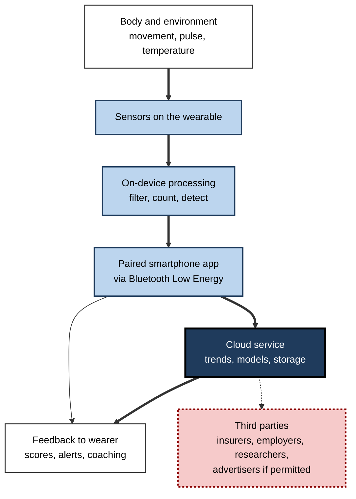
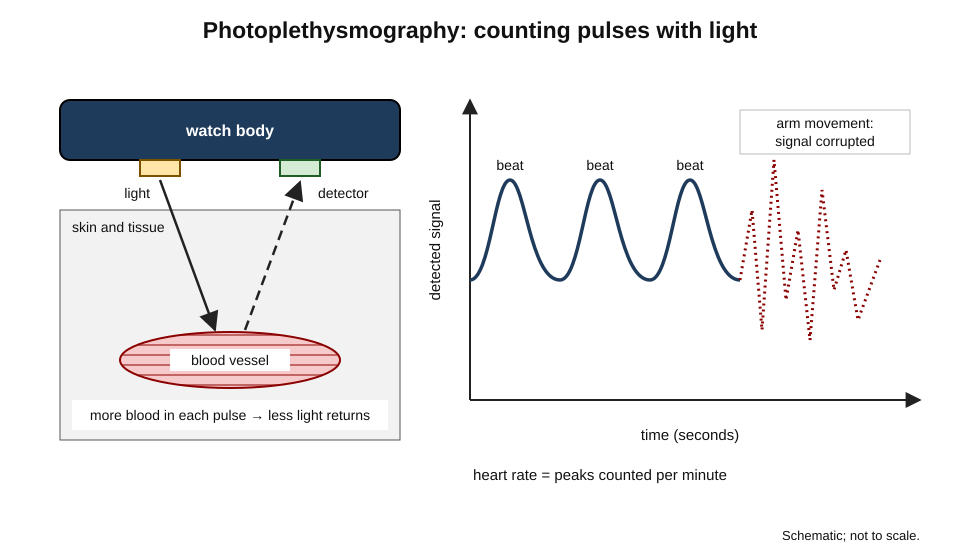
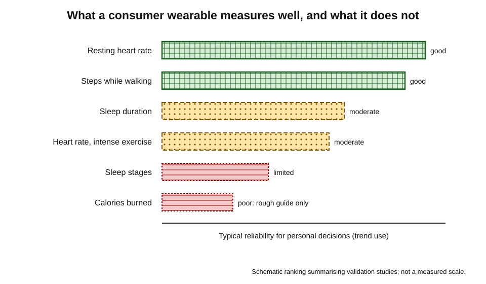
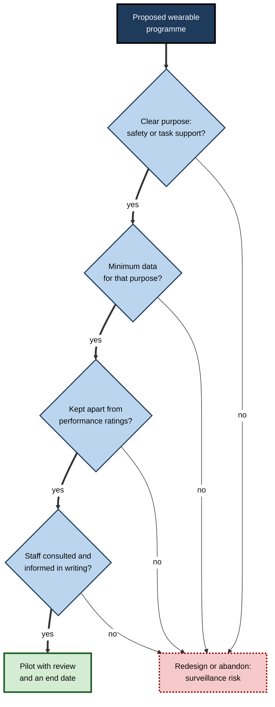

# B.5. Wearable Devices

A runner's watch tells her she ran 10 kilometres at a steady pace. A man in his sixties receives a notification that his heart rhythm looks irregular, sees a doctor and is diagnosed with atrial fibrillation. A warehouse picker scans parcels with a ring on his finger. A field engineer wearing smart glasses sees a remote expert's arrows drawn over the machine in front of her. Each is wearing a computer — one that **senses the body and its surroundings continuously** and is almost never taken off.

> **Definition — Wearable device:** a computing device worn on or close to the body — on the wrist, finger, ear, face, clothing or skin — that senses, processes and communicates data about the wearer, their activity or their environment, usually in partnership with a smartphone and cloud services.

**Why wearables matter**

- They generate the most **intimate data** of any device: heart rhythm, sleep, location, movement, sometimes blood glucose and menstrual cycles.
- They are moving from **lifestyle gadgets** to **regulated medical tools**, which changes how their readings should be trusted.
- In workplaces they support safety, hands-free work and training — and raise sharp questions about **monitoring and consent**.
- Their readings are easily over-trusted; understanding accuracy is a core digital-literacy skill.

---

## From Wristwatch to Body Sensor

### A short history

- **1970s** — digital watches and calculator watches put electronics on the wrist.
- **1980s–1990s** — researchers such as Steve Mann experiment with head-worn cameras and computers, coining much of the language of **wearable computing**.
- **2009** — clip-on and wrist **fitness trackers** popularise step counting and sleep tracking.
- **2013** — **Google Glass** tests smart glasses publicly; privacy objections and limited usefulness end the consumer version, but enterprise versions continue.
- **2015** — the **Apple Watch** launches; smartwatches combine notifications, fitness and later health features.
- **2016 onward** — wireless earbuds become mainstream; later models add noise cancellation, health sensing and hearing assistance.
- **2018** — the first smartwatch electrocardiogram (ECG) feature receives clearance from the United States Food and Drug Administration (FDA).
- **2020s** — smart rings, consumer continuous glucose monitors, camera-equipped glasses with AI assistants and mixed-reality headsets.

**Figure 1.** Where wearable devices are worn and what they mainly sense.

---

## Kinds of Wearable

### Main categories

- **Smartwatches** — full computers on the wrist: notifications, apps, payments, fitness, heart and sleep sensing, sometimes mobile connectivity.
- **Fitness bands** — simpler, cheaper, longer battery life; focused on activity and sleep.
- **Smart rings** — small sensors on the finger tracking sleep, heart rate and temperature; battery life of several days.
- **Hearables** — earbuds and hearing devices with noise cancellation, voice assistants, translation, hearing assistance and sometimes heart-rate sensing.
- **Smart glasses and headsets** — display information in front of the eyes or capture what the wearer sees.
  - **Augmented reality (AR)** overlays digital images on the real world.
  - **Virtual reality (VR)** replaces the real world with a digital one.
  - **Mixed reality (MR)** blends both, with digital objects anchored in the room.
- **Medical wearables** — continuous glucose monitors, cardiac monitoring patches, insulin pumps, connected hearing aids.
- **Workplace wearables** — ring and wrist scanners, smart badges, lone-worker alarms, gas detectors, smart helmets, exoskeletons that reduce strain in lifting.
- **Smart clothing** — garments with woven sensors; mostly sport and research uses.

> **Definition — Extended reality (XR):** the umbrella term for augmented, virtual and mixed reality — technologies that blend or replace a person's view of the physical world with computer-generated content.

| Category | Main purpose | Typical battery life | Key sensors | Regulated as medical? |
|---|---|---|---|---|
| Smartwatch | Notifications, fitness, health, payments | 1–3 days (some longer) | Accelerometer, optical heart rate, ECG, GNSS | Some features cleared |
| Fitness band | Activity and sleep | 5–14 days | Accelerometer, optical heart rate | Rarely |
| Smart ring | Sleep and recovery | 4–7 days | Optical heart rate, temperature, accelerometer | Rarely |
| Hearables | Audio, calls, hearing support | Hours per charge; case recharges | Microphones, motion | Some hearing features |
| Smart glasses / XR headsets | Information display, capture, immersive work | Hours | Cameras, depth sensors, eye tracking | No |
| Continuous glucose monitor | Diabetes management | 10–15 days per sensor | Glucose sensor under the skin | Yes |
| Workplace wearables | Scanning, safety, ergonomics | A shift or more | Scanner, motion, gas, location | Safety standards apply |

> **Watch out:** battery lives and regulatory status vary by model and country. A device being "cleared" for one feature, such as ECG, does not make all its other readings medical-grade.

---

## How a Wearable Works

### The sensing chain

1. **Sense** — a sensor converts a physical signal (movement, light reflected from blood, electrical activity of the heart) into a number.
2. **Pre-process on the device** — filtering, counting steps, detecting a heartbeat; done locally to save battery and radio use.
3. **Synchronise** — data is sent, usually by Bluetooth Low Energy, to a paired phone.
4. **Analyse** — the phone app and cloud service compute trends, scores and alerts, often with machine-learning models.
5. **Present** — rings, charts, scores and notifications on the watch or phone.

**Figure 2.** The data path from body to cloud and back.

### The main sensors

- **Accelerometer and gyroscope** — detect movement and orientation; used for steps, activity type, sleep and fall detection.
- **Optical heart-rate sensor (photoplethysmography, PPG)** — green or infrared light shines into the skin; the amount reflected changes with each pulse of blood.
- **Electrical heart sensor (ECG)** — electrodes on the watch and a fingertip form a circuit across the heart, recording a single-lead electrocardiogram.
- **Blood-oxygen (SpO2)** — red and infrared light estimate the oxygen saturation of blood.
- **Skin temperature** — detects changes from a personal baseline, used for illness signals and cycle tracking.
- **GNSS** — satellite positioning for routes and distance.
- **Barometer** — altitude and stairs climbed.
- **Microphones** — noise exposure, voice commands, hearing assistance.

> **Definition — Photoplethysmography (PPG):** measuring changes in blood volume under the skin by shining light into it and detecting how much is reflected or transmitted; each heartbeat produces a small pulse in the signal.

**Figure 3.** How an optical heart-rate sensor detects a pulse.

> **Watch out:** optical sensors are affected by **movement, fit, tattoos, cold skin and skin tone**. Some studies have found poorer accuracy of pulse-oximetry on darker skin, a problem first documented in hospital devices; the extent for consumer wearables is still being studied.

### Why battery life is the central constraint

- A wearable must be **small and light**, so its battery is tiny.
- Every sensor reading, screen wake and radio transmission costs energy.
- Designers therefore sample sensors **intermittently**, process locally and synchronise in bursts.
- Trade-off: more frequent sampling gives better data but shorter battery life.

---

## How Accurate Are Wearables?

Wearables measure some things well and others poorly. Judging which is which is the most practical skill in using them.

### Evidence on accuracy

**Study card — Shcherbina and colleagues, Stanford (2017)**

- **Design:** 60 volunteers wore seven wrist devices while walking, running and cycling; readings were compared with an electrocardiogram and with laboratory measurement of energy expenditure from breathing gases.
- **Results:**
  - **Heart rate** — most devices were reasonably accurate, typically within a few per cent in many conditions.
  - **Energy expenditure (calories)** — no device was accurate; even the best was off by more than a fifth on average, and the worst by far more.
- **Conclusion:** heart-rate readings can be useful; calorie figures should be treated as rough estimates only.

| Measure | Typical accuracy of consumer wearables | Main sources of error | How to use it |
|---|---|---|---|
| Steps | Good for walking; worse for pushing trolleys or slow gait | Arm movement without steps; steps without arm swing | Trends and daily totals |
| Heart rate at rest | Good | Loose fit, cold skin | Resting trends over weeks |
| Heart rate during intense exercise | Moderate | Wrist movement, gripping | Chest strap for training precision |
| Energy expenditure | Poor | Model assumptions about the body | Rough guide only |
| Sleep duration | Moderate | Lying still awake counted as sleep | Trends over weeks |
| Sleep stages | Limited | Inferred from movement and heart rate, not brain activity | Do not over-interpret nightly scores |
| ECG for atrial fibrillation | Good where cleared | Poor contact, other arrhythmias | Prompt to see a clinician |

**Figure 4.** Relative reliability of common wearable measurements.

### Health alerts and screening

**Study card — The Apple Heart Study (Perez and colleagues, 2019)**

- **Design:** more than 400,000 participants in the United States used a smartwatch app that looked for irregular pulse patterns; those notified were offered an ECG patch to wear for up to a week.
- **Results:**
  - about **0.5%** of participants received an irregular-pulse notification;
  - among notified participants who returned a usable patch, about a third had atrial fibrillation detected on the patch;
  - when the watch notified during patch-wearing, it agreed with atrial fibrillation on the patch in most cases.
- **Conclusion:** a consumer wearable could identify possible atrial fibrillation at scale, but many notified people never completed follow-up, and the value of screening the general population remains debated.

> **Definition — Atrial fibrillation:** an irregular, often fast heart rhythm that raises the risk of stroke; it may cause no symptoms.

### Worked example: why alerts in healthy populations produce false alarms

**Situation:** a hypothetical wearable detects a condition with **90% sensitivity** (it flags 90% of people who have it) and **98% specificity** (it correctly clears 98% of people who do not). It is used by 10,000 people, of whom 2% have the condition.

1. People with the condition: 10,000 × 0.02 = **200**.
2. Correctly flagged: 200 × 0.90 = **180** (true positives).
3. People without it: **9,800**; wrongly flagged: 9,800 × 0.02 = **196** (false positives).
4. Total alerts: 180 + 196 = **376**.
5. Chance an alert is correct: 180 ÷ 376 ≈ **48%**.

| | Has the condition | Does not | Total |
|---|---|---|---|
| Alert | 180 | 196 | 376 |
| No alert | 20 | 9,604 | 9,624 |
| Total | 200 | 9,800 | 10,000 |

> **Formula — Positive predictive value:** PPV = true positives ÷ all positive results. Here 180 ÷ 376 ≈ **0.48**. The rarer the condition in the people wearing the device, the lower the PPV, even for an accurate test.

> **Key point:** an alert from a wearable is a reason to **see a professional**, not a diagnosis. And the absence of an alert is not a clean bill of health.

### Steps, sleep and scores

- **The 10,000-step target** is often traced to the name of a Japanese pedometer marketed in the 1960s, not to a scientific study.
- **Study card — Paluch and colleagues (2022)**
  - **Design:** a meta-analysis pooling 15 cohort studies of nearly 50,000 adults, linking daily steps with death from any cause.
  - **Results:** more steps were linked with lower risk, levelling off at roughly **6,000–8,000 steps a day for adults over 60** and **8,000–10,000 for younger adults**.
  - **Conclusion:** benefits begin well below 10,000 steps; the evidence is observational, so causation cannot be proved.
- **Sleep and readiness scores** combine several imperfect measures into a single number; useful for trends, misleading if treated as precise.

> **Definition — Orthosomnia:** a term proposed by sleep researchers (Baron and colleagues, 2017) for anxiety and poor sleep caused by striving for perfect sleep-tracker scores.

---

## Wearables at Work

### Uses

- **Hands-free scanning** — ring and wrist scanners speed picking in warehouses.
- **Lone-worker safety** — fall detection and panic buttons for utility, security and care staff working alone.
- **Hazard detection** — wearable gas monitors, heat-stress sensors, proximity alerts near heavy vehicles.
- **Remote expert support** — smart glasses stream what a technician sees to an expert who annotates it in the technician's view.
- **Training** — VR simulations for surgery, aviation, emergency response and hazardous procedures.
- **Ergonomic support** — passive and powered exoskeletons reducing strain on backs and shoulders in lifting and overhead work.
- **Wellness programmes** — some employers and insurers offer incentives for activity tracking.

> **Example:** an aircraft maintenance team uses smart glasses to call a specialist at the manufacturer, who sees the engine through the technician's camera and marks the exact fastener to inspect — avoiding a flight for the specialist.

### Monitoring, privacy and ethics

- **Health data is sensitive.** Under the EU's General Data Protection Regulation (GDPR), data concerning health is a **special category** that needs a specific legal basis and strong safeguards.
- **Consumer wearables often fall outside medical privacy laws.** In the United States, for example, health-privacy rules for medical providers generally do not cover data collected by consumer apps.
- **Location can reveal more than intended.**
  - *e.g.* in 2018 a fitness app's public global "heat map" of users' activity revealed the outlines and patrol routes of military bases in several countries.
- **Employer power** — even "voluntary" tracking can feel compulsory; productivity monitoring through wearables can harm trust and wellbeing.
- **Reproductive data** — cycle-tracking data has raised concerns in jurisdictions where it could be used as evidence.

> **Definition — Special category data:** under GDPR, types of personal data needing extra protection, including health, genetic and biometric data used for identification.

> **In practice:** responsible workplace wearable programmes collect **only what the purpose needs**, aggregate data wherever possible, separate safety data from performance management, explain clearly what is collected, and involve staff representatives before launch.

**Figure 5.** Questions before deploying wearables to staff.

### Case study: safety wearables in a distribution centre

- **Situation:** a distribution centre with 800 staff had repeated near-misses between pedestrians and forklift trucks, and rising back injuries.
- **Proposal:** wearable tags for proximity alerts, plus wrist devices that would also record walking speed and idle time.
- **Staff reaction:** strong opposition to the wrist devices, seen as productivity surveillance; union representatives threatened to withdraw co-operation.
- **Actions:**
  1. Separated the two purposes; dropped speed and idle-time recording.
  2. Deployed **proximity tags** that vibrated when a truck came close, with data aggregated by zone, not by person.
  3. Introduced passive **back-support exoskeletons** for the heaviest lifting roles on a voluntary trial basis.
  4. Published a short data notice and reviewed results with staff representatives monthly.
- **Result:** near-misses fell markedly in the zones with tags; the exoskeleton trial received mixed reviews, with some staff finding them uncomfortable in hot weather; complaints about surveillance ended.
- **Lesson:** a wearable programme's legitimacy depends on **purpose limitation and trust**. Mixing safety with productivity monitoring can sink both.

---

## Medical-Grade Wearables

### The boundary between wellness and medicine

- **Wellness devices** — general fitness and lifestyle; not evaluated as medical devices.
- **Medical devices** — intended to diagnose, monitor or treat disease; must be evaluated and authorised by regulators (in the EU under the Medical Device Regulation; in the United States by the FDA).
- Some consumer devices contain **specific cleared features** — ECG, irregular-rhythm notification, hearing-aid functions, sleep-apnoea notifications — inside an otherwise wellness product.

### Remote patient monitoring

- **Continuous glucose monitors** — a small filament under the skin measures glucose every few minutes, transforming diabetes care.
- **Cardiac patches** — record heart rhythm for one to two weeks.
- **Post-discharge monitoring** — patients wear sensors at home; clinicians watch for deterioration.
- **Benefits:** earlier intervention, fewer hospital visits.
- **Challenges:** data overload for clinicians, false alarms, unequal access, responsibility for responding to alerts.

---

## Smart Glasses and Headsets in Depth

### How head-worn displays work

- **Optical see-through** — the wearer looks through transparent lenses onto which small projectors or waveguides add images.
  - Light, socially acceptable; images can be faint in bright light.
- **Video see-through** — cameras capture the world and screens inside a headset show it, blended with digital content.
  - Rich, convincing mixed reality; heavier, with a slight delay and a sealed view.
- **Fully immersive VR** — screens replace the view entirely.
- **Tracking** — cameras and motion sensors follow the head, hands and sometimes eyes, so digital objects stay fixed in space.
- **Camera-and-audio glasses without displays** — capture photos and video and connect to AI assistants that describe the scene or answer questions.

> **Definition — Waveguide:** a thin transparent optical element that guides light from a tiny projector across a lens and into the eye, allowing digital images to appear over the real world in lightweight glasses.

### Evidence and limits

- **Training** — simulation in VR is well established in aviation and increasingly in surgery and emergency response; studies in several fields have found transfer of skills to real tasks, though quality varies and results depend on the design of the training.
- **Comfort** — **cybersickness** (nausea, disorientation) affects a share of users, especially with delays between movement and image; session length and design matter.
- **Ergonomics** — headset weight on the neck limits comfortable session lengths.
- **Privacy** — always-available cameras on faces raise concerns for bystanders; many designs include a recording light, which can be covered or ignored.

> **Definition — Cybersickness:** nausea, eye strain or disorientation caused by virtual or mixed-reality experiences, often linked to mismatches between seen and felt motion.

> **Watch out:** forecasts that headsets would soon replace monitors and phones have repeatedly proved premature. They are valuable in **specific** tasks — training, design review, remote assistance — rather than as general-purpose replacements so far.

---

## Choosing and Using a Wearable Well

### Questions before buying

- **Purpose** — fitness, sleep, health monitoring, notifications, payments, safety?
- **Platform** — does it work fully with the user's phone? Many features are tied to one ecosystem.
- **Battery** — daily charging or a week between charges?
- **Accuracy needs** — consumer-grade estimates or a medically cleared feature?
- **Data** — where does the data go, who can see it, can it be exported and deleted?
- **Comfort and fit** — worn all day and night, so size, weight and materials matter.
- **Durability** — water resistance for swimming or work; replaceable straps; repair options.

### Using the data sensibly

- **Look at trends**, not single readings — weeks of resting heart rate or sleep duration are more meaningful than last night's score.
- **Know the weak measures** — calories and sleep stages are estimates.
- **Act on persistent changes**, such as a resting heart rate rising for many days, and seek professional advice for symptoms.
- **Set boundaries** — notifications on the wrist can multiply interruptions; turn off those that are not needed.

> **Remember:** a wearable is a **thermometer for trends**, not a doctor. Trust it most for what it measures directly and repeatedly; trust it least for estimates built on models.

### Data controls

- Review sharing settings in the companion app and in any connected services.
- Limit public sharing of routes and locations — set start and end zones around home and work to private.
- Check what happens to data if the company is sold or closes.
- Delete data and accounts before passing on or recycling the device.

| Setting | Why it matters |
|---|---|
| Public activity maps | Can reveal home address, routines and sensitive sites |
| Third-party app connections | Data may flow to services with different privacy terms |
| Employer or insurer programmes | Data may influence decisions about the wearer |
| Cloud backup and export | Determines whether data can be retrieved or deleted |

---

## Hearables and Hearing Health

- **Noise cancellation** — lets wearers listen at lower volumes in noisy places, reducing sound dose.
- **Exposure monitoring** — phones and watches measure headphone and environmental sound levels and warn when weekly exposure is high.
- **Hearing assistance** — some earbuds now include features authorised as over-the-counter hearing aids for mild to moderate hearing loss, and hearing tests run through a phone.
- **Conversation boost and transparency modes** — amplify voices or let outside sound in for safety.
- **Translation** — real-time interpretation of speech in another language through earbuds, useful but imperfect for specialised or rapid speech.

> **In practice:** making hearing support available in ordinary earbuds may reduce the stigma and cost that stop many people with hearing loss from seeking help, though professional assessment remains important.

---

## Wearables for Older People and Carers

- **Fall detection** — watches and pendants detect hard falls and call for help if the wearer does not respond.
- **Location sharing** — reassurance for families of people with dementia, balanced against the person's autonomy and consent.
- **Medication reminders and check-ins** — prompts and simple confirmations.

> **Watch out:** monitoring a vulnerable adult should involve the person themselves wherever possible; safety technology can quietly become surveillance.

---

## Open Questions

- **Should healthy people be screened by wearables?**
  - Early detection helps some; false alarms, anxiety and unnecessary tests affect others. The balance for population screening is unresolved.
- **How accurate are sensors across all bodies?**
  - Accuracy across skin tones, ages and body types needs more independent testing.
- **Will smart glasses become mainstream?**
  - AI assistants make glasses more useful; privacy concerns about always-on cameras remain.
- **Who owns wearable data?**
  - Rules on sale, sharing with insurers and employers, and law-enforcement access differ widely and are changing.
- **Do wearables change behaviour lastingly?**
  - Studies show increases in activity in the short term; long-term effects and drop-off rates are less clear.

---

## Summary

- A **wearable** is a computing device worn on the body that senses, processes and communicates data, usually paired with a phone and cloud services.
- Categories: smartwatches, fitness bands, smart rings, hearables, smart glasses and **XR** headsets, medical wearables, workplace wearables, smart clothing.
- The sensing chain: **sense → process on device → sync by Bluetooth LE → analyse in app or cloud → present**.
- Key sensors: accelerometer, **PPG** optical heart rate, ECG, SpO2, temperature, GNSS, barometer, microphones; battery life is the central constraint.
- Accuracy varies: heart rate and steps are useful; **calories are poor**; sleep stages are limited.
- Alerts are prompts, not diagnoses; low prevalence lowers **positive predictive value**.
- Benefits of walking begin well below 10,000 steps; beware **orthosomnia**.
- At work: scanning, lone-worker safety, hazard detection, remote experts, training, exoskeletons — with strict purpose limitation.
- Health data is **special category data** under GDPR; consumer devices often sit outside medical privacy rules; location data can leak sensitive information.
- Medical-grade features are regulated; remote monitoring helps patients but creates data and responsibility challenges.

---

## Self-Check

1. Define a wearable device and give four categories with examples.
2. Describe the five steps of the sensing chain.
3. Explain how photoplethysmography measures heart rate and name three factors that reduce its accuracy.
4. Why is battery life the central constraint of wearable design, and how do designers manage it?
5. What did the 2017 Stanford study find about heart rate and energy expenditure?
6. Summarise the Apple Heart Study and one limitation.
7. A wearable has 95% sensitivity and 99% specificity for a condition affecting 1% of 20,000 users. Calculate the positive predictive value.
8. What did the 2022 meta-analysis on daily steps find, and why can it not prove causation?
9. What is orthosomnia?
10. Distinguish AR, VR and MR, with a workplace use for each.
11. Why is health data from consumer wearables a privacy concern even when anonymised maps are published?
12. An employer proposes wristbands that record staff heart rate and idle time "for wellbeing". Evaluate the proposal.
13. What distinguishes a medical wearable from a wellness wearable?
14. A friend's watch reports "poor sleep quality" five nights running. How should they interpret this?

### Answer Key

1. A computing device worn on or near the body that senses, processes and communicates data about the wearer or environment. Smartwatches (wrist computer), smart rings (sleep tracking), hearables (noise-cancelling earbuds), XR headsets (training), medical wearables (glucose monitors), workplace wearables (ring scanners).
2. Sense the signal; pre-process on the device; synchronise to a phone by Bluetooth LE; analyse in app or cloud; present feedback.
3. Light shines into the skin; blood volume changes with each heartbeat alter how much light is reflected; the device counts the pulses. Movement, loose fit, cold skin, tattoos and skin tone can reduce accuracy.
4. Devices must be small, so batteries are tiny while sensing and radios use energy. Designers sample intermittently, process locally and synchronise in bursts.
5. Heart rate was reasonably accurate for most devices; energy expenditure was inaccurate for all, with even the best off by more than a fifth.
6. Over 400,000 participants used an irregular-pulse app; about 0.5% were notified; about a third of those who returned a patch had atrial fibrillation on it. Limitation: many notified participants did not complete follow-up, and the benefit of screening the general population is uncertain.
7. Affected: 200; true positives 200 × 0.95 = 190. Unaffected: 19,800; false positives 19,800 × 0.01 = 198. PPV = 190 ÷ 388 ≈ **0.49**.
8. More daily steps were linked to lower mortality, levelling off around 6,000–8,000 for over-60s and 8,000–10,000 for younger adults. The studies were observational; healthier people may walk more, so causation is not proven.
9. Anxiety and poorer sleep caused by striving for perfect sleep-tracker scores.
10. AR overlays digital content on the real world (maintenance instructions); VR replaces it (surgical simulation); MR anchors digital objects in the real room (design review of a 3D model at full scale).
11. Aggregated location data can still reveal sensitive places and patterns, as the 2018 heat map revealed military bases; health and location together can identify individuals.
12. Heart rate is special-category health data; idle time implies productivity monitoring; consent from employees is rarely truly free. The purpose is vague. Better to state a narrow purpose, collect minimum data, keep it apart from performance management, consult staff, or drop the proposal.
13. A medical wearable is intended to diagnose, monitor or treat disease and is authorised by a regulator after evaluation; a wellness wearable is for general fitness and is not evaluated as medical.
14. Sleep-stage and quality scores are imprecise; look at sleep duration and how they feel; review habits (caffeine, screens, timing); see a doctor if symptoms such as daytime sleepiness or snoring persist — not because of the score alone.

---

## Glossary

| Term | Meaning |
|---|---|
| Accelerometer | A sensor measuring acceleration and movement. |
| Atrial fibrillation | An irregular heart rhythm that raises stroke risk. |
| Augmented reality | Digital content overlaid on a view of the real world. |
| Bluetooth Low Energy | A low-power wireless standard used to link wearables and phones. |
| Continuous glucose monitor | A wearable measuring blood glucose every few minutes. |
| Cybersickness | Nausea or disorientation caused by virtual or mixed-reality experiences. |
| ECG | Electrocardiogram: a recording of the heart's electrical activity. |
| Exoskeleton | A wearable frame that supports or assists the body in physical work. |
| Extended reality | Umbrella term for augmented, virtual and mixed reality. |
| False positive | A test result that wrongly indicates a condition. |
| Hearable | An ear-worn computing device. |
| Medical device | A product intended for diagnosis, monitoring or treatment, regulated as such. |
| Mixed reality | Blending of real and digital worlds with digital objects anchored in the room. |
| Orthosomnia | Sleep anxiety caused by pursuing perfect tracker scores. |
| Photoplethysmography | Optical measurement of blood-volume changes to detect pulse. |
| Positive predictive value | The proportion of positive results that are correct. |
| Sensitivity | The proportion of true cases a test detects. |
| Smart ring | A ring-shaped wearable sensor. |
| Special category data | Personal data such as health data that needs extra protection under GDPR. |
| Specificity | The proportion of non-cases a test correctly clears. |
| SpO2 | Peripheral blood-oxygen saturation. |
| Virtual reality | A fully computer-generated environment replacing the real view. |
| Waveguide | An optical element guiding projected images across a lens into the eye. |
| Wearable device | A computing device worn on or near the body. |
