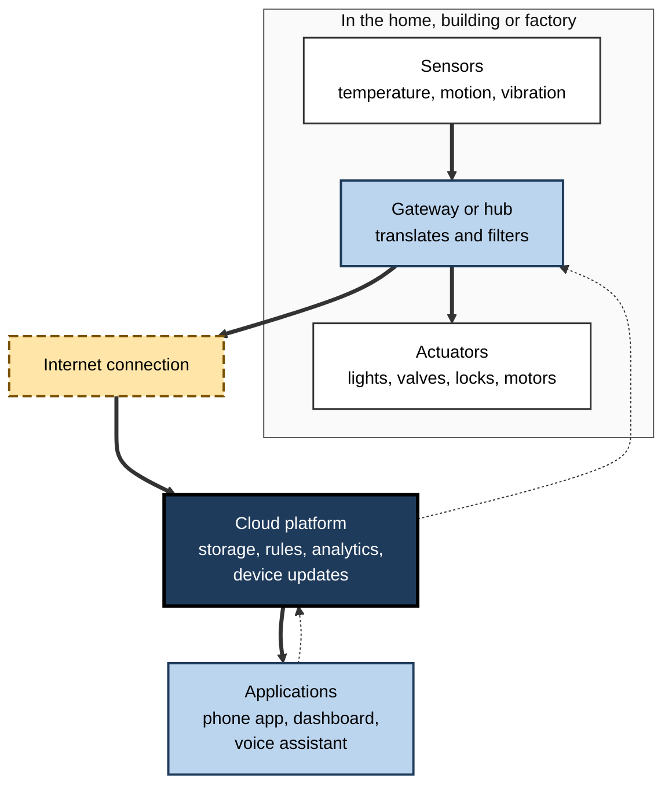
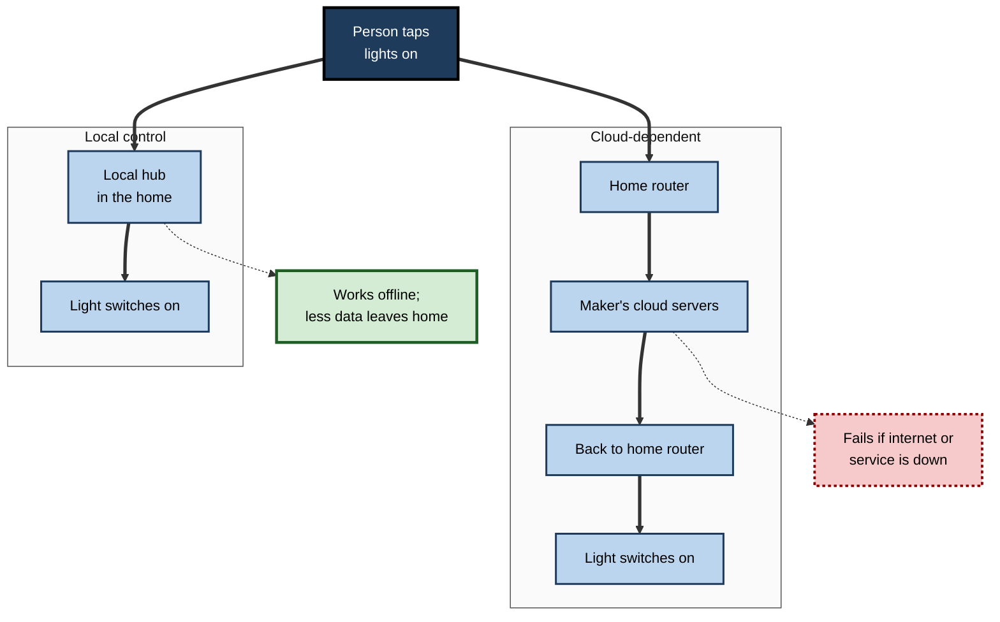
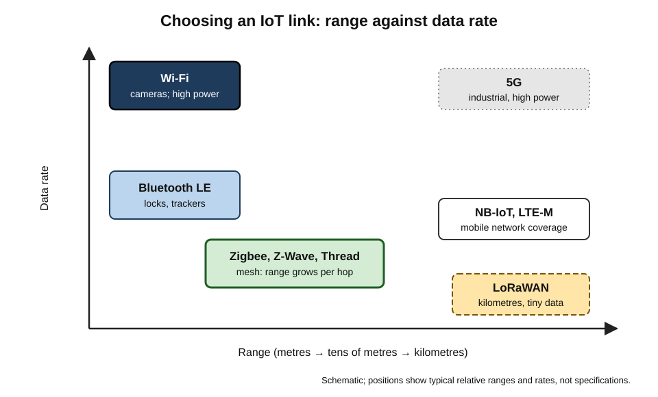
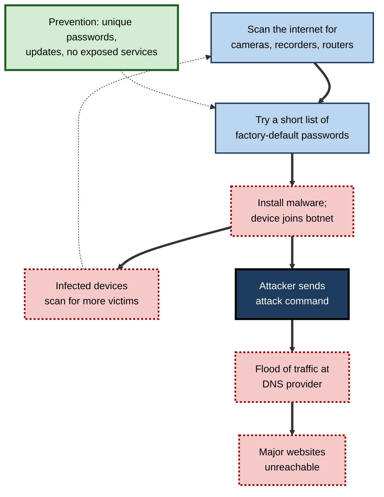
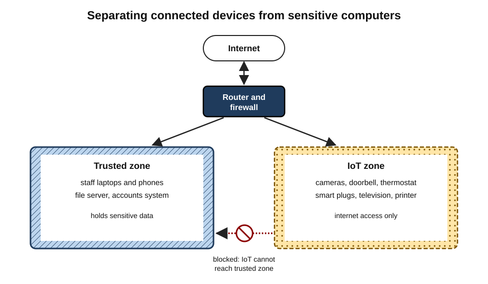

# B.6. Smart Home & IoT Devices

A thermostat learns that a household leaves at eight and turns the heating down. A doorbell shows a courier's face on a phone in another country. A sensor on a factory pump detects a vibration pattern that predicts failure weeks ahead. A farmer's soil probes decide when to irrigate. And in 2016, hundreds of thousands of poorly secured cameras and video recorders were hijacked to knock major websites offline. All of these are **things on the internet** — ordinary objects given sensors, processors and network connections.

> **Definition — Internet of Things (IoT):** the network of physical objects — appliances, sensors, machines, vehicles, buildings — that contain embedded computing and connectivity, allowing them to collect data, be monitored and be controlled remotely, often without direct human operation.

> **Definition — Smart home:** a home in which lighting, heating, security, appliances, entertainment or energy systems are connected and can be controlled remotely, automatically or by voice.

**Why IoT matters**

- It is the **largest and fastest-growing** class of computing device: connected things far outnumber people and personal computers.
- It moves computing from screens into the **physical world** — so failures can open doors, stop heating, spoil medicines or halt production.
- It is the **weakest point** of many networks: cheap devices, rarely updated, often forgotten.
- It produces streams of data about homes, buildings and behaviour, raising **privacy** questions in both private and working life.

---

## How Objects Joined the Internet

### Origins

- **Early 1980s** — students at Carnegie Mellon University connected a drinks vending machine to the university network so they could check remotely whether it held cold drinks.
- **1991** — at the University of Cambridge, a camera pointed at a coffee pot in the "Trojan Room" let researchers see whether it was full; it later became one of the first webcams.
- **1999** — **Kevin Ashton**, working on radio-frequency identification (RFID) tags for supply chains, coined the phrase **"Internet of Things"**.
- **2000s** — RFID in logistics; early networked appliances; **smart meters** for electricity begin rolling out.
- **2010s** — learning thermostats (from 2011), voice-assistant speakers (from 2014), connected doorbells and cameras; "Industry 4.0" programmes in manufacturing.
- **2022** — the **Matter** standard (version 1.0) is released by an industry alliance, aiming to let smart-home devices from different makers work together; later versions add energy management and cameras.
- **2024 onward** — governments begin requiring minimum security for connected consumer products.

> **Definition — RFID (radio-frequency identification):** tags that can be read by radio without line of sight, used to identify and track goods, animals and people's access cards; passive tags need no battery.

---

## The Architecture of an IoT System

### Five layers

- **Things** — the physical devices.
  - **Sensors** measure: temperature, motion, light, humidity, vibration, location, power.
  - **Actuators** act: switch a light, open a valve, lock a door, start a motor.
- **Connectivity** — the radio or cable link from the thing: Wi-Fi, Bluetooth, Zigbee, Thread, mobile networks, low-power wide-area networks.
- **Gateway or hub** — collects data from many local devices, translates between protocols and connects them to the internet.
- **Cloud platform** — stores data, runs analytics and rules, manages devices and updates.
- **Applications** — phone apps, dashboards, voice assistants and links to other business systems.

> **Definition — Sensor:** a device that converts a physical quantity, such as temperature or motion, into data.

> **Definition — Actuator:** a device that converts a digital command into physical action, such as turning a motor, closing a relay or opening a valve.

**Figure 1.** The layers of a typical IoT system.

### Where the decisions are made

- **Cloud-dependent** — every command goes through the maker's servers.
  - Simple to build; fails when the internet or the service fails; sends more data away.
- **Local control** — a hub in the home makes decisions itself.
  - Faster, works offline, more private; needs a capable hub.
- **Edge analytics in industry** — gateways analyse high-volume sensor data on site and send only summaries or alerts.

**Figure 2.** The path of a command under cloud-dependent and local control.

> **Key point: a "smart" light switch that stops working when a company's servers go down is not really part of the home; it is part of the company's service. Local control is a design choice with consequences for reliability, privacy and longevity.

---

## Connecting the Things

### Why IoT needs its own networks

- Many devices run for **years on small batteries**, so radios must use very little power.
- Some are **far apart** — across a farm or a city — needing long range.
- Some send only **a few bytes** a few times a day.
- Homes may contain **dozens or hundreds** of devices; networks must handle many simultaneous members.

### Main technologies

- **Wi-Fi** — high bandwidth, mains-powered devices such as cameras and speakers; power-hungry.
- **Bluetooth Low Energy** — short range, low power; phones talk directly to devices such as locks and trackers.
- **Zigbee and Z-Wave** — low-power **mesh** networks for lights, sensors and switches, needing a hub.
- **Thread** — a low-power mesh network using internet addressing (IPv6), designed for smart-home devices and used beneath Matter.
- **LoRaWAN and Sigfox** — low-power wide-area networks: kilometres of range, tiny amounts of data; used for meters, agriculture and city sensors.
- **NB-IoT and LTE-M** — low-power variants of mobile networks for trackers, meters and remote equipment.
- **5G and wired Ethernet** — for high-bandwidth and critical industrial uses.

> **Definition — Mesh network:** a network in which devices relay messages for one another, so coverage grows as more devices are added and messages can route around a failed device.

> **Definition — Matter:** an industry standard for smart-home devices that defines how they describe themselves and are controlled, so that a device certified for Matter can work with different manufacturers' apps, hubs and voice assistants; it runs over Wi-Fi, Thread and Ethernet.

| Technology | Range | Data rate | Power use | Typical uses |
|---|---|---|---|---|
| Wi-Fi | Tens of metres | Very high | High | Cameras, speakers, appliances |
| Bluetooth LE | Up to tens of metres | Low to moderate | Very low | Locks, trackers, health sensors |
| Zigbee / Z-Wave | Tens of metres per hop; mesh | Low | Very low | Lights, switches, sensors |
| Thread (with Matter) | Tens of metres per hop; mesh | Low | Very low | Sensors, locks, blinds, plugs |
| LoRaWAN | Several kilometres | Very low | Very low | Meters, farms, city sensors |
| NB-IoT / LTE-M | Mobile network coverage | Low | Low | Trackers, meters, remote equipment |

**Figure 3.** IoT connection technologies by range and data rate.

---

## The Smart Home

### What gets connected

- **Lighting** — smart bulbs and switches; schedules, scenes, dimming, presence-based control.
- **Heating and cooling** — smart thermostats, radiator valves, heat pumps; schedules, occupancy sensing, remote control.
- **Security and access** — cameras, video doorbells, smart locks, alarm sensors, leak and smoke detectors.
- **Voice assistants and speakers** — spoken control of other devices, timers, information, calls.
- **Appliances** — washing machines, ovens, fridges and robot vacuum cleaners with apps and remote start.
- **Energy** — smart meters, solar inverters, home batteries, electric-vehicle chargers that charge when electricity is cheapest.
- **Care and accessibility** — fall sensors, medication reminders, voice control for people with limited mobility or sight.

### Benefits, honestly assessed

- **Convenience** — real for routines such as lights, heating schedules and remote checks.
- **Accessibility** — often transformative: voice control and automation give independence to people with disabilities and older people living alone.
- **Energy saving** — plausible where heating is otherwise left on unnecessarily; smaller where households already manage heating carefully.
- **Security** — cameras and alerts deter some crime and provide evidence; they also add risks of their own.

> **Watch out:** savings claimed for smart thermostats come mostly from manufacturers' own studies. Independent trials generally find **some** savings, but smaller and more variable than marketing suggests, depending on the home, the heating system and how occupants behaved before.

> **Example:** an electric-vehicle charger linked to a time-of-use tariff charges the car between midnight and five in the morning, when electricity is cheaper and less carbon-intensive, without the owner doing anything each night.

### Interoperability and ecosystems

- Historically each maker had its own app, hub and cloud, and devices rarely worked together.
- Large platforms built ecosystems around their voice assistants.
- **Matter** aims to let a certified device join any compatible ecosystem; adoption has grown, but support for particular device types and features varies.

> **In practice:** before buying, check whether a device works **locally**, which ecosystems it supports, whether it carries a recognised interoperability certification, and how long the maker promises security updates.

---

## Industrial and Organisational IoT

### Uses beyond the home

- **Predictive maintenance** — vibration, temperature and power sensors on machines detect early signs of failure.
- **Smart buildings** — occupancy sensors drive lighting, heating, ventilation and desk-booking; meters track energy use by floor.
- **Logistics** — trackers report the location, temperature and shock of shipments; RFID tags count stock automatically.
- **Agriculture** — soil-moisture probes, weather stations, livestock tags, automated irrigation.
- **Healthcare** — connected infusion pumps, monitoring equipment, cold-chain sensors for vaccines.
- **Utilities and cities** — smart meters, water-leak detection, street lighting, parking and air-quality sensors.
- **Manufacturing** — connected production lines feeding data into planning systems.

> **Definition — Industry 4.0:** a term, popularised in Germany from 2011, for the integration of sensors, connectivity, data analytics and automation into manufacturing — sometimes called the fourth industrial revolution.

> **Definition — Digital twin:** a continuously updated digital model of a physical asset, process or building, fed by sensor data, used to monitor, simulate and optimise the real thing.

> **Definition — Operational technology (OT):** hardware and software that monitor and control physical processes, such as industrial control systems, as distinct from information technology (IT) that handles data.

### IT and OT converge

- Industrial control systems were once isolated; connecting them to business networks and the internet brings efficiency **and** exposure.
- OT devices may run for **decades**, cannot be patched without stopping production, and often lack basic security features.
- Attacks on OT can cause **physical harm**: stopped pipelines, poisoned water, damaged machines.

---

## Security: the Weakest Link

### Why IoT devices are often insecure

- **Low price, thin margins** — security costs money that cheap devices do not budget for.
- **Default passwords** — identical credentials such as "admin/admin" shipped on every unit.
- **No update mechanism** — or updates that owners never install.
- **Short support** — makers stop issuing fixes after a year or two, or disappear.
- **Hidden presence** — owners forget the device exists; organisations do not list it.
- **Exposed services** — devices reachable directly from the internet.

**Study card — The Mirai botnet (2016)**

- **What happened:** malicious software called Mirai scanned the internet for cameras, video recorders and routers that still used factory-default usernames and passwords, logged in and took control of them.
- **Scale:** hundreds of thousands of devices were enlisted into a **botnet**.
- **Attack:** in October 2016 the botnet flooded Dyn, a company providing internet name-lookup (DNS) services, making many major websites unreachable for parts of a day across North America and Europe.
- **Lesson:** individually trivial devices, insecure in exactly the same way, became a weapon capable of disrupting the internet.

> **Definition — Botnet:** a network of compromised devices controlled remotely by an attacker, often used to flood targets with traffic or send spam.

**Figure 4.** How the Mirai botnet recruited devices and attacked.

### Other routes in

- **Through a supplier's access** — in the 2013 breach of the United States retailer Target, attackers first stole network credentials from a heating, ventilation and air-conditioning contractor, then moved from that access to the payment systems, stealing tens of millions of card records.
- **Through an overlooked gadget** — security firms have reported cases of attackers entering corporate networks through devices such as a connected aquarium thermometer in a casino; such accounts are anecdotal but illustrate the pattern.
- **Through cameras and baby monitors** — weak credentials let strangers view or speak through them.
- **Through physical locks** — vulnerable smart locks and access-control systems.

### Regulation catches up

- **ETSI EN 303 645 (first published 2020)** — a European baseline standard for consumer IoT security: no universal default passwords, a way to report vulnerabilities, security updates, secure storage of credentials and more.
- **United Kingdom — Product Security and Telecommunications Infrastructure (PSTI) regime, in force from 29 April 2024.** Makers of connected consumer products sold in the UK must:
  - not use universal or easily guessable default passwords;
  - publish how to report security problems;
  - state the **minimum period** for which security updates will be provided.
- **European Union — Cyber Resilience Act (entered into force December 2024)** — sets security requirements across the life of products with digital elements, with most obligations applying from late 2027.
- **United States — the Cyber Trust Mark**, a voluntary label for consumer IoT products meeting security criteria, launched in early 2025.

> **Remember:** the three minimum questions for any connected device are **"Is the password unique?", "How do I report a flaw?" and "How long will it be updated?"** — the same questions the UK law now forces makers to answer.

### Securing a smart home or office

1. **Inventory** every connected device, including the forgotten ones.
2. **Change default passwords** and use the maker's account security, including two-step sign-in.
3. **Update** firmware automatically where possible.
4. **Segment the network** — put IoT devices on a separate guest or IoT network, away from computers holding sensitive data.
5. **Disable unused features** — remote access, universal plug-and-play, microphones that are not needed.
6. **Prefer local control** and recognised security certification.
7. **Retire** devices that no longer receive updates; reset them before disposal.

**Figure 5.** Keeping IoT devices on their own network segment.

> **Definition — Network segmentation:** dividing a network into separate zones with controlled connections between them, so that a compromised device in one zone cannot easily reach others.

---

## Privacy in Connected Spaces

### What smart devices learn

- **Occupancy** — when a home or office is empty, from thermostats, lights and meters.
- **Routines** — sleeping, cooking, washing and travelling patterns.
- **Voices and images** — from assistants, doorbells and cameras, including neighbours and passers-by.
- **Children's data** — from connected toys and baby monitors.

### Lessons from incidents

- **2017 — connected toys.** Germany's telecoms regulator told parents to destroy a talking doll whose Bluetooth microphone could be used to listen in, classing it as a prohibited concealed surveillance device; in the same year a connected-toy company's database of voice messages between parents and children was found exposed online.
- **2019 — voice assistants.** Reports revealed that contractors for several major companies listened to samples of users' voice recordings to improve speech recognition; companies changed settings and disclosures in response.
- **Doorbell cameras** record public streets; in many jurisdictions owners must consider data-protection law when cameras capture beyond their property.

> **In practice:** in workplaces, occupancy and desk sensors should be designed to count **people, not persons** — aggregating data so that individuals are not tracked — and staff should be told what is collected.

---

## When the Cloud Goes Away

### The longevity problem

- A connected device depends on its maker's servers and apps.
- If the maker closes the service, is acquired or goes bankrupt, devices can stop working or lose features — they are **"bricked"**.
  - *e.g.* in 2016 a smart-home hub called Revolv, by then owned by Google's Nest, was shut down, disabling customers' hubs bought for hundreds of dollars; refunds followed public criticism.
- Buildings last decades; many connected devices are supported for a few years.

> **Watch out:** "lifetime" in IoT marketing often means **the lifetime of the service**, not of the house. A boiler controller or door lock is expected to work for many years; check the stated support period and whether it works without the cloud.

---

## Worked Example: Securing a Small Office

**Situation:** a 25-person accountancy practice has added, over three years: two video doorbells, eight cameras with a recorder, a smart thermostat, smart plugs for coffee machines, a meeting-room voice assistant, a smart television and a cloud-managed printer. All share the office Wi-Fi with staff laptops.

1. **Inventory** — 19 connected devices, besides computers and phones. Four still use default passwords; three have had no updates for over two years.
2. **Assess risk** — the camera recorder and printer store data; the voice assistant has a microphone in client meetings; all devices can reach the file server.
3. **Act:**
   - change every default password; enable two-step sign-in on maker accounts;
   - update firmware; replace the camera recorder whose maker stopped updates;
   - create a separate IoT network; allow it internet access but block it from the staff network;
   - remove the voice assistant from the meeting room;
   - record each device with its stated support period and owner.
4. **Review** quarterly.

| | Before | After |
|---|---|---|
| Devices on the staff network | 19 | 0 (all on IoT network) |
| Default passwords | 4 | 0 |
| Unsupported devices | 3 | 0 |
| Microphones in client meetings | 1 | 0 |
| Inventory | None | Complete, with support dates |

> **Watch out:** the most dangerous device is usually not the most sophisticated but the **most forgotten** — the recorder in a cupboard, the printer nobody owns.

---

## Case Study: The Smart Building that Saved Energy — and Nearly Leaked Data

- **Situation:** a company moved into a refurbished office with sensors controlling lighting, heating and ventilation by occupancy, and desk sensors to guide space planning.
- **Benefits:** energy use for lighting and heating fell substantially in the first year; meeting rooms booked but unused were released automatically.
- **Problem:** a security review found that the building-management system, installed by the facilities contractor, sat on the same network as office computers and could be reached remotely with a shared contractor password.
- **Further concern:** desk-sensor data could show when individuals were at their desks; staff learned of this through an internal rumour, and trust fell.
- **Actions:**
  1. Moved building systems to a separate network with controlled, logged contractor access and individual accounts.
  2. Configured desk sensors to report only floor-level and zone-level occupancy.
  3. Published a plain-language notice of what the building collects and why.
  4. Added building systems to the IT asset inventory and update schedule.
- **Result:** savings kept; security risk reduced; staff concerns settled.
- **Lesson:** smart-building benefits are real, but **facilities technology is IT** — it needs the same security, privacy and governance.

---

## Voice Assistants and the Connected Home

### How a voice assistant works

1. A low-power chip listens continuously for a **wake word**, processing audio locally.
2. After the wake word, audio is usually sent to the provider's cloud for recognition and understanding; some systems now process more requests on the device.
3. The request is turned into an action — answer a question, play music, control a device, add to a list.
4. Recordings and transcripts may be stored, subject to the user's settings.

> **Definition — Wake word:** a word or phrase, such as an assistant's name, that a device listens for locally before it begins recording and processing a request.

### Benefits and concerns

- **Benefits** — hands-free control, accessibility for people with limited sight or mobility, companionship and reminders for older people.
- **Accidental activation** — words that sound like the wake word trigger recording.
- **Shared spaces** — guests, children and colleagues may be recorded without realising.
- **Purchasing** — voice purchases by children or visitors; most systems allow PINs or disabling.

> **Remember:** review **voice history settings**, delete recordings periodically, use the **microphone mute** in sensitive conversations, and restrict purchasing.

---

## Smart Energy and the Grid

### Why homes and buildings are joining the grid

- Electricity systems are adding variable **solar and wind** generation; demand that can shift in time is increasingly valuable.
- **Smart meters** record consumption at short intervals and allow **time-of-use tariffs**.
- **Flexible devices** — heat pumps, electric-vehicle chargers, home batteries and water heaters — can run when electricity is cheap and clean.
- **Demand response** — utilities or aggregators pay or reward households and businesses for reducing or shifting use at peak times.

> **Definition — Demand response:** changing electricity consumption in response to price signals or requests from the grid, for example by delaying charging or heating.

### Security and resilience of energy IoT

- Many thousands of devices switching at once could, if compromised or badly coordinated, stress local networks.
- Some jurisdictions now set **security requirements for smart chargers and energy devices** — for example, the United Kingdom's rules for electric-vehicle charge points, which include security and randomised start times to avoid simultaneous switching.

> **In practice:** organisations with large fleets of chargers or building systems treat energy IoT as **critical infrastructure** — inventoried, updated, segmented and monitored.

---

## Choosing Smart Devices Wisely

### Questions before buying

- **Purpose** — what problem does it solve? Would a timer or a simple thermostat do as well?
- **Local operation** — does it work without the internet or the maker's cloud?
- **Standards** — Matter, Thread, Zigbee or Z-Wave support for interoperability.
- **Security** — unique passwords, published vulnerability reporting, stated update period, recognised security label.
- **Privacy** — what data is collected, where it goes, whether cameras and microphones can be disabled physically.
- **Longevity** — battery replacement, repair options, and the maker's track record.

| Question | Good answer | Warning sign |
|---|---|---|
| Works offline? | Core functions run locally | Nothing works without the app's cloud |
| Update period stated? | Several years, in writing | No statement |
| Default password? | Unique per device or set at setup | Same for every unit |
| Interoperability? | Certified to an open standard | Proprietary hub only |
| Data controls? | Clear settings, deletion, export | Vague privacy policy |

---

## Open Questions

- **Will interoperability standards finally unify the smart home?**
  - Matter has wide industry backing; whether it delivers consistent, reliable cross-brand experience for all device types is still being tested.
- **Can security regulation keep up with cheap devices sold online worldwide?**
  - Enforcement against overseas sellers on marketplaces is difficult.
- **How long should connected products be supported?**
  - Laws now require stated support periods; whether minimum periods will match products' physical lives is open.
- **Who controls data from shared spaces?**
  - Landlords, employers, residents and visitors have competing interests in building data.
- **How should AI assistants in homes be governed?**
  - More capable assistants that act on behalf of residents raise new questions about consent, children and errors.

---

## Summary

- The **Internet of Things** is the network of physical objects with embedded computing and connectivity; a **smart home** connects household systems for remote, automatic or voice control.
- History: networked vending machine and coffee pot, Ashton's term (1999), smart meters, thermostats and voice speakers, **Matter** (2022).
- Five layers: **things (sensors and actuators), connectivity, gateway, cloud, applications**; decisions may be cloud-dependent or local.
- Connectivity is chosen for power, range and data: Wi-Fi, Bluetooth LE, Zigbee, Z-Wave, **Thread**, LoRaWAN, NB-IoT, 5G; **mesh** networks extend coverage.
- Smart-home benefits: convenience, accessibility, some energy savings — often less than marketed.
- Industrial IoT: predictive maintenance, smart buildings, logistics, agriculture, **digital twins**, **Industry 4.0**; IT and **OT** converge.
- Insecurity stems from default passwords, no updates, short support and forgotten devices; **Mirai** (2016) showed the scale of harm.
- Regulation: ETSI EN 303 645, the UK **PSTI** regime (April 2024), the EU **Cyber Resilience Act**, the US Cyber Trust Mark.
- Secure by inventory, unique passwords, updates, **network segmentation**, local control and retirement of unsupported devices.
- Privacy: occupancy, routines, voices and children's data; aggregate workplace sensor data.
- Devices can be **bricked** when cloud services close; check support periods and offline operation.

---

## Self-Check

1. Define the Internet of Things and a smart home, and give two examples of each.
2. Who coined the phrase "Internet of Things", and in what context?
3. Distinguish a sensor from an actuator, with an example of each.
4. Describe the five layers of an IoT system.
5. Why are mesh networks such as Zigbee and Thread suited to smart homes?
6. Choose a connection technology for each and justify: a soil sensor in a field 3 km from the farmhouse; a video doorbell; a battery window sensor.
7. What problem does Matter try to solve?
8. Explain how Mirai built its botnet and what made the devices vulnerable.
9. What three things does the UK PSTI regime require of makers?
10. What is network segmentation and why does it help with IoT devices?
11. Give two privacy risks of smart-home devices and one mitigation for each.
12. What does it mean for a device to be "bricked", and how can a buyer reduce the risk?
13. A facilities manager wants desk sensors to "monitor who is in". Advise.
14. Distinguish IT from OT and explain why connecting OT creates special risks.

### Answer Key

1. IoT: physical objects with embedded computing and connectivity that collect data and can be monitored or controlled remotely (factory vibration sensors, shipment trackers). Smart home: connected household systems controlled remotely, automatically or by voice (smart thermostat, video doorbell).
2. Kevin Ashton, in 1999, while working on RFID tags for supply chains.
3. A sensor converts a physical quantity into data (a temperature sensor); an actuator converts a command into action (a smart valve closing a pipe).
4. Things (sensors and actuators); connectivity; gateway or hub; cloud platform; applications.
5. Devices relay messages for one another, extending coverage throughout a home and routing around failures, with very low power use suitable for battery devices.
6. Soil sensor: LoRaWAN or NB-IoT (long range, tiny data, low power). Video doorbell: Wi-Fi (high bandwidth, mains power). Window sensor: Zigbee, Z-Wave or Thread (very low power, mesh, small data).
7. Fragmentation: devices from different makers not working together; Matter defines a common way for certified devices to be controlled across ecosystems.
8. It scanned for cameras, recorders and routers, logged in with factory-default passwords, installed malware and used them to scan for others; the devices shared identical, unchanged default credentials and exposed login services.
9. No universal or easily guessable default passwords; a published way to report vulnerabilities; a stated minimum period of security updates.
10. Dividing a network into zones with controlled connections; a compromised IoT device on its own segment cannot easily reach computers and servers holding sensitive data.
11. Occupancy revealed by thermostats or meters — limit data sharing and secure accounts. Voice recordings — mute or remove microphones in sensitive spaces and review recording settings. Cameras capturing neighbours — position and mask views.
12. It stops working or loses functions because the maker's cloud service ends. Prefer devices with local control, recognised standards and stated support periods.
13. Tracking individuals raises privacy, legal and trust problems. If the aim is space planning, configure sensors to report aggregated zone or floor occupancy, state the purpose, inform staff and keep data apart from performance management.
14. IT handles data; OT monitors and controls physical processes. OT devices run for decades, are hard to patch without stopping operations, often lack security features, and attacks can cause physical harm.

---

## Glossary

| Term | Meaning |
|---|---|
| Actuator | A device that turns a digital command into physical action. |
| Botnet | A network of compromised devices controlled by an attacker. |
| Bricked | Rendered non-functional, for example when a cloud service closes. |
| Cyber Resilience Act | EU law setting security requirements for products with digital elements. |
| Demand response | Shifting electricity use in response to prices or grid requests. |
| Digital twin | A live digital model of a physical asset, fed by sensor data. |
| Gateway | A device that connects local IoT devices to the internet and translates protocols. |
| Industry 4.0 | Integration of sensors, data and automation into manufacturing. |
| Internet of Things | The network of physical objects with embedded computing and connectivity. |
| LoRaWAN | A low-power, long-range network for small amounts of data. |
| Matter | An interoperability standard for smart-home devices. |
| Mesh network | A network in which devices relay messages for each other. |
| Mirai | Malware that built a botnet from IoT devices with default passwords in 2016. |
| NB-IoT / LTE-M | Low-power variants of mobile networks for IoT devices. |
| Network segmentation | Dividing a network into controlled zones. |
| Operational technology | Systems that monitor and control physical processes. |
| PSTI regime | UK security requirements for connected consumer products, in force from April 2024. |
| RFID | Radio-frequency identification tags read without line of sight. |
| Sensor | A device that converts a physical quantity into data. |
| Smart home | A home with connected, remotely or automatically controlled systems. |
| Smart meter | A meter recording electricity use at short intervals and communicating it remotely. |
| Thread | A low-power IPv6 mesh network for smart-home devices. |
| Wake word | A phrase a device listens for locally before processing a request. |
| Z-Wave | A low-power mesh protocol for home automation. |
| Zigbee | A low-power mesh protocol for home and building devices. |
