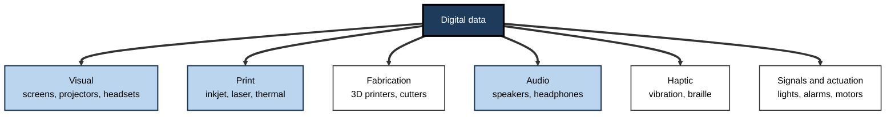
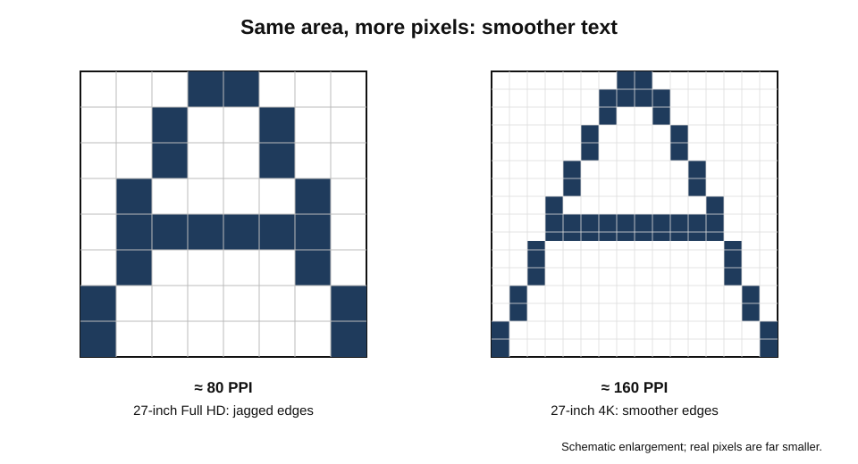
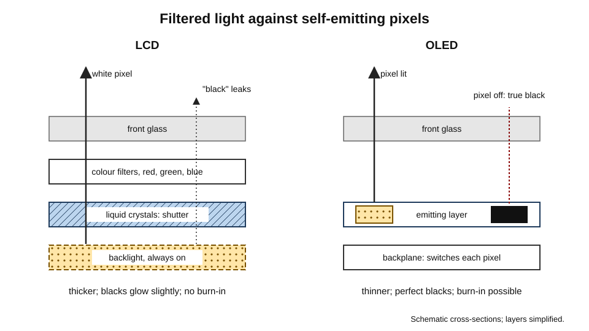
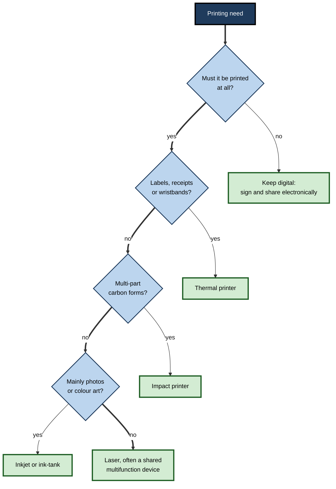
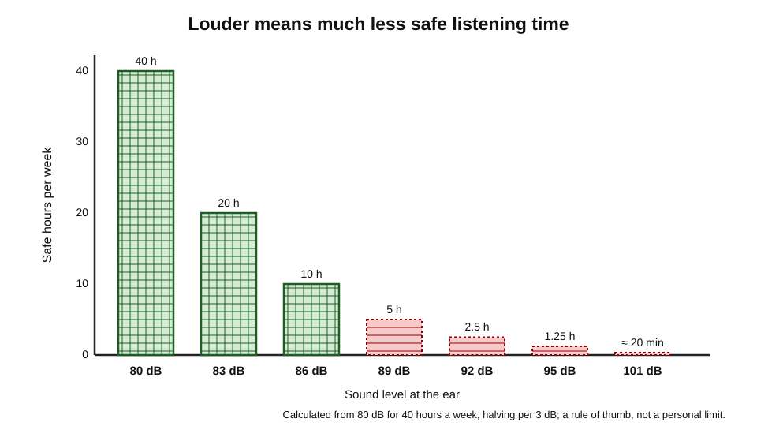

# B.9. Output Devices

A radiologist studies a chest image on a calibrated screen, looking for a shadow a few millimetres across. A finance team prints a board pack that must look identical to the version on screen. A commuter's earbuds cancel the roar of a train. A blind lawyer reads a contract with her fingertips on a refreshable braille display. A dental laboratory prints a crown overnight. Computers do their work invisibly; **output devices** are how that work reaches human senses and the physical world.

> **Definition — Output device:** hardware that converts digital data from a computing device into a form people can perceive or use — images, printed pages, sound, touch sensations or physical objects.

**Why output matters**

- **Quality of judgement** — decisions are made from what people see and hear; a poor display can hide detail, distort colour or tire the eyes.
- **Cost** — printing and displays are among the largest recurring device costs in many organisations.
- **Health and safety** — screen use, listening volume and printer emissions all have health dimensions.
- **Inclusion** — alternative outputs such as screen readers, captions and braille make information available to everyone.

---

## The Families of Output

- **Visual** — monitors, laptop and phone screens, projectors, large interactive displays, video walls, head-mounted displays.
- **Print** — inkjet, laser, thermal and impact printers; large-format plotters.
- **Fabrication** — 3D printers, computer-controlled cutters and mills.
- **Audio** — speakers, headphones, earbuds, hearing devices.
- **Haptic** — vibration motors, force-feedback controllers, refreshable braille displays.
- **Signals and actuation** — indicator lights, alarms, motors and valves driven by computers.

**Figure 1.** The main families of output device.

---

## How a Display Makes an Image

### Pixels and resolution

- A screen is a grid of **pixels** (picture elements); each pixel has red, green and blue **sub-pixels** whose brightness mixes into any colour.
- **Resolution** — the number of pixels across and down.
  - **HD**: 1280 × 720; **Full HD**: 1920 × 1080; **QHD**: 2560 × 1440; **4K UHD**: 3840 × 2160.
- **Aspect ratio** — width to height: 16:9 is standard; 16:10 and 3:2 give more vertical space for documents; ultrawide 21:9 suits timelines and spreadsheets.
- **Screen size** — measured diagonally, usually in inches.

> **Definition — Pixel:** the smallest controllable element of a digital image or display, made of red, green and blue sub-pixels.

### Pixel density

- **Pixels per inch (PPI)** — how tightly pixels are packed; higher density gives sharper text.
- What matters is density **at the viewing distance**: a phone held at 30 cm needs far higher PPI than a television viewed from 3 m.

> **Formula — Pixel density:** PPI = √(width² + height²) ÷ diagonal in inches. A 27-inch 4K monitor: √(3840² + 2160²) ≈ 4,406 pixels diagonal ÷ 27 ≈ **163 PPI**. A 27-inch Full HD monitor: √(1920² + 1080²) ≈ 2,203 ÷ 27 ≈ **82 PPI** — text visibly coarser at desk distance.

**Figure 2.** The same text at low and high pixel density.

### Other display qualities

- **Brightness** — measured in **nits** (candelas per square metre); around 250–350 nits suffices indoors; 500+ helps near windows or outdoors; HDR content uses peaks far higher.
- **Contrast ratio** — difference between the brightest white and darkest black.
- **Refresh rate** — how many times per second the image is redrawn, in **hertz**: 60 Hz is standard; 120 Hz and above make scrolling and motion smoother.
- **Response time** — how quickly pixels change; matters for fast motion and gaming.
- **Colour gamut** — the range of colours a display can show, compared with standards such as **sRGB** (web and office), **DCI-P3** (film and many modern devices) and **Adobe RGB** (print photography).
- **Colour depth** — bits per channel; 8-bit gives about 16.7 million colours; 10-bit over a billion, reducing visible banding.
- **HDR (high dynamic range)** — brighter highlights and deeper shadows for suitable content.
- **Finish** — glossy screens look vivid but reflect; matte screens diffuse glare.

> **Definition — Colour gamut:** the range of colours a display or printer can reproduce, often expressed as a percentage of a standard colour space such as sRGB or DCI-P3.

> **Definition — Calibration:** adjusting a display with a measuring instrument so its colours and brightness match a standard; essential in photography, printing, film and medical imaging.

---

## Display Technologies

### From tubes to panels

- **Cathode-ray tubes (CRT)** — electron beams lit phosphors on glass; heavy, deep, power-hungry; dominant until the mid-2000s.
- **Liquid-crystal displays (LCD)** — a backlight shines through liquid crystals that twist to block or pass light through colour filters.
  - **IPS** panels: wide viewing angles, good colour; standard for office and creative work.
  - **VA** panels: high contrast, slower response.
  - **TN** panels: fast and cheap, poor viewing angles.
- **LED backlighting** — LCDs lit by light-emitting diodes; **mini-LED** uses thousands of tiny LEDs in dimmable zones for better contrast.
- **OLED (organic light-emitting diode)** — each pixel emits its own light; perfect blacks, thin and flexible.
  - Risk of **burn-in** where static images remain for very long periods, much reduced in modern panels.
- **MicroLED** — self-emitting inorganic LEDs per pixel; very bright and durable; still expensive and emerging.
- **E-paper (electronic ink)** — reflects ambient light like paper; uses power only when the image changes; readable in sunlight; slow and mostly monochrome.

**Figure 3.** How an LCD and an OLED produce light.

| Technology | Black level and contrast | Brightness | Power use | Lifespan concerns | Typical use |
|---|---|---|---|---|---|
| LCD (IPS) | Moderate; backlight glows | Good | Moderate | Few | Office monitors, laptops |
| Mini-LED LCD | High, with dimming zones | Very high | Moderate to high | Some "blooming" halos | Premium laptops, HDR monitors, TVs |
| OLED | Perfect blacks | Good; lower full-screen | Low for dark content | Burn-in with static images | Phones, premium laptops, TVs |
| E-paper | Paper-like | Reflective only | Very low | Few | E-readers, shelf labels, signs |
| MicroLED | Perfect blacks | Very high | Low to moderate | Few expected | Emerging large displays, watches |

### Specialised displays

- **Medical diagnostic displays** — high brightness, calibrated response across grey levels, regular quality checks; radiology requires consistent display of subtle grey differences.
- **Colour-critical displays** — wide gamut, hardware calibration, shading hoods; for photography, print and film.
- **Rugged and sunlight-readable displays** — high brightness for outdoor and vehicle use.
- **Touch and interactive displays** — meeting rooms and classrooms.
- **Head-mounted displays** — XR headsets place tiny high-density displays close to the eyes.

---

## Working with Screens

### How much screen does work need?

- **More screen area** lets documents sit side by side — a source document and the one being written, a dataset and its chart, a call and its notes.
- **Options** — a larger single monitor, two monitors, or an ultrawide.
- **Laptop alone** — about 13–14 inches; fine for travel, cramped for sustained work.

> **Watch out:** frequently cited figures for productivity gains from second monitors come largely from studies funded by display manufacturers. Many users report clear benefits for multi-window work, but the size of the gain is uncertain and depends on the task.

### Eye comfort and the blue-light question

- **Digital eye strain** — tired, dry or sore eyes and blurred vision after long screen sessions; largely due to reduced blinking, focusing at one distance, glare and poor set-up.
- **Remedies with reasonable support** — screen at arm's length and slightly below eye level, brightness matched to the room, reduced glare, regular breaks to look into the distance, larger text.
- **The "20-20-20" habit** — every 20 minutes, look at something 20 feet (about 6 m) away for 20 seconds; widely recommended by eye-care bodies, although the evidence for this exact rule is limited.

> **Watch out:** there is no good evidence that blue light from screens damages the eyes, and a 2023 Cochrane systematic review found that blue-light-filtering spectacles probably make little or no difference to eye strain in the short term. Evening screen use may affect sleep, but through stimulation and timing as well as light; the size of the light effect is debated.

---

## Printers

### Kinds of printer

- **Inkjet** — sprays microscopic droplets of liquid ink.
  - Good for photographs and colour; cheaper machines; higher cost per page with cartridges; ink can dry if unused.
  - **Ink-tank** models refill from bottles and cut running costs sharply.
- **Laser** — a laser draws an image of static charge on a drum, which attracts powdered **toner**, fused onto paper by heat.
  - Fast, sharp text, low cost per page for volume; the office standard.
- **Thermal** — heat darkens special paper or transfers ink from a ribbon.
  - Receipts, shipping labels, wristbands, barcodes; no ink cartridges.
- **Impact (dot-matrix)** — pins strike a ribbon.
  - Noisy and slow but prints through **multi-part carbon forms**; still used in some logistics, banking and industrial settings.
- **Dye-sublimation** — heat turns dye into gas that permeates the paper or card; photo kiosks and ID cards.
- **Large-format plotters** — architectural drawings, posters and banners.

| | Inkjet | Laser | Thermal | Impact |
|---|---|---|---|---|
| Best at | Photos, colour, low volume | Text, volume, offices | Labels, receipts, barcodes | Multi-part forms |
| Purchase price | Low | Moderate | Low to moderate | Moderate |
| Running cost per page | High (cartridges) to low (ink tanks) | Low | Very low (paper only) | Low |
| Speed | Moderate | High | High for small items | Low |
| Noise | Low | Low to moderate | Very low | High |

**Figure 4.** Choosing a printer type for a job.

### The economics of printing

- **"Razor and blades"** — some printers are sold cheaply and profits come from consumables; per-millilitre ink prices can be very high.
- **Cost per page** is the right measure, not the printer's price.

> **Formula — Cost per page:** cost per page = consumable price ÷ page yield (+ paper and share of maintenance). A 30 black cartridge yielding 300 pages costs 30 ÷ 300 = **0.10 per page**; a 90 toner yielding 6,000 pages costs 90 ÷ 6,000 = **0.015 per page** — about seven times less.

> **Watch out:** page yields are measured with standard test pages of modest coverage (around 5% of the page for black text). Dense reports, charts and photographs use far more ink or toner than the stated yield assumes.

### Printing in organisations

- **Multifunction devices (MFDs)** — print, copy, scan and email in one networked machine.
- **Managed print services** — a provider supplies, monitors and maintains printers and consumables for a fee per page.
- **Secure "pull" printing** — jobs wait on a server until the user authenticates at any printer with a badge or PIN; documents are not left in output trays.
- **Printers as computers** — MFDs have operating systems, network connections and often storage holding copies of scanned and printed documents; they need updates, secure settings and data wiping before disposal.
- **Sustainability** — duplex by default, monochrome by default, fewer devices shared by more people, recycled paper and cartridge take-back.

> **In practice:** many organisations cut printing substantially by combining **pull printing** (abandoned jobs are never printed), **default duplex and monochrome**, and **electronic signatures** for approval workflows.

---

## 3D Printing

### How it works

- An object is designed in **CAD software**, sliced into thin layers, and built **layer by layer** — additive manufacturing.
- **Fused deposition modelling (FDM)** — melts plastic filament through a nozzle; cheap, common, visible layer lines.
- **Stereolithography (SLA) and resin printing** — a light source hardens liquid resin; fine detail; used in dentistry and jewellery.
- **Selective laser sintering (SLS) and metal printing** — lasers fuse powder; strong functional parts, including metal components in aerospace and medicine.

> **Definition — Additive manufacturing:** making objects by building them up layer by layer from a digital model, rather than cutting material away.

### Uses

- **Rapid prototyping** — product designers test shapes in hours instead of weeks.
- **Healthcare** — dental aligners and crowns, hearing-aid shells, surgical guides, custom prosthetics and implants.
- **Manufacturing** — jigs, fixtures, spare parts on demand, lightweight aerospace parts.
- **Architecture and education** — models and teaching aids.

> **Watch out:** 3D printing is often presented as replacing factories. In practice it excels at **customised, complex or low-volume** parts; for large volumes of simple parts, moulding and machining remain far cheaper and faster.

---

## Audio Output

### Speakers and headphones

- **Speakers** turn electrical signals into sound by moving a diaphragm; laptop speakers are small and weak in bass.
- **Headphones and earbuds** — wired or wireless; open or closed; in-ear or over-ear.
- **Active noise cancellation (ANC)** — microphones capture outside noise and the headphones play an inverted signal to cancel it, most effective for steady low-frequency sounds such as engines.
- **Headsets with microphones** — beam-forming microphones and AI noise suppression improve call quality.

> **Definition — Active noise cancellation:** reducing unwanted sound by generating an opposite sound wave that cancels it.

### Safe listening

- Loud sound damages the hair cells of the inner ear, which do not regrow; the damage builds up over time and is permanent.
- The **World Health Organization** has warned that over a billion young people are at risk of hearing loss from unsafe listening, and issued a global standard for safe listening devices in 2019.
- **Dose matters**: risk depends on **level and duration** together.

> **Formula — Safe listening time (rule of thumb):** with a reference of 80 dB for 40 hours a week, each increase of 3 dB **halves** the safe time. At 83 dB: 20 hours; at 86 dB: 10 hours; at 92 dB: 40 ÷ 2⁴ = **2.5 hours** a week.

**Figure 5.** Weekly safe listening time falls by half for every 3 dB increase.

> **Remember:** keep personal audio **at about 60% of maximum volume or lower**, use **noise-cancelling** headphones in noisy places so the volume can stay low, and take **listening breaks**.

> **Watch out:** the 60% figure is a common rule of thumb; actual sound levels at a given setting vary widely between devices and headphones. Many phones and watches now measure listening levels and warn when weekly exposure is high.

---

## Haptic and Accessible Output

### Haptics

- **Vibration motors** — alerts, keyboard feedback, simulated button clicks on trackpads.
- **Force feedback** — game controllers, flight simulators, surgical robots transmitting resistance to the operator.

> **Definition — Haptics:** technology that communicates through the sense of touch, using vibration, force or movement.

### Outputs that include

- **Screen readers** — software that reads screen content aloud, used by blind and partially sighted people.
- **Refreshable braille displays** — rows of pins rise and fall to form braille characters that change as the reader moves through text.
- **Captions and transcripts** — text versions of speech for deaf and hard-of-hearing people, and for noisy or quiet environments; AI live captions are now common in meetings.
- **Magnification and high-contrast modes** — for people with low vision.
- **Visual alerts** — flashing lights instead of sounds.

> **Key point:** accessible output is not an add-on for a minority; captions, text-to-speech and adjustable displays are used by large numbers of people for convenience, language learning and situational needs.

---

## Worked Example: Choosing Monitors for an Analytics Team

**Situation:** a 40-person analytics team works with spreadsheets, dashboards and code all day at fixed desks. The budget allows either two 24-inch Full HD monitors per person or one 27-inch 4K monitor per person.

1. **Calculate density.**
   - 24-inch Full HD: √(1920² + 1080²) ÷ 24 ≈ 2,203 ÷ 24 ≈ **92 PPI**.
   - 27-inch 4K: ≈ 4,406 ÷ 27 ≈ **163 PPI**.
2. **Calculate usable area.** Two 24-inch screens give more total width; one 27-inch 4K screen gives sharper text and, with scaling, roughly the working space of a 27-inch QHD screen.
3. **Consider the work.** Analysts compare a dataset with code or a chart — two windows side by side; long sessions favour sharp text.
4. **Consider ergonomics.** Two screens mean turning the head for the secondary screen; one centred screen keeps a neutral posture.
5. **Decide.** One 27-inch 4K monitor with USB-C docking (one cable to the laptop), height-adjustable stand; a second screen only for those who demonstrably need it.

| | Two 24-inch Full HD | One 27-inch 4K |
|---|---|---|
| Pixel density | ≈ 92 PPI | ≈ 163 PPI |
| Total width | Greater | Less |
| Text sharpness | Moderate | High |
| Neck posture | Some turning | Neutral |
| Cables and desk space | More | Less |

> **Watch out:** a 4K screen at 27 inches is usually run with **interface scaling** (for example 150%), otherwise text is too small. Its advantage is sharpness, not fitting more on screen at unreadable sizes.

---

## Case Study: Cutting Printing at a Law Firm

- **Situation:** a 300-person law firm had 140 printers, many personal desktop models, and printed several million pages a year.
- **Problems:** high cartridge costs; confidential documents left in output trays; unmanaged printers with outdated firmware; storage of scanned client documents on printers' internal drives.
- **Actions:**
  1. Replaced personal printers with 30 managed multifunction devices.
  2. Introduced **secure pull printing** with badge release.
  3. Set duplex and monochrome as defaults; colour on request.
  4. Moved routine approvals to electronic signatures and court bundles to digital formats where courts accepted them.
  5. Added printers to patching and asset systems; ensured internal drives were encrypted and wiped at end of life.
- **Result:** pages printed fell substantially within a year; abandoned confidential printouts disappeared; consumable spending dropped; fewer devices to secure.
- **Side effects:** some senior lawyers resisted losing desk printers; a few exceptions were granted for genuine needs.
- **Lesson:** output devices are a **cost, security and sustainability system**; managing them as such yields gains in all three.

---

## Projectors and Large Displays

### Projectors

- **Technologies** — LCD and DLP (digital light processing, using millions of tiny mirrors) projectors; laser light sources last far longer than older lamps.
- **Brightness** — measured in **lumens**; rooms with windows need several thousand lumens, dark rooms far fewer.
- **Throw ratio** — distance from screen divided by image width; **short-throw** projectors sit close to the wall, avoiding shadows.
- **Uses** — lecture theatres, large meeting rooms, events, simulation and museum installations.

> **Formula — Throw distance:** distance = throw ratio × image width. A projector with a throw ratio of 1.5 filling a 2.5 m-wide screen must sit 1.5 × 2.5 = **3.75 m** from it.

### Large flat panels and video walls

- **Meeting-room displays** — large LCD or OLED panels have replaced projectors in many rooms: brighter, sharper and lower maintenance.
- **Interactive displays** — touch-enabled panels for whiteboarding in classrooms and workshops.
- **Video walls** — tiled panels or direct-view LED walls for control rooms, retail and events.
- **Digital signage** — screens displaying timetables, menus and messages, managed centrally — and, being networked, needing the same security as other connected devices.

### Sizing a display for a room

- A common guide is that the **furthest viewer** should be no more than a few image heights away for comfortable reading of text; detailed spreadsheets need larger screens or closer seating than video.
- **Text size on slides** matters as much as screen size: small fonts defeat any display.

> **In practice:** many organisations now design meeting rooms around **two displays** — one for remote participants' faces, one for shared content — so that neither crowds out the other in hybrid meetings.

---

## Output in Immersive and Mobile Settings

### Head-mounted displays

- Very high pixel densities are needed because screens sit centimetres from the eyes and are magnified by lenses.
- **Field of view**, **refresh rate** and **latency** determine comfort; delays between head movement and image update contribute to cybersickness.
- **Passthrough** — cameras show the room behind the virtual content in mixed-reality headsets.

### Mobile screens outdoors

- **Peak brightness** and **anti-reflective coatings** make phones and rugged tablets readable in sunlight.
- **Adaptive refresh rates** — screens slow to 1–10 Hz for static content to save battery, rising to 120 Hz for scrolling.
- **Always-on displays** — low-power modes showing time and notifications.

---

## Print, Screen or Neither?

- **When print still helps** — some people read long, complex documents more carefully on paper; meta-analyses of reading studies have found a modest advantage for paper over screens in comprehension of longer informational texts, especially under time pressure, though the effect is small and varies.
- **When screens win** — searching, sharing, updating, accessibility (adjustable text, screen readers), and avoiding paper waste.
- **When neither is needed** — information that can be acted on directly in a system, without reading a report at all.

> **Watch out:** the "paper is better for reading" finding is an average across many studies with small effects; it does not mean screens are unsuitable for serious reading. Settings, habits and text length matter.

---

## Output Settings That Help Everyone

- **Night or warm-colour modes** and lower brightness in the evening for comfort.
- **Dark mode** — preferred by some users and can save power on OLED screens; not inherently better for eyes.
- **Text scaling** — larger text reduces strain, and is especially helpful on high-PPI screens.

---

## Open Questions

- **Will paper continue to decline?**
  - Digital signatures and documents reduce printing, but regulation, courts and personal preference sustain it; the floor is unclear.
- **Which display technology will dominate?**
  - OLED, mini-LED and microLED compete on cost, brightness and lifespan.
- **Are head-mounted displays a future workplace screen?**
  - Virtual monitors in headsets promise portability; comfort, weight and social acceptance are unresolved.
- **How do screens affect eyes and sleep over decades?**
  - Links between screen time and myopia in children, and between evening use and sleep, are active research areas with mixed evidence on mechanisms.
- **Will 3D printing move into everyday repair?**
  - Printing spare parts locally could support repair and reduce waste; standards, intellectual property and materials limit it today.

---

## Summary

- **Output devices** turn digital data into images, prints, objects, sound, touch and actions.
- Displays are grids of **pixels**; quality depends on resolution, **PPI** (√(w² + h²) ÷ diagonal), brightness (nits), contrast, refresh rate, **colour gamut**, colour depth, HDR and finish.
- Technologies: CRT (historical), **LCD** (IPS, VA, TN) with LED or mini-LED backlights, **OLED** (perfect blacks, burn-in risk), microLED (emerging), **e-paper**.
- Specialised displays serve medicine, colour-critical work and outdoor use; **calibration** keeps colour accurate.
- Second-monitor productivity claims are partly vendor-sourced; blue light does not damage eyes and blue-light glasses show little benefit; set screens up well and take breaks.
- Printers: **inkjet, laser, thermal, impact**, dye-sub, plotters; judge by **cost per page**; manage with MFDs, managed print and **secure pull printing**; printers are networked computers that store data.
- **3D printing** (FDM, SLA, SLS) excels at prototypes and custom parts, not mass production of simple parts.
- Audio: speakers, headphones, **active noise cancellation**; hearing risk depends on level and time — each +3 dB halves safe time.
- **Haptics**, screen readers, **braille displays**, captions and magnification make output accessible.

---

## Self-Check

1. Define an output device and list five families with an example of each.
2. Calculate the PPI of a 15.6-inch laptop at 1920 × 1080 and of a 32-inch monitor at 3840 × 2160.
3. Why is PPI only meaningful together with viewing distance?
4. Explain refresh rate, brightness in nits and colour gamut, with a role where each matters most.
5. Compare LCD and OLED for a photographer and for a public information screen showing a static logo all day.
6. What does the evidence say about blue light and blue-light glasses?
7. Choose a printer type for: a parcel depot's shipping labels; an architect's drawings; a busy office; triplicate delivery notes. Justify.
8. A cartridge costs 45 and yields 500 pages; a toner costs 120 and yields 8,000. Compare costs per page.
9. Why are multifunction printers a security concern, and what controls help?
10. What is secure pull printing, and which two problems does it solve?
11. Explain how 3D printing works and when it is, and is not, the right method.
12. Using the 3 dB rule, how long per week is safe at 89 dB?
13. How does active noise cancellation help protect hearing?
14. A manager wants to give every employee two monitors because "studies show 40% productivity gains". Evaluate the claim and advise.

### Answer Key

1. Hardware that converts digital data into perceivable or usable form. Visual (monitor), print (laser printer), fabrication (3D printer), audio (headphones), haptic (braille display), actuation (alarm siren).
2. Laptop: √(1920² + 1080²) ≈ 2,203 ÷ 15.6 ≈ **141 PPI**. 32-inch 4K: ≈ 4,406 ÷ 32 ≈ **138 PPI**.
3. Perceived sharpness depends on the angle each pixel occupies at the eye; a lower PPI can look sharp from further away.
4. Refresh rate: redraws per second (gaming, fast scrolling). Brightness: light output (outdoor or sunlit work). Colour gamut: range of colours (photography, design, print preparation).
5. Photographer: OLED or calibrated wide-gamut IPS for colour and contrast; calibration matters most. Static logo all day: LCD avoids OLED burn-in.
6. No good evidence that screen blue light damages eyes; a 2023 Cochrane review found blue-light glasses probably make little or no difference to eye strain short term. Eye strain stems from set-up, glare and reduced blinking.
7. Labels: thermal (fast, no ink). Drawings: large-format plotter. Office: shared laser MFD (low cost per page). Triplicate notes: impact printer (prints through carbon copies).
8. 45 ÷ 500 = **0.09**; 120 ÷ 8,000 = **0.015** per page — the toner is six times cheaper per page.
9. They are networked computers that store scanned and printed documents and can be attacked. Controls: updates, secure configuration, encryption of internal storage, authentication, network segmentation, wiping before disposal.
10. Jobs are held until the user authenticates at a printer. It prevents confidential pages being left in trays and avoids printing abandoned jobs.
11. A digital model is sliced into layers and built additively. Right for prototypes, customised medical and dental parts, complex low-volume parts; wrong for large volumes of simple parts.
12. 89 dB is 9 dB above 80, i.e. three halvings: 40 ÷ 8 = **5 hours** a week.
13. It cancels steady background noise, so people can listen at lower volumes and reduce their sound dose.
14. Such figures come mostly from manufacturer-funded studies; benefits vary by task. Assess the work (multi-window tasks benefit), consider one larger high-density monitor, ergonomics and cost; pilot and measure, and provide second screens where needed.

---

## Glossary

| Term | Meaning |
|---|---|
| Active noise cancellation | Cancelling unwanted sound with an opposite sound wave. |
| Additive manufacturing | Building objects layer by layer from a digital model. |
| Aspect ratio | The ratio of a screen's width to its height. |
| Burn-in | Persistent ghost image on some displays after long static content. |
| Calibration | Adjusting a display to match a colour and brightness standard. |
| Colour depth | Bits per colour channel, setting how many shades can be shown. |
| Colour gamut | The range of colours a device can reproduce. |
| Cost per page | Consumable cost divided by page yield, plus paper and maintenance. |
| DLP | Digital light processing: projection using arrays of tiny mirrors. |
| E-paper | A reflective display technology using electronic ink. |
| Haptics | Communication through touch, vibration or force. |
| HDR | High dynamic range: brighter highlights and deeper shadows. |
| Inkjet printer | A printer that sprays droplets of liquid ink. |
| Laser printer | A printer that fuses toner onto paper using a charged drum. |
| LCD | Liquid-crystal display lit by a backlight. |
| Lumen | A unit of light output used to rate projector brightness. |
| Multifunction device | A networked machine that prints, copies and scans. |
| Nit | A unit of display brightness (candela per square metre). |
| OLED | A display whose pixels emit their own light. |
| Pixel | The smallest controllable element of a display. |
| PPI | Pixels per inch: display pixel density. |
| Pull printing | Holding print jobs until the user authenticates at a printer. |
| Refresh rate | How many times per second a display redraws, in hertz. |
| Refreshable braille display | A device raising pins to form changing braille characters. |
| Resolution | The number of pixels across and down a display. |
| Screen reader | Software that reads screen content aloud. |
| Thermal printer | A printer that uses heat on special paper or ribbon. |
| Throw ratio | Projector distance divided by image width. |
| Video wall | Multiple tiled displays acting as one large screen. |
