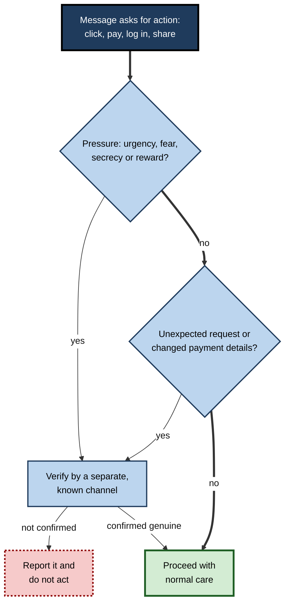
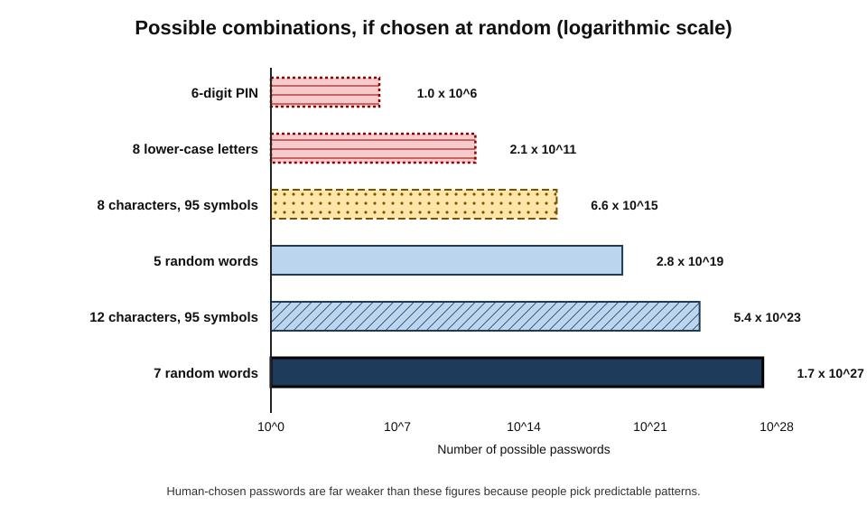
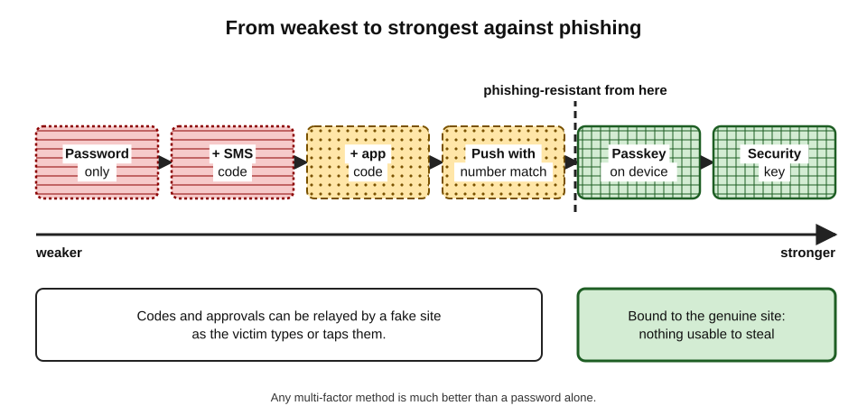
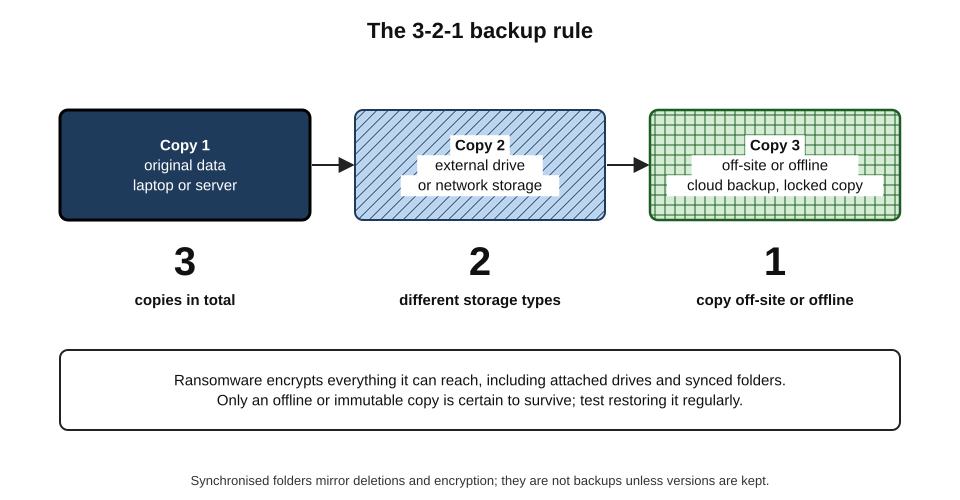
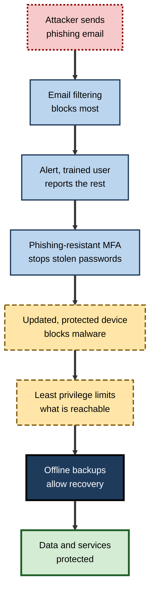

# B.11. Internet Safety Basics

A finance assistant receives an email from the "chief executive" asking for an urgent, confidential payment to a new supplier. A retired teacher gets a text saying a parcel cannot be delivered until a small fee is paid. A graduate reuses one password on a shopping site and a work account; the shopping site is breached, and within days strangers sign in to the work account.

None of these people is careless or unintelligent — they are ordinary users meeting the ordinary threats of a network that connects everyone to everyone, including criminals.

> **Definition — Internet safety:** the knowledge, habits and tools that protect people, their accounts, devices, data and money from harm when using the Internet.

**Why it matters**

- Most successful attacks still begin with a **person** — a click, a reused password, a convincing call — rather than a technical break-in.
- Online fraud is now among the most common crimes in many countries, affecting all ages and professions.
- A single compromised account can expose an employer, colleagues, clients and family.
- Generative AI has made scams **cheaper, more fluent and more convincing**, so old warning signs such as poor spelling are no longer reliable.

---

## How Harm Happens Online

### Three things attackers want

- **Money** — direct theft, fraudulent payments, ransom, resale of stolen data.
- **Access** — to accounts, devices or an organisation's network, often as a stepping stone.
- **Information** — personal data, credentials, business secrets, material for blackmail.

### Two routes to the target

- **Through people (social engineering)** — persuading someone to act against their own interests.
- **Through technology** — exploiting weak passwords, unpatched software or misconfigured services.
- **Usually both** — a phishing email (people) delivers malware that exploits an unpatched flaw (technology).

> **Definition — Social engineering:** manipulating people into revealing information, granting access or taking actions that benefit an attacker, by exploiting trust, fear, urgency, curiosity or helpfulness.

> **Key point:** the Internet makes attacks **cheap to repeat at scale**. An attacker can send a million messages for almost nothing; a 0.1% success rate still yields a thousand victims.

---

## The Main Threats

### Phishing and its relatives

> **Definition — Phishing:** fraudulent messages that impersonate a trusted organisation or person to trick recipients into revealing information, clicking a malicious link or opening a harmful attachment.

- **Email phishing** — mass messages imitating banks, delivery firms, tax authorities, software providers.
- **Spear phishing** — tailored to one person or organisation using researched details.
- **Smishing** — by text message ("your parcel is held").
- **Vishing** — by phone call ("this is your bank's fraud team").
- **Quishing** — QR codes leading to fake sites, *e.g.* stickers placed over parking-meter codes.
- **Business email compromise** — impersonating executives or suppliers to redirect payments.

**Psychological levers attackers use**

- **Authority** — "the chief executive needs this now".
- **Urgency** — "your account will be closed in 24 hours".
- **Fear** — "suspicious activity detected", "you owe a fine".
- **Reward** — "you have won", "claim your refund".
- **Curiosity** — "see who viewed your profile".
- **Helpfulness** — "can you quickly buy gift cards for a client?"

> **Mnemonic — "AU-FRCH" ("A Useful Friend Rarely Calls Hurriedly"):** Authority, Urgency, Fear, Reward, Curiosity, Helpfulness — the six pressures behind most scams.

**Figure 1.** Checking a suspicious message before acting.

> **Watch out:** "I would recognise a scam" is the belief scammers rely on. Well-crafted phishing — especially AI-written and researched spear phishing — fools experts too. The defence is a **habit of verification**, not confidence in spotting fakes.

### Malware

> **Definition — Malware:** software designed to harm, exploit or gain unauthorised control of a device, network or data.

- **Viruses and worms** — spread by infecting files or by moving across networks.
- **Trojans** — disguised as useful software.
- **Spyware and keyloggers** — record activity and passwords.
- **Information stealers** — harvest saved passwords, browser cookies and session tokens.
- **Ransomware** — encrypts files and demands payment; modern gangs also **steal data** and threaten to publish it ("double extortion").
- **Adware and unwanted apps** — intrusive advertising, browser hijacking.

**Common infection routes**

- Attachments and links in phishing messages.
- Pirated software, cracked games and fake "free" tools.
- Malicious browser extensions and mobile apps outside official stores.
- Unpatched software on devices exposed to the Internet.
- Infected USB drives.

### Scams and fraud

- **Purchase scams** — goods that never arrive; fake shops.
- **Investment scams** — fake trading platforms, cryptocurrency schemes, celebrity "endorsements".
- **Romance scams** — long-running online relationships ending in requests for money.
- **Impersonation scams** — "bank", "police" or "tax office" callers persuading victims to move money "to keep it safe".
- **Authorised push-payment fraud** — the victim is tricked into **authorising** a transfer themselves, making recovery harder.
- **Tech-support scams** — pop-ups or calls claiming a computer is infected, leading to remote access and payment.

> **Remember:** genuine banks, police and tax authorities do **not** ask people to move money to a "safe account", read out one-time passcodes or install remote-access software.

### AI-enabled threats

- **Fluent, personalised phishing** at scale, in any language.
- **Voice cloning** — a few seconds of recorded speech can be enough to imitate a voice on the phone.
- **Deepfake video** — synthetic video of real people in calls or adverts.
- **Fake websites and reviews** generated in bulk.

### Case study: the deepfake video conference (2024)

- **Situation:** in early 2024, police in Hong Kong reported that an employee in the finance function of a multinational engineering firm had transferred roughly US$25 million.
- **Method:**
  1. the employee received a message apparently from the UK-based chief financial officer about a confidential transaction;
  2. initially suspicious, the employee joined a **video conference** in which the CFO and several colleagues appeared and spoke;
  3. all the other participants were reportedly **AI-generated deepfakes** built from publicly available video and audio;
  4. reassured, the employee made a series of transfers to accounts controlled by the criminals.
- **Discovery:** the fraud came to light when the employee later checked with the company's head office.
- **Lessons:**
  - seeing and hearing someone is **no longer proof of identity**;
  - high-value payments need **out-of-band verification** and **multi-person approval**, whatever the apparent source;
  - a culture where staff may challenge senior people without penalty is a security control.

---

## Protecting Accounts

### Passwords

- **Length beats complexity** — a long passphrase of several random words is both stronger and easier to remember than a short jumble.
- **Uniqueness matters most** — reusing a password means one breach unlocks many accounts (**credential stuffing**).
- **Password managers** — generate and store a unique, strong password for every account; the user remembers one strong master passphrase.
- **Avoid** — personal information, common words alone, keyboard patterns, simple substitutions (P@ssw0rd).

> **Definition — Credential stuffing:** automated attempts to sign in to many services using username–password pairs leaked from other breaches.

> **Formula — Number of possible passwords:** (size of character set)^(length). Example: 8 characters from 95 printable symbols = 95⁸ ≈ 6.6 × 10¹⁵; a passphrase of 5 words chosen randomly from a 7,776-word list = 7,776⁵ ≈ 2.8 × 10¹⁹ — over **four thousand times** more combinations.

**Figure 2.** How password length and type affect the number of possible combinations.

> **Watch out:** the size of the password space matters only if the password is **truly random**. Human-chosen passwords cluster around predictable patterns, which attackers try first. A password manager's random output, or randomly chosen words, avoids this trap.

### Multi-factor authentication (MFA)

> **Definition — Multi-factor authentication (MFA):** sign-in requiring two or more different kinds of evidence — something the user **knows** (a password), **has** (a phone or security key) or **is** (a fingerprint or face).

- **Effect** — even a stolen password is not enough; studies by large providers report that MFA blocks the **overwhelming majority** of automated account-takeover attempts.
- **Not all MFA is equal:**

| Method | How it works | Resistance to phishing | Main weakness |
|---|---|---|---|
| SMS code | One-time code sent by text | Low | SIM-swap fraud; codes can be phished |
| Authenticator app code | Time-based code generated on the phone | Low to moderate | Codes can be phished in real time |
| Push approval | Tap "approve" on a prompt | Moderate (with number matching) | "MFA fatigue" — repeated prompts until the user approves |
| Passkey | Cryptographic key on the device, unlocked by fingerprint, face or PIN | High | Device loss needs recovery planning |
| Hardware security key | Physical key using the same cryptographic standard | Very high | Cost; must be carried |

> **Definition — Passkey:** a sign-in credential based on public-key cryptography, stored on a user's device and tied to a specific website or app, so it cannot be typed into — or stolen by — a fake site.

**Figure 3.** Sign-in methods from weakest to strongest against phishing.

> **Key point:** any MFA is far better than none; **phishing-resistant** methods (passkeys and security keys) are the current best practice, especially for email, banking, cloud and administrator accounts.

> **Watch out:** a common attack now relays a real login page through the attacker's server, capturing both the password and the one-time code as the victim types them. Only phishing-resistant methods, which check the website's genuine identity, defeat this reliably.

### Account recovery

- **Recovery options are a back door** — an attacker who controls the recovery email or phone number controls the account.
- **Secure the email account first** — it is the master key to most others.
- **Store recovery codes** safely (in the password manager or on paper in a secure place).
- **Check sign-in alerts and active sessions** periodically.

---

## Protecting Devices and Data

### Updates

- **Why they matter** — updates fix security flaws that attackers actively exploit; many attacks use flaws for which fixes have been available for months.
- **Practice** — turn on **automatic updates** for the operating system, browser, apps and router firmware; replace devices that no longer receive updates.

> **Example:** the WannaCry ransomware outbreak of May 2017 spread across hundreds of thousands of computers worldwide, disrupting hospitals in the UK's National Health Service among many others. It exploited a Windows flaw for which Microsoft had released a fix two months earlier; unpatched and unsupported systems were hit hardest.

### Security software and settings

- **Built-in protection** — modern operating systems include anti-malware, firewalls and disk encryption; keep them on.
- **Screen lock and encryption** — protect lost or stolen devices.
- **App and extension discipline** — install from official stores; remove what is not needed; review permissions (location, microphone, contacts).
- **Administrator rights** — everyday use under a standard account limits what malware can do.

### Backups

> **Definition — 3-2-1 backup rule:** keep at least **three** copies of important data, on **two** different types of storage, with **one** copy kept off-site (or offline).

**Figure 4.** The 3-2-1 approach to backups.

- **Offline or immutable copies** protect against ransomware, which encrypts everything it can reach — including connected backup drives and synced folders.
- **Test restores** — a backup that has never been restored is a hope, not a plan.

> **Watch out:** cloud file **synchronisation** is not the same as **backup**. If ransomware encrypts files, or files are deleted, synchronisation faithfully copies the damage to every device — unless version history or a separate backup exists.

---

## Safe Browsing and Connecting

### What HTTPS does and does not mean

- **Does mean:** the connection is **encrypted** and the site has a valid certificate for the **domain shown**.
- **Does not mean:** the site is honest, safe or the one intended. Most phishing sites use HTTPS.
- **The real check** — is the **domain** exactly the one expected? Reading web addresses from the right reveals who controls them.

### Public Wi-Fi

- **Risks** — fake hotspots with plausible names; others on the network seeing unencrypted traffic.
- **Reality today** — most important services encrypt traffic end to end, so the risk from simply using café Wi-Fi is lower than it once was.
- **Sensible practice:**
  - prefer the phone's mobile data for banking and sensitive work;
  - check the network name with staff;
  - keep devices updated and file sharing off;
  - use the employer's VPN for work, if required.

### VPNs: what they do and do not do

> **Definition — VPN (virtual private network):** an encrypted tunnel between a device and a VPN server, through which traffic travels before reaching the Internet.

| | What a VPN does | What a VPN does not do |
|---|---|---|
| Privacy | Hides traffic from the local network and ISP | Hide activity from the VPN provider, or from sites where the user is signed in |
| Security | Protects traffic on untrusted Wi-Fi | Stop phishing, malware or weak passwords |
| Location | Makes traffic appear to come from the VPN server | Make the user anonymous |
| Work use | Gives access to internal corporate systems | Replace device security and identity checks |

> **Watch out:** many consumer VPN adverts overstate their benefits. A VPN **moves trust** from the ISP to the VPN company; a free VPN of unknown ownership may be a greater privacy risk than none.

### Privacy basics

- **Tracking** — websites and apps record behaviour through cookies, device identifiers and embedded third-party code, often to build advertising profiles.
- **Practical steps:**
  - review privacy and ad-personalisation settings on major accounts;
  - limit app permissions, particularly location;
  - be selective about what is shared publicly — birthdays, addresses, travel plans and family details help scammers;
  - use privacy-respecting browsers or settings that block third-party tracking.
- **Data breaches** — assume personal data may already be exposed somewhere; this is why unique passwords and MFA matter.

---

## Safety at Work

### The employee's role

- **Report, don't hide** — clicking a suspicious link and reporting it immediately limits damage; staying silent lets attackers spread.
- **Verify payments and data requests** through a separate channel, especially changes to supplier bank details.
- **Use approved tools** — "shadow IT" (unapproved apps, personal cloud accounts, unvetted AI tools) can leak data outside the organisation's protection.
- **Handle data deliberately** — share with named people, not "anyone with the link"; avoid pasting confidential data into public AI services unless approved.
- **Keep work and personal accounts separate.**

> **Definition — Shadow IT:** technology — software, cloud services, devices or AI tools — used for work without the knowledge or approval of the organisation's IT or security function.

### What organisations provide

- **Layered defences** — email filtering, device protection, MFA, patching, backups, monitoring — so that one failure does not lead to disaster.
- **Clear reporting routes** — a single button or address for suspicious messages.
- **Payment controls** — call-back verification and dual approval for new or changed payees.
- **Training and culture** — practical guidance, and leaders who reward reporting rather than punishing mistakes.

**Figure 5.** Layers of protection between an attacker and an organisation's data.

**Study card — Does phishing training work? (Ho and colleagues, 2025)**

- **Setting:** a large US healthcare organisation; roughly 19,500 employees received simulated phishing emails over eight months.
- **Comparison:** staff who had recently completed annual security training versus those who had not; and several forms of "embedded" training shown immediately after a simulated phish was clicked.
- **Findings:**
  - recent completion of annual training showed **no meaningful relationship** with lower failure rates;
  - embedded training produced at most **very small** average improvements;
  - many employees spent only seconds on the training material.
- **Conclusion:** awareness training alone is a weak defence; **technical controls** (filtering, phishing-resistant MFA, payment controls) must carry most of the load.
- **Caveat:** one organisation and one style of training; better-designed, engaging training may perform differently. The broader research literature on training effectiveness is mixed.

> **Key point:** people are a vital layer of defence, but systems should be designed so that **one human mistake is not enough** to cause a disaster.

---

## When Something Goes Wrong

### Worked example (illustrative): "I think I entered my password on a fake site"

Situation: an employee typed their work password into a convincing "document sharing" page, then noticed the address was wrong.

1. **Act immediately** — change the password from a known-good device, going to the service directly.
2. **Report** — tell the IT or security team at once, with the message and the address.
3. **Revoke sessions** — the security team signs the account out everywhere and checks for new MFA devices or mail-forwarding rules added by the attacker.
4. **Check reuse** — change the password anywhere else it was used (and stop reusing it).
5. **Watch** — monitor for unusual sign-in alerts or messages sent from the account.
- **Outcome:** reported within minutes, the attempt is usually contained; discovered weeks later, the attacker may have read email, stolen data and launched further phishing from a trusted account.

> **Remember:** **speed of reporting** is the single biggest factor in limiting damage. No organisation worth working for punishes prompt reporting.

### If money has been lost

- **Contact the bank immediately** — on the number on the card or official website — transfers can sometimes be stopped or recovered if reported quickly.
- **Report to the relevant fraud-reporting service or police**, keeping evidence (messages, numbers, transaction details).
- **Beware recovery scams** — fraudsters often contact victims again, offering to "recover" losses for a fee.

---

## Helping Others Stay Safe

- **Older relatives** — often targeted with impersonation and tech-support scams; agree a family rule: "never act on an unexpected call about money — hang up and call back".
- **Children and teenagers** — age-appropriate settings, open conversation about what they see and who they talk to, and knowing they can report problems without losing their devices.
- **Colleagues** — share suspicious messages with the security team, not around the office; model verification behaviour.

> **In practice:** the most effective personal safety measures can be summarised in a handful of habits: **unique passwords in a manager, MFA (ideally passkeys) everywhere, automatic updates, tested backups, and verification of any unexpected request involving money or credentials.**

---

## Everyday Situations

### Shopping and paying online

- **Check the shop, not just the padlock** — exact domain, company details, returns policy, independent reviews; very new domains offering huge discounts are a classic warning sign.
- **Prefer protected payment methods** — credit cards and reputable payment services offer dispute and chargeback rights; bank transfers to strangers usually do not.
- **Be wary of marketplace "off-platform" requests** — sellers who ask buyers to pay or communicate outside the platform remove its protections.
- **Delivery scams** — genuine couriers rarely demand small fees by text; check the tracking number on the courier's own app or site.

### Downloads and software

- **Official sources only** — operating-system app stores, the vendor's own website, or the organisation's software portal.
- **Search adverts can lie** — criminals buy search adverts that imitate popular software downloads; navigate to the vendor directly.
- **Browser extensions** — powerful enough to read every page visited; install few, from known publishers, and remove unused ones.
- **"Cracked" software** — a leading source of information-stealing malware.

### The home router and connected devices

- **Change the router's administrator password** and keep its firmware updated; replace routers that no longer receive updates.
- **Use WPA3 or WPA2 encryption** with a strong Wi-Fi passphrase.
- **Separate networks** — a guest network for visitors and smart-home gadgets keeps them apart from work laptops.
- **Disable features not needed** — remote administration from the Internet, old pairing methods.
- **Buy devices with a stated update period** — a cheap camera that is never updated becomes a permanent weak point.

### Social media and oversharing

- **Information that helps attackers** — birthdays, pets' names, schools, travel dates, family names, job titles and reporting lines.
- **Professional networks** — attackers map organisations from public profiles to craft spear phishing ("I'm the new finance director…").
- **Privacy settings** — review who can see posts, contact details and friends lists.
- **Location** — avoid posting real-time locations and travel absences publicly.

> **Example (illustrative):** a criminal studying a company's public profiles learns that its finance manager has just started and that the chief executive is travelling. A message "from the CEO, between flights" asking the new manager for an urgent payment exploits exactly the gaps that oversharing revealed.

---

## A Personal Safety Baseline

**Worked example (illustrative) — securing a new professional's digital life in one afternoon**

Situation: a graduate starting a first job wants to put sensible protections in place.

1. **Email first** — set a long unique passphrase and a passkey or authenticator on the main personal email account; check recovery phone and email.
2. **Password manager** — install one, import existing passwords and replace reused ones, starting with banking, email, shopping and social accounts.
3. **MFA everywhere it matters** — banking, cloud storage, social media, mobile-phone account (to prevent SIM-swap fraud).
4. **Updates** — turn on automatic updates on phone, laptop, browser and router.
5. **Backups** — enable cloud backup with version history for phone and laptop; keep a second copy of irreplaceable photos and documents on an external drive.
6. **Privacy settings** — review social-media visibility, ad personalisation and app permissions.
7. **Bank alerts** — enable payment notifications so unusual transactions are spotted at once.
8. **A family rule** — agree a code word or call-back habit for unexpected requests for money.
- **Conclusion:** a few hours of set-up removes the most common routes to account takeover and data loss.

| Habit | Threat it defeats | Effort |
|---|---|---|
| Unique passwords in a manager | Credential stuffing after breaches | One-off set-up, then little |
| Passkeys or MFA | Stolen or phished passwords | A few minutes per account |
| Automatic updates | Exploits of known flaws | Almost none |
| Versioned and offline backups | Ransomware, device loss, mistakes | Moderate set-up; periodic checks |
| Verification by a known channel | Phishing, impersonation, payment fraud | Seconds per suspicious request |

---

## Signs That an Account or Device May Be Compromised

- **Account signs** — password-reset emails not requested; sign-in alerts from unfamiliar places; sent messages the owner did not write; new forwarding rules; contacts reporting strange messages.
- **Device signs** — unexplained pop-ups, new browser extensions or toolbars, security software disabled, unusual slowness or battery drain, unknown apps with administrator rights.
- **Money signs** — small "test" transactions, new payees, changed contact details at the bank.

> **Remember:** a single sign is not proof, but any of them justifies **changing passwords from a clean device, reviewing sessions and reporting** — sooner rather than later.

---

## Open Questions

- **How can identity be proven when voices and faces can be faked?**
  - Cryptographic verification, code words and new standards for authentic media are being explored; none is yet universal.
- **Who should bear the cost of fraud?**
  - Some countries now require banks to reimburse many authorised push-payment fraud victims; how responsibility should be shared among banks, platforms and telecom firms is debated.
- **Does security awareness training work?**
  - Recent large studies suggest limited effects; what kind of training, if any, reliably changes behaviour remains contested.
- **Will passkeys replace passwords?**
  - Adoption is growing quickly; account recovery, shared devices and older systems remain obstacles.
- **How should AI assistants be protected from manipulation?**
  - AI tools that read email or browse websites can be tricked by hidden instructions in content, a new class of attack whose defences are still immature.

---

## Summary

- Internet safety protects **people, accounts, devices, data and money**. Attackers seek **money, access and information**, through **people** (social engineering) and **technology**.
- **Phishing** (email, spear, smishing, vishing, quishing) and **business email compromise** exploit **authority, urgency, fear, reward, curiosity and helpfulness**; the defence is **verification by a separate channel**.
- **Malware** includes trojans, info-stealers and **ransomware** (often with data theft); **scams** include purchase, investment, romance, impersonation and **authorised push-payment** fraud.
- **AI** enables fluent phishing, **voice cloning** and **deepfakes** — the 2024 deepfake video-conference fraud showed that seeing is not proof.
- Accounts: **long, unique passwords** in a **password manager**; **MFA** everywhere, preferably **passkeys** or **security keys**; secure the **email account** and recovery options.
- Devices and data: **automatic updates** (WannaCry exploited an unpatched flaw), built-in protections, careful app permissions, and **3-2-1 backups** with an offline copy; sync is not backup.
- **HTTPS** means encryption, not honesty; **public Wi-Fi** risk is lower than before but sensible care applies; **VPNs** move trust rather than create anonymity.
- At work: **report quickly**, verify payment changes, avoid **shadow IT**, follow data-handling rules; organisations rely on **layered defences** because training alone has limited measured effect.
- If something goes wrong: change credentials, **report immediately**, contact the bank quickly, and beware recovery scams.

---

## Self-Check

1. Define social engineering and give three psychological levers it uses.
2. Distinguish phishing, spear phishing, smishing, vishing and quishing.
3. What is business email compromise, and what control best prevents payment fraud from it?
4. Why is "I would spot a scam" a dangerous belief?
5. What is ransomware "double extortion"?
6. Explain authorised push-payment fraud and why recovery is difficult.
7. Calculate how many times more combinations a random five-word passphrase (7,776-word list) has than a random 8-character password from 95 symbols.
8. Why is password reuse so dangerous?
9. Rank SMS codes, authenticator codes, push approval and passkeys by phishing resistance, and explain why passkeys resist phishing.
10. Why should the email account be secured first?
11. What did the WannaCry outbreak demonstrate about updates?
12. Explain the 3-2-1 backup rule and why synchronisation is not backup.
13. What do HTTPS and a VPN each protect against, and what do they not?
14. Summarise the 2025 study of phishing training and its implications for organisations.
15. A colleague receives a video call from an apparent director asking for an urgent confidential transfer. Describe what should happen next, and what organisational controls should exist.

### Answer Key

1. Manipulating people into revealing information or taking harmful actions. Levers: authority, urgency, fear (also reward, curiosity, helpfulness).
2. Phishing: mass fraudulent messages. Spear phishing: tailored to a target. Smishing: by text. Vishing: by voice call. Quishing: via QR codes.
3. Impersonating executives or suppliers to redirect payments. Out-of-band call-back verification using known contact details, with dual approval for new or changed payees.
4. Well-crafted, AI-assisted phishing fools experts; overconfidence discourages verification, which is the reliable defence.
5. Attackers both encrypt data and steal it, threatening to publish it unless paid.
6. The victim is deceived into authorising a transfer themselves; because the payment was authorised, banks and law have historically treated it differently from unauthorised fraud, and funds move quickly onwards.
7. 7,776⁵ ≈ 2.8 × 10¹⁹; 95⁸ ≈ 6.6 × 10¹⁵; ratio ≈ 4,200 times.
8. A breach at one site exposes the password; attackers automatically try it on many others (credential stuffing), unlocking every account that shares it.
9. SMS (lowest) < authenticator codes < push approval with number matching < passkeys (highest). Passkeys are cryptographically bound to the genuine website, so a fake site cannot use or capture them.
10. Most other accounts can be reset through email; controlling email gives control of the rest.
11. A fix had been available for two months; unpatched and unsupported systems were widely infected, showing that prompt updates prevent many attacks.
12. Three copies, two types of storage, one off-site or offline. Synchronisation copies deletions and encryption to every device; backups preserve earlier, independent versions.
13. HTTPS encrypts the connection to the named domain but does not prove honesty. A VPN hides traffic from the local network and ISP and protects on untrusted Wi-Fi, but does not stop phishing or malware, does not hide activity from the VPN provider and does not make users anonymous.
14. Among about 19,500 employees, recent annual training showed no meaningful link to fewer phishing failures and embedded training had very small effects. Organisations should rely mainly on technical and process controls, with training as a supplement.
15. Do not transfer; end the call and verify via a known number or in person; report to security; follow payment procedures requiring dual approval. Controls: mandatory out-of-band verification for high-value or unusual payments, multi-person approval, code words or callbacks for executives, and a culture that supports challenging senior staff.

---

## Glossary

| Term | Meaning |
|---|---|
| 3-2-1 backup rule | Three copies, two storage types, one off-site or offline. |
| Authorised push-payment fraud | Fraud in which victims are tricked into authorising transfers themselves. |
| Business email compromise | Impersonation of executives or suppliers to redirect payments. |
| Credential stuffing | Trying leaked username–password pairs on many services. |
| Deepfake | AI-generated synthetic audio or video imitating a real person. |
| Malware | Software designed to harm or gain unauthorised control. |
| MFA | Multi-factor authentication; sign-in with two or more kinds of evidence. |
| MFA fatigue | Bombarding a user with approval prompts until one is accepted. |
| Passkey | A phishing-resistant cryptographic credential tied to a site and stored on a device. |
| Password manager | Software that generates and stores unique passwords. |
| Phishing | Fraudulent messages impersonating trusted parties. |
| Quishing | Phishing via QR codes. |
| Ransomware | Malware that encrypts data and demands payment. |
| Security key | A physical device providing phishing-resistant authentication. |
| Shadow IT | Technology used for work without organisational approval. |
| Smishing | Phishing by text message. |
| Social engineering | Manipulating people into harmful actions. |
| Spear phishing | Targeted, tailored phishing. |
| Vishing | Phishing by voice call. |
| VPN | Virtual private network; an encrypted tunnel to a VPN server. |
