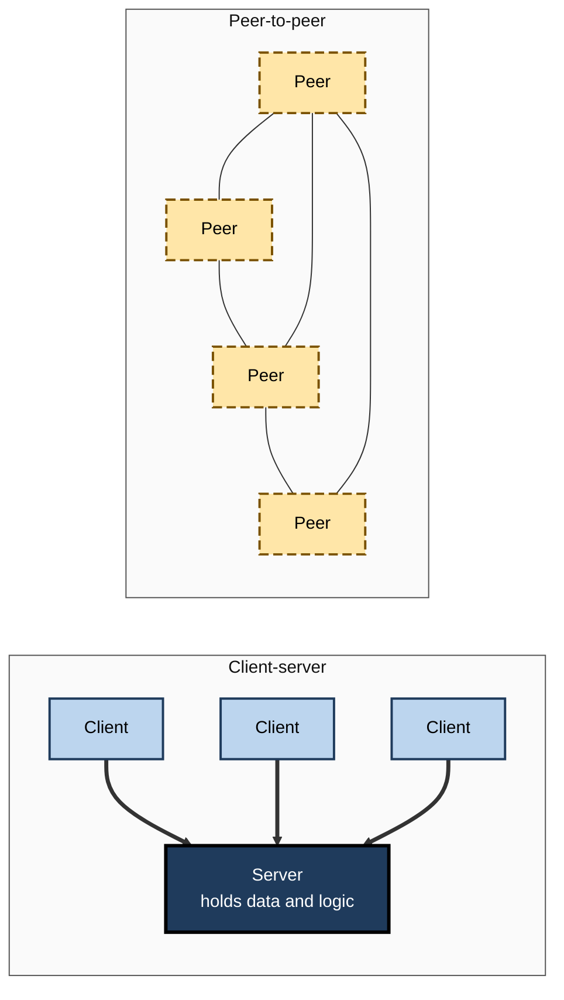
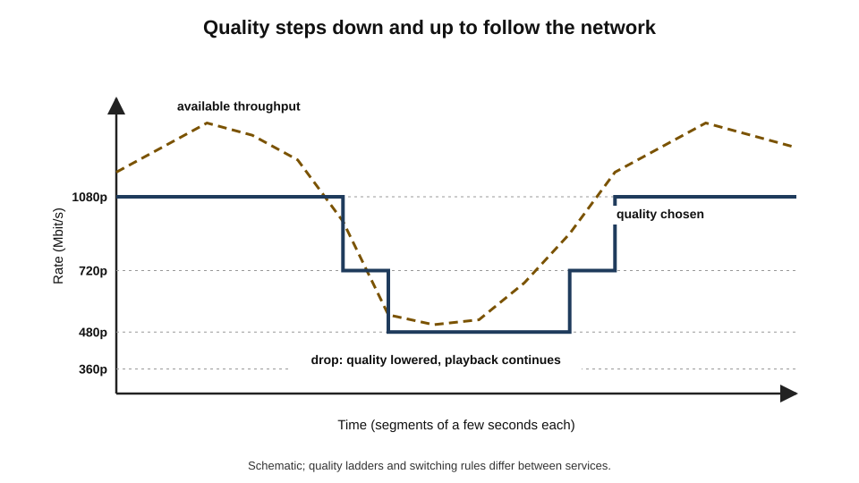
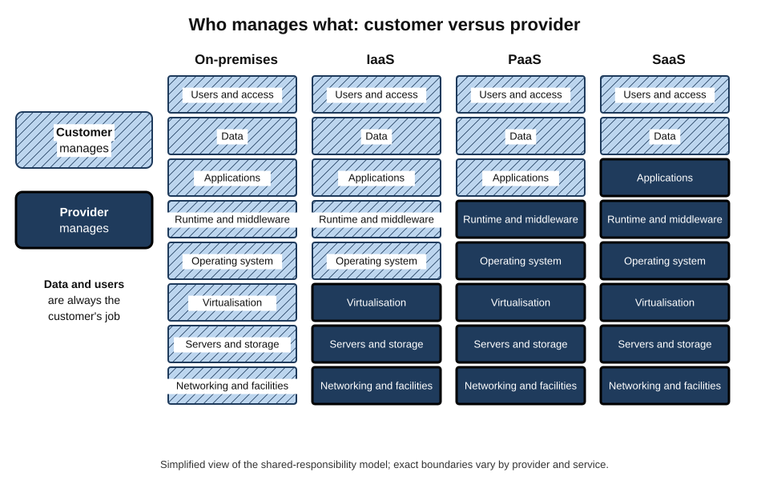
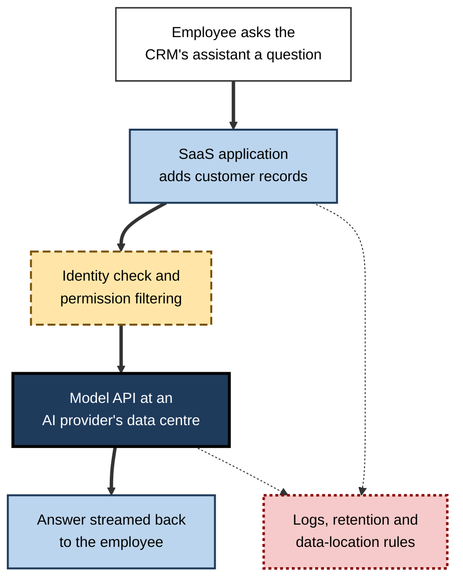
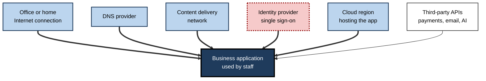

# E.12. Common Internet Services

Before nine in the morning, a typical professional has already used a dozen Internet services without thinking of them as such: a weather app, a news site, email, a messaging group, a music stream on the commute, a calendar invitation, a cloud document, a video meeting, a payment for coffee, an AI assistant asked to summarise a report. Each is a distinct **service** — a capability delivered over the network by someone else's computers — and each rests on the same underlying Internet.

> **Definition — Internet service:** a capability — such as communication, information, storage, computing or a transaction — that is provided to users or programs over the Internet by systems operated by a service provider.

**Why it matters**

- Personal and working life now run on a **portfolio of services**, most owned and operated by other organisations.
- Understanding what kind of service something is — and how it is delivered — explains its **cost, reliability, privacy and risks**.
- Organisations increasingly **buy** rather than build their IT, so choosing, combining and governing services is a core professional skill.
- AI capabilities are arriving mainly **as Internet services**, inheriting all the strengths and dependencies of the model.

---

## Services, Applications and Protocols

### Three levels

- **Protocol** — the rules used to communicate (*e.g.* HTTP, SMTP, IMAP).
- **Application** — the software a person uses (*e.g.* a mail app on a phone).
- **Service** — the capability provided by an operator's systems (*e.g.* a company's hosted email service), reached through applications using protocols.

> **Example:** "email" can mean the protocol family (SMTP, IMAP), the app (a mail client), or the service (a provider's mail system that stores messages, filters spam and keeps them available). Most confusion in conversations about technology comes from mixing these levels.

### Architectures

> **Definition — Client–server model:** an arrangement in which clients (users' devices or programs) send requests to servers, which provide the service and hold the data.

> **Definition — Peer-to-peer (P2P) model:** an arrangement in which participating devices communicate and share resources directly with each other, without depending on a central server for every exchange.

| | Client–server | Peer-to-peer |
|---|---|---|
| Where the service runs | On the provider's servers | Spread across participants' devices |
| Control | Central operator | Distributed |
| Scaling | Provider must add capacity | Each new peer adds capacity |
| Reliability | Depends on the provider | Depends on enough peers being online |
| Examples | Webmail, online banking, most apps | File-sharing networks, some video-call media paths, blockchain networks |

- **Hybrid designs are common** — a video-call service may use central servers to set up calls, then send media directly between participants where possible.

**Figure 1.** Client–server and peer-to-peer arrangements.

---

## The Main Families of Service

### The web

- The largest single service family: websites, web applications, online shops, portals.
- Reached through browsers and, increasingly, through apps that use the same web technologies behind the scenes.

### Email

- **Still the backbone of business communication** and the default identity for most online accounts.
- **Service features beyond the protocol:** storage, spam and malware filtering, search, archiving for legal retention, encryption, and integration with calendars.
- **Provider choice** — most organisations now use hosted email from a few large providers rather than running their own servers.

### Messaging and chat

- **Consumer messaging apps** — usually end-to-end encrypted, tied to phone numbers or accounts.
- **Workplace chat** — channels, threads and integrations with other tools; messages retained under organisational policy.
- **Interoperability** — unlike email, most messaging services are **closed**: users of one cannot message users of another, although regulation in some regions (such as the European Union's digital markets rules) has begun to require some interoperability for the largest providers.

### Voice and video

> **Definition — Voice over IP (VoIP):** the delivery of voice calls as data packets over IP networks rather than over the traditional circuit-switched telephone network.

- **Video meetings** — real-time audio, video and screen sharing for groups.
- **Internet telephony** — business phone systems delivered as cloud services; many countries are switching off their old copper telephone networks in favour of all-IP voice.
- **Requirements** — low latency, low jitter and loss, adequate upload capacity.

### Streaming media

- **On-demand video and music** — content stored in advance, delivered through content delivery networks.
- **Live streaming** — sport, events, gaming broadcasts; harder because there is little time to buffer.
- **Adaptive bitrate streaming** — the player continually measures throughput and switches between versions of the content encoded at different qualities, so that playback continues rather than stalling.
- **Scale** — video is the largest category of Internet traffic by volume.

**Figure 2.** Adaptive bitrate streaming: quality follows available throughput.

> **Definition — Adaptive bitrate streaming:** a technique in which video is encoded at several qualities, split into short segments, and the player chooses each segment's quality according to current network conditions.

### File storage, sharing and collaboration

- **Cloud storage and sync** — files kept on the provider's servers and synchronised across devices.
- **Sharing** — links or named permissions; "anyone with the link" is convenient but weak.
- **Real-time co-editing** — documents, spreadsheets and whiteboards edited simultaneously by many people.
- **Records and compliance** — retention policies, legal holds, audit trails.

### Why collaboration services became central

- **From files to shared spaces** — instead of emailing attachments, teams work in one shared document, which removes version confusion.
- **Records implications** — chats, comments and co-edited files are business records; they may be subject to retention rules, legal discovery and data-protection rights.
- **Integration** — collaboration suites combine mail, calendar, chat, documents, meetings and AI assistants under one identity, which simplifies work and concentrates risk.

> **Watch out:** "it's only chat" is a dangerous assumption. Messages in workplace collaboration tools have been central evidence in litigation and regulatory investigations; the same professional standards apply as for email.

### Remote access

- **VPNs** — connect a remote device into the organisation's private network.
- **Remote desktop and virtual desktops** — the user's screen shows a computer running elsewhere.
- **Zero-trust access services** — grant access to specific applications after checking identity and device, rather than connecting the whole network.

### Commerce, payments and banking

- **E-commerce** — catalogues, baskets, checkout, delivery tracking.
- **Payments** — card processing, digital wallets, instant bank-to-bank transfers.
  - *e.g.* India's Unified Payments Interface (UPI), launched in 2016, grew to process many billions of transactions a month, showing how a public Internet-based payment service can transform everyday commerce.
- **Online and mobile banking** — now the main channel for most retail banking customers in many countries.

### Identity services

- **Single sign-on (SSO)** — one organisational login gives access to many services.
- **"Sign in with…"** — consumer services letting users log in with an existing large-platform account.
- **Why it matters** — the identity provider becomes a **critical dependency**: if it fails or is compromised, every connected service is affected.

> **Definition — Single sign-on (SSO):** an arrangement in which a user authenticates once with an identity provider and is then granted access to multiple services without signing in separately to each.

### Location, maps and the Internet of Things

- **Maps and navigation** — combining satellite positioning on the device with online maps, traffic data and search.
- **Internet of Things (IoT) services** — cloud platforms that collect data from and control connected devices: smart meters, thermostats, fleet trackers, factory sensors.

### Infrastructure services

- **DNS, time (NTP), certificate authorities, content delivery, email filtering** — invisible services on which all others depend.

> **Mnemonic — "We Email, Message, Video, Stream, Share, Access, Pay, Identify, Locate":** the main consumer and workplace service families.

---

## Cloud Computing: Services Built for Rent

### The definition

> **Definition — Cloud computing (NIST, 2011):** a model for enabling convenient, on-demand network access to a shared pool of configurable computing resources (networks, servers, storage, applications and services) that can be rapidly provisioned and released with minimal management effort or service-provider interaction.

**Five essential characteristics** (from the same US National Institute of Standards and Technology definition)

- **On-demand self-service** — customers provision resources themselves.
- **Broad network access** — available over the network from many device types.
- **Resource pooling** — the provider serves many customers from shared infrastructure.
- **Rapid elasticity** — capacity scales up and down quickly.
- **Measured service** — usage is metered and billed.

> **Mnemonic — "On Board, Ride Rapidly, Mind the meter":** On-demand, Broad access, Resource pooling, Rapid elasticity, Measured service.

### Service models

- **Infrastructure as a Service (IaaS)** — rented virtual servers, storage and networks; the customer manages operating systems and applications.
- **Platform as a Service (PaaS)** — a managed platform for building and running applications; the customer supplies code and data.
- **Software as a Service (SaaS)** — complete applications used through a browser or app; the customer manages only users, configuration and data.
- **Newer variants** — serverless functions, containers as a service, and **AI models as a service**.

**Figure 3.** Who manages what in each cloud service model.

| | On-premises | IaaS | PaaS | SaaS |
|---|---|---|---|---|
| Customer manages | Everything | Operating system upwards | Applications and data | Users, settings and data |
| Provider manages | Nothing | Hardware, networking, virtualisation | Plus operating system and runtime | Almost everything |
| Flexibility | Highest | High | Moderate | Lowest |
| Speed to start | Slowest | Fast | Faster | Fastest |
| Example | Company's own server room | Rented virtual machines | Managed application platform | Online office suite, CRM |

> **Key point:** in every model the customer remains responsible for **its data, its users and how the service is configured** — the "shared responsibility" principle. Most cloud data breaches stem from customer misconfiguration, not provider failure.

> **Watch out:** "the cloud is just someone else's computer" captures the dependence but misses the point: cloud services add **automation, elasticity, global reach and managed operations** that are hard to replicate. Equally, "moving to the cloud makes security the provider's problem" is false.

### Deployment models

- **Public cloud** — shared provider infrastructure available to anyone.
- **Private cloud** — cloud-style infrastructure dedicated to one organisation.
- **Hybrid cloud** — a combination, with workloads in both.
- **Multi-cloud** — using several providers, for resilience, capability or negotiating power.

---

## AI as an Internet Service

### How AI services are delivered

- **Chat assistants** — conversational interfaces in browsers and apps.
- **Embedded assistants** — AI features inside office suites, email, coding tools and business systems.
- **Model APIs** — developers send prompts and data to a provider's model over HTTPS and receive outputs; billing is usually by volume of text processed (tokens).
- **Hosted models in a customer's cloud account** — for stronger control over data location and retention.
- **On-device models** — smaller models running locally, often combined with cloud models for harder tasks.

> **Definition — Model API:** an Internet interface through which programs send inputs to an AI model operated by a provider and receive its outputs.

**Figure 4.** The path of a request to an AI service embedded in a business application.

### What changes — and what does not

- **Same dependencies** — the AI feature works only if the Internet connection, the application, the identity service and the model provider are all available.
- **New data questions** — what data is sent to the model, whether it is stored or used for training, and in which country it is processed.
- **New reliability questions** — outputs can be wrong or fabricated; providers update models, changing behaviour without notice.
- **New cost patterns** — usage-based billing can grow quickly as adoption spreads.

> **In practice:** organisations adopting AI services typically approve specific tools, configure data-retention and training opt-outs, restrict sensitive data, monitor usage and costs, and require human review for consequential outputs.

---

## How Services Are Paid For

| Model | How the provider earns | User experience | Examples |
|---|---|---|---|
| Advertising-funded | Selling attention and targeting to advertisers | Free at point of use; data collected | Social media, many news sites, search |
| Freemium | Free basic tier, paid premium features | Upgrade prompts; limits on free tier | Cloud storage, collaboration tools |
| Subscription | Recurring fee per user or household | Predictable cost; lock-in risk | Streaming, office suites, business software |
| Usage-based | Pay for what is consumed | Flexible; costs can surprise | Cloud computing, AI model APIs, data transfer |
| Transaction fee | Share of each payment or sale | Embedded in prices | Marketplaces, payment services, app stores |

> **Watch out:** "if it's free, you are the product" is a useful warning but an oversimplification. Free services may be funded by advertising, by premium customers, by data, or by strategic interest. The practical question is **what the provider gains and what the user gives up**.

---

## Dependencies and Failure

### Every service is a chain

- **The user's device and connection.**
- **DNS** — to find the service.
- **Content delivery network** — to serve its front end.
- **Identity provider** — to sign in.
- **The application itself** — often running in a cloud provider's region.
- **Third-party services it calls** — payments, maps, messaging, AI models.

**Figure 5.** A typical dependency chain behind one software-as-a-service application.

> **Key point:** a service is only as available as the **weakest link in its chain**. Many outages blamed on "the app" originate in a shared dependency several steps away.

### Case study: one cloud region, thousands of services (December 2021)

- **Situation:** on 7 December 2021, problems in the internal network of one of the largest cloud providers' most heavily used regions, in the eastern United States, disrupted services for several hours.
- **What users saw:**
  - streaming services, smart-home devices, delivery-tracking systems, payment and business applications slowed or failed;
  - some failures appeared in places users did not associate with the cloud provider at all.
- **Why the effect was so wide:**
  1. many companies ran their services **only in that one region**;
  2. some of the provider's own management tools and status reporting depended on the affected systems;
  3. services that seemed independent turned out to share hidden dependencies on the same region.
- **Lessons for organisations:**
  - map dependencies, including those of suppliers;
  - design critical services to survive the loss of a region (multi-region or multi-provider);
  - make sure monitoring and communication do not depend on the system being monitored;
  - include provider outages in business-continuity exercises.

> **Watch out:** "the cloud never goes down" is false. Major providers achieve high availability **overall**, but individual regions and services fail; resilience is a design responsibility of the customer.

---

## Choosing and Governing Services at Work

### Questions before adopting a service

- **Purpose and fit** — does it solve a real need better than existing tools?
- **Data** — what data will it hold, where is it stored and processed, who can access it, is it used to train models?
- **Security** — authentication options (SSO, MFA), encryption, independent certifications, breach history.
- **Reliability** — published availability, status history, support terms, regional resilience.
- **Integration** — APIs, identity integration, compatibility with existing systems.
- **Cost** — total cost including usage growth, add-ons and staff time.
- **Exit** — can data be exported in a usable format, and how hard is it to leave?
- **Compliance** — sector rules (health, finance, public sector), data-protection law, records retention.

### Worked example: approving a new file-sharing service

Situation: a design team asks to use a fast new file-transfer service for sending large files to clients.

1. **Clarify need** — clients receive files of 5–50 GB weekly; the current tool is slow.
2. **Check data** — files include unreleased product designs (confidential) but no personal data.
3. **Assess security** — the service supports SSO and MFA, encrypts files at rest and in transit, offers expiring links and download logs.
4. **Check location and terms** — data stored in a region acceptable to clients' contracts; provider does not use content for other purposes.
5. **Consider exit** — files are transient; leaving is easy.
6. **Decide** — approve, with SSO enforced, default link expiry of 7 days, and download notifications; add to the approved-services register.
- **Conclusion:** a short, structured assessment turned a potential **shadow IT** risk into a governed, useful service.

### SaaS sprawl

- **The problem** — organisations accumulate hundreds of services, many unknown to IT, with duplicated functions, orphaned accounts and unmanaged data.
- **Remedies** — a service register; SSO for everything possible; automatic removal of leavers' access; periodic review of usage and cost.

> **In practice:** mature organisations maintain a **service catalogue** listing each service, its owner, the data it holds, its dependencies and its exit plan — and review it regularly.

---

## Services That Talk to Services: APIs and Webhooks

Much of the Internet's traffic is not people using services but **services using each other**. A shop's checkout calls a payment service; an accounting system pulls bank transactions; a support desk posts alerts into team chat.

> **Definition — API (application programming interface):** a defined set of requests and responses through which one program can use the functions or data of another; on the Internet, usually HTTPS requests with structured data.

> **Definition — Webhook:** a mechanism by which a service notifies another automatically, by sending an HTTPS request to a pre-agreed address when a particular event occurs.

- **Pull (API call)** — "has the payment arrived yet?" asked repeatedly.
- **Push (webhook)** — "the payment has arrived" sent once, when it happens.
- **Authentication** — API keys, tokens or certificates identify the calling program; they must be protected like passwords.
- **Rate limits** — providers cap how many requests a customer may make, to protect capacity and enforce pricing.
- **Versioning and deprecation** — providers announce when old versions will stop working; integrations need maintenance.

### Worked example: connecting an online shop to its services

Situation: a small online retailer wants orders to flow automatically through payment, stock, delivery and accounting.

1. **Checkout** — the shop calls the payment provider's API to take payment; the provider returns success or failure.
2. **Payment confirmation** — the payment provider sends a **webhook** to the shop when funds are confirmed or a dispute is raised.
3. **Stock** — the shop calls the warehouse system's API to reserve items.
4. **Delivery** — the shop calls a courier's API to create a shipment and receive a tracking number; the courier sends webhooks as the parcel moves.
5. **Accounting** — each night, the accounting service pulls the day's sales through the shop's API.
6. **Failure handling** — every step retries safely if a call fails, and alerts staff if a webhook does not arrive.
- **Conclusion:** five independent services cooperate through APIs and webhooks; the retailer writes little code but must manage **keys, rate limits, failures and version changes**.

> **Watch out:** API keys accidentally published in code repositories or shared documents are a frequent cause of breaches and surprise bills. Keys should be stored in secret-management tools, limited in scope and rotated regularly.

---

## Reading a Service's Promises

### Service levels

- **Availability commitment** — *e.g.* 99.9% monthly uptime for the service as a whole.
- **Exclusions** — scheduled maintenance, problems caused by the customer, "beta" features, events outside the provider's control.
- **Remedies** — usually service credits, rarely compensation for business losses.
- **Support terms** — response times by severity, channels available, languages and hours.

### Status pages and incident reports

- **Status pages** show current incidents and history; mature providers publish **post-incident reviews** explaining causes and fixes.
- **Reading them well:**
  - check whether the provider reports **regional** or **feature-level** incidents, not only total outages;
  - look for honest root-cause analysis and concrete corrective actions;
  - remember that the status page may itself depend on the provider's infrastructure.

> **In practice:** before relying on a service for a critical process, professionals review a year of its incident history. A provider that hides problems is riskier than one that reports them candidly.

---

## Connected Homes and Devices as Services

- **The device is half the product** — a smart thermostat, doorbell camera or fitness tracker usually depends on the manufacturer's cloud service for its main features.
- **Consequences:**
  - if the service is discontinued, devices can lose functions or stop working entirely — this has happened with several consumer products whose makers closed their cloud services;
  - data from cameras, microphones and sensors flows to the provider, raising privacy questions;
  - security depends on the manufacturer continuing to issue updates.
- **Good questions for buyers:**
  - Does it work locally if the Internet or the provider is unavailable?
  - How long will updates be provided?
  - Where is the data stored, and can it be deleted?
- **Regulatory trend** — several jurisdictions now require minimum security standards for connected consumer products, such as banning universal default passwords and stating update periods.

> **Example:** a household with an Internet-dependent door lock, heating controller and alarm effectively has a **service dependency** for basic home functions. A short provider outage or the end of a product line becomes a practical problem, not just an inconvenience.

---

## Personal Service Portfolios

- **Inventory** — most adults hold dozens to hundreds of online accounts; a password manager doubles as a list of them.
- **Critical services** — email, banking, the mobile-phone account, cloud storage and government identity accounts deserve the strongest protection, because others depend on them.
- **Digital legacy** — many services offer ways to nominate a trusted contact or decide what happens to an account after death; without this, families may lose access to photos, documents and financial records.
- **Pruning** — closing unused accounts reduces exposure in future breaches.
- **Portability** — major services provide data-export tools; exporting periodically keeps a personal copy and makes switching easier.

> **In practice:** a sensible annual review — list accounts, delete unused ones, check recovery options, export important data and confirm backups — takes an hour and greatly reduces the impact of breaches, outages and life events.

| | Free consumer service | Paid consumer plan | Business-grade service |
|---|---|---|---|
| Support | Self-help forums | Limited direct support | Contracted support and service levels |
| Data controls | Basic settings | More storage and options | Retention, audit, legal hold, administrator controls |
| Security features | Standard | Standard to enhanced | SSO, enforced MFA, device policies |
| Suitable for | Personal use | Households, freelancers | Organisations and regulated work |

---

## Open Questions

- **Will messaging and social services become interoperable like email?**
  - Regulation is pushing large providers towards it; technical and privacy challenges, especially for end-to-end encryption, remain.
- **How concentrated should critical services be?**
  - A few providers dominate cloud, identity, email and AI; this brings efficiency and also systemic risk.
- **Will AI services replace many existing services or sit on top of them?**
  - Assistants that act across services ("agents") may change how people use the web and apps; the outcome is uncertain.
- **Who owns data generated within services?**
  - Rights over data, models trained on it and portability between providers are unsettled legally and commercially.
- **Can usage-based pricing remain predictable?**
  - Cloud and AI bills can grow unexpectedly; tools and practices for cost governance are still maturing.

---

## Summary

- An **Internet service** is a capability delivered over the network by a provider's systems; distinguish **protocol**, **application** and **service**.
- Services use **client–server**, **peer-to-peer** or hybrid architectures.
- Main families: **web**, **email**, **messaging**, **voice and video (VoIP)**, **streaming** (with **adaptive bitrate**), **storage and collaboration**, **remote access**, **commerce and payments** (e.g. UPI), **identity (SSO)**, **maps and IoT**, and invisible **infrastructure services**.
- **Cloud computing** (NIST 2011): on-demand, broad access, pooling, elasticity, measured service; service models **IaaS, PaaS, SaaS**; deployment **public, private, hybrid, multi-cloud**; **shared responsibility** always applies.
- **AI services** — assistants, embedded features, **model APIs** — inherit Internet dependencies and add data, reliability and cost questions.
- Business models: **advertising, freemium, subscription, usage-based, transaction fees**.
- Every service is a **dependency chain**; the 2021 cloud-region outage showed hidden concentration risks.
- Organisations assess services for **purpose, data, security, reliability, integration, cost, exit and compliance**, and control **SaaS sprawl** with registers and SSO.

---

## Self-Check

1. Distinguish a protocol, an application and a service, using email as the example.
2. Compare client–server and peer-to-peer architectures on control and scaling.
3. Why are most messaging services not interoperable, and what is changing?
4. Explain adaptive bitrate streaming and why it reduces stalling.
5. What is single sign-on, and why does it create a critical dependency?
6. State the NIST definition of cloud computing and its five essential characteristics.
7. Compare IaaS, PaaS and SaaS in terms of what the customer manages.
8. What is the shared-responsibility principle, and why are misconfigurations so common a cause of breaches?
9. Describe three ways AI is delivered as an Internet service.
10. List three new questions organisations must ask when adopting AI services.
11. Compare advertising-funded and usage-based business models from the user's point of view.
12. Draw (in words) the dependency chain of a SaaS application and identify two shared dependencies.
13. What lessons did the December 2021 cloud-region outage teach?
14. List eight questions to ask before adopting a new service at work.
15. A department has signed up for 40 different SaaS tools without IT involvement. Propose a plan to bring them under control without stopping useful work.

### Answer Key

1. Protocol: SMTP and IMAP rules for sending and reading mail. Application: a mail app on a phone. Service: a provider's mail system that stores, filters and serves messages.
2. Client–server: central control by the operator; capacity must be added by the provider. Peer-to-peer: control distributed among peers; each peer adds capacity, but availability depends on enough peers.
3. They are proprietary services designed as closed networks, often for business reasons and end-to-end encryption; regulation (e.g. in the EU) now requires some interoperability from the largest providers.
4. Content is encoded at several qualities in short segments; the player picks each segment's quality according to measured throughput, lowering quality rather than stalling when conditions worsen.
5. One authentication with an identity provider gives access to many services. If the identity provider fails or is compromised, all connected services are affected.
6. On-demand network access to a shared pool of configurable resources that can be rapidly provisioned and released with minimal management effort. Characteristics: on-demand self-service, broad network access, resource pooling, rapid elasticity, measured service.
7. IaaS: customer manages operating system, middleware, applications and data. PaaS: applications and data. SaaS: only users, configuration and data.
8. Providers secure the underlying platform; customers remain responsible for their data, access and configuration. Cloud services are highly configurable and easy to expose publicly by mistake.
9. Chat assistants; AI features embedded in existing software; model APIs called by developers (also hosted models in a customer's cloud and on-device models).
10. What data is sent and whether it is stored or used for training; where it is processed; how reliable outputs are and who reviews them; how costs will grow.
11. Advertising-funded: free at use but the user's attention and data fund it. Usage-based: the user pays for consumption — flexible but potentially unpredictable.
12. User's connection → DNS → CDN → identity provider → application in a cloud region → third-party APIs. Shared dependencies: the cloud region, the identity provider, the DNS or CDN provider.
13. Concentration in a single region spreads failure widely; hidden dependencies exist; monitoring and communication should not depend on the failed system; critical services need multi-region or multi-provider design and continuity exercises.
14. Purpose and fit; data held and location; security features; reliability; integration; total cost; exit and data export; compliance.
15. Discover and list all tools (expense and network data); classify by data sensitivity and use; keep and integrate valuable tools with SSO and proper contracts; replace duplicates with approved alternatives; retire risky ones with data migration; set up a simple, fast approval route so future requests are handled rather than hidden.

---

## Glossary

| Term | Meaning |
|---|---|
| Adaptive bitrate streaming | Switching video quality segment by segment to match network conditions. |
| Client–server model | Clients request services from central servers. |
| Cloud computing | On-demand network access to shared, elastic, metered computing resources. |
| Hybrid cloud | Use of both public and private cloud infrastructure. |
| IaaS | Infrastructure as a Service; rented virtual servers, storage and networks. |
| Identity provider | A service that authenticates users for other services. |
| Internet service | A capability delivered over the Internet by a provider's systems. |
| Model API | An interface for sending inputs to a provider's AI model and receiving outputs. |
| Multi-cloud | Use of several cloud providers. |
| PaaS | Platform as a Service; managed platform for running applications. |
| Peer-to-peer model | Devices share resources directly without a central server for each exchange. |
| SaaS | Software as a Service; complete applications delivered over the Internet. |
| SaaS sprawl | Uncontrolled growth in the number of software services an organisation uses. |
| Service catalogue | A register of an organisation's services, owners, data and dependencies. |
| Shared responsibility | The division of security duties between cloud provider and customer. |
| Single sign-on (SSO) | One authentication giving access to many services. |
| VoIP | Voice over IP; telephone calls carried as data packets. |
