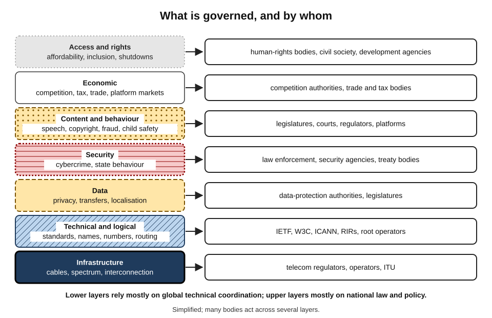
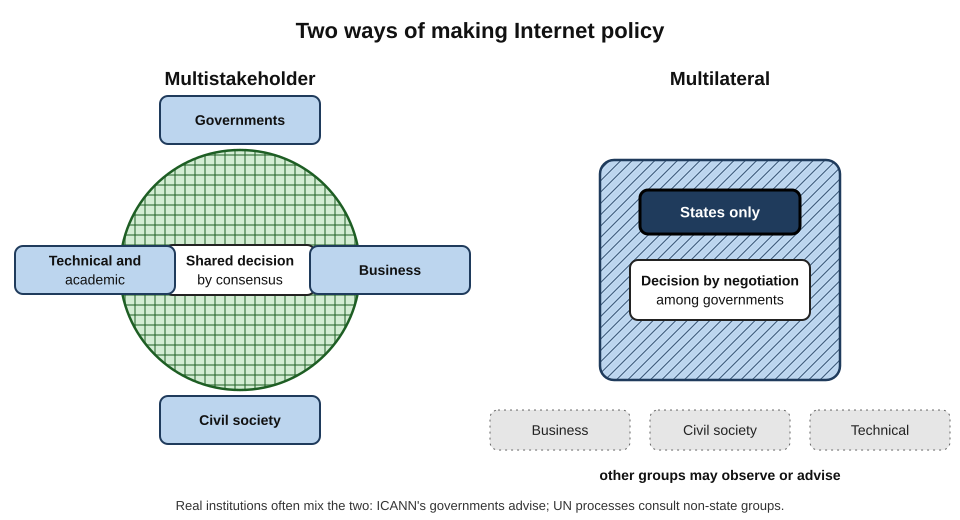
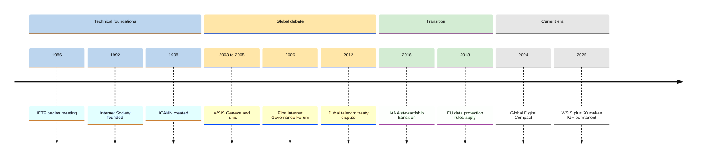
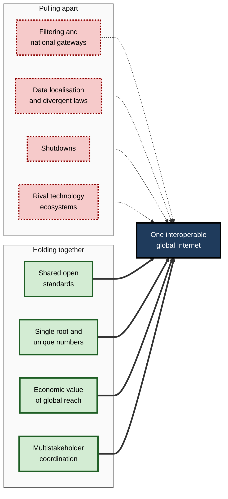
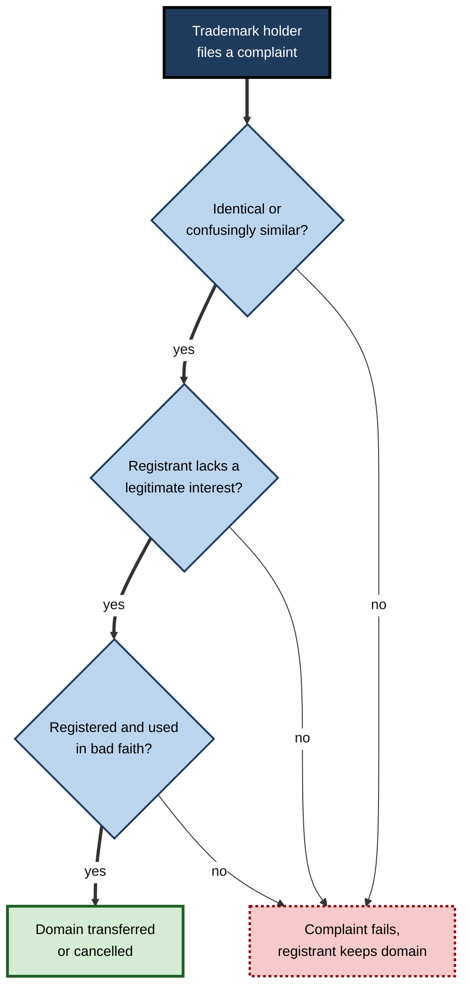

# B.13. Internet Governance

Someone decides which new top-level domains may exist. Someone writes the technical standard that every phone uses to fetch web pages. Someone rules on whether a broadband provider may slow down a video service, whether a platform must remove a post, whether a government may switch off mobile data in a region during unrest. These "someones" are not one authority but a crowded landscape of engineers, companies, non-profits, governments, courts and international bodies — and the way they share power is called **Internet governance**.

> **Definition — Internet governance (Working Group on Internet Governance, 2005):** the development and application by governments, the private sector and civil society, in their respective roles, of shared principles, norms, rules, decision-making procedures and programmes that shape the evolution and use of the Internet.

**Why it matters**

- Governance decisions determine whether the Internet stays **open, global, secure and interoperable** — or fragments.
- They shape what businesses may do with data, how platforms handle content, how ISPs treat traffic and how much access citizens have.
- Organisations operating across borders face **many overlapping regimes**; compliance and strategy depend on understanding them.
- Professionals increasingly participate — in standards bodies, policy consultations, industry associations — and their input changes outcomes.

---

## What Is Being Governed

### Layers of governance

- **Infrastructure** — cables, spectrum, data centres, interconnection, market competition.
- **Technical and logical layer** — standards and protocols; unique identifiers (IP addresses, domain names, protocol numbers); routing security.
- **Content and behaviour** — what may be published, shared or done online: speech, copyright, fraud, child protection, harassment.
- **Data** — privacy, data protection, cross-border transfers, data localisation.
- **Security** — cybercrime, state behaviour in cyberspace, critical-infrastructure protection.
- **Economic** — taxation, competition, trade in digital services, platform markets.
- **Access and rights** — affordability, inclusion, freedom of expression, shutdowns.

**Figure 1.** The layers of Internet governance and the kinds of body most active in each.

> **Key point:** "Who governs the Internet?" has no single answer because the Internet has **different layers governed in different ways** — technical coordination by global non-profits and engineering communities; content, data and security largely by national laws and international agreements.

### Governance, not government

- **Government** — formal authority of states: laws, regulators, courts.
- **Governance** — the wider system of rules and coordination, including private standards, contracts, community policies and norms.
- Much of the Internet's technical functioning is governed **without governments in the lead** — through voluntary standards and private coordination bodies.

> **Watch out:** the claim that "the Internet is ungoverned" or "lawless" is mistaken. It is governed by an unusually **decentralised** mix of bodies, and national laws apply to activity within each jurisdiction.

---

## The Technical Coordinators

### Names and numbers

- **ICANN (Internet Corporation for Assigned Names and Numbers)** — founded in **1998** as a non-profit organisation based in California.
  - Coordinates the **domain-name system**: policy for generic top-level domains, accreditation of registrars, introduction of new TLDs.
  - Its policies are developed by **supporting organisations and advisory committees** representing registries, registrars, businesses, users, country-code operators and governments.
  - Governments participate through the **Governmental Advisory Committee**, which advises but does not control.
- **IANA functions** — maintaining the root zone, the global IP address pool and protocol parameter registries; operated today by an ICANN affiliate.
- **Regional Internet Registries** — five member-based organisations allocating IP addresses and autonomous-system numbers in their regions through community-developed policy.
- **Root server operators** — twelve independent organisations operating the thirteen root server identities.

> **Definition — ICANN:** the non-profit organisation that coordinates the Internet's systems of unique identifiers, especially the domain-name system, through a multistakeholder policy process.

### The IANA stewardship transition

- **Before 2016** — the IANA functions were performed under a contract with the US government's Department of Commerce, giving it a residual oversight role.
- **Pressure for change** — other governments and stakeholders questioned why one country should oversee a global resource; the 2013 surveillance revelations intensified criticism.
- **2014** — the US government announced its intention to transfer oversight to the global multistakeholder community, on condition that it would not be replaced by a government-led or intergovernmental solution.
- **1 October 2016** — the contract expired; accountability passed to ICANN's community through new mechanisms (including the power to remove board members and approve key changes).

> **Example:** the transition is a rare case of a government voluntarily relinquishing a formal power over global infrastructure — and a test of whether multistakeholder institutions can be accountable without a state overseer.

### Standards

- **IETF** — core Internet protocols; open participation; rough consensus.
- **Internet Architecture Board (IAB)** — oversight of the IETF's architecture and appeals.
- **Internet Society (ISOC, founded 1992)** — a non-profit providing an organisational home for the IETF and advocating for an open Internet.
- **W3C** — web standards.
- **IEEE, 3GPP, ITU-T** — networking, mobile and telecommunications standards.

> **In practice:** standards decisions have policy consequences. Encrypting more protocol information, for example, improves privacy but reduces what network operators and authorities can see — so security agencies, telecom operators and civil-society groups all follow and influence IETF work.

---

## Models of Governance

### Multistakeholder and multilateral

> **Definition — Multistakeholder governance:** an approach in which governments, businesses, civil society, the technical community and academia participate in developing policies, typically through open, consensus-based processes.

> **Definition — Multilateral governance:** an approach in which decisions are made by **governments** acting together through intergovernmental organisations, typically by negotiation among states.

| | Multistakeholder model | Multilateral model |
|---|---|---|
| Who decides | All stakeholder groups, often by consensus | Governments, by agreement among states |
| Typical forums | ICANN, IETF, RIRs, Internet Governance Forum | United Nations bodies, ITU, treaty negotiations |
| Strengths | Expertise, flexibility, inclusion of those who build and use the network | Democratic legitimacy through states; enforceability |
| Weaknesses | Dominated by well-resourced participants; weak enforcement | Slow; can exclude non-state voices; risk of state control over content |
| Supporters | Many Western governments, industry, technical community | Many governments seeking greater state authority, including China and Russia |

**Figure 2.** Multistakeholder and multilateral approaches compared.

> **Watch out:** the debate is often presented as "free Internet versus state control". Reality is more mixed: democratic governments legislate heavily on content and data, while multistakeholder bodies have been criticised for being dominated by large Western companies and for weak accountability.

### Key moments in the debate

- **World Summit on the Information Society (WSIS)** — two UN summits, **Geneva 2003** and **Tunis 2005**.
  - Produced the working definition of Internet governance.
  - Created the **Internet Governance Forum (IGF)** — an annual multistakeholder forum for dialogue, without decision-making power; first held in Athens in 2006.
- **World Conference on International Telecommunications (Dubai, 2012)** — revision of the ITU's telecommunications treaty.
  - Disagreement over whether the treaty should extend to the Internet; a large group of countries, including the United States and many European states, declined to sign the revised regulations.
- **Global Digital Compact (2024)** — adopted at the UN Summit of the Future, setting shared principles for digital cooperation, including an open, safe and secure Internet.
- **WSIS+20 review (December 2025)** — the UN General Assembly reaffirmed the multistakeholder approach and made the **IGF a permanent UN body**, with the next review planned for 2035.

**Figure 3.** Milestones in global Internet governance.

---

## Net Neutrality

### The principle

> **Definition — Net neutrality:** the principle that Internet access providers should treat all lawful traffic equally, without blocking, throttling or giving paid priority to particular content, applications, services or senders.

- **Coined** by legal scholar **Tim Wu** in 2003, building on earlier ideas of non-discrimination in communications.
- **Core rules usually proposed:**
  - **no blocking** of lawful content;
  - **no throttling** (deliberate slowing) of particular services;
  - **no paid prioritisation** ("fast lanes" sold to content providers);
  - **transparency** about traffic management.
- **Reasonable traffic management** — temporary measures to deal with congestion or security threats are usually permitted.

### The arguments

| | Arguments for strong net-neutrality rules | Arguments against strict rules |
|---|---|---|
| Innovation | New services can compete on equal terms without paying ISPs | ISPs could innovate with differentiated services and pricing |
| Competition | Protects against ISPs favouring their own or partners' content | Competition among ISPs disciplines bad behaviour without regulation |
| Investment | Open access drives demand that funds networks | Rules may reduce incentives and revenue for network investment |
| Free expression | Prevents gatekeeping of lawful speech | Existing competition and consumer law can address abuses |
| Quality of service | Equal treatment is simple and fair | Some applications (telemedicine, safety) may need guaranteed quality |

> **Watch out:** both sides make strong predictions — "the Internet will die without net neutrality" or "investment will collapse with it". Evidence on the effects of rules on investment is **contested**, and outcomes depend heavily on local market competition.

### Approaches around the world

- **United States** — repeated reversals:
  - 2015 — the Federal Communications Commission classified broadband as a telecommunications service and adopted net-neutrality rules;
  - 2017 — the rules were repealed;
  - 2024 — the Commission reinstated them;
  - **January 2025** — a federal appeals court (the Sixth Circuit) held that the Commission lacked the legal authority to classify broadband this way and **vacated the rules**; several states maintain their own laws.
- **European Union** — the **Open Internet Regulation (2015)** requires equal treatment of traffic, with national regulators enforcing it; the EU's highest court later ruled that certain zero-rating offers breached the regulation.
- **India** — in 2016 the telecom regulator **prohibited discriminatory pricing for data services**, effectively banning zero-rated offers; the government adopted strong net-neutrality principles in 2018.
- **Other countries** — range from strong rules (some in Latin America) to none.

### Case study: Free Basics in India (2015–2016)

- **Situation:** a large social-media company partnered with a mobile operator to offer **Free Basics** — free access to a limited set of websites and services, including its own — aimed at bringing people online.
- **Supporters' case:**
  - free access would help the poorest users get online;
  - something was better than nothing.
- **Critics' case:**
  - a single company would choose which parts of the Internet were free, becoming a gatekeeper;
  - new Indian start-ups would be disadvantaged against services included for free;
  - it would create a "poor Internet for poor people".
- **Public campaign:** a broad coalition of entrepreneurs, academics and activists organised one of the largest public consultations the regulator had received; the company also campaigned heavily for its programme.
- **Decision (February 2016):** the Telecom Regulatory Authority of India banned discriminatory pricing of data based on content, ending Free Basics in India.
- **Aftermath:** a new operator's very cheap data plans soon brought hundreds of millions online through ordinary, unrestricted access — which supporters of the decision cited as vindication, though the causal link is debated.
- **Lesson:** connectivity policy involves trade-offs between **immediate access** and **long-term openness**; public participation can shape outcomes.

---

## Governing Content, Data and Platforms

### Content and platform regulation

- **United States** — **Section 230** of the Communications Decency Act (1996) largely protects online platforms from liability for users' content and for good-faith moderation; it is a long-running subject of reform proposals.
- **European Union** — the **Digital Services Act** (fully applicable from 2024) sets duties for platforms on illegal content, transparency, risk assessment and user rights, with extra obligations for very large platforms; the **Digital Markets Act** regulates "gatekeeper" platforms' competitive conduct.
- **United Kingdom** — the **Online Safety Act 2023** places duties on services to protect users, especially children, from illegal and harmful content.
- **India** — the **Information Technology Rules (2021)** set obligations for intermediaries, including grievance mechanisms and content-removal timelines.
- **Global effect** — large platforms often apply the strictest major regime worldwide for simplicity (a "Brussels effect"), or vary features by country.

### Data protection and cross-border data

- **EU General Data Protection Regulation (GDPR, applying from 2018)** — rights for individuals, duties for organisations, large fines, rules restricting transfers of personal data outside the EU.
- **India's Digital Personal Data Protection Act (2023)** — consent-based framework with duties for data fiduciaries.
- **Data localisation** — some laws require certain data (financial, health, government) to be stored or processed inside the country.
- **Cross-border flows** — trade agreements and adequacy decisions try to keep data moving while protecting rights.

> **Definition — Data localisation:** a legal requirement that certain data be stored or processed within a country's borders.

### Security and cybercrime

- **Budapest Convention on Cybercrime (2001)** — the first international treaty on cybercrime, harmonising offences and cooperation.
- **United Nations cybercrime convention** — adopted by the UN General Assembly in December 2024 after years of negotiation; critics warned it could be used to justify surveillance and suppression of dissent.
- **Norms of responsible state behaviour** — UN-endorsed, voluntary norms, such as not attacking critical infrastructure in peacetime.

---

## Sovereignty, Shutdowns and Fragmentation

### Digital sovereignty

> **Definition — Digital sovereignty:** a state's or region's ability — or claim — to control the digital infrastructure, data, technologies and rules that operate within its territory.

- **Spectrum of positions:**
  - **open, global Internet with national laws** — most democracies;
  - **strategic autonomy** — reducing dependence on foreign technology providers (a prominent theme in European policy);
  - **tightly controlled national networks** — extensive filtering and control of international gateways, as in China's long-standing system and Russia's 2019 "sovereign Internet" law.

### Internet shutdowns

- **What they are** — deliberate disruptions of Internet or mobile data access, nationwide or regional, often during protests, elections, conflicts or examinations.
- **Scale** — civil-society monitors have recorded **hundreds of shutdowns a year** worldwide in recent years, in dozens of countries; India has frequently recorded among the highest numbers of regional shutdowns.
- **Costs** — economic losses, disruption to health care and emergency services, suppression of information and rights.
- **Legal challenges** — courts in several countries have ruled on the proportionality of shutdowns; India's Supreme Court in 2020 held that indefinite suspension of Internet services was impermissible and that restrictions must be proportionate and subject to review.

> **Watch out:** shutdown counts depend on how monitors define and detect a "shutdown" (full outage, regional cut, throttling, platform block). Figures from different sources differ; the trend of frequent use is consistent.

### The "splinternet"

> **Definition — Splinternet (Internet fragmentation):** the division of the global Internet into separate or partly separate networks, through technical, commercial or political barriers.

- **Technical fragmentation** — alternative roots, incompatible standards, blocked protocols.
- **Governmental fragmentation** — filtering, localisation, divergent laws, shutdowns.
- **Commercial fragmentation** — walled gardens, geo-blocking, platform lock-in.

**Figure 4.** Forces pulling the Internet towards fragmentation and forces holding it together.

---

## Governance in Professional Practice

### What organisations must manage

- **Compliance mapping** — which laws apply where: data protection, content duties, consumer protection, sector rules, export controls.
- **Data-location decisions** — where to store and process data, given localisation and transfer rules.
- **Domain and identifier management** — trademarks in domain disputes, registry rules, abuse handling.
- **Platform obligations** — for organisations hosting user content: notice-and-action procedures, transparency reports, age-assurance duties.
- **Continuity planning** — for shutdowns and sanctions affecting operations or staff in certain countries.
- **AI regulation** — emerging rules on AI systems (such as the EU's AI Act, adopted in 2024 and applying in stages) increasingly interact with data and platform law.

### Worked example (illustrative): launching a customer app in three markets

Situation: a fintech start-up plans to launch a payments app in the EU, the UK and India.

1. **Map data rules** — GDPR (EU), UK data-protection law, India's data-protection act and sector rules; financial regulators in all three may require certain payment data to be stored locally.
2. **Decide architecture** — regional data stores; transfers only under approved mechanisms; encryption and access controls.
3. **Content and platform duties** — if users can post content or message each other, assess duties under the EU Digital Services Act, the UK Online Safety Act and India's IT Rules.
4. **Consumer and payments law** — disclosures, complaint handling, fraud reimbursement rules.
5. **Resilience** — plan for regional shutdowns or regulatory blocks; avoid single-country dependencies for critical functions.
6. **Engagement** — join industry associations that respond to consultations on payments and data rules.
- **Conclusion:** governance is not an afterthought to product design; it determines architecture, cost and launch sequence.

### Taking part

- **Public consultations** by regulators and governments.
- **Standards bodies** — the IETF is open to any individual; many firms send engineers.
- **ICANN and RIR communities** — open meetings and mailing lists.
- **National and regional Internet Governance Forums** — dialogue spaces open to all stakeholders.

> **In practice:** large technology firms, telecom operators and civil-society groups all maintain policy teams that track and shape governance; smaller organisations usually participate through trade associations.

---

## Resolving Disputes Over Names

### Domain names and trademarks

- **The problem** — in the 1990s, people registered domain names matching famous brands, hoping to sell them back at high prices ("cybersquatting").
- **The response** — in 1999 ICANN adopted the **Uniform Domain-Name Dispute-Resolution Policy (UDRP)**, binding on registrants of generic top-level domains.
- **How it works:**
  1. A trademark holder files a complaint with an approved dispute-resolution provider.
  2. A panel decides on written submissions, usually within a few months.
  3. The complainant must show that the domain is **identical or confusingly similar** to its mark, that the registrant has **no legitimate interest**, and that it was **registered and used in bad faith**.
  4. The only remedies are **transfer or cancellation** of the domain; there are no damages.
- **Significance** — a private, global, low-cost procedure that works across national legal systems; tens of thousands of cases have been decided.

**Figure 5.** The three tests a complainant must pass in a domain-name dispute.

> **Definition — Cybersquatting:** registering a domain name that matches or resembles another's trademark in bad faith, typically to profit from its value.

> **Example:** a company that finds a lookalike domain being used to phish its customers can pursue a fast UDRP complaint to have the domain transferred, while also asking the registrar and hosting provider to suspend the abusive site.

### Country-code domains

- Country-code domains are governed by **national policies**, often with their own dispute procedures.
- Some, such as .io or .tv, have been controversial because revenue from global marketing has flowed largely outside the territories concerned, raising questions of fairness and sovereignty.

---

## How a Standards Choice Becomes a Political Fight

### Case study: encrypted DNS in browsers (2018–2020)

- **Situation:** browser makers began offering **DNS over HTTPS**, sending users' name lookups encrypted to chosen resolvers rather than to the ISP's resolver in the clear.
- **Supporters' case:**
  - privacy from network eavesdroppers and ISPs;
  - protection against tampering with DNS answers.
- **Objections:**
  - some ISPs and governments said it would bypass parental-control filtering, court-ordered blocking and malware filtering;
  - enterprises worried about losing visibility of their own networks;
  - critics warned of concentrating DNS traffic in a few large resolver operators.
- **What happened:**
  1. the protocol was standardised at the IETF in 2018;
  2. browser makers adjusted defaults by country and respected enterprise policies and network signals;
  3. resolver operators adopted privacy commitments;
  4. ISPs increasingly offered their own encrypted resolvers.
- **Lesson:** technical standards redistribute **power and visibility**. Governance happens not only in UN halls but in engineering mailing lists, browser settings and procurement decisions.

---

## Governing AI's Relationship With the Internet

- **Training data** — AI developers gather vast amounts of text and images from the web; disputes over copyright, consent and compensation are being fought in courts and legislatures in several countries.
- **Crawler access** — website owners use long-standing machine-readable instructions, and newer controls, to permit or refuse AI crawlers; whether such signals are legally binding varies by jurisdiction.
- **AI-specific law** — the EU's AI Act sets risk-based obligations, including transparency duties for general-purpose AI models; other countries are adopting guidelines, standards and sector rules.
- **Synthetic content** — several jurisdictions require labelling of AI-generated media in some contexts, linking AI governance to content regulation.
- **Institutional gap** — no single body governs AI on the Internet; responsibility is split among data-protection authorities, competition regulators, copyright law, standards bodies and new AI offices.

> **Watch out:** many AI-governance rules are new and are being phased in; obligations and timelines change frequently. Organisations should treat any summary as a starting point and check the current rules in each jurisdiction where they operate.

---

## Governance and the Individual Professional

- **Rights to respect** — data-protection laws give individuals rights of access, correction and deletion; professionals handling customer data must honour them.
- **Duties to know** — employees in regulated roles (finance, health, law, public service) must understand which rules govern the data and services they use.
- **Voices that count** — public consultations by regulators genuinely change outcomes; detailed, evidence-based responses from practitioners are read and cited.
- **Ethical judgement** — governance gaps remain; professionals often decide what is right before the law has caught up, such as whether to use a new AI tool with client data.

> **Key point:** Internet governance is not only a matter for diplomats and engineers. Everyday professional choices — what data to collect, which services to use, how to respond to a consultation — are part of how the Internet is governed in practice.

---

## Open Questions

- **Can multistakeholder governance remain legitimate and effective?**
  - It is reaffirmed in UN processes but criticised for unequal participation and weak accountability.
- **Will regulation fragment the Internet?**
  - Divergent content, data and AI laws raise compliance costs and may split services along national lines.
- **What should net neutrality mean in the era of 5G slicing and AI traffic?**
  - New technical capabilities to differentiate traffic challenge older principles; regulators are reinterpreting them.
- **How should shutdowns be constrained?**
  - International norms condemn them; enforcement is weak.
- **Who should govern AI's use of the Internet?**
  - Questions about crawling, copyright, data use and automated agents cut across existing institutions.

---

## Summary

- **Internet governance** (WGIG, 2005) is the shared development of principles, norms, rules and procedures by **governments, private sector and civil society** shaping the Internet.
- It spans **layers**: infrastructure, technical identifiers and standards, content, data, security, economics and rights.
- Technical coordination: **ICANN** (1998) for names, **IANA functions**, five **RIRs**, root server operators; standards by **IETF/IAB/ISOC**, **W3C**, IEEE, 3GPP, ITU-T.
- The **IANA stewardship transition (1 October 2016)** ended US government oversight.
- **Multistakeholder** versus **multilateral** models; **WSIS** (2003, 2005) created the **IGF**; the **2012 Dubai** treaty dispute; the **Global Digital Compact** (2024); **WSIS+20** (2025) made the IGF **permanent**.
- **Net neutrality** (Tim Wu, 2003): no blocking, throttling or paid prioritisation; US rules reversed several times and **vacated by a court in January 2025**; the EU and India maintain strong rules; India ended **Free Basics** in 2016.
- Content and data: **Section 230**, **Digital Services Act**, **Online Safety Act**, India's **IT Rules**, **GDPR**, India's **DPDP Act**, **data localisation**; cybercrime treaties (Budapest 2001; UN convention 2024).
- **Digital sovereignty**, **shutdowns** and the **splinternet** threaten global interoperability.
- Organisations must map compliance, design data architecture accordingly, plan for disruption and take part in governance processes.

---

## Self-Check

1. State the WGIG definition of Internet governance and explain why "governance" is broader than "government".
2. List five layers of Internet governance with an example issue for each.
3. What does ICANN do, and how do governments participate in it?
4. Explain the IANA stewardship transition and why it was significant.
5. Compare multistakeholder and multilateral governance on who decides, strengths and weaknesses.
6. What were WSIS and the IGF, and what changed in December 2025?
7. Define net neutrality and its four core rules.
8. Summarise the history of net-neutrality rules in the United States up to 2025.
9. Present the arguments on both sides of the Free Basics debate and the outcome.
10. Compare the approaches of Section 230 and the EU Digital Services Act.
11. What is data localisation, and how does it affect cloud architecture?
12. Define an Internet shutdown and explain why counts vary between sources.
13. What is the splinternet, and what forces hold the Internet together?
14. How does an IETF decision about encryption become a policy issue?
15. A company plans to store all customer data for its Indian, EU and UK users in one US data centre. Identify governance issues and recommend an approach.

### Answer Key

1. The development and application by governments, the private sector and civil society, in their respective roles, of shared principles, norms, rules, decision-making procedures and programmes that shape the evolution and use of the Internet. Governance includes private standards, contracts and community processes, not only state authority.
2. Infrastructure (spectrum allocation); technical identifiers (new TLDs); content (illegal-content removal); data (cross-border transfers); security (cybercrime cooperation); also economics (digital taxation) and rights (shutdowns).
3. It coordinates the domain-name system — generic TLD policy, registrar accreditation, new TLDs — through multistakeholder supporting organisations. Governments advise through the Governmental Advisory Committee.
4. The US government's contract overseeing IANA functions expired on 1 October 2016, passing accountability to the global multistakeholder community with new mechanisms. It ended a single state's special role and tested multistakeholder accountability.
5. Multistakeholder: all stakeholder groups by consensus; expertise and flexibility, but uneven participation and weak enforcement. Multilateral: governments by negotiation; state legitimacy and enforceability, but slow and may exclude non-state voices.
6. Two UN summits (2003, 2005) on the information society, which defined Internet governance and created the IGF, a multistakeholder dialogue forum. In December 2025 the WSIS+20 review made the IGF a permanent UN body.
7. ISPs should treat all lawful traffic equally: no blocking, no throttling, no paid prioritisation, plus transparency about traffic management.
8. 2015 rules under Title II; repealed in 2017; reinstated in 2024; vacated by the Sixth Circuit in January 2025, which held the FCC lacked authority; some states keep their own laws.
9. Supporters: free limited access helps the poor get online. Critics: one company chooses winners, disadvantaging start-ups and creating a two-tier Internet. In February 2016 TRAI banned discriminatory data pricing, ending Free Basics in India.
10. Section 230 broadly shields platforms from liability for user content and moderation decisions; the DSA imposes affirmative duties — notice-and-action, transparency, risk assessment — especially on very large platforms.
11. A legal requirement to store or process certain data within a country. Cloud architectures must use in-country regions, restrict transfers and design replication accordingly.
12. A deliberate disruption of Internet or mobile data access. Counts vary because monitors define and detect shutdowns differently (full outages, regional cuts, throttling, platform blocks).
13. The division of the Internet into separate networks through technical, governmental or commercial barriers. Shared open standards, a single root and unique numbers, the economic value of global reach and multistakeholder coordination hold it together.
14. Encrypting more protocol data improves user privacy but reduces what operators and authorities can observe, affecting law enforcement, network management and security monitoring — so governments, operators and civil society contest it.
15. Issues: GDPR and UK transfer rules; possible Indian localisation requirements for some data (especially financial); foreign-government access concerns; customer trust; resilience. Approach: regional data stores in or near each jurisdiction, lawful transfer mechanisms where transfers are necessary, legal review of sector rules, encryption and access controls, and documented data maps.

---

## Glossary

| Term | Meaning |
|---|---|
| Budapest Convention | The 2001 international treaty on cybercrime. |
| Data localisation | A legal requirement to keep certain data within national borders. |
| Digital Services Act | EU law setting duties for online platforms and intermediaries. |
| Digital sovereignty | Control or claimed control over digital infrastructure, data and rules within a territory. |
| GDPR | The EU General Data Protection Regulation, applying from 2018. |
| Global Digital Compact | 2024 UN framework for digital cooperation. |
| IANA functions | Maintenance of the root zone, address pool and protocol registries. |
| IANA stewardship transition | The 2016 end of US government oversight of IANA functions. |
| ICANN | Non-profit coordinating the Internet's unique identifiers. |
| IGF | Internet Governance Forum; a multistakeholder dialogue forum, permanent since 2025. |
| Internet governance | Shared principles, norms, rules and procedures shaping the Internet. |
| Internet shutdown | Deliberate disruption of Internet access. |
| Multilateral governance | Decision-making by governments through intergovernmental bodies. |
| Multistakeholder governance | Decision-making involving governments, business, civil society and technical experts. |
| Net neutrality | Equal treatment of lawful traffic by Internet access providers. |
| Paid prioritisation | Charging content providers for faster treatment of their traffic. |
| Section 230 | US law shielding platforms from liability for user content. |
| Splinternet | Fragmentation of the Internet into separate networks. |
| Throttling | Deliberately slowing particular traffic. |
| WSIS | World Summit on the Information Society (2003, 2005). |
| Zero-rating | Not counting certain services' data against users' allowances. |
