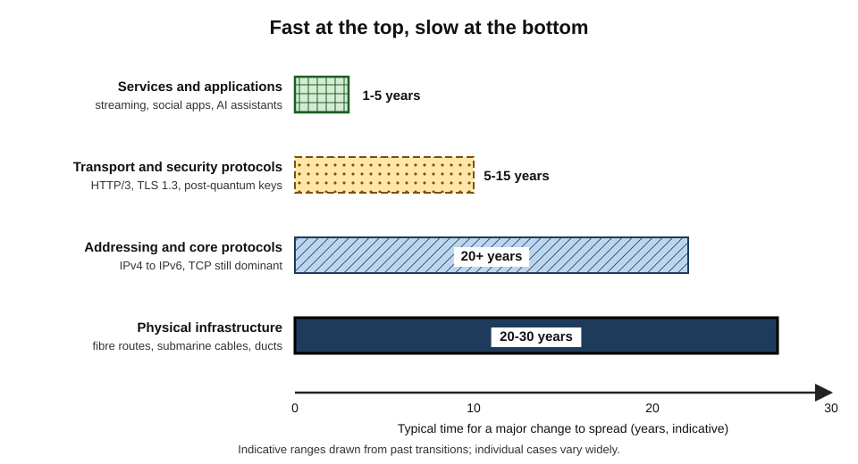
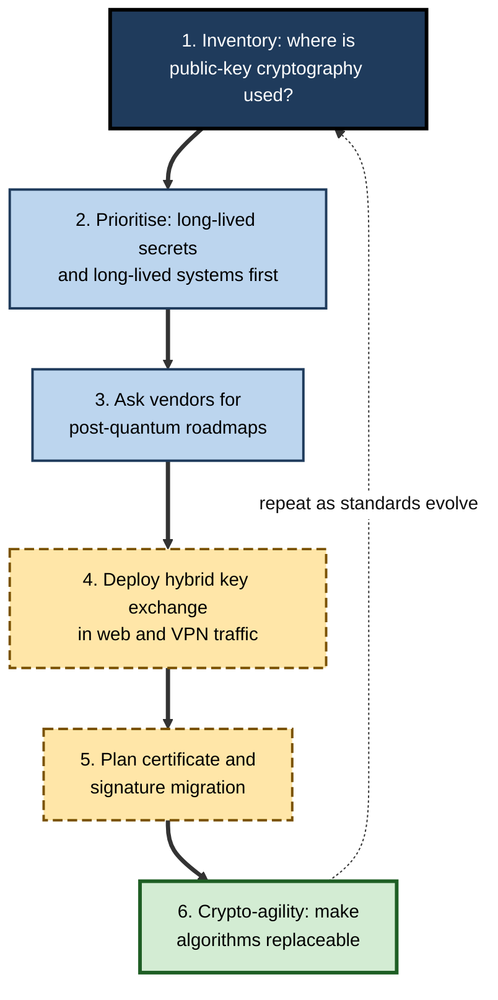
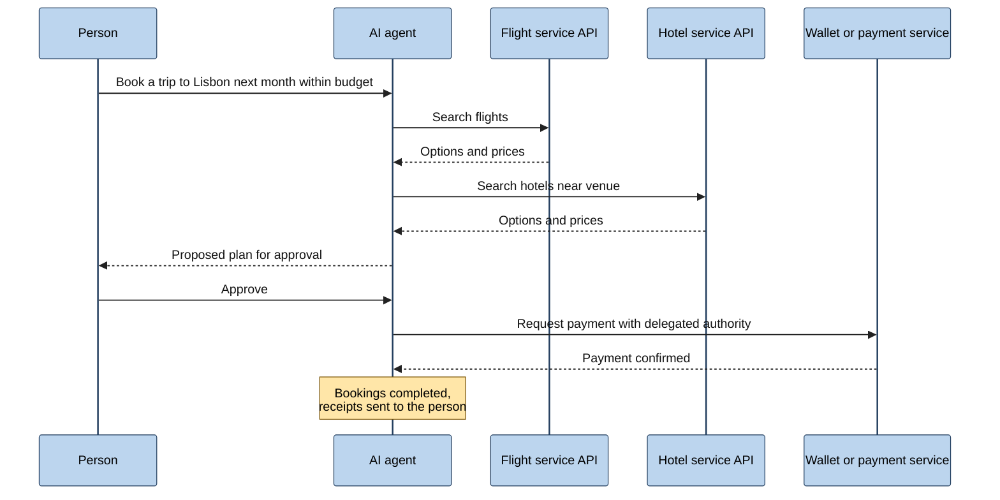
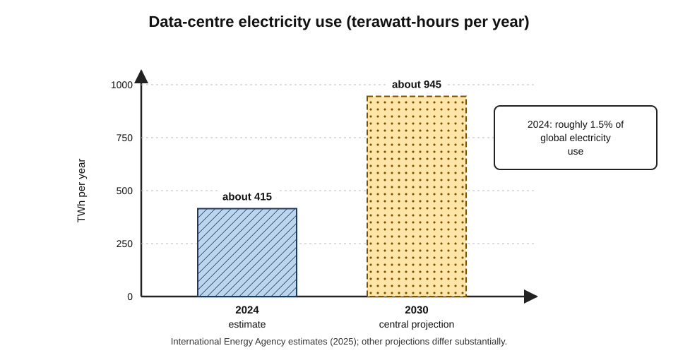
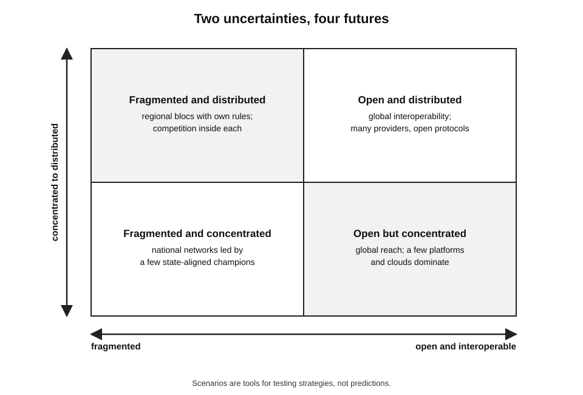

# E.14. Future of the Internet

In December 1995 a respected network pioneer predicted in a trade magazine that the Internet would suffer a "catastrophic collapse" the following year. The same year a well-known astronomer and author wrote that no online database would ever replace the daily newspaper. Both were thoughtful experts; both were wrong. Thinking about the Internet's future is valuable precisely because it is hard — and because organisations that anticipate its direction make better decisions than those that are surprised by it.

> **Definition — Future of the Internet (as a field of analysis):** the systematic study of how the Internet's infrastructure, protocols, services, economics and governance are likely to change, based on current trends, technical constraints and plausible alternative scenarios.

**Why it matters**

- Investments in networks, cloud platforms, security and skills pay off over **five to twenty years** — longer than most product cycles.
- Several shifts are already **under way and partly predictable**: IPv6, satellite access, post-quantum cryptography, AI traffic, regulatory divergence.
- Others are **genuinely uncertain**: fragmentation, the economics of the open web, decentralisation.
- Professionals who distinguish **likely trends** from **hype** and from **open possibilities** give better advice.

---

## How to Think About Internet Futures

### Lessons from past predictions

**Study card — Robert Metcalfe's collapse prediction (1995–1997)**

- **Who:** Robert Metcalfe, co-inventor of Ethernet and founder of a major networking company, writing a magazine column.
- **Prediction (1995):** the Internet would "go spectacularly supernova" and suffer catastrophic collapse in 1996 under the strain of growth.
- **What happened:** traffic kept growing; outages occurred but the network did not collapse.
- **Response (1997):** at a conference he blended a printed copy of his column with liquid and **ate it**, as he had promised to do if wrong.
- **Lesson:** even top experts underestimated how **decentralised investment and adaptive protocols** would let the network scale.

- **Common errors in Internet forecasting:**
  - **underestimating adoption** — the web, smartphones, streaming and AI chat all spread faster than many expected;
  - **overestimating speed of infrastructure change** — IPv6 took decades; "the death of email" has been predicted for years;
  - **assuming one winner** — the Internet usually absorbs new technologies as layers rather than being replaced;
  - **ignoring politics and economics** — technology rarely determines outcomes alone.

> **Key point:** Internet change is usually **fast at the top** (services and applications) and **slow at the bottom** (protocols, addressing, physical infrastructure). Good forecasts respect both speeds.

**Figure 1.** Different layers of the Internet change at different speeds.

### Lessons from the IPv6 transition

- **The forecast:** when IPv6 was standardised in the late 1990s, many engineers expected it to replace IPv4 within about a decade.
- **What happened:** address sharing through NAT relieved the immediate pressure, so operators delayed the cost of change; IPv6 took roughly a quarter of a century to reach about half of users at major services.
- **Why:** the benefits of IPv6 were collective and long-term, while the costs fell on each operator now; no one could switch off IPv4 until almost everyone had IPv6.
- **The general lesson:** infrastructure transitions that require **coordinated action by many independent parties**, without an immediate payoff for each, are slow — whatever their technical merit. Post-quantum migration and routing security face similar dynamics, which is why regulators and large providers are pushing them actively.

### Tools for thinking ahead

- **Trend analysis** — extrapolating measured changes (traffic, users, adoption rates), with caution.
- **Constraint analysis** — identifying hard limits: the speed of light, spectrum, energy, cost of laying fibre.
- **Scenario planning** — constructing several plausible, internally consistent futures and testing decisions against all of them.
- **Signals** — standards work, regulatory proposals, large investments and early adopters' behaviour.

> **Definition — Scenario planning:** a method of strategic thinking in which several distinct, plausible futures are described so that decisions can be tested for robustness across them, rather than betting on a single forecast.

---

## Connecting Everyone

### The remaining gap

- **About 2.2 billion people** were offline in 2025, mostly in low- and middle-income countries and rural areas.
- **Barriers:** affordability of devices and data; coverage; skills; relevant content in local languages; electricity.
- **"Universal and meaningful connectivity"** — a United Nations-backed goal that everyone should have safe, satisfying, enriching and affordable access — has become the benchmark, rather than mere coverage.

### Technologies that will extend access

- **Low-Earth-orbit satellite constellations**
  - Several systems are deploying thousands of satellites; the largest had more than ten million subscribers by 2026.
  - **Direct-to-device** service — satellites communicating with ordinary phones — began with messaging and is expanding.
  - Concerns: concentration in a few operators, space debris, light pollution for astronomy, national-security dependence.
- **Fibre everywhere** — full-fibre networks keep expanding, with higher-capacity optical access standards ready to upgrade them.
- **Next-generation mobile (6G)** — under development through the international process for mobile standards for around 2030, promising higher capacity, integrated sensing and tighter integration with satellites; early marketing should be treated cautiously.
- **Wi-Fi evolution** — further generations focusing on reliability and low latency rather than headline speed alone.

> **Watch out:** every generation of wireless has been marketed with transformative promises. Experience with 5G suggests that the **most visible benefits** — capacity and cheaper data — arrive first, while more exotic capabilities depend on slower ecosystem changes.

---

## The Architecture Ahead

### IPv6 completing its long rollout

- Roughly **half** of users at major services connect over IPv6; mobile networks and new deployments increasingly run **IPv6-only** internally, translating to IPv4 at the edge.
- IPv4 will remain in use for many years, but its role will steadily shrink.

### Concentration and the private Internet

- **Hyperscale networks** — the largest cloud and content companies operate global private backbones, own a growing share of submarine cables and place caches inside ISPs.
- **Consequences:**
  - much traffic never crosses the "public" Internet in the old sense;
  - performance improves for users of these services;
  - **power concentrates** in a few firms, raising competition, resilience and sovereignty concerns.

### The edge and computing near users

- **Edge computing** places processing in local data centres, mobile network sites or on devices to reduce latency and data movement.
- **Drivers:** real-time AI (voice, vision), industrial automation, augmented reality, vehicle systems.
- **Uncertainty:** many applications are adequately served by regional cloud centres; the economics of large numbers of small edge sites remain unproven at scale.

### Beyond Earth

- **Delay-tolerant networking** — protocols designed for links with long delays and frequent disconnection, such as between spacecraft; Vint Cerf has been a long-time advocate of an "interplanetary Internet".
- Space agencies use such techniques for missions; a lunar communications network is under active planning by several agencies.

---

## Security and Trust

### Post-quantum cryptography

- **The threat** — a large, fault-tolerant quantum computer could break the public-key methods (RSA, elliptic-curve) that protect today's key exchange and digital signatures.
- **"Harvest now, decrypt later"** — adversaries may record encrypted traffic today to decrypt it once such computers exist; long-lived secrets are at risk now.
- **Standards** — in **August 2024** the US National Institute of Standards and Technology published its first post-quantum cryptography standards; other bodies are following.
- **Deployment** — major browsers and providers adopted hybrid post-quantum key exchange quickly; by the end of 2025, one large network provider reported that around **half** of human-generated traffic it carried used it.
- **Harder parts** — certificates, signatures, embedded devices and long-lived industrial systems will take much longer.

> **Definition — Post-quantum cryptography:** cryptographic algorithms designed to be secure against attacks by both conventional and quantum computers.

**Figure 2.** A typical path for an organisation's migration to post-quantum cryptography.

### Routing, identity and authenticity

- **Routing security** — cryptographic validation of route origins is spreading, and further mechanisms to validate entire paths are being standardised.
- **Passkeys replacing passwords** — phishing-resistant sign-in is being adopted rapidly by major platforms.
- **Digital identity wallets** — governments, notably in the European Union, are introducing wallets that let citizens prove attributes (age, qualifications, residence) online with minimal disclosure.
- **Content provenance** — industry standards for attaching tamper-evident records of how images, video and audio were created or edited, as a response to synthetic media; adoption is partial and the approach cannot by itself prove that unlabelled content is fake.

> **Watch out:** no single technology will "solve" online trust. Provenance labels can be stripped; identity systems raise privacy and exclusion concerns; security improves layer by layer.

---

## AI and the Future of the Web

### From pages for people to answers by machines

- **Crawling for AI** — automated crawlers gathering content for AI training and real-time answers grew into a significant share of web traffic in 2024–25.
- **Answer engines** — search and assistants increasingly answer questions directly, so users may not visit the sources ("zero-click" behaviour).
- **Publisher responses:**
  - blocking AI crawlers via site rules or network-level controls;
  - licensing deals with AI companies;
  - experiments with charging crawlers per access.
- **The economic question** — if fewer people visit websites, advertising and subscription models that fund much of the open web may weaken.

### AI agents on the network

> **Definition — AI agent:** a software system that uses an AI model to pursue goals by taking actions — browsing, calling services, filling forms, transacting — with some autonomy.

- **What changes:** more traffic generated by machines acting for people; services designed for agents (APIs, structured data) as well as human interfaces.
- **New problems:**
  - verifying which agent is acting and on whose authority;
  - preventing agents from being manipulated by malicious content;
  - liability for agents' mistakes;
  - capacity and cost as automated requests multiply.

**Figure 3.** How an AI agent might complete a travel booking across several services.

> **In practice:** organisations preparing for agent traffic are publishing clean APIs and structured data, deciding which automated access to allow, strengthening bot management and defining when a human must approve consequential actions.

### Energy and sustainability

- **Data centres' electricity use** — the International Energy Agency estimated around **415 TWh** in 2024 (roughly 1.5% of global electricity), with a central projection of roughly **945 TWh** by 2030, driven largely by AI.
- **Networks** themselves use less than data centres, and their energy per unit of data has fallen steadily with newer technology.
- **Responses:** efficiency improvements, siting near clean power, heat reuse, more efficient AI models and hardware.

**Figure 4.** Estimated global data-centre electricity consumption, 2024, and a central projection for 2030.

> **Watch out:** projections of AI energy demand vary widely between sources and have repeatedly been revised. Treat any single projection as **one scenario**, not a certainty.

---

## Decentralisation: Promise and Reality

### Movements to rebalance power

- **Federated social networks** — independently run servers that interoperate through an open protocol standardised by the W3C in 2018, so users on one server can follow users on another.
- **Personal data stores** — proposals, including one led by Tim Berners-Lee, for individuals to hold their own data in "pods" and grant applications access.
- **Blockchain-based "Web3"** — systems using distributed ledgers for ownership records, payments and applications without central operators.

| | Federated networks | Personal data stores | Blockchain "Web3" |
|---|---|---|---|
| Core idea | Many servers, one open protocol | Users control where data lives | Shared ledger replaces trusted intermediaries |
| Maturity | Working, with millions of users | Pilots, especially in public services | Active for digital assets; limited mainstream applications |
| Main strengths | Open, no single owner | Privacy and portability | Censorship resistance, programmable money |
| Main weaknesses | Moderation and usability burdens | Adoption and developer support | Speculation, fraud, energy use (for some systems), usability |
| Status of claims | Growing niche | Early | Heavily **contested** |

> **Watch out:** claims that blockchain-based systems will replace the web have been made since the mid-2010s and remain **unproven**. Some uses have real value; many promoted projects collapsed amid fraud and speculation. Judge specific applications, not slogans.

> **Key point:** the Internet's lower layers are decentralised; its most-used services are highly centralised. Future debates about decentralisation are really about **who controls the service layer**.

---

## Governance Futures

### Plausible directions

- **A permanent forum, many rulebooks** — the Internet Governance Forum is now a permanent UN body, but rules increasingly come from national and regional laws on content, data and AI.
- **Regulatory divergence** — services adapting features, data storage and moderation by jurisdiction.
- **Sovereignty pressures** — governments seeking control over infrastructure, cloud provision and data within their borders.
- **Shutdowns and filtering** — persisting as tools of state control in many countries.

### Scenarios

**Figure 5.** Four scenarios for the Internet in 2035, built from two uncertainties.

- **Open and distributed** — interoperable globally; many providers and open protocols at the service layer.
- **Open but concentrated** — global reach maintained, but a few platforms and cloud providers dominate.
- **Fragmented and distributed** — regional blocs with their own rules and providers, each relatively competitive internally.
- **Fragmented and concentrated** — national or bloc networks dominated by a few state-aligned champions.

> **Remember:** scenarios are not predictions. Their purpose is to test whether a strategy still works if the world turns out differently.

---

## The Future Inside Organisations

### Worked example: testing a strategy against scenarios

Situation: a global professional-services firm plans to consolidate all client data in one cloud provider's regions in the United States and Europe.

1. **List the critical uncertainties** — fragmentation (data-localisation laws) and concentration (dependence on one provider).
2. **Test under "fragmented and concentrated"** — clients in several countries require in-country storage; the chosen provider lacks regions there; the plan fails.
3. **Test under "open but concentrated"** — the plan works, but the firm is exposed to the provider's pricing and outages.
4. **Adjust** — design for **portability** (containers, open formats), choose regions per jurisdiction, keep a second provider qualified for critical workloads, and build a cryptographic inventory for post-quantum migration.
- **Conclusion:** the adjusted plan costs a little more but remains viable across all four scenarios.

### Case study: preparing for "harvest now, decrypt later"

- **Situation:** a national health insurer holds medical records that must stay confidential for decades.
- **Problem:** traffic between its data centres and partners was protected with classical public-key methods; recorded today, it might be decrypted in future.
- **Actions:**
  1. built an **inventory** of every system using public-key cryptography, including suppliers' products;
  2. classified data by how long it must remain secret;
  3. enabled **hybrid post-quantum key exchange** on external web services and inter-site VPNs as vendors supported it;
  4. wrote **crypto-agility** requirements into procurement, so future algorithm changes would not require replacing systems;
  5. scheduled certificate and signature migration in line with national guidance.
- **Result:** the highest-risk flows were protected within two years; legacy medical devices remained a known, documented gap with compensating controls.
- **Lesson:** future threats can require **present action** when data has a long life; migration is a multi-year programme, not a single switch.

> **Definition — Crypto-agility:** the ability of a system to switch cryptographic algorithms without major redesign.

### Skills that will matter

- **Understanding layers** — knowing what can change quickly and what cannot.
- **Security fundamentals** — identity, encryption, supply-chain risk.
- **Data governance across jurisdictions.**
- **Working with AI services and agents** — including their limits.
- **Scenario thinking and vendor independence.**

---

## Confidence: What Is Likely, Possible and Speculative

Not every claimed future deserves equal weight. Sorting developments by the strength of the evidence behind them is the core discipline of professional foresight.

| Development | Current evidence | Confidence for the next decade | Main uncertainty |
|---|---|---|---|
| IPv6 becoming the majority protocol | Steady measured growth; IPv6-only mobile cores | High | Pace in lagging countries and enterprises |
| Post-quantum key exchange as default | Standards published; rapid deployment by large providers | High | Speed of migration for signatures and embedded devices |
| LEO satellite broadband as a mainstream rural option | Millions of subscribers; several constellations deploying | High | Market concentration, regulation, space sustainability |
| AI-generated and automated traffic growing strongly | Measured growth in crawler and bot traffic | High | Effect on the economics of the open web |
| 6G commercial launches around 2030 | Standards work under way | Moderate | Which capabilities matter commercially |
| Widespread edge computing | Pilots and niche deployments | Moderate to low | Business case for many small sites |
| Major Internet fragmentation into blocs | Rising localisation and filtering | Uncertain | Geopolitics and the economic cost of splitting |
| Blockchain systems replacing core web services | Limited mainstream use | Low | Usability, regulation, demonstrated value |
| Quantum key distribution at Internet scale | Specialised links and trials | Low | Cost, distance limits, need for trusted relays |

> **Definition — Quantum key distribution (QKD):** a method of sharing encryption keys using quantum properties of light, so that eavesdropping can be detected; distinct from post-quantum cryptography, which uses ordinary computers and mathematics.

> **Watch out:** "quantum Internet" headlines often blur two different things. **Post-quantum cryptography** is software already deployed at scale. **Quantum networking**, including quantum key distribution, is an experimental field with specialised uses; many security agencies currently recommend post-quantum algorithms rather than QKD for general use.

---

## Who Will Pay for the Network?

### The "fair share" debate

- **The claim by some telecom operators:** a few very large content and cloud companies generate much of the traffic on access networks, so they should contribute directly to the cost of building those networks.
- **The response from content companies and many civil-society groups:**
  - users already pay ISPs for access, and their demand is what drives traffic;
  - content firms already invest heavily in caches, submarine cables and interconnection that reduce ISPs' costs;
  - charging senders for traffic would undermine net neutrality and could entrench large firms that can afford to pay.
- **Where it stands:** the European Union consulted on the idea in 2022–23; most regulators and many governments were sceptical, and no general "network fee" had been adopted in Europe by 2026, though the debate continues in several countries.

> **Key point:** the question "who pays?" sits underneath many future-of-the-Internet debates — satellite subsidies, rural fibre, AI crawling of publishers' content, and the funding of open-source infrastructure.

### Funding the commons

- **Open-source software** underpins almost every Internet service; the Heartbleed incident of 2014 exposed how thinly some critical projects were funded.
- **Public digital infrastructure** — some countries treat identity, payments and data exchange as public platforms on which private services build; India's digital public infrastructure (national identity, real-time payments and data-sharing frameworks) is the most widely studied example.
- **Research and education networks** — publicly funded networks continue to pioneer high-capacity and experimental services.

---

## Physical Resilience in a Contested World

- **Submarine cables** — around 600 systems carry nearly all intercontinental traffic; damage by anchors and fishing is routine, but suspected deliberate damage in sensitive seas has raised concern since the early 2020s.
- **Repair capacity** — a limited global fleet of cable-repair ships means outages can last weeks in some regions.
- **Responses under way:**
  - more diverse routes and landing points;
  - government protection strategies and monitoring of cable corridors;
  - satellite links as backup for critical communications;
  - stricter security rules for landing stations and data centres.
- **Climate risks** — floods, heat and storms threaten data centres, cable landings and power supplies; resilience planning increasingly includes climate scenarios.

> **In practice:** critical organisations now ask not just "do we have two Internet connections?" but "do our providers' routes depend on the same cable, landing station, data centre or power grid?"

### Worked example: judging a technology claim

Situation: a supplier tells a hospital group that "6G will make our remote-surgery platform viable everywhere by 2030".

1. **Separate the layers** — remote surgery needs very low, stable latency **end to end**, including the hospital network, the core and the data centre, not only the radio link.
2. **Check physics** — over long distances, propagation delay alone may exceed safe limits regardless of radio technology.
3. **Check the standards stage** — 6G specifications are still being written; early services usually deliver capacity before exotic capabilities.
4. **Check ecosystem** — devices, regulation, clinical approval and liability all take time.
5. **Conclusion** — treat the claim as **possible for specific, local, well-engineered deployments**, not as a general guarantee; plan the platform to work with today's best fixed connections and to benefit if 6G delivers.

---

## Signals to Watch

- **Standards activity** — new working groups and drafts at standards bodies often signal changes two to five years ahead.
- **Large infrastructure investments** — new submarine cables, data-centre campuses and satellite launches reveal where capacity will be.
- **Regulatory pipelines** — consultations and draft laws on data, AI, platforms and connectivity show the direction of compliance obligations.
- **Adoption curves** — measured shares of IPv6, encrypted traffic, passkey use and AI traffic indicate how quickly changes are spreading.
- **Prices** — falling costs of satellite terminals, fibre deployment or AI processing change what is economical.
- **Incidents** — major outages and attacks often trigger new rules and designs.

> **In practice:** a small set of signals reviewed quarterly — a "radar" of technologies and rules marked as adopt, trial, assess or hold — keeps an organisation's technology plans aligned with the Internet's direction without chasing every headline.

| Kind of signal | Example | What it may indicate |
|---|---|---|
| Technical | A protocol reaches standard status with many implementations | Broad adoption within a few years |
| Commercial | Several large cloud firms fund cables on the same route | Durable traffic growth on that corridor |
| Regulatory | Several large jurisdictions consult on the same issue | Converging obligations ahead |
| Behavioural | Users shift to answer engines and agents | Pressure on web traffic and advertising models |

---

## Open Questions

- **Will the open web remain economically viable as AI answers replace visits?**
  - New compensation models for publishers are being tested; none is established.
- **Will the Internet fragment along geopolitical lines?**
  - Pressures are strong; the economic value of interoperability is also strong.
- **How much concentration is compatible with resilience and competition?**
  - Hyperscale networks improve performance but create systemic dependencies.
- **When will cryptographically relevant quantum computers arrive?**
  - Estimates range from about a decade to much longer; prudent planning assumes that migration must start now.
- **Can Internet growth be made environmentally sustainable?**
  - Efficiency gains have offset much growth so far; AI-driven demand may change that balance.
- **What governance will AI agents need?**
  - Identity, authority, liability and security for autonomous software acting online are largely unresolved.

---

## Summary

- Forecasting the Internet is hard: experts in the 1990s predicted **collapse** and dismissed online media; **Metcalfe** famously ate his words. Change is **fast at the top** (services) and **slow at the bottom** (protocols, infrastructure).
- Use **trend analysis, constraint analysis, signals** and **scenario planning**.
- About **2.2 billion** people remain offline; the goal is **universal meaningful connectivity**. **LEO satellites** (including direct-to-device), **fibre**, **6G** (around 2030) and new Wi-Fi will extend access.
- Architecture: **IPv6** nearing majority use; **hyperscale private networks** concentrate traffic; **edge computing** is promising but economically uncertain; **delay-tolerant networking** reaches into space.
- Security: **post-quantum cryptography** (NIST standards 2024; hybrid key exchange widespread by 2025); routing security, **passkeys**, **digital identity wallets** and **content provenance** develop, none a complete solution.
- AI reshapes the web: **AI crawlers**, **answer engines**, publisher responses, and **AI agents** acting across services; data-centre energy may roughly double by 2030 in central projections.
- **Decentralisation** efforts — federation, personal data stores, blockchain — vary in maturity; Web3 claims are **contested**.
- Governance futures: permanent IGF, **regulatory divergence**, sovereignty and shutdowns; four **scenarios** combine openness/fragmentation with distribution/concentration.
- Organisations should test strategies against scenarios, design for **portability** and **crypto-agility**, and act now on long-lived risks.

---

## Self-Check

1. What did Robert Metcalfe predict in 1995, what happened, and what lesson does it teach?
2. Explain "fast at the top, slow at the bottom" with examples.
3. Name four tools for thinking about Internet futures.
4. What does "universal meaningful connectivity" mean, and why is coverage alone insufficient?
5. Give two benefits and two concerns of low-Earth-orbit satellite constellations.
6. Why should 6G marketing be treated with caution?
7. What are the consequences of hyperscale private networks for users and for the Internet's structure?
8. Explain "harvest now, decrypt later" and why it requires action today.
9. List the main steps of a post-quantum migration programme.
10. How are AI crawlers and answer engines affecting the economics of the web?
11. Identify three new problems created by AI agents acting online.
12. Summarise the IEA's estimate and projection of data-centre electricity use, and why such projections should be treated cautiously.
13. Compare federated networks, personal data stores and blockchain-based Web3 on maturity and weaknesses.
14. Describe the four scenarios formed by crossing openness–fragmentation with distribution–concentration.
15. A company's strategy assumes a single global cloud provider and no new data-localisation rules for ten years. Test it against the scenarios and recommend adjustments.

### Answer Key

1. That the Internet would catastrophically collapse in 1996 under growth. It did not; in 1997 he ate his column. Lesson: decentralised investment and adaptive protocols let the network scale beyond experts' expectations — forecasts should respect adaptive capacity.
2. Services and applications change quickly (streaming, social media, AI chat spread within years), while protocols and infrastructure change slowly (IPv6 took decades; TCP/IP persists since 1983).
3. Trend analysis, constraint analysis, scenario planning and monitoring signals (standards, regulation, investment).
4. Safe, satisfying, enriching and affordable access for everyone; coverage alone ignores cost, devices, skills, quality and relevant content.
5. Benefits: rapid rural and remote access; low latency compared with GEO. Concerns: concentration in few operators; space debris and astronomical interference (also security dependence).
6. Every generation has promised transformation; with 5G, capacity benefits arrived first and exotic capabilities depended on slower ecosystem change. 6G standards are still being developed.
7. Users of those services get better performance; much traffic bypasses the public Internet; power and dependency concentrate in a few firms.
8. Adversaries record encrypted traffic now to decrypt it when quantum computers can break current public-key methods; secrets that must last years are already at risk.
9. Inventory cryptography use; prioritise long-lived data and systems; obtain vendor roadmaps; deploy hybrid key exchange; plan certificate and signature migration; build crypto-agility.
10. Crawlers take content for AI training and answers, increasing traffic; answer engines reduce visits to sources, weakening advertising and subscription revenue; publishers block, license or charge.
11. Verifying agents' identity and authority; manipulation by malicious content; liability for mistakes (and capacity and cost of automated traffic).
12. About 415 TWh in 2024 (~1.5% of global electricity), with a central projection of about 945 TWh by 2030 driven by AI. Projections vary widely and have been revised repeatedly.
13. Federated networks: working with millions of users; moderation and usability burdens. Personal data stores: early pilots; adoption challenges. Web3: active for digital assets but limited mainstream use; speculation, fraud and contested claims.
14. Open and distributed; open but concentrated; fragmented and distributed; fragmented and concentrated.
15. Under fragmentation scenarios, localisation rules could force in-country storage the provider cannot offer; under concentration, the company is exposed to pricing and outages. Adjust: design for portability, choose regions by jurisdiction, qualify a second provider for critical workloads, and monitor regulatory signals.

---

## Glossary

| Term | Meaning |
|---|---|
| AI agent | Software using an AI model to act autonomously towards goals. |
| Answer engine | A search or assistant service that answers questions directly rather than listing links. |
| Content provenance | Tamper-evident records of how digital media was created or edited. |
| Crypto-agility | The ability to replace cryptographic algorithms without redesign. |
| Delay-tolerant networking | Protocols for links with long delays and intermittent connectivity. |
| Digital identity wallet | An app holding verifiable credentials for proving attributes online. |
| Direct-to-device | Satellite service communicating directly with ordinary phones. |
| Edge computing | Processing placed near users to reduce latency. |
| Federated network | Independent servers interoperating through an open protocol. |
| Harvest now, decrypt later | Recording encrypted data today to decrypt with future capabilities. |
| Hyperscale network | The global private network of a very large cloud or content company. |
| Meaningful connectivity | Access that is safe, affordable, adequate in quality and useful. |
| Post-quantum cryptography | Algorithms designed to resist quantum-computer attacks. |
| Scenario planning | Testing strategies against several plausible futures. |
| Web3 | Shorthand for blockchain-based approaches to online services. |
| Zero-click behaviour | Users obtaining answers without visiting the source website. |
