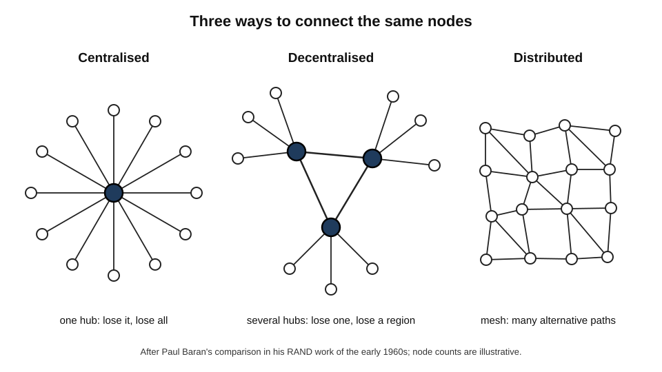
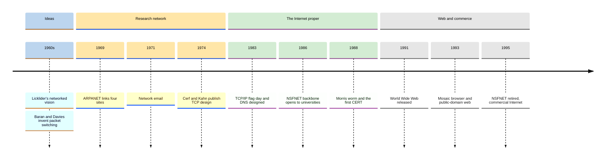
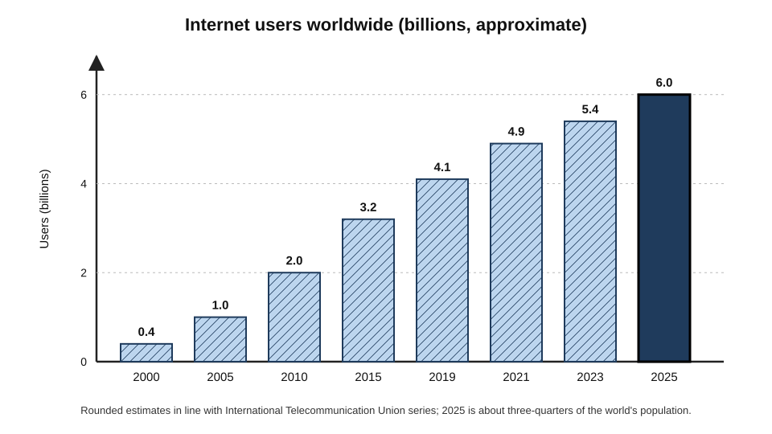
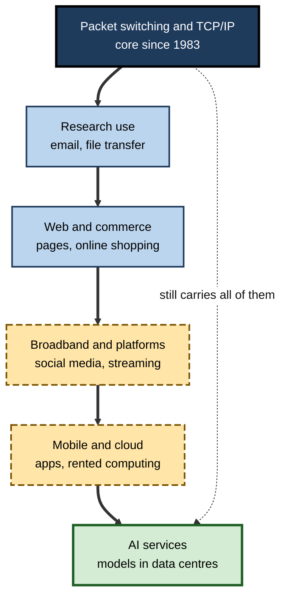

# E.2. History & Evolution of the Internet

On 29 October 1969, a student programmer at the University of California, Los Angeles, tried to log in to a computer at the Stanford Research Institute, some 500 kilometres away. He typed "L", then "O" — and the remote system crashed. The first message ever sent across the network that became the Internet was therefore "LO". Barely half a century later, around six billion people use its descendant every day.

> **Definition — History of the Internet:** the development, from the 1960s onwards, of the ideas, technologies, institutions and business models that turned a small experimental research network into the global, commercial, mobile and cloud-based Internet of today.

**Why the history matters**

- Today's strengths — openness, resilience, rapid innovation — and today's weaknesses — spam, insecurity, concentration of power — were both **built in by early choices**.
- Many current debates (who governs the Internet, whether it will fragment, who should pay for networks) are **old debates in new forms**.
- Professionals who know the history can tell **durable principles** from passing fashions, and recognise when a "new" idea has been tried before.
- The pattern of past transitions — research to commercial, fixed to mobile, owned to rented — helps in judging the ones now under way, such as the shift to AI services.

---

## Before the Internet: The Problem to Be Solved

### Computers as scarce, isolated machines

- **1950s–early 1960s:** computers were large, very expensive and usually owned by universities, governments or big firms.
  - Each machine had its own operating system, its own programs and its own data.
  - Users brought work to the machine, often as punched cards, and waited for results.
- **Time-sharing** (early 1960s) let several users work on one computer at once through terminals — the first taste of interactive, shared computing.
- **The problem:** researchers at one site could not use programs, data or computing power at another without travelling or posting tapes.

> **Definition — Time-sharing:** a way of running a computer so that many users, each at a terminal, share its processing time and appear to have the machine to themselves.

### Visionaries and the idea of a network

- **J. C. R. Licklider** — psychologist and computer scientist.
  - In 1960 wrote about **"man–computer symbiosis"**, picturing people and computers working together interactively.
  - In 1962–63 circulated memos describing an "Intergalactic Computer Network" linking computers and their users everywhere.
  - As first head of the Information Processing Techniques Office at the US **Advanced Research Projects Agency (ARPA)**, he funded the research community that would build it.
- **Three independent inventors of packet switching:**
  - **Paul Baran** (RAND Corporation, early 1960s) — designed a **distributed** communication network in which messages were broken into blocks and routed independently, so that the network would survive the loss of many nodes.
  - **Donald Davies** (National Physical Laboratory, United Kingdom, 1965) — independently arrived at the same idea for efficient data communication and coined the word **"packet"**; his team built a working local packet network at NPL.
  - **Leonard Kleinrock** (MIT, then UCLA) — developed mathematical queueing theory for networks of message-switching nodes in the early 1960s.

> **Watch out:** the question of who "invented" packet switching is still argued. Baran and Davies clearly devised packet-switched designs independently; Kleinrock's early work modelled message switching mathematically, and the significance of his contribution to packet switching specifically is disputed among historians. The safe statement is that **several people reached the idea independently in the early-to-mid 1960s**.

**Figure 1.** Centralised, decentralised and distributed networks, as contrasted by Paul Baran.

- **Centralised** — every node depends on one hub; destroy the hub and everything fails.
- **Decentralised** — several hubs; losing one cuts off its region.
- **Distributed** — a mesh with many alternative paths; the network survives heavy damage.

> **Key point:** the distributed mesh and the idea of breaking messages into independently routed packets are the two intellectual foundations of the Internet.

---

## The ARPANET Era (1969–1983)

### Building the first network

- **1966–67:** ARPA's Bob Taylor, frustrated at needing three separate terminals to reach three computers, secured funding for a network; **Larry Roberts** led its design.
- **1968:** the contract to build the network's packet switches — **Interface Message Processors (IMPs)** — went to the firm Bolt Beranek and Newman (BBN).
  - Each IMP was a ruggedised minicomputer placed beside a host computer, handling all network work so the host did not have to.
- **Late 1969:** the first four nodes were connected:
  - UCLA;
  - Stanford Research Institute (SRI);
  - University of California, Santa Barbara;
  - University of Utah.
- **April 1969:** Steve Crocker wrote the first **Request for Comments (RFC 1)**, starting an open, informal tradition of publishing technical proposals for anyone to comment on — a tradition that still governs Internet standards.

> **Definition — ARPANET:** the experimental packet-switched network funded by ARPA from 1969, the principal ancestor of the Internet.

> **Definition — Request for Comments (RFC):** a numbered document in the series that records Internet technical proposals, standards and best practices; the series began in 1969 and continues today.

### First applications

- **Remote login** (Telnet) and **file transfer** (FTP) — the original purposes: using distant computers and moving data between them.
- **Email (1971)** — Ray Tomlinson at BBN sent messages between machines and chose the **@** sign to separate user from host.
  - Email quickly became the network's most popular use — an early example of users finding a purpose the designers had not planned.
- **Mailing lists and discussion** — communities formed around shared interests, including the network's own design.

> **Example:** a pattern repeated throughout Internet history began here: networks are built for one purpose (sharing computers) and become valuable for another (communication between people).

### Going international and plural

- **1972:** a public demonstration at a computer communications conference in Washington showed dozens of interconnected machines to a sceptical audience.
- **1973:** the first international connections — to NORSAR in Norway and University College London, where Peter Kirstein's group linked British researchers.
- **Other packet networks** appeared:
  - **CYCLADES** in France (Louis Pouzin), which pioneered **datagrams** — independent packets with the end hosts responsible for reliability;
  - **packet radio** and **satellite** networks funded by ARPA;
  - commercial and public data networks in Europe and North America.
- **The new problem:** each network had its own rules; they could not talk to each other.

---

## TCP/IP: Inventing the Inter-Network

### The Cerf–Kahn design

**Study card — Vinton Cerf and Robert Kahn (1974)**

- **Context:** ARPA wanted its packet-radio, satellite and ARPANET networks — with different speeds, packet sizes and reliability — to work together.
- **Paper:** "A Protocol for Packet Network Intercommunication", published in May 1974.
- **Key ideas:**
  - **gateways** (later called routers) connect different networks, forwarding packets between them without needing to understand their contents;
  - a **common addressing scheme** spans all networks;
  - **hosts, not the networks, handle reliability** — retransmitting lost data and putting it back in order;
  - each network can stay as it is internally — **no changes needed** to join.
- **Conclusion:** a network of networks is possible if every participant agrees on one simple shared protocol at the boundary.

**Figure 2.** The Cerf–Kahn idea: gateways join unlike networks, and the end hosts handle reliability.

```mermaid
%%{init: {'theme':'base','themeVariables':{'fontFamily':'Arial, Helvetica, sans-serif','fontSize':'15px','primaryColor':'#FFFFFF','primaryTextColor':'#111111','primaryBorderColor':'#222222','lineColor':'#333333','secondaryColor':'#F2F2F2','tertiaryColor':'#FFFFFF','clusterBkg':'#FAFAFA','clusterBorder':'#555555','edgeLabelBackground':'#FFFFFF','titleColor':'#111111'}}}%%
flowchart LR
    classDef core    fill:#1F3B5C,stroke:#000000,stroke-width:3px,color:#FFFFFF
    classDef key     fill:#BCD5EE,stroke:#1F3B5C,stroke-width:2px,color:#000000
    classDef accent  fill:#FFE6A8,stroke:#7A5200,stroke-width:2px,stroke-dasharray:8 4,color:#000000
    classDef good    fill:#D3ECD3,stroke:#1E5E24,stroke-width:3px,color:#000000

    H1["Host A<br/>checks, orders,<br/>retransmits"]
    N1["Packet radio<br/>network"]
    G1["Gateway"]
    N2["ARPANET"]
    G2["Gateway"]
    N3["Satellite<br/>network"]
    H2["Host B<br/>checks, orders,<br/>retransmits"]

    H1 ==> N1 ==> G1 ==> N2 ==> G2 ==> N3 ==> H2
    H1 -. "end-to-end reliability" .-> H2

    class H1,H2 good
    class N1,N2,N3 key
    class G1,G2 core
```

- **1978:** the single protocol was split into two:
  - **IP** — addressing and forwarding packets between networks (the "narrow waist");
  - **TCP** — reliable, ordered delivery between the end hosts.
  - The split allowed applications that prefer speed to reliability, such as voice, to use a lighter alternative (UDP).
- **1 January 1983 — "flag day":** the ARPANET switched from its original protocol (NCP) to TCP/IP. This date is often taken as the **birth of the Internet** in the modern sense.

> **Definition — TCP/IP:** the family of protocols on which the Internet runs, named after its two best-known members, the Transmission Control Protocol and the Internet Protocol.

> **Key point:** the Internet was not designed as one big network. It was designed as a way for **existing, different networks to cooperate** — which is why it could absorb every later technology, from Ethernet to 5G.

### Names, not numbers: DNS

- Early hosts were found using a single list of names and addresses, the **HOSTS.TXT** file, maintained centrally and copied to every machine.
- As the number of hosts grew, the list became impossible to keep current.
- **1983:** Paul Mockapetris designed the **Domain Name System** — a distributed, hierarchical directory.
- **1985:** the first commercial ".com" name was registered.

> **Watch out:** many people date the Internet from the web (1991) or from popular use (mid-1990s). The network — and email, file transfer and naming — was well established **before** the web existed.

---

## From Research Tool to Public Utility (1983–1995)

### Academic expansion

- **CSNET (1981)** extended connectivity to computer-science departments without ARPA contracts.
- **1985–86: NSFNET** — the US National Science Foundation built a national backbone linking supercomputer centres and regional networks, open to universities generally.
  - Upgraded repeatedly as traffic grew faster than predicted.
- **National research networks** spread elsewhere — *e.g.* JANET in the United Kingdom (1984) and comparable networks across Europe, Asia and Australia.
- **1990:** the original ARPANET was decommissioned; the Internet no longer needed it.

### The protocol wars

- **The rival:** in the 1980s many governments and large telecommunications companies backed the **Open Systems Interconnection (OSI)** standards, developed through formal international bodies.
- **The contest:**
  - OSI — comprehensive, carefully specified, designed by committee, slow to arrive in working products.
  - TCP/IP — simpler, already running, free to implement, improved by "rough consensus and running code".
- **The outcome (early 1990s):** TCP/IP won in practice; OSI survived mainly as a teaching model of layers.

| | OSI programme | TCP/IP |
|---|---|---|
| Developed by | Formal international standards bodies and national telecoms | Researchers, ARPA contractors, later the open IETF |
| Approach | Specify fully first, then build | Build, test, refine |
| Availability | Specifications ahead of products | Free implementations already in use |
| Government backing | Strong in Europe and among telecom operators | US research funding; adoption by universities |
| Legacy | The seven-layer reference model used in teaching | The actual protocols of the Internet |

> **Definition — Rough consensus and running code:** the working philosophy of Internet standards-making, attributed to David Clark (1992), that decisions should rest on broad agreement among engineers and on demonstrated working implementations, not on votes or authority.

> **Watch out:** "TCP/IP won because it was technically better" oversimplifies. It was good enough, **already deployed and free**, backed by a growing community, and bundled with popular operating systems. Timing and openness mattered as much as design.

### The first great security shock

**Study card — The Morris worm (November 1988)**

- **What happened:** a graduate student, Robert Tappan Morris, released a self-replicating program that exploited weaknesses in common Unix software and weak passwords.
- **Intended effect:** reportedly to gauge the size of the network.
- **Actual effect:** a flaw made it re-infect machines repeatedly, overloading them; a substantial fraction of the computers then on the Internet were slowed or disabled.
- **Responses:**
  - the creation of the first **Computer Emergency Response Team (CERT)** at Carnegie Mellon University;
  - the first conviction under the US Computer Fraud and Abuse Act;
  - lasting recognition that an open network of trusted peers was vulnerable.
- **Lesson:** a network designed for a community of colleagues was now large enough to contain careless or hostile actors.

---

## The World Wide Web and the Commercial Internet (1989–2000)

### The web is invented

- **March 1989:** Tim Berners-Lee, a British scientist at CERN, proposed an information-management system using **hypertext** — documents linked to other documents.
- **1990–91:** he wrote the first web server, web browser and the three founding standards:
  - **HTML** — the language of web pages;
  - **URL** — the address of a resource;
  - **HTTP** — the protocol for fetching it.
- **August 1991:** the web was made available to the wider Internet community.
- **April 1993:** CERN released the web technology into the **public domain**, free for anyone to use — a decision of enormous consequence.
- **1993: Mosaic**, a graphical browser from the National Centre for Supercomputing Applications (NCSA) at the University of Illinois, made the web easy and attractive; **Netscape** followed in 1994.
- **1994:** Berners-Lee founded the **World Wide Web Consortium (W3C)** to develop web standards.

> **Key point:** the web did not create the Internet; it gave the Internet a **simple, universal interface** that non-specialists could use. Its royalty-free release, like TCP/IP's, was decisive.

### Commercialisation

- **Acceptable-use rules** had kept NSFNET for research and education; commercial traffic was restricted.
- **Early 1990s:** commercial ISPs appeared, selling access to businesses and the public.
- **April 1995:** NSFNET was retired; the US backbone passed to commercial carriers interconnecting at exchange points.
- **Walled gardens vs the open Internet:**
  - online services such as CompuServe and AOL had offered closed, curated networks with their own content;
  - France's state-backed **Minitel** (1980s) gave millions of homes terminals for directories, booking and messaging — a successful but closed national system;
  - the open Internet, where anyone could publish and anyone could connect, eventually absorbed or replaced them.
- **Around the world:** public Internet access spread rapidly — *e.g.* India's state-owned VSNL launched public access in August 1995.

### Boom and bust

- **1995–2000: the dot-com boom** — huge investment in Internet companies, many without profits; the founding of firms such as Amazon (1994) and Google (1998).
- **2000–2002: the crash** — many firms failed; telecom carriers that had laid vast fibre networks went bankrupt.
- **The unexpected legacy:** the overbuilt fibre became cheap capacity that later carried broadband, video and cloud traffic.

> **Example:** the crash is a reminder that a technology can be transformative **and** over-hyped at the same time. Investors were wrong about which firms and how fast; they were right that the Internet would reshape commerce.

**Figure 3.** Key milestones from the ARPANET to the commercial web.

---

## Broadband, Platforms and Mobility (2000–2015)

### Always-on broadband

- **Dial-up** (through a telephone modem) gave way to **always-on broadband**: DSL over telephone lines, cable modems, later fibre.
- **Wi-Fi** (consumer products from 1999) made the home and office network wireless.
- **Consequences:**
  - continuous connection replaced deliberate "going online";
  - richer media — music, then video streaming — became practical;
  - home working and online services became normal for professionals.

### Web 2.0 and the platform economy

- **"Web 2.0"** (a term popularised by Tim O'Reilly around 2004) described a shift from static pages to **participation**:
  - user-generated content — blogs, wikis, video sharing;
  - social networks;
  - web applications that behaved like desktop software.
- **Platforms** grew to enormous scale by exploiting **network effects** — each new user made the service more valuable to others.
- **The search engine** became the main gateway to information online; a few firms came to dominate search, social media and online advertising.

> **Definition — Network effect:** a situation in which a product or service becomes more valuable to each user as more people use it.

| | Early web (1990s) | Participatory web (2000s) | Platform and mobile era (2010s) |
|---|---|---|---|
| Typical user activity | Reading pages | Writing, sharing, commenting | Scrolling feeds, using apps |
| Who publishes | Organisations and enthusiasts | Everyone | Everyone, inside a few platforms |
| Main device | Desktop computer | Laptop | Smartphone |
| Business model | Sales, early advertising | Advertising, subscriptions | Targeted advertising, app stores, data |
| Architecture | Many independent sites | Web applications | Centralised platforms on cloud infrastructure |

> **Watch out:** labels such as "Web 1.0", "Web 2.0" and "Web3" are **marketing and journalistic shorthand**, not technical standards. They describe tendencies, and the boundaries between them are blurred.

### The mobile Internet

- **Mobile data** grew through successive generations of cellular technology (3G in the 2000s, 4G from around 2009–10).
- **2007–2008:** the iPhone and then Android phones brought a full web browser and app stores to the pocket.
- **Mobile-first and mobile-only use:** in many countries — especially in Asia and Africa — most people's first and main Internet access was through a phone, not a computer.

> **Example:** in India, very low-cost mobile data from the mid-2010s brought hundreds of millions of people online in a few years, many of whom had never used a desktop computer.

### Cloud computing

- **2006:** Amazon Web Services launched rentable storage and computing, followed by other providers.
- **The shift:** organisations began to **rent** computing over the Internet instead of owning servers.
- **Consequences:**
  - start-ups could launch global services cheaply;
  - large firms moved email, office tools and business systems to "software as a service";
  - a handful of hyperscale providers came to operate much of the world's computing and some of its largest private networks.

### Addresses running out, and other strains

- **IPv4 exhaustion:** the original Internet address space of about 4.3 billion addresses was too small for a world of phones and sensors.
  - The central free pool of IPv4 addresses was exhausted in **February 2011**.
  - **World IPv6 Launch (June 2012):** major firms permanently enabled the newer, vastly larger IPv6 addressing.
- **Surveillance revelations (2013):** disclosures by Edward Snowden about mass interception by intelligence agencies prompted a large push towards **encrypting** web and messaging traffic by default.
- **Free certificates (from 2015–16):** a non-profit certificate authority made encrypted websites cheap and automatic; encrypted web traffic soon became the norm rather than the exception.

**Figure 4.** Approximate number of Internet users worldwide, 2000–2025.

---

## The Contemporary Internet (2015–Present)

### Governance in transition

- **1998:** the **Internet Corporation for Assigned Names and Numbers (ICANN)** was created to coordinate names and numbers, under contract to the US government.
- **1 October 2016:** the **IANA stewardship transition** ended the US government's contractual oversight of these functions, passing it to a global multistakeholder community.
- **December 2025:** the United Nations' twenty-year review of the World Summit on the Information Society made the **Internet Governance Forum** a permanent UN body.

### A more concentrated, more contested network

- **Concentration:** a small number of companies now carry a large share of traffic, host much of the web and own a growing share of submarine cables.
- **Content delivery networks** place copies of popular content near users, so that much traffic never crosses long distances.
- **National controls:** some states filter the web, require data to stay inside borders or order regional shutdowns; talk of a "splinternet" has grown.
- **Pandemic stress test (2020):** traffic rose sharply as work, school and social life moved online; the network largely coped, showing the benefits of decades of over-provisioning and distributed design.

### The AI turn

- **Late 2022 onwards:** public generative-AI chat services reached very large audiences very fast.
- **What changed for the Internet:**
  - large models were trained on text and images gathered at vast scale from the public web;
  - automated **crawlers** collecting data for AI grew into a significant share of web requests;
  - AI services became heavy users of cloud data centres and long-distance links;
  - publishers and website owners began debating whether and how to allow AI crawling of their content.
- **Satellite constellations:** from 2019, low-Earth-orbit satellite networks began offering broadband in remote areas, with more than ten million subscribers on the largest such network by 2026.

> **Key point:** each era has added a new layer **on top of** the old one rather than replacing it. The packet-switched, TCP/IP core of 1983 still carries web pages, video, cloud services and AI requests.

**Figure 5.** How each era added a new layer of use to the same core.

---

## Patterns Across the History

### Recurring themes

- **Open beats closed — usually, and for a while.**
  - TCP/IP over OSI; the open web over walled gardens.
  - Yet openness at the lower layers coexists with powerful closed platforms at the top.
- **Users repurpose the network.**
  - Built for sharing computers → used for email; built for documents → used for shopping, video and social life.
- **Capacity races demand.**
  - Each upgrade (NSFNET's backbone, broadband, fibre, 5G) has been filled by new uses.
- **Security lags adoption.**
  - From the Morris worm to modern ransomware, protection has been added after damage.
- **Public money, private scale.**
  - Government research funding created the foundations; private investment built the mass network.
- **Each era rests on the one before.**
  - Mobile apps depend on the web's standards; AI services depend on cloud and broadband.

> **Mnemonic — "OUCSPE" ("Old Users Catch Slow Phones Eventually"):** Open beats closed, Users repurpose, Capacity races demand, Security lags, Public money–private scale, Eras build on eras.

### Credit and chronology

- **"Al Gore claimed to have invented the Internet."** — He said he "took the initiative in creating" it, referring to his legislative support for networking funding in the US Congress; leading Internet pioneers credited his support. The quip is a distortion.
- **"The Internet and the web are the same age."** — The Internet (1983, building on ARPANET from 1969) is older than the web (1991) by roughly a decade or more.
- **"One person invented the Internet."** — It was built by many contributors across several countries, through open collaboration.

> **Watch out:** "the Internet was invented by the US military" is partly true and partly misleading. Funding came from a defence research agency, but the work was done largely by university and contractor researchers, and key ideas came from Britain, France and elsewhere.

---

## Case Study: How a Bank Lived Through Four Internet Eras

- **Situation:** a mid-sized retail bank, founded long before the Internet, serving millions of customers.
- **Era 1 — private networks (1980s):**
  - branches linked by leased lines and private data networks;
  - cash machines connected over dedicated circuits; nothing on the public Internet.
- **Era 2 — the first website (late 1990s):**
  - a static "brochure" site; online banking introduced cautiously, for a minority of customers;
  - security concerns dominated board discussions.
- **Era 3 — broadband and mobile (2005–2015):**
  - online and then mobile banking became the main channel; branch visits fell;
  - the bank's systems had to handle peaks at times when customers, not staff, were active — evenings and weekends.
- **Era 4 — cloud and AI (2015 onwards):**
  - customer-facing apps and analytics moved partly to cloud providers;
  - AI tools used for fraud detection, customer queries and document processing;
  - regulators required plans for **outages at critical third-party providers**.
- **Problems encountered:**
  - legacy core systems, designed for branch hours, struggled with always-on demand;
  - each era added new attack surfaces — phishing, account takeover, supply-chain risks;
  - concentration on a few cloud providers created new single points of failure.
- **Actions that worked:**
  1. treating the Internet channel as the **primary** channel, not an add-on;
  2. designing for continuous availability and graceful failure;
  3. building security and identity checks into every new channel from the start;
  4. keeping exit and fallback plans for each major provider.
- **Lesson:** organisations do not "go online" once. They pass through a succession of Internet eras, each requiring different capabilities — and each inheriting the weaknesses of the last.

---

## Interpreting the History Professionally

### Reading a new technology through the past

| Question | Historical precedent | What it suggests today |
|---|---|---|
| Will an open or closed model win? | Open Internet over Minitel and walled gardens; but closed platforms dominated later | Openness at the infrastructure level does not guarantee openness at the service level |
| Is the hype justified? | Dot-com boom and crash | Transformative change and over-investment can happen together |
| Who will build the infrastructure? | Public research funding, then private carriers | Public and private roles shift with each era |
| Will security keep up? | Morris worm, spam, ransomware | Expect harms to arrive before defences |
| Will the old core be replaced? | TCP/IP has survived every new layer | Durable foundations change slowly; services on top change fast |

### Worked example: assessing a "revolutionary" network claim

Situation: a vendor tells a logistics firm that a new proprietary network will "replace the Internet" for its supply chain.

1. **Ask what problem it solves** — the Internet's best-effort service? Its security? Its cost?
2. **Recall precedents** — closed networks (private data networks, Minitel, walled gardens) offered control but were eventually overtaken by the open Internet's reach.
3. **Check interoperability** — can partners, customers and cloud services reach it without special equipment?
4. **Look for lock-in** — if the vendor fails or raises prices, can the firm leave?
5. **Prefer layering over replacement** — most successful innovations run *over* the Internet (encrypted overlays, private links into cloud providers) rather than replacing it.
- **Conclusion:** adopt the technology only if it **complements** Internet connectivity and preserves the ability to interoperate.

> **Watch out:** "this will replace the Internet" has been claimed for many technologies. The Internet's strength has been absorbing new technologies as layers, not being replaced by them.

---

## Open Questions

- **Will the Internet stay unified?**
  - National controls, data-localisation laws and rival technology ecosystems may fragment it; whether this becomes a true split is unknown.
- **How will historians judge the platform era?**
  - Whether the concentration of the 2010s was a passing phase or a permanent feature is debated.
- **What is the long-term effect of AI on the open web?**
  - If people ask AI assistants instead of visiting websites, the economics of publishing on the web may change profoundly.
- **Whose story is it?**
  - Accounts long centred on a few US institutions; historians increasingly study contributions and experiences from Europe, Asia, Africa and Latin America.
- **Could the Internet's founding principles survive a redesign?**
  - Proposals for "clean-slate" architectures recur; none has displaced TCP/IP, and it is unclear whether one ever could.

---

## Summary

- The Internet grew from **1960s ideas**: Licklider's vision of networked computing and the independent invention of **packet switching** by Baran, Davies and others.
- **ARPANET (1969)** linked four US sites; the **RFC** series (from 1969) began open standards-making; **email (1971)** became its most popular use.
- **Cerf and Kahn (1974)** designed **TCP/IP** to link different networks through gateways; the **flag day of 1 January 1983** marks the modern Internet's birth; **DNS** (1983) replaced a central host list.
- **NSFNET** (1986) opened the network to universities; TCP/IP beat **OSI** through availability and openness; the **Morris worm (1988)** exposed its insecurity.
- Tim Berners-Lee's **World Wide Web** (1989–91), released royalty-free in 1993 and popularised by **Mosaic**, gave the Internet a universal interface; **NSFNET's retirement in 1995** completed commercialisation.
- The **dot-com boom and bust** left cheap fibre; **broadband**, **Wi-Fi**, **Web 2.0**, **smartphones** and **cloud computing** reshaped use in 2000–2015.
- **IPv4 exhaustion (2011)**, the **IPv6 launch (2012)**, the push to **encryption** after 2013, the **IANA transition (2016)** and the IGF's **permanent status (2025)** marked infrastructure and governance changes.
- The current era features **concentration**, **national controls**, **satellite broadband** and **AI services**, all running on the same TCP/IP core.
- Recurring patterns: open beats closed (at the lower layers), users repurpose networks, capacity races demand, security lags adoption, and each era builds on the last.

---

## Self-Check

1. What problem were early network builders trying to solve in the 1960s?
2. Name three people associated with the invention of packet switching and explain why "who invented it" is disputed.
3. Contrast centralised, decentralised and distributed networks.
4. What happened on 29 October 1969, and which four sites formed the first ARPANET?
5. What is an RFC, and why does the tradition matter?
6. Summarise the key ideas of Cerf and Kahn's 1974 design.
7. Why is 1 January 1983 often taken as the Internet's birth date?
8. Why did TCP/IP prevail over OSI?
9. What did the Morris worm reveal, and what institution did it prompt?
10. Explain why the web and the Internet are not the same age, and why CERN's 1993 decision mattered.
11. Describe two changes brought by Web 2.0 and two by the mobile Internet.
12. What were IPv4 exhaustion and World IPv6 Launch?
13. What changed in Internet governance in 2016 and in 2025?
14. Identify three recurring patterns in Internet history and apply one to the rise of AI services.
15. A board member says a new private network will "replace the Internet" for the company's customers. Using historical precedents, how should the firm evaluate the claim?

### Answer Key

1. Computers were expensive and isolated; researchers could not share programs, data or computing power across sites without moving physical media. Networks would let scarce resources be shared.
2. Paul Baran (RAND), Donald Davies (NPL, who coined "packet") and Leonard Kleinrock (queueing theory). Baran and Davies devised packet designs independently; the weight of Kleinrock's early contribution to packet switching specifically is contested by historians.
3. Centralised: all nodes depend on one hub. Decentralised: several hubs, each serving a region. Distributed: a mesh with many alternative paths, surviving heavy damage.
4. UCLA sent the first message ("LO", before the system crashed) to SRI. The first four nodes were UCLA, SRI, UC Santa Barbara and the University of Utah.
5. A Request for Comments is a numbered public document recording technical proposals and standards, begun in 1969. It established open, peer-reviewed, informal standards-making that remains central today.
6. Gateways connect different networks; a common addressing scheme spans them; end hosts handle reliability; networks need no internal changes to join.
7. On that date the ARPANET switched from NCP to TCP/IP, making it part of a TCP/IP inter-network — the Internet in its modern technical sense.
8. TCP/IP was already working, free to implement, bundled with popular systems and refined by running code; OSI was comprehensive but slow to produce products. Timing and openness mattered as much as design.
9. It showed that an open network of trusted peers was vulnerable to self-replicating code exploiting software flaws and weak passwords; it led to the first CERT at Carnegie Mellon.
10. The Internet dates from 1983 (ARPANET from 1969); the web was released in 1991. CERN placing the web in the public domain in 1993 meant anyone could build browsers and servers royalty-free, enabling rapid adoption.
11. Web 2.0: user-generated content; social networks and web applications. Mobile: smartphones with browsers and app stores; mobile-first access for billions in countries where computers were rare.
12. The central free pool of IPv4 addresses ran out in February 2011; on World IPv6 Launch (June 2012) major companies permanently enabled IPv6, the far larger address system.
13. In 2016 the US government's contractual oversight of the IANA functions ended, passing stewardship to the global multistakeholder community. In 2025 the UN made the Internet Governance Forum permanent.
14. E.g. users repurpose networks; capacity races demand; security lags adoption. Applied to AI: AI services are filling data-centre and network capacity, and new harms (AI-driven fraud, large-scale scraping) are arriving before agreed defences.
15. Ask what problem it solves, recall that closed networks (Minitel, walled gardens) lost to the open Internet's reach, check interoperability with customers and partners, assess lock-in, and prefer technologies that layer over the Internet rather than replacing it.

---

## Glossary

| Term | Meaning |
|---|---|
| ARPA | The US Advanced Research Projects Agency, which funded the ARPANET. |
| ARPANET | The experimental packet-switched network begun in 1969, ancestor of the Internet. |
| CERT | Computer Emergency Response Team; a body coordinating responses to security incidents. |
| Cloud computing | Renting computing, storage and software over the Internet instead of owning it. |
| Datagram | An independent, self-contained packet; reliability is left to the end hosts. |
| Distributed network | A mesh network with many alternative paths between nodes. |
| Dot-com boom | The speculative investment surge in Internet companies of roughly 1995–2000. |
| Flag day | 1 January 1983, when ARPANET switched to TCP/IP. |
| HTML | Hypertext Markup Language, the language of web pages. |
| HTTP | Hypertext Transfer Protocol, used to fetch web resources. |
| Hypertext | Text containing links to other texts. |
| IANA stewardship transition | The 2016 end of US government oversight of key Internet coordination functions. |
| IMP | Interface Message Processor; the packet switch of the original ARPANET. |
| Minitel | France's closed national videotex service of the 1980s and 1990s. |
| Network effect | Increase in a service's value to each user as more people use it. |
| NSFNET | The US National Science Foundation's backbone network, 1986–1995. |
| OSI | Open Systems Interconnection; a rival standards programme, now mainly a teaching model. |
| Packet switching | Breaking data into independently routed packets that share links. |
| RFC | Request for Comments; the numbered series of Internet technical documents. |
| Rough consensus and running code | The Internet community's preference for broad agreement and working implementations. |
| TCP/IP | The protocol suite on which the Internet runs. |
| Time-sharing | Many users sharing one computer interactively through terminals. |
| Walled garden | A closed online service that controls content and access. |
| Web 2.0 | Shorthand for the participatory, application-like web of the 2000s. |
| World Wide Web | The hypertext system of linked resources invented by Tim Berners-Lee. |
