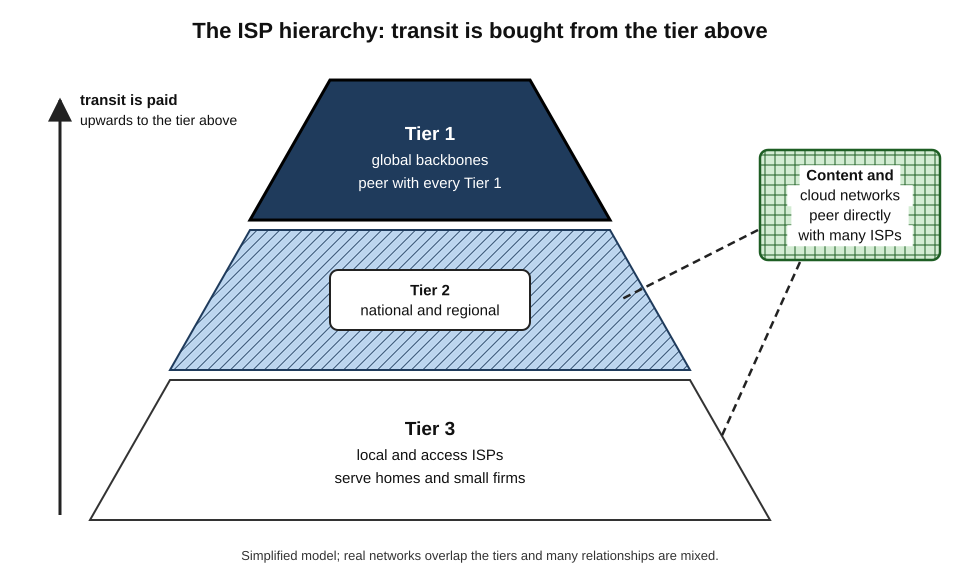
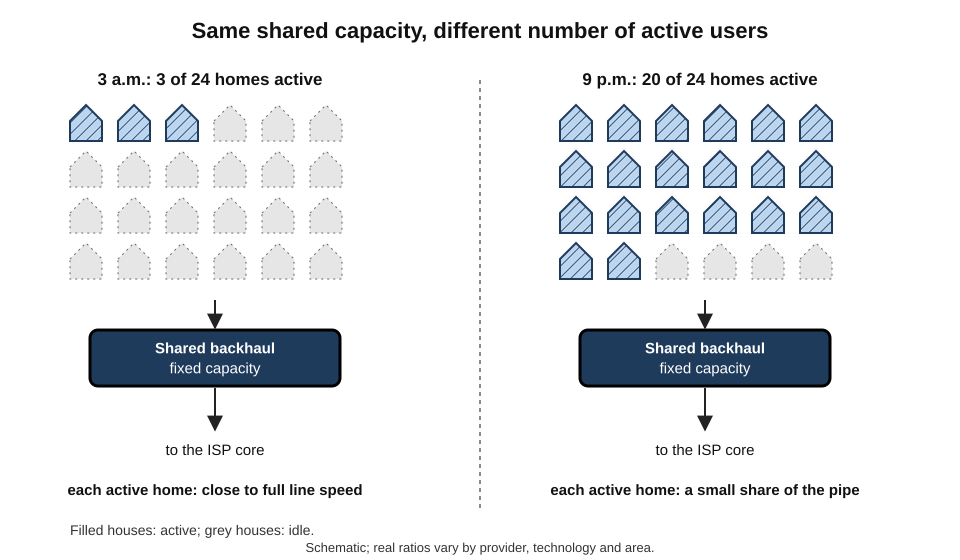
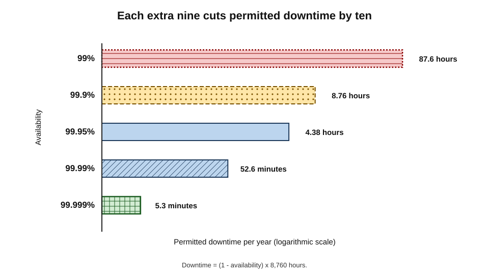
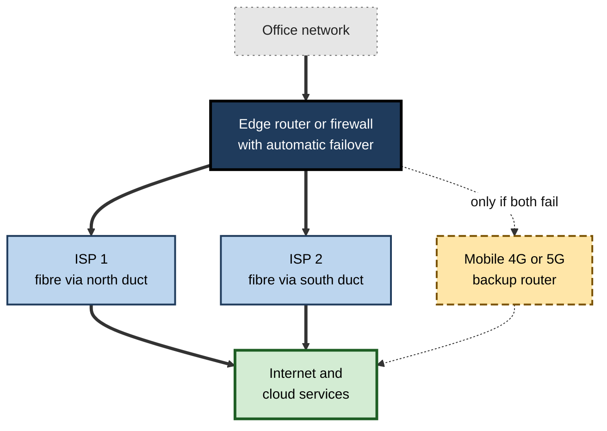

# B.4. Internet Service Providers (ISPs)

A family signs up for "full-fibre broadband" and receives a router in the post. A start-up in Bengaluru pays a mobile operator for a data plan on every employee's phone. A hospital trust buys two dedicated fibre lines from different companies, with penalty clauses if either fails. In each case someone has bought the same essential thing: a connection to the rest of the Internet from an **Internet service provider**.

> **Definition — Internet service provider (ISP):** an organisation that provides customers with access to the Internet, and often related services, by connecting their devices or networks to its own network, which is in turn interconnected with the rest of the Internet.

**Why ISPs matter**

- They own or control the **last link** between almost every user and the Internet, so their choices shape speed, price, reliability and privacy.
- They are the point where **law meets the network**: blocking orders, data retention and lawful interception are usually implemented by ISPs.
- For organisations, the choice and design of ISP connections is a **business-continuity decision**, not merely a purchasing one.
- Their commercial relationships with each other and with content companies decide how traffic actually flows across the Internet.

---

## What an ISP Actually Provides

### The core service

- **Physical access** — a line or radio link to the customer's premises or device: fibre, copper, cable, mobile, fixed wireless or satellite.
- **An IP address** — so the customer's devices can send and receive packets on the Internet.
- **Routing and onward connectivity** — carrying traffic from the customer to the rest of the Internet, through the ISP's own network and its interconnections.
- **Name resolution** — a DNS resolver, used by default unless the customer chooses another.
- **Customer equipment** — often a router that combines a modem, Wi-Fi access point and firewall.

### Additional services

- **Email accounts and web hosting** — once standard, now less common for home users.
- **Security filtering** — optional blocking of malicious sites; parental controls.
- **Static IP addresses** — fixed addresses for businesses running their own servers.
- **Bundles** — television, landline telephony, mobile plans.
- **Business services** — service-level agreements, dedicated lines, managed networks, private links into cloud providers.

> **Key point:** the ISP's essential job is narrow — **get the customer's packets to and from the rest of the Internet**. Everything else is optional and can often be obtained elsewhere.

---

## Kinds of ISP

### By the customers they serve

- **Residential (consumer) ISPs** — broadband for households; mass-market pricing and support.
- **Mobile network operators (MNOs)** — own spectrum and radio networks; sell data plans to phones and mobile broadband devices.
- **Mobile virtual network operators (MVNOs)** — resell capacity on another operator's network under their own brand.
- **Business ISPs** — connectivity with guaranteed performance, faster repair and dedicated support.
- **Wholesale and transit providers** — sell connectivity to other ISPs, content companies and large enterprises.
- **Satellite ISPs** — serve remote areas, ships and aircraft; low-Earth-orbit constellations have expanded this market sharply.
- **Community and municipal networks** — run by local cooperatives, councils or non-profits, often where commercial providers did not invest.

> **Definition — Mobile virtual network operator (MVNO):** a mobile provider that sells services to customers using another operator's radio network rather than its own.

### By position in the Internet's hierarchy

- **Tier 1** — global networks that can reach every part of the Internet **without paying anyone for transit**, because they peer with all other Tier 1 networks.
- **Tier 2** — large regional or national networks that peer widely but still buy some transit.
- **Tier 3** — access networks that mostly buy transit from others to reach the wider Internet.

**Figure 1.** The ISP hierarchy and the direction of transit payments.

| | Tier 1 | Tier 2 | Tier 3 |
|---|---|---|---|
| Typical size | Global backbone | National or regional | Local or access-focused |
| Buys transit? | No | Some | Mostly |
| Sells transit? | Yes, to many | Yes, to smaller networks | Rarely |
| Main customers | Other networks, large enterprises | Smaller ISPs, businesses | Homes and small firms |
| Peering | With every other Tier 1 | Extensive, often at exchange points | Limited, sometimes at local exchanges |

> **Watch out:** the tier model is a useful simplification, not an official classification. Large content and cloud networks — which may peer directly with thousands of ISPs — fit poorly into it, and today they carry a large share of all traffic without being "Tier 1" in the classic sense.

---

## The ISP Value Chain

### From the customer to the world

- **Customer premises** — the router or modem in the home or office.
- **Last mile (access network)** — the line or radio link to the nearest point of the ISP's network: a street cabinet, telephone exchange or mobile mast.
- **Aggregation** — combining traffic from thousands of customers.
- **Backhaul** — carrying aggregated traffic from local sites to the ISP's core.
- **Core network** — the ISP's high-capacity backbone between major cities.
- **Interconnection** — handing traffic to other networks through transit and peering, often at exchange points and data centres.

> **Definition — Last mile:** the final segment of a network connecting a provider's infrastructure to the customer's premises; usually the most expensive part to build and the most common bottleneck.

> **Definition — Backhaul:** the links that carry traffic from local access sites back to an operator's core network.

**Figure 2.** The stages between a customer's router and the wider Internet.

```mermaid
%%{init: {'theme':'base','themeVariables':{'fontFamily':'Arial, Helvetica, sans-serif','fontSize':'15px','primaryColor':'#FFFFFF','primaryTextColor':'#111111','primaryBorderColor':'#222222','lineColor':'#333333','secondaryColor':'#F2F2F2','tertiaryColor':'#FFFFFF','clusterBkg':'#FAFAFA','clusterBorder':'#555555','edgeLabelBackground':'#FFFFFF','titleColor':'#111111'}}}%%
flowchart LR
    classDef core    fill:#1F3B5C,stroke:#000000,stroke-width:3px,color:#FFFFFF
    classDef key     fill:#BCD5EE,stroke:#1F3B5C,stroke-width:2px,color:#000000
    classDef detail  fill:#FFFFFF,stroke:#333333,stroke-width:1.5px,color:#000000
    classDef good    fill:#D3ECD3,stroke:#1E5E24,stroke-width:3px,color:#000000
    classDef caution fill:#F6CACA,stroke:#8B0000,stroke-width:2.5px,stroke-dasharray:3 3,color:#000000

    C["Customer<br/>router"]
    L["Last mile<br/>fibre, copper,<br/>cable or radio"]
    A["Aggregation<br/>cabinet, exchange<br/>or mast"]
    B["Backhaul"]
    K["ISP core<br/>network"]
    I["Interconnection<br/>transit and peering"]
    W["Rest of the<br/>Internet"]

    C ==> L ==> A ==> B ==> K ==> I ==> W

    class C detail
    class L caution
    class A,B key
    class K core
    class I,W good
```

### Who builds the last mile?

- **Vertically integrated** — the same company owns the lines and sells the service.
- **Open access / wholesale** — one company (sometimes regulated or publicly owned) builds the lines; many retail ISPs rent them and compete on service.
  - *e.g.* in the United Kingdom, most broadband providers sell services over lines run by a separately managed wholesale operator; several countries have built national wholesale fibre networks.
- **Local loop unbundling** — regulators require the incumbent telephone company to rent its lines to competitors.

| | Vertically integrated model | Open-access wholesale model |
|---|---|---|
| Who owns the line | The retail ISP | A wholesale network operator |
| Competition | Between rival networks (where they exist) | Between retailers on the same network |
| Customer choice | Often limited to one or two providers per area | Often many providers per area |
| Incentive to invest | Strong where the owner keeps the customer | Depends on wholesale pricing and regulation |
| Typical risk | Local monopoly | Weak investment if wholesale returns are low |

> **Key point:** the price and quality of Internet access in a country depend more on **who owns the last mile and how it is regulated** than on technology alone.

---

## How ISPs Make Money — and Why It Shapes the Service

### Sharing capacity: contention and oversubscription

- An ISP does not reserve the full advertised speed for every customer all the time.
- Because users are rarely all busy at once, it sells more total capacity than it has — **oversubscription**.
- **The contention ratio** expresses how many customers share a given amount of capacity.
- **The evening peak** — when most households stream video — is when this sharing becomes visible.

> **Definition — Contention ratio:** the number of customers sharing the same unit of upstream capacity; for example, 20:1 means twenty customers share capacity equal to one customer's full speed.

**Figure 3.** Why speeds fall at peak times: many customers sharing the same upstream capacity.

> **Formula — Average share at peak:** shared capacity ÷ number of simultaneously active users. Example: 10 gigabits per second of backhaul shared by 400 active households = 10,000 ÷ 400 = **25 megabits per second each**, even if each was sold "500 megabits".

> **Watch out:** oversubscription is not a scam. It is how every shared network — roads, telephones, electricity — is built economically. Problems arise only when ISPs **under-provision** so heavily that peak-time speeds fall far below what customers can reasonably expect.

### Other features of the business model

- **Tiered plans** — higher price for higher speed, even when the line could deliver more.
- **Data caps and fair-use policies** — common on mobile and satellite services, rarer on fixed broadband in many countries.
- **Bundling** — combining broadband with television, phone or mobile services to reduce customer switching.
- **Long contracts and introductory prices** — low first-year prices that rise afterwards.
- **Business premiums** — much higher prices for guaranteed service, fast repair and static addresses.

> **In practice:** consumer protection regulators in many countries now require ISPs to state **realistic minimum or typical peak-time speeds**, not only "up to" headline figures.

---

## What an ISP Can See and Must Do

### Visibility

- **An ISP can see:**
  - which IP addresses its customer connects to, when and how much data flows;
  - in many cases, the **domain names** requested (through DNS lookups and other connection metadata);
  - the full content of any **unencrypted** traffic.
- **An ISP cannot normally see:**
  - the content of **encrypted** connections, such as secure web pages, most messaging apps and banking sessions;
  - the specific page or search terms within an encrypted website.

> **Watch out:** "HTTPS means my ISP knows nothing" is false. Encryption hides the **content**, but connection metadata — which services are used, when and how much — often remains visible. Encrypted DNS and other newer techniques reduce, but do not eliminate, this visibility.

### Legal obligations

- **Lawful interception** — providing access to specified communications when authorised by law.
- **Data retention** — in some countries, keeping records of customers' connections for a set period.
- **Blocking orders** — courts or regulators may order ISPs to block particular websites (*e.g.* for copyright infringement, illegal gambling or child-abuse material).
- **Shutdown orders** — in some countries, governments order ISPs to cut or throttle service in a region, sometimes during protests or examinations.
- **Consumer protection** — rules on contracts, switching, transparency and complaints.
- **Emergency services and security** — duties to maintain resilience and report serious incidents.

### Traffic management

- ISPs manage traffic to keep networks working — *e.g.* prioritising emergency services or limiting traffic from infected devices.
- Controversy begins when ISPs **slow, block or favour** particular services for commercial reasons, or exempt their own services from data caps (**zero-rating**). Those practices are the subject of the net-neutrality debate in Internet policy.

> **Definition — Zero-rating:** a practice in which data used by certain applications does not count towards a customer's data allowance.

---

## Case Study: The Interconnection Dispute Behind Slow Streaming

- **Situation (2013–2014, United States):** customers of several large ISPs found that a major video-streaming service played poorly at peak times, while other services worked well.
- **What was happening:**
  - the streaming company's traffic reached the ISPs through transit providers;
  - the **interconnection links** between those transit providers and the ISPs were congested;
  - each side argued that the other should pay to add capacity.
- **Positions:**
  - the ISPs said the streaming firm was sending huge volumes and should pay for direct connections;
  - the streaming firm and transit providers said the ISPs' customers were requesting the video and had already paid for access.
- **Resolution (early 2014):** the streaming company agreed to pay one of the largest ISPs for **direct interconnection**; streaming quality for that ISP's customers improved quickly; similar agreements followed with others.
- **Wider effects:**
  - interconnection disputes became part of the net-neutrality argument, although formal rules at the time covered the ISP's treatment of traffic on its own network rather than payments at interconnection points;
  - large content companies accelerated building their own networks and placing caches inside ISPs.
- **Lesson:** the quality a customer receives depends not just on the speed of their own line but on **commercial agreements between networks** they never see.

---

## Choosing an ISP

### For a household or small office

- **Technology available** — full fibre generally beats copper or cable for upload speed and consistency; mobile or satellite may be the only option in remote areas.
- **Real-world performance** — typical peak-time speed, upload speed and latency, not only the headline figure.
- **Reliability** — outage history and repair times in the area.
- **Contract terms** — length, price after any introductory period, exit fees.
- **Support** — quality and availability of customer service.
- **Extras that matter** — static IP address (for some home workers and small businesses), quality of supplied router, parental controls.

### Worked example (illustrative): comparing two home-worker offers

Situation: a freelance video editor uploads large files to clients daily and joins video calls.

| | Offer A: cable broadband | Offer B: full-fibre broadband |
|---|---|---|
| Download speed | 500 Mbit/s | 300 Mbit/s |
| Upload speed | 25 Mbit/s | 300 Mbit/s |
| Typical evening speed | 350 Mbit/s | 290 Mbit/s |
| Latency to nearby servers | 15–25 ms | 5–10 ms |
| Monthly price (24-month average) | Slightly lower | Slightly higher |

*Illustrative figures.*

1. **Identify the real need** — large *uploads* and stable video calls.
2. **Estimate the upload task** — a 20-gigabyte project file:
   - Offer A: 20 × 8,000 ÷ 25 = 6,400 seconds ≈ **1 hour 47 minutes**;
   - Offer B: 20 × 8,000 ÷ 300 ≈ 533 seconds ≈ **9 minutes**.
3. **Consider consistency** — fibre's evening speed holds closer to its headline.
- **Conclusion:** Offer B is far better for this user despite the lower download figure.

> **Watch out:** most advertising emphasises **download** speed. For home working, content creation, video calls and cloud backup, **upload speed and latency** are often what matters most.

### For an organisation

- **Service-level agreement (SLA)** — guaranteed availability, repair times and compensation.
- **Dedicated Internet access** — an uncontended line with symmetric, guaranteed speed, unlike shared business broadband.
- **Diversity** — two providers using **physically separate routes** into the building, so that one digger cannot cut both.
- **Static addresses and routing options** — for hosting services or announcing the organisation's own address space.
- **Private connections to cloud providers** — bypassing the public Internet for predictable performance and security.
- **Managed wide-area networking** — linking many sites, increasingly by software-defined WAN over ordinary Internet connections.

> **Definition — Service-level agreement (SLA):** a contract that specifies measurable service standards — such as availability and repair time — and the remedies if they are not met.

> **Definition — Dedicated Internet access (DIA):** a business connection with capacity reserved for one customer, typically symmetric and backed by an SLA.

---

## Availability and Resilience

### What availability figures mean

> **Formula — Downtime allowed per year:** (1 − availability) × 8,760 hours. Example: 99.9% availability allows (1 − 0.999) × 8,760 = **8.76 hours** of downtime per year.

**Figure 4.** Downtime per year permitted by common availability levels.

- Each additional "nine" cuts permitted downtime by a factor of ten — and usually raises cost sharply.
- **SLA compensation is usually small** — typically a credit against monthly fees — and rarely covers the business loss from an outage.

> **Key point:** an SLA **allocates blame and modest compensation**; it does not prevent outages. Resilience comes from **design** — independent connections, automatic failover and tested fallback plans.

### Designing a resilient connection

**Figure 5.** A resilient office connection with two independent ISPs and a mobile backup.

- **Separate providers** — protects against one company's network failure.
- **Separate physical routes** — protects against a single cable cut; many "dual" connections turn out to share the same duct or exchange.
- **Separate technologies** — a mobile backup survives a street-level fibre failure.
- **Automatic failover** — traffic switches without staff intervention.
- **Testing** — failover deliberately exercised, not assumed.

> **Watch out:** buying two lines from two ISPs does not guarantee diversity. Both may be delivered over the **same wholesale network** or run through the **same duct**. Ask for route maps and confirm physical separation.

---

## Choosing Connectivity for Cloud and AI Workloads

- **Cloud-first organisations** send most traffic to a few cloud and software providers rather than to their own data centres.
  - The quality of the path from office or home to those providers matters more than the path between offices.
- **Options:**
  - ordinary Internet connections — cheap, flexible, adequate for most software-as-a-service use;
  - **private interconnects** — dedicated links from the organisation's network into the cloud provider, via the ISP or a data-centre operator, for predictable performance and lower data-transfer charges;
  - **software-defined WAN** — steering each application's traffic over the best available connection in real time.
- **AI services** add particular demands:
  - interactive AI assistants are sensitive to latency and reliability;
  - moving large datasets to cloud training or analytics platforms needs high upload capacity or physical transfer services;
  - data-protection rules may require that traffic and processing stay within a jurisdiction.

> **In practice:** a mature IT team maps **which business services depend on which connections**, then sizes and duplicates those connections accordingly — rather than buying "the fastest broadband available" for every site.

---

## The ISP Market and Its Regulation

### Market structure

- **Natural-monopoly tendencies** — the last mile is very expensive to duplicate, so many areas have only one or two networks.
- **Mobile competition** — usually three or four national operators per country, limited by spectrum.
- **Disruptive entrants** — a new operator can transform a market.
  - *e.g.* a large new mobile operator entering India in 2016 with very cheap data drove prices down sharply and brought hundreds of millions of people online, while forcing consolidation among rivals.
- **Satellite** — low-Earth-orbit services now compete in rural and remote areas, with the largest constellation reporting more than ten million subscribers by 2026.

### What regulators typically do

- **License** operators and allocate **radio spectrum**.
- **Set wholesale access rules** so competitors can use incumbents' networks.
- **Protect consumers** — transparency about speeds, switching rules, complaint handling.
- **Promote coverage** — subsidies or obligations for rural and low-income areas ("universal service").
- **Oversee traffic management and openness** — to varying degrees in different jurisdictions.
- **Require resilience and security** — incident reporting and minimum security standards for critical networks.

> **Watch out:** the regulatory picture differs widely by country and changes frequently. For example, in January 2025 a United States federal appeals court struck down the national regulator's most recent net-neutrality rules, while the European Union continued to apply its open-Internet regulation. Generalising from one country is risky.

---

## Working With an ISP When Things Go Wrong

### Reporting a fault effectively

1. **Confirm it is the ISP** — test with a cable next to the router; restart the router once; check the ISP's service-status page.
2. **Gather evidence** — times of outages or slowdowns, speed-test results (wired), router status lights or log messages, whether neighbours are affected.
3. **Report with specifics** — "since Tuesday, the line drops every evening between 8 and 10 p.m.; wired speed falls from 300 to 20 Mbit/s; router log shows repeated loss of synchronisation" is acted on faster than "the Internet is rubbish".
4. **Record the reference number** and agreed actions.
5. **Escalate** — if unresolved within published timescales, use the ISP's complaints process and then, where available, an independent ombudsman or regulator's dispute scheme.

> **Remember:** most consumer protection schemes require the customer to have **complained to the provider first** and to have given it a reasonable time to fix the problem.

### Measuring ISP performance independently

- **Regulators' measurement programmes** — several national regulators run panels of volunteers with measurement devices to compare ISPs' real-world speeds and reliability, publishing results.
- **Crowd-sourced data** — large speed-test platforms publish aggregate comparisons by provider and area; useful, but biased towards people who run tests when something seems wrong.
- **Business monitoring** — organisations run continuous probes from each site to key cloud services, measuring latency, loss and availability against SLAs.

| | Regulator panel | Crowd-sourced tests | Organisation's own probes |
|---|---|---|---|
| Method | Dedicated devices in sampled homes | Voluntary user tests | Automated tests from each site |
| Strength | Controlled, comparable over time | Very large samples | Measures exactly the services that matter to the business |
| Weakness | Smaller samples; slower publication | Self-selected, Wi-Fi-affected | Covers only the organisation's own sites |
| Typical use | Policy and consumer information | Choosing a provider locally | SLA enforcement and troubleshooting |

> **In practice:** when negotiating renewal of a business connectivity contract, an IT manager brings a year of the organisation's own measurements — outages, latency and peak utilisation — rather than relying on the provider's reports.

---

## ISPs in the Wider Digital Economy

- **Gatekeepers of first contact** — the ISP's router, default DNS resolver and customer portal are many people's first encounter with network settings; their defaults (security, privacy, parental controls) shape millions of homes.
- **Partners for public policy** — ISPs implement emergency alerts, support digital-inclusion schemes such as social tariffs for low-income households, and take part in national cyber-security initiatives that block known malicious sites.
- **Platforms for other services** — many bundle television, mobile, smart-home and security services, competing directly with content companies.
- **Customers of the cloud** — ISPs increasingly run their own core functions on cloud platforms and virtualised software rather than dedicated hardware.

> **Definition — Social tariff:** a discounted broadband or mobile plan offered to people on low incomes or receiving certain benefits, to make Internet access affordable.

**Consumer tips that follow from how ISPs work**

- Check whether a **social tariff** is available before assuming connectivity is unaffordable.
- Compare providers that use the **same wholesale network** on service and support, since the line itself may be identical.
- Ask about **minimum guaranteed speeds** and what happens if they are not met.
- At the end of a contract, **renegotiate or switch** — out-of-contract prices are often much higher than new-customer offers.

---

## Open Questions

- **Who should pay for network upgrades?**
  - Some telecom operators argue that the largest content and AI companies should contribute to access-network costs; critics say this would undermine an open Internet.
- **Will low-Earth-orbit satellites reshape the ISP market?**
  - They are transforming rural access; whether they can compete in dense cities, and what concentration in a few operators means, is unclear.
- **How can rural and low-income areas be connected profitably?**
  - Subsidy schemes, community networks and wholesale models have mixed records.
- **How much should ISPs see and keep?**
  - The balance between law enforcement access, data retention and privacy remains contested.
- **Will the ISP's role shrink?**
  - As content and cloud companies build their own networks, the ISP may increasingly become a provider of the last mile alone.

---

## Summary

- An **ISP** connects customers to its network and, through **transit** and **peering**, to the rest of the Internet; it provides access, an IP address, routing and usually DNS.
- Kinds include **residential, mobile (MNO/MVNO), business, wholesale/transit, satellite** and **community** providers; the **Tier 1–3** hierarchy describes position and transit payments but fits content networks poorly.
- The **value chain** runs from customer equipment through the **last mile**, aggregation and **backhaul** to the core and **interconnection**; the last mile is the costliest and most common bottleneck.
- **Who owns the last mile** — vertically integrated or open-access — shapes competition, price and investment.
- ISPs **oversubscribe** shared capacity; **contention** explains peak-time slowdowns.
- ISPs see connection **metadata** even when content is encrypted, and implement **lawful interception, retention, blocking** and sometimes **shutdown** orders.
- Interconnection disputes — such as the 2013–14 streaming dispute in the United States — show that service quality depends on agreements between networks.
- Choose consumer ISPs by real upload/download speed, latency, reliability and terms; choose business connectivity by **SLA**, **dedicated access**, **diversity** and cloud connectivity.
- Availability figures convert to permitted downtime; **resilience comes from design**, not contracts.
- Regulation varies widely; debates continue about who pays for networks and how open they must be.

---

## Self-Check

1. Define an ISP and list four things a typical ISP provides.
2. Distinguish an MNO from an MVNO.
3. Explain the Tier 1, Tier 2 and Tier 3 classification and one limitation of it.
4. Describe the stages of the ISP value chain and identify the usual bottleneck.
5. Compare vertically integrated and open-access models of last-mile ownership.
6. What is a contention ratio? Calculate the average share at peak for 400 active users sharing 10 Gbit/s.
7. Is oversubscription inherently unfair? Explain.
8. What can an ISP see when a customer uses an encrypted website, and what can it not see?
9. List four legal obligations commonly placed on ISPs.
10. Summarise the 2013–14 streaming interconnection dispute and its lesson.
11. Why might an offer with a lower download speed suit a home worker better?
12. Convert 99.95% availability into permitted downtime per year.
13. Why does an SLA not by itself make a business resilient?
14. Design a resilient Internet connection for a clinic that relies on cloud patient records, and explain each element.
15. A retail chain plans to move its point-of-sale systems to a cloud service. What connectivity questions should it ask before doing so?

### Answer Key

1. An organisation that connects customers to the Internet via its network and interconnections. It provides physical access, an IP address, routing to the rest of the Internet, a DNS resolver and often customer equipment.
2. An MNO owns spectrum and a radio network; an MVNO sells mobile service under its own brand using another operator's network.
3. Tier 1 networks reach the whole Internet without buying transit, peering with all other Tier 1s; Tier 2 peer widely but buy some transit; Tier 3 mostly buy transit. Limitation: it is unofficial and fits large content and cloud networks poorly.
4. Customer router → last mile → aggregation → backhaul → core → interconnection. The last mile is usually the costliest and most common bottleneck.
5. Vertically integrated: the retail ISP owns the line; competition is between networks, often few per area. Open access: a wholesale operator owns the line; many retailers compete on it, increasing choice but depending on wholesale pricing for investment.
6. The number of customers sharing one customer's worth of capacity. 10,000 Mbit/s ÷ 400 = 25 Mbit/s each.
7. No. All shared networks rely on users not being active at once; it becomes a problem only when providers under-provision so that peak speeds fall far below reasonable expectations.
8. It can see the IP addresses contacted, timing and volume, and often the domain names; it cannot see the encrypted content, specific pages or search terms.
9. Lawful interception; data retention; site-blocking orders; consumer-protection rules; resilience and incident-reporting duties; in some countries, shutdown orders.
10. Interconnection links between transit providers carrying a streaming service's traffic and large ISPs were congested; each side wanted the other to pay. The streaming firm paid one ISP for direct interconnection and quality improved. Lesson: service quality depends on unseen agreements between networks.
11. If the work needs large uploads and stable calls, a fibre offer with much higher upload speed and lower latency is better even with a lower download figure.
12. (1 − 0.9995) × 8,760 = 4.38 hours per year.
13. It provides modest compensation and defines responsibility but does not prevent outages; only design (diverse connections, failover, fallback plans) does.
14. Two ISPs on physically separate routes (protect against provider failure and cable cuts); a mobile backup (different technology); automatic failover on the edge device; tested regularly; plus an offline procedure for treating patients if cloud records are unreachable.
15. What latency and availability the service needs; whether each store needs two connections or a mobile backup; how the tills behave if the connection fails (offline mode); data volumes and upload capacity; whether a private or SD-WAN connection is needed; and where the provider processes data.

---

## Glossary

| Term | Meaning |
|---|---|
| Backhaul | Links carrying traffic from local sites to an operator's core. |
| Contention ratio | The number of customers sharing one unit of upstream capacity. |
| Core network | An operator's high-capacity backbone between major locations. |
| Data cap | A limit on the volume of data a customer may use in a period. |
| Dedicated Internet access (DIA) | An uncontended business connection with reserved capacity and an SLA. |
| Diversity | Use of physically separate routes and providers to avoid shared failure. |
| ISP | Internet service provider; an organisation giving customers Internet access. |
| Last mile | The final link between a provider's network and the customer. |
| Lawful interception | Legally authorised access to communications by authorities. |
| Local loop unbundling | A rule requiring incumbents to rent their lines to competitors. |
| MNO | Mobile network operator; owns spectrum and a radio network. |
| MVNO | Mobile virtual network operator; resells another operator's network. |
| Open access | A model in which one network is shared by many retail providers. |
| Oversubscription | Selling more total capacity than exists, relying on users not all being active. |
| Peering | Direct traffic exchange between networks, often unpaid. |
| SD-WAN | Software-defined wide-area networking; steering traffic over multiple connections by software. |
| Service-level agreement (SLA) | A contract specifying measurable service standards and remedies. |
| Static IP address | A fixed address that does not change between connections. |
| Tier 1 network | A network that reaches the whole Internet without paying for transit. |
| Transit | A paid service carrying traffic to the rest of the Internet. |
| Zero-rating | Not counting certain applications' data against a customer's allowance. |
