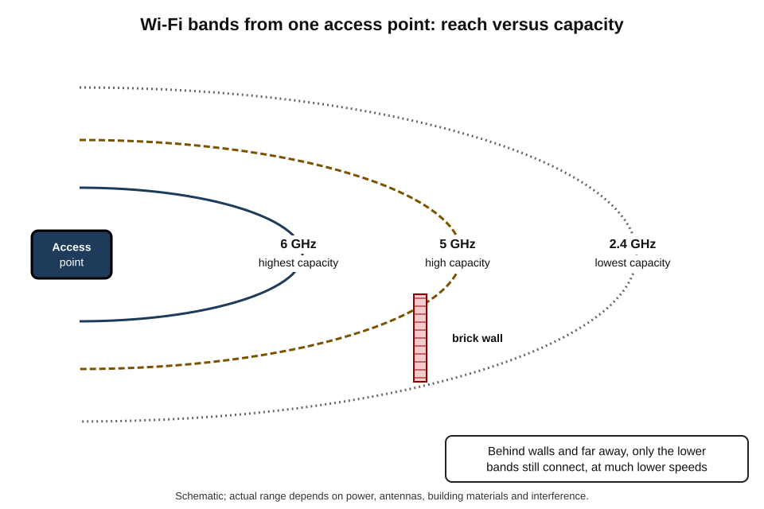
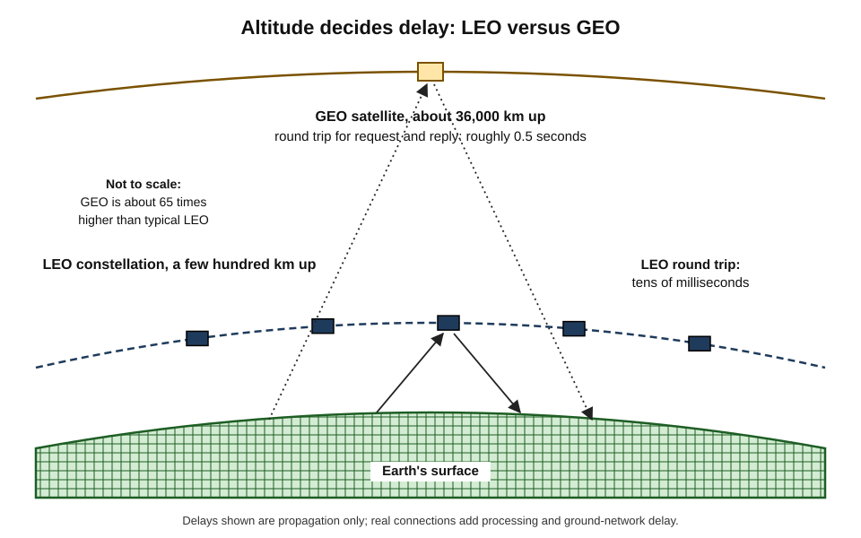
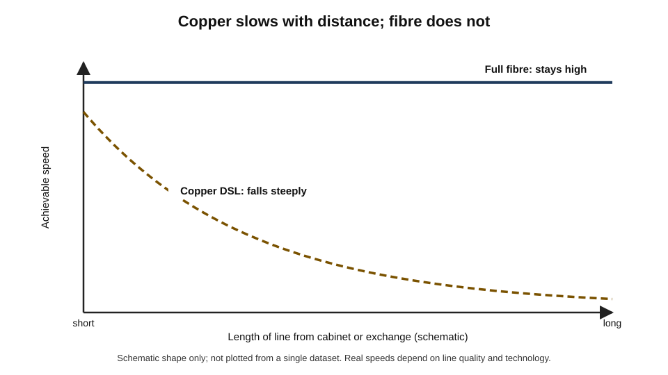
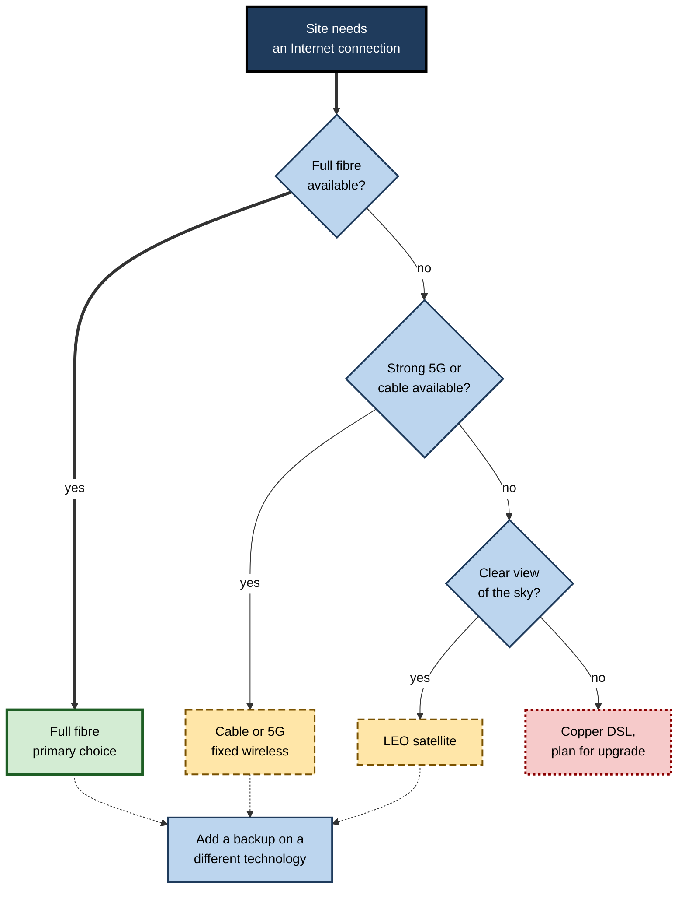
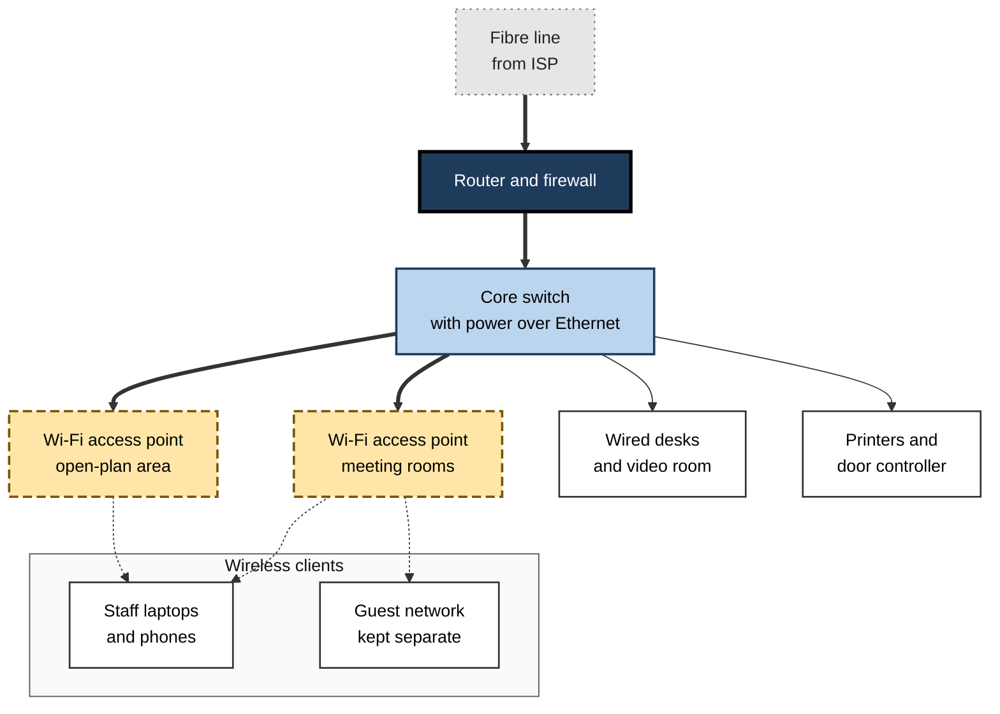

# B.5. Wired & Wireless Networks

In a modern office, a laptop on a desk may be connected by a cable to a wall socket, a phone in a meeting room by Wi-Fi, a visiting engineer by 5G and a temperature sensor in the plant room by a low-power radio. Every one of them ends up on the same Internet. What differs is the **medium** that carries their bits over the first few metres or kilometres — and that choice decides speed, reliability, cost, mobility and security.

> **Definition — Network medium:** the physical means by which signals carrying data travel between devices: electrical signals on copper wire, light in optical fibre, or radio waves through the air.

> **Definition — Wired network:** a network in which devices are connected by physical cables (copper or fibre). **Wireless network:** a network in which devices communicate by radio (or occasionally light) without a physical cable.

**Why the distinction matters**

- Most everyday frustration with "the Internet" — dropped calls, slow Wi-Fi in a back bedroom, a video call that freezes on a train — is really a **local medium** problem.
- Choosing the right mix of wired and wireless connections is a basic design skill for homes, offices, factories, hospitals and public spaces.
- Each medium has **physical limits** set by distance, interference and shared use that no software update can remove.
- New services — remote working, connected sensors, video-heavy collaboration, AI assistants on mobile devices — place growing demands on these local links.

---

## Networks by Scale

Networks are often described by how much ground they cover.

- **Personal area network (PAN)** — a few metres around one person.
  - *e.g.* a phone linked to wireless earbuds and a smartwatch by Bluetooth.
- **Local area network (LAN)** — a home, office floor or building.
  - *e.g.* computers, printers and Wi-Fi access points in an office.
- **Wireless LAN (WLAN)** — a LAN using Wi-Fi.
- **Campus network** — several buildings on one site, such as a university or hospital.
- **Metropolitan area network (MAN)** — a city or region.
  - *e.g.* a municipal fibre network linking schools and libraries.
- **Wide area network (WAN)** — links across countries and continents.
  - *e.g.* a company network connecting offices in Mumbai, Frankfurt and Chicago, usually over carrier or Internet links.

> **Definition — Local area network (LAN):** a network connecting devices within a limited area, such as a home, office or building, usually owned and managed by one organisation or household.

> **Definition — Wide area network (WAN):** a network spanning large geographical distances, typically built using links provided by telecommunications carriers.

> **Mnemonic — "People Like Choosing Many Wires":** Personal, Local, Campus, Metropolitan, Wide — from smallest to largest.

---

## Wired Media

### Copper twisted pair

- **What it is** — pairs of insulated copper wires twisted together to reduce interference.
- **Uses:**
  - **Ethernet cabling** inside buildings — the familiar network cable with a clip-in plug;
  - **telephone lines** to homes, reused for DSL broadband.
- **Limits:**
  - standard Ethernet copper runs are limited to about **100 metres**;
  - over long telephone lines, signals weaken, so speed falls with distance.
- **Categories** — cable is graded (*e.g.* Cat 5e, Cat 6, Cat 6A) by the frequencies it can carry, which determine the speeds it supports.

### Coaxial cable

- **What it is** — a central copper conductor inside insulation and a metal shield.
- **Uses** — cable television networks, which carry broadband using cable-modem technology.
- **Character** — high capacity, but the cable from the street is usually **shared** among many households.

### Optical fibre

> **Definition — Optical fibre:** a thin strand of very pure glass that carries data as pulses of light, guided by total internal reflection.

- **Advantages:**
  - **enormous capacity** — many wavelengths of light can share one fibre, each carrying very high data rates;
  - **low loss** — signals travel tens of kilometres before needing amplification;
  - **immune to electrical interference** and difficult to tap without detection;
  - **light and thin**, relative to its capacity.
- **Types:**
  - **single-mode** — very thin core; used for long distances and access networks;
  - **multimode** — wider core; cheaper for short runs within buildings and data centres.
- **Uses** — long-distance backbones, submarine cables, data centres and, increasingly, the connection all the way to homes.

> **Watch out:** "fibre broadband" in advertising does not always mean fibre to the home. Many services run fibre only to a **street cabinet**, with the last few hundred metres on old copper — and that copper sets the speed limit.

### Ethernet: the language of wired LANs

**Study card — Robert Metcalfe and Ethernet (1973)**

- **Context:** at Xerox's Palo Alto research laboratory (PARC), Robert Metcalfe and David Boggs needed to link the centre's personal workstations and laser printers.
- **Design:** devices shared a single cable; each listened before sending and backed off if two transmissions collided.
- **Development:** standardised in the early 1980s as **IEEE 802.3**; later versions replaced the shared cable with **switches** and individual cables to each device.
- **Result:** Ethernet became the near-universal wired LAN technology, its speeds rising from about 10 megabits per second to hundreds of gigabits per second in data centres.
- **Lesson:** a simple, open design that could be improved generation by generation outlasted many technically ambitious rivals.

- **Switch** — the central device in a wired LAN; it forwards data only to the port where the destination device is connected.
- **Power over Ethernet (PoE)** — sends electrical power through the same cable, so Wi-Fi access points, cameras and desk phones need no separate power supply.

> **Definition — Network switch:** a device that connects devices within a LAN and forwards each frame only to the port leading to its destination.

> **Watch out:** a **switch** connects devices *within* a network; a **router** connects *different* networks. A home "router" usually combines a router, a switch, a Wi-Fi access point, a firewall and a modem in one box.

---

## Wireless Media

### How radio networking works

- Data is encoded onto **radio waves** at particular frequencies.
- **Frequency bands** are allocated by governments:
  - **licensed** bands — sold or assigned to mobile operators for exclusive use;
  - **unlicensed** bands — shared by anyone following power rules; used by Wi-Fi and Bluetooth.
- **Physics sets the trade-offs:**
  - **lower frequencies** travel further and penetrate walls better but carry less data;
  - **higher frequencies** carry more data but have shorter range and are blocked more easily.
- **The air is shared** — all devices on the same channel take turns; more devices and more neighbours mean more waiting.

> **Definition — Spectrum:** the range of radio frequencies available for communication; a scarce public resource managed by national regulators and coordinated internationally.

> **Key point:** a wireless network is a **shared, noisy medium**. Its performance depends on distance, obstacles, interference and how many other devices are competing for airtime.

### Wi-Fi

> **Definition — Wi-Fi:** the trade name for wireless LAN technology based on the IEEE 802.11 family of standards, operating in unlicensed radio bands.

- **Access point** — the device that broadcasts the Wi-Fi network and connects wireless devices to the wired LAN.
- **Generations** (the industry adopted simple numbers in 2018):
  - **Wi-Fi 4** (802.11n, 2009) — widespread multi-antenna Wi-Fi;
  - **Wi-Fi 5** (802.11ac, 2013) — faster, mainly on the 5 GHz band;
  - **Wi-Fi 6** (802.11ax, 2019) — better efficiency with many devices; **Wi-Fi 6E** adds the 6 GHz band;
  - **Wi-Fi 7** (802.11be, certified from 2024) — wider channels and the ability to use several bands at once.

| | 2.4 GHz band | 5 GHz band | 6 GHz band |
|---|---|---|---|
| Range and wall penetration | Best | Moderate | Shortest |
| Typical capacity | Lowest | High | Highest |
| Interference | Heavy — crowded by neighbours, Bluetooth, microwave ovens | Moderate | Low (newer, less crowded) |
| Devices supported | Almost all | Most modern | Only recent devices |
| Best use | Distant rooms, simple smart-home devices | General use | High-speed use in the same or adjacent room |

**Figure 1.** Range and capacity of the three Wi-Fi bands from a single access point.

**What weakens Wi-Fi**

- **Distance** — signal strength falls rapidly as distance increases.
- **Obstacles** — concrete, brick, metal, mirrors, water (including people and fish tanks).
- **Interference** — neighbouring networks on the same channel; other radio devices.
- **Congestion** — many devices sharing one access point.
- **Old devices** — a slow, old device can consume disproportionate airtime.

> **Watch out:** the "up to" speeds printed on Wi-Fi equipment are theoretical maxima under ideal laboratory conditions, summed across bands and antennas. A single device in a real room typically achieves a fraction of the figure.

**Extending coverage**

- **Mesh Wi-Fi** — several units cooperate to cover a large home or office, handing devices between them.
- **Wired backhaul** — linking access points by Ethernet cable gives far better performance than wireless links between them.
- **Range extenders** — cheap but often halve the speed for devices that use them.

### Cellular (mobile) networks

> **Definition — Cellular network:** a wireless network divided into geographic **cells**, each served by a base station, which hands devices from cell to cell as they move.

| | 2G (1990s) | 3G (2000s) | 4G / LTE (2010s) | 5G (2019 onwards) |
|---|---|---|---|---|
| Main advance | Digital voice, SMS | Practical mobile data | All-IP mobile broadband | Higher capacity, lower latency, massive device numbers |
| Typical use | Calls and texts | Email, basic web | Video, apps, mobile working | Dense urban use, fixed wireless access, industrial uses |
| Network design | Circuit-switched voice | Mixed circuit and packet | Packet-switched throughout | Packet-switched, software-based core, network slicing |

- **5G's three goals** (as defined by its standards bodies):
  - **enhanced mobile broadband** — more capacity and speed;
  - **ultra-reliable low-latency communication** — for control systems and machines;
  - **massive machine-type communication** — very large numbers of low-power sensors.
- **Frequency layers:**
  - **low-band** — wide coverage, modest speeds;
  - **mid-band** — the main 5G capacity layer in most countries;
  - **millimetre wave** — very high speeds over very short distances, easily blocked.
- **Fixed wireless access (FWA)** — using 4G or 5G to deliver home broadband through a box by the window, competing with wired broadband where fibre is absent.
- **Private 5G and 4G** — networks owned by a factory, port or campus for its own machines and staff.

> **Definition — Network slicing:** the ability of a 5G network to run several logically separate virtual networks, each with its own performance characteristics, over the same physical infrastructure.

> **Watch out:** many early "5G" services used 4G core networks with 5G radios; the more advanced capabilities, such as slicing and very low latency, depend on **standalone** 5G cores and are not available everywhere. Claims that 5G alone will transform every application have been tempered by experience.

### Satellite

- **Geostationary (GEO) satellites** — about **36,000 km** above the equator; they appear fixed in the sky.
  - Wide coverage from few satellites;
  - round trip to the satellite and back alone adds roughly **half a second** of delay, making calls and games awkward.
- **Low-Earth-orbit (LEO) constellations** — hundreds to thousands of satellites a few hundred kilometres up.
  - Delay comparable to many terrestrial connections (tens of milliseconds);
  - need many satellites and moving antennas or electronically steered dishes;
  - the largest constellation had roughly ten thousand satellites in orbit and more than ten million subscribers by 2026.
- **Uses** — rural homes, ships, aircraft, disaster response, remote mines and military operations.

**Figure 2.** Geostationary and low-Earth-orbit satellites: altitude and resulting delay.

> **Formula — Minimum delay from distance:** distance ÷ speed of light. For a geostationary hop: up and down ≈ 2 × 36,000 km = 72,000 km; 72,000 ÷ 300,000 km/s ≈ **0.24 s** one way, so a request and reply need roughly **0.5 s** before any processing.

### Short-range and low-power wireless

- **Bluetooth** — short-range links for headsets, keyboards, wearables and medical devices.
- **NFC (near-field communication)** — a few centimetres; contactless payments and access cards.
- **Zigbee, Thread and similar** — low-power mesh networks for smart-home and building sensors.
- **LoRaWAN and narrowband IoT** — very low data rates over kilometres, for meters, trackers and agricultural sensors running for years on a battery.

> **Key point:** for connected devices, the right medium is often the one that uses **least power** and **reaches far enough**, not the fastest.

---

## Last-Mile Access Technologies

The medium that links a home or office to its provider largely determines the quality of its Internet connection.

### The main options

- **DSL over copper telephone lines**
  - Speed falls sharply with distance from the exchange or street cabinet.
  - **Fibre to the cabinet** shortens the copper section and raises speeds.
- **Cable (hybrid fibre–coaxial)**
  - High download speeds; capacity shared among a neighbourhood; upload historically lower.
- **Fibre to the premises (FTTP / FTTH)**
  - Fibre all the way; very high and often **symmetric** speeds; most future-proof.
  - Usually a **passive optical network**: one fibre from the exchange is split among a group of homes.
- **Fixed wireless access** — 4G or 5G to a home receiver.
- **Satellite** — GEO or LEO, as above.

> **Definition — Passive optical network (PON):** a fibre access architecture in which unpowered optical splitters divide one fibre among many premises, with the bandwidth shared and managed by equipment at the provider's end.

**Figure 3.** How the speed of copper-based broadband falls with line length compared with fibre.

| | DSL (copper) | Cable | Full fibre | Fixed wireless (5G) | LEO satellite |
|---|---|---|---|---|---|
| Typical download | Low to moderate; distance-dependent | High | Very high | Moderate to high | Moderate to high |
| Upload | Low | Low to moderate | Very high, often symmetric | Moderate | Low to moderate |
| Latency | Low to moderate | Low | Lowest | Low to moderate, variable | Moderate |
| Consistency | Varies with line quality | Peak-time sharing | Very consistent | Varies with signal and load | Weather and obstruction sensitive |
| Where it fits | Legacy areas | Areas with cable TV networks | Wherever built | Areas without fibre | Rural and remote areas |

**Figure 4.** Choosing a last-mile technology for a site.

---

## Wired Versus Wireless

| | Wired (Ethernet, fibre) | Wireless (Wi-Fi, cellular) |
|---|---|---|
| Speed | High and consistent | Variable; shared airtime |
| Latency and jitter | Low and stable | Higher and more variable |
| Reliability | Very high once installed | Affected by distance, walls and interference |
| Mobility | None | Full |
| Installation | Cabling cost and disruption | Quick and flexible |
| Security exposure | Requires physical access | Signals extend beyond walls; must be encrypted |
| Best for | Desktops, servers, access points, TVs, consoles, video studios | Laptops, phones, tablets, visitors, sensors |

> **Key point:** the best networks are **wired where possible and wireless where necessary**. Even a Wi-Fi network depends on cables: access points perform far better when connected to the LAN by Ethernet.

> **Example:** a podcast studio running live interviews uses wired connections for its recording computers so that a neighbour's Wi-Fi traffic cannot cause a dropout in the middle of a recording, while guests' phones use Wi-Fi.

### Wireless security in brief

- **Wi-Fi encryption** — modern networks use **WPA3** (or at least WPA2) so that traffic over the air cannot be read by bystanders.
- **Open public Wi-Fi** — often unencrypted at the radio level; rely on encrypted applications (secure websites, VPNs) on such networks.
- **Default passwords** — routers and access points must have their administrator passwords changed.
- **Guest networks** — keep visitors' and smart-home devices separate from work computers.

> **Watch out:** a strong Wi-Fi password protects the **radio link**; it does not make the devices or the Internet connection behind it safe. Device updates and secure applications still matter.

---

## Designing Real Networks

### Worked example (illustrative): fixing a home office's poor video calls

Situation: a policy analyst's video calls freeze in a back bedroom office two floors from the router, although the broadband line tests at 300 Mbit/s.

1. **Locate the bottleneck** — a speed test next to the router shows 280 Mbit/s; in the office, 15 Mbit/s with frequent drops. The problem is **Wi-Fi**, not broadband.
2. **Check the band** — the laptop is on 2.4 GHz, crowded by a dozen neighbouring networks.
3. **Consider options:**
   - move the router — limited by where the line enters;
   - add a mesh unit — better, but wireless backhaul through two floors is weak;
   - run an Ethernet cable or use the house's existing cabling to a second access point — best.
4. **Action** — an access point in the office connected by Ethernet; the laptop wired directly for calls.
5. **Result** — consistent speeds above 250 Mbit/s and stable calls.

> **Remember:** test **next to the router and at the problem location**. If the first is fast and the second slow, fix the local network before blaming the ISP.

### Enterprise and campus networks

- **Structured cabling** — standardised cabling from each floor's network cabinet to desks, access points and devices.
- **Switching layers** — access switches near users, linked by fibre to core switches.
- **Enterprise Wi-Fi** — many centrally managed access points; devices roam between them; capacity is planned per room, not just coverage.
- **Segmentation** — separate logical networks for staff, guests, building systems, medical devices or point-of-sale terminals, so a problem in one does not spread to others.
- **Monitoring** — tools that show which access points are overloaded and where interference occurs.

**Figure 5.** A typical small-office network combining wired and wireless segments.

### Case study (illustrative): a hospital ward's wireless overload

- **Situation:** a hospital introduced tablets for nurses, wireless infusion pumps, patient-entertainment streaming and staff phones on the same ward Wi-Fi.
- **Problem:** at visiting times, nurses' tablets lost connection to the electronic patient record; pump alerts were delayed.
- **Diagnosis:**
  1. access points had been placed for **coverage**, not **capacity** — each served too many devices;
  2. patient and visitor streaming shared airtime with clinical devices;
  3. some old pumps used only the crowded 2.4 GHz band, slowing everyone on it;
  4. thick walls in older buildings caused dead spots.
- **Actions:**
  1. survey of signal and load room by room;
  2. more access points, wired back to switches, at lower power to create smaller cells;
  3. clinical devices on a **separate network with priority**; guest traffic limited;
  4. migration plan for old devices to newer bands;
  5. critical monitoring kept on wired connections where possible.
- **Result:** dropped sessions fell sharply; clinical staff stopped carrying paper back-ups for routine tasks.
- **Lesson:** wireless networks fail not only from weak signal but from **too many devices sharing too little airtime**. Clinical and safety-critical traffic needs its own capacity and priority.

---

## Wired and Wireless Networks in the Age of Cloud and AI

- **More upload, less download imbalance** — video calls, cloud backups and collaborative editing send as much data as they receive; access technologies with strong upload (full fibre) suit cloud-based work best.
- **Latency-sensitive services** — interactive AI assistants, voice interfaces and cloud gaming reward low, stable latency; wired and fibre links help most.
- **Edge devices** — cameras and sensors analysed by AI in the cloud generate continuous upstream traffic; factories increasingly use private 5G or Wi-Fi 6/7 for this.
- **Data-centre networks** — inside the buildings where AI models are trained, short fibre and copper links between processors run at extraordinary speeds; their design is a specialised field of its own.

> **In practice:** when an organisation plans a cloud or AI rollout, a network engineer asks first, "How will the **local** network and the **last mile** cope?" — because these, not the cloud provider, are usually the weakest links.

---

## Measuring and Future-Proofing

### Reading wireless signal strength

- **Received signal strength** is usually shown in **dBm** — decibels relative to one milliwatt; values are negative, and closer to zero is stronger.
  - around −50 dBm — excellent;
  - around −67 dBm — a common target for reliable voice and video over Wi-Fi;
  - around −80 dBm — weak; connections drop or slow sharply.
- **Signal is not everything** — a strong signal on a crowded channel can still perform badly; the **signal-to-noise ratio** and channel utilisation matter too.

> **Formula — Decibel rule of thumb:** every 3 dB is roughly a doubling or halving of power, and every 10 dB a factor of ten. Example: moving from −60 dBm to −70 dBm means the received power has fallen to about **one tenth**.

### Future-proofing the physical network

- **Cabling outlives equipment** — switches and access points are replaced every five to eight years; good cabling lasts far longer.
- **Install for the next generation** — higher-category copper and spare fibre in risers cost little extra during building works and a great deal later.
- **Ducts and spare capacity** — empty ducts between buildings and to the street make later fibre upgrades and second providers cheap.
- **Power and placement** — ceiling locations with power over Ethernet for access points; wall outlets where desks and screens will be.
- **Document everything** — labelled cables and up-to-date plans save hours in every fault and refurbishment.

> **In practice:** in new or refurbished offices, network designers plan **access-point positions for capacity**, run cabling to every likely location, and leave spare fibre and duct capacity — decisions that set the network's limits for a decade or more.

---

## Wired and Wireless in Industry

- **Factories and warehouses** — robots, guided vehicles and scanners need reliable, low-latency links; operators combine industrial Ethernet for fixed machines with Wi-Fi 6 or 7 or private 5G for mobile ones.
- **Ports, mines and airports** — large outdoor sites where private cellular networks offer better coverage and control than Wi-Fi.
- **Retail** — tills, handheld scanners and customer Wi-Fi on separate networks, with mobile backup so card payments continue during a line fault.
- **Healthcare** — wired connections for imaging and monitoring equipment; carefully planned Wi-Fi for mobile clinical devices.

> **Key point:** the more critical and predictable the traffic, the stronger the case for wires or a dedicated, managed wireless network; the more mobile and casual the use, the stronger the case for shared Wi-Fi or public mobile networks.

---

## Open Questions

- **Will fixed wireless and satellites replace wired access in some places?**
  - They are cheaper to deploy in sparse areas; whether they can match fibre's capacity as demand grows is uncertain.
- **How should scarce spectrum be shared?**
  - Mobile operators, Wi-Fi, satellites and other users compete for the same bands; regulators are experimenting with dynamic sharing.
- **Will Wi-Fi and cellular converge?**
  - Both are adopting similar techniques; how far they will merge in devices and enterprise networks is unclear.
- **Can low-power wireless scale securely to billions of sensors?**
  - Many devices are cheap, rarely updated and hard to secure.
- **What are the environmental costs of different media?**
  - Energy use per bit differs greatly between fibre, mobile and satellite networks; complete life-cycle comparisons are still emerging.

---

## Summary

- The **medium** — copper, fibre or radio — sets the physical limits of a connection.
- Networks range from **PAN** and **LAN** to **MAN** and **WAN**.
- **Copper** (twisted pair, coaxial) is cheap and widespread but distance-limited; **optical fibre** offers vast capacity, low loss and immunity to interference.
- **Ethernet**, created by Metcalfe and Boggs at Xerox PARC in 1973, is the universal wired LAN technology; **switches** connect devices within a LAN, **routers** connect networks.
- Wireless networks share **spectrum**; lower frequencies reach further, higher frequencies carry more.
- **Wi-Fi** (802.11) uses the 2.4, 5 and 6 GHz bands, now in its seventh generation; performance falls with distance, obstacles, interference and congestion.
- **Cellular** networks have advanced from 2G to **5G**, adding capacity, low latency and massive device support; **fixed wireless access** and **private 5G** are growing uses.
- **GEO satellites** have high delay; **LEO constellations** offer low delay and are transforming remote access.
- Last-mile choices — **DSL, cable, full fibre, fixed wireless, satellite** — largely determine connection quality.
- Design principle: **wired where possible, wireless where necessary**; plan Wi-Fi for **capacity** as well as coverage; separate critical and guest traffic.

---

## Self-Check

1. Define a network medium and give one example each of copper, fibre and radio media.
2. Put PAN, LAN, MAN, WAN and campus network in order of scale, with an example of each.
3. Why does fibre outperform copper over long distances?
4. Explain why "fibre broadband" may still be limited by copper.
5. Summarise the origin of Ethernet and why it lasted.
6. Distinguish a switch, a router and an access point.
7. Explain the trade-off between lower and higher radio frequencies.
8. Compare the 2.4, 5 and 6 GHz Wi-Fi bands across three attributes.
9. Name five causes of poor Wi-Fi performance.
10. What are the three goals of 5G, and why have some early claims been tempered?
11. Calculate the minimum one-way delay for a signal via a geostationary satellite, and explain why LEO satellites reduce it.
12. Compare full fibre and DSL on upload, latency and consistency.
13. Why should access points ideally be wired back to switches?
14. A user reports slow Internet in one room. Describe the first two tests you would perform and what each result would mean.
15. A hospital plans to put all clinical, visitor and building-system devices on one Wi-Fi network. Identify the risks and recommend a design.

### Answer Key

1. The physical means by which signals travel. Copper: Ethernet cable or telephone line; fibre: a fibre-to-the-home line or submarine cable; radio: Wi-Fi or 5G.
2. PAN (phone and earbuds) < LAN (office floor) < campus network (university site) < MAN (city fibre network) < WAN (multinational company network).
3. Light in glass loses little energy over distance and is immune to electrical interference, and many wavelengths can share one fibre, giving vast capacity.
4. Many services run fibre only to a street cabinet; the final copper section to the home limits speed, which falls with its length.
5. Robert Metcalfe and David Boggs designed it at Xerox PARC in 1973 to connect workstations and printers; standardised as IEEE 802.3, it was simple, open and repeatedly upgraded, outlasting more complex rivals.
6. A switch forwards data between devices within a LAN; a router connects different networks; an access point connects wireless devices to the wired LAN.
7. Lower frequencies travel further and penetrate obstacles better but carry less data; higher frequencies carry more data but have shorter range and are blocked more easily.
8. 2.4 GHz: best range, lowest capacity, heavy interference. 5 GHz: moderate range, high capacity, moderate interference. 6 GHz: shortest range, highest capacity, low interference, newer devices only.
9. Distance; obstacles; interference from neighbouring networks or devices; congestion from many devices; slow old devices using airtime.
10. Enhanced mobile broadband; ultra-reliable low-latency communication; massive machine-type communication. Many early services used 4G cores, and advanced features need standalone 5G, so transformative claims were tempered.
11. About 72,000 km up and down ÷ 300,000 km/s ≈ 0.24 s one way (about 0.5 s round trip). LEO satellites orbit only a few hundred kilometres up, so the distance — and the delay — is far smaller.
12. Full fibre: very high, often symmetric upload; lowest latency; very consistent. DSL: low upload; low to moderate latency; consistency depends on line length and quality.
13. Wireless links between access points share airtime and lose capacity; Ethernet backhaul gives full, stable capacity and often power.
14. Test speed next to the router and in the problem room. Fast at the router but slow in the room → local Wi-Fi problem; slow in both → broadband or ISP problem.
15. Risks: airtime congestion, visitors' streaming harming clinical traffic, old devices slowing the network, security exposure of medical devices. Design: capacity survey, more access points wired to switches, separate logical networks with priority for clinical devices, limits on guest traffic, wired connections for critical monitoring, and an upgrade plan for legacy devices.

---

## Glossary

| Term | Meaning |
|---|---|
| Access point | A device that connects wireless clients to a wired network. |
| Backhaul (wireless) | The link connecting an access point or base station to the wider network. |
| Bluetooth | A short-range wireless technology for personal devices. |
| Cellular network | A wireless network of cells, each served by a base station. |
| Coaxial cable | A shielded copper cable used by cable TV and broadband networks. |
| DSL | Digital subscriber line; broadband over telephone copper. |
| Ethernet | The standard wired LAN technology (IEEE 802.3). |
| Fixed wireless access | Home or office broadband delivered over mobile networks. |
| GEO satellite | A satellite about 36,000 km above the equator, fixed relative to the ground. |
| LAN | Local area network. |
| LEO satellite | A satellite in low Earth orbit, a few hundred kilometres up. |
| Mesh Wi-Fi | Multiple cooperating units covering a large area. |
| Network slicing | Separate virtual networks over one 5G infrastructure. |
| Optical fibre | Glass strand carrying data as light. |
| PAN | Personal area network. |
| Passive optical network (PON) | Fibre access in which unpowered splitters share one fibre among premises. |
| Power over Ethernet | Supplying electrical power through a network cable. |
| Spectrum | The range of radio frequencies available for communication. |
| Switch | A device forwarding frames between devices within a LAN. |
| Twisted pair | Copper wires twisted together to reduce interference. |
| WAN | Wide area network. |
| Wi-Fi | Wireless LAN technology based on IEEE 802.11. |
| WPA3 | The current Wi-Fi security standard for encrypting wireless traffic. |
