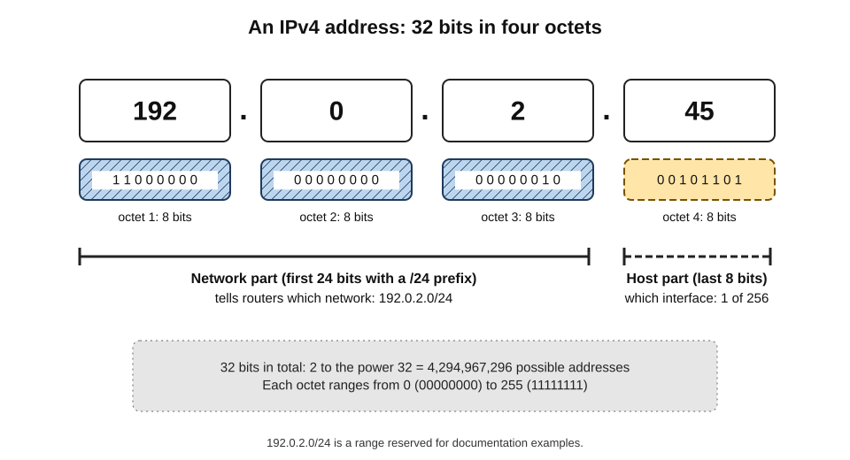
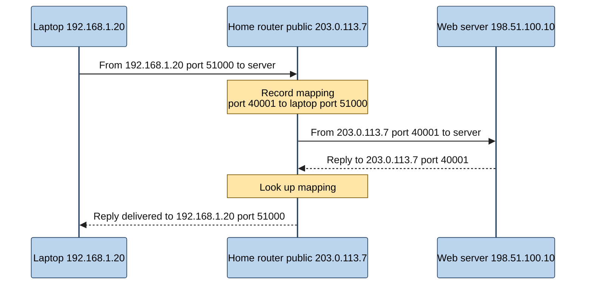
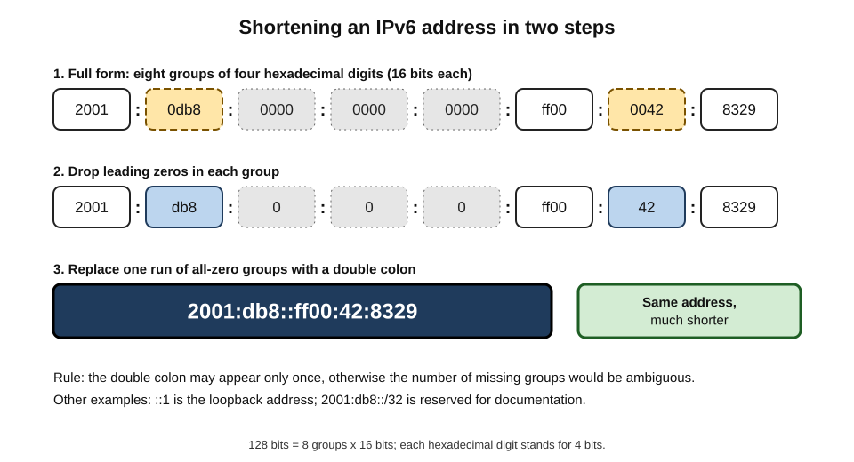
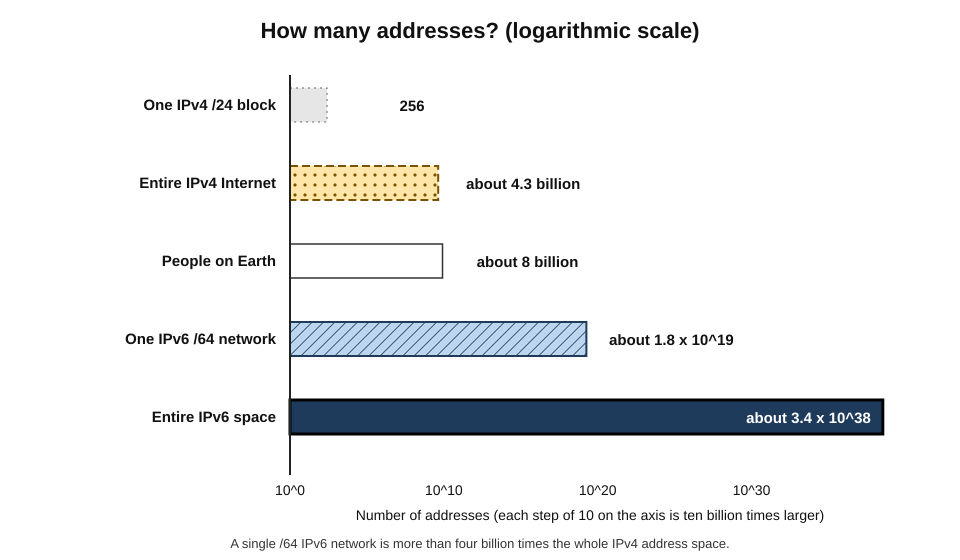
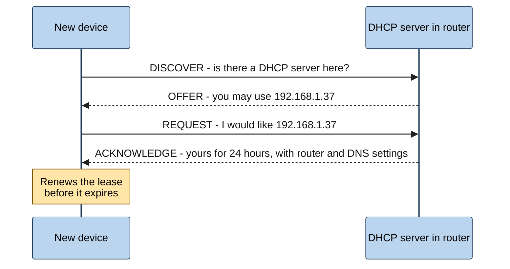
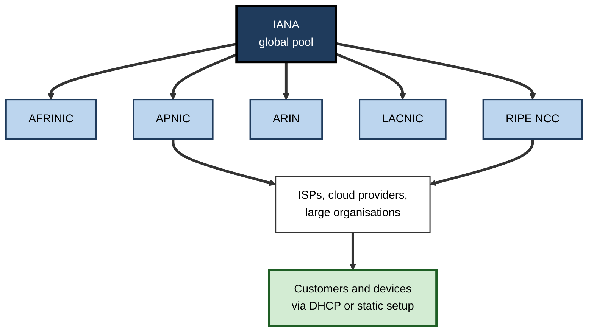

# E.6. IP Addresses

A support technician asks a caller to read out the numbers shown in the laptop's network settings: "one-nine-two, dot, one-six-eight, dot, one, dot, forty-five". A security analyst sees thousands of failed sign-in attempts from one address in another country. A cloud architect discovers that two merging companies used exactly the same internal numbers for their networks. All three are dealing with the same thing — the numbers that tell the Internet **where** to send each packet.

> **Definition — IP address:** a numerical label assigned to a network interface that uses the Internet Protocol, serving both to **identify** the interface and to indicate its **location** in the network so that packets can be routed to it.

**Why IP addresses matter**

- Every packet carries a **source** and a **destination** address; without addresses, routing is impossible.
- Addresses reveal — and conceal — information: a rough location, an ISP, an organisation, but rarely a person directly.
- The original supply of addresses **ran out**, forcing the workarounds and the successor system that shape today's Internet.
- In organisations, poor address planning causes outages, security gaps and painful mergers; good planning makes cloud adoption and growth smooth.

---

## What an Address Does

### Identifier and locator

- **Identifier** — distinguishes one network interface from all others on the same network.
- **Locator** — the address is structured so that routers can tell **which network** it belongs to, much as a postcode tells a sorting office which area a letter is for.
- **Interface, not device** — a laptop with Wi-Fi and Ethernet has an address for each; a server may have several.

> **Example:** a postal address combines a **region** (country, city, postcode) with a **specific house**. An IP address similarly combines a **network part** (which network) with a **host part** (which interface on that network).

### Addresses versus names

- People use **names** (such as a company's web address); machines use **numbers**.
- The Domain Name System translates names to addresses; one name may map to many addresses, and one address may host many names.
- Addresses can change while names stay the same — which is why services are reached by name.

> **Watch out:** an IP address is not like a phone number permanently attached to a person. Most home and mobile addresses are **assigned temporarily**, shared through translation, and reassigned to other customers over time.

---

## IPv4: The Original Addressing System

### Format

- **32 bits** long — 32 binary digits.
- Written as **four decimal numbers** from 0 to 255, separated by dots — *dotted-decimal notation*.
  - *e.g.* 192.0.2.45
- Each number represents **8 bits** (an **octet**).
- **Total possible addresses:** 2³² = **4,294,967,296** — about 4.3 billion.

> **Definition — IPv4:** version 4 of the Internet Protocol, defined in 1981, which uses 32-bit addresses and still carries a large share of Internet traffic.

> **Definition — Octet:** a group of eight bits, written in IPv4 as a decimal number from 0 to 255.

**Figure 1.** The structure of an IPv4 address: four octets, a network part and a host part.

### Network and host parts

- An address block is described by its starting address and a **prefix length** — the number of leading bits that identify the network.
  - *e.g.* **192.0.2.0/24** means the first 24 bits (192.0.2) identify the network; the last 8 bits identify hosts.
- **Size of a block** = 2^(32 − prefix length).

> **Formula — Addresses in an IPv4 block:** 2^(32 − prefix). Example: a /24 block holds 2⁸ = **256** addresses; a /16 holds 2¹⁶ = **65,536**.

- Routers on the wider Internet only need to know where each **block** is, not every individual address — this keeps routing tables manageable.
- Dividing blocks into smaller subnetworks (subnetting) follows the same rule: each extra prefix bit halves the block — a /25 holds 128 addresses, a /26 holds 64.

> **Definition — Prefix (CIDR) notation:** writing an address block as an address followed by a slash and the number of network bits, e.g. 203.0.113.0/24. CIDR stands for Classless Inter-Domain Routing, introduced in 1993 to allocate blocks of any size.

> **Watch out:** older material describes IPv4 "classes" (A, B, C) of fixed size. Classful addressing was abandoned in 1993 in favour of CIDR; the terms survive informally but no longer describe how addresses are allocated.

### Special-purpose ranges

| Range | Purpose | What seeing it usually means |
|---|---|---|
| 10.0.0.0/8, 172.16.0.0/12, 192.168.0.0/16 | **Private** addresses for internal networks | The device is on a home or office LAN behind a router |
| 127.0.0.0/8 (commonly 127.0.0.1) | **Loopback** — the device itself | A program talking to another program on the same machine |
| 169.254.0.0/16 | **Link-local** — self-assigned | The device failed to obtain an address automatically |
| 100.64.0.0/10 | **Shared address space** for carrier-grade NAT | The ISP is sharing public addresses among many customers |
| 192.0.2.0/24 and two similar blocks | **Documentation** examples | Used in manuals and training; never on the real Internet |
| 224.0.0.0/4 | **Multicast** — one-to-many delivery | Specialised uses such as some video distribution |

> **Remember:** a laptop showing an address starting **169.254** has not been given a proper address — check the cable, Wi-Fi or router before anything else.

> **Mnemonic — "Ten, One-Seven-Two-Sixteen, One-Nine-Two-One-Six-Eight":** the three private ranges — 10/8, 172.16/12, 192.168/16.

---

## Running Out of IPv4 Addresses

### Why 4.3 billion was not enough

- In the 1970s and 1980s, 4.3 billion addresses seemed inexhaustible for a research network of a few hundred hosts.
- **Early generous allocations** — some organisations received blocks of over 16 million addresses.
- **Then came** personal computers, the web, smartphones, servers, cloud platforms and connected devices — tens of billions of potential endpoints.

### The exhaustion timeline

- **February 2011** — the central pool held by the Internet Assigned Numbers Authority (IANA) was exhausted; its last blocks went to the regional registries.
- **2011 onwards** — the regional registries reached their final allocation phases in turn, beginning with the Asia-Pacific registry in April 2011; the European registry made its last regular allocation in November 2019.
- **Today** — IPv4 addresses are mainly obtained by **transfer**: organisations buy and sell blocks in a secondary market, at prices of tens of US dollars per address in recent years.

> **Key point:** IPv4 exhaustion did not stop the Internet growing. It forced two responses: **sharing** addresses through translation, and **replacing** them with IPv6.

### Response 1: Network Address Translation (NAT)

> **Definition — Network Address Translation (NAT):** a technique by which a router rewrites the addresses (and usually port numbers) of packets passing through it, allowing many devices with private addresses to share one public address.

- **How home NAT works:**
  1. Each device in the home has a **private** address, such as 192.168.1.20.
  2. The router has one **public** address from the ISP.
  3. When a device sends a packet out, the router replaces the private source address with its public address and a unique **port number**, and records the mapping.
  4. When the reply returns, the router looks up the mapping and forwards it to the right device.

**Figure 2.** Network address translation in a home router.

- **Side effects of NAT:**
  - devices inside are not directly reachable from outside unless the router is configured to allow it — a **useful barrier**, though not a substitute for a firewall;
  - peer-to-peer applications, online games and video calls need extra techniques to connect through NAT;
  - logs show the public address, so identifying which inside device acted requires the router's records.

### Carrier-grade NAT

- ISPs facing address shortages put **another layer of NAT inside their own networks**, so many customers share each public address.
- **Consequences:**
  - customers cannot easily host services at home;
  - one misbehaving user can get a shared address blocked, affecting others;
  - investigators need the ISP's translation logs, including port numbers and exact times, to identify a subscriber.

> **Definition — Carrier-grade NAT (CGNAT):** address translation performed by an ISP, letting many customers share a pool of public IPv4 addresses.

> **Watch out:** "an IP address identifies a person" is wrong on several counts. It identifies, at best, a connection at a moment — often shared by a household, an office, or hundreds of mobile customers behind carrier-grade NAT.

---

## IPv6: The Long-Term Solution

### Format

- **128 bits** long.
- Written as **eight groups of four hexadecimal digits**, separated by colons.
  - *e.g.* 2001:0db8:0000:0000:0000:ff00:0042:8329
- **Abbreviation rules:**
  1. Leading zeros in a group may be dropped: 0db8 → db8; 0042 → 42.
  2. One run of consecutive all-zero groups may be replaced by **::**.
  - *e.g.* the address above becomes **2001:db8::ff00:42:8329**.
- **Total addresses:** 2¹²⁸ — about 3.4 × 10³⁸.

> **Definition — IPv6:** version 6 of the Internet Protocol, standardised from the late 1990s, which uses 128-bit addresses and removes the need for address sharing.

> **Definition — Hexadecimal:** a base-16 number system using digits 0–9 and letters a–f; each hexadecimal digit represents four bits.

**Figure 3.** Writing an IPv6 address in full and in abbreviated form.

### How big is IPv6?

- A single **standard home or office network** in IPv6 is usually a **/64** — a block of 2⁶⁴ addresses, about 18 billion billion, which is over four billion times the entire IPv4 Internet.
- Address scarcity is no longer the design constraint; the structure is designed for **routing efficiency and simple automatic configuration**.

**Figure 4.** The size of IPv4 and IPv6 address spaces compared, on a logarithmic scale.

> **Example:** with IPv6, a smart-home sensor, a factory robot and a cloud server can each have a globally unique address without translation, simplifying end-to-end communication.

### What else IPv6 changes

- **Automatic configuration** — devices can create their own addresses from the network prefix advertised by the router (stateless address autoconfiguration), as well as receive them from servers.
- **Privacy addresses** — devices typically generate **temporary, changing** addresses for outgoing connections, so that they cannot be easily tracked by a fixed address.
- **No routine NAT** — every device can have a public address; **firewalls**, not translation, control what may reach it.
- **Simplified headers** — designed for efficient processing by routers.

> **Watch out:** "IPv6 is less secure because there is no NAT" misunderstands NAT. NAT was never a security mechanism by design; a properly configured **firewall** provides the same protection in IPv6 by blocking unsolicited inbound connections.

### Adoption

- **Dual stack** — most networks run IPv4 and IPv6 side by side; devices prefer IPv6 when both ends support it.
- **Progress** — measurements of users reaching a major search provider passed **roughly half over IPv6** in 2025–26, having been negligible in 2010.
- **Uneven geography** — several countries, including India, France and Germany, carry most of their traffic to such services over IPv6; others lag far behind.
- **Why so slow?**
  - IPv4 kept working thanks to NAT, so the urgency was low;
  - IPv6 is not directly compatible with IPv4, so both must be run during a long transition;
  - costs fall on network operators while benefits are diffuse.

| | IPv4 | IPv6 |
|---|---|---|
| Address length | 32 bits | 128 bits |
| Notation | Dotted decimal, e.g. 192.0.2.45 | Hexadecimal with colons, e.g. 2001:db8::45 |
| Total addresses | About 4.3 billion | About 3.4 × 10³⁸ |
| Address sharing | Widespread NAT and carrier-grade NAT | Normally unnecessary |
| Configuration | Manual or DHCP | Automatic from router advertisements, or DHCPv6 |
| Privacy | NAT obscures inside devices | Temporary addresses rotate |
| Status | Exhausted; traded on a secondary market | Growing; roughly half of users at major services |

---

## How Devices Get Addresses

### Static and dynamic assignment

- **Static** — configured manually and does not change.
  - Typical for servers, printers, network equipment and services that others must find by address.
- **Dynamic** — assigned automatically when a device joins a network, for a limited **lease** period.
  - Typical for laptops, phones and most home devices.

> **Definition — DHCP (Dynamic Host Configuration Protocol):** a protocol by which a device joining a network automatically obtains an IP address, along with settings such as the router's address and DNS servers, for a limited lease.

**Figure 5.** How a device obtains an address from a DHCP server.

> **Mnemonic — "DORA":** Discover, Offer, Request, Acknowledge — the four DHCP messages.

### Public addresses from the ISP

- Home customers usually receive a **dynamic public address** (or a share of one, behind carrier-grade NAT) that may change from time to time.
- Business customers can buy **static public addresses** to run servers, VPN gateways or email services.

### Where addresses come from

- **IANA** — allocates large blocks to the five regional registries.
- **Regional Internet Registries (RIRs):**
  - **AFRINIC** — Africa;
  - **APNIC** — Asia–Pacific;
  - **ARIN** — North America;
  - **LACNIC** — Latin America and the Caribbean;
  - **RIPE NCC** — Europe, the Middle East and parts of Central Asia.
- **ISPs, cloud providers and large organisations** — receive blocks from RIRs (or national registries) and assign addresses to customers and systems.

**Figure 6.** The hierarchy through which IP addresses are allocated.

> **Key point:** IP addresses are **allocated, not owned outright**, through a policy system run by the regional registries and their communities. This coordination is what keeps every public address globally unique.

---

## What an Address Reveals

### Geolocation

- Commercial databases map address blocks to **countries, regions, cities** and **organisations**, based on registry records, network measurements and data from services.
- **Accuracy:**
  - country level — usually good;
  - city level — often approximate;
  - street level — not reliable.
- **Uses:** showing local content and prices, enforcing licensing regions, fraud detection, tax rules and legal compliance.

> **Watch out:** geolocation can be badly wrong — mobile users may appear in a distant city where their operator's gateway sits; VPN users appear wherever the VPN server is. Decisions with serious consequences should not rest on IP location alone.

### Identity and privacy

- An address links to a **subscriber** only through the ISP's records — and only for a specific time (and, with carrier-grade NAT, port).
- **Legal status:** in the European Union, the Court of Justice held in 2016 (the *Breyer* case) that even a **dynamic** IP address can be **personal data** where the website operator has legal means to identify the person through the ISP. Many privacy laws treat IP addresses as personal data.
- **Ways users hide their address:** VPNs, privacy relays, the Tor network and mobile carrier-grade NAT.

> **In practice:** organisations should treat IP addresses in logs as **personal data** — with retention limits, access controls and a lawful purpose — rather than as harmless technical noise.

---

## IP Addresses in Organisations

### Address planning

- **Private ranges inside** — offices, data centres and cloud networks use private addresses; plan them so they **do not overlap**.
- **Cloud networks** — each virtual network in the cloud is assigned a private block; connecting many of them, and connecting them to offices, requires non-overlapping ranges.
- **IP address management (IPAM)** — a register or tool recording which blocks and addresses are used where, by whom and for what.
- **IPv6 plan** — allocate a structured IPv6 prefix per site and per function, even if adoption is gradual.

> **Definition — IP address management (IPAM):** the planning, tracking and administration of an organisation's IP address space.

### Security uses — and limits

- **Allowlisting** — permitting access to an administrative system only from known office addresses.
- **Blocklisting** — blocking addresses known to send attacks or spam.
- **Logging and investigation** — correlating activity by address.
- **Limits:**
  - attackers rotate addresses and use compromised home devices or cloud servers;
  - legitimate users may share addresses with attackers through carrier-grade NAT or VPNs;
  - remote and mobile workers have changing addresses, so address-based trust is weak — **identity-based access** has largely replaced it.

### Case study: two companies, one address range

- **Situation:** a logistics firm acquired a competitor and planned to connect the two corporate networks within three months.
- **Problem:** both companies had built their internal networks on the same private range (10.0.0.0/16), the default of a popular firewall vendor. Hundreds of servers and printers in each company shared identical addresses.
- **Diagnosis:**
  - direct routing between the networks was impossible — a packet for 10.0.4.12 could mean either company's server;
  - several cloud networks used the same range too.
- **Options considered:**
  1. **Translate** addresses at the boundary (NAT between the two networks) — quick, but complex and fragile;
  2. **Renumber** the acquired company onto a new, unused range — slow and disruptive, but clean;
  3. **Avoid** network-level connection, integrating through cloud applications only.
- **Actions:** short-term translation for a few essential systems; a twelve-month renumbering programme; a group-wide IPAM register; non-overlapping ranges reserved for every future site and cloud network.
- **Result:** integration took twice as long as planned, at substantial cost in consultancy and downtime.
- **Lesson:** address planning seems trivial until networks must be joined. Choosing **unusual, documented private ranges** from the outset — and adopting IPv6 — avoids expensive collisions.

### Worked example: diagnosing "no Internet" from the address

Situation: a new employee's laptop shows "connected, no Internet".

1. **Read the address** in network settings.
2. **If it begins 169.254** → the laptop got no address from DHCP: check the cable or Wi-Fi association, and whether the DHCP server is working.
3. **If it is a private address (e.g. 192.168.x.x or 10.x.x.x)** → the local network works; test whether the router can be reached, then whether names can be resolved.
4. **If it is in an unexpected range** → the laptop may be on the wrong network (*e.g.* guest Wi-Fi) or a rogue device may be handing out addresses.
5. **If addresses look correct but names fail** → suspect DNS settings rather than addressing.

> **Remember:** the address a device holds is a quick, powerful clue to **which layer** of the network has failed.

---

## Addresses in the Cloud and AI Era

- **Cloud providers** hold very large IPv4 and IPv6 address pools and rent public addresses to customers, increasingly charging for IPv4 addresses as their market value has risen.
- **Elastic and ephemeral addresses** — cloud servers and containers appear and disappear constantly; services are found by name and load balancers, not fixed addresses.
- **AI crawlers and agents** — website operators identify and manage automated traffic partly by the address ranges that AI and search companies publish for their crawlers, combined with other signals.
- **IoT growth** — billions of sensors and devices make IPv6's abundance increasingly important.

---

## Moving From IPv4 to IPv6

### Transition mechanisms

- **Dual stack** — devices and networks run both protocols; the most common approach, but it means operating and securing two networks.
- **IPv6-only with translation** — the network runs only IPv6 internally; a translator (NAT64, with a matching DNS function, DNS64) lets devices reach IPv4-only services. Many mobile operators use this approach.
- **Tunnelling** — carrying one protocol inside the other across parts of the network that do not support it.
- **IPv4 as a service** — some networks carry IPv4 traffic over an IPv6-only core, delivering IPv4 only at the edge where still needed.

> **Definition — NAT64:** a translation mechanism that allows devices with only IPv6 addresses to communicate with servers reachable only over IPv4.

### Worked example: an IPv6 plan for a mid-sized organisation

Situation: an organisation with 12 offices and a growing cloud estate wants to stop depending on scarce IPv4 addresses.

1. **Obtain a prefix** — request an IPv6 allocation from the regional registry (or use the ISP's), large enough to give each site its own block.
2. **Design structure** — one block per site, subdivided into standard /64 networks for staff, guests, servers and devices.
3. **Enable dual stack** at the Internet edge, on public websites and on cloud networks first.
4. **Update security** — firewall rules and monitoring must cover IPv6 explicitly; unmanaged IPv6 is a blind spot.
5. **Train staff** — support teams learn to read and troubleshoot IPv6 addresses.
6. **Measure** — track the share of traffic using IPv6; plan IPv6-only segments where all systems support it.
- **Conclusion:** a phased, documented plan turns IPv6 from a risk ("we have it but don't manage it") into an asset.

> **Watch out:** many operating systems enable IPv6 by default. A network that "doesn't use IPv6" may still carry it unmonitored — attackers can exploit such blind spots. Either manage IPv6 properly or understand exactly where it is active.

---

## Reading Addresses in Logs and Alerts

- **Private addresses in external alerts** — a warning that "10.2.3.4 attacked us" usually refers to an internal device; the real outside party is hidden behind NAT and must be found from firewall records.
- **Cloud and CDN addresses** — traffic from a large cloud or CDN range may come from any of millions of customers; blocking the whole range can block legitimate services.
- **Shared addresses** — many users behind one address (offices, mobile carrier-grade NAT, VPN services) mean that rate limits and blocks based on address affect innocent people.
- **Time zones and clocks** — matching an address to a user requires exact timestamps; logs with unsynchronised clocks or missing time zones can make identification impossible.

> **In practice:** incident responders record **address, port, exact time with time zone, and source of the log** for every observation — the minimum needed to ask an ISP or cloud provider who was using an address at that moment.

---

## Open Questions

- **When, if ever, will IPv4 be switched off?**
  - Dual-stack operation may last for many more years; some networks are now IPv6-only internally, translating at the edge.
- **How should IP addresses be treated under privacy law?**
  - Courts and regulators differ on when an address counts as personal data.
- **Will address-based security disappear?**
  - Identity-based and zero-trust models reduce reliance on addresses, but many systems still depend on them.
- **Should IPv4 addresses be a tradable asset?**
  - The transfer market allocates scarce addresses efficiently but favours wealthy organisations and latecomers pay more.
- **How should crawlers and AI agents be identified?**
  - Address ranges are an imperfect signal; better verifiable identification for automated clients is under discussion.

---

## Summary

- An **IP address** identifies a network interface and indicates its **location** for routing; devices are found by **names**, translated into addresses.
- **IPv4** addresses are **32 bits**, written in **dotted decimal**; there are about **4.3 billion**. Blocks are written in **prefix (CIDR) notation**; a /24 holds 256 addresses.
- **Special ranges** include **private** (10/8, 172.16/12, 192.168/16), **loopback** (127/8), **link-local** (169.254/16, a sign of DHCP failure) and **CGNAT shared space** (100.64/10).
- IPv4 ran out — **IANA in 2011**, then the regional registries in turn (the European registry by **2019**); addresses are now traded.
- **NAT** lets many private devices share one public address; **carrier-grade NAT** shares addresses among customers, complicating hosting and identification.
- **IPv6** uses **128 bits** in hexadecimal with colons (abbreviated with **::**), giving about 3.4 × 10³⁸ addresses; it brings autoconfiguration and privacy addresses, and roughly **half** of users at major services now use it.
- Devices obtain addresses **statically** or by **DHCP** (DORA); addresses flow from **IANA → five RIRs → ISPs and organisations → devices**.
- Addresses reveal approximate **location** and **network**, not reliably a person; many laws treat them as **personal data**.
- Organisations need **IPAM**, **non-overlapping private ranges** and an **IPv6 plan**; address-based trust is giving way to identity-based access.

---

## Self-Check

1. Explain the two roles of an IP address with a postal analogy.
2. Why is it wrong to say that an IP address identifies a person?
3. How many bits are in an IPv4 address, and how many addresses are possible?
4. What does the notation 203.0.113.0/24 mean, and how many addresses does the block contain?
5. List the three private IPv4 ranges and explain where they are used.
6. A laptop shows the address 169.254.20.7. What does this indicate and what should be checked?
7. Describe step by step how a home router performs NAT.
8. What is carrier-grade NAT, and give two consequences for users or investigators.
9. Abbreviate the IPv6 address 2001:0db8:0000:0000:0000:0000:0000:0001.
10. Why has IPv6 adoption been slow, and where does it stand now?
11. Why is "IPv6 is less secure because it lacks NAT" a misconception?
12. Explain DHCP using the DORA sequence.
13. Name the five Regional Internet Registries and the role of IANA.
14. How accurate is IP geolocation, and why should it be used cautiously?
15. Two merging firms both use 10.0.0.0/16 internally. Explain the problem and evaluate the options.

### Answer Key

1. Like a postal address, it identifies a specific interface (the house) and locates it within a network (the town and postcode) so routers can deliver packets.
2. It identifies a connection at a moment, often shared by a household, office or hundreds of mobile users behind carrier-grade NAT; most addresses are temporary and reassigned; linking to a subscriber needs ISP records.
3. 32 bits; 2³² ≈ 4.3 billion addresses.
4. The first 24 bits identify the network; the remaining 8 bits identify hosts. It contains 2⁸ = 256 addresses.
5. 10.0.0.0/8, 172.16.0.0/12 and 192.168.0.0/16 — used inside homes, offices and cloud networks, not routed on the public Internet.
6. It is a self-assigned link-local address: the device did not receive an address from DHCP. Check the cable or Wi-Fi connection and the DHCP server or router.
7. The device sends a packet from its private address and port; the router substitutes its public address and a unique port, records the mapping, forwards the packet; replies arrive at the public address and port, and the router uses the mapping to deliver them to the device.
8. ISP-level NAT sharing public addresses among many customers. Consequences: customers cannot easily host services; shared addresses can be blocked for others' misbehaviour; investigators need exact time and port logs to identify a subscriber.
9. 2001:db8::1.
10. IPv4 continued to work through NAT; IPv6 is not directly compatible, so both must run during transition; costs fall on operators while benefits are diffuse. Roughly half of users at major services now connect over IPv6, with wide national variation.
11. NAT was not designed as security; protection comes from firewalls blocking unsolicited inbound traffic, which works equally in IPv6.
12. The device broadcasts a Discover; the server Offers an address; the device Requests it; the server Acknowledges with the lease time and settings such as router and DNS addresses.
13. AFRINIC, APNIC, ARIN, LACNIC and RIPE NCC. IANA allocates large blocks to the RIRs, which allocate to ISPs and organisations.
14. Usually good at country level, approximate at city level and unreliable at street level; mobile gateways and VPNs can place users far from their real location, so serious decisions should not rest on it alone.
15. Identical addresses make direct routing ambiguous. Options: NAT between networks (quick but complex and fragile); renumbering one network (clean but slow and disruptive); avoiding network-level integration (limited). A combination — temporary translation for essentials plus planned renumbering and an IPAM register — is usually best.

---

## Glossary

| Term | Meaning |
|---|---|
| Carrier-grade NAT (CGNAT) | ISP-level address translation sharing public addresses among customers. |
| CIDR | Classless Inter-Domain Routing; flexible address blocks written with a prefix length. |
| DHCP | Protocol for automatic address assignment with a lease. |
| Dotted decimal | IPv4 notation of four decimal numbers separated by dots. |
| Dual stack | Running IPv4 and IPv6 side by side. |
| Dynamic address | An address assigned automatically for a limited time. |
| Geolocation | Estimating a device's location from its IP address. |
| Hexadecimal | Base-16 notation used for IPv6 addresses. |
| IANA | Internet Assigned Numbers Authority; coordinates the global address pool. |
| IP address | A numerical label identifying and locating a network interface. |
| IPAM | IP address management; planning and tracking address use. |
| IPv4 | The 32-bit version of the Internet Protocol. |
| IPv6 | The 128-bit version of the Internet Protocol. |
| Lease | The period for which a DHCP address is granted. |
| Link-local address | A self-assigned address valid only on the local link (169.254/16 in IPv4). |
| Loopback | An address referring to the device itself (127.0.0.1, ::1). |
| NAT | Network Address Translation; rewriting addresses so devices share a public address. |
| Octet | Eight bits; one of the four numbers in an IPv4 address. |
| Prefix length | The number of leading bits identifying the network part of an address. |
| Private address | An address reserved for internal networks, not routed on the Internet. |
| Public address | A globally unique address reachable on the Internet. |
| Regional Internet Registry (RIR) | A body allocating addresses within a world region. |
| Static address | A manually configured address that does not change. |
| Temporary (privacy) address | An IPv6 address that changes periodically to limit tracking. |
