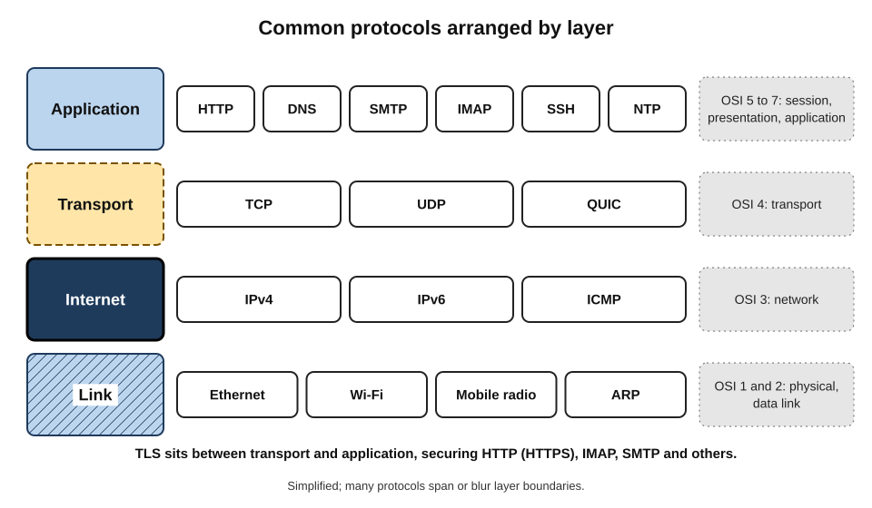
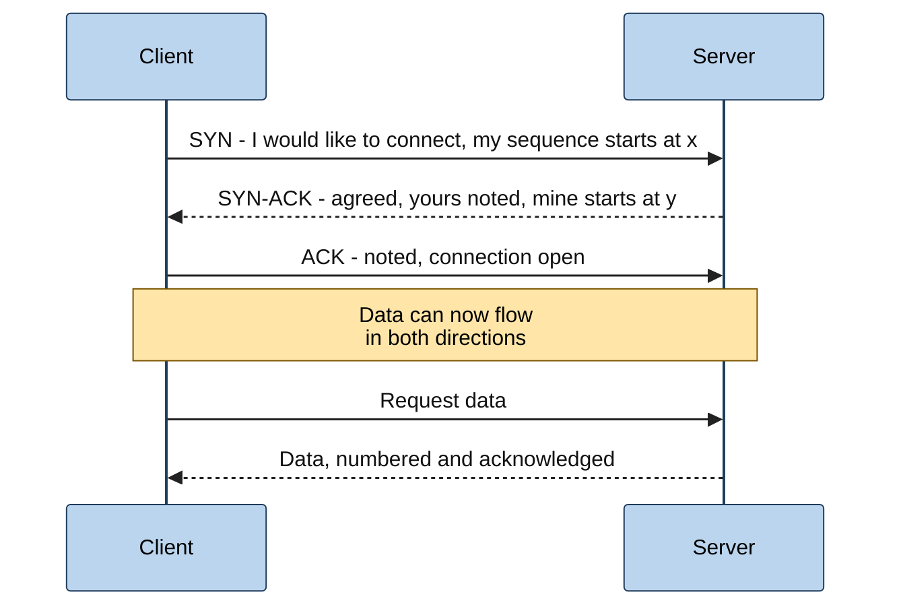
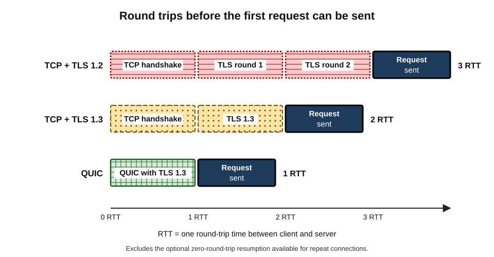
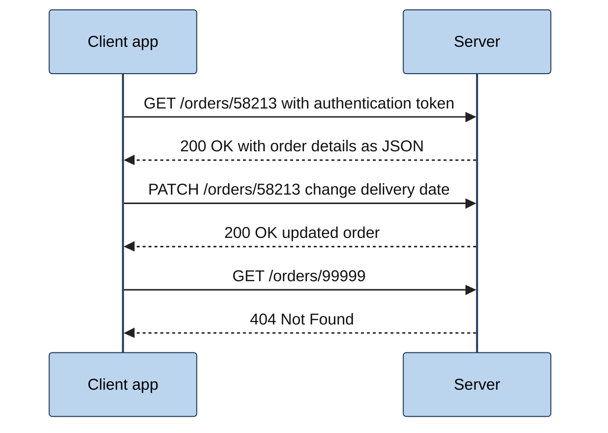
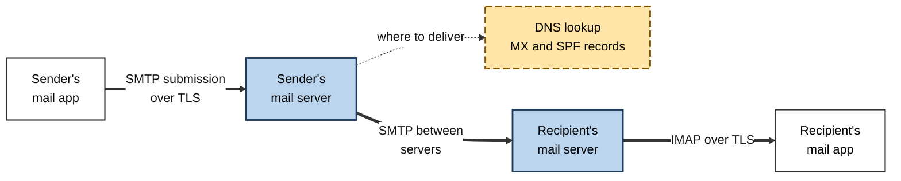

# B.9. Internet Protocols Overview

Two diplomats who share no language can still negotiate if they agree on an interpreter, on who speaks first, on how to signal agreement and on what to do if a message is misheard. Computers made by different companies, running different software in different countries, communicate on the Internet in exactly this way — by following shared, written rules called **protocols**. Several dozen of them are at work every time someone opens an app.

> **Definition — Protocol:** a formally specified set of rules that defines the **format** of messages, their **meaning**, the **order** in which they are exchanged and the **actions** to take on sending, receiving or failing to receive them.

**Why protocols matter**

- They are what makes the Internet **interoperable**: any device that follows the rules can talk to any other.
- They decide **what is possible** — speed, reliability, security and privacy are properties of the protocols in use.
- Many professional decisions — firewall rules, API design, which legacy systems to retire, how to secure email — are **decisions about protocols**.
- Most serious security incidents involve either a weak protocol, a badly implemented one or one used in the wrong way.

---

## What a Protocol Specifies

### Three elements

- **Syntax** — the structure of messages: which fields, in what order, of what size.
  - *e.g.* an IP packet header begins with a version number, then length fields, then addresses.
- **Semantics** — what each field and message means and what the receiver should do.
  - *e.g.* a "404" status in a web response means "not found".
- **Timing and sequence** — who speaks when, how long to wait, what happens after silence.
  - *e.g.* if an acknowledgement does not arrive in time, retransmit.

> **Example:** a telephone call follows an informal protocol: the caller dials, the callee answers with a greeting, the caller identifies themselves, both take turns, someone signals the end, both say goodbye. Breaking the protocol — silence after answering, hanging up mid-sentence — causes confusion. Computer protocols make every such rule explicit.

### Open standards

- **Internet protocols are mostly open standards** — published specifications that anyone may implement without paying royalties.
- **Benefits:**
  - competing vendors interoperate;
  - users are not locked in to one supplier;
  - independent experts can review designs for flaws.
- **Proprietary protocols** still exist, especially inside particular products (messaging apps, gaming, some industrial systems), but usually run **on top of** open Internet protocols.

> **Key point:** the openness of the core protocols is a large part of why the Internet won over closed networks — and why any organisation can build on it.

---

## Who Writes the Rules

### The main standards bodies

- **Internet Engineering Task Force (IETF)** — develops the core Internet protocols (IP, TCP, UDP, DNS, HTTP, TLS, email), published as **RFCs**.
  - Open to anyone; work done in mailing lists and meetings; decisions by **rough consensus** and demonstrated implementations.
- **World Wide Web Consortium (W3C)** — web technologies such as HTML, CSS and accessibility guidelines; some web standards are maintained by browser-maker groups.
- **IEEE** — local and wireless network standards, notably **802.3 (Ethernet)** and **802.11 (Wi-Fi)**.
- **3GPP** — mobile network standards (4G, 5G), bringing together telecommunications standards organisations.
- **ITU-T** — the telecommunications standards arm of the United Nations' International Telecommunication Union; strong in telephony, video coding and optical transport.

| | IETF | W3C | IEEE 802 | 3GPP | ITU-T |
|---|---|---|---|---|---|
| Main focus | Internet protocols | Web technologies | Local and wireless networks | Mobile networks | Telecommunications |
| Membership | Open to individuals | Organisational members | Professional members, corporate participants | Telecom standards bodies and companies | Governments and sector members |
| Typical output | RFCs (IP, TCP, HTTP, TLS) | Recommendations (HTML, accessibility) | Standards (Ethernet, Wi-Fi) | Releases (LTE, 5G) | Recommendations (video coding, transport) |
| Decision style | Rough consensus | Consensus with member review | Balloting | Consensus among members | Consensus among member states |

> **Definition — RFC (Request for Comments):** a numbered document published by the Internet's standards process; some RFCs are standards, others are informational, experimental or historical.

> **Watch out:** not every RFC is a standard. Some are informational, experimental, or even jokes published on 1 April. Professionals check an RFC's **status** before treating it as authoritative.

---

## Layering: How Protocols Fit Together

### Why layers

- **Divide and conquer** — each layer solves one problem and relies on the layer below.
- **Independence** — a layer can change (copper to fibre, HTTP/1.1 to HTTP/3) without the others changing.
- **Reuse** — one transport protocol serves thousands of applications.

### Two models

- **The Internet (TCP/IP) model** — four layers that match the protocols actually used:
  1. **Link** — moving frames across one physical network.
  2. **Internet** — moving packets between networks.
  3. **Transport** — delivering data between programs on two hosts.
  4. **Application** — the services people and programs use.
- **The OSI model** — seven layers, used mainly as a teaching vocabulary:
  - physical, data link, network, transport, session, presentation, application.

**Figure 1.** Common protocols arranged by layer.

| OSI layer (number) | Internet model layer | Example protocols | Example of a problem at this layer |
|---|---|---|---|
| Physical (1) and data link (2) | Link | Ethernet, Wi-Fi, mobile radio | Unplugged cable; weak Wi-Fi |
| Network (3) | Internet | IPv4, IPv6, ICMP | Wrong address; routing failure |
| Transport (4) | Transport | TCP, UDP, QUIC | Blocked port; congestion |
| Session (5), presentation (6), application (7) | Application | HTTP, DNS, SMTP, IMAP, SSH, TLS | Expired certificate; server error |

> **Mnemonic — "Please Do Not Throw Sausage Pizza Away":** Physical, Data link, Network, Transport, Session, Presentation, Application — the seven OSI layers from the bottom.

> **In practice:** engineers say "a layer-1 problem" (physical), "layer 3" (IP and routing) or "layer 7" (application) as shorthand, even though the Internet itself uses the four-layer model.

---

## The Lower Layers in Brief

### Link layer

- **Ethernet and Wi-Fi** — deliver frames between devices on the same local network using hardware (MAC) addresses.
- **ARP (Address Resolution Protocol)** — in IPv4, finds which hardware address belongs to a given local IP address; IPv6 has an equivalent (neighbour discovery).

> **Definition — MAC address:** a hardware identifier assigned to a network interface, used for delivery within a local network.

### Internet layer

- **IP** — addressing and forwarding of packets between networks; best-effort.
- **ICMP** — control and error messages: "destination unreachable", "time exceeded".
  - The familiar **ping** tool uses ICMP echo messages to test whether a host is reachable and how long a round trip takes.

---

## Transport Protocols

### Ports: which program?

- An IP address identifies a host; a **port number** (0–65,535) identifies the **program or service** on that host.
- **Well-known ports** (0–1023) are conventionally assigned to standard services.

> **Definition — Port:** a number that identifies a specific process or service on a host, allowing many network conversations to share one IP address.

- **22 — SSH** — secure remote administration.
- **25 — SMTP** — email transfer between servers.
- **53 — DNS** — name resolution.
- **80 — HTTP** — unencrypted web traffic.
- **443 — HTTPS (and QUIC)** — encrypted web traffic.
- **587 — SMTP submission** — email sent from users' mail programs.
- **993 — IMAP over TLS** — encrypted mailbox access.
- **3389 — RDP** — remote desktop for Windows systems.

> **Watch out:** ports are **conventions**, not guarantees. Malware can use port 443 to blend in with web traffic, and services can run on any port. Firewalls that judge traffic by port alone are easily misled.

### TCP: reliable streams

> **Definition — TCP (Transmission Control Protocol):** a connection-oriented transport protocol that delivers a reliable, ordered stream of bytes between two programs, with flow control and congestion control.

- **Connection set-up** — a three-step exchange (the "three-way handshake") before data flows.
- **Reliability** — numbering, acknowledgement and retransmission of data.
- **Ordering** — data delivered to the application in the order sent.
- **Flow control** — the receiver tells the sender how much it can accept.
- **Congestion control** — the sender slows when the network shows signs of overload.
- **Typical uses** — web pages (traditionally), email, file transfers, database connections.

**Figure 2.** Opening a TCP connection with the three-way handshake.

> **Mnemonic — "SYN, SYN-ACK, ACK":** "Shall we? — Yes, shall we? — Yes."

### UDP: fast and simple

> **Definition — UDP (User Datagram Protocol):** a connectionless transport protocol that sends independent messages (datagrams) without guaranteeing delivery, order or protection against duplication.

- **No set-up, no retransmission, minimal overhead.**
- **Typical uses** — DNS queries, live voice and video, online games, streaming telemetry, and as a base for newer protocols.
- **The application decides** what to do about loss — often nothing, because late data is useless in real-time communication.

### QUIC: a modern transport

- **Developed** at Google in the early 2010s and standardised by the IETF in **2021**.
- **Runs over UDP** but provides reliable, ordered streams like TCP.
- **Key improvements:**
  - **built-in encryption** (using TLS 1.3) — even most transport-control information is protected;
  - **faster connection set-up** — security and transport negotiated together, saving round trips;
  - **independent streams** — loss affecting one stream does not stall others (avoiding "head-of-line blocking");
  - **connection migration** — a phone moving from Wi-Fi to mobile data can keep its connection.
- **Used by HTTP/3**, now carrying a substantial share of web traffic to large providers.

| | TCP | UDP | QUIC |
|---|---|---|---|
| Connection set-up | Yes, handshake | None | Yes, combined with encryption |
| Reliable and ordered | Yes | No | Yes, per stream |
| Built-in encryption | No (TLS added on top) | No | Yes |
| Behaviour when one packet is lost | Whole stream waits | Application decides | Only the affected stream waits |
| Typical uses | Traditional web, email, databases | DNS, real-time media, games | HTTP/3, modern apps |

> **Key point:** QUIC shows how protocols evolve: rather than change TCP inside every operating system and network device — slow and fraught — designers built a new transport on top of UDP, which networks already let through.

---

## Security Protocols

### TLS: the padlock

> **Definition — TLS (Transport Layer Security):** a protocol that provides encryption, integrity checking and server (optionally client) authentication for data exchanged between applications; the successor to SSL.

- **What TLS does:**
  1. **Authenticates** the server using a **digital certificate** issued by a trusted certificate authority — proving the server controls the domain name.
  2. **Agrees keys** securely so that only the two ends can decrypt the traffic.
  3. **Encrypts and protects** each message against reading and tampering.
- **Versions:**
  - SSL (1990s) and early TLS versions are now **obsolete and insecure**;
  - TLS 1.0 and 1.1 were formally deprecated in 2021;
  - **TLS 1.2** remains widely used; **TLS 1.3** (2018) is faster and removes weak options.
- **HTTPS** = HTTP carried inside TLS; it is now the default for the large majority of web traffic.
- **Post-quantum key exchange** — because future quantum computers could break today's key-exchange methods, providers began combining classical and **post-quantum** algorithms; by the end of 2025, one large network provider reported that around half of the human-generated traffic it carried was protected this way.

> **Definition — Digital certificate:** an electronic document, signed by a certificate authority, that binds a public key to a domain name or organisation.

> **Watch out:** "SSL" is still used loosely to mean TLS ("SSL certificate"). The old SSL protocol itself is broken and should be disabled everywhere.

### Other security protocols

- **SSH (Secure Shell)** — encrypted remote command-line access and file transfer; replaced insecure Telnet.
- **IPsec** — encrypts traffic at the IP layer; widely used for site-to-site VPNs.
- **WireGuard** — a modern, simple VPN protocol.
- **DNSSEC** — signs DNS data to prove authenticity.
- **S/MIME and OpenPGP** — encrypt and sign email messages end to end.

**Figure 3.** Round trips needed before the first useful data can be sent.

> **Formula — Set-up delay:** set-up round trips × round-trip time. Example: with a 150 ms round trip, TCP + TLS 1.2 (3 round trips) ≈ **450 ms** before the request, TCP + TLS 1.3 (2) ≈ **300 ms**, QUIC (1) ≈ **150 ms**.

---

## Application Protocols

### HTTP: the web's protocol

> **Definition — HTTP (Hypertext Transfer Protocol):** an application protocol in which a client sends a request (method, path, headers, optional body) and a server returns a response (status code, headers, optional body); the foundation of the web and of most APIs.

- **Requests** use **methods**:
  - **GET** — retrieve a resource;
  - **POST** — submit data;
  - **PUT / PATCH** — replace or modify;
  - **DELETE** — remove.
- **Responses** carry **status codes**:
  - **2xx** success (*200 OK*);
  - **3xx** redirection (*301 Moved Permanently*);
  - **4xx** client error (*403 Forbidden*, *404 Not Found*, *429 Too Many Requests*);
  - **5xx** server error (*500 Internal Server Error*, *503 Service Unavailable*).
- **Headers** carry metadata: content type, caching rules, cookies, authentication.
- **Stateless** — each request stands alone; continuity (being "logged in") is added with cookies or tokens.

**Figure 4.** A simple HTTP exchange.

| | HTTP/1.1 (1997) | HTTP/2 (2015) | HTTP/3 (2022) |
|---|---|---|---|
| Transport | TCP | TCP | QUIC over UDP |
| Format | Text | Binary frames | Binary frames |
| Many requests at once | Several parallel connections | Many streams on one connection | Many independent streams |
| Effect of one lost packet | Delays that connection | Delays all streams on the connection | Delays only the affected stream |
| Encryption | Optional | Effectively always (in browsers) | Always |

> **Remember:** **2xx** worked, **3xx** go elsewhere, **4xx** the client asked wrongly, **5xx** the server failed.

### Email protocols

- **SMTP** — moves mail from the sender's program to its mail server and between mail servers.
- **IMAP** — lets a mail program read and manage messages kept on the server, synchronised across devices.
- **POP3** — older; downloads messages to one device, often deleting them from the server.
- **Authentication records** (SPF, DKIM, DMARC) published in DNS help receivers detect forged senders.

**Figure 5.** Protocols involved in sending and reading an email.

### Other everyday application protocols

- **DNS** — name resolution, usually over UDP port 53, increasingly encrypted.
- **DHCP** — automatic address configuration.
- **NTP** — synchronises device clocks; accurate time is essential for security certificates, logs and financial transactions.
- **SSH and SFTP** — secure administration and file transfer.
- **WebSocket** — keeps a two-way channel open for live updates (chat, dashboards).
- **WebRTC, SIP and RTP** — real-time voice and video between browsers and apps.
- **MQTT** — lightweight publish-and-subscribe messaging for sensors and IoT devices.

---

## A Worked Example (illustrative): Protocols in One Video Call

Situation: a project manager joins a scheduled video meeting from a laptop on office Wi-Fi.

1. **Wi-Fi (802.11) with WPA3** — the laptop is connected and encrypted over the air.
2. **DHCP** — the laptop already holds an IP address and DNS settings.
3. **DNS** — the meeting app resolves the provider's server names.
4. **TCP or QUIC + TLS** — the app signs in and fetches the meeting details over HTTPS.
5. **HTTP** — the app's API calls retrieve participant lists and chat messages; a WebSocket may keep live updates flowing.
6. **UDP-based media** — audio and video stream in real time over UDP, encrypted, tolerating occasional loss rather than waiting for retransmissions.
7. **Fallback** — if the office firewall blocks UDP, the app falls back to sending media over TCP port 443 — usually with worse quality.
8. **NTP** — accurate clocks keep certificates valid and logs consistent.

> **Key point:** even a simple everyday task depends on **a dozen protocols across all layers**, each from a different standards tradition, all interoperating invisibly.

> **Watch out:** "the video call is bad, so the bandwidth is too low" is often wrong. Firewalls forcing media over TCP, Wi-Fi interference and high latency or jitter are frequent causes even when bandwidth is ample.

---

## Case Study: Heartbleed — When an Implementation Fails

- **Situation:** in April 2014, researchers disclosed a flaw, nicknamed **Heartbleed**, in **OpenSSL**, the open-source software library that implemented TLS for a large share of the world's web servers.
- **The bug:**
  - a TLS extension let one side send a small "heartbeat" message asking the other to echo it back;
  - OpenSSL failed to check that the claimed length of the message matched its real length;
  - an attacker could request up to 64 kilobytes of the server's memory repeatedly — memory that might contain **private keys, passwords and session data**.
- **Scale:** a large fraction of secure web servers were initially estimated to be affected, along with many devices and appliances.
- **Response:**
  1. a patched version was released and urgently deployed;
  2. organisations **replaced certificates and keys**, as they could not know whether keys had been stolen;
  3. users were advised to change passwords on affected services.
- **Wider consequences:**
  - the discovery that critical Internet software was maintained by a handful of mostly volunteer developers with little funding;
  - new industry funding initiatives for critical open-source projects;
  - greater attention to memory-safe programming and code auditing.
- **Lessons:**
  - the **protocol** (TLS) was sound; the **implementation** failed;
  - widely shared components create **systemic risk**;
  - incident response must include **key rotation**, not only patching.

---

## Protocols in Professional Practice

### Decisions that are really protocol decisions

- **Firewall and network policy** — which protocols and ports are allowed in and out; blocking legacy and risky ones (Telnet, unencrypted FTP, old file-sharing protocols) at the boundary.
- **Retiring weak protocols** — disabling SSL and TLS 1.0/1.1, insecure Wi-Fi modes, POP3 without encryption.
- **API design** — choosing HTTP-based REST APIs for broad compatibility, binary RPC frameworks for internal speed, WebSockets or streaming for real-time data.
- **Email security** — enforcing TLS between servers; publishing SPF, DKIM and DMARC.
- **Remote access** — exposing remote desktop (RDP, port 3389) directly to the Internet is a common route for ransomware; place it behind a VPN or identity-aware gateway.
- **Observability** — encryption hides content from network monitoring, so visibility shifts to endpoints and application logs.

> **In practice:** a security baseline usually lists **approved protocols and versions** (*e.g.* TLS 1.2 or above, SSH not Telnet, SFTP not FTP, IMAP over TLS not plain POP3) and is checked automatically across the estate.

### Protocols for cloud and AI services

- **Cloud APIs** are almost all **HTTPS-based**, using JSON or binary formats; authentication tokens travel in headers.
- **AI model APIs** follow the same pattern: an HTTPS request carrying the prompt; the response is often **streamed** back token by token, using server-sent events or similar techniques over HTTP.
- **Emerging agent protocols** — standard ways for AI assistants to discover and call tools, data sources and other agents have appeared since 2024, generally layered on HTTP and JSON.
- **Inside AI data centres** — specialised high-speed protocols move data between processors, a field distinct from Internet protocols.

---

## Protocol Evolution and Ossification

> **Definition — Ossification:** the hardening of the Internet against change, as network devices that inspect or modify traffic (firewalls, load balancers, "middleboxes") come to assume old protocol behaviour and break anything new.

- **The problem** — new features in TCP were often blocked or mangled by equipment that "expected" old patterns.
- **The response** — encrypt more of each protocol (as QUIC does) so intermediaries cannot depend on details they should not see; deliberately send unusual values ("greasing") so implementations stay tolerant of change.
- **The tension** — operators lose visibility into traffic they used to manage and secure.

| | Visible protocols (older designs) | Encrypted protocols (newer designs) |
|---|---|---|
| Network operators can inspect | Most headers, often content | Very little |
| Ease of introducing new features | Low — middleboxes interfere | Higher — fewer assumptions possible |
| User privacy | Lower | Higher |
| Network troubleshooting | Easier from the network | Shifts to endpoints and logs |
| Example | HTTP/1.1 over TCP | HTTP/3 over QUIC |

---

## How a Protocol Becomes a Standard

### The IETF path

1. **Problem and interest** — engineers identify a need (*e.g.* faster secure connections) and discuss it on open mailing lists or at a meeting.
2. **Working group** — if there is enough interest and a clear scope, a working group is chartered, with chairs and milestones.
3. **Internet-Drafts** — proposals are written as drafts, which expire after six months unless revised; anyone may comment.
4. **Implementation and testing** — independent teams build the protocol and test interoperability, often at "hackathons" and interoperability events.
5. **Rough consensus** — the working group converges; objections must be addressed, not simply outvoted.
6. **Review and approval** — area directors and the Internet Engineering Steering Group review the draft for quality and conflicts with other standards.
7. **Publication as an RFC** — on the standards track (Proposed Standard, then possibly Internet Standard), or as informational or experimental.
8. **Evolution** — errata, updates and, eventually, replacement by newer RFCs.

> **Example:** QUIC began as an experiment by one company, was brought to the IETF in 2016, went through years of drafts and interoperability testing among many independent implementations, and was published as a standard in 2021 — substantially changed and improved from the original.

### Why the process matters to practitioners

- **Interoperability** — standards tested by many implementers reduce the risk of lock-in to one vendor's behaviour.
- **Security review** — open drafts attract scrutiny from academic and industry cryptographers before deployment.
- **Influence** — organisations that depend on a protocol can send engineers to shape it; participation is open to individuals.
- **Timing** — standards take years; organisations adopting a draft early accept the risk of later changes.

| | Open standard protocol | Proprietary protocol |
|---|---|---|
| Specification | Published and free to implement | Controlled by one company, often unpublished |
| Implementations | Many, from different vendors and open-source projects | Usually one, from the owner |
| Review | Public scrutiny | Limited to the owner and selected parties |
| Change | Through an open process | At the owner's discretion |
| Risk for users | Slower evolution | Lock-in; disappearance if the owner withdraws support |

---

## Diagnosing Problems by Protocol

| Symptom | Layer most likely involved | Typical check |
|---|---|---|
| No network at all | Link | Cable, Wi-Fi association, address assigned |
| Local network works, Internet does not | Internet | Ping the router, then an external address |
| Addresses reachable, names not | Application (DNS) | Try another resolver |
| Some services work, one port blocked | Transport | Firewall rules for that port |
| "Your connection is not private" warning | Security (TLS) | Certificate validity, device clock, interception by an intermediary |
| Page loads but shows an error code | Application (HTTP) | Status code and server logs |

> **Key point:** the layered design of protocols gives a **systematic order for troubleshooting** — start at the bottom and work up until the failing layer is found.

---

## Open Questions

- **How should networks be managed when most traffic is encrypted?**
  - Privacy gains are clear; operators and security teams are still adapting their monitoring.
- **How fast must cryptography move to post-quantum algorithms?**
  - Key exchange is migrating quickly; certificates and signatures are harder, and the timeline for practical quantum attacks is uncertain.
- **Will QUIC replace TCP for most traffic?**
  - It is growing on the web, but TCP remains embedded in enterprise systems, databases and devices.
- **Who should fund critical open-source protocol implementations?**
  - Heartbleed exposed under-investment; funding has improved but remains uneven.
- **Will AI agents need new Internet protocols?**
  - Agent-to-tool and agent-to-agent standards are young and competing; whether they will converge, and how they will be secured, is unresolved.

---

## Summary

- A **protocol** specifies **syntax, semantics and timing** of message exchange; Internet protocols are mainly **open standards**.
- Standards come from the **IETF** (RFCs), **W3C**, **IEEE 802**, **3GPP** and **ITU-T**; not every RFC is a standard.
- Protocols are **layered**: the four-layer **Internet model** (link, internet, transport, application) and the seven-layer **OSI** teaching model.
- **IP** and **ICMP** work at the internet layer; **Ethernet, Wi-Fi and ARP** at the link layer.
- **Ports** identify services; well-known examples: 22 SSH, 25 SMTP, 53 DNS, 80 HTTP, 443 HTTPS, 3389 RDP.
- **TCP** gives reliable ordered streams (three-way handshake, flow and congestion control); **UDP** is fast and unreliable; **QUIC** (2021) runs over UDP with built-in encryption, faster set-up and independent streams.
- **TLS** authenticates servers with **certificates** and encrypts traffic; TLS 1.3 is current; SSL and TLS 1.0/1.1 are obsolete; post-quantum key exchange is spreading.
- **HTTP** uses methods (GET, POST…) and status codes (2xx–5xx); HTTP/2 and HTTP/3 improve performance. Email uses **SMTP** and **IMAP**.
- **Heartbleed (2014)** showed that a sound protocol can fail through its **implementation**, creating systemic risk.
- Professional practice: approved protocol baselines, retiring weak protocols, careful API and remote-access design; cloud and AI APIs ride on **HTTPS**; **ossification** drives protocols to encrypt more.

---

## Self-Check

1. Define a protocol and explain its three elements with an example of each.
2. Why are open standards important for the Internet?
3. Name the main standards body for each of: TCP, Wi-Fi, 5G, HTML.
4. Why should an RFC's status be checked?
5. List the four Internet-model layers and an example protocol at each.
6. What is a port, and what are the default ports for HTTPS, DNS and SSH?
7. Describe TCP's three-way handshake and three services TCP provides.
8. Why do live voice and games often use UDP?
9. List four improvements QUIC offers over TCP + TLS.
10. What three things does TLS do, and which TLS versions should no longer be used?
11. Calculate the set-up delay with a 100 ms round trip for TCP + TLS 1.2, TCP + TLS 1.3 and QUIC.
12. Interpret the HTTP status codes 200, 301, 404, 429 and 503.
13. Distinguish SMTP, IMAP and POP3.
14. Summarise Heartbleed and explain the difference between a protocol flaw and an implementation flaw.
15. An organisation allows remote desktop (port 3389) directly from the Internet "for convenience" and still accepts TLS 1.0. Assess the risks and recommend changes.

### Answer Key

1. A formally specified set of rules for message format, meaning, order and actions. Syntax: the fields of an IP header. Semantics: "404" means not found. Timing: retransmit if no acknowledgement arrives in time.
2. Anyone can implement them without royalties, so different vendors interoperate, users avoid lock-in and experts can review designs.
3. TCP: IETF; Wi-Fi: IEEE 802.11; 5G: 3GPP; HTML: W3C (with browser-maker groups).
4. RFCs include informational, experimental, historic and even humorous documents; only standards-track RFCs define standards.
5. Link (Ethernet, Wi-Fi); Internet (IP); Transport (TCP, UDP, QUIC); Application (HTTP, DNS, SMTP).
6. A number identifying a service or process on a host. HTTPS 443, DNS 53, SSH 22.
7. SYN, SYN-ACK, ACK establish the connection and initial sequence numbers. TCP provides reliability (acknowledgement and retransmission), ordering, flow control and congestion control.
8. Late data is useless in real time; waiting for retransmission adds delay, so applications tolerate loss instead.
9. Built-in encryption; fewer round trips to set up; independent streams avoiding head-of-line blocking; connection migration between networks.
10. Authenticates the server with a certificate, agrees keys securely, encrypts and integrity-protects traffic. SSL and TLS 1.0/1.1 should no longer be used.
11. TCP + TLS 1.2: 3 × 100 = 300 ms; TCP + TLS 1.3: 2 × 100 = 200 ms; QUIC: 1 × 100 = 100 ms.
12. 200: success. 301: moved permanently (redirect). 404: not found. 429: too many requests (rate limited). 503: service unavailable.
13. SMTP sends mail from clients to servers and between servers; IMAP reads and manages mail on the server, synchronised across devices; POP3 downloads mail to one device, often removing it from the server.
14. A missing length check in OpenSSL's heartbeat handling let attackers read server memory, including keys and passwords. TLS itself was sound (protocol); the faulty code was in one widely used implementation.
15. Exposed RDP is a common ransomware entry route through password guessing and exploits; TLS 1.0 has known weaknesses and is deprecated. Place remote desktop behind a VPN or identity-aware gateway with multi-factor authentication, restrict and monitor access, and require TLS 1.2 or above.

---

## Glossary

| Term | Meaning |
|---|---|
| ARP | Address Resolution Protocol; maps local IPv4 addresses to hardware addresses. |
| Certificate authority | A trusted body that issues digital certificates. |
| Digital certificate | A signed document binding a public key to a name. |
| HTTP | Hypertext Transfer Protocol; request–response protocol of the web. |
| HTTP/3 | The version of HTTP that runs over QUIC. |
| ICMP | Internet Control Message Protocol; error and diagnostic messages, used by ping. |
| IETF | Internet Engineering Task Force; develops core Internet protocols. |
| IMAP | Protocol for accessing mailboxes held on a server. |
| MAC address | Hardware identifier of a network interface. |
| Ossification | Resistance of the network to protocol change caused by intermediary devices. |
| OSI model | A seven-layer reference model of network functions. |
| Port | A number identifying a service on a host. |
| Protocol | Rules for the format, meaning, order and handling of messages. |
| QUIC | Encrypted, multiplexed transport protocol running over UDP. |
| RFC | Request for Comments; numbered Internet standards-process document. |
| SMTP | Simple Mail Transfer Protocol; sends and relays email. |
| SSH | Secure Shell; encrypted remote access. |
| Status code | A three-digit HTTP result such as 200 or 404. |
| TCP | Transmission Control Protocol; reliable, ordered transport. |
| Three-way handshake | SYN, SYN-ACK, ACK exchange opening a TCP connection. |
| TLS | Transport Layer Security; encryption and authentication protocol. |
| UDP | User Datagram Protocol; simple, connectionless transport. |
| WebSocket | Protocol keeping a two-way channel open between client and server. |
