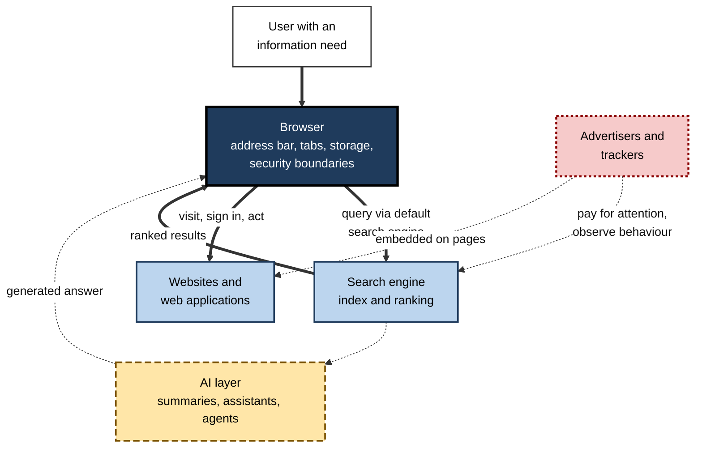
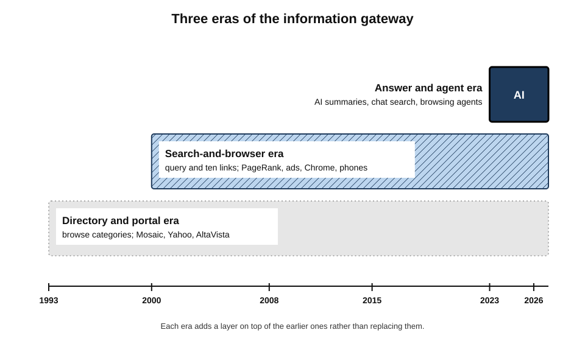
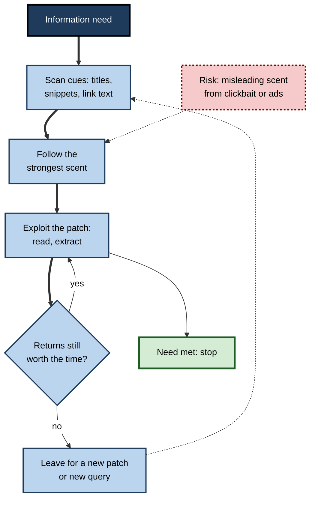
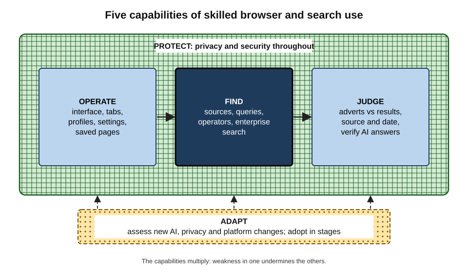
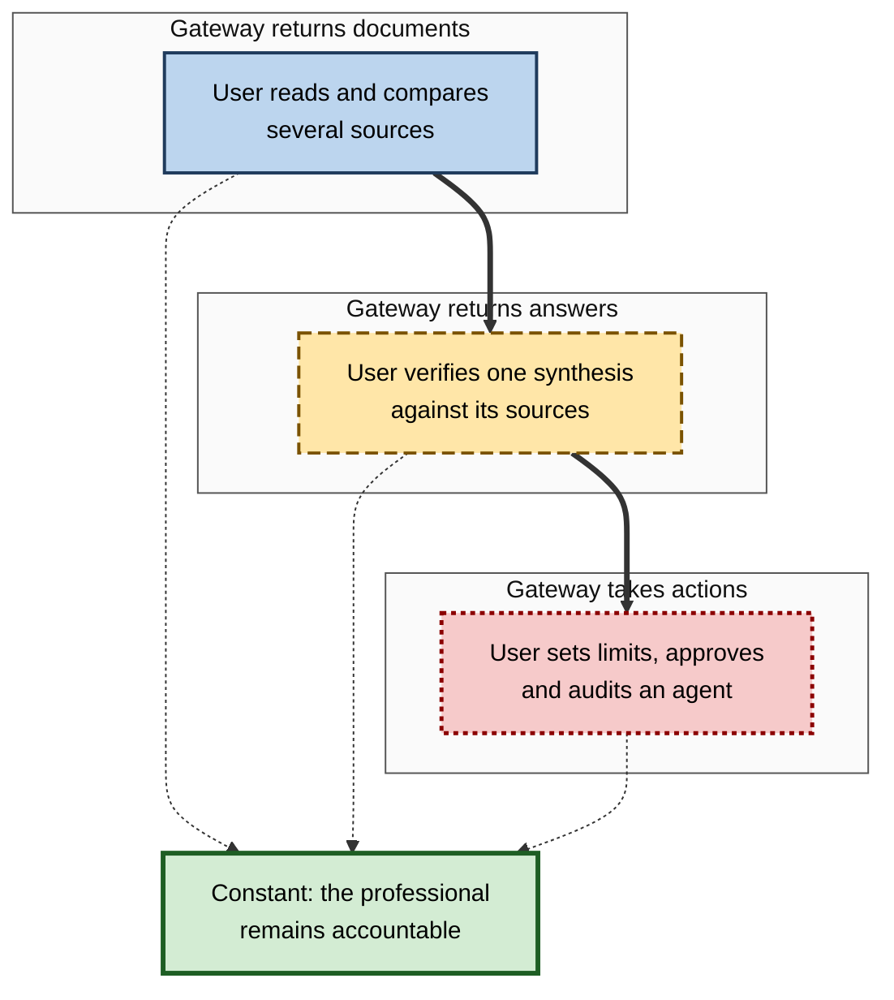

# F. Web Browsers & Search

Before most professionals have finished their first coffee, they have opened a browser a dozen times and searched several times more: to check a figure, find a form, sign in to a client system, read a policy, compare suppliers or ask an AI assistant a question. Almost everything they will know, decide and do online that day passes through two technologies — a program that fetches and displays the web, and services that decide which parts of it they see first.

Together these form the **gateway** between people and online information, and the skill with which a person uses that gateway shapes the speed, quality and safety of their work.

> **Definition — Web browsing and search:** the pair of technologies and practices through which people reach, judge and act on online information — the **browser**, which retrieves, renders and isolates web content on the user's device, and **search systems**, which index content in advance and rank it, or synthesise answers from it, in response to queries.

**Why it matters**

- **It is the universal starting point.** Research, purchasing, learning, collaboration and most business applications begin in a browser, very often with a query.
- **It filters what is known.** What ranks first, or what an AI answer chooses to say, is what most people read and believe.
- **It is where attacks land.** Phishing, malicious downloads, scam adverts and session theft all arrive through the gateway.
- **It is economically central.** Search advertising funds most browser development and much of the free web.
- **It is changing fast.** AI answers and agents are altering how people search, what they click and what websites can sustain.

---

## The Gateway: How Browser and Search Fit Together

### Two halves of one system

- **The browser** is the **client**: software on the user's device that fetches pages, runs their code, stores data, enforces security boundaries and presents everything through an interface.
- **The search engine** is a **service**: a system that crawls and indexes the web in advance and ranks matches for each query — itself a website reached through the browser.
- **The fusion point** is the address bar. Since 2008, when Chrome and Firefox combined address entry and search in one box, typing anything that is not an address sends it to a **default search engine**. For most users the browser and the search engine now feel like one tool.
- **The newest layer** is generative AI: assistants inside the browser, AI summaries on results pages, and agents that act on websites.

> **Definition — Information gateway:** the combination of software, defaults and services that stands between a person and the information they seek, determining what they can reach, what they see first and how safely they can act on it.

**Figure 1.** The information gateway: how a request flows from user to browser, search and AI layers, and on to the sites that hold the information.

### Control points

The gateway contains a small number of **control points** — places where one decision shapes the behaviour of millions of people.

- **The default browser** on each device.
- **The default search engine** in each browser.
- **The ranking** of results and the selection of content in AI answers.
- **Security warnings and blocks** — which sites are labelled dangerous.
- **Privacy defaults** — whether cross-site tracking is allowed.
- **Extension rules** — what add-ons may see and change.

> **Key point:** most users never change a default, so whoever controls these points largely decides what people see, how they are tracked and how safe they are. A skilled user **reclaims** the control points that matter to them.

> **Definition — Default effect:** the strong tendency of people to keep pre-set options, which makes the choice of default one of the most consequential design decisions in any system.

---

## Three Eras of the Gateway

The relationship between browsing and search has changed in three broad eras, each defined by how people found information and who controlled access to it.

### The directory and portal era (about 1993–2000)

- **Graphical browsers** — Mosaic (1993) and Netscape Navigator (1994) made the web usable by non-specialists.
- **Human-edited directories** — Yahoo (1994) organised the web into categories, like a library catalogue.
- **Early full-text engines** — WebCrawler (1994) and AltaVista (1995) indexed page text, but results were easily manipulated by keyword repetition.
- **Portals** — companies tried to keep users within their own pages of news, email and links.
- **The first browser war** — Microsoft's bundling of Internet Explorer with Windows defeated Netscape, showing for the first time that **distribution beats quality** at the gateway.

### The search-and-browser era (about 2000–2022)

- **Link-based ranking** — Google's PageRank (1998) used the web's links as votes of importance, making results far more useful and turning search into the main way of finding anything.
- **Search advertising** — keyword auctions became one of the most profitable businesses ever created and the main funder of browsers through default-placement deals.
- **The second browser war** — Firefox (2004) and Chrome (2008) ended Internet Explorer's stagnation; Chrome's speed, security architecture and integration with Google search made it dominant.
- **Mobile** — the smartphone made Safari and Chrome on phones the main gateway for billions of new users.
- **Consolidation** — by the 2020s most browsing ran on two engines and most searching on one engine.

### The answer-and-agent era (2023 onward)

- **Generated answers** — chat assistants with web search, AI summaries above search results (from 2024) and conversational search modes (from 2025).
- **Agents** — browsers whose AI can navigate, click and complete tasks (2025).
- **Shifting traffic** — fewer clicks reach the original sources; publishers block AI crawlers or seek payment.
- **Regulation** — courts and regulators intervene in search and browser markets on both sides of the Atlantic.

**Figure 2.** Three eras of the information gateway.

| | Directory and portal era | Search-and-browser era | Answer-and-agent era |
|---|---|---|---|
| How people find information | Browse categories, follow links | Type a query, scan ten links | Ask a question, read an answer, delegate a task |
| What decides what is seen | Human editors | Ranking algorithms and advertising auctions | Ranking plus language models choosing what to say |
| Main skill required | Navigation | Query formulation and result evaluation | Verification of synthesised answers and supervision of agents |
| Typical failure | Out-of-date, incomplete directories | Optimised or commercial content crowding the top | Fluent but wrong or misattributed answers; manipulated agents |
| Economic engine | Banner advertising, portals | Search advertising, default deals | Unsettled — subscriptions, advertising in answers, licensing |

> **Key point:** each era **adds** a layer rather than replacing the last. AI answers are built on search indexes; search depends on browsers; all depend on the open web. Weaknesses in the lower layers flow upward.

---

## How People Actually Search and Browse

Understanding the gateway requires understanding the people who use it. Several research traditions explain observed behaviour.

### Information foraging

**Study card — Peter Pirolli and Stuart Card (1999), information foraging theory**

- **Idea:** people seek information the way animals forage for food, trying to maximise the value gained for the time spent.
- **Key concepts:**
  - **information scent** — cues (link text, titles, snippets) that suggest whether a path leads to the desired information;
  - **patches** — clusters of information, such as a site or a results page, where a forager spends time before moving on;
  - **diminishing returns** — people leave a patch when the expected gain from staying falls below what they could get elsewhere.
- **Implications:** users follow strong scent quickly and abandon pages with weak scent; well-written titles and snippets drive behaviour; manipulators exploit scent with misleading headlines.

> **Definition — Information scent:** the cues that indicate how likely a link or result is to lead to the information sought; strong scent draws users along a path, weak scent makes them abandon it.

**Figure 3.** The foraging cycle: following scent, exploiting a patch and leaving when returns diminish.

### Satisficing and trust in rank

- **Satisficing** — Herbert Simon's term for choosing the first option that is good enough rather than searching for the best. Most searchers satisfice: they click among the first few results and stop when an answer looks plausible.
- **Trust in rank** — eye-tracking and click experiments show that users favour top results even when they are less relevant, treating position as evidence of quality.
- **Consequence** — the order of results, and now the content of AI answers, has a disproportionate effect on what people conclude.

### What searching does to the searcher

**Study card — Fisher, Goddu and Keil (2015)**

- **Design:** in a series of experiments, participants either searched the internet for explanations of everyday phenomena or were given the same information without searching; they then rated their own ability to explain **unrelated** topics.
- **Results:** those who had searched rated their own knowledge of unrelated topics **higher**, even though they had learned nothing about them.
- **Conclusion:** access to search can blur the line between knowledge in one's head and knowledge one can look up, **inflating confidence**.

> **Watch out:** a widely cited 2011 study suggesting that people remember less of what they expect to be able to find online (the "Google effect") influenced thinking for years, but a central finding failed to replicate in a large 2018 replication project. The general concern about over-reliance remains plausible; the specific effect is **uncertain**.

### Unequal skill

- Early research assumed that once people had internet access, they would use it equally well. **Eszter Hargittai** (2002) described a "**second-level digital divide**": large differences in people's ability to find information online, even among those with the same access.
- Her later studies of young adults found that growing up with the internet did **not** guarantee search skill; skill varied with education and social background.
- **Implication:** browser and search skill is learned, uneven and worth teaching explicitly — including in workplaces that assume staff "know how to Google".

> **Key point:** the gateway's behaviour is shaped as much by **human tendencies** — following scent, satisficing, trusting rank, overestimating one's knowledge — as by technology. Skilled users know these tendencies and correct for them.

---

## The Economics and Power of the Gateway

### Who pays for the gateway

- **Advertising** pays for most free search, and through default deals for most browser development.
- **Platform ownership** pays for browsers that make devices and ecosystems attractive.
- **Data** — browsing and search behaviour improve advertising and products.
- **The open web** supplies the content that search ranks and AI summarises, funded by its own advertising, subscriptions and public money.

> **Key point:** the gateway is a **two-sided market**: users receive free tools; advertisers pay for users' attention. The user is both customer and product, which explains many design choices — from default tracking settings to how prominently adverts are labelled.

### Concentration and its remedies

- **Concentration** — one company has supplied the most-used browser engine, the most-used browser and the most-used search engine for over a decade.
- **United States** — in August 2024 a federal court found that Google had illegally maintained a monopoly in general search, partly through exclusive default deals; in September 2025 the remedies decision barred exclusive deals and required sharing of some search data with competitors, but did not require the sale of Chrome.
- **European Union** — the Digital Markets Act (applying from 2023–2024) required choice screens and allowed alternative browser engines on iPhones in the EU; the Digital Services Act requires very large search engines to assess and reduce systemic risks such as the spread of illegal content and disinformation.
- **Other jurisdictions** — competition authorities in the UK, Japan, India and elsewhere have examined app stores, mobile browsers and search defaults.

**Figure 4.** The main actors at the gateway and what each controls.

```mermaid
%%{init: {'theme':'base','themeVariables':{'fontFamily':'Arial, Helvetica, sans-serif','fontSize':'15px','primaryColor':'#FFFFFF','primaryTextColor':'#111111','primaryBorderColor':'#222222','lineColor':'#333333','secondaryColor':'#F2F2F2','tertiaryColor':'#FFFFFF','clusterBkg':'#FAFAFA','clusterBorder':'#555555','edgeLabelBackground':'#FFFFFF','titleColor':'#111111'}}}%%
flowchart TD
    classDef core    fill:#1F3B5C,stroke:#000000,stroke-width:3px,color:#FFFFFF
    classDef key     fill:#BCD5EE,stroke:#1F3B5C,stroke-width:2px,color:#000000
    classDef detail  fill:#FFFFFF,stroke:#333333,stroke-width:1.5px,color:#000000
    classDef accent  fill:#FFE6A8,stroke:#7A5200,stroke-width:2px,stroke-dasharray:8 4,color:#000000

    G["Gateway control points:<br/>defaults, ranking, warnings,<br/>privacy and extension rules"]
    PL["Platform owners<br/>pre-install browsers"]
    BM["Browser makers<br/>set defaults and protections"]
    SE["Search and AI providers<br/>rank and synthesise"]
    AD["Advertisers<br/>buy attention"]
    PB["Publishers<br/>supply content"]
    RG["Regulators and courts<br/>constrain all of them"]
    OR["Organisations<br/>set policies for staff"]
    US["Users<br/>keep or change defaults"]

    PL --> G
    BM --> G
    SE --> G
    AD -.-> G
    PB -.-> G
    RG ==> G
    OR ==> G
    US ==> G

    class G core
    class PL,BM,SE key
    class AD,PB accent
    class RG,OR,US detail
```

### Ranking as editorial power

- Ranking decides which businesses gain customers, which views reach audiences and which health advice people read.
- **Search engine optimisation** is the industry that tries to influence ranking; most of it is legitimate, some is manipulation.
- **Experimental evidence** shows that biased rankings can shift the opinions of undecided people; the size of such effects outside experiments is debated.
- **Evidence on personal "filter bubbles"** in web search is weaker than often assumed: studies have found that differences in what people **choose** to click matter more than differences in what search **shows** them.

> **Watch out:** two opposite errors are common — believing that search results are neutral facts, and believing that they are personally tailored propaganda. The evidence supports a middle position: rankings are **consequential editorial choices**, shaped by algorithms, optimisation and money, and largely the same for everyone.

---

## Privacy and Security as Properties of the Whole Gateway

### The gateway sees everything

- **The browser** holds history, cookies, passwords, payment cards and access to every signed-in service.
- **The search provider** sees every query — often more revealing than browsing itself, because people search for symptoms, debts, fears and plans.
- **The account** that links browser, search, email and phone can assemble a near-complete record of a person's online life.
- **Embedded trackers** on websites observe behaviour across sites.

> **Key point:** privacy is a property of the **combination** — browser defaults, search provider, account sign-in, extensions and the sites visited — not of any single setting.

### Security has moved into the browser

- As work moved to cloud applications, the browser became the **main endpoint** for attacks: phishing pages, malicious downloads and extensions, scam adverts and theft of session cookies that bypass passwords and one-time codes.
- Browsers have strengthened greatly — sandboxing, site isolation, automatic updates, HTTPS by default, phishing warnings and phishing-resistant passkeys — so attackers increasingly target **human judgement** instead of software flaws.
- Search adds its own risks: adverts and optimised pages impersonating brands, support lines and software downloads.

| | Default-driven use | Deliberate use |
|---|---|---|
| Browser and search engine | Whatever was pre-installed | Chosen for the role, with privacy and management in mind |
| Reaching important sites | Search for the name, click the first result | Bookmarks, apps or typed addresses for sign-in, payment and support |
| Judging results | Trust the top result or the AI answer | Check source, date and purpose; open cited sources; corroborate |
| Credentials | Reused passwords, codes by text message | Password manager, passkeys, separate profiles for sensitive roles |
| Extensions and AI features | Install or enable whatever seems useful | Few, vetted, with limited access; AI features governed by data policy |
| When something seems wrong | Ignore it or keep clicking | Stop, verify independently, report |

> **In practice:** many of the most effective security and privacy gains at the gateway come from **choosing defaults once** — browser, search provider, profiles, password manager, permission settings — rather than relying on vigilance at every click.

---

## The Competence: What Skilled Use Looks Like

### Digital-competence frameworks

- The European Commission's **DigComp** framework (versions from 2013; DigComp 2.2 in 2022) places "**browsing, searching and filtering data, information and digital content**" as the first competence of its information and data literacy area, alongside evaluating and managing information.
- DigComp describes proficiency across eight levels, from performing simple searches with guidance to creating solutions for complex search problems and guiding others.
- National frameworks, such as the UK's Essential Digital Skills framework, similarly treat finding information and staying safe online as foundational for life and work.

> **Definition — DigComp:** the European Commission's Digital Competence Framework for Citizens, which defines the knowledge, skills and attitudes for using digital technologies confidently and critically, organised into five areas including information and data literacy and safety.

### Five capabilities

Skilled use of the gateway can be described as five interacting capabilities.

- **Operate** — use the browser fluently: interface, tabs and windows, profiles, saved pages, settings and shortcuts. The browser's architecture and engines, its interface conventions and its options for saving and organising pages all sit here.
- **Find** — choose where to look and formulate queries: knowing how search engines crawl, index and rank, and applying operators, filters, specialist databases and enterprise search.
- **Judge** — evaluate what is found: distinguishing adverts, summaries and organic results; checking source, date and purpose; verifying AI answers against their sources.
- **Protect** — keep self and organisation safe: understanding tracking and stored data such as cookies and caches, managing extensions, recognising deception and responding to incidents.
- **Adapt** — keep pace with change: assessing AI assistants and agents, new privacy regimes and new platforms, and adopting them in stages.

**Figure 5.** Five capabilities of skilled browser and search use.

> **Mnemonic — "O-FJ-PA" ("Oh, fudge, pay attention"):** **O**perate, **F**ind, **J**udge, **P**rotect, **A**dapt.

> **Key point:** the capabilities **multiply**. A brilliant searcher who cannot judge results spreads error efficiently; a careful judge who cannot find the authoritative source wastes hours; both are exposed if they cannot protect their sessions.

---

## From Search to Answers: What Changes for the Professional

### The shift

- **Before:** the gateway returned **documents**; the user read, compared and concluded.
- **Now:** the gateway increasingly returns **conclusions** — summaries and answers — and, with agents, **actions**.
- **Evidence on reliability (2025):**
  - an evaluation of eight AI search tools by Columbia University's Tow Center (March 2025) found them collectively wrong in more than 60 per cent of attempts to identify the source of news excerpts;
  - a study coordinated by the European Broadcasting Union and the BBC (October 2025), covering 18 countries and 14 languages, found significant issues in 45 per cent of AI assistants' answers to news questions;
  - Pew Research Center's tracking of real searches (published July 2025) found that users clicked through to a result on about 8 per cent of visits to pages with an AI summary, against about 15 per cent without.
- **Agents** — browsing agents launched in 2025 were shown within days to be vulnerable to **prompt injection**, instructions hidden in web content; their makers acknowledged that the problem may never be fully solved.

**Figure 6.** How the user's work shifts as the gateway returns answers and actions instead of documents.

> **Watch out:** the error rates above describe specific products at specific dates and will change. What will not change is the structure: the more the gateway concludes and acts on the user's behalf, the more the user's role shifts from **finding** to **verifying and supervising** — and the less visible the underlying sources become.

> **Remember:** **cite the source, not the summary**; **delegate the reversible, keep the irreversible**; **the professional remains accountable** for what the gateway produced.

---

## The Gateway in Organisations

### The browser as the workplace

- Email, documents, finance, HR, customer systems and AI tools are now mostly web applications, so the browser is effectively the organisation's **primary workspace**.
- **Managed browsers** let organisations set security baselines, control extensions, enforce updates, restrict data movement and govern AI features.
- **Enterprise search** helps staff find internal knowledge, but depends on **content governance** — titles, ownership, currency and permissions — and AI assistants built on it magnify any over-sharing of confidential files.

### Worked example: the cost of a weak gateway

A 600-person professional-services firm estimates, from a short time-tracking exercise, that each employee loses about **15 minutes a day** to re-finding documents, wrestling with poor intranet search, recovering from browser problems and checking doubtful search results.

1. **Daily loss:** 600 people × 15 minutes = 9,000 minutes = **150 hours**.
2. **Annual loss:** 150 hours × 220 working days = **33,000 hours**.
3. **Cost:** at an average loaded cost of £45 per hour, 33,000 × £45 = **£1,485,000** a year.
4. **Intervention:** a managed browser standard with shared bookmarks, best-bet results and synonym lists for internal search, and a two-hour skills session per employee.
5. **Break-even:** if the intervention recovers even **one-third** of the lost time (11,000 hours, about £495,000), it repays a substantial investment within the year.

> **Formula — Annual cost of lost time:** staff × minutes lost per day ÷ 60 × working days × hourly cost. Example: 600 × 15 ÷ 60 × 220 × £45 = **£1,485,000**.

> **Watch out:** self-reported time losses are imprecise, and widely quoted industry estimates of how much time knowledge workers spend searching come from surveys rather than measurement. Use such calculations to **size** a problem and justify a pilot, then measure actual change.

| | Unmanaged gateway | Governed gateway |
|---|---|---|
| Browser choice and settings | Individual, inconsistent | Standard build with policies, reviewed regularly |
| Extensions and AI features | Anything installed | Allow-listed, data use governed |
| Internal search | Neglected; outdated content ranks first | Owned; analytics reviewed; official content boosted |
| Sign-in and sessions | Passwords, codes, long sessions | Passkeys, conditional access, managed devices |
| Staff skills | Assumed | Taught, with trusted-source lists per function |

---

### Case study: the cost of a gateway monopoly, 2001–2006

- **Situation:** by the early 2000s Internet Explorer had won the first browser war and held around nine-tenths of usage; Internet Explorer 6 was released in 2001.
- **Problem:** with competition gone, development slowed dramatically. For about five years no major new version appeared.
- **Consequences:**
  1. **Security** — IE6's deep integration with Windows and its support for ActiveX controls made it a favourite target for malware and drive-by attacks.
  2. **Standards** — its non-standard behaviour forced developers to write separate code for "IE" and "everyone else", raising costs across the industry.
  3. **Lock-in** — organisations built internal systems that worked only in IE6, a legacy that took more than a decade to unwind.
  4. **Innovation** — features such as tabbed browsing and pop-up blocking arrived in rival browsers first.
- **Response:** Firefox (2004) offered a safer, standards-based alternative; Microsoft resumed development with IE7 (2006); Chrome (2008) raised the bar again; Microsoft finally retired Internet Explorer in 2022.
- **Lesson:** when one actor controls the gateway without competitive pressure, **security, standards and innovation suffer** — and organisations that build around a single gateway inherit its stagnation. The same concern underlies today's debates about engine concentration, search dominance and the control of AI answers.

### Case study: rebuilding an organisation's gateway for the AI era

- **Situation:** a 2,500-person engineering consultancy found in 2025 that staff were using four different browsers, a dozen unvetted AI extensions and personal AI accounts for client research.
- **Problem:** two near-miss incidents — a phishing page that captured a session cookie, and confidential client drawings pasted into a public AI tool — showed that the gateway was ungoverned.
- **Actions:**
  1. **Operate:** one managed browser standard, with separate profiles for client systems.
  2. **Find:** enterprise search re-tuned with best bets and synonyms; a trusted-source list for each discipline.
  3. **Judge:** guidance requiring that AI-generated answers in client deliverables be traced to and cited from primary sources.
  4. **Protect:** passkeys for all staff; extension allow-list; AI features in the browser enabled only under the firm's enterprise agreement.
  5. **Adapt:** a quarterly review of new browser and AI capabilities, with small pilots before wider rollout.
- **Result:** within a year, extension count per device fell sharply, phishing-driven account compromises stopped, and staff reported finding internal standards faster.
- **Side effects / caveats:** some engineers resented losing favourite extensions; an exception process and a monthly "tool request" review reduced friction.
- **Lesson:** the gateway is best treated as a **system** — browser, search, AI, identity and skills — designed deliberately, rather than as a collection of individual tools.

---

## Open Questions

- **Who will pay for the open web when answers replace visits?**
  - Search advertising and default deals funded both browsers and much publishing; AI answers reduce clicks, and no sustainable replacement model has yet emerged.
- **Can competition be restored at the gateway?**
  - Court remedies and regulation have opened some doors, but building browser engines and web-scale indexes remains extraordinarily expensive.
- **Can AI answers be made reliably accurate and attributable?**
  - Error and misattribution rates measured in 2025 were high; whether verification can safely be skipped for consequential claims is doubtful.
- **Can agents be given the user's sessions safely?**
  - Browser security was designed to keep sites apart; agents that move information between sites challenge that model, and prompt injection is unsolved.
- **How should gateway skill be taught?**
  - If people rarely see result lists, the habits of comparing sources may weaken unless deliberately cultivated.
- **Will privacy settle into two regimes?**
  - With the leading browser retaining third-party cookies while others block tracking, the web may remain divided by browser choice.

---

## Summary

- **Web browsing and search** form the **information gateway**: the browser as client that fetches, renders and isolates content; search systems that index and rank it; and a new AI layer that summarises and acts.
- The gateway has **control points** — default browser and search engine, ranking, warnings, privacy and extension rules — and the **default effect** means whoever sets them shapes most behaviour.
- Three eras: **directory and portal** (1993–2000), **search-and-browser** (2000–2022), **answer-and-agent** (2023 onward); each adds a layer, and weaknesses flow upward.
- Human behaviour is explained by **information foraging** (Pirolli and Card, 1999), **satisficing** and **trust in rank**; searching can **inflate confidence** (Fisher et al., 2015); skill is unequal (**second-level digital divide**, Hargittai, 2002).
- The gateway is a **two-sided market** funded by advertising; concentration has prompted the 2024 US monopoly ruling and 2025 remedies, and EU rules on choice and systemic risk.
- Rankings are **consequential editorial choices**, but largely the same for everyone; user choice matters more than personal filter bubbles.
- **Privacy** is a property of the whole combination; **security** has moved into the browser, and attackers target judgement.
- Skilled use combines five capabilities — **Operate, Find, Judge, Protect, Adapt** — reflected in frameworks such as **DigComp**.
- As the gateway returns answers and actions, the professional's work shifts to **verifying and supervising**, with accountability unchanged; 2025 evaluations found substantial error rates in AI answers.
- In organisations, the browser is the **workplace**; governing browser, search, AI, identity and skills as one system pays for itself.

---

## Self-Check

1. Define the information gateway and name its three layers.
2. Why did the fusion of address bar and search box in 2008 matter?
3. List four control points at the gateway and explain why defaults are so powerful.
4. Compare the three eras of the gateway in terms of how information is found and the main skill required.
5. Explain information scent and how manipulators exploit it.
6. What did Fisher, Goddu and Keil (2015) find, and what is its practical lesson?
7. What is the second-level digital divide, and why does it matter for employers?
8. Explain why the gateway is described as a two-sided market.
9. Summarise the 2024 and 2025 US court decisions on Google search.
10. What does the evidence say about personal filter bubbles in web search?
11. Why is privacy a property of the whole gateway rather than of one setting?
12. Name the five capabilities of skilled use and give one example of each.
13. How does the user's role change as the gateway returns answers and actions?
14. Using the worked example, calculate the annual cost if 300 staff each lose 10 minutes a day over 220 days at £50 per hour.
15. What lessons does the Internet Explorer 6 case offer for today's debates about the gateway?

### Answer Key

1. The combination of software, defaults and services between people and online information: the browser (client), search systems (index and ranking) and the AI layer (summaries, assistants, agents).
2. It made the default search engine receive anything typed that was not an address, so browser and search became one experience for most users and the default search deal became enormously valuable.
3. Default browser, default search engine, ranking and AI answer content, security warnings, privacy defaults, extension rules. Defaults are powerful because most people never change them, so the default effectively decides behaviour.
4. Directory era: browsing categories, navigation skill. Search era: typing queries and scanning links, query formulation and evaluation. Answer-and-agent era: asking and delegating, verification and supervision.
5. The cues — titles, snippets, link text — that signal whether a path leads to what is sought. Manipulators use misleading headlines, adverts and optimised titles to give strong scent to poor or harmful content.
6. Searching the internet for explanations led people to rate their knowledge of unrelated topics higher; access to search can inflate confidence, so professionals should test what they actually know before relying on it.
7. Large differences in people's ability to use the internet effectively, even with equal access; employers cannot assume staff search well and should teach and support the skill.
8. Users receive free browsers and search; advertisers pay for users' attention; revenue from one side funds the service to the other, shaping design choices.
9. In August 2024 a court found Google had illegally maintained a search monopoly partly through exclusive default deals; in September 2025 it barred exclusive deals and required some data sharing with competitors, but did not require the sale of Chrome and allowed default payments.
10. Measured personalisation of web results is modest; differences in what users choose to click matter more than differences in what they are shown.
11. Information about a person is spread across browser storage, search queries, account sign-ins, extensions and site trackers; protection depends on how all of these are combined.
12. Operate — profiles separating work and personal; Find — `site:` and `filetype:` searches for official documents; Judge — opening an AI answer's cited sources; Protect — passkeys and an extension allow-list; Adapt — piloting an AI browser with restricted access.
13. From reading and comparing documents, to verifying a single synthesised answer against its sources, to setting limits for, approving and auditing agents — while remaining accountable.
14. 300 × 10 ÷ 60 × 220 × £50 = 50 hours a day × 220 = 11,000 hours × £50 = **£550,000**.
15. A dominant gateway without competition stagnated, harming security, standards and innovation and locking organisations into legacy systems; concentration of engines, search and AI answers today raises similar risks, and organisations should avoid building around a single gateway's proprietary behaviour.

---

## Glossary

| Term | Meaning |
|---|---|
| Agent (browsing) | An AI system that navigates and acts on websites for the user. |
| Answer engine | A system that generates answers from retrieved sources. |
| Browser | Client software that fetches, renders and isolates web content. |
| Control point | A place in the gateway where one decision shapes many users' behaviour. |
| Default effect | The tendency to keep pre-set options. |
| DigComp | The European Commission's Digital Competence Framework for Citizens. |
| Enterprise search | Search across an organisation's internal content, respecting permissions. |
| Information foraging theory | The theory that people seek information to maximise value per unit of time. |
| Information gateway | The software, defaults and services between people and online information. |
| Information scent | Cues indicating whether a path leads to the information sought. |
| Managed browser | A browser configured and controlled by an organisation's policies. |
| Prompt injection | Hidden instructions in content that manipulate an AI system. |
| Ranking | The ordering of search results by estimated relevance and quality. |
| Satisficing | Choosing the first option that is good enough. |
| Search engine | A service that indexes content and ranks matches for queries. |
| Search engine optimisation | Efforts to improve a page's ranking in unpaid results. |
| Second-level digital divide | Differences in online skill among people with equal access. |
| Two-sided market | A market in which a platform serves two groups, one often subsidising the other. |
