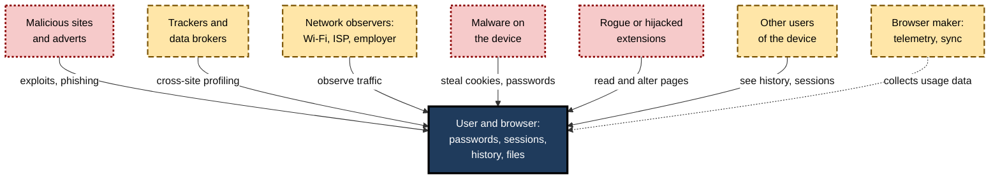
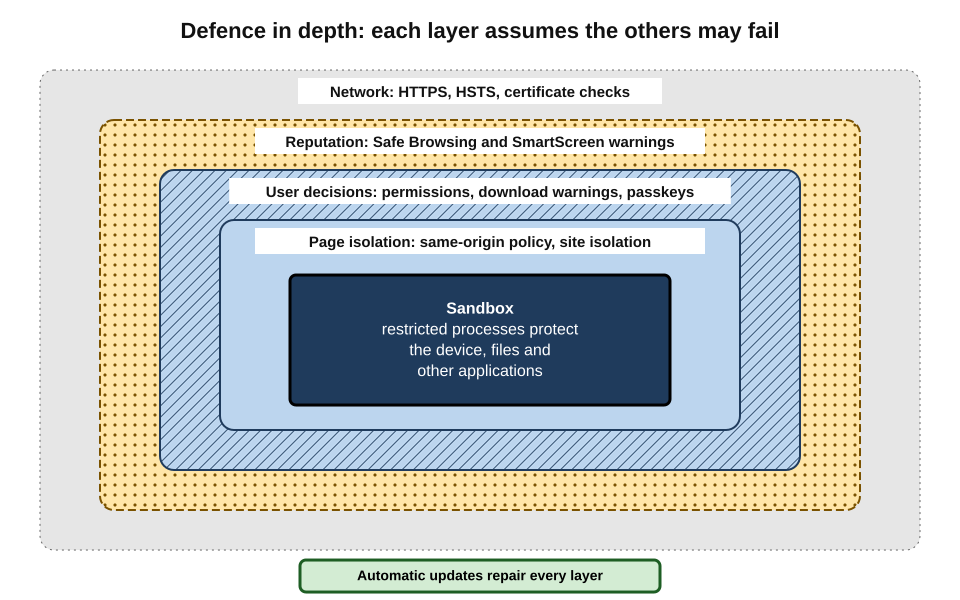
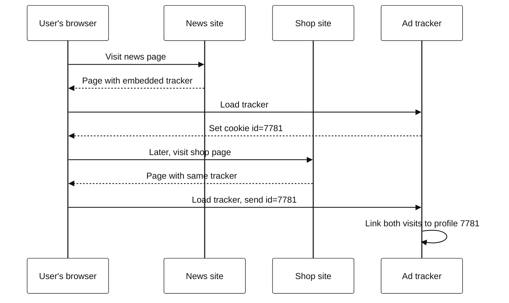
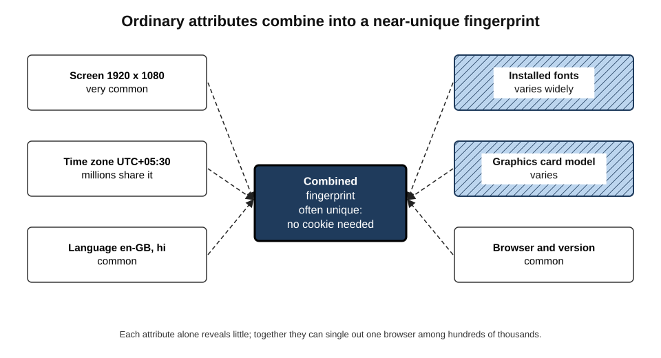
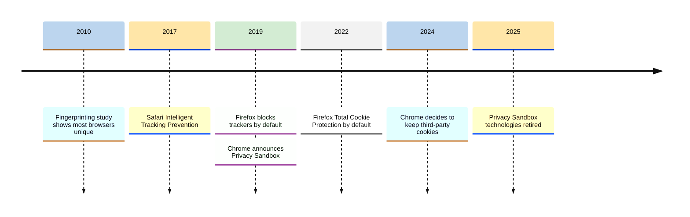
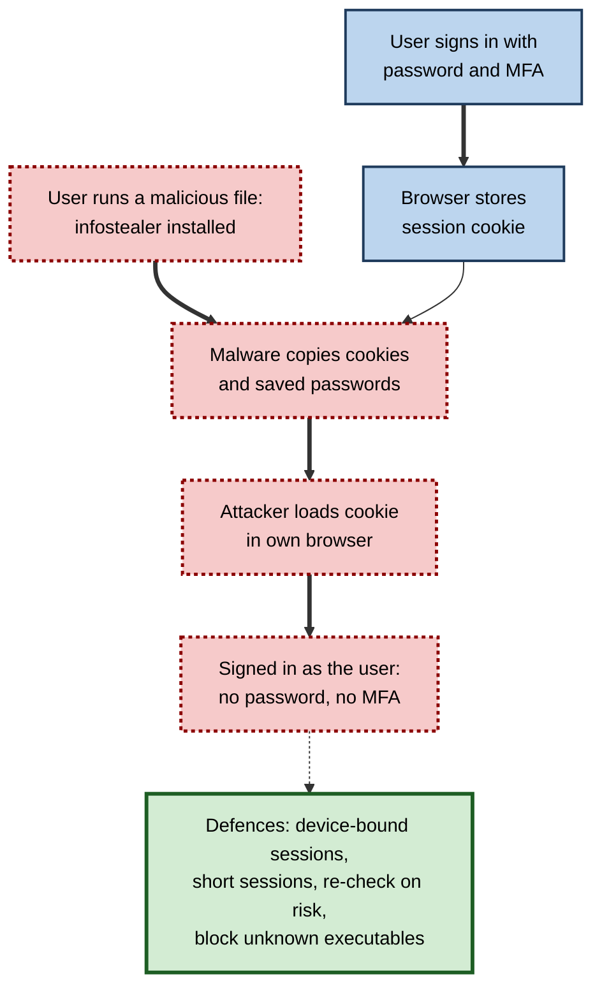

# C.10. Browser Privacy & Security

In March 2023 a popular technology channel with millions of subscribers was taken over within minutes. No password was guessed and no two-factor code was stolen: an employee had opened what looked like a sponsorship offer, which quietly copied the browser's **session cookies**, and the attackers simply resumed the employee's signed-in sessions from their own machines. The browser held the keys to everything — and the attack went around every defence that relied on signing in.

> **Definition — Browser security:** the protection of the user, the device and the user's accounts from harm caused through the browser — malicious code, deceptive sites, stolen credentials and sessions, and exploitation of browser flaws.

> **Definition — Browser privacy:** the user's control over what information about their identity and behaviour is revealed through the browser — to websites, trackers, network observers, the browser maker and others using the device.

**Why it matters**

- **The browser holds the crown jewels** — passwords, session cookies, payment details, history and access to every cloud application.
- **It runs strangers' code** on every page, so its defences are tested constantly.
- **Tracking is the web's business model** — much of the web is funded by observing users across sites.
- **Organisations' perimeter has moved** — when work happens in cloud apps, the browser is the main point of attack and control.

---

## Who Is the Adversary?

Privacy and security depend on a **threat model** — a clear view of who might cause harm and how.

> **Definition — Threat model:** a structured description of what needs protecting, from whom, by what means and with what consequences, used to choose proportionate defences.

- **Malicious websites and adverts** — attempt to exploit browser flaws, deceive users into handing over credentials or installing malware.
- **Trackers and data brokers** — follow users across sites to build profiles for advertising or sale.
- **Network observers** — public Wi-Fi operators, internet providers, employers' networks, governments; see traffic that is not encrypted, and metadata even when it is.
- **Malware on the device** — "infostealers" that read the browser's stored passwords and cookies.
- **Other users of the device** — family, colleagues, anyone with physical access.
- **The browser maker and its partners** — receive telemetry, sync data and, in some modes, browsing information.
- **Malicious or compromised extensions** — run inside the browser with broad access.

**Figure 1.** The parties that can threaten a user's privacy or security through the browser.

> **Key point:** defences differ by adversary. A **private window** protects against other users of the device; **tracking protection** against trackers; **HTTPS** against network observers; **updates and the sandbox** against exploits. No single setting protects against all.

---

## How the Browser Defends the User

### Layers of defence

- **The sandbox and site isolation** — page code runs in restricted processes, separated by site, so a flaw in one page cannot easily reach the device or other sites.
- **The same-origin policy** — scripts from one site cannot read another site's data.
- **Automatic updates** — fixes delivered within days of discovery.
- **HTTPS and certificate checks** — encryption and verification of the server's identity.
- **Reputation services** — Google **Safe Browsing** (launched 2007, also used by Firefox and Safari) and Microsoft **SmartScreen** warn about known phishing and malware sites and downloads.
- **Download protections** — scanning, warnings and blocking of dangerous file types.
- **Permission prompts** — sites must ask for camera, microphone, location and other capabilities.
- **Credential protections** — password managers that fill only on the matching site; breach alerts; **passkeys**.

**Figure 2.** The layers of browser defence, from the network inwards.

### Updates and zero-days

- Browsers are among the most attacked software in the world, because they are everywhere and process untrusted input.
- **Zero-day exploits** — attacks using flaws unknown to the vendor — are found in Chrome, Safari and Firefox every year; Chrome alone has patched between several and well over a dozen actively exploited zero-days per year in recent years.
- **Most attacks use known, patched flaws** against users who have not restarted their browser.

> **Remember:** a browser update is installed only when the browser **restarts**. "Relaunch to update" is a security instruction, not a cosmetic one.

### HTTPS and certificates

- **HTTPS** encrypts traffic between browser and server and verifies that the server holds a valid certificate for the domain.
- **Adoption** — the free certificate authority Let's Encrypt (launched 2015–2016) and browser warnings drove HTTPS from a minority to the great majority of page loads.
- **Supporting mechanisms:**
  - **HSTS** — a site tells the browser to use only HTTPS in future, preventing downgrade attacks;
  - **mixed-content blocking** — insecure scripts on secure pages are blocked;
  - **Certificate Transparency** — public logs of every certificate issued, so that wrongly issued certificates for a domain can be detected.
- **HTTPS by default** — browsers increasingly try HTTPS first; Chrome planned to warn before every unencrypted public site for all users from October 2026.

> **Watch out:** HTTPS protects the **connection**, not the **content**. A phishing site with a valid certificate is still a phishing site. And the network can still see **which site** is visited, even when it cannot see the pages.

---

## How Users Are Tracked

### Third-party cookies

> **Definition — Third-party cookie:** a cookie set by a domain other than the one in the address bar — typically by an advertising or analytics service embedded on many sites — which lets that service recognise the same browser across all those sites.

1. A user visits a news site that embeds an advertising network's script.
2. The network sets a cookie with a unique identifier.
3. The user visits a shopping site that embeds the same network.
4. The browser sends the same cookie; the network links both visits to one profile.

**Figure 3.** How a third-party cookie links visits to different sites.

### Beyond cookies

- **Fingerprinting** — identifying a browser from its combination of characteristics (screen size, fonts, graphics card, time zone, language, installed features) without storing anything.
- **Link decoration** — adding identifiers to links (`?click_id=…`) so that the destination learns where the user came from.
- **Bounce tracking** — briefly redirecting through a tracker's domain to set or read a first-party cookie there.
- **CNAME cloaking** — disguising a tracker as a subdomain of the site itself, so that its cookies look first-party.
- **Tracking pixels** — invisible images, including in emails, that report when content is viewed.
- **Logged-in identity** — signing in to a large platform lets it recognise the user on every site embedding its buttons or sign-in widgets.
- **IP address** — reveals approximate location and, combined with other data, identity.

**Study card — Peter Eckersley, Electronic Frontier Foundation (2010), "How Unique Is Your Web Browser?"**

- **Design:** a public website (Panopticlick) collected the configuration details browsers reveal from nearly half a million visitors.
- **Results:** about **84 per cent** of browsers had a unique fingerprint; among browsers with Flash or Java plug-ins, about **94 per cent** were unique.
- **Conclusion:** browsers can be tracked **without cookies**, and attempts to block tracking by adding unusual settings can make a browser *more* distinctive.

> **Definition — Browser fingerprinting:** identifying or re-identifying a browser from the combination of attributes it exposes, without storing any identifier on the device.

**Figure 4.** Ordinary browser attributes that combine into a near-unique fingerprint.

> **Watch out:** fingerprinting resists the usual remedies — clearing cookies and private windows do not change the fingerprint. Defences reduce or randomise the attributes revealed (as Tor Browser, Brave, Firefox and Safari do in different ways); exotic settings and many extensions can make a browser stand out more.

---

## How Browsers Limit Tracking

### Browser by browser

- **Safari — Intelligent Tracking Prevention** (2017): classifies trackers with machine learning, blocks third-party cookies (fully since 2020), limits script-set cookies and strips some link decoration; Safari also limits fingerprinting surface.
- **Firefox — Enhanced Tracking Protection** (default from 2019): blocks known trackers using lists; **Total Cookie Protection** (default from 2022) gives each site a separate cookie jar, so trackers cannot share identifiers across sites.
- **Brave — Shields**: blocks ads and trackers by default and randomises some fingerprinting attributes.
- **Edge — tracking prevention** with basic, balanced and strict levels.
- **Chrome** — retains third-party cookies by default, with user controls to block them; partitions some other storage by site.

### The Privacy Sandbox saga

- **2019** — Google announced the **Privacy Sandbox**, promising to phase out third-party cookies in Chrome once replacement technologies for advertising existed.
- **2021–2022** — its first interest-targeting proposal, **FLoC**, was abandoned after criticism and replaced by the **Topics** API.
- **2020–2024** — the UK's Competition and Markets Authority oversaw the plan, concerned it could entrench Google's advertising position; the deadline slipped repeatedly.
- **July 2024** — Google said it would not remove third-party cookies but would offer users a choice.
- **April 2025** — Google dropped even the choice prompt, keeping existing controls.
- **October 2025** — Google announced the retirement of most Privacy Sandbox technologies, citing low adoption; removal proceeded through Chrome releases in 2026.

> **Key point:** the most widely used browser still permits third-party cookies by default, while Safari and Firefox block cross-site tracking by default. The **choice of browser** is therefore itself one of the largest privacy decisions a user makes.

**Figure 5.** Milestones in browser tracking protection.

---

## Private Browsing: What It Does and Does Not Do

> **Definition — Private browsing:** a browser mode (Incognito, InPrivate, Private Window) in which history, cookies and site data from the session are discarded when the window closes.

| Protects against | Does not protect against |
|---|---|
| Other users of the same device seeing history | Websites recognising the user when they sign in |
| Cookies persisting after the session | The employer's or school's network monitoring |
| Autofill and search suggestions from the session | The internet provider seeing which sites are visited |
| Previous cookies following the user into the session | Fingerprinting |
| | Malware or monitoring software on the device |
| | Downloads and bookmarks, which remain after closing |

**Study card — Wu and colleagues (2018), "Your Secrets Are Safe with Me"**

- **Design:** surveyed several hundred users about what they believed private browsing modes did, using browsers' own disclosures.
- **Results:** many participants overestimated the protection — believing, for example, that private mode hid their activity from employers or internet providers, or protected against malware.
- **Conclusion:** browser disclosures failed to correct common misconceptions.

> **Example:** in 2024 Google settled a US class action (*Brown v. Google*) alleging that it collected data from users browsing in Incognito mode; it agreed to delete large volumes of collected data and to clarify its disclosures, without paying damages to the class.

> **Watch out:** private browsing is **not anonymity**. For anonymity against websites and networks, tools such as Tor Browser are needed, and even they require careful behaviour.

### VPNs and encrypted DNS

- **A VPN** (virtual private network) encrypts traffic to the VPN provider and hides the user's IP address from sites.
  - It moves trust from the local network or internet provider to the **VPN provider**, who can see the traffic metadata.
  - It does **not** stop cookies, fingerprinting or signing in.
- **Encrypted DNS (DNS over HTTPS)** hides which site names are looked up from local network observers; the resolver operator still sees them.

---

## Protecting Accounts and Sessions

### Passwords, passkeys and session cookies

- **Password managers** generate unique passwords and refuse to fill them on lookalike domains — a strong anti-phishing control.
- **Passkeys** (announced jointly by Apple, Google and Microsoft through the FIDO Alliance in 2022) replace passwords with cryptographic keys bound to the genuine site; they cannot be phished by a lookalike domain.
- **Session cookies** — after sign-in, a cookie proves the user is signed in. Whoever holds it can act as the user, **without the password or second factor**.

> **Definition — Session hijacking:** taking over a user's authenticated session by stealing or reusing their session token, typically a cookie, thereby bypassing passwords and multi-factor authentication.

### Infostealers

- **Infostealer malware** — delivered through fake downloads, cracked software, malicious attachments or fake updates — reads the browser's stored passwords, cookies and autofill data and sends them to criminals.
- Stolen data are sold in bulk on criminal markets and used for account takeover.
- **Browser countermeasures:**
  - Chrome added **app-bound encryption** on Windows in 2024, making it harder for other programs to read its cookies;
  - Google has developed **device-bound session credentials**, tying sessions cryptographically to the device so that a copied cookie is useless elsewhere; deployment was still under way in 2025–2026.

**Figure 6.** How session-cookie theft bypasses multi-factor authentication.

### Case study: a hijacked channel without a stolen password

- **Situation:** in March 2023 a major technology media company's YouTube channels were taken over and used to stream cryptocurrency scams.
- **Problem:** the attackers needed neither passwords nor multi-factor codes.
- **Diagnosis:**
  1. An employee opened an attachment presented as a sponsorship proposal; it was malware disguised as a document.
  2. The malware copied **session tokens** from the employee's browser.
  3. The attackers imported the tokens and acted as the employee, renaming and repurposing the channels.
- **Actions:** the company regained control with the platform's help within hours, invalidated sessions and reviewed internal practices around attachments and session lifetimes.
- **Result:** the channels were restored; the incident drew wide attention to session-token theft as a way around multi-factor authentication.
- **Side effects / caveats:** platform protections against reuse of tokens from new devices were criticised as too weak at the time.
- **Lesson:** multi-factor authentication protects the **sign-in**, not the **session**. Defences must also cover malware delivery, session lifetimes and binding sessions to devices.

---

## Privacy Versus Security Trade-offs

- **Safe Browsing** — stronger real-time protection sends more data to the provider.
- **Sync** — convenient and a backup, but places data in the provider's cloud.
- **Extensions** — some add privacy (blockers) while each one adds an attack surface.
- **Encrypted DNS** — protects from local snooping but may bypass organisational security filters.
- **Telemetry** — helps vendors find crashes and attacks, but reveals usage.
- **Corporate monitoring** — protects the organisation, but reduces employee privacy; it should be proportionate and disclosed.

### Worked example: three threat models

| | Office worker using cloud apps | Investigative journalist | Finance administrator approving payments |
|---|---|---|---|
| Main threats | Phishing, malicious downloads | Surveillance, identification of sources, targeted exploits | Business-email compromise, session theft, fake supplier sites |
| Browser choice | Organisation's managed browser | Hardened mainstream browser plus Tor Browser for sensitive research | Managed browser, separate profile for banking |
| Key settings | Updates, Safe Browsing, password manager | Strict tracking protection, minimal extensions, no sync of sensitive work, separate profiles | Passkeys or hardware keys, short sessions, no extensions in the banking profile |
| Behaviour | Navigate to known sites; report suspicious pages | Compartmentalise identities; avoid signing in during sensitive research | Verify payment changes by a known phone number; never act on links in emails |

1. The **same browser** can be configured very differently for each person.
2. The journalist accepts slower, more awkward browsing for **anonymity**.
3. The finance administrator's main risk is **fraud through the browser**, not tracking.

> **In practice:** security teams write short **browser standards** per role — what to use, how it is configured and which behaviours are expected — rather than one rule for everyone.

---

## The Browser in Organisational Security

- **The browser is the new endpoint.** Most work happens in cloud applications; attacks increasingly target sessions, extensions and browser-based phishing.
- **Controls:**
  - managed browsers with enforced updates and policies;
  - extension allow-lists;
  - phishing-resistant authentication (passkeys, security keys);
  - conditional access — allowing sign-in only from managed devices and browsers;
  - data-loss prevention — blocking uploads or copying of sensitive data to unapproved sites;
  - **secure web gateways** and DNS filtering.
- **Enterprise browsers** — products built specifically for corporate control (with policies, isolation and data protection built into the browser) have become a distinct market since the early 2020s.
- **Remote browser isolation** — running risky pages on a remote server and sending only safe rendering to the user.

> **Watch out:** heavy-handed monitoring of employees' browsing can breach privacy and employment law in many jurisdictions. Monitoring should be proportionate, transparent and documented.

---

## Security Features Sites Ask Browsers to Enforce

Websites can instruct the browser to apply extra protections through response headers. Knowing them helps professionals commission, review or test web systems.

- **Content Security Policy (CSP)** — lists which sources of scripts, styles, images and frames a page may use; a strict policy blocks most injected scripts.
- **HTTP Strict Transport Security (HSTS)** — tells the browser to use only HTTPS for the site in future.
- **Frame controls** (`frame-ancestors` in CSP, or the older `X-Frame-Options`) — stop other sites embedding the page invisibly to trick users into clicking (**clickjacking**).
- **Permissions Policy** — disables powerful features (camera, geolocation) for the page or its embedded frames.
- **Cross-origin isolation headers** — let sites opt into stronger isolation in exchange for access to high-precision features.
- **Cookie attributes** — `Secure`, `HttpOnly` and `SameSite` limit how session cookies can be stolen or misused.

> **Definition — Content Security Policy:** a response header that tells the browser which sources a page may load code and content from, so that injected scripts from elsewhere are refused.

> **Definition — Clickjacking:** an attack in which a malicious page loads another site invisibly in a frame and tricks the user into clicking its buttons.

| | Without the protection | With the protection |
|---|---|---|
| Content Security Policy | An injected script runs with the page's privileges | Script from an unlisted source is blocked |
| HSTS | First visit over HTTP can be intercepted and downgraded | Browser goes straight to HTTPS |
| Frame controls | Page can be embedded invisibly by an attacker | Browser refuses to display it in foreign frames |
| HttpOnly cookies | Injected scripts can read the session cookie | Session cookie hidden from scripts |

> **In practice:** when procuring a web system, organisations can require these headers in the contract and verify them with free scanning tools or the browser's developer tools — a quick, objective check of basic security hygiene.

---

## Privacy Rights and the Browser

- **Data-protection laws** such as the EU and UK GDPR, India's Digital Personal Data Protection Act 2023 and Californian privacy law give people rights over personal data — including data gathered through browsing.
- **Rights commonly available:**
  - to be informed about what is collected and why;
  - to access the data held;
  - to have data deleted in certain circumstances;
  - to object to or opt out of certain processing, such as targeted advertising or sale of data.
- **Browser-level signals** — Global Privacy Control lets a browser communicate an opt-out automatically; some laws require sites to honour it.
- **Practical limits** — exercising rights requires knowing who holds the data; tracking networks are opaque, which is why prevention through browser settings matters.

> **Key point:** legal rights and technical protections are **complementary**. Law sets what organisations may do; browser defences limit what they can do without the user's knowledge.

---

## Open Questions

- **Can tracking be curbed without breaking the advertising-funded web?**
  - Replacement technologies failed to win adoption; regulation, contextual advertising and subscriptions are alternatives with their own costs.
- **Can fingerprinting be defeated?**
  - Reducing exposed attributes conflicts with features users and developers want; the arms race continues.
- **Will device-bound sessions end cookie theft?**
  - They promise to make stolen cookies useless, but need adoption by websites and identity providers.
- **How should AI browser agents be secured?**
  - Agents acting with the user's sessions extend the attack surface; prompt injection is not fully solved.
- **Whom should users trust — browser maker, VPN, operating system?**
  - Every protection moves trust somewhere; independent audit of these parties remains limited.

---

## Summary

- Privacy and security start with a **threat model**: malicious sites, trackers, network observers, device malware, other users, extensions and the browser maker.
- Browser defences: **sandbox and site isolation, same-origin policy, updates, HTTPS and certificate checks, Safe Browsing and SmartScreen, download protection, permissions, credential protections**. Updates apply only after **restart**.
- HTTPS protects the connection, not the honesty of the site; the network still sees which site is visited.
- Tracking uses **third-party cookies**, **fingerprinting** (84% of browsers unique in 2010), link decoration, bounce tracking, CNAME cloaking, pixels, logged-in identity and IP addresses.
- **Safari and Firefox** block cross-site tracking by default; **Chrome kept third-party cookies** and retired the Privacy Sandbox in 2025.
- **Private browsing** protects only against other users of the device; users widely overestimate it.
- **Passkeys** and password managers resist phishing; **session-cookie theft** by infostealers bypasses MFA — countered by app-bound encryption and device-bound sessions.
- Privacy and security trade off; settings should follow role-based **threat models**.
- In organisations, the browser is the **endpoint**: managed browsers, extension control, conditional access, data-loss prevention and enterprise browsers.

---

## Self-Check

1. Distinguish browser security from browser privacy.
2. Name five types of adversary in a browser threat model and one defence suited to each.
3. Why does "relaunch to update" matter?
4. What do HSTS and Certificate Transparency add to HTTPS?
5. Explain step by step how a third-party cookie tracks a user across two sites.
6. What did Eckersley's 2010 study show, and why can privacy extensions backfire?
7. Compare the default tracking protection of Safari, Firefox and Chrome in 2026.
8. Summarise the history of Google's Privacy Sandbox.
9. List three things private browsing does not protect against.
10. What does a VPN protect, and what does it not?
11. Why can session-cookie theft bypass multi-factor authentication, and what countermeasures exist?
12. In the 2023 channel hijack, what was the attack chain and the lesson?
13. Configure a browser for an HR officer who handles employee medical records, explaining choices.
14. Why might encrypted DNS conflict with an organisation's security?

### Answer Key

1. Security protects the user, device and accounts from harm (malware, phishing, exploitation, session theft). Privacy concerns control over what information about the user's identity and behaviour is revealed, and to whom.
2. Malicious sites — updates and sandbox; trackers — tracking protection; network observers — HTTPS; device malware — avoid untrusted executables, endpoint protection, device-bound sessions; other device users — private windows or separate accounts; extensions — allow-lists.
3. Fixes for exploited flaws are installed only when the browser restarts; until then the vulnerable version keeps running.
4. HSTS forces future connections to a site to use HTTPS, preventing downgrade attacks; Certificate Transparency publishes all issued certificates so that wrongly issued ones can be detected.
5. A site embeds a tracker that sets a cookie with an identifier; another site embeds the same tracker; the browser sends the same cookie; the tracker links both visits to one profile.
6. About 84% of browsers had unique fingerprints (94% with Flash or Java), so tracking works without cookies. Unusual settings or many extensions add distinctive attributes, making a browser easier to single out.
7. Safari blocks third-party cookies and limits tracking by default; Firefox blocks known trackers and isolates cookies per site; Chrome allows third-party cookies by default, with optional blocking.
8. Announced in 2019 to replace third-party cookies; FLoC abandoned for Topics; UK regulator oversight and repeated delays; July 2024 decision to keep cookies; April 2025 choice prompt dropped; October 2025 most technologies retired.
9. Any three: websites when signed in; network monitoring by employer or ISP; fingerprinting; malware; downloads and bookmarks remaining.
10. It encrypts traffic to the VPN provider and hides the IP address from sites and local networks; it does not stop cookies, fingerprinting or sign-in tracking, and the VPN provider can see metadata.
11. The cookie proves an already-completed sign-in, so presenting it skips password and MFA checks. Countermeasures: app-bound encryption, device-bound session credentials, short sessions, re-authentication on risk, preventing malware execution.
12. Malware disguised as a sponsorship document stole session tokens; attackers reused them to control the channels. Lesson: MFA protects sign-in, not sessions; address malware delivery, session lifetime and device binding.
13. Managed browser with enforced updates; separate work profile; passkey or security key sign-in; Enhanced Safe Browsing; extension allow-list with none in the HR profile beyond essentials; sync to work account only; cloud spell-check and AI page-reading disabled; short session timeouts on the HR system; downloads restricted.
14. Encrypted DNS can bypass the organisation's DNS-based filtering and monitoring of malicious domains, undermining a security control.

---

## Glossary

| Term | Meaning |
|---|---|
| App-bound encryption | Protection making a browser's stored cookies hard for other programs to read. |
| Bounce tracking | Redirecting through a tracker's domain to set or read cookies there. |
| Browser fingerprinting | Identifying a browser by the combination of attributes it exposes. |
| Certificate Transparency | Public logs of issued certificates for detecting misissuance. |
| CNAME cloaking | Disguising a third-party tracker as a subdomain of the visited site. |
| Device-bound session credentials | Sessions cryptographically tied to a device so copied cookies fail elsewhere. |
| HSTS | HTTP Strict Transport Security: an instruction to use only HTTPS for a site. |
| Infostealer | Malware that steals stored passwords, cookies and browser data. |
| Intelligent Tracking Prevention | Safari's default anti-tracking system. |
| Link decoration | Adding tracking identifiers to link addresses. |
| Passkey | A phishing-resistant credential bound to a specific site. |
| Privacy Sandbox | Google's retired programme to replace third-party cookies. |
| Private browsing | A mode discarding session history and cookies when closed. |
| Safe Browsing | Google's service warning about known dangerous sites and downloads. |
| Session hijacking | Taking over an authenticated session by reusing its token. |
| SmartScreen | Microsoft's reputation-based protection against phishing and malware. |
| Threat model | A structured view of what to protect, from whom and how. |
| Total Cookie Protection | Firefox's separate cookie jar for each site. |
| Tracking pixel | An invisible image that reports when content is viewed. |
| VPN | A service encrypting traffic to a provider and hiding the user's IP address. |
