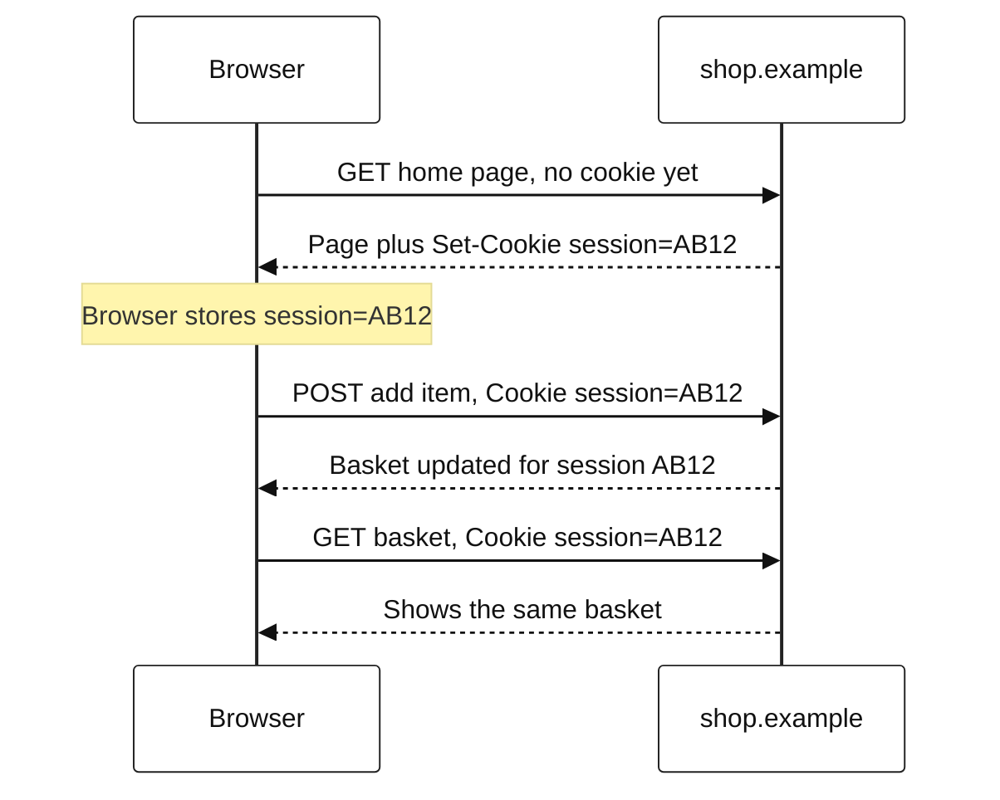
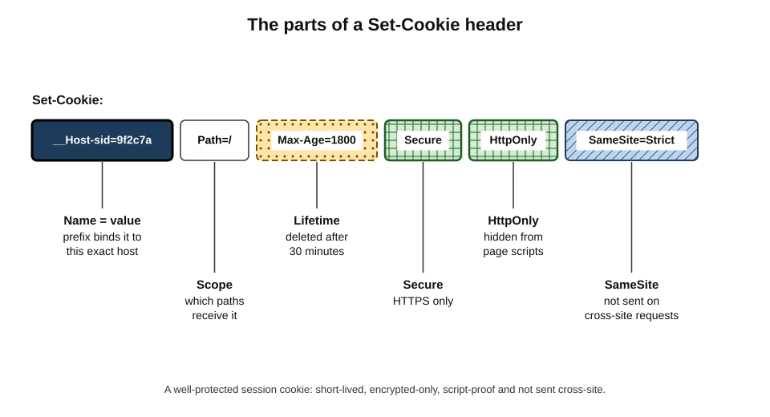
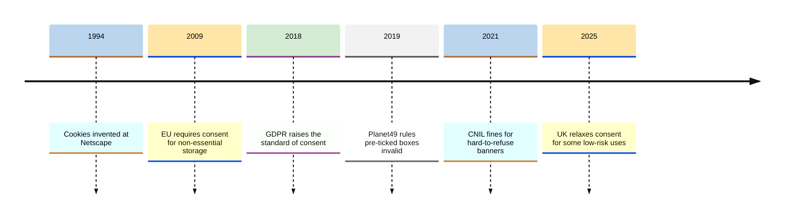
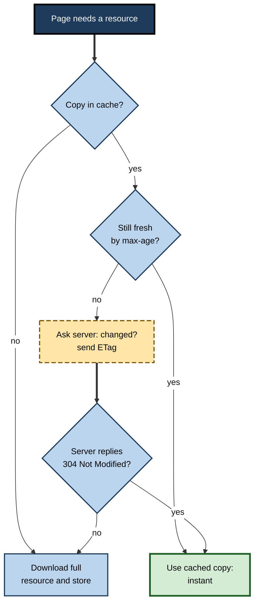
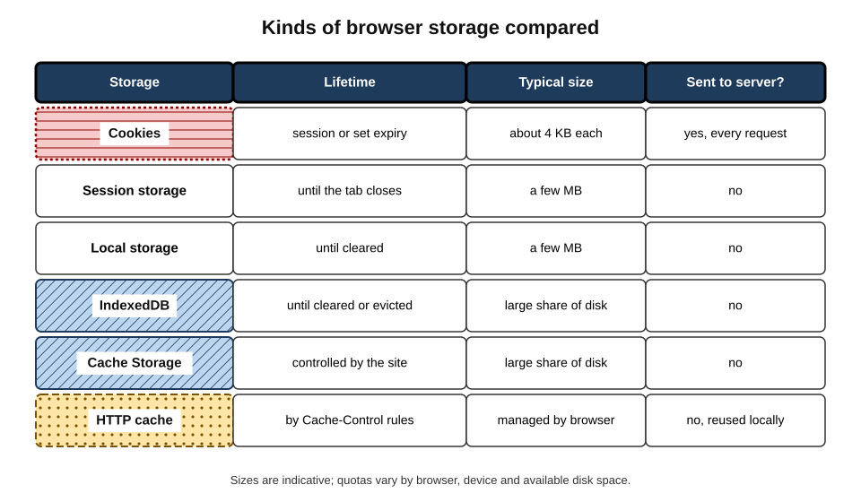
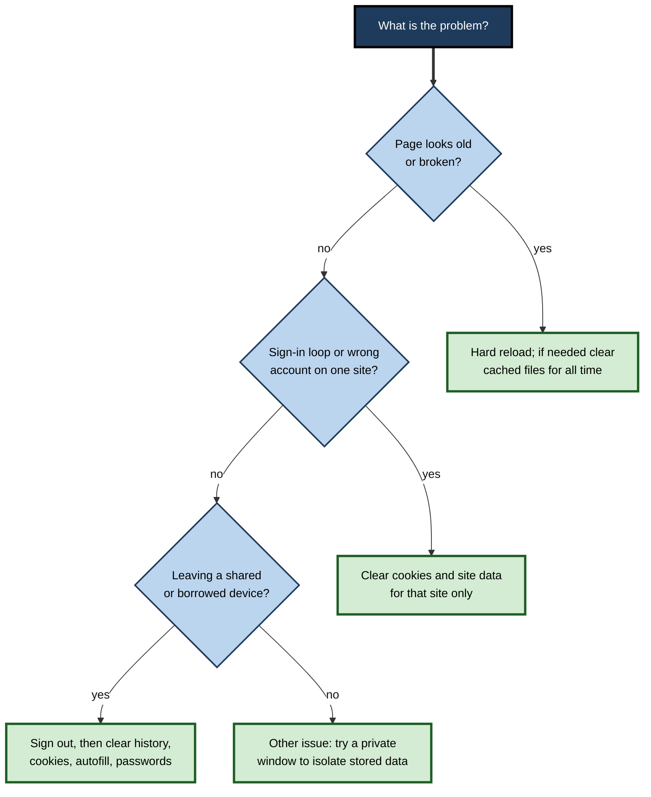

# C.11. Cookies, Cache & Browsing Data

"Have you tried clearing your cache and cookies?" is one of the most common sentences in technical support — and one of the least understood. Clearing cookies signs a user out of every site; clearing the cache may fix a broken page or change nothing; clearing history removes evidence of where they have been but not what websites recorded about them. Each kind of browsing data exists for a reason, carries a privacy cost, and behaves differently when removed.

> **Definition — Browsing data:** the information a browser stores locally as the user browses — cookies, cached copies of resources, site storage, history, download records, form entries, saved passwords and site permissions — to make the web faster, stateful and convenient.

**Why it matters**

- **Function** — sign-ins, shopping baskets, preferences and offline web apps depend on stored data.
- **Speed** — caching avoids downloading the same files repeatedly.
- **Privacy** — stored data reveal what a person has done, and cookies enable tracking across sites.
- **Law** — storing non-essential data on a user's device requires consent in many jurisdictions, which is why cookie banners exist.
- **Troubleshooting** — knowing which data to clear fixes problems without needless side effects.

---

## Why the Web Needs Cookies

### Stateless HTTP

- The web's protocol, HTTP, is **stateless**: each request is independent, and the server does not inherently know that two requests come from the same person.
- Without some form of memory, a site could not keep a user signed in, remember a basket or store a language preference.

### The invention of the cookie

- **1994** — Lou Montulli, an engineer at Netscape, devised the **cookie** to let an online shop remember what a visitor had added to a basket.
- **1997** — the first formal specification; the current core specification dates from **2011**, with an updated version in progress.
- **The name** — from "magic cookie", programmers' slang for a token passed between programs.

> **Definition — Cookie:** a small piece of data (up to about 4 KB) that a server asks the browser to store and to send back with later requests to the same site, giving otherwise stateless web requests a memory.

**Figure 1.** How a cookie gives a stateless protocol a memory.

---

## Anatomy of a Cookie

### The parts

A server sets a cookie with a `Set-Cookie` header. Besides its **name and value**, a cookie carries attributes that control its scope, lifetime and security.

- **Domain** — which host(s) receive it; if omitted, only the exact host that set it.
- **Path** — which paths on that host receive it.
- **Expires / Max-Age** — when it is deleted; without either, it is a **session cookie**, deleted when the browser session ends.
- **Secure** — sent only over HTTPS.
- **HttpOnly** — invisible to page scripts, so a script injected by an attacker cannot read it.
- **SameSite** — whether it is sent when the request comes from another site:
  - **Strict** — never on cross-site requests;
  - **Lax** — on top-level navigations (following a link) but not on embedded requests; Chrome made **Lax the default** in 2020;
  - **None** — always, but only together with Secure.
- **Partitioned** — stored separately for each top-level site when used in an embedded context, so it cannot track across sites.
- **Prefixes** — names beginning `__Host-` or `__Secure-` force stricter rules that a careless or malicious subdomain cannot override.

**Figure 2.** The parts of a Set-Cookie header.

### Worked example (illustrative): reading a cookie header

A developer inspecting a banking site's sign-in response sees:

`Set-Cookie: __Host-sid=9f2c7a; Path=/; Max-Age=1800; Secure; HttpOnly; SameSite=Strict`

1. **`__Host-sid=9f2c7a`** — a session identifier; the `__Host-` prefix means it is bound to this exact host, must be Secure, and must have `Path=/`.
2. **`Max-Age=1800`** — expires after 30 minutes, limiting the window in which a stolen cookie is useful.
3. **`Secure`** — never sent over unencrypted connections.
4. **`HttpOnly`** — page scripts cannot read it, defending against script-injection attacks.
5. **`SameSite=Strict`** — not sent when another site triggers a request, defending against forged requests.
6. **Conclusion:** a well-protected session cookie. If the same cookie lacked `HttpOnly` and had `SameSite=None` and a one-year lifetime, it would be far easier to steal or misuse.

> **Definition — Cross-site request forgery (CSRF):** an attack in which a malicious site causes the user's browser to send a request to another site where the user is signed in, relying on the browser to attach that site's cookies automatically. SameSite cookies are a principal defence.

### Kinds of cookie

| | Session cookie | Persistent cookie | First-party cookie | Third-party cookie |
|---|---|---|---|---|
| Lifetime | Until the browser session ends | Until an expiry date | Either | Either |
| Set by | Any site | Any site | The site in the address bar | A different domain embedded in the page |
| Typical use | Sign-in session, basket | "Remember me", preferences | Function and site analytics | Advertising, cross-site analytics, embedded services |
| Privacy concern | Low | Moderate | Moderate | High — enables cross-site tracking |

**Purpose categories used in consent banners**

- **Strictly necessary** — sign-in, security, load balancing, the consent choice itself.
- **Preferences (functional)** — language, region, layout.
- **Analytics (statistics)** — counting visits and measuring use.
- **Marketing (advertising)** — targeting and measuring advertisements, often third-party.

> **Watch out:** "cookie" in law and in consent banners usually means **any** storage on the device — including local storage, pixels and fingerprinting techniques — not just HTTP cookies.

---

## Cookies and the Law

### The European framework

- **ePrivacy Directive (2002, amended 2009)** — storing or reading information on a user's device requires **consent**, unless strictly necessary for a service the user requested. This is why the "cookie law" applies to more than cookies.
- **GDPR (in force May 2018)** — set a high standard for valid consent: freely given, specific, informed, unambiguous, as easy to withdraw as to give.
- **Planet49 judgment (EU Court of Justice, 2019)** — a **pre-ticked box** is not valid consent.
- **Enforcement** — in December 2021 France's data-protection authority, the CNIL, fined Google €150 million and Facebook €60 million because refusing cookies took more clicks than accepting them.
- **UK** — the Privacy and Electronic Communications Regulations apply the same rule; in 2025 the UK legislated to relax consent requirements for some low-risk uses such as certain analytics.

**Figure 3.** Milestones in the regulation of cookies and device storage.

### Consent banners in practice

- **Good banners** offer **Accept all** and **Reject all** with equal prominence, plus granular choices, and record the decision.
- **Dark patterns** — design that nudges acceptance:
  - "Accept" as a bright button and "Manage options" as faint text;
  - rejection hidden two or three screens deep;
  - pre-selected toggles labelled "legitimate interest";
  - repeated prompts after refusal.
- **Consent management platforms** — commercial tools that run banners and pass users' choices to advertisers through industry frameworks; regulators have challenged parts of these frameworks under GDPR.

> **Definition — Dark pattern:** an interface design that steers users towards choices they might not otherwise make, such as accepting tracking.

> **In practice:** organisations that publish websites should audit their banners against regulators' published guidance: equal-weight reject option, no pre-ticked boxes, no non-essential cookies set **before** consent, and a visible way to change the choice later.

---

## The Cache

### What caching does

> **Definition — HTTP cache:** the browser's store of previously downloaded resources — images, style sheets, scripts, fonts, sometimes pages — reused for later requests so that they need not be fetched again.

- **Benefits** — faster pages, less data used, less load on servers.
- **Kinds of cache the user meets:**
  - the browser's **memory cache** (for the current session) and **disk cache**;
  - **service-worker caches** that web apps control for offline use;
  - caches outside the browser — company proxies and content-delivery networks — which follow the same rules.

### How the browser decides

The server's response headers tell the browser how long a resource stays **fresh**.

- **`Cache-Control: max-age=86400`** — reuse for 24 hours without asking.
- **`Cache-Control: no-cache`** — may store, but must **check** with the server before each reuse.
- **`Cache-Control: no-store`** — never store (used for sensitive pages such as bank statements).
- **Validators** — an `ETag` (a fingerprint of the content) or `Last-Modified` date lets the browser ask "has this changed?"; if not, the server replies **304 Not Modified** with no body.

**Figure 4.** How the browser decides whether to reuse a cached resource.

### Cache problems and remedies

- **Stale content** — after a site update, a browser keeps using an old style sheet or script until it expires, so pages look broken.
  - **Hard reload** (Ctrl+Shift+R or Ctrl+F5) re-fetches the page's resources, bypassing the cache for that load.
  - **Cache busting** — developers give each new version of a file a new name (such as `app.3f9a2c.js`), so the browser cannot confuse old and new.
- **Sensitive pages in the cache** — on shared computers, cached pages may be viewable later; sensitive sites use `no-store`.
- **Cross-site leaks** — attackers once inferred whether a user had visited a site by timing whether its resources loaded instantly from the cache; since about 2020 major browsers **partition the cache by top-level site**, so one site cannot probe another's cached resources.

### Case study (illustrative): the release nobody could see

- **Situation:** a retail company released a redesigned checkout page on a Thursday evening.
- **Problem:** by Friday morning the help desk had hundreds of complaints that the "Pay" button did nothing.
- **Diagnosis:**
  1. The new page expected a new version of the checkout script.
  2. The script kept its **old file name**, and the old version had been served with `max-age` of one week.
  3. Returning customers' browsers used the cached old script with the new page; new customers had no problem.
- **Actions:**
  1. Short term: the script was republished under a new, versioned name and the page updated to reference it.
  2. Long term: the build process added content fingerprints to every file name; the page itself was served with `no-cache` so it would always be checked; long `max-age` was kept only for fingerprinted files.
- **Result:** the fault cleared within minutes of the fix for all users, without asking anyone to clear their cache.
- **Side effects / caveats:** a small number of users behind a company proxy with its own cache needed another hour.
- **Lesson:** "clear your cache" is a **workaround for a deployment error**. Correct caching headers and versioned file names make it unnecessary.

---

## Other Site Storage

Modern web applications store more than cookies.

- **Local storage** — simple key–value storage that persists until cleared; typically a few megabytes per site; readable by any script on the site.
- **Session storage** — like local storage but per tab, cleared when the tab closes.
- **IndexedDB** — a database inside the browser for large structured data; used by offline email, documents and maps.
- **Cache Storage** — controlled by a site's **service worker** for offline use.
- **Origin private file system** — fast private file storage for demanding apps such as editors.
- **Quotas and eviction** — browsers allow sites a share of disk space and evict data from rarely used sites when space runs low, unless a site has been granted **persistent storage**.

**Figure 5.** The main kinds of browser storage compared by lifetime, size and whether they travel to the server.

> **Watch out:** tokens stored in **local storage** can be read by any script running on the site — including an injected one — whereas an `HttpOnly` cookie cannot. Where sessions are stored is a security design choice, not a detail.

> **Key point:** to a site's code, all storage belongs to an **origin**; to the user, "clear cookies and site data" removes all of it — cookies, local storage, databases and offline caches — for the chosen sites.

---

## History, Downloads, Forms and Passwords

- **Browsing history** — addresses and titles visited, with times; powers address-bar suggestions.
- **Download history** — records of files downloaded (deleting it does not delete the files).
- **Autofill form data** — names, addresses, phone numbers and other entries.
- **Saved passwords and passkeys**.
- **Payment methods**.
- **Site settings** — permissions, zoom levels, pop-up exceptions.
- **Hosted app data** — data of installed web apps.

### What clearing each item does

| Data type | Clearing it removes | Side effects | When to clear |
|---|---|---|---|
| Browsing history | Record of visited pages | Fewer address-bar suggestions | Shared device; privacy of past activity |
| Cookies and site data | Sign-ins, preferences, local storage, offline data | Signed out everywhere; offline app data lost | Sign-in loops, shared device, tracking reset |
| Cached images and files | Stored copies of resources | Pages load slower once | Stale or broken pages |
| Download history | List of downloads | None on the files themselves | Privacy of past downloads |
| Autofill form data | Saved form entries | Forms no longer prefill | Shared device; wrong entries suggested |
| Passwords | Saved credentials | Must have another record of passwords | Leaving a device; rarely otherwise |
| Site settings | Permissions and exceptions | Sites ask again for camera, location | Permission problems |

**Figure 6.** Choosing what to clear for common problems.

> **Remember:** clear the **narrowest** thing that fixes the problem — one site's data, or only cached files — rather than everything. Wholesale clearing signs the user out of every service and can destroy offline work.

> **In practice:** testing a problem in a **private window** is a fast diagnostic: if the site works there, stored data (cookies, cache or an extension) is the likely cause.

### Clearing automatically

- **Clear on exit** — browsers can delete cookies, history or all data whenever they close; strong for privacy, inconvenient for daily sign-ins.
- **Per-site exceptions** — keep cookies for chosen sites (email, work tools) while clearing others.
- **Site-initiated clearing** — a site can send a `Clear-Site-Data` header when the user signs out, telling the browser to erase that site's cookies and storage.

---

## Browsing Data as Evidence

- **On the device** — history, cache, cookies and downloads reveal what was viewed, when and sometimes what was typed.
  - Digital forensic investigators routinely examine browser data in criminal, employment and civil cases.
- **Clearing is incomplete** — deleting history does not erase:
  - records held by the websites themselves;
  - the employer's or provider's network logs;
  - synced copies on other devices or in the browser maker's cloud, unless sync is also cleared;
  - copies in backups.
- **Legal holds** — when litigation is anticipated, deleting relevant browsing data can amount to destroying evidence.

> **Watch out:** for an employee under investigation, clearing browser history does not remove what the organisation's proxy, security tools and cloud logs recorded — and may itself be treated as misconduct if a legal hold is in place.

---

## Cookies and Sign-In

### How a sign-in session works

1. The user submits a username and password (or a passkey) to the site.
2. The server verifies them and creates a **session record** on its side.
3. It sends the browser a **session cookie** containing a long random identifier for that record.
4. Every later request carries the cookie; the server looks up the session and treats the request as signed in.
5. Signing out should delete the session on the server **and** the cookie in the browser.

- **"Remember me"** — a longer-lived cookie, or a refresh token, that recreates the session after the browser restarts.
- **Session timeouts** — the server ends idle sessions; banking sites often after minutes, collaboration tools after weeks.
- **Re-authentication** — sensitive actions (changing bank details, deleting data) may require signing in again even within a session.

> **Key point:** after sign-in, the **cookie is the credential**. Anyone who obtains it can act as the user until the session ends — which is why `Secure`, `HttpOnly`, short lifetimes and server-side revocation matter.

### Single sign-on and third-party cookies

- **Single sign-on (SSO)** lets one sign-in (for example to a company identity provider) open many applications.
- Traditional SSO and "Sign in with…" buttons often relied on **third-party cookies** or embedded frames, so blocking third-party cookies can break them.
- Browsers and identity providers have responded with redirect-based flows and a dedicated browser interface for federated sign-in (FedCM), which lets identity providers work without general-purpose third-party cookies.

> **In practice:** when a corporate sign-in loops endlessly in one browser but works in another, a common cause is a tracking-protection setting blocking the identity provider's cookies. Administrators typically add the identity provider as an exception by policy rather than asking users to lower protection everywhere.

### Worked example (illustrative): inspecting a site's stored data

A support analyst investigates why a customer portal keeps showing the wrong language.

1. **Open developer tools** (F12) and choose the Application or Storage panel.
2. **Cookies** — the list shows `lang=fr` with an expiry date two years away, set by an old marketing campaign page.
3. **Local storage** — shows `preferredLanguage: en`, set by the current portal.
4. **Diagnosis:** the server reads the cookie first, so the stale cookie overrides the user's current choice.
5. **Immediate fix:** delete that one cookie for that site.
6. **Permanent fix:** the development team changes the portal to give the explicit user setting priority and retires the old cookie.

> **Remember:** most "it works for me but not for them" faults on web applications come down to **different stored data**. Inspecting storage, or testing in a private window, separates data problems from code problems.

---

## Measurement Without Third-Party Cookies

As browsers restrict cross-site tracking, organisations measuring their own websites have changed methods.

- **First-party analytics** — counting visits with cookies or storage set by the organisation's own domain; still subject to consent rules in many jurisdictions.
- **Cookieless or aggregate analytics** — counting page views without persistent identifiers; lower privacy risk, less detail about individual journeys.
- **Server-side measurement** — recording events on the organisation's own servers rather than in the browser; can improve accuracy but can also be used to evade browser protections, so it does not remove legal obligations.
- **Consent-aware modelling** — estimating totals from consenting users.

| | Third-party cookie tracking | First-party analytics | Aggregate cookieless analytics |
|---|---|---|---|
| Follows users across sites | Yes | No | No |
| Typical consent requirement in the EU | Required | Usually required | Sometimes exempt, depending on design and jurisdiction |
| Detail about individual journeys | High | Moderate | Low |
| Affected by browser protections | Heavily | Moderately | Little |

> **Watch out:** moving tracking from the browser to the server does not make it lawful. Data-protection law applies to the **processing of personal data**, wherever it happens.

---

## Open Questions

- **Will consent banners survive?**
  - They are widely disliked and often ignored; regulators and lawmakers are considering browser-level signals and exemptions for low-risk uses.
- **What will replace third-party cookies for advertising measurement?**
  - With the leading browser keeping them and others blocking them, the industry operates in two regimes at once.
- **How should local storage be governed?**
  - Partitioning protects privacy but complicates legitimate cross-site services such as single sign-on and embedded payments.
- **Can users understand what they are clearing?**
  - Settings dialogs use technical categories; research on usable data controls is still developing.

---

## Summary

- HTTP is **stateless**; **cookies** (Netscape, 1994) give it memory for sign-ins, baskets and preferences.
- Cookie attributes: **Domain, Path, Expires/Max-Age, Secure, HttpOnly, SameSite** (Lax by default in Chrome since 2020), **Partitioned**, and `__Host-`/`__Secure-` prefixes.
- Session vs persistent; **first-party vs third-party** — third-party cookies enable cross-site tracking.
- EU law requires **consent** for non-essential device storage (2009), with GDPR standards (2018), **Planet49** (2019) and fines for hard-to-refuse banners (CNIL, 2021). Dark patterns are unlawful in many cases.
- The **HTTP cache** reuses resources according to **Cache-Control** and validators (ETag, 304); stale content is a deployment error fixed by **versioned file names**; caches are now **partitioned** by site.
- Other storage: **local and session storage, IndexedDB, Cache Storage, private file system**, with quotas and eviction.
- Clearing data has specific effects; clear the **narrowest** item; use a private window to diagnose.
- Browsing data are **evidence**; clearing them on the device does not erase server, network, sync or backup records.

---

## Self-Check

1. Why does the web need cookies?
2. Who invented cookies, when and for what?
3. Explain the effect of the Secure, HttpOnly and SameSite attributes.
4. Decode `Set-Cookie: prefs=dark; Max-Age=31536000; SameSite=Lax`.
5. Distinguish first-party from third-party cookies and explain why the latter raise privacy concerns.
6. What does the EU "cookie law" require, and why does it cover more than cookies?
7. What did the Planet49 judgment and the CNIL's 2021 fines establish?
8. Give three examples of dark patterns in consent banners.
9. Explain `max-age`, `no-cache` and `no-store`.
10. What does a 304 Not Modified response mean?
11. Why did customers see a broken checkout in the case study, and what was the permanent fix?
12. Why is storing a session token in local storage riskier than in an HttpOnly cookie?
13. A colleague is stuck in a sign-in loop on one supplier portal. What should they clear, and why not everything?
14. An employee clears their browser history before an investigation. What records still exist?

### Answer Key

1. HTTP treats each request independently; cookies let a site recognise later requests from the same browser, enabling sign-ins, baskets and preferences.
2. Lou Montulli at Netscape in 1994, to let an online shop remember the contents of a visitor's basket.
3. Secure: sent only over HTTPS. HttpOnly: not readable by page scripts, protecting against theft through injected scripts. SameSite: limits sending on cross-site requests, defending against forged requests and some tracking.
4. A preference cookie named "prefs" with value "dark", lasting one year, sent on same-site requests and top-level navigations from other sites but not embedded cross-site requests; not Secure or HttpOnly, which is acceptable for a non-sensitive preference.
5. First-party cookies are set by the site in the address bar; third-party cookies by other domains embedded in the page. A third party embedded on many sites can recognise the same browser everywhere, building a cross-site profile.
6. Consent before storing or reading non-essential information on the user's device. The rule concerns device storage and access generally — local storage, pixels, fingerprinting — not only cookies.
7. Planet49: pre-ticked boxes are not valid consent. CNIL fines: refusing must be as easy as accepting.
8. Bright "Accept" with faint "Manage options"; rejection buried several screens deep; pre-enabled "legitimate interest" toggles; repeated prompts after refusal.
9. max-age: reuse without checking for the given seconds. no-cache: may store but must revalidate before each reuse. no-store: never store.
10. The browser asked whether its cached copy was still current (using a validator such as an ETag) and the server confirmed it was, sending no new content.
11. The new page used an old cached script with the same file name and a week-long max-age. Permanent fix: fingerprinted file names for each version, long caching only for those files, and revalidation of the page itself.
12. Any script running on the page, including an attacker's injected script, can read local storage; an HttpOnly cookie is inaccessible to scripts.
13. Cookies and site data for that portal only. Clearing everything would sign them out of all services and remove offline data without benefit.
14. Website server logs, the organisation's proxy and security-tool logs, cloud service audit logs, synced copies in the browser account and other devices, and backups.

---

## Glossary

| Term | Meaning |
|---|---|
| Cache busting | Giving each new file version a new name so caches cannot serve the old one. |
| Cache-Control | The HTTP header that sets caching rules. |
| Clear-Site-Data | A header by which a site asks the browser to erase its stored data. |
| Consent management platform | A tool that runs cookie banners and records choices. |
| Cookie | A small piece of data stored by the browser and sent back to the site. |
| CSRF | Cross-site request forgery: tricking a browser into sending authenticated requests. |
| Dark pattern | Interface design that steers users into choices. |
| ETag | A content fingerprint used to check whether a cached copy is current. |
| Hard reload | Reloading a page while bypassing the cache. |
| HttpOnly | A cookie attribute hiding the cookie from page scripts. |
| HTTP cache | The browser's store of previously downloaded resources. |
| IndexedDB | A database for structured data inside the browser. |
| Local storage | Persistent key–value storage per site. |
| Partitioned cookie | A cookie stored separately for each top-level site. |
| Persistent cookie | A cookie with an expiry date. |
| SameSite | A cookie attribute controlling sending on cross-site requests. |
| Secure | A cookie attribute restricting it to HTTPS. |
| Service worker | A script that can intercept requests and manage offline caches for a site. |
| Session cookie | A cookie deleted when the browser session ends. |
| Session storage | Per-tab storage cleared when the tab closes. |
| Stateless protocol | A protocol in which each request is independent of earlier ones. |
| Third-party cookie | A cookie set by a domain other than the visited site. |
