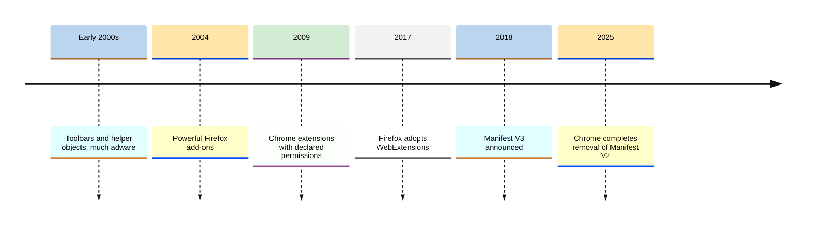
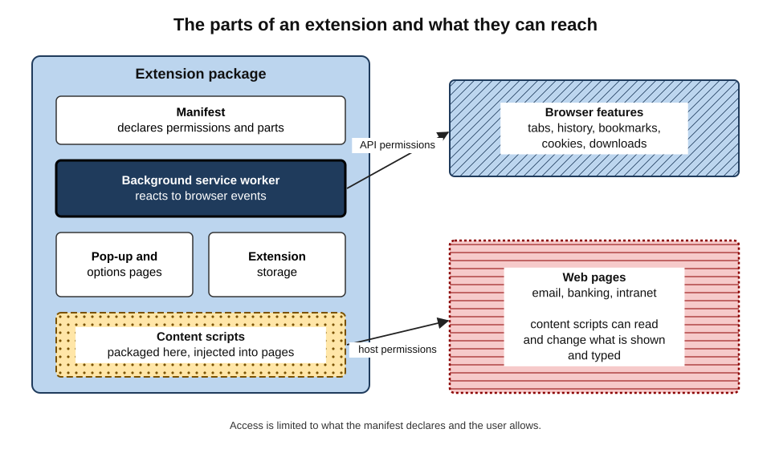
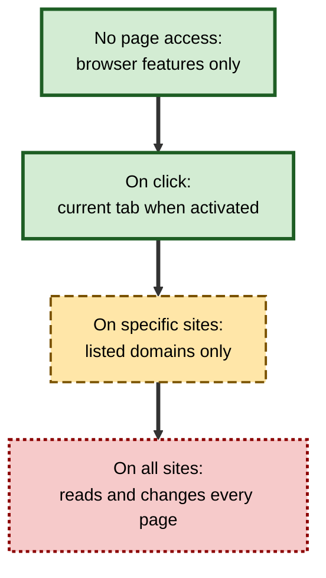
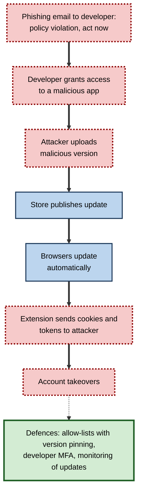
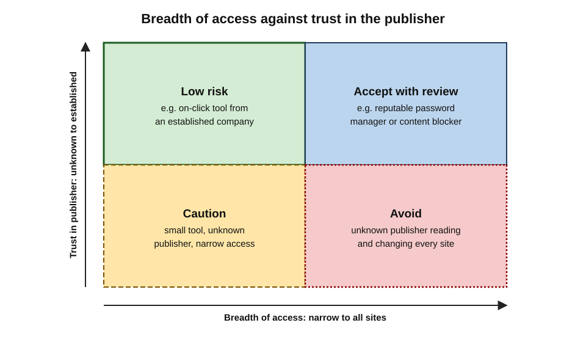
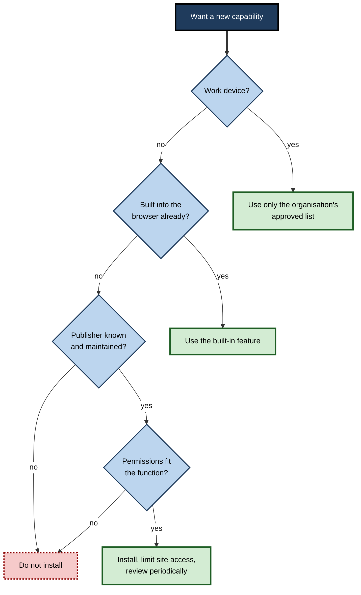

# F.12. Browser Extensions & Add-ons

A free tab-management extension used by two million people was quietly sold by its original developer. Months later an update arrived like any other — automatically, without a prompt — and the extension began running code from a server controlled by its new owner. Google eventually removed it as malware. Its users had done nothing wrong except install a useful tool years earlier. Extensions are among the most valuable and the most dangerous things a person can add to a browser.

> **Definition — Browser extension (add-on):** a small software package, installed into a browser, that adds or changes functionality — modifying pages, blocking content, managing passwords, adding tools — using interfaces the browser provides and permissions the user grants.

**Why it matters**

- **Power** — extensions can read and change every page a user visits, including email, banking and internal systems.
- **Productivity and accessibility** — content blockers, password managers, readers, translators and accessibility aids transform the web for many users.
- **Security** — extensions are a leading route for data theft and account takeover, through malicious publishers, ownership changes and hijacked developer accounts.
- **Organisational control** — managing extensions is one of the most important controls an IT team has over the browser.

---

## What Extensions Are and Are Not

### Extensions, plug-ins and themes

- **Extensions** — packages of HTML, CSS and JavaScript that use browser interfaces to change behaviour; run inside the browser's security model.
- **Plug-ins** (historical) — separate native programs such as Flash and Java that rendered content inside pages, with full access to the device; now gone from mainstream browsers.
- **Themes** — change only the browser's appearance; no access to pages.
- **Web apps and progressive web apps** — websites installed like apps, with no special access to other sites.

> **Watch out:** "add-on" and "plug-in" are often used loosely. Modern browsers support **extensions**, not plug-ins; a website asking a user to "install a plug-in to view this content" is almost always a scam.

### A short history

- **Early 2000s** — Internet Explorer "browser helper objects" and toolbars ran with deep access; many were **adware** bundled with other software, creating the infamous stacks of toolbars.
- **2004 onward** — Firefox's extension system was extremely powerful, letting add-ons rewrite the browser itself, but offered little isolation.
- **2009–2010** — Chrome introduced extensions built from web technologies with a **declared permission model**; Safari followed in 2010.
- **2017** — Firefox 57 moved to the cross-browser **WebExtensions** model, ending its legacy add-ons.
- **2018–2025** — Chrome's **Manifest V3** reshaped what extensions may do; most Chromium browsers followed.
- **2021** — a W3C community group began aligning extension interfaces across browsers.

**Figure 1.** Milestones in the development of browser extensions.

---

## How Extensions Work

### The parts of an extension

- **Manifest** — a file (`manifest.json`) declaring the extension's name, version, permissions, scripts and icons.
- **Background service worker** — code that runs in the background, reacting to events (a tab opening, a button being clicked, a timer).
- **Content scripts** — code injected into web pages that can **read and change** the page's content.
- **User interface** — toolbar button, pop-up panel, options page, side panel, context-menu items.
- **Storage** — the extension's own settings and data, which can sync across devices.
- **Messaging** — channels between content scripts, background code and, with permission, native programs on the device.

> **Definition — Content script:** extension code that runs inside web pages, able to read and modify what the user sees and types on those pages.

**Figure 2.** The parts of an extension and the access each has.

### Permissions

- Extensions must **declare** what they need; the browser shows warnings at installation.
- **API permissions** — access to browser features: tabs, history, bookmarks, downloads, cookies, clipboard, notifications.
- **Host permissions** — which websites the extension may read and change.
  - "**Read and change all your data on all websites**" is the broadest and most common warning.
- **Optional permissions** — requested later, only when a feature needs them.
- **activeTab** — temporary access to the current tab only when the user clicks the extension.

**User controls for site access** (Chromium browsers and Firefox)

- **On click** — the extension runs on a site only when the user activates it.
- **On specific sites** — runs only on listed sites.
- **On all sites** — always active everywhere.

**Figure 3.** Site-access settings from narrowest to broadest.

> **Key point:** the permission to **read and change all data on all websites** means the extension can see everything the user sees and types — passwords as they are entered, email contents, internal dashboards — and can alter pages, for example changing a bank-transfer recipient.

> **In practice:** setting extensions that need page access only occasionally (screenshot tools, translators) to **"on click"** keeps them useful while denying them silent access to every site.

---

## Manifest V3: Security, Performance and Content Blocking

### What changed

- **Manifest V2** — the older format; extensions could intercept and modify every network request in real time using the blocking **webRequest** interface.
- **Manifest V3** (announced 2018–2019; Chrome disabled V2 extensions through 2024–2025):
  - **declarativeNetRequest** — extensions supply rules (block or redirect requests matching patterns) that the browser applies itself, without the extension seeing each request;
  - **remotely hosted code banned** — all code must be in the reviewed package;
  - **service workers** replace persistent background pages.

> **Definition — Manifest V3:** the current version of the Chromium extension platform, which replaces real-time request interception with rule-based filtering and bans remotely loaded code.

| | Manifest V2 | Manifest V3 |
|---|---|---|
| Request blocking | Extension inspects each request with arbitrary logic | Browser applies declared rules, with limits on the number of rules |
| Remote code | Permitted in practice | Banned |
| Background code | Persistent page | Event-driven service worker |
| Privacy | Extension can see every request | Extension need not see requests to block them |
| Content blockers | Maximum flexibility | Reduced flexibility; some advanced filtering impossible |

### The controversy

- **Google's case:** better performance, security and privacy — extensions no longer need to see all traffic to block ads, and remote-code bans reduce malicious updates.
- **Critics' case:** the rule limits weaken the most capable ad and tracker blockers; the best-known, **uBlock Origin**, was disabled in Chrome and replaced by a reduced "Lite" version; critics noted that Google's business is advertising.
- **Other browsers:**
  - **Firefox** adopted Manifest V3 but **kept** the blocking webRequest interface;
  - **Brave** and others build ad blocking into the browser itself, unaffected by extension rules;
  - **Edge** and most Chromium browsers followed Chrome.

> **Watch out:** both claims contain truth. Manifest V3 genuinely reduces some risks — but malicious extensions have continued to appear, and the capability of content blockers has genuinely been reduced. The net effect remains **contested**.

---

## The Benefits: What Extensions Are Good For

- **Content blocking** — ads, trackers, malicious scripts; faster pages and less exposure to malvertising.
- **Password management** — dedicated managers fill credentials only on the right domain and generate strong passwords.
- **Accessibility** — dark-mode readers, dyslexia-friendly fonts, text-to-speech, colour adjustment, magnifiers, captioning.
- **Language** — translation and grammar checking.
- **Productivity** — tab management, note-taking, web clipping, citation managers.
- **Developer tools** — framework inspectors, accessibility checkers, request editors.
- **Security tools** — phishing detection, enterprise single sign-on, data-loss prevention.
- **AI assistants** — summarising pages, drafting replies, answering questions about content.

> **Watch out:** **grammar checkers** and **AI assistants** must read what the user types or views to work. On a work device, that may include confidential client material, personal data or source code being sent to the extension's servers.

---

## The Risks: How Extensions Go Wrong

### Five routes to harm

1. **Malicious from the start** — published to steal data, inject ads or hijack searches, often imitating popular tools (fake "ChatGPT" helpers in 2023 stole social-media session cookies).
2. **Sold to a new owner** — a popular extension is bought, and an update adds tracking or malware.
3. **Developer account compromised** — attackers phish the developer and publish a malicious update to every user.
4. **Excessive data collection** — "free" extensions harvest browsing data for sale.
5. **Vulnerable code** — a legitimate but buggy extension that attackers can exploit.

> **Definition — Supply-chain attack:** compromising software by attacking its supplier or update channel, so that a trusted product delivers malicious code to its users.

**Study card — The Great Suspender (2020–2021)**

- **Situation:** an open-source extension that suspended idle tabs, with about two million users.
- **What happened:** the original developer transferred it to an unknown new owner in 2020; subsequent versions added code that could fetch and run scripts from a remote server.
- **Outcome:** in February 2021 Google disabled it and labelled it malware; users' suspended tabs were lost.
- **Lesson:** a trustworthy extension can become untrustworthy **without the user doing anything**.

**Study card — DataSpii (2019)**

- **Design:** security researcher Sam Jadali investigated why private web addresses — internal company pages, document links, tax returns — appeared in a commercial analytics product.
- **Findings:** a handful of browser extensions collected users' browsing activity, and the data, covering around four million users, were sold onwards; the leaked addresses included confidential corporate documents.
- **Conclusion:** extensions with "read all sites" permission can turn ordinary browsing into a data-leak channel for whole organisations.

**Study card — The Cyberhaven compromise (December 2024)**

- **Situation:** Cyberhaven, a data-security company, published a Chrome extension used by about 400,000 people.
- **Attack:**
  1. An administrator received a phishing email posing as Chrome Web Store developer support, warning that the extension would be removed for a policy breach.
  2. Clicking the link granted a malicious application access to the developer account.
  3. On 25 December 2024 the attackers published a malicious version that copied cookies and session tokens to their server.
- **Response:** Cyberhaven detected and removed the update within about an hour of discovering it and released a clean version.
- **Scale:** investigators found the same campaign had compromised **dozens** of other extensions, together installed by more than two million users.
- **Lesson:** even an extension from a **security company** can be weaponised through its developer's account; automatic updates spread the compromise within hours.

**Figure 4.** How a compromised developer account turns an automatic update into an attack.

### Affiliate and shopping extensions

- Coupon and cashback extensions earn commission when users buy.
- In late 2024 investigations alleged that some such extensions replaced creators' and publishers' **affiliate codes** with their own at checkout, and did not always show the best available discounts; legal actions followed.

> **Watch out:** an extension that is free and has nothing obvious to sell is often selling **the user's data or attention**. Ask how it makes money.

### What the evidence says about extension ecosystems

- Research on the Chrome Web Store, including a large 2024 study led by Stanford University researchers, found that extensions containing malware, breaching policies or carrying known vulnerabilities had been installed **hundreds of millions** of times over a few years, and that many extensions remained in the store for long periods without updates.
- Store review catches many malicious submissions but not all; malicious extensions often survive for months.

> **Watch out:** exact counts from such studies depend on definitions ("security-noteworthy", "abandoned") and change as stores remove items. The robust conclusion is that **store presence and high user counts do not prove safety**.

---

## Evaluating an Extension Before Installing

- **Need** — does the browser already do this (password manager, screenshots, translation, reader view)? Built-in features carry no extra risk.
- **Publisher** — a known organisation, with a verifiable website and contact details?
- **Permissions** — are they proportionate to the function?
- **Reputation** — number of users and reviews, but beware of fake reviews; look for recent negative reviews mentioning changed behaviour.
- **Maintenance** — recent updates, a changelog, support responses.
- **Business model** — paid, open-source, sponsored by a company — or unexplained?
- **Privacy policy** — what is collected, and is it sold?
- **Store signals** — curated programmes such as Firefox's "Recommended" extensions are manually reviewed; "featured" badges indicate some review.

> **Mnemonic — "NO PERMS":** **N**eed, **O**wner, **P**ermissions, **E**vidence of reputation, **R**ecent maintenance, **M**oney model, **S**tatement of privacy.

**Figure 5.** Placing extensions by breadth of access and trust in the publisher.

### Worked example: choosing between two screenshot extensions

| | Extension A | Extension B |
|---|---|---|
| Function | Full-page screenshots with annotation | Full-page screenshots with annotation and cloud upload |
| Publisher | Established software company, verified site | Individual developer, no website |
| Users | 2 million | 3 million |
| Permissions | activeTab (current tab when clicked), downloads | Read and change all data on all websites; tabs; storage; access to cookies |
| Last update | Last month | 14 months ago |
| Money model | Paid tier | Free, no explanation |

1. **Function** — both meet the need; B's cloud upload is not required.
2. **Permissions** — A needs access only when clicked; B wants permanent access to every site and to cookies, far beyond screenshot needs.
3. **Maintenance and model** — A is maintained and funded; B is stale with an unexplained model.
4. **Decision:** A, and only if the browser's built-in screenshot tool is insufficient.

> **Remember:** **more users does not mean safer.** Permissions, publisher and money model matter more than popularity.

**Figure 6.** Deciding whether to install an extension.

---

## Living With Extensions

### Personal hygiene

- **Keep few** — each extension adds risk and slows the browser; five well-chosen extensions beat thirty.
- **Review quarterly** — remove what is unused; check whether permissions have grown.
- **Watch for changes** — new permission requests, a changed name or icon, new advertisements or pop-ups.
- **Separate profiles** — keep a clean profile with no extensions for banking and sensitive work.
- **Private windows** — most browsers disable extensions there unless allowed; leave them disabled.
- **Never sideload** extensions from websites or files at a stranger's request.

### In organisations

- **Allow-list by default** — block all extensions except approved ones; Chromium browsers and Firefox support this through policy.
- **Force-install** essential tools — password manager, single sign-on, security agents.
- **Block by permission** — some policies block any extension requesting particular permissions.
- **Restrict site access** — prevent extensions running on sensitive internal sites.
- **Inventory and monitor** — browser management consoles report installed extensions across the fleet; some tools score risk and alert on suspicious updates.
- **Review requests** — a lightweight process for staff to request new extensions, assessed against the criteria above.

> **Key point:** for organisations, an **extension allow-list** is one of the highest-value, lowest-cost browser controls. It turns thousands of individual decisions into one considered decision.

### Case study: an unapproved AI writing extension

- **Situation:** a law firm's security team noticed in its browser-management console that 140 staff had installed the same free "AI email writer" extension within two weeks.
- **Problem:** the extension had permission to read and change data on all websites, including the firm's document-management and email systems.
- **Diagnosis / Actions:**
  1. The team examined the extension's privacy policy: typed and displayed text was sent to its servers and could be used to "improve services".
  2. The publisher was a small company with no data-processing agreement and no stated data location.
  3. The firm blocked the extension by policy, notified affected staff, and assessed whether client-privileged material had been transmitted.
  4. It offered an approved, contractually governed AI writing tool, and moved the browser to an allow-list model.
- **Result:** the immediate exposure was contained; staff had a sanctioned alternative.
- **Side effects / caveats:** the firm could not fully determine what text had already been sent.
- **Lesson:** demand for AI tools will be met one way or another; an **approved alternative plus an allow-list** prevents staff from filling the gap with unvetted extensions.

---

## Extensions Across Devices and Browsers

### Mobile

- **Chrome on Android and iOS** — does not support extensions.
- **Safari on iPhone and iPad** — supports extensions distributed through the App Store, including content blockers, with per-site permission controls.
- **Firefox for Android** — opened its extension store to the full catalogue of compatible extensions in December 2023, after years of a limited list.
- **Edge, Samsung Internet and others on Android** — offer limited or curated extension support.

> **Key point:** many people's most-used browser — on their phone — runs **few or no extensions**. Protections that rely on extensions (ad blocking, password filling) must come from the browser or operating system there.

### Cross-browser portability

- Because Chrome, Edge, Firefox and Safari now share the WebExtensions model, many extensions are published for several browsers.
- Differences remain — Firefox's retained blocking interfaces, Safari's App Store packaging and review, browser-specific features — so the **same name** in two stores may not mean the same behaviour or the same publisher.

> **Watch out:** a malicious publisher may copy a popular extension's name and icon into a **different browser's store** where the genuine publisher has no presence. Check the publisher name and website, not just the extension name.

---

## Extensions Built Inside Organisations

Organisations sometimes build their own extensions — to add a button that files emails into a case system, to inject warnings on external sites, or to connect internal tools.

- **Advantages:** tailored workflows; no third-party data exposure; distribution by force-install policy.
- **Responsibilities:**
  - treat the extension as production software — code review, security testing, versioning;
  - request the **minimum permissions** and restrict host access to the sites actually needed;
  - protect the **developer account** and publishing pipeline with strong authentication, since a compromised account can push malicious updates to every employee;
  - prefer private or self-hosted distribution through the management console over public stores.
- **Retirement:** remove internal extensions when their workflow ends; abandoned extensions accumulate vulnerabilities.

> **In practice:** security teams increasingly apply the same supplier-risk questions to extensions as to any software vendor: who maintains it, how are updates signed and reviewed, what data leaves the browser, and what happens if the vendor is acquired?

---

## Extensions and Accessibility

For many disabled users, extensions are not conveniences but **access tools**.

- **Visual** — dark-mode and high-contrast rewriters, magnifiers, font and spacing changes, colour filters for colour-vision deficiency.
- **Reading and cognition** — dyslexia-friendly fonts, line focus, simplified reading views, text-to-speech, reading-level summaries.
- **Motor** — keyboard navigation aids, voice control, link hints that allow clicking by typed letters.
- **Hearing** — caption enhancement and transcript tools.

> **Watch out:** extension allow-lists in organisations can inadvertently **remove accessibility tools** that employees rely on. A good extension policy includes a fast route for approving assistive extensions, consistent with the duty to make reasonable adjustments.

---

## Reading Permission Warnings

Installation warnings are short, but each phrase corresponds to a specific capability.

| Warning text (typical wording) | What the extension can actually do | Typical legitimate need |
|---|---|---|
| Read and change all your data on all websites | See and alter every page, including what is typed | Content blockers, password managers, accessibility rewriters |
| Read and change your data on a list of sites | The same, but only on named domains | A tool for one web application |
| Read your browsing history | See every address visited, on every device that syncs | History search or tab managers |
| Manage your downloads | See, open and start downloads | Download managers |
| Read and modify data you copy and paste | Access the clipboard | Clipboard tools, password managers |
| Communicate with cooperating native applications | Exchange data with installed programs on the device | Password managers, enterprise security agents |
| Change your privacy-related settings | Alter browser privacy controls | Privacy tools — rarely anything else |

> **Watch out:** a **permission increase** in an update — such as a simple colour-picker suddenly requesting history or all-site access — is one of the clearest signs of an ownership change or compromise. Chromium browsers disable the extension until the user approves new permissions; that prompt deserves scrutiny rather than a reflexive click.

> **In practice:** a quick way to audit a browser is to open its extensions page, switch on details or developer mode, and list each extension's site access and permissions; anything with all-site access should have a clear, current justification.

---

## Open Questions

- **Can stores reliably detect malicious extensions?**
  - Automated review struggles with code that behaves well until triggered; manual review does not scale.
- **Should ownership transfers be disclosed?**
  - Users are rarely told when an extension changes hands; whether stores should require notice or re-consent is debated.
- **Will Manifest V3 prove a net gain?**
  - Its effect on security versus user control over content blocking remains contested.
- **How should AI extensions be governed?**
  - Assistants that read every page combine the risks of broad permissions with data transfer to AI services.
- **Should browsers build in more and allow fewer extensions?**
  - Built-in features are safer but reduce choice and concentrate power with browser makers.

---

## Summary

- **Extensions** add capabilities using browser interfaces and granted permissions; **plug-ins** are obsolete; **themes** change only appearance.
- History: toolbars and adware → powerful Firefox add-ons → Chrome's permission model (2009) → cross-browser **WebExtensions** (2017) → **Manifest V3**.
- Parts: **manifest, background service worker, content scripts, interface, storage, messaging**; content scripts can read and change pages.
- **Permissions**: API and host permissions; "read and change all data on all websites" is the broadest; use **on-click** site access where possible.
- **Manifest V3** replaced real-time interception with declared rules and banned remote code; it weakened some content blockers; its net effect is contested; Firefox kept blocking webRequest.
- Benefits: content blocking, password management, accessibility, language, productivity, developer and security tools, AI.
- Risks: malicious publishers, **ownership sales** (The Great Suspender), **data harvesting** (DataSpii), **developer-account compromise** (Cyberhaven, December 2024), affiliate abuse, vulnerable code; store presence and user counts do not prove safety.
- Evaluate with **NO PERMS**; keep few, review often, separate profiles.
- Organisations should **allow-list**, force-install essentials, restrict by permission and site, monitor, and offer approved alternatives.

---

## Self-Check

1. Distinguish an extension, a plug-in and a theme.
2. What is a content script, and why does it make extensions powerful?
3. What does "read and change all your data on all websites" allow?
4. How does on-click site access reduce risk?
5. What did Manifest V3 change, and why is it controversial?
6. List the five routes by which extensions cause harm.
7. Summarise The Great Suspender case and its lesson.
8. What did the DataSpii investigation reveal?
9. Describe the Cyberhaven attack chain step by step.
10. Why can a grammar checker be a data-protection concern at work?
11. Apply NO PERMS to an unknown "PDF converter" extension requesting access to all sites.
12. Why is an extension allow-list one of the most effective organisational controls?
13. A user notices that an extension they have used for years now shows advertisements and asks for new permissions. What should they do and why?

### Answer Key

1. An extension is a web-technology package using browser interfaces within the security model; a plug-in was a separate native program (Flash, Java) with device access, now obsolete; a theme changes appearance only.
2. Code injected into web pages that can read and modify content and input; it lets extensions act on any page they have access to.
3. Seeing everything shown and typed on every site — including passwords, emails and internal systems — and altering page content or behaviour.
4. The extension can access a site only when the user activates it on that tab, so it cannot silently observe or change other sites.
5. It replaced real-time request interception with browser-applied rules, banned remote code and moved to service workers. Supporters cite security and privacy; critics say it weakened ad and tracker blockers to the benefit of an advertising company.
6. Malicious from the start; sold to a new owner; developer account compromised; excessive data collection; vulnerable code.
7. A popular tab suspender was transferred to an unknown owner, gained code that could run remote scripts, and was removed by Google as malware in 2021. A trusted extension can become malicious without user action.
8. Several extensions harvested browsing data from around four million users and sold it onwards, exposing confidential corporate addresses and documents.
9. Phishing email posing as store support → developer grants a malicious app access → attacker uploads malicious version → store publishes it → browsers auto-update → extension exfiltrates cookies and tokens → account takeovers.
10. It must read typed text, which may include confidential or personal data, and often sends it to external servers without a data-processing agreement.
11. Need: browsers and operating systems can already print or save to PDF. Owner: unknown? Permissions: all-site access is excessive for conversion. Evidence, Recent maintenance, Money model, Statement of privacy: likely weak. Conclusion: do not install.
12. It replaces thousands of individual judgements with one assessed list, blocking malicious and data-harvesting extensions by default at little cost.
13. Treat it as a possible ownership change or compromise: remove or disable it, check the publisher and recent reviews, change passwords for sensitive accounts if it had broad access, and find an alternative.

---

## Glossary

| Term | Meaning |
|---|---|
| activeTab | A permission giving temporary access to the current tab when the user clicks the extension. |
| Allow-list | A list of the only extensions permitted. |
| Background service worker | Extension code that runs in response to browser events. |
| Content script | Extension code that runs inside web pages. |
| declarativeNetRequest | Manifest V3's rule-based mechanism for blocking or redirecting requests. |
| Extension | A package that adds functionality to a browser. |
| Force-install | A policy that installs an extension on managed browsers automatically. |
| Host permission | Permission to read and change particular websites. |
| Manifest | The file declaring an extension's details and permissions. |
| Manifest V3 | The current Chromium extension platform. |
| Plug-in | A historical native program rendering content in pages. |
| Sideloading | Installing an extension from outside the official store. |
| Supply-chain attack | Compromising software through its supplier or update channel. |
| Theme | A package changing only the browser's appearance. |
| WebExtensions | The cross-browser extension model used by Chrome, Edge, Firefox and Safari. |
| webRequest | An interface letting extensions observe and, in Manifest V2, block requests in real time. |
