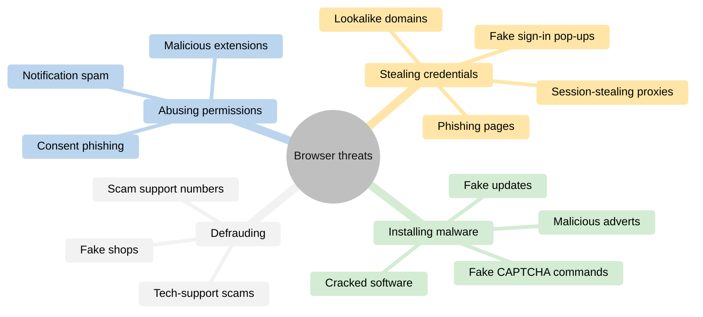
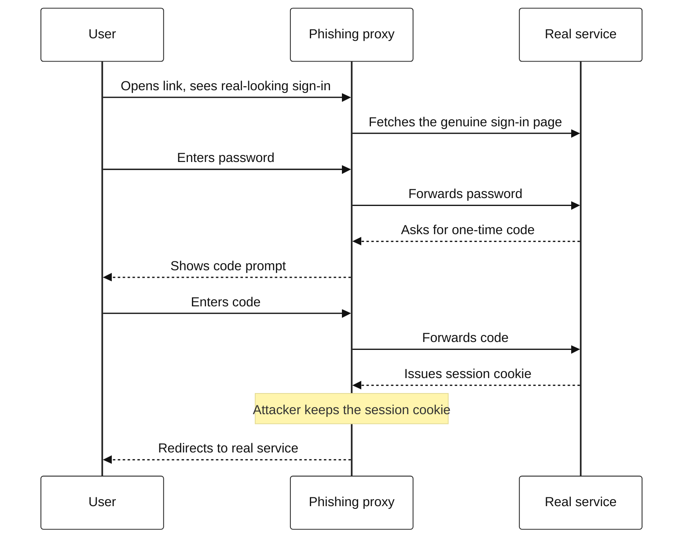
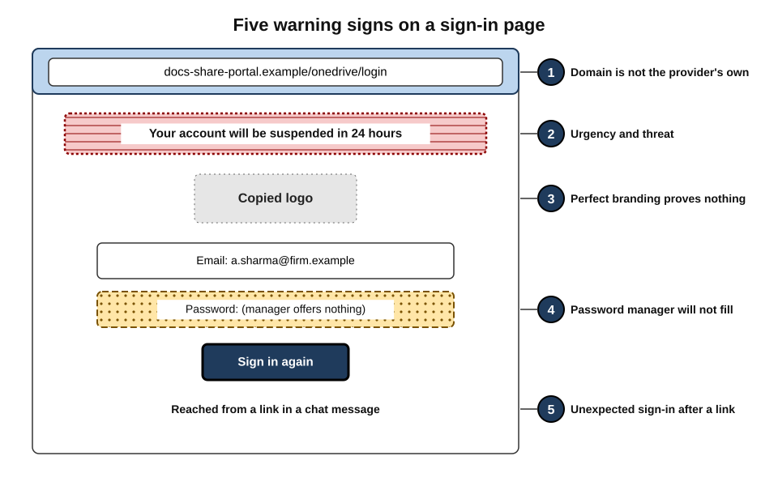
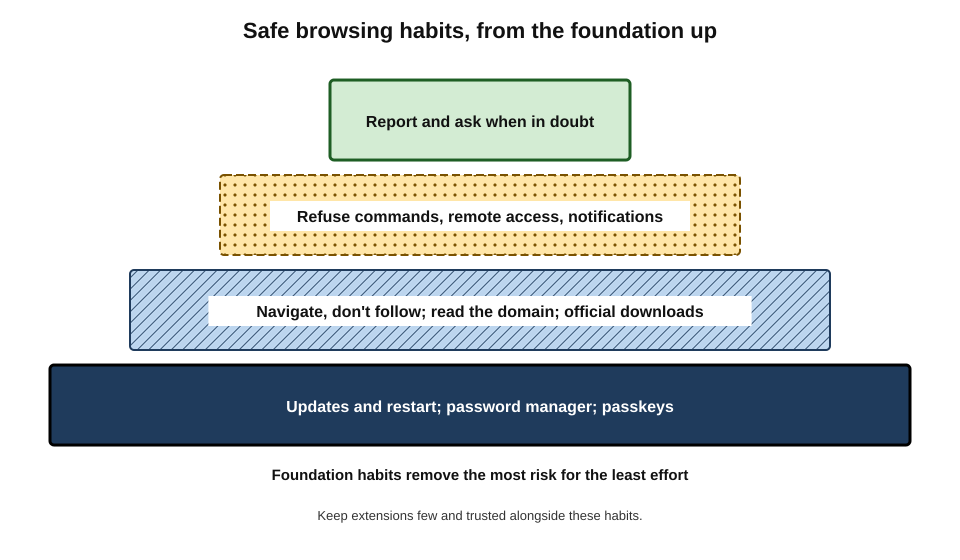
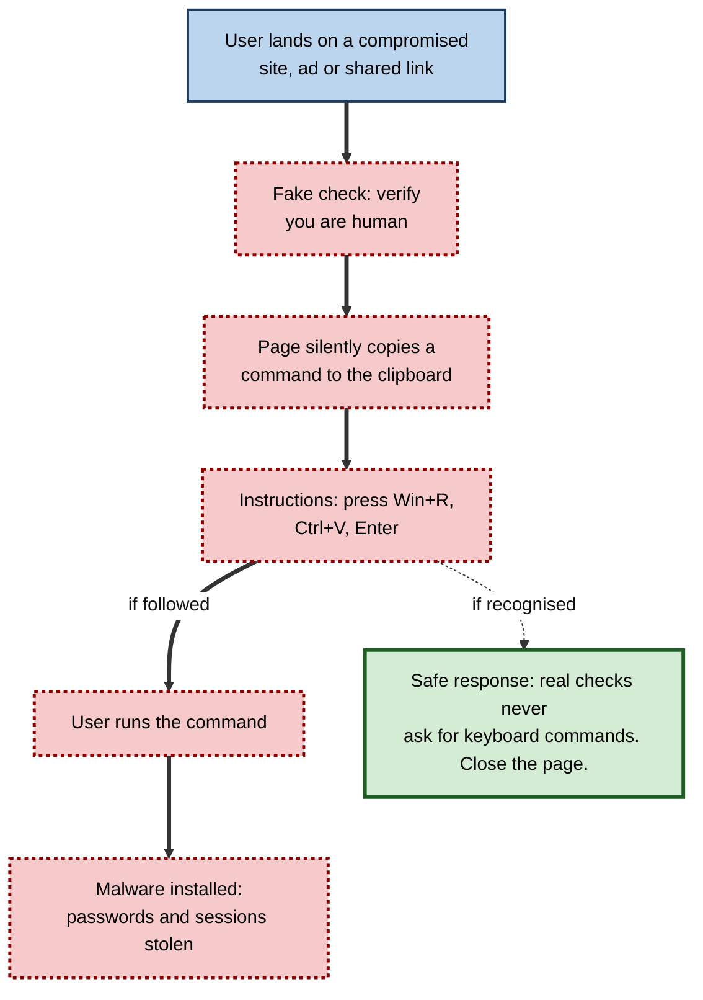
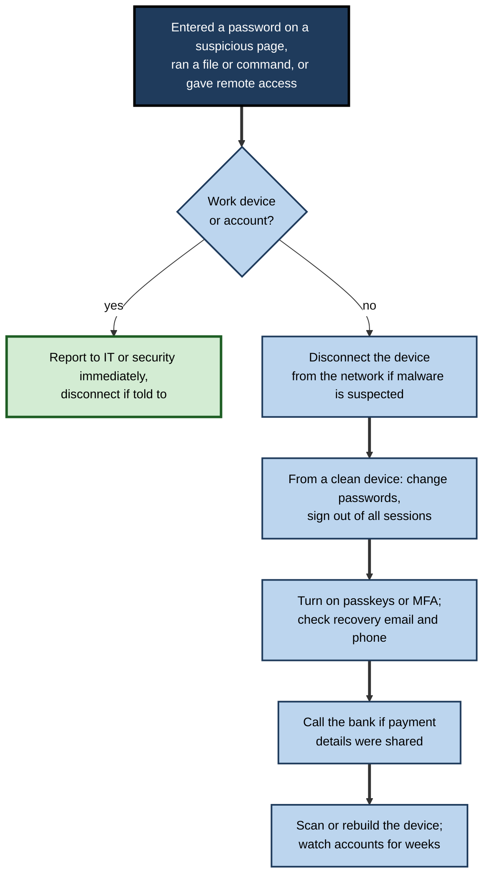

# C.13. Safe Web Browsing Practices

A project coordinator opens a link to a shared invoice. A familiar-looking "Verify you are human" box asks her to press the Windows key and R, then Ctrl+V, then Enter. The page has silently copied a command to the clipboard; following the instructions installs malware that steals every password and session the browser holds.

The attack defeats no technology; it persuades the user to do the attacker's work. Most harm through browsers arrives this way — by **deception**, not by breaking in.

> **Definition — Safe browsing practice:** a habit or routine that reduces the likelihood or impact of harm through the browser — by recognising deception, reaching sites by trustworthy routes, protecting credentials and sessions, handling downloads and permissions carefully, and responding correctly when something goes wrong.

**Why it matters**

- **Deception is the main threat.** Browsers block many technical attacks automatically; attackers therefore target the person.
- **One mistake can be enough.** A single stolen session or password can open email, files and finance systems.
- **Habits scale.** In an organisation, every employee's browsing habits are part of the security perimeter.
- **Speed matters after an incident.** Knowing what to do in the first ten minutes limits damage.

---

## How Harm Arrives Through the Browser

**Figure 1.** The main routes by which attacks reach users through the browser.

### Credential theft

- **Phishing pages** — copies of sign-in pages for email, banks, cloud storage or delivery companies, reached through emails, texts, chat messages, search adverts or QR codes.
- **Lookalike domains** — addresses that differ subtly from the real one:
  - **typosquatting** (`micros0ft-support.example`);
  - **combosquatting** (`paypal-security-check.example`);
  - **subdomain tricks** (`login.microsoft.com.account-verify.example`);
  - **homographs** — characters from other alphabets that look like Latin letters.
- **Browser-in-the-browser** — a fake sign-in pop-up drawn inside the page.
- **Adversary-in-the-middle (AiTM) phishing** — a phishing site that **relays** the user's sign-in to the real service in real time, passing through the password and the multi-factor code, and capturing the resulting **session cookie**. Large campaigns of this kind have targeted thousands of organisations since 2021–2022.
- **Consent phishing** — a genuine sign-in page asks the user to grant a malicious application access to their mailbox or files; no password is stolen, but the access is.

> **Definition — Adversary-in-the-middle phishing:** a phishing technique in which the attacker's site sits between the user and the real service, forwarding traffic both ways to capture passwords, one-time codes and session cookies.

**Figure 2.** How an adversary-in-the-middle phishing site defeats one-time codes.

> **Key point:** one-time codes and push approvals **do not stop** adversary-in-the-middle phishing. **Passkeys** and hardware security keys do, because they are cryptographically bound to the genuine domain and will not work on the proxy's address.

### Malware delivery

- **Fake browser updates** — a compromised website shows a convincing "Your browser is out of date" banner and offers a download. Real browsers update **themselves**; they never ask a website to deliver an update.
- **Fake CAPTCHA ("ClickFix") commands** — since 2024 a fast-growing technique: a page instructs the user to paste and run a command "to verify" or "to fix an error".
- **Cracked software, game cheats and "free" tools** — frequent carriers of information-stealing malware.
- **Malvertising and SEO poisoning** — adverts or search results for popular software leading to lookalike download sites.
- **Drive-by downloads** — infection merely by visiting a page; now rarer thanks to sandboxing and fast patching, but still used with zero-day exploits against high-value targets.

### Fraud

- **Tech-support scams** — a page goes full-screen, plays an alarm, shows a fake system warning and a phone number; the "technician" seeks remote access and payment.
- **Fake shops** — professional-looking stores offering branded goods at implausible discounts, taking payment and delivering nothing.
- **Scam customer-service numbers** — planted on low-quality pages, in adverts and occasionally surfaced by AI-generated summaries.
- **Payment-page skimming** — malicious code injected into a legitimate shop's checkout copies card details; invisible to the user.

### Abuse of permissions

- **Notification spam** — sites trick users into allowing notifications, then push fake virus alerts and scam offers.
- **Malicious extensions** — requested by pages "to view the content" or "to download faster".
- **Screen-sharing and remote-access requests** — from callers posing as support.

---

## Recognising Deception

### The universal red flags

- **Urgency** — "act within 24 hours", "account suspended", "final notice".
- **Fear or reward** — threats of loss, promises of refunds or prizes.
- **Unexpected requests** — a sign-in from a link one did not request, a document one did not expect.
- **Unusual actions** — run a command, install something, call a number, allow notifications, share the screen, pay by gift card.
- **Mismatch** — the address does not match the claimed organisation; the password manager does not offer to fill.

> **Mnemonic — "STOP-UP":** **S**urprise, **T**hreat or **O**ffer, **P**ressure — then **U**nusual action and **P**lace (address) wrong. Any two together justify stopping.

### Reading a suspicious page

**Figure 3.** Warning signs on a phishing sign-in page.

### Worked example (illustrative): is this sign-in page genuine?

A finance assistant receives a chat message: "Shared: Q3 supplier payments.xlsx — sign in to view". The link opens a sign-in page carrying the company's cloud-provider logo.

1. **Address bar.** It shows `docs-share-portal.example/onedrive/login`. The registrable domain is `docs-share-portal.example` — not the cloud provider's own domain.
2. **Password manager.** It does **not** offer to fill the work password — it recognises the domain as unfamiliar. This is one of the most reliable signals available.
3. **Route.** The link came from a chat account of a supplier contact, which could be compromised; the message style is unusual.
4. **Content.** Logo and layout are perfect — which proves nothing, since they can be copied.
5. **Verify independently.** The assistant opens the cloud storage app directly; no file has been shared.
6. **Report** the message through the organisation's reporting channel; warn the supplier through a known phone number.

> **Remember:** when the **password manager will not fill**, stop. It is checking the domain more reliably than a human eye can.

> **Watch out:** a page can display a **padlock and a valid certificate** and still be a phishing site; attackers obtain certificates as easily as anyone. HTTPS is necessary, never sufficient.

---

## Core Habits

The following habits address the great majority of browser-borne harm. They are ordered roughly by impact.

1. **Keep the browser and operating system updated** — and restart when prompted.
2. **Use a password manager** with a unique password for every site; let it act as a phishing detector.
3. **Use passkeys or security keys** wherever offered, especially for email, cloud storage and finance.
4. **Navigate, don't follow** — reach important sites through bookmarks, the app or a typed address, not links in messages or adverts.
5. **Read the registrable domain** before entering credentials or payment details.
6. **Never run commands, install software or allow remote access** because a web page or caller said so.
7. **Download software only from the publisher's own site or official store**; avoid cracked software.
8. **Refuse notification requests** from sites that do not genuinely need them; review permissions periodically.
9. **Keep extensions few and trusted**; use a clean profile for banking and sensitive work.
10. **Report and ask** — when in doubt, report the message or page, and ask colleagues or IT before acting.

**Figure 4.** Safe browsing habits arranged from the foundation upwards.

### Downloads

- **Check the source** — the publisher's own domain or official store.
- **Check the file type** — a "document" or "invoice" that is an executable (`.exe`, `.msi`, `.scr`, `.js`, `.vbs`, `.lnk`, `.iso`) is a red flag; show file extensions in the operating system.
- **Heed warnings** — "dangerous" and "uncommon" download warnings are worth taking seriously.
- **Office documents** — do not enable macros or "editing" on documents from unexpected sources.

### Shopping and payments

- **Prefer known retailers** or verify unfamiliar ones — company details, independent reviews, domain age.
- **Use protected payment methods** — credit cards and payment services offering chargebacks; **virtual card numbers** where available.
- **Be wary of prices far below market** and of requests for bank transfers, gift cards or cryptocurrency.
- **Check the address at checkout** and on any payment-provider page.

### Public and shared computers

- **Avoid** signing in to sensitive accounts on shared or public computers; if unavoidable, use a private window, **sign out** and close the browser.
- **Public Wi-Fi** — with HTTPS almost universal, eavesdropping on page content is far less of a risk than it once was; the larger risks are fake hotspots with captive portals asking for credentials, and shoulder-surfing.

> **Watch out:** advice that "public Wi-Fi is dangerous, never use it" is outdated in its strong form. With HTTPS and an updated browser, ordinary browsing on public Wi-Fi is low risk. Do not enter credentials into Wi-Fi sign-in pages that ask for email or social-media passwords.

---

## Escaping Common Traps

### Full-screen scare pages

1. **Do not call** any number shown and do not click anything on the page.
2. **Press Esc** (exits full-screen) and close the tab.
3. If the page will not close, use **Ctrl+Shift+Esc** (Task Manager on Windows) or force-quit the browser.
4. When restarting, **do not restore** the previous session if the browser offers.
5. If notifications keep appearing, remove the site's notification permission.

### Fake CAPTCHA commands

**Figure 5.** How a fake CAPTCHA tricks a user into running malware.

> **Remember:** **no website ever needs the user to run a command** to prove they are human, fix a page, view a document or update a browser.

### Unexpected sign-in prompts

- A request to sign in again after following a link is the most common phishing moment.
- Close the page, open the service directly, and see whether a sign-in is actually needed.

---

## When Something Goes Wrong

Speed and honesty limit damage. Organisations would far rather hear about a mistake in minutes than discover it in weeks.

**Figure 6.** First steps after a suspected browser-borne compromise.

> **Watch out:** changing a password does **not** end sessions an attacker has already stolen. Use "**sign out of all sessions**" or "**sign out everywhere**" — and, if malware was involved, change passwords from a **different, clean device**.

---

## Safe Browsing in Organisations

### Does awareness training work?

**Study card — Lain, Kostiainen and Čapkun (2022), ETH Zurich**

- **Design:** a 15-month study of more than 14,000 employees of a large company, sending simulated phishing emails and testing different warnings and training.
- **Results:**
  - **embedded training** — showing a training page to people who clicked a simulated phish — did **not** make them more resilient, and in this study was associated with **more** clicking later;
  - employees collectively **reported** phishing quickly, and crowd-sourced reports could detect campaigns early.
- **Conclusion:** reporting systems may protect organisations more than punitive or click-triggered training.

**Study card — Ho and colleagues (2025), University of California San Diego**

- **Design:** an eight-month study of around 19,500 employees of a health-care organisation, combining simulated phishing campaigns with records of annual and embedded training.
- **Results:** completion of annual security training showed **no meaningful relationship** with whether employees clicked simulated phishing; embedded training produced at most a **very small** improvement on average, and many trainees spent only seconds on the training page.
- **Conclusion:** commonly deployed training formats delivered little measurable protection.

> **Watch out:** these findings are **contested in their generality** — other studies report benefits from well-designed, frequent, non-punitive training. The robust lesson is that training alone is a **weak control**; it must be combined with technical defences that do not depend on every person noticing every trick.

### Controls that do not rely on vigilance

| Threat | Technical control | What it removes |
|---|---|---|
| Credential phishing, including AiTM | Passkeys or hardware security keys | Phished passwords and codes become useless |
| Lookalike sites | Password managers enforced; DNS and web filtering | Credentials not filled; many known bad domains blocked |
| Malicious downloads | Download restrictions, application allow-listing, endpoint protection | Unknown executables cannot run |
| Fake CAPTCHA commands | Restricting script and command tools for standard users; endpoint detection | Pasted commands blocked or detected |
| Session theft | Conditional access from managed devices; device-bound sessions; short session lifetimes | Stolen cookies fail or expire quickly |
| Malicious extensions | Extension allow-list | Unapproved extensions blocked |
| Unpatched browsers | Enforced updates with restart deadlines | Known exploits closed |

> **Key point:** the most effective organisations make the **safe path the easy path** — passkeys instead of passwords, an obvious "report" button, approved tools that work — so that safety does not depend on perfect judgement.

### Building a reporting culture

- **One-click reporting** of suspicious messages and pages.
- **Fast, friendly feedback** — "thank you; this one was malicious and we have blocked it".
- **No blame for honest mistakes** — people who fear punishment hide incidents.
- **Share examples** of real attacks seen in the organisation.

---

### Case study (illustrative): fake CAPTCHA in a consultancy

- **Situation:** a 400-person consultancy saw three laptops begin sending unusual traffic within a single morning.
- **Problem:** information-stealing malware had harvested saved browser passwords and session cookies, including for the firm's cloud storage and a client's project portal.
- **Diagnosis:**
  1. All three users had visited the same legitimate industry-association site, which had been compromised to show a fake "verify you are human" check.
  2. Each had followed instructions to press Win+R and paste — running a command that downloaded malware.
  3. Two had passwords saved in the browser for sites not covered by single sign-on.
- **Actions:**
  1. Devices isolated and rebuilt; all sessions for affected accounts revoked; passwords reset from clean devices.
  2. The client was notified and its portal sessions revoked.
  3. Standard users' ability to run the command dialog and scripting tools was restricted by policy.
  4. Passkeys rolled out for cloud services; the password manager made mandatory, with browser password saving disabled.
  5. The incident was shared with all staff as a short, blame-free explainer: "No real check ever asks you to run a command."
- **Result:** no further infections from the same campaign; the explainer prompted several staff to report similar pages within days.
- **Side effects / caveats:** some power users objected to the restrictions; an exception process was created.
- **Lesson:** when a deception reliably works, **remove the capability it depends on** — and tell people about it quickly and without blame.

---

## Safe Browsing in Particular Situations

### QR codes and short links

- **QR codes** are addresses in disguise: scanning one opens a page without showing its address first in many apps.
- **"Quishing"** — phishing via QR codes on emails, parking meters, posters, restaurant tables or fake delivery notices; criminals have pasted fake codes over genuine ones on parking payment machines.
- **Habits:**
  - preview the address the scanner shows before opening;
  - pay for parking or services through the official app or a typed address where possible;
  - treat QR codes in **emails** as suspicious — they are often used to move phishing from a protected work computer to a less protected phone.

### Travel and borrowed devices

- **Hotel and conference computers** — assume they may be monitored or infected; avoid signing in to work or financial accounts.
- **Hotel Wi-Fi portals** — accept terms only; never enter email or social-media passwords into a Wi-Fi sign-in page.
- **Lost or stolen devices** — browsers with saved passwords and sessions are valuable; device encryption, screen locks and remote sign-out of sessions limit the damage.

### Roles with elevated risk

- **Finance and payroll staff**
  - verify any change of bank details through a known phone number, never by replying to the message or using a link in it;
  - use a separate browser profile, free of extensions, for banking and payment systems.
- **Recruiters and HR staff**
  - open CVs and attachments from unknown applicants in the organisation's protected viewer, not by downloading executable "portfolio" files;
  - be alert to fake job-seeker sites that host malware.
- **Executives and their assistants**
  - targeted by highly personalised lures; use phishing-resistant authentication and minimal extensions.
- **IT administrators**
  - use a dedicated browser profile or device for administrative consoles, never for general browsing — a single stolen administrator session can compromise the whole organisation.

| | General staff | Finance staff | IT administrators |
|---|---|---|---|
| Main browser risks | Phishing, fake downloads | Payment fraud, session theft on banking sites | Theft of privileged sessions |
| Key separation | Work and personal profiles | Banking profile with no extensions | Dedicated admin profile or device |
| Authentication | Passkeys where offered | Passkeys or hardware keys, payment approval controls | Hardware keys, short admin sessions |
| Behaviour rule | Navigate, don't follow | Verify bank changes by known phone number | Never browse the web from admin sessions |

---

## AI and the Changing Face of Deception

- **Flawless language** — AI-written phishing removes the spelling and grammar errors people were taught to notice.
- **Cloned sites at scale** — convincing copies of login pages and shops can be generated quickly for many brands and languages.
- **Fake support chat** — scam sites deploy chatbots posing as customer support, guiding victims step by step.
- **Voice and video impersonation** — calls that sound like a manager or supplier, often combined with a link to "the document we discussed".
- **Poisoned AI answers** — scam phone numbers or links planted on low-quality pages that AI summaries may repeat.

> **Key point:** as surface clues disappear, safe browsing depends less on **spotting imperfections** and more on **process**: reaching sites by trusted routes, verifying requests through independent channels and using credentials that cannot be phished.

---

## Measuring Safe Browsing in an Organisation

What gets measured shapes behaviour, and some popular measures mislead.

| Measure | What it shows | Weakness |
|---|---|---|
| Click rate on simulated phishing | How many people click a test email | Depends heavily on how hard the test is; can encourage blame |
| Reporting rate and time to first report | How quickly suspicious messages reach security staff | Needs an easy reporting button to be meaningful |
| Accounts on phishing-resistant sign-in | Share of users with passkeys or security keys | Says nothing about recovery processes, which attackers target |
| Browsers on current version | Patch coverage | Must count restarted browsers, not just downloaded updates |
| Extensions per device and unapproved extensions | Attack surface | Requires central inventory |
| Incidents from browser-borne attacks | Real outcomes | Small numbers; slow feedback |

> **Key point:** a falling click rate on simulated phishing is weak evidence of safety if real attacks bypass clicking altogether. **Reporting speed**, **phishing-resistant authentication coverage** and **patch coverage** track the controls that actually stop harm.

> **Watch out:** publishing league tables of who "failed" phishing tests tends to discourage reporting of real mistakes — the opposite of what an organisation needs.

---

## Open Questions

- **Can phishing be designed out?**
  - Passkeys defeat credential phishing, but adoption across all services and recovery processes remains incomplete; attackers move to consent phishing and malware.
- **How effective is awareness training really?**
  - Large field studies have found weak effects; whether better designs can achieve durable change is debated.
- **Should browsers block clipboard-to-command attacks?**
  - The browser cannot see what happens in the operating system after a paste; responsibilities between browser and operating system are unsettled.
- **Who should bear the cost of scam adverts and numbers?**
  - Platforms, advertisers and users share the harm; regulation is developing.
- **Will AI make deception harder to detect?**
  - Flawless language, cloned voices and personalised lures remove traditional warning signs such as poor grammar.

---

## Summary

- Most harm through browsers comes from **deception**: credential theft, malware delivery, fraud and permission abuse.
- Credential theft uses **phishing pages, lookalike domains, browser-in-the-browser, adversary-in-the-middle proxies** (which defeat one-time codes) and **consent phishing**.
- Malware arrives through **fake updates, fake CAPTCHA commands, cracked software, malvertising and SEO poisoning**; fraud through **tech-support scams, fake shops and scam numbers**.
- Red flags: **STOP-UP** — surprise, threat or offer, pressure, unusual action, wrong place.
- The **password manager refusing to fill** is a strong phishing signal; HTTPS is never proof of legitimacy.
- Core habits: update and restart; password manager; **passkeys**; **navigate, don't follow**; read the domain; never run commands or allow remote access on request; official downloads; refuse notifications; few extensions; report and ask.
- After compromise: report; disconnect; change passwords from a clean device; **sign out of all sessions**; enable strong authentication; contact the bank.
- Training alone is a **weak, contested** control (Lain et al., 2022; Ho et al., 2025); organisations need technical controls — passkeys, filtering, download and command restrictions, conditional access, allow-lists, enforced updates — and a **blame-free reporting culture**.

---

## Self-Check

1. Name the four main routes of browser-borne harm with an example of each.
2. What is adversary-in-the-middle phishing, and why do one-time codes fail against it?
3. Why do passkeys resist phishing?
4. Explain the fake CAPTCHA ("ClickFix") technique and the rule that defeats it.
5. List the STOP-UP red flags.
6. Why is a password manager refusing to fill a useful signal?
7. Why is "look for the padlock" insufficient advice?
8. Describe how to escape a full-screen tech-support scam page.
9. How should a person respond after entering their password on a phishing page?
10. Why does changing a password not always end an attacker's access?
11. Summarise the findings of the ETH Zurich and UC San Diego phishing-training studies, and their limits.
12. Match three threats to technical controls that do not rely on vigilance.
13. In the consultancy case, why was restricting the command dialog more effective than another training session?
14. A colleague says public Wi-Fi is so dangerous they never check email in cafés. How would you advise them?

### Answer Key

1. Credential theft (phishing page imitating email sign-in); malware delivery (fake browser update); fraud (tech-support scam page); permission abuse (notification spam).
2. The attacker's site relays the sign-in to the real service in real time, passing through password and code and capturing the session cookie. The code is used immediately by the proxy, so it does not protect the user.
3. They are cryptographic credentials bound to the genuine domain; the browser will not use them on a lookalike or proxy domain, so there is nothing for the attacker to capture and replay.
4. A page shows a fake human-verification check, silently copies a command to the clipboard and instructs the user to paste and run it, installing malware. Rule: no website ever needs a user to run a command.
5. Surprise; Threat or Offer; Pressure; Unusual action; wrong Place (address).
6. It matches credentials to exact domains, so it detects lookalike domains that humans miss; refusal to fill means the site is not the one the password belongs to.
7. Phishing sites routinely use valid HTTPS certificates; the padlock (now often replaced) indicates encryption, not legitimacy.
8. Don't call or click; press Esc and close the tab; if stuck, use Task Manager or force-quit; don't restore the session; remove any notification permission.
9. Report it (at work, immediately); from a clean device change the password, sign out of all sessions, enable passkeys or MFA, check recovery details; contact the bank if payment data were shared; monitor accounts.
10. An attacker may hold a stolen session cookie that remains valid; sessions must be revoked with "sign out everywhere".
11. ETH Zurich (2022, 14,000+ employees, 15 months): embedded training did not help and was associated with more clicks; crowd reporting was valuable. UC San Diego (2025, ~19,500 employees): annual training unrelated to click rates; embedded training gave very small gains. Limits: specific organisations and designs; other studies find benefits; conclusion is that training is weak alone.
12. AiTM phishing → passkeys; malicious downloads → application allow-listing; malicious extensions → extension allow-list (also: session theft → conditional access and device-bound sessions; unpatched browsers → enforced updates).
13. The attack worked by persuading people; removing the capability it needed meant success no longer depended on every person recognising the trick every time.
14. With HTTPS everywhere and an updated browser, ordinary use is low risk; avoid fake hotspots and Wi-Fi portals asking for account passwords, watch for shoulder-surfing, and use the organisation's VPN if policy requires.

---

## Glossary

| Term | Meaning |
|---|---|
| Adversary-in-the-middle phishing | A phishing proxy that relays sign-ins to capture passwords, codes and session cookies. |
| Browser-in-the-browser | A fake sign-in window drawn inside a web page. |
| ClickFix | A fake CAPTCHA or error page that tricks users into running a pasted command. |
| Combosquatting | Registering a domain combining a brand name with other words. |
| Consent phishing | Tricking a user into granting a malicious app access to their account. |
| Drive-by download | Infection merely by visiting a page, through an exploit. |
| Embedded training | Training shown immediately to people who fall for a simulated phish. |
| Fake update | A website prompt offering a malicious "browser update". |
| Homograph | A character from another alphabet that looks like a Latin letter. |
| Malvertising | Delivering malware or scams through online advertisements. |
| Passkey | A phishing-resistant credential bound to a site's domain. |
| Payment skimming | Malicious code on a checkout page copying card details. |
| Phishing | Deceiving users into revealing credentials or taking harmful actions. |
| SEO poisoning | Optimising malicious pages to rank for popular searches. |
| Tech-support scam | A fake warning urging the user to call a fraudulent support line. |
| Typosquatting | Registering misspellings of well-known domains. |
