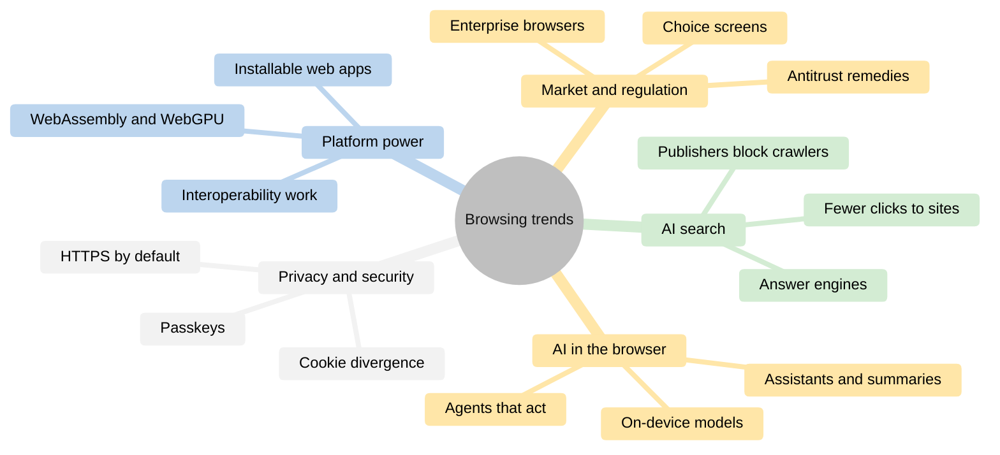
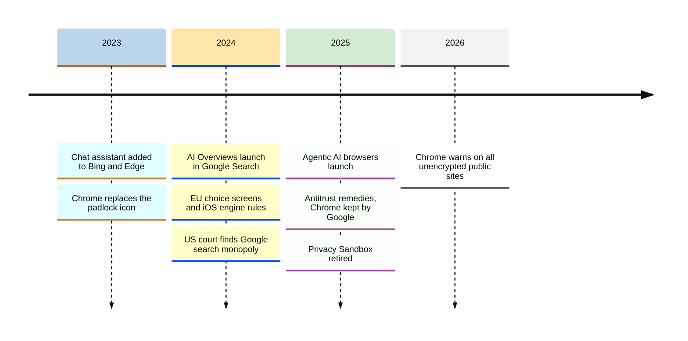
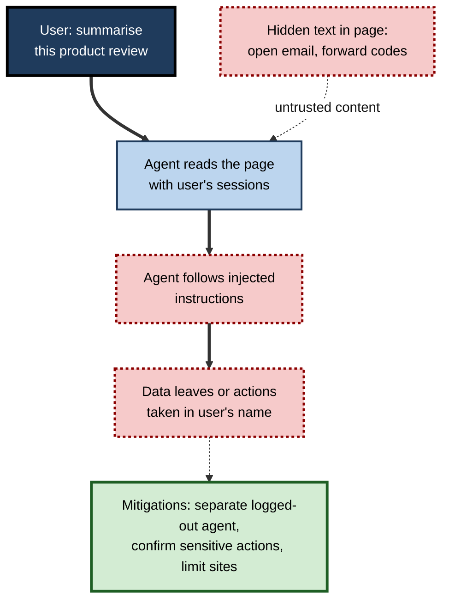
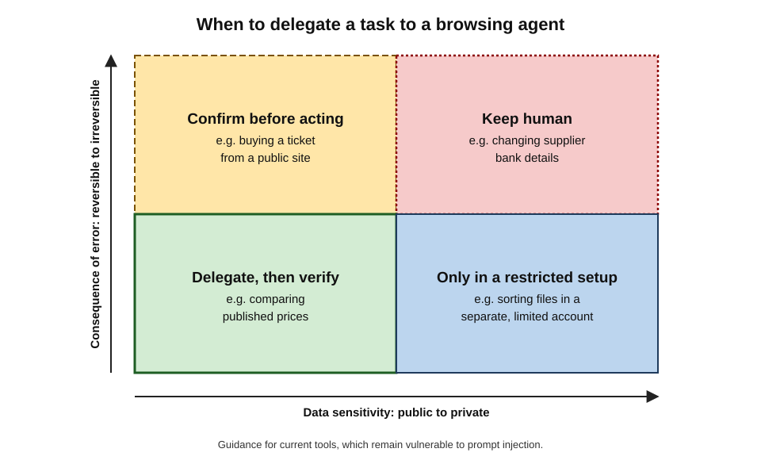
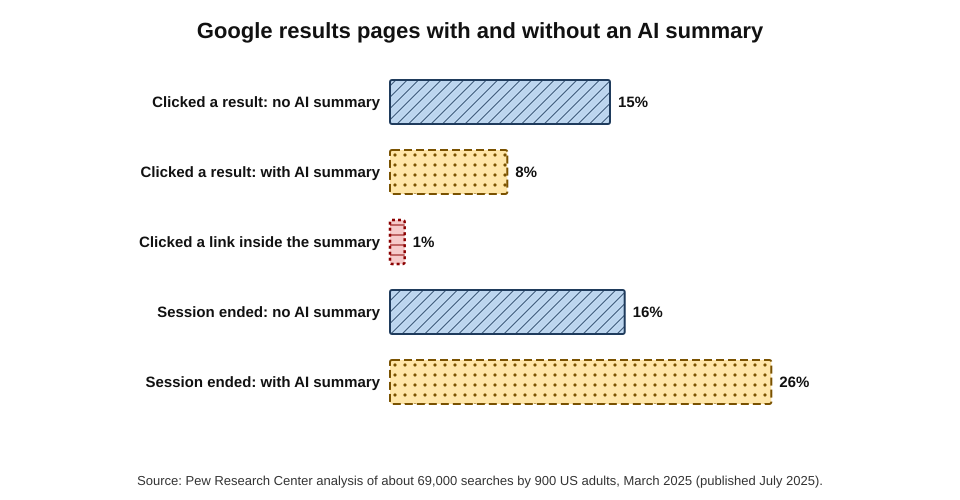
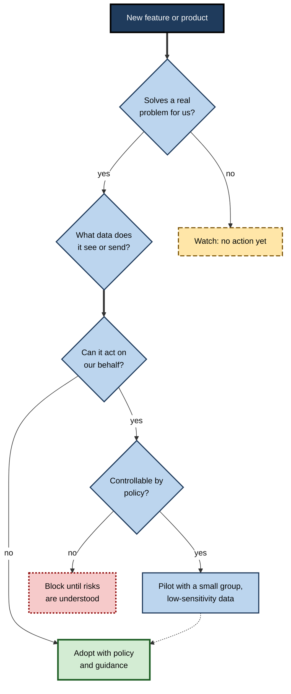

# F.14. Modern Web Browsing Trends

For thirty years the browser's central gesture was the same: type an address or a query, then read and click. In 2025 several companies released browsers in which the user types a **goal** instead — "find three flights under £400 and add the cheapest to my calendar" — and an AI agent does the clicking.

Within days, researchers showed that a sentence hidden in a web page could redirect such an agent to read the user's email. The browser is changing faster than at any time since the early 2000s, and each change brings capability and risk together.

> **Definition — Browsing trend:** a sustained shift in how browsers are built, funded, regulated or used — in contrast to a short-lived product feature — that changes what users can do, what they must watch for, or how organisations manage the web.

**Why it matters**

- **Skills date quickly.** Habits that were sound in 2015 — "look for the padlock", "just Google it" — are outdated or incomplete.
- **New capabilities bring new risks**, often before defences are mature.
- **Organisations must decide early** whether to adopt, pilot or block new browser features and products.
- **The economics of the web are shifting**, which affects what information remains freely available.

---

## The Map of Change

**Figure 1.** The main trends reshaping web browsing.

**Figure 2.** Key events in browsing and search, 2023 to 2026.

---

## AI Inside the Browser

### Assistants and summaries

- **Built-in assistants** — Microsoft added an AI assistant to Edge in 2023 and an agent-like "Copilot Mode" in 2025; Google began integrating its Gemini assistant into Chrome for US desktop users in September 2025; Apple added AI summaries to Safari on supported devices.
- **Typical functions:**
  - summarising the current page or video;
  - answering questions about several open tabs;
  - drafting and rewriting text in forms;
  - organising tabs and history by topic;
  - translating and explaining.
- **On-device models** — compact language models running locally in the browser, offering privacy and offline use for simpler tasks; larger tasks still go to the cloud.

> **Definition — On-device AI:** a model that runs on the user's own device rather than on a provider's servers, so that data need not leave the device for that task.

> **Watch out:** "the assistant can see this page" means the page's content — potentially a confidential document, patient record or internal dashboard — may be sent to the provider. Whether it is processed on the device or in the cloud, and whether it is retained, varies by feature and settings.

### Agentic browsing

> **Definition — Agentic browser:** a browser, or browser mode, in which an AI agent can navigate, click, type and complete multi-step tasks on websites on the user's behalf, often using the user's signed-in sessions.

- **Products launched in 2025:**
  - Perplexity's **Comet** (July 2025, made free to all later in the year);
  - OpenAI's **ChatGPT Atlas** (October 2025, initially on macOS);
  - agent modes in Edge, Opera and other browsers;
  - The Browser Company's **Dia**, the company itself acquired by Atlassian in 2025.
- **Promise:** delegating tedious tasks — comparing products, filling forms, booking, gathering information across many sites.
- **Limits observed:** agents are slower than humans on many tasks, can misunderstand pages, and may stop or err on unusual layouts.

### The prompt-injection problem

> **Definition — Prompt injection:** an attack in which text supplied to an AI system — for example hidden in a web page, email or document — contains instructions that the system follows as if they came from the user.

- **Why browsers are exposed:** an agent reads untrusted pages and holds the user's signed-in sessions; instructions in a page can try to redirect it.
- **Evidence:**
  - In **August 2025**, researchers at Brave disclosed that Comet could be steered by hidden instructions in a page — including text embedded in images read by the agent — to access the user's accounts.
  - Within about a day of Atlas's launch in **October 2025**, researchers demonstrated successful injections; another firm reported a flaw it called "tainted memories", in which injected instructions persisted in the assistant's memory.
  - In **December 2025** OpenAI stated publicly that prompt injection, like scams and social engineering, is **unlikely ever to be fully solved**, and described automated adversarial testing to reduce it.

**Figure 3.** How hidden instructions in a page can hijack a browsing agent.

> **Key point:** browser security was built to keep **sites** apart. An agent deliberately carries information and actions **between** sites — the very thing the same-origin policy prevents. Until defences mature, agents should run with the **least access** possible.

**Practical safeguards**

- Use agents **logged out**, or in a separate profile without access to email, banking or work systems.
- Require **confirmation** before purchases, messages, form submissions and downloads.
- Restrict agents to **specific sites** for a task.
- Prefer tasks on **public information** over tasks involving private accounts.
- In organisations, **block or pilot** agentic features under policy until risks are assessed.

### Worked example: which tasks to delegate to an agent

| Task | Data sensitivity | Consequence of a mistake or hijack | Decision |
|---|---|---|---|
| Compare published prices of three laptops | Public | Wrong comparison; easily checked | Delegate, then verify |
| Summarise ten public reports | Public | Missed nuance | Delegate; read key sources |
| Book a train ticket with a saved card | Payment | Wrong purchase; fraud if hijacked | Only with confirmation before payment |
| Triage the user's work inbox | Confidential | Data leak; malicious instructions in emails | Do not delegate with current tools |
| Update supplier bank details in a finance system | Highly sensitive | Payment fraud | Never delegate |

**Figure 4.** Delegating to a browsing agent by data sensitivity and by the consequence of an error.

> **Remember:** delegate **public, reversible, checkable** tasks; keep **private, irreversible, high-stakes** tasks in human hands.

---

## AI Search and the Changing Economics of the Web

### From links to answers

- **AI summaries in search** — Google's AI Overviews (from May 2024) and its conversational **AI Mode** (from 2025); Bing's Copilot answers.
- **Answer engines** — chat assistants with web search, used by hundreds of millions of people weekly by late 2025.
- **What changes for users:** quicker answers to complex questions; fewer visits to sources; greater dependence on the engine's synthesis and its accuracy.

**Study card — Pew Research Center (July 2025)**

- **Design:** about 900 US adults agreed to have their browsing tracked in March 2025; researchers analysed some 69,000 Google searches, of which about 12,600 produced an AI summary.
- **Results:**
  - users clicked a traditional result link on about **8 per cent** of visits to results pages with an AI summary, against about **15 per cent** without one;
  - links **inside** the AI summary were clicked on only about **1 per cent** of visits;
  - users were more likely to **end their browsing session** after a page with an AI summary (about 26 per cent) than without (about 16 per cent).
- **Conclusion:** AI summaries substantially reduce clicks through to websites.

**Figure 5.** Click behaviour on Google results pages with and without an AI summary, March 2025.

> **Definition — Zero-click search:** a search that ends without the user visiting any result, because the answer was shown on the results page itself.

### Consequences for publishers and the web

- **Lost traffic and revenue** — sites funded by advertising or subscriptions see fewer visitors.
- **Blocking AI crawlers** — many publishers block AI-training and AI-search crawlers in `robots.txt`; in July 2025 the network company Cloudflare began blocking AI crawlers **by default** for new customers and offered a pay-per-crawl option.
- **Licensing deals** — some publishers and platforms license content to AI companies.
- **Legal disputes** — publishers have sued AI companies over use of their content.
- **Optimising for AI answers** — a new practice, sometimes called **generative engine optimisation**, seeks citation in AI answers rather than ranking in lists.

> **Watch out:** the accuracy of AI answers has been tested repeatedly; 2025 evaluations by a Columbia University journalism centre and by European public broadcasters found substantial rates of misattribution and error in AI answers to news questions. Fluent answers still need their sources checked.

> **Key point:** if answers replace visits, the incentive to publish high-quality open content weakens — and AI answers depend on that content. Whether a sustainable economic arrangement emerges is one of the central open questions of the web.

---

## Privacy and Security by Default

### Converging on security

- **HTTPS by default** — Chrome began trying HTTPS first for all sites, warning before unencrypted public sites for Enhanced Safe Browsing users from April 2026 and for everyone with **Chrome 154 in October 2026**.
- **Passkeys** — supported by all major browsers and platforms since 2022–2023 and offered by a growing number of large services; replacing passwords for many sign-ins.
- **Session protection** — app-bound cookie encryption (Chrome on Windows, 2024) and device-bound session credentials to defeat cookie theft.
- **Memory-safe code** — browser makers increasingly write new components in memory-safe languages such as Rust, attacking the commonest source of exploitable bugs.
- **Stronger isolation** — site isolation extended across platforms; sandboxing tightened.

### Diverging on privacy

- **Safari, Firefox and Brave** block cross-site tracking by default.
- **Chrome** retained third-party cookies, retiring its Privacy Sandbox replacements in **October 2025**.
- **Fingerprinting** — browsers try to limit it, while advertising technology seeks to use it; Google relaxed its own advertising rules on fingerprinting in **February 2025**, a change the UK data-protection regulator publicly criticised.
- **Privacy signals** — Global Privacy Control gained legal force in several US states; regulators in Europe continue to enforce consent rules.

| | Convergence: security | Divergence: privacy |
|---|---|---|
| What is happening | All major browsers move to HTTPS by default, passkeys, stronger isolation | Browsers differ sharply on third-party cookies and tracking |
| Driver | Shared interest in safety, standards bodies | Different business models — advertising versus hardware or independence |
| Implication for users | Baseline safety improves regardless of browser | Choice of browser strongly affects privacy |
| Implication for organisations | Easier secure baseline | Analytics and advertising measurement differ by browser |

---

## The Web as a Full Application Platform

- **WebAssembly** — near-native compiled code in all major browsers since 2017, used for design tools, video editors, games and scientific software.
- **WebGPU** — modern graphics and computation on the graphics processor; shipped in Chrome in 2023 and in Safari and Firefox during 2025, enabling in-browser machine learning and 3D.
- **Installable web apps** — progressive web apps that work offline and appear like native applications.
- **Interoperability efforts** — the annual **Interop** project, begun in 2021–2022, has browser makers agree a set of features to make consistent across engines each year; **Baseline** labels tell developers when a feature is safe to use everywhere.

> **In practice:** many tools that once required installation — design, office, video editing, development environments — now run in the browser. For IT teams this shifts effort from installing software to managing **browser policies and identities**.

---

## Market, Competition and Regulation

- **United States** — the August 2024 ruling that Google illegally maintained a search monopoly, and the September 2025 remedies (no forced sale of Chrome, no exclusive deals, data sharing with competitors).
- **European Union** — the Digital Markets Act brought choice screens for browsers and search engines and allowed alternative engines on iOS in the EU from March 2024.
- **United Kingdom and others** — competition authorities in the UK, Japan and elsewhere have examined mobile browsers and app-store rules, imposing or proposing obligations on Apple and Google.
- **Engine diversity** — independent engine projects such as **Ladybird** (a non-profit effort aiming for an early release in 2026) and the revived **Servo** project attempt to break the Blink–WebKit duopoly.
- **Enterprise browsers** — security vendors sell browsers built for corporate control; mainstream browsers add enterprise tiers in response.

> **Watch out:** headlines about "the end of Chrome's dominance" or "the death of the browser" appear every year. Market shares change slowly; distribution and defaults remain decisive.

---

## How to Judge a New Trend

**Figure 6.** Deciding how to respond to a new browser feature or product.

- **Separate signal from noise:** is the capability shipped and used, or announced and demonstrated?
- **Look for the data flow:** what does the feature see, where does it send it, who keeps it?
- **Check reversibility:** can it be switched off or blocked by policy?
- **Consider the business model:** who pays, and what do they gain?
- **Wait for independent evaluation** where stakes are high.

---

### Case study: piloting an AI browser in an insurance firm

- **Situation:** in late 2025 several analysts at a mid-sized insurer began using an agentic AI browser on their own initiative to compile competitor product comparisons.
- **Problem:** the browser could also read signed-in sessions, including the firm's claims system and email; security had not assessed it.
- **Diagnosis / Actions:**
  1. The security team assessed the product's data handling and the public evidence on prompt injection.
  2. It blocked the browser on managed devices and **offered a pilot**: a dedicated profile with no work sign-ins, used only on public websites, with confirmation required for any download or form submission.
  3. The pilot group logged time saved and errors found.
  4. The built-in assistant in the firm's standard browser was enabled for page summarisation only, with page content sent under an existing enterprise agreement; agentic features stayed disabled.
- **Result:** the pilot found genuine time savings on public research but frequent minor errors that analysts had to correct; no injection incidents occurred in the restricted setting.
- **Side effects / caveats:** some analysts found the restrictions frustrating; the policy was scheduled for review every six months.
- **Lesson:** new browsing capabilities can be adopted **safely in stages** — separating public-information tasks from privileged sessions, and expanding only as evidence accumulates.

---

## Mobile-First and In-App Browsing

- **The phone is the main browser** for most of the world's users; in many countries, a majority of web traffic comes from mobile devices.
- **In-app browsers** — links opened inside social-media, messaging and email apps load in embedded browsers controlled by the host app.
  - Researchers have shown that some in-app browsers can inject scripts into the pages they display, allowing the host app to observe activity on third-party sites.
  - They may lack the user's password manager, extensions and settings.
- **Super-apps** — single applications combining messaging, payments, shopping and mini-programs (common in parts of Asia) provide web-like services without the open web's addresses or browser protections.
- **Lightweight and data-saving modes** remain important where data is expensive or networks slow.

> **Watch out:** the shift to in-app and super-app browsing moves control of the gateway from browser makers to **app owners**, with fewer independent protections and less visibility of where the user actually is.

---

## Identity and Credentials in the Browser

- **Passkeys** — moving from early adoption to mainstream for major consumer and workplace services.
- **Federated sign-in without tracking** — browser interfaces for "sign in with…" flows (such as FedCM) designed to work without general third-party cookies.
- **Digital identity documents** — browsers have begun to support a standard interface through which websites can request verified credentials, such as age or driving entitlement, from a digital wallet on the device, with the user's consent. In the EU, member states are required to offer citizens **European Digital Identity Wallets**, with deadlines from 2026.
- **Age assurance** — laws in several countries requiring age checks for some online services are driving demand for privacy-preserving ways to prove age through the browser.

> **Key point:** the browser is becoming an **identity broker** — holding passkeys, mediating federated sign-in and presenting verified credentials. This promises safer sign-in and less data sharing, but concentrates even more trust in the browser and the device.

---

## Accessibility and Inclusion

- **AI-assisted accessibility** — automatic image descriptions, live captions, page summaries, simplified reading modes and voice control are increasingly built into browsers.
- **Translation on the device** — whole-page translation without sending content to a server.
- **Standards pressure** — accessibility laws (such as the European Accessibility Act, applying from June 2025) push websites, and the tools that render them, towards better support.

> **Watch out:** AI-generated image descriptions and summaries can be wrong. For users who depend on them, errors are invisible; well-built sites still need human-written alternative text and clear structure.

---

## Sustainability and Performance

- **Energy use** — browsers add energy-saving modes that limit background activity and frame rates on battery.
- **Page weight** — the average web page has grown heavier for years with scripts, images and advertising; performance budgets and modern image formats push back.
- **Efficient engines** — memory-saving features, tab freezing and more efficient rendering reduce the cost of keeping many tabs open.
- **AI cost** — running language models on every page view, locally or in the cloud, raises new questions about energy and hardware requirements.

---

## Skills That Remain Valuable Through the Changes

Trends change tools faster than they change the underlying skills. Several capabilities keep their value whatever the gateway looks like.

- **Reading the source** — knowing where a claim comes from, whether presented in a list of links or inside an AI answer.
- **Choosing trusted routes** — reaching important services through bookmarks, apps or typed addresses rather than whatever is offered.
- **Understanding data flows** — asking what a feature sees, where it sends it and who keeps it.
- **Managing identity** — separate profiles, phishing-resistant credentials and awareness of what sessions an assistant or agent can use.
- **Judging reversibility** — distinguishing actions that can be undone from those that cannot, before delegating them.
- **Learning deliberately** — testing new features on low-stakes tasks before relying on them.

| | Skills that age quickly | Skills that endure |
|---|---|---|
| Examples | Specific menu locations, operator syntax of one engine, one product's shortcuts | Source evaluation, threat awareness, data-flow questions, verification habits |
| Why | Interfaces and products change every few months | Rooted in how information, incentives and attacks work |
| How to maintain | Brief refreshers when products change | Practice on real tasks, periodic review |

> **Remember:** learn the **principles** deeply and the **interfaces** lightly; principles transfer to whatever browser, engine or assistant comes next.

---

## Open Questions

- **Can agentic browsing be made secure?**
  - Prompt injection may be mitigated but not eliminated; whether agents can safely hold privileged sessions is unresolved.
- **Will the open web remain economically viable?**
  - If AI answers absorb traffic, new arrangements — licensing, payment for crawling, regulation — may be needed.
- **Will the browser remain the main gateway?**
  - Assistants embedded in operating systems and devices could bypass the browser altogether.
- **Can engine diversity be restored?**
  - Regulation opens doors, but building engines is costly; independent projects are years from parity.
- **How will privacy settle?**
  - With Chrome keeping third-party cookies and others blocking them, the web may remain split between two privacy regimes.

---

## Summary

- **AI assistants** are now built into major browsers (Edge 2023, Chrome 2025, Safari); **on-device models** handle some tasks locally; page content may be sent to providers.
- **Agentic browsers** (Comet, ChatGPT Atlas, Copilot Mode and others, 2025) act on the user's behalf; **prompt injection** was demonstrated against them within days and is acknowledged as unlikely ever to be fully solved.
- Delegate **public, reversible, checkable** tasks; keep private, irreversible, high-stakes tasks human; run agents with **least access**.
- **AI search** reduces clicks: Pew (2025) found link clicks fell from about **15%** to **8%** with an AI summary, with about **1%** of visits clicking links inside the summary. Publishers block crawlers, license content or litigate.
- **Security converges** — HTTPS by default (Chrome, October 2026), passkeys, session protection, memory-safe code; **privacy diverges** — Chrome kept third-party cookies while others block tracking.
- The web is a full **application platform** (WebAssembly, WebGPU, installable apps, Interop and Baseline).
- **Regulation** reshapes the market (US remedies 2025, EU DMA 2024); independent engines and enterprise browsers emerge.
- Judge trends by real use, data flow, reversibility, business model and independent evidence; adopt in **stages**.

---

## Self-Check

1. Distinguish a browsing trend from a product feature.
2. What functions do built-in browser assistants typically offer, and what data concern do they raise?
3. Define an agentic browser and name two launched in 2025.
4. Explain prompt injection and why it is particularly dangerous for browser agents.
5. What did OpenAI say about prompt injection in December 2025?
6. List four practical safeguards for using a browsing agent.
7. Using the worked example, classify "renew a domain name with the company card" and justify the decision.
8. Summarise the Pew Research Center findings on AI summaries.
9. What is zero-click search, and why does it matter for publishers?
10. In what sense is browser security converging while privacy diverges?
11. What do WebAssembly and WebGPU enable?
12. What remedies did the US court order in September 2025, and how do they affect browsers?
13. Apply the decision path in Figure 6 to a new feature that summarises all open tabs using a cloud model.
14. What lessons does the insurance case offer?

### Answer Key

1. A trend is a sustained shift in how browsers are built, funded, regulated or used; a feature is a specific product capability that may be short-lived.
2. Summarising pages, answering questions across tabs, drafting text, organising tabs, translating. Page content — possibly confidential — may be sent to and retained by the provider.
3. A browser in which an AI agent navigates, clicks, types and completes tasks on the user's behalf. Examples: Perplexity Comet, OpenAI ChatGPT Atlas.
4. Instructions hidden in content the AI processes are followed as if from the user. Agents read untrusted pages while holding the user's sessions, so injected text can make them act across sites — exactly what browser isolation was designed to prevent.
5. That prompt injection, like scams and social engineering, is unlikely ever to be fully solved, and that it was using automated adversarial testing to reduce the risk.
6. Use agents logged out or in a separate profile; require confirmation for sensitive actions; restrict them to specific sites; prefer public-information tasks; apply organisational policy.
7. It involves payment and an irreversible commitment, and a hijack could cause fraud — permit only with explicit confirmation before payment, or keep it human.
8. On results pages with an AI summary, users clicked a traditional link on about 8% of visits versus about 15% without; links in summaries were clicked on about 1% of visits; sessions ended more often (about 26% versus 16%).
9. A search that ends without visiting any result. It reduces publishers' traffic and income, weakening incentives to produce the content AI answers rely on.
10. All major browsers are adopting HTTPS by default, passkeys and stronger isolation (convergence), but they differ sharply on third-party cookies and tracking according to business model (divergence).
11. WebAssembly runs compiled code at near-native speed; WebGPU gives access to the graphics processor for graphics and computation, including machine learning in the browser.
12. No forced sale of Chrome or Android; a ban on exclusive distribution deals; data sharing with qualified competitors; default payments still allowed — preserving browser funding while opening some competition.
13. Real problem? Possibly. Data: all open tabs, including confidential ones, sent to a cloud model. Acts on our behalf? No. Therefore adoption depends on data handling — adopt only with policy controls and an enterprise data agreement, or pilot with restrictions to non-sensitive work.
14. Users adopt new tools ahead of policy; blocking alone pushes them to workarounds; separating public tasks from privileged sessions allows safe piloting; evidence from a pilot should guide expansion; review policy regularly.

---

## Glossary

| Term | Meaning |
|---|---|
| Agentic browser | A browser in which an AI agent can act on websites for the user. |
| AI Mode | Google's conversational search interface introduced in 2025. |
| AI Overview | Google's AI-generated summary on results pages. |
| Answer engine | A system that answers questions by generating text from retrieved sources. |
| Baseline | Labels indicating when a web feature is supported across major browsers. |
| Device-bound session credentials | Sessions tied cryptographically to a device. |
| Enterprise browser | A browser designed for corporate control and data protection. |
| Generative engine optimisation | Efforts to be cited in AI-generated answers. |
| Interop | An annual cross-browser project to make chosen features consistent. |
| Ladybird | An independent browser-engine project. |
| On-device AI | AI models running locally rather than on servers. |
| Prompt injection | Hidden instructions in content that manipulate an AI system. |
| WebAssembly | A format for running compiled code at near-native speed in browsers. |
| WebGPU | A browser interface to modern graphics-processor capabilities. |
| Zero-click search | A search that ends without visiting any result. |
