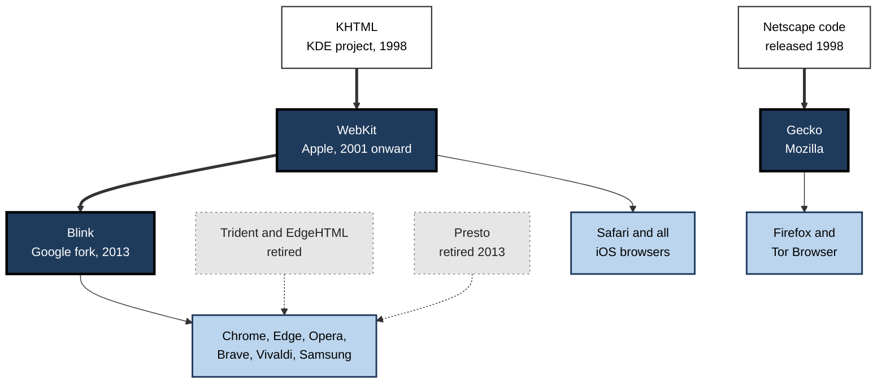
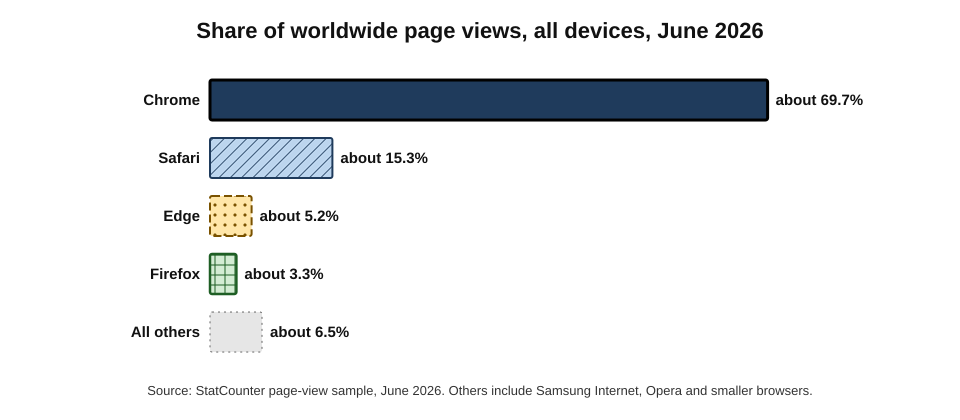
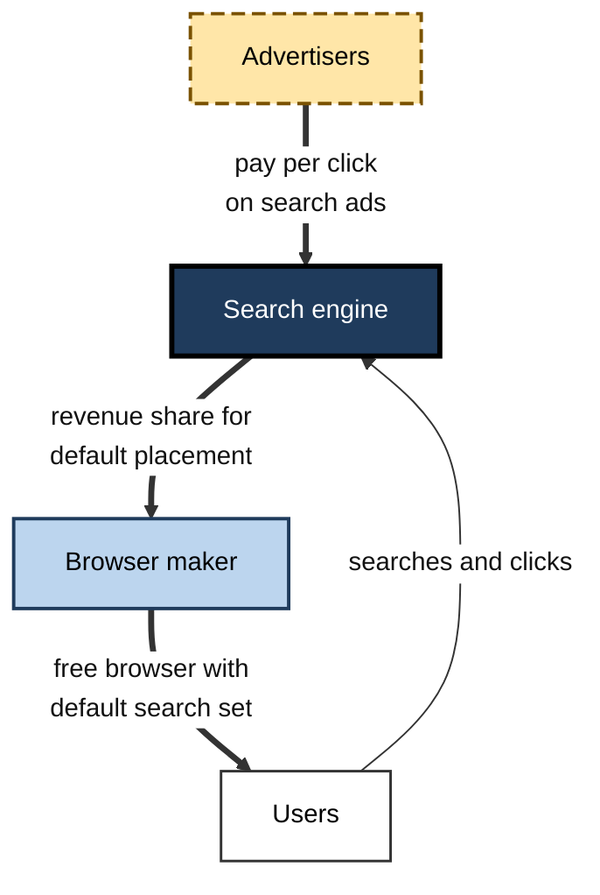
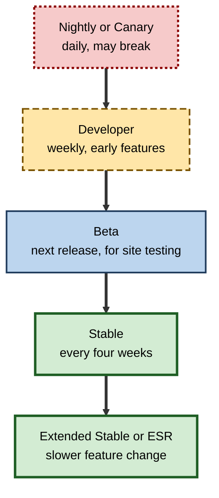
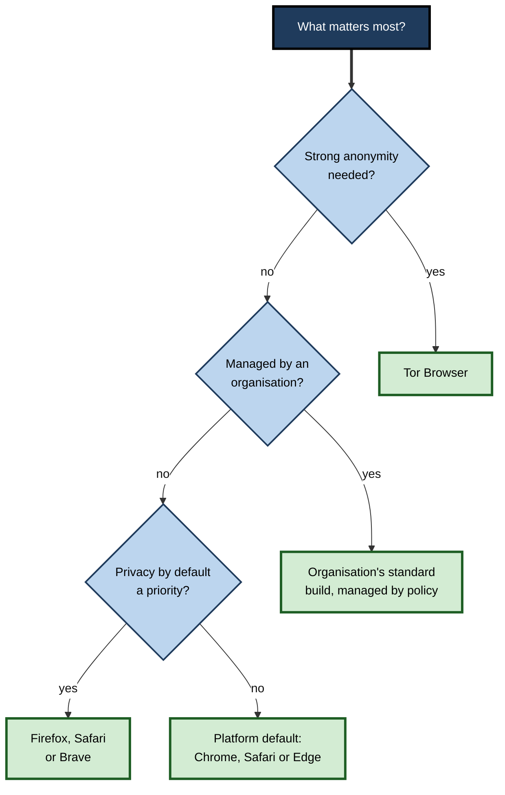

# F.2. Popular Web Browsers

Most people never choose a browser: they use whatever came with the phone or laptop. Yet a consultant moving between client sites, a developer testing a new release, a journalist protecting sources and an IT manager setting a company standard all need to know what distinguishes one browser from another — and what does not. Behind dozens of brand names sit only three working engines, a handful of business models and a market shaped more by defaults than by preference.

> **Definition — Browser market:** the set of competing web browsers, measured by share of usage, together with the engines, platforms, business models and distribution agreements that determine which browsers people actually use.

**Why it matters**

- **Compatibility** — knowing which engine a browser uses predicts how pages will behave in it.
- **Privacy and security** — browsers differ sharply in default tracking protection, update speed and data collection.
- **Organisational standards** — a company's browser choice affects security management, licensing, support costs and user productivity.
- **Competition and policy** — browser defaults decide which search engine, AI assistant and services billions of people use.

---

## Engines and Brands

A browser **brand** is the product the user sees. Its **engine** is the code that renders pages and runs scripts. Many brands share one engine.

### The three surviving engines

- **Blink** — developed by Google within the open-source **Chromium** project.
  - Used by Chrome, Microsoft Edge, Opera, Brave, Vivaldi, Samsung Internet and most others.
- **WebKit** — developed by Apple, originally derived from KDE's KHTML engine.
  - Used by Safari, and by every browser on iPhone and iPad outside the European Union.
- **Gecko** — developed by Mozilla.
  - Used by Firefox, Tor Browser and a few smaller browsers.

> **Definition — Chromium:** Google's open-source browser project, which supplies the Blink engine, the V8 JavaScript engine and much of the user interface code; Chrome is Google's branded build of it, and many other browsers are built on it.

### Retired engines

- **Trident** — Internet Explorer's engine; retired with IE in June 2022.
- **EdgeHTML** — the engine of the original Microsoft Edge (2015); replaced by Chromium in January 2020.
- **Presto** — Opera's own engine; abandoned when Opera moved to Chromium in 2013.

**Figure 1.** The family tree of the main browser engines and the browsers built on them.

> **Key point:** the market has many **brands** but only **three engines**, and one of them — Blink — powers the large majority of all browsing.

---

## Who Uses What

### Measuring browser share

- **StatCounter** — counts page views across a large network of websites that carry its tracking code; the most widely quoted source.
- **Other sources** — content-delivery networks and analytics firms publish their own figures, which differ by method.
- Shares differ by **device**, **country**, **sector** and **time of day** — office browsers dominate in working hours.

> **Watch out:** share figures measure **page views on participating sites**, not people. Privacy-focused browsers that block trackers may be under-counted, and some browsers deliberately identify themselves as Chrome. Treat single-decimal precision with caution.

### The 2026 picture

StatCounter's figures for **June 2026** show:

- **All devices:** Chrome about **69.7%**, Safari about **15.3%**, Edge about **5.2%**, Firefox about **3.3%**, with the remainder shared by Samsung Internet, Opera and others.
- **Desktop:** Chrome about **72%**, Edge about **10%**, Firefox about **6%**, Safari making up most of the rest.
- **Mobile:** Chrome about **68%**, Safari about **24%**, with Samsung Internet the most significant of the rest.

**Figure 2.** Share of worldwide page views by browser, all devices, June 2026.

**What the numbers reveal**

- **Platform decides.** Safari's share is almost entirely Apple devices; Edge's is almost entirely Windows desktops; Samsung Internet's is Samsung phones.
- **Defaults stick.** Each leading browser is the one pre-installed on its platform, or the one the platform's owner promotes heavily.
- **Firefox is the only major independent engine** not owned by a platform company, and its share has declined for over a decade.
- **Regional exceptions exist.** Yandex Browser is significant in Russia; domestic browsers have large shares in China; Samsung Internet is strong where Samsung phones dominate.

> **Example:** in India, UC Browser from Alibaba was for several years among the most used mobile browsers, prized for data compression on slow connections. It was banned in June 2020 along with 58 other Chinese-owned apps on national-security grounds, and users moved largely to Chrome.

---

## Profiles of the Major Browsers

### Google Chrome

- **Launched:** September 2008.
- **Engine:** Blink with V8.
- **Strengths:**
  - fast, standards-leading and the default target for most web developers;
  - automatic silent updates — a new major version roughly **every four weeks** since 2021;
  - **Google Safe Browsing** warnings against phishing and malware;
  - deep integration with Google accounts, Workspace and Android.
- **Concerns:**
  - collects usage data tied to Google's advertising business;
  - retained **third-party cookies** after abandoning plans to remove them (Google confirmed in 2025 that they would stay, and retired most of its replacement "Privacy Sandbox" technologies in October 2025);
  - Manifest V3 extension rules weakened some content blockers.

### Apple Safari

- **Launched:** January 2003 (Mac); on iPhone from 2007.
- **Engine:** WebKit with JavaScriptCore.
- **Strengths:**
  - energy-efficient on Apple hardware;
  - **Intelligent Tracking Prevention** (introduced 2017) blocks most cross-site tracking by default;
  - integrated password and passkey storage across Apple devices.
- **Concerns:**
  - available only on Apple platforms;
  - tied to operating-system updates, so new features arrive more slowly;
  - developers report more compatibility gaps than with Blink.

> **Definition — WebKit rule on iOS:** Apple's long-standing App Store requirement that every browser on iPhone and iPad use WebKit. "Chrome" or "Firefox" on iOS has therefore been a different interface around Safari's engine. Since March 2024 the EU's **Digital Markets Act** has required Apple to allow other engines for users in the EU; take-up has been slow.

### Microsoft Edge

- **Launched:** 2015 with EdgeHTML; rebuilt on Chromium in **January 2020**.
- **Strengths:**
  - pre-installed on Windows; strong desktop presence in organisations;
  - **IE mode** runs legacy Internet Explorer applications inside Edge, which Microsoft has committed to support until at least 2029;
  - policy management through Microsoft's enterprise tools and identity platform;
  - built-in Copilot assistant and security features such as SmartScreen.
- **Concerns:**
  - frequent prompts promoting Microsoft services;
  - data collection tied to Microsoft accounts.

### Mozilla Firefox

- **Launched:** Firefox 1.0 in November 2004, descended from the open-sourced Netscape code.
- **Engine:** Gecko with SpiderMonkey.
- **Strengths:**
  - developed by **Mozilla**, whose parent is a non-profit foundation;
  - **Enhanced Tracking Protection** on by default since 2019, with **Total Cookie Protection** (a separate cookie jar for each site) by default since 2022;
  - container tabs, strong extension support including the older blocking APIs that full-strength ad blockers rely on;
  - an **Extended Support Release** for organisations that need slower change.
- **Concerns:**
  - small share means some sites are tested less in it;
  - Mozilla's income depends heavily on its search agreement with Google.

### Other notable browsers

- **Samsung Internet** — Blink-based default on Samsung phones; built-in tracker blocking and content-blocker support.
- **Opera** — Norwegian origin (1995); moved to Blink in 2013; owned since 2016 by a Chinese-led investor consortium; known for a built-in proxy described as a VPN and for its sidebar of messaging apps. **Opera GX** targets gamers.
- **Brave** — launched 2016 by Brendan Eich, creator of JavaScript and former Mozilla chief executive; blocks ads and trackers by default; offers an optional system of privacy-preserving ads that pay users in a cryptocurrency token.
- **Vivaldi** — launched 2016 by Jon von Tetzchner, co-founder of Opera; extreme customisation, tab stacking and tiling, built-in mail and calendar.
- **Tor Browser** — a hardened Firefox build that routes traffic through the **Tor network** of volunteer relays, hiding the user's IP address and resisting fingerprinting; slower, and some sites block it.
- **DuckDuckGo browser** — privacy-focused, with tracker blocking and a "Fire" button to erase data.
- **AI-centred browsers** — products launched in 2025 such as Perplexity's **Comet** and OpenAI's **ChatGPT Atlas**, built around an assistant that can read pages and act on them.

> **Definition — Tor network:** an overlay network that sends traffic through three volunteer-run relays, each knowing only the previous and next hop, so no single relay can link the user to the destination.

| | Chrome | Safari | Edge | Firefox | Brave |
|---|---|---|---|---|---|
| Engine | Blink | WebKit | Blink | Gecko | Blink |
| Maker | Google (advertising) | Apple (hardware) | Microsoft (software, cloud) | Mozilla (non-profit parent) | Brave Software |
| Platforms | All major | Apple only | All major | All major | All major |
| Default cross-site tracking protection | Limited | Strong | Moderate | Strong | Strong, plus ad blocking |
| Typical strength | Compatibility, ecosystem | Efficiency on Apple devices | Enterprise management, legacy IE apps | Independence, privacy, extensions | Privacy by default |

---

## How Browsers Make Money

A browser is expensive to build — hundreds of engineers working on security, performance and standards — yet is given away free. The money comes from elsewhere.

### Search deals

- The **default search engine** in a browser is extremely valuable, because most searches start from the address bar.
- Search companies therefore **pay browser makers** for default placement, usually as a share of advertising revenue.
  - Evidence in the United States' antitrust case against Google showed Google paid Apple about **$20 billion** for 2022 alone.
  - The large majority of Mozilla's revenue has come from its Google search agreement.
- In **August 2024** a US federal court held that Google had illegally maintained a monopoly in general search, partly through such exclusive default deals.
- In the **September 2025** remedies decision, Judge Amit Mehta:
  - declined to force Google to sell Chrome;
  - barred **exclusive** distribution contracts for Search, Chrome, its assistant and Gemini;
  - allowed Google to keep paying for default placement;
  - required Google to share some search-index and user-interaction data with qualified competitors.

> **Key point:** the browser market is financed largely by **search advertising**. Decisions about search competition therefore directly affect the survival of independent browsers — a ban on all default payments would have threatened Mozilla's main income.

**Figure 3.** How money flows from advertisers through search engines to browser makers.

### Other models

- **Platform support** — Safari and Edge are funded as part of an operating system and ecosystem.
- **Data and advertising** — browser usage data improves the owner's advertising and services.
- **Subscriptions and add-ons** — paid VPNs, premium features or AI assistant tiers.
- **Enterprise licences** — enterprise-browser vendors charge organisations for managed, security-focused browsers.
- **Alternative advertising** — Brave's opt-in ads that share revenue with users.

> **Watch out:** "free" browsers are paid for somehow. Asking **how the maker earns money** is the quickest way to predict its privacy defaults.

---

## Release Channels and Update Speed

Browsers ship constantly because attackers constantly find new flaws.

- **Stable** — the version most people use; major updates every four weeks for Chrome, Edge and Firefox.
- **Beta** — the next version, a few weeks early; used to test sites before release.
- **Developer and nightly builds** (Chrome Dev and Canary, Firefox Nightly, Safari Technology Preview) — experimental, updated daily or weekly.
- **Extended or slower channels** — Chrome and Edge **Extended Stable** (major updates every eight weeks) and Firefox **ESR** (roughly yearly major versions) for organisations, with security fixes still delivered quickly.

> **Definition — Zero-day vulnerability:** a security flaw that attackers exploit before the vendor has released a fix. Chrome typically patches several actively exploited zero-days each year, often within days.

**Figure 4.** Release channels arranged from experimental to most stable.

> **In practice:** an IT team typically keeps most staff on Stable, places a small pilot group on Beta to catch internal-site breakages two to four weeks before they hit everyone, and reserves Extended Stable or ESR for systems that cannot tolerate frequent change.

---

## Forks, Builds and Security Lag

### What a fork inherits

- Most alternative browsers are **forks** or **builds** of Chromium: they take Google's open-source code and add their own interface, privacy features or services.
- **Benefits of building on Chromium:**
  - near-perfect compatibility with sites tested in Chrome;
  - access to Google's large security team and its fixes;
  - Chrome extensions usually work unchanged.
- **Costs:**
  - the fork must **re-apply its own changes** every four weeks when Chromium moves on;
  - its makers have limited influence over engine decisions such as extension rules or cookie behaviour.

> **Definition — Fork:** a separate line of development created by copying an open-source code base and then modifying it independently.

### Patch lag

- When Google fixes a serious flaw in Chromium, every browser built on it must merge the fix and ship its own update.
- Large vendors (Microsoft, Opera, Brave, Samsung) usually ship within days; smaller forks can lag for weeks.
- During that gap the flaw is **publicly known** — because the fix is visible in open-source code — but users of the slower browser remain exposed.

> **Watch out:** a little-known "privacy browser" or a browser bundled with a utility program may run an **outdated Chromium core**. For professional use, the maker's record of shipping security updates promptly matters more than its feature list.

> **In practice:** security teams check the **engine version** reported in a browser's "About" page against the current Chromium release. A browser that is two or three versions behind is a warning sign, whatever its interface claims.

---

## Testing Across Browsers

Developers, testers, designers and content owners need confidence that sites work for everyone, not just for users of their own browser.

### What to test

- **Each engine** — at least one Blink, one WebKit and one Gecko browser.
- **Each platform class** — desktop and mobile; iOS deserves separate attention because of its engine rules.
- **Accessibility** — keyboard navigation and screen-reader use in at least one browser per platform.
- **Older but supported versions** — where organisations or customers update slowly.

### How professionals test

- **Analytics first** — the site's own visitor data shows which browsers and versions its users actually have; testing effort follows that distribution.
- **Automated cross-browser testing** — frameworks that drive real browsers through the W3C **WebDriver** standard or similar protocols (for example Selenium and Playwright) run the same test scripts in Chromium, WebKit and Firefox.
- **Cloud device services** — rent access to hundreds of real browser–device combinations.
- **Manual exploratory testing** — still needed for layout, touch behaviour and assistive technology.

> **Definition — WebDriver:** a W3C standard interface through which test software controls a browser — opening pages, clicking, typing and reading results — in the same way for every major browser.

> **Key point:** "it works in Chrome" is not a test result for a public service. Because Chrome dominates, faults in Safari and Firefox are noticed late — often by customers.

---

## Choosing a Browser

### For an individual

- **Already in an ecosystem?** Safari on Apple devices or Chrome with Android and Google services offer the smoothest synchronisation.
- **Privacy a priority?** Firefox, Safari or Brave block more tracking by default.
- **Need full-strength content blocking?** Firefox keeps the older extension interfaces that powerful blockers use.
- **Need anonymity?** Tor Browser — with its trade-offs in speed and site access.
- **Developer or tester?** Use at least one browser from **each engine**.

> **Remember:** for most people the **update habit** matters more than the brand. Any major browser kept current is far safer than an excellent browser left unpatched.

**Figure 5.** A decision path for choosing a browser by main need.

### For an organisation

Organisations choose a **standard browser** — and usually a supported second — against explicit criteria:

- **Manageability** — central policy, extension control, update control, reporting.
- **Security** — patch speed, sandbox strength, phishing protection, integration with security tools.
- **Compatibility** — internal and supplier web applications, including legacy ones.
- **Identity integration** — single sign-on, device-based access policies.
- **Privacy and data residency** — what telemetry is sent, and where.
- **User experience and accessibility** — performance, assistive-technology support.
- **Cost of support** — training, help-desk load, licensing for enterprise features.

### Worked example: choosing a corporate standard

A 3,000-person professional-services firm on Windows laptops compares two candidates. Each criterion is weighted and scored from 1 to 5.

| Criterion | Weight | Browser A score | A weighted | Browser B score | B weighted |
|---|---|---|---|---|---|
| Central management | 25% | 5 | 1.25 | 4 | 1.00 |
| Security and patching | 25% | 5 | 1.25 | 5 | 1.25 |
| Legacy app compatibility | 20% | 5 | 1.00 | 2 | 0.40 |
| Privacy defaults | 15% | 3 | 0.45 | 5 | 0.75 |
| User familiarity | 15% | 4 | 0.60 | 3 | 0.45 |
| **Total** | 100% | | **4.55** | | **3.85** |

1. The decisive gap is **legacy compatibility** — Browser A can run old IE-dependent applications.
2. Browser B wins on **privacy defaults**, which policy can partly narrow by configuring Browser A more strictly.
3. Decision: Browser A as standard, configured with stricter tracking settings; Browser B permitted as a secondary browser for testing.

> **Formula — Weighted score:** Σ (weight × score). For Browser A: 0.25×5 + 0.25×5 + 0.20×5 + 0.15×3 + 0.15×4 = **4.55**.

> **Watch out:** weights encode values. A firm handling sensitive client data might weight privacy at 30%, reversing the result. Agree the weights **before** scoring.

---

### Case study: retiring Internet Explorer in a regional bank

- **Situation:** a regional bank still ran more than forty internal applications built for Internet Explorer in the 2000s — loan origination, branch reporting, HR forms.
- **Problem:** Microsoft announced the end of support for the IE desktop application, which was disabled on most Windows 10 versions from **June 2022**. Several applications used ActiveX controls and IE-specific scripts.
- **Diagnosis / Actions:**
  1. An inventory used browser telemetry to find every internal site still opened in IE, and how often.
  2. Sites were triaged: retire, rewrite, or run in Edge's **IE mode** via a centrally managed site list.
  3. Low-use applications were retired; the two most critical were rebuilt as standards-based web applications over 18 months.
  4. Staff were moved to Edge with IE mode enabled only for listed sites.
- **Result:** IE was removed from all devices on schedule; the IE-mode list shrank year by year.
- **Side effects / caveats:** IE mode preserved old security weaknesses for listed sites; the security team restricted those sites to the internal network.
- **Lesson:** browser retirements expose **technical debt** in web applications. A compatibility mode buys time, not a solution.

---

## Browsers, Accessibility and Specialist Settings

- **Screen-reader pairings** — assistive technology works through the browser, and some combinations are better tested than others: NVDA is commonly used with Firefox or Chrome, JAWS with Chrome or Edge, and VoiceOver with Safari on Apple devices. Changing a user's browser can break a working assistive setup.
- **Locked-down and kiosk browsers** — used for exams, shop-floor terminals and public displays, restricting navigation to approved sites.
- **Clinical and industrial settings** — shared workstations need fast user switching, automatic sign-out and strict control of stored data.
- **Low-bandwidth regions** — data-saving modes and lightweight browsers matter where connections are slow or expensive.

> **In practice:** before changing an organisation's standard browser, accessibility leads test the main assistive technologies against core internal systems; a change that saves licence costs but breaks screen-reader access is a legal and ethical failure.

---

## Open Questions

- **Is engine concentration a risk to the open web?**
  - When most browsers share Blink, one company's choices effectively become the standard; how much independence Gecko and WebKit can sustain is uncertain.
- **What will fund independent browsers?**
  - Antitrust remedies, AI search and changing advertising could all reshape search deals that pay for browser development.
- **Will alternative engines appear on iOS?**
  - Regulation permits them in the EU, but engineering cost and restrictions have limited uptake.
- **Will AI-centred browsers displace conventional ones?**
  - Early products have attracted attention but face unresolved security and trust problems.
- **Can a genuinely new engine succeed?**
  - Independent projects such as Ladybird are attempting it; building a modern engine from scratch is a multi-year effort.

---

## Summary

- Many browser **brands** run on three **engines**: **Blink** (Chrome, Edge, Opera, Brave, Vivaldi, Samsung Internet), **WebKit** (Safari and iOS browsers) and **Gecko** (Firefox, Tor Browser).
- In June 2026 Chrome had about **70%** of worldwide page views, Safari about **15%**, Edge about **5%**, Firefox about **3%**; desktop and mobile differ sharply.
- Share follows **platform defaults**; measurement figures are page views, not people.
- Chrome leads on compatibility; Safari on efficiency and tracking prevention; Edge on enterprise management and legacy IE support; Firefox on independence and privacy; Brave and Tor on privacy and anonymity.
- Browsers are funded mainly by **search deals**; the 2024 US ruling against Google and 2025 remedies banned exclusive deals but allowed default payments.
- Browsers ship on **channels** from Nightly to Extended Stable; update speed is a security property.
- Organisations choose browsers with **weighted criteria** — manageability, security, compatibility, identity, privacy, usability, cost.
- Retiring a browser exposes **technical debt**; compatibility modes buy time only.

---

## Self-Check

1. Distinguish a browser brand from an engine, with examples.
2. Name the three surviving engines and two browsers that use each.
3. Why does every browser on an iPhone behave much like Safari, and what changed in the EU in 2024?
4. What does StatCounter measure, and why should its figures be read with caution?
5. Summarise the June 2026 market shares for all devices, and explain why Safari's mobile share is far higher than its desktop share.
6. How do search deals fund browsers? Give one figure from the US antitrust case.
7. What did the September 2025 remedies decision require and not require?
8. Why might a ban on all default-search payments have hurt competition in browsers?
9. Describe four release channels and when an organisation would use each.
10. What is a zero-day vulnerability, and why does update speed matter?
11. Recommend a browser for a journalist protecting a source, and explain the trade-offs.
12. Using the worked example, explain how changing the privacy weight could change the decision.
13. What lessons does the Internet Explorer retirement case offer for organisations planning browser changes?

### Answer Key

1. The brand is the product the user installs and sees (Edge, Opera); the engine renders pages and runs scripts (Blink). Edge and Opera are different brands on the same engine.
2. Blink — Chrome, Edge; WebKit — Safari, Chrome on iOS (outside the EU); Gecko — Firefox, Tor Browser.
3. Apple's App Store rules required all iOS browsers to use WebKit, so they are interfaces around Safari's engine. From March 2024 the EU Digital Markets Act obliged Apple to allow other engines for EU users.
4. Page views on websites carrying its code. It counts views not people, may under-count tracker-blocking browsers, varies by region and site mix, and some browsers disguise themselves as Chrome.
5. Chrome ~70%, Safari ~15%, Edge ~5%, Firefox ~3%. iPhones are a large share of phones, and Safari is their default; Macs are a smaller share of desktops, where Windows (and so Chrome and Edge) dominates.
6. Search engines pay browser makers a share of advertising revenue for being the default search; Google paid Apple about $20 billion for 2022.
7. It required an end to exclusive distribution contracts and some data sharing with qualified competitors; it did not require the sale of Chrome or Android and did not ban paying for default placement.
8. Independent browsers such as Firefox rely on default-search income; removing it would weaken the very competitors to Chrome the case aimed to protect.
9. Nightly/Canary (experiment, developers); Developer (early features); Beta (pilot group testing internal sites before release); Stable (most staff); Extended Stable/ESR (systems needing slower change, still receiving security fixes).
10. A flaw exploited before a fix exists. Attackers exploit browser flaws quickly; the sooner the fix is installed, the shorter the window of exposure.
11. Tor Browser hides the IP address and resists fingerprinting; trade-offs are slower speed, sites blocking Tor, and the need for careful behaviour (not signing in to personal accounts). For general secure work, a hardened, up-to-date mainstream browser plus a separate Tor session for sensitive contacts.
12. Raising privacy to 30% (taking weight from familiarity or management) adds more to Browser B's 5 than Browser A's 3, narrowing or reversing the gap. Weights must be agreed beforehand to avoid motivated scoring.
13. Inventory real usage early; triage by value; use compatibility modes only as a bridge; rebuild critical systems on standards; contain the security risks of legacy modes; plan multi-year timelines.

---

## Glossary

| Term | Meaning |
|---|---|
| Blink | Google's rendering engine within Chromium, used by most browsers. |
| Brave | A Blink-based browser that blocks ads and trackers by default. |
| Chromium | Google's open-source browser project on which Chrome and many others are built. |
| Default search engine | The search service a browser uses for queries typed into the address bar. |
| Digital Markets Act | EU law (applying from 2023–2024) imposing obligations on large "gatekeeper" platforms, including browser and engine choice. |
| Enhanced Tracking Protection | Firefox's default blocking of known trackers. |
| ESR | Firefox Extended Support Release, a slower-changing version for organisations. |
| Extended Stable | A Chrome and Edge channel with major updates every eight weeks. |
| Gecko | Mozilla's rendering engine. |
| IE mode | A feature of Microsoft Edge that renders listed sites with the Internet Explorer engine. |
| Intelligent Tracking Prevention | Safari's default limits on cross-site tracking. |
| Market share | A browser's proportion of measured usage, usually page views. |
| Presto | Opera's former engine, abandoned in 2013. |
| Release channel | A stream of browser versions at a given stage of testing. |
| Search deal | An agreement in which a search engine pays a browser maker for default placement. |
| Tor Browser | A Firefox-based browser that routes traffic through the Tor network. |
| Total Cookie Protection | Firefox's separation of cookies into a jar per site. |
| Trident | Internet Explorer's engine, retired in 2022. |
| WebKit | Apple's rendering engine. |
| Zero-day | A vulnerability exploited before a fix is available. |
