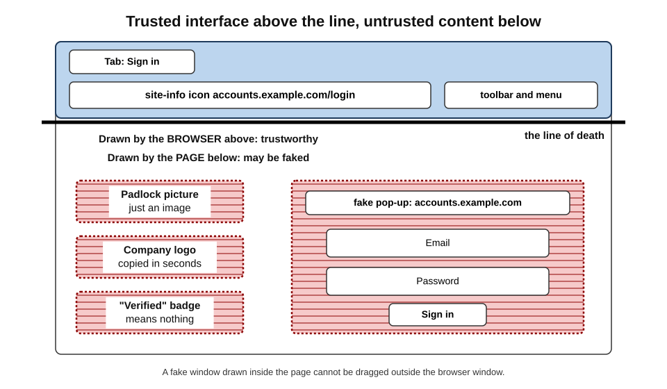
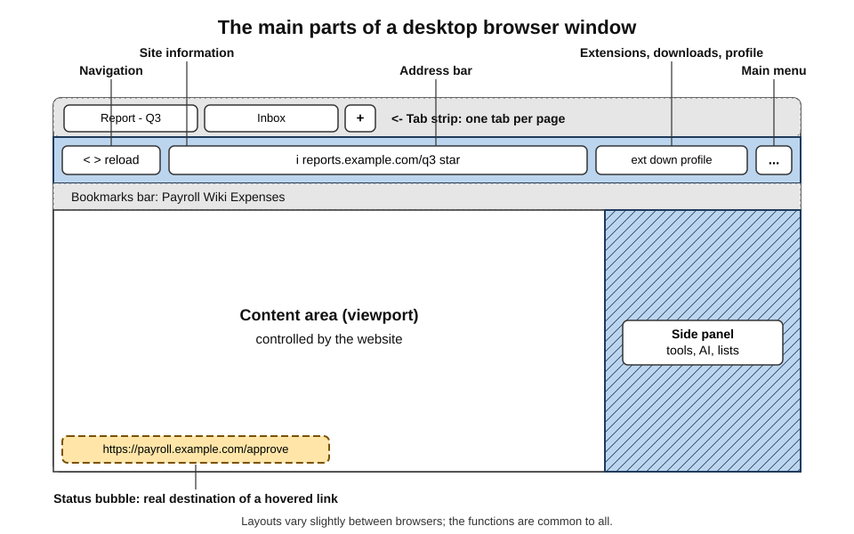
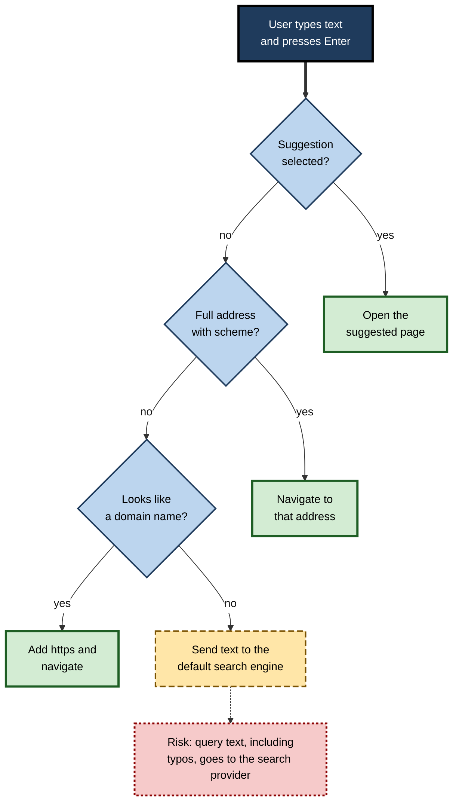
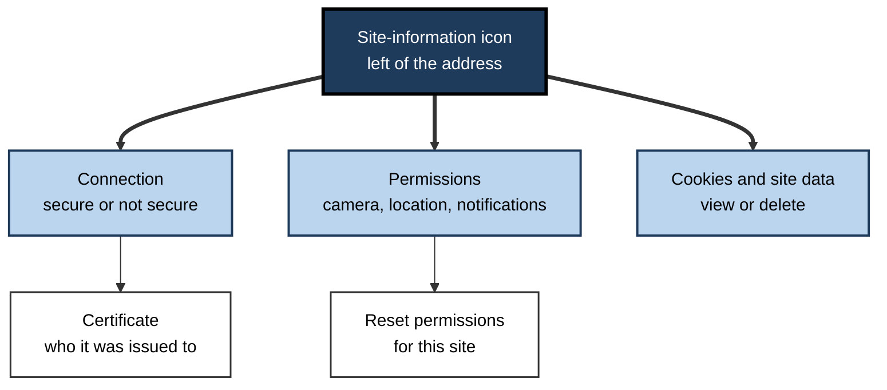
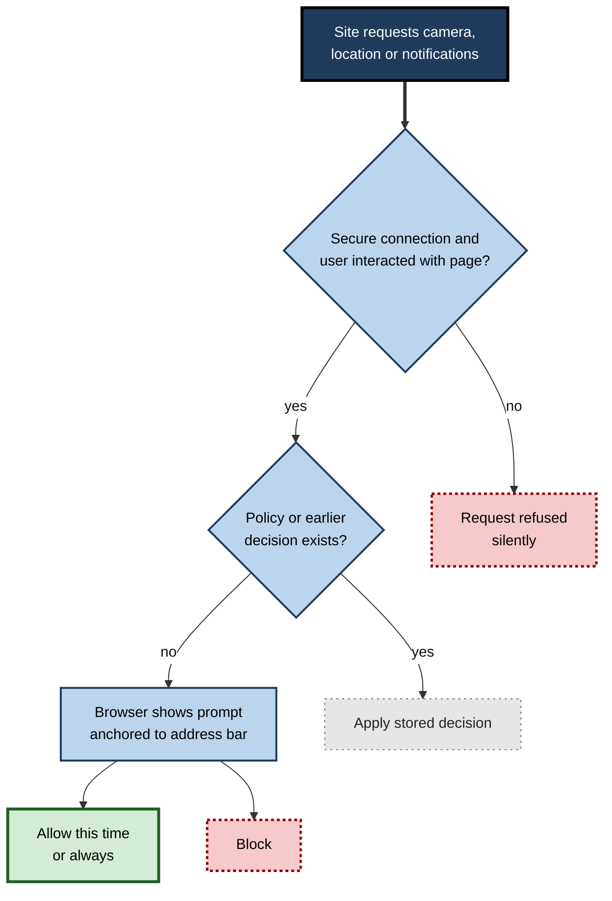

# F.3. Browser User Interface

A finance officer about to approve a large payment glances at the top of the screen: the address reads correctly, the site-information icon shows a secure connection, and the page has not gone full-screen. That glance takes half a second — and it relies entirely on understanding the strip of controls that surrounds every web page. The browser's interface is both a productivity tool and the user's main defence against deception.

> **Definition — Browser user interface:** the controls, indicators and dialogs that a browser draws around and over web content — tabs, address bar, navigation buttons, menus, security indicators and permission prompts — through which the user directs the browser and judges what it is showing.

**Why it matters**

- **Speed** — fluent use of the address bar, keyboard shortcuts and menus saves minutes every hour for heavy web users.
- **Safety** — the interface is the only part of the screen a malicious page cannot (normally) control; knowing where it ends is a core security skill.
- **Accessibility** — zoom, reader views and keyboard navigation make the web usable for people with different needs.
- **Support** — help-desk staff and trainers need a shared vocabulary for the parts of the window.

---

## The Two Zones: Chrome and Content

### What "chrome" means

- Every browser window has two zones:
  - **the browser chrome** — tabs, toolbars, menus and indicators drawn by the browser itself;
  - **the content area (viewport)** — the web page, drawn according to the site's code.
- The term "chrome" predates Google's browser; it was used by interface designers for the frame around content, and Google named its product partly as a joke about minimising that frame.

> **Definition — Viewport:** the region of the window in which web content is displayed; the page controls everything inside it.

### The line of death

> **Definition — Line of death:** the boundary between the browser's trusted interface and the untrusted page content. Anything drawn below it can be faked by the page; only what is above it comes from the browser.

- **Above the line** — the address bar, site-information icon and tab title are drawn by the browser and are hard to forge.
- **Below the line** — logos, padlock images, "verified" badges, fake login windows and fake warnings can all be drawn by any page.
- **Attacks that blur the line:**
  - **picture-in-picture or browser-in-the-browser** — a page draws a fake pop-up window, complete with fake address bar, inside the content area;
  - **full-screen abuse** — a page enters full-screen mode and draws a fake browser frame or a fake system warning;
  - **fake permission prompts** — page-drawn dialogs that imitate browser requests.

> **Key point:** trust only what the browser itself draws **above the line of death**. A padlock picture inside a page proves nothing.

**Figure 1.** The trusted browser interface above the line of death and untrusted page content below it.

> **Watch out:** a fake login window that can be **dragged outside** the browser window is real; one that stops at the edge of the page is drawn by the page. Real browser pop-up windows also have their own address bar that responds to clicks and selection.

---

## Anatomy of the Window

Desktop browsers have converged on a similar layout.

### From top to bottom

- **Title bar and window controls** — minimise, maximise, close; often merged with the tab strip to save space.
- **Tab strip** — one tab per open page, showing the site's icon (**favicon**) and title, plus a button for a new tab.
- **Navigation buttons** — back, forward, reload (and in some browsers a home button).
- **Address bar** — shows the current address and accepts addresses or searches.
  - **Site-information icon** at its left edge.
  - **Page actions** at its right edge — bookmark star, translation, password key, zoom indicator, install-app button.
- **Toolbar area** — extensions menu (often a puzzle-piece icon), pinned extension icons, downloads, profile avatar, side-panel button.
- **Main menu** — three dots or three lines; settings, history, downloads, zoom, print, find, developer tools.
- **Bookmarks bar** (optional) — quick access to saved pages.
- **Content area** — the page itself.
- **Status bubble** — a small box, usually at the bottom left, showing the **destination of a link** when the pointer hovers over it.
- **Side panel** (optional) — reading lists, bookmarks, history, AI assistant or other tools beside the page.

**Figure 2.** The main parts of a desktop browser window.

> **Remember:** hover over a link and read the **status bubble** before clicking. Link text can say anything; the bubble shows where the link actually goes (unless a script intercepts the click).

### Names differ between browsers

| Feature | Chrome | Edge | Firefox | Safari |
|---|---|---|---|---|
| Address bar name | Omnibox | Address bar | Address bar (formerly "Awesome Bar") | Smart Search field |
| Saved pages | Bookmarks | Favourites | Bookmarks | Bookmarks |
| Main menu icon | Three vertical dots | Three horizontal dots | Three lines | Menu bar and toolbar |
| Private window | Incognito | InPrivate | Private Window | Private Window |
| Side tools | Side panel | Sidebar | Sidebar | Sidebar |

> **In practice:** support staff who say "open the menu with three dots in the top-right corner" will confuse Firefox and Safari users. Shortcuts such as **Ctrl+H** for history work across most browsers and are a more reliable common language.

---

## The Address Bar

The address bar is the most powerful single control in the browser. Since Chrome (2008) and Firefox 3 (2008), it has combined **address entry, search and history recall** in one box.

### What happens when text is typed

1. **As each character is typed,** the browser offers **suggestions** from history, bookmarks, open tabs and the default search engine.
2. **On Enter,** it decides how to interpret the text:
   - a full address including its scheme (`https` plus host and path) → navigate there;
   - something that looks like a domain (`example.com`) → add the scheme and navigate;
   - anything else (`quarterly tax deadline`) → send it to the **default search engine**.
3. **Inline autocompletion** may fill in a previously visited address as the user types — pressing Enter accepts it.

> **Definition — Omnibox:** Google's name for an address bar that accepts both addresses and search queries and offers combined suggestions; now the general design in all major browsers.

**Figure 3.** How the address bar decides between navigating and searching.

### Address display

Browsers simplify how addresses are shown, which helps reading but hides detail.

- **Scheme hidden** — many browsers hide the `https` scheme until the bar is clicked.
- **Domain emphasised** — the registrable domain may be shown in darker text so that `paypal.com.secure-login.example` stands out as belonging to `secure-login.example`.
- **Path trimmed** — long paths and queries may be cut or hidden on mobile.
- **Internationalised domains** — addresses in non-Latin scripts may be shown as **punycode** (`xn--...`) when they could be confused with a familiar Latin name.

> **Watch out:** the most important part of an address is the **registrable domain** — the part just before the public suffix such as `.com` or `.co.uk`. Everything to its left can be chosen freely by whoever owns that domain.

### Power features of the address bar

- **Search shortcuts** — in Chrome and Edge, typing a site's keyword and pressing Tab searches that site directly; Firefox offers keyword bookmarks; DuckDuckGo supports "bangs" such as `!w` for Wikipedia.
- **Tab search** — suggestions include already-open tabs, avoiding duplicates.
- **Calculations and conversions** — `15% of 2400` or `30 GBP in INR` answered in the suggestions list.
- **Internal pages** — `chrome://settings`, `edge://settings`, `about:preferences` and similar open settings directly.
- **Actions** — typing "clear browsing data" or "update browser" offers the action itself in some browsers.

---

## Security and Status Indicators

### The site-information icon

- Clicking the icon at the left of the address bar opens a panel showing:
  - whether the **connection is secure** (encrypted with HTTPS);
  - the site's **certificate**;
  - **cookies and site data** stored by the site;
  - **permissions** granted (camera, microphone, location, notifications, pop-ups);
  - links to clear data or reset permissions for that site.

**Figure 4.** What the site-information panel offers.

### From padlock to neutral icon

- For about two decades a **padlock** indicated an HTTPS connection.
- Users widely read it as meaning "this site is **trustworthy**" — but phishing sites obtain certificates as easily as legitimate ones.
- Browsers responded in stages:
  - **2019** — Chrome and Firefox stopped showing the company name for **Extended Validation** certificates in the address bar, after research found users did not notice or understand it.
  - **2018 onward** — pages **without** HTTPS were labelled "Not secure", shifting attention to the risky case.
  - **September 2023** — Chrome 117 replaced the padlock with a neutral "tune" icon that opens the site-information panel.

> **Definition — Extended Validation (EV) certificate:** a type of HTTPS certificate issued after checking the legal identity of the organisation; once shown as a green company name in the address bar, now visible only in certificate details.

### Case study: retiring the padlock

- **Situation:** by the early 2020s the large majority of page loads in Chrome used HTTPS.
- **Problem:** Google's research found that only a small minority of users — around one in ten — correctly understood that the padlock indicated an encrypted connection rather than a safe or trustworthy site.
- **Diagnosis:** the icon had become **misleading**: it was shown on almost every phishing page, reassuring users at exactly the wrong moment.
- **Actions:**
  1. Make HTTPS the expected default and warn on its absence.
  2. Replace the padlock with a neutral icon that signals "settings and information", not "safe".
  3. Move certificate and permission details into the panel behind the icon.
- **Result:** the security message became "unencrypted is abnormal" rather than "encrypted is good".
- **Side effects / caveats:** some users and trainers continued to teach "look for the padlock" for years after the change.
- **Lesson:** a security indicator is useful only if users **interpret it correctly**; indicators that are present nearly everywhere stop carrying information.

> **Watch out:** "look for the padlock" is outdated advice. A secure connection only means no one in the middle can read or change the traffic; it says **nothing** about whether the site's owner is honest.

### Other indicators worth reading

- **Tab audio and recording icons** — a speaker for sound; red dot or camera icon when the camera, microphone or screen is in use.
- **Download indicator** — progress and warnings for dangerous files.
- **Blocked pop-up or permission icon** — appears in the address bar when the browser has blocked something.
- **Reader-view icon** — offers a simplified text view.
- **Managed-browser notice** — "Your browser is managed by your organisation" when policies apply.

---

## Permission Prompts

Websites must ask before using sensitive capabilities.

- **Typical permissions:** location, camera, microphone, notifications, clipboard, pop-ups and redirects, automatic downloads, device access (USB, Bluetooth, serial), screen sharing, idle detection.
- **Prompt designs:**
  - **anchored prompts** attached to the address bar, so they are visibly the browser's;
  - **quiet prompts** — since 2020 Chrome shows a small address-bar indicator instead of a full prompt for notification requests from sites where users usually refuse;
  - **one-time permissions** — "Allow this time" for camera and location in several browsers;
  - **automatic expiry** — some browsers revoke permissions for sites not visited in months.

**Figure 5.** How a well-designed browser handles a site's request for a sensitive permission.

> **Watch out:** "Click Allow to prove you are not a robot" is a common trick to obtain **notification permission**, after which the site can push scam alerts to the desktop even when the page is closed. No genuine verification requires allowing notifications.

> **In practice:** reviewing a browser's site-permission list every few months — and revoking notifications from sites that are not genuinely needed — removes a common source of desktop spam and scams.

---

## Working Faster: Shortcuts and Tools

### Core keyboard shortcuts

Shortcuts are largely shared across Chrome, Edge and Firefox on Windows and Linux; on macOS **Cmd** replaces **Ctrl**.

- **Ctrl+L** (or Alt+D, F6) — jump to the address bar and select it.
- **Ctrl+T** — new tab; **Ctrl+W** — close tab; **Ctrl+Shift+T** — reopen the last closed tab.
- **Ctrl+Tab / Ctrl+Shift+Tab** — next / previous tab; **Ctrl+1…8** — jump to a tab; **Ctrl+9** — last tab.
- **Alt+Left / Alt+Right** — back / forward.
- **Ctrl+F** — find in page; **Ctrl+G** — next match.
- **Ctrl+D** — bookmark the page; **Ctrl+H** — history; **Ctrl+J** — downloads.
- **Ctrl+Plus / Ctrl+Minus / Ctrl+0** — zoom in / out / reset.
- **Ctrl+P** — print or save as PDF.
- **Ctrl+Shift+N** (Chrome, Edge) or **Ctrl+Shift+P** (Firefox) — private window.
- **F5 / Ctrl+R** — reload; **Ctrl+Shift+R** or **Ctrl+F5** — reload ignoring the cache.
- **F12** — developer tools.
- **Esc** — leave full-screen; stop loading.

> **Mnemonic — "LTW-FDH":** **L**ocation (Ctrl+L), **T**ab, **W**ithdraw (close), **F**ind, **D**ock a bookmark, **H**istory — six shortcuts that cover most daily navigation.

### Useful built-in tools

- **Find in page** — fast scanning of long documents and policies.
- **Reader view** — strips advertisements and layout clutter, adjusts font and spacing; useful for focus and accessibility.
- **Translation** — whole-page translation, increasingly done on the device.
- **Zoom and text size** — per-site zoom is remembered.
- **Print to PDF** — saves a dated copy of a page as evidence or record.
- **Screenshot tools** — full-page capture in Edge and Firefox, and in Chrome's developer tools.
- **Browser task manager** — Shift+Esc in Chrome and Edge shows which tab or extension is using memory and processor time.
- **Developer tools** — inspect elements, view network requests and console errors; valuable to non-developers diagnosing broken forms.

### Worked example: checking a payment page in thirty seconds

A purchasing assistant receives an emailed link to "renew the software licence" and is asked for card details.

1. **Read the address bar, not the page.** It shows `licence-renewal-portal.example`, not the vendor's known domain.
2. **Open the site-information panel.** The connection is encrypted — which proves only that the traffic is private to this unknown site.
3. **Hover over the "Vendor account" link.** The status bubble shows the same unknown domain, not the vendor's.
4. **Type the vendor's address directly** (or use a bookmark) and sign in. The account shows no pending renewal.
5. **Conclusion:** the emailed page is a phishing site; report it.

> **Remember:** **navigate, don't follow** — for anything involving money or credentials, reach the site through a bookmark or a typed address, not through a link someone sent.

---

## The Downloads Interface

Downloads are where web content crosses onto the device, so the interface around them deserves attention.

- **Download bubble or panel** — shows progress, the file name and the source site; recent browsers show a small panel under the toolbar instead of a bar at the bottom.
- **Warnings** — the browser labels files as:
  - **dangerous** — known malware, blocked by default;
  - **uncommon** — rarely downloaded, so reputation is unknown;
  - **deceptive** — from a site known for misleading downloads;
  - **insecure** — delivered over an unencrypted connection.
- **Keep or discard** — overriding a warning usually needs several deliberate clicks.
- **Show in folder** — reveals where the file landed.
- **Downloads page** (Ctrl+J) — full list with source addresses, useful for checking where a file came from.

> **Watch out:** a file's **name and icon** are chosen by whoever made it. "Invoice_March.pdf.exe" may appear as "Invoice_March.pdf" when the operating system hides known extensions. The downloads page and the file's properties show the real type.

> **In practice:** when a colleague reports "I opened a document and nothing happened", the downloads page shows the exact source and file type — often the first clue in a malware investigation.

---

## Developer Tools for Everyone

Developer tools (F12, or right-click → Inspect) are built for web developers, but several features help any professional.

- **Elements panel** — shows the page's structure; reveals whether text is real or part of an image, and lets a user temporarily hide an overlay that blocks reading.
- **Console** — shows error messages; a screenshot of the console gives a help desk far more to work with than "the button doesn't work".
- **Network panel** — lists every request, its timing and status; shows whether a form submission actually reached the server.
- **Application or Storage panel** — lists cookies and stored data for the site.
- **Device emulation** — previews a page at phone and tablet sizes.
- **Lighthouse or performance reports** — automated audits of speed, accessibility and best practice.

> **Watch out:** scammers sometimes ask victims to **paste code into the console** "to verify an account" or "unlock a feature". This runs the attacker's code with the victim's signed-in access to the site. Browsers now show warnings and may require typing a confirmation phrase before pasting. Never paste code into the console at a stranger's request.

> **Example:** a finance analyst finds that an expenses form "does nothing" on submit. The network panel shows the request returning an error stating that a file attachment is too large — a fault the analyst can fix immediately, instead of waiting for support.

---

## Mobile Browser Interfaces

Small touch screens have reshaped browser design.

| | Desktop browser | Mobile browser |
|---|---|---|
| Address bar position | Top | Top or bottom (Safari on iOS moved it to the bottom by default in 2021; others allow either) |
| Address shown | Usually domain and path | Often domain only, or hidden while scrolling |
| Tab management | Tab strip | Tab grid or overview |
| Navigation | Buttons and keyboard | Gestures (swipe back, pull to refresh) |
| Hover preview of links | Status bubble | None — long-press shows the address |
| Screen space for chrome | Ample | Minimal; interface hides while reading |

- **Implications:**
  - checking the full address takes a deliberate action — tap the address bar or long-press a link;
  - phishing is more effective on phones because less of the address is visible;
  - "Request desktop site" overrides mobile layouts where they lack features.

> **Watch out:** on a phone, a link opened from a social-media or messaging app often appears in an **in-app browser** whose interface looks similar but may show less of the address and lacks the user's saved passwords. Use "Open in browser" for anything sensitive.

---

## Interface Design Principles

Browser makers balance competing goals.

- **Content first** — minimal chrome leaves more space for pages, but hides information users may need.
- **Security clarity** — indicators must be few, consistent and correctly understood.
- **Discoverability versus clutter** — features buried in menus are rarely used; features on the toolbar consume space.
- **Fitts's law** — targets at screen edges are fast to hit, which is why tabs sit at the very top when the window is maximised.
- **Consistency across platforms** — users switch between laptop and phone.
- **Accessibility** — every function reachable by keyboard and screen reader; high-contrast and zoom support.

> **Definition — Fitts's law:** a model from Paul Fitts (1954) predicting that the time to reach a target depends on its distance and size; edges and corners of the screen act as very large targets.

> **Watch out:** browser interfaces are also used to **promote** the maker's own services — sign-in nudges, default-browser prompts, sponsored shortcuts on the new-tab page. Distinguishing a genuine setting from a promotion is part of interface literacy.

### Accessibility features in the interface

- **Keyboard-only operation** — Tab moves through links and controls; **caret browsing** (F7) allows text selection with the keyboard.
- **Zoom** up to several hundred per cent without breaking well-built pages.
- **Minimum font size and high-contrast modes**.
- **Live captions** for audio and video in Chrome and Edge.
- **Read aloud** — text-to-speech in Edge and other browsers.
- **Screen-reader support** — browsers expose pages to assistive technology through an **accessibility tree**.

---

## Open Questions

- **Can any security indicator be made reliably understood?**
  - Decades of research show users misread or ignore indicators; whether better design or fewer indicators is the answer is unresolved.
- **How much of the address should be shown?**
  - Hiding detail reduces confusion for some users and removes information others rely on.
- **How should AI assistants be placed in the interface?**
  - Side panels and address-bar assistants blur the line between browser and page, and between the user's request and a site's content.
- **Will the address bar survive conversational interfaces?**
  - If users ask an assistant rather than type an address, the cues that protect them may disappear.

---

## Summary

- The window has two zones: the browser's **chrome** and the page's **viewport**; the **line of death** separates trusted from untrusted.
- Fake windows, full-screen tricks and page-drawn badges exploit confusion about that line.
- Parts of the window: tab strip, navigation buttons, **address bar** with site-information icon and page actions, toolbar and extensions, main menu, bookmarks bar, content area, **status bubble**, side panel.
- The **omnibox** decides between navigating and searching; it offers suggestions, search shortcuts, calculations and internal pages.
- Read the **registrable domain**; HTTPS proves privacy of the connection, not honesty of the site. Chrome replaced the padlock in 2023 because it was misread.
- **Permission prompts** are anchored to the address bar; notification requests disguised as robot checks are a common scam.
- Shortcuts (**Ctrl+L, T, W, Shift+T, F, D, H, J**) and tools (reader view, translation, PDF, task manager, developer tools) raise productivity.
- Mobile interfaces show less of the address and rely on gestures, increasing phishing risk; in-app browsers are weaker still.
- Interface design balances content space, security clarity, discoverability, consistency and accessibility, and is sometimes used for promotion.

---

## Self-Check

1. Distinguish the browser chrome from the viewport.
2. What is the line of death, and name two attacks that exploit it.
3. List the main parts of a desktop browser window from top to bottom.
4. What does the status bubble show, and why is it useful?
5. How does the address bar decide whether typed text is an address or a search?
6. What privacy implication follows from the address bar sending typed text to a search engine?
7. Why did Chrome replace the padlock icon in 2023?
8. What does an HTTPS connection prove, and what does it not prove?
9. What information does the site-information panel provide?
10. Explain the "Click Allow to prove you are not a robot" trick and how to undo it.
11. Give the shortcuts for reopening a closed tab, finding text and jumping to the address bar.
12. Why is phishing more effective on mobile browsers, and what habits reduce the risk?
13. A colleague receives a link to a "secure document portal" showing a padlock image and the company logo. Using the interface, how should they check it?
14. A user sees a login pop-up for their email provider inside a page. How can they tell whether it is a real browser window?

### Answer Key

1. The chrome is the interface the browser draws (tabs, address bar, menus); the viewport is the page area controlled by the site's code.
2. The boundary between trusted browser interface and untrusted content. Attacks: browser-in-the-browser fake pop-ups; full-screen pages drawing fake browser frames or system alerts; page-drawn fake permission dialogs.
3. Window controls and tab strip; navigation buttons; address bar with site-information icon and page actions; toolbar with extensions, downloads and profile; main menu; optional bookmarks bar; content area; status bubble; optional side panel.
4. The real destination of a hovered link; link text can be misleading, so it reveals mismatches before the click.
5. A selected suggestion is opened; a full address is navigated to; text that looks like a domain has a scheme added; anything else is sent to the default search engine.
6. Typos of internal addresses, pasted text and sensitive phrases may be sent to the search provider; suggestions may also send keystrokes as they are typed.
7. Research showed most users misread the padlock as meaning a trustworthy site; since nearly every page — including phishing pages — used HTTPS, it reassured users wrongly.
8. That traffic between browser and server is encrypted and the certificate matches the domain; it does not prove the site's owner is legitimate or honest.
9. Connection security, certificate details, permissions granted, cookies and site data, and options to clear data or reset permissions.
10. A page asks the user to allow notifications under the pretence of a check; the site can then push scam alerts. Undo it by removing the site's notification permission in site settings or the site-information panel.
11. Ctrl+Shift+T; Ctrl+F; Ctrl+L (or Alt+D / F6). On macOS, Cmd replaces Ctrl.
12. Less of the address is visible, there is no hover preview, and in-app browsers hide detail. Habits: tap the address bar to see the full domain, long-press links, open sensitive links in the main browser, and navigate to known sites via bookmarks.
13. Ignore the padlock image and logo (below the line of death); read the registrable domain in the address bar; check it against the company's known domain; if in doubt, navigate to the known portal directly.
14. A real pop-up is a separate window with its own working address bar; it can be dragged outside the parent window and its address text can be selected. A fake one is confined to the page and its "address bar" is just an image or styled text.

---

## Glossary

| Term | Meaning |
|---|---|
| Address bar | The field showing the current address and accepting addresses or searches. |
| Anchored prompt | A permission request visibly attached to the browser's interface. |
| Browser-in-the-browser | An attack in which a page draws a fake browser window inside itself. |
| Caret browsing | Moving a text cursor through a page with the keyboard. |
| Chrome (interface) | The browser's own frame of controls around page content. |
| Extended Validation certificate | A certificate issued after verifying an organisation's legal identity. |
| Favicon | The small icon a site shows in tabs and bookmarks. |
| Fitts's law | Time to reach a target depends on its size and distance. |
| Line of death | The boundary between trusted browser interface and untrusted page content. |
| Omnibox | An address bar combining navigation, search and suggestions. |
| Permission prompt | A browser request asking whether a site may use a sensitive capability. |
| Punycode | An ASCII encoding of internationalised domain names, beginning "xn--". |
| Reader view | A simplified, clutter-free display of a page's main text. |
| Registrable domain | The part of a host name that an organisation registers, just before the public suffix. |
| Site-information icon | The address-bar icon that opens connection, certificate and permission details. |
| Status bubble | The box showing a hovered link's destination. |
| Tab strip | The row of tabs across the top of the window. |
| Viewport | The area in which web content is displayed. |
