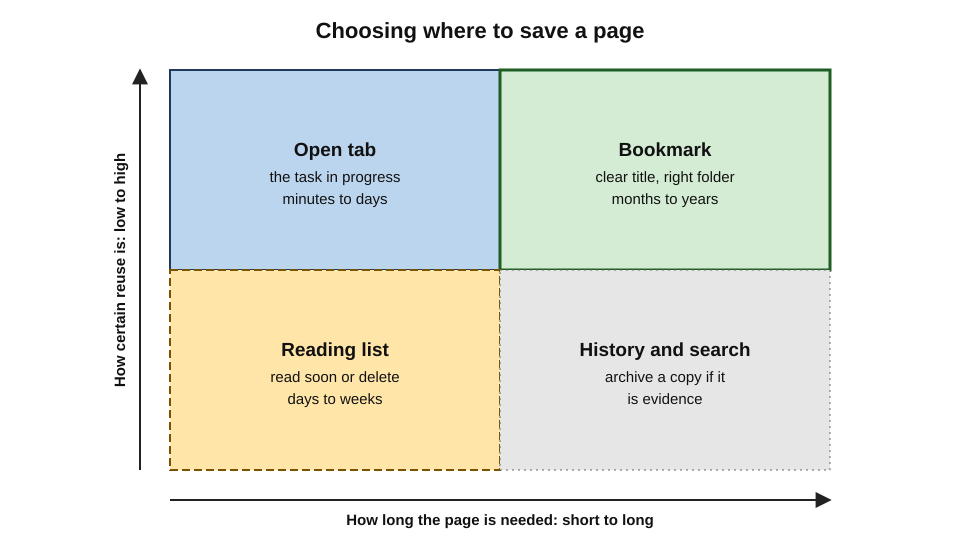
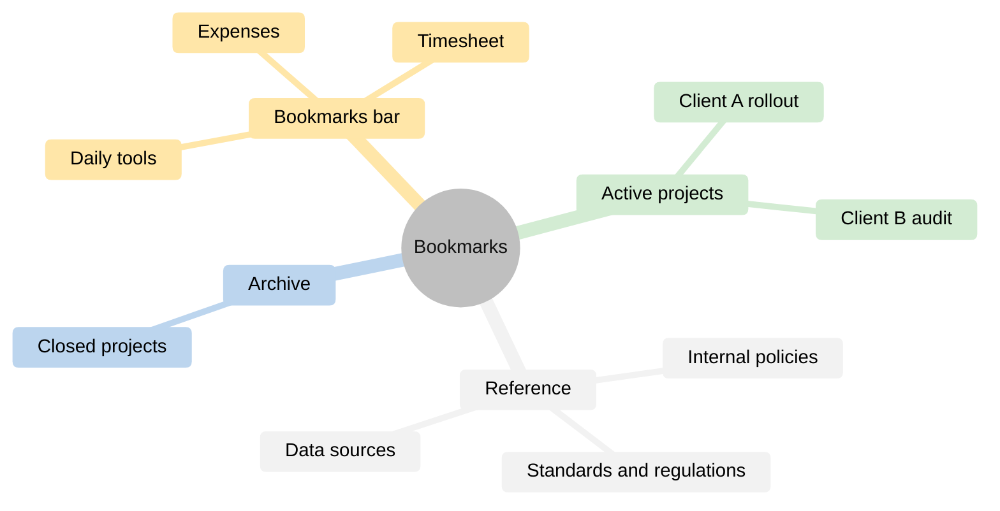
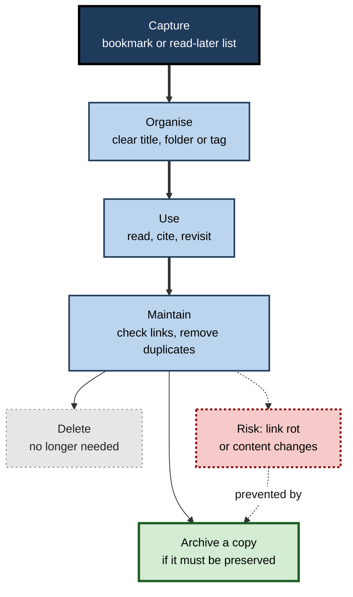
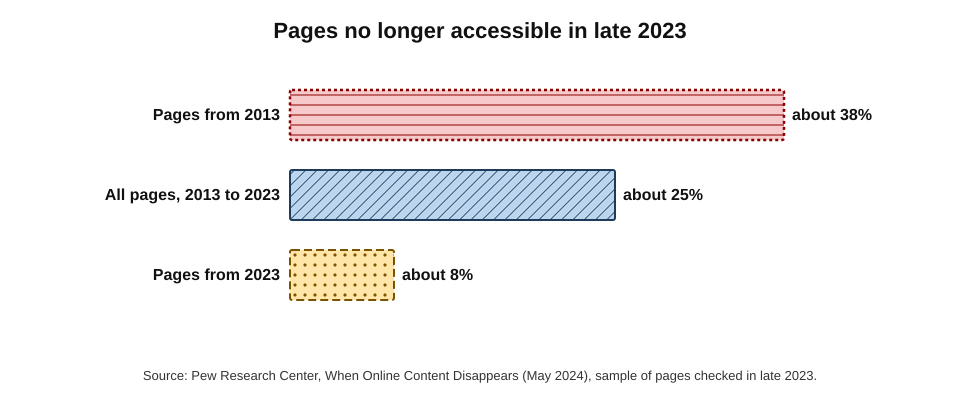
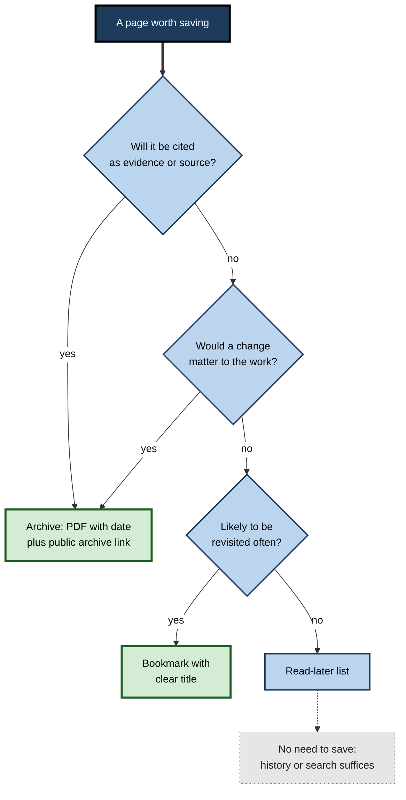

# C.5. Bookmarks & Reading Lists

A policy adviser remembers reading an excellent analysis of carbon pricing three months ago, but cannot recall the site, the author or the title, and an hour of searching fails to find it. A barrister cites a government web page in a submission; by the time of the hearing, the page has moved and the link returns an error. Both problems — **re-finding** and **link rot** — are as old as the web, and the browser's tools for saving pages exist to solve them.

> **Definition — Bookmark:** a saved reference to a web address, stored by the browser with a title and optional folder, tags or keyword, so that the page can be returned to without remembering or searching for it.

> **Definition — Read-later list:** a queue of pages saved for later reading, typically sorted by date and marked as read or unread, sometimes with an offline copy of the text.

**Why it matters**

- **Re-finding is common.** Much web use consists of returning to pages already seen.
- **Memory is unreliable.** People remember that they saw something long after they forget where.
- **The web forgets.** Pages move, change and vanish; a saved link is not a saved page.
- **Teams share resources.** Organisations need reliable access to the same key pages for everyone.

---

## Why People Save Pages

### Revisiting and re-finding

- **Revisitation** — returning to a page seen before.
  - Studies of browser logs in the 1990s and 2000s, beginning with Linda Tauscher and Saul Greenberg (1997), found that **more than half** of page visits were returns to pages already seen; later studies found lower but still substantial rates as search and tabs changed habits.
- **Re-finding through search** — research at Microsoft led by Jaime Teevan (2007) found that a large share of search queries — up to around **two in five** in their logs — were attempts to find something the user had found before.
- **Why it matters:** if re-finding is this common, a few seconds spent saving a page well can save many minutes later.

> **Key point:** people mostly **revisit**, not discover. Tools for saving and re-finding deserve as much attention as tools for searching.

### Four tools for four horizons

| | Browser history | Open tab | Read-later list | Bookmark |
|---|---|---|---|---|
| Created | Automatically | By leaving the page open | Deliberately, in one click | Deliberately, with optional folder |
| Intended horizon | Days to months | Minutes to days | Days to weeks | Months to years |
| Organised by | Time and title | Position in tab strip | Date saved; read or unread | Folders, tags, keywords |
| Typical failure | Too much to scan; cleared by privacy settings | Overload, lost on crash | Saved but never read | Folders become a cluttered dump |
| Best for | "What was that page yesterday?" | The task in progress | Articles to read soon | Pages to return to repeatedly |

**Figure 1.** Choosing where to save a page according to how long it is needed and how certain its reuse is.

---

## How Bookmarks Work

### What a bookmark stores

- **Address (URL)** — the only essential field.
- **Title** — copied from the page's title, editable.
- **Folder** — position in a hierarchy (bookmarks bar, other bookmarks, mobile bookmarks).
- **Favicon** — the site's icon, for quick visual recognition.
- **Date added** and sometimes **date last visited**.
- **Tags** — in Firefox and some managers, labels that allow one bookmark to sit in several categories.
- **Keyword** — in Firefox, a short word that opens the bookmark when typed in the address bar.

> **Watch out:** a bookmark saves the **address, not the content**. If the page changes or disappears, the bookmark points to the new content or to an error — it is a pointer, not a copy.

### Origins

- **Mosaic (1993)** offered a "hotlist" of saved pages.
- **Netscape Navigator** used the term **bookmarks**; its `bookmarks.html` file format remains the common format for importing and exporting bookmarks between browsers today.
- **Internet Explorer** called them "favourites", a term Edge keeps.
- **Social bookmarking** — the service del.icio.us (2003) let people save bookmarks publicly with **tags**; the collective tagging it popularised was named a **folksonomy** by Thomas Vander Wal in 2004.

> **Definition — Folksonomy:** a classification created by many users freely applying their own tags, as opposed to a taxonomy designed in advance by experts.

### Folders, tags and search

Three ways of organising saved pages compete.

- **Folders (taxonomy)**
  - Each bookmark lives in one place; easy to browse.
  - Forces a single choice — is a tax article under "Finance" or under "Client X"?
- **Tags (faceted)**
  - A bookmark can carry several labels; flexible.
  - Requires discipline in naming; synonyms multiply ("tax", "taxation", "VAT").
- **Search**
  - The address bar searches bookmark titles and addresses as the user types.
  - Works only if titles contain the words the user will later think of.

> **Key point:** whichever structure is used, the **title** is what makes a bookmark findable. Renaming "Untitled document – Portal" to "Supplier onboarding form (procurement)" turns it into something search can find.

**Figure 2.** An example of a bookmark structure organised around how pages are used.

### Bookmark power features

- **Bookmarks bar** — the most-used handful of sites, one click away; folders on the bar act as menus.
- **Open all in tabs** — a folder of daily tools can be opened together each morning.
- **Keyword bookmarks and site search** — a keyword such as `wiki` followed by a term searches the internal wiki directly from the address bar.
- **Bookmarklets** — bookmarks containing small scripts (`javascript:` addresses) that act on the current page, such as reformatting or sending it to another tool.
- **Import and export** — moving bookmarks between browsers or backing them up as an HTML file.
- **Synchronisation** — bookmarks sync through the browser account across devices.

> **Watch out:** a **bookmarklet** runs code on whatever page is open. Only add bookmarklets from trusted sources; a malicious one can read the page, including forms and session details.

> **Watch out:** syncing a **work** profile's bookmarks to a **personal** account copies internal addresses — sometimes containing project names or document identifiers — to devices and services outside the organisation's control.

---

## Reading Lists and Read-Later Tools

### The idea

- A read-later list separates **capture** from **consumption**: an interesting article is saved in one click and read when there is time.
- It replaces the habit of leaving articles open in tabs.

### Browser and service options

- **Safari Read-later list** (2011) — saves pages, optionally for offline reading, synchronised across Apple devices.
- **Chrome read-later list** — in the side panel; read and unread sections.
- **Edge Collections** — gather pages, notes and images on a topic.
- **Dedicated read-later services** — **Instapaper** (2008) and **Pocket** (originally "Read It Later", 2007; acquired by Mozilla in 2017) saved clean, offline copies of articles with highlighting.
  - Mozilla closed Pocket in **July 2025**, and users had to export their saved items — a reminder that third-party services can disappear.

> **Definition — Read-later service:** an application that saves a clean, often offline copy of an article's text for later reading, typically with highlighting, tagging and cross-device synchronisation.

### The read-later trap

- Saving is effortless; reading takes time. Many users accumulate hundreds of unread items.
- Read-later lists can become a source of guilt rather than learning.
- Good practice:
  - **save less** — only items likely to be read within a week or two;
  - **schedule reading** — a fixed weekly slot;
  - **prune ruthlessly** — delete anything unread after a month;
  - **extract** — move the useful ideas into notes, then remove the item.

> **Watch out:** claims that users read only a small fraction of what they save are widely repeated, but reliable published data are scarce. The pattern is plausible and commonly reported; precise figures should be treated with caution.

**Figure 3.** The life cycle of a saved page, from capture to archiving or deletion.

---

## Link Rot and Reference Rot

### The problem

> **Definition — Link rot:** the decay of links over time as pages are moved, renamed or deleted, so that the address no longer returns the intended resource.

> **Definition — Content drift:** a change in what a still-working address shows, so that it no longer contains the information originally cited. Together with link rot it is called **reference rot**.

### The evidence

**Study card — Zittrain, Albert and Lessig (2014), Harvard Law School**

- **Design:** checked web links cited in US Supreme Court opinions and in leading law journals.
- **Results:** about **half** of the links in Supreme Court opinions no longer led to the information originally cited; in the law journals the figure was **over 70 per cent**.
- **Conclusion:** the legal record was quietly losing its evidence. The study led to **Perma.cc**, a service run by Harvard's law library that lets courts and journals create permanent archived copies of cited pages.

**Study card — Pew Research Center (2024), "When Online Content Disappears"**

- **Design:** sampled web pages that existed at different points between 2013 and 2023 and checked whether they could still be reached in late 2023.
- **Results:**
  - about **38 per cent** of pages that existed in 2013 were no longer accessible;
  - about a quarter of all pages that had existed at some point in the decade were gone;
  - even about **8 per cent** of pages from 2023 itself had already disappeared;
  - substantial shares of news and government pages contained at least one broken link.
- **Conclusion:** link rot is pervasive and begins immediately.

**Figure 4.** Share of sampled web pages no longer accessible in late 2023, by the year the page existed.

### Why pages disappear

- **Site redesigns** that change address structure without redirects.
- **Organisational change** — mergers, rebranding, departments closed.
- **Content management migrations** that generate new addresses.
- **Deliberate removal** — outdated, embarrassing or legally sensitive content.
- **Expired domains** — sometimes re-registered by unrelated or malicious parties.
- **Paywalls and sign-in walls** added later.

> **Watch out:** an old bookmark to an **expired domain** can lead to a site now owned by someone else — sometimes a scam or malware site that inherits the old domain's trust.

---

## Preserving Pages

### Options for keeping a copy

- **Print to PDF** — a dated, self-contained snapshot; easy to file with a project.
- **Save page** — an HTML file with its resources, or a single-file web archive in some browsers.
- **Screenshot (full page)** — preserves appearance; text may not be searchable.
- **Read-later or note-taking tools** — store clean article text.
- **Public web archives**
  - **Internet Archive** (founded 1996 by Brewster Kahle) and its **Wayback Machine** (public since 2001) hold hundreds of billions of captured pages; "Save Page Now" captures a page on request.
  - **Perma.cc** — permanent links for legal and scholarly citation.
  - National libraries archive their national web domains under legal-deposit laws.

> **Definition — Web archive:** a collection of captured copies of web pages, stored with the date of capture, so that past versions can be viewed after the live page changes or disappears.

> **Watch out:** public archives are not guaranteed. In October 2024 the Internet Archive was taken offline for days by a cyber-attack and data breach. Material that matters professionally should also be kept in the organisation's own records.

### When to archive

**Figure 5.** Deciding whether a saved link needs a preserved copy.

> **Remember:** **cite the live link, keep the archived copy.** For anything used as evidence, record the address, the date accessed and a preserved snapshot.

---

## History as a Re-Finding Tool

Browser history is the safety net beneath bookmarks: it records nearly everything, whether or not the user thought to save it.

### Searching history well

- **Search by remembered words** — history searches page titles and addresses, so recalling one distinctive word ("tariff", "onboarding") is often enough.
- **Search by site** — typing part of a domain lists all pages visited on that site.
- **Narrow by date** — most browsers group history by day; some allow date filters.
- **Grouped history** — some browsers cluster history into topics or "journeys", showing related searches and pages together.
- **History from other devices** — synced history includes pages read on a phone.

### Limits of history

- **Retention** — browsers keep history for limited periods (Chrome, for example, for about 90 days); older visits are deleted automatically.
- **Clearing** — privacy routines and policies may erase it.
- **Private windows** record nothing.
- **Titles can be unhelpful** — "Dashboard", "Home", "Document" are hard to find later.

> **Remember:** history is for **days and weeks**; anything needed after that must be **saved deliberately**.

---

## Maintaining a Collection of Bookmarks

Collections grow for years and decay unless maintained.

- **Remove duplicates** — browsers and extensions can list identical addresses.
- **Check for dead links** — link-checking tools test every bookmark and list those returning errors.
- **Prune by date** — bookmarks not opened in two years are candidates for deletion or archiving.
- **Rename vague titles** whenever a bookmark is used.
- **Back up** — export bookmarks periodically, especially before changing browser or device.
- **Migrate carefully** — importing between browsers usually preserves folders but may lose tags, keywords or descriptions.

| | Quarterly light maintenance | Annual deep maintenance |
|---|---|---|
| Time needed | About ten minutes | About an hour |
| Actions | Rename unclear titles, move new items into folders | Run a dead-link check, delete duplicates, archive closed projects |
| Effect | Keeps recent bookmarks findable | Keeps the whole collection trustworthy |

> **In practice:** many professionals tie bookmark maintenance to an existing routine — project close-out, the end of a financial year, or a laptop replacement — so that it actually happens.

---

## Saved Pages and Personal Knowledge

- Bookmarks and read-later items store **where** information is; they do not capture **what was learned** from it.
- People who rely on saved material for their work — researchers, consultants, lawyers, journalists — typically pair saving with **note-taking**: a short summary, the key figure or quotation, and the source with its date.
- The note then becomes the durable asset; the link becomes a reference that may break.
- AI assistants that summarise saved articles can speed this up, but summaries can omit or distort key points and should be checked against the source before being relied upon.

> **Key point:** a collection of links is a **map of where knowledge was**, not knowledge itself. Extracting the essential points at the time of reading protects against both link rot and forgetting.

---

## Bookmarks in Organisations

### Shared resources

- **Managed bookmarks** — administrators can push a folder of bookmarks to every managed browser through policy (for example, HR portal, IT help desk, expenses).
  - Users cannot delete them, so they stay accurate across the organisation.
- **Intranet and team sites** — curated link pages owned by a team, rather than many personal bookmarks.
- **Collaboration tools** — links pinned in team channels and project spaces.
- **Short internal addresses** — memorable internal links (such as `go/expenses`) maintained centrally so that destination changes do not break everyone's bookmarks.

### Security and privacy considerations

- **Phishing defence** — bookmarking banking, payroll and supplier portals lets staff reach them without following emailed links.
- **Data leakage** — internal addresses synchronised to personal accounts expose project names and document identifiers.
- **Access tokens in addresses** — some addresses contain secret tokens (shared-document links, password-reset links); bookmarking or sharing them can grant access to anyone who obtains the bookmark.

> **Watch out:** an address that opens a document **without signing in** is a credential. Bookmarking it in a synced personal profile, or pasting it into a public tool, gives that access to others.

### Worked example (illustrative): a bookmark structure for a new engagement

A management consultant starts a six-month supply-chain project and wants a structure that colleagues can also reuse.

1. **Create a project folder** named for the client and engagement: "Client – Supply chain review 2026".
2. **Split by use, not by source:**
   - "Daily" — project tracker, shared drive, timesheet code;
   - "Client systems" — the client's portals (also bookmarked in the separate client profile);
   - "Sources" — industry reports and data sets, each titled with publisher and year;
   - "Regulation" — relevant rules and guidance.
3. **Rename every bookmark** to a descriptive title including the key noun the consultant will later search for.
4. **Archive cited sources** as dated PDFs in the project's shared folder.
5. **Share the structure** by exporting the folder to the project wiki as a link page, maintained by one owner.
6. **At project close,** move the folder to "Archive" and delete client-system bookmarks.

| | Before | After |
|---|---|---|
| Typical bookmark title | "Home", "Dashboard", "PDF" | "Client – inventory dashboard (Power BI)", "Port congestion data 2025 – shipping regulator" |
| Finding a source | Scroll through 200 unsorted items | Type two words in the address bar |
| Cited sources after six months | Several broken links | Dated PDFs on file |
| Handover to a colleague | Not possible | Shared link page and archive folder |

*Illustrative figures.*

---

### Case study (illustrative): reference rot in a policy unit

- **Situation:** a government policy unit published evidence reviews with hundreds of web citations each year.
- **Problem:** an internal audit found that a large share of links in reviews more than three years old no longer worked, and some still-working links showed different figures from those cited.
- **Diagnosis:**
  1. Citations recorded only the address, not the access date or a copy.
  2. Many sources were press releases and data pages that agencies routinely replaced.
  3. No one owned link maintenance after publication.
- **Actions:**
  1. Every cited web source to be captured in a public web archive at the time of citation, with the archive link recorded alongside the live link.
  2. Access date added to every citation.
  3. Data figures quoted with the table or file name, not just the page.
  4. A sample of older reviews checked annually, with broken links replaced by archive links.
- **Result:** new reviews became verifiable years later; challenges to the unit's figures could be answered by showing the source as it stood on the date cited.
- **Side effects / caveats:** citation took a few minutes longer; some sources blocked archiving and required local PDF copies.
- **Lesson:** a link is a **pointer that decays**; evidence requires a **preserved copy and a date**.

---

## Sharing Links Well

Links are shared constantly in email, chat and documents; a few habits make them more useful and safer.

- **Describe the destination** — "the 2025 procurement policy, section 4" rather than a bare address or "click here".
- **Link to the exact place** — use links to a heading or a highlighted passage where the browser supports it.
- **Prefer stable addresses** — the official, permanent address of a document rather than a session-specific or search-result address.
- **Remove tracking parameters** — strip `utm_` and similar campaign codes, which add clutter and reveal where the link came from.
- **Check access** — a link to an internal or signed-in page will not work for external recipients; a link that works without sign-in may be granting access to anyone who receives it.
- **Avoid shorteners for important documents** — they hide the destination and add another service that can fail.

> **Watch out:** pasting a document link into a public chat, ticket or AI tool can expose it permanently if the link grants access without sign-in. Check the sharing settings before posting.

---

## Open Questions

- **Who is responsible for keeping the web's record?**
  - Public archives rely on donations and goodwill; national libraries cover only some domains; much content is never captured.
- **Can saved-page tools preserve context, not just addresses?**
  - Users want to resume tasks, not just pages; current tools capture little about why something was saved.
- **How will AI change re-finding?**
  - Assistants that search a user's own history in natural language may replace manual bookmarking, at a cost in privacy.
- **How can dynamic content be archived?**
  - Personalised, script-heavy and signed-in pages are hard to capture faithfully.

---

## Summary

- A **bookmark** saves an address with a title and place; a **read-later list** queues articles to read soon; neither saves the content itself.
- **Revisitation** and **re-finding** make up a large share of web use; good saving saves time later.
- **History, open tabs, reading lists and bookmarks** serve different horizons; choose by how long a page is needed and how certain reuse is.
- Bookmarks are organised by **folders, tags or search**; descriptive **titles** make them findable. Power features include the bookmarks bar, keywords, bookmarklets, import/export and sync.
- Read-later tools separate capture from reading but invite hoarding; services can close (Pocket, 2025).
- **Link rot** and **content drift** are pervasive: about half of Supreme Court links failed (2014); about 38% of 2013 pages were gone by 2023 (Pew, 2024).
- Preserve evidence with **dated PDFs** and **web archives**; archives themselves are fallible.
- Organisations use **managed bookmarks**, curated link pages and stable internal short links; bookmarks of secret-token addresses and synced internal links are security risks.

---

## Self-Check

1. Define a bookmark and a read-later list, and explain why neither preserves a page's content.
2. What did research on revisitation and re-finding find, and why does it matter?
3. Compare history, open tabs, reading lists and bookmarks by intended horizon and typical failure.
4. Give one advantage and one drawback each of folders and tags.
5. Why does a bookmark's title matter more than its folder for later retrieval?
6. What is a bookmarklet, and what precaution does it require?
7. What is the read-later trap, and how can it be avoided?
8. Distinguish link rot from content drift.
9. Summarise the Zittrain, Albert and Lessig study and its practical consequence.
10. What did the 2024 Pew study find about pages from 2013 and 2023?
11. When should a saved page be archived rather than simply bookmarked?
12. Why can an old bookmark to an expired domain be dangerous?
13. A team's critical supplier portal address is stored in individual staff bookmarks. What problems might this cause, and what would be better?
14. A researcher's report cites ten web sources. Describe a citation practice that keeps the report verifiable in five years.

### Answer Key

1. A bookmark stores an address with a title and location; a read-later list queues pages to read soon. Both store pointers, so if the page changes or disappears, the saved item shows the new content or an error.
2. More than half of page visits in early log studies were revisits, and up to around two in five search queries were attempts to re-find something. Saving well is therefore a high-value habit.
3. History — days to months, automatic, too much to scan; tabs — minutes to days, overload and loss on crash; reading lists — days to weeks, saved but unread; bookmarks — months to years, cluttered folders.
4. Folders: easy to browse, but each item has one place. Tags: several labels per item, but synonyms and inconsistency multiply.
5. Address-bar search matches titles and addresses; a descriptive title containing likely search words makes the bookmark findable regardless of where it is filed.
6. A bookmark containing a script that runs on the current page. Use only bookmarklets from trusted sources, since they can read and change any page, including sensitive forms.
7. Saving far more than one reads, so the list becomes a guilty backlog. Avoid by saving less, scheduling reading, pruning items unread after a month and extracting ideas into notes.
8. Link rot: the address no longer works. Content drift: the address works but shows different content from that cited.
9. About half of links in Supreme Court opinions and over 70% in law journals no longer led to the cited material. It prompted Perma.cc, which creates permanent archived copies for citation.
10. About 38% of pages that existed in 2013 were inaccessible by late 2023, and about 8% of pages from 2023 had already gone.
11. When it will be cited as evidence or a source, or when a later change to it would matter to the work.
12. The domain may have been re-registered by someone else, who can use its inherited trust for scams or malware.
13. Staff may hold outdated addresses, follow emailed links instead, or lose access when they leave; new joiners have nothing. Better: a managed bookmark or a curated, owned link page, possibly with a stable internal short link.
14. For each source: live address, access date, title and publisher, and an archive link created at the time of citing (plus a dated PDF in the project records for important sources); quote data with the specific table or file name.

---

## Glossary

| Term | Meaning |
|---|---|
| Bookmark | A saved reference to a web address with a title and location. |
| Bookmarklet | A bookmark containing a small script that acts on the current page. |
| Bookmarks bar | A toolbar showing the most-used bookmarks below the address bar. |
| Content drift | Change in what a working address shows compared with when it was cited. |
| Folksonomy | A classification created by many users' free tagging. |
| Keyword bookmark | A bookmark opened by typing a short word in the address bar. |
| Link rot | Decay of links as pages move or disappear. |
| Managed bookmarks | Bookmarks pushed to browsers by an organisation's policy. |
| Perma.cc | A service creating permanent archived copies of cited web pages. |
| Read-later list | A queue of pages saved for later reading. |
| Read-later service | An application saving clean, often offline copies of articles. |
| Reference rot | The combination of link rot and content drift. |
| Re-finding | Searching for information one has found before. |
| Revisitation | Returning to a page previously visited. |
| Tag | A free label attached to a saved item. |
| Wayback Machine | The Internet Archive's public interface to archived web pages. |
| Web archive | A collection of dated captured copies of web pages. |
