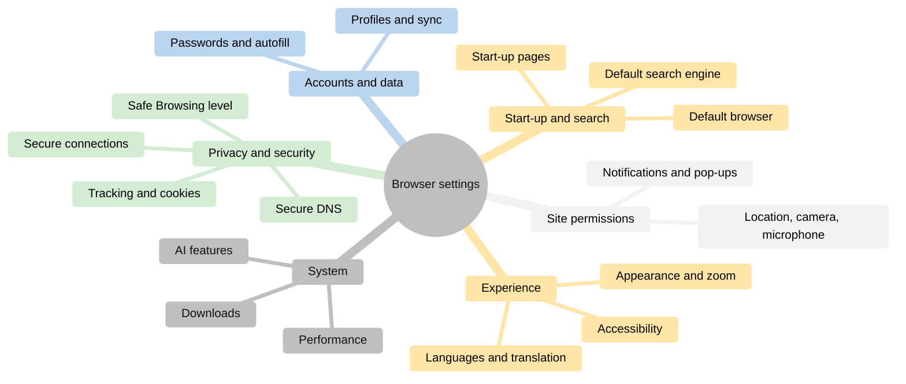
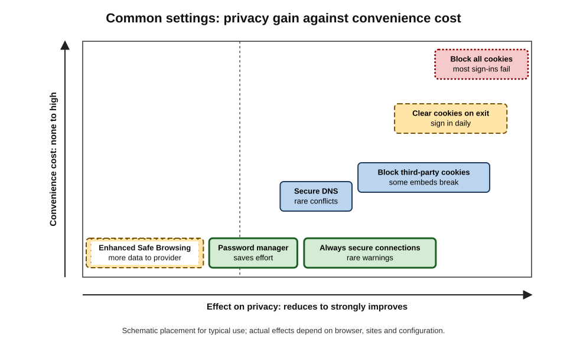
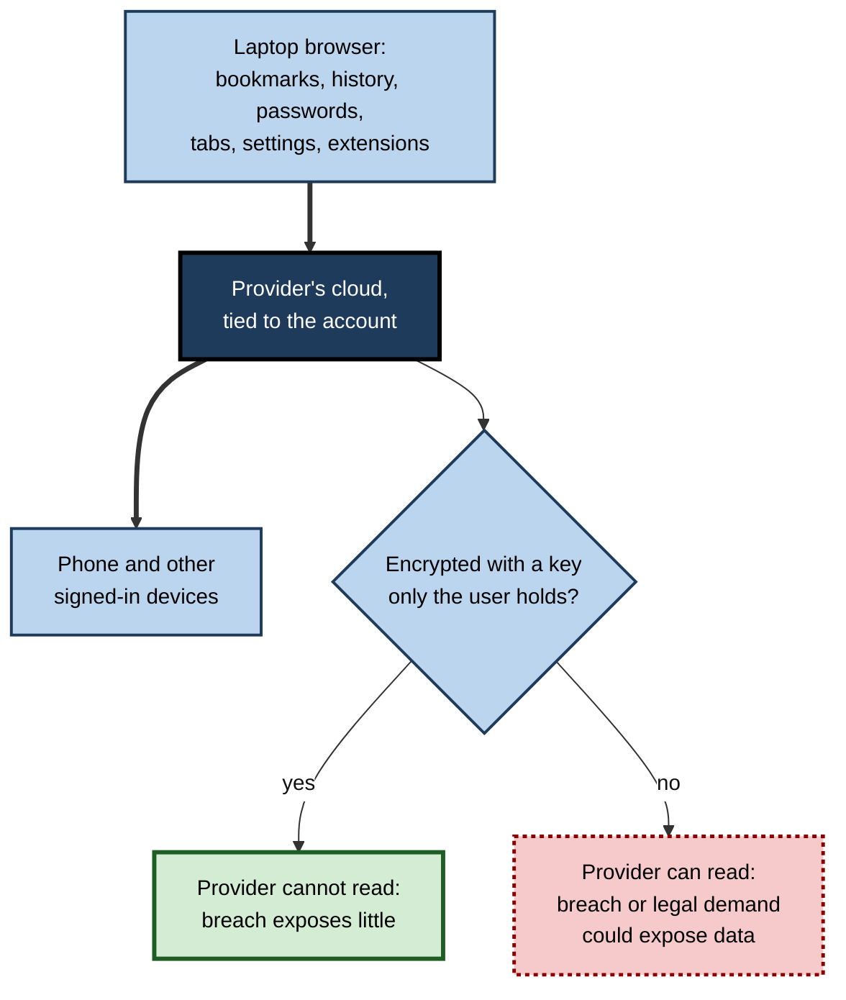
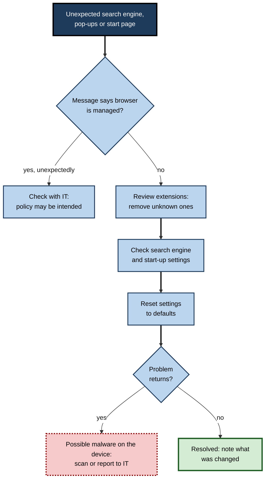
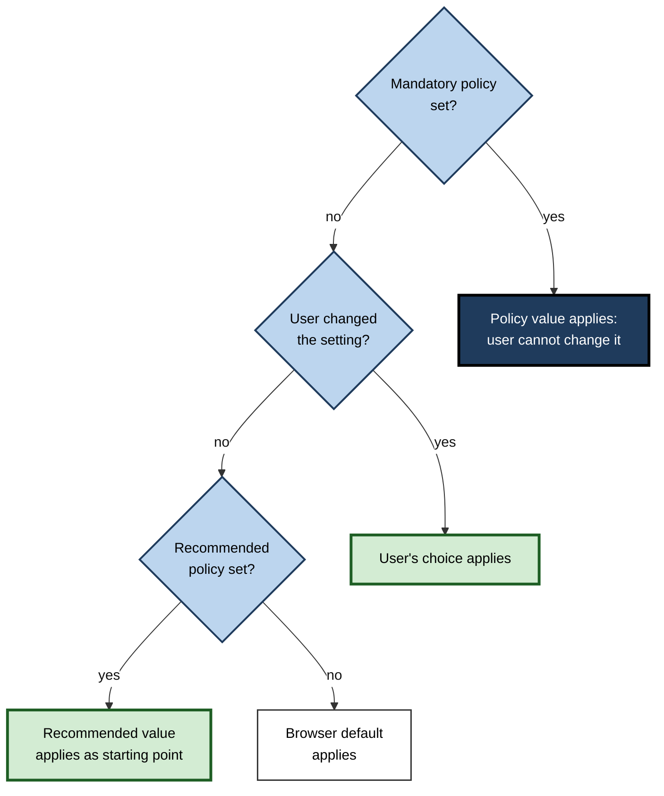

# C.6. Browser Settings & Customization

Two employees receive identical new laptops. One accepts every default: cloud spell-check, third-party cookies, a news-filled new-tab page. The other spends fifteen minutes in settings: a separate work profile, stricter tracking protection, notifications blocked by default, pages reopened where they were left.

A year later the difference in privacy, safety and daily friction between them is substantial — and almost entirely the product of settings.

> **Definition — Browser settings:** the configurable options that determine how a browser behaves — what it does at start-up, how it searches, what it stores, what sites may do, how it looks and what data it shares — set by the user, by the browser's defaults or by an organisation's policy.

**Why it matters**

- **Defaults rule.** Most people never change most settings, so the default effectively decides behaviour for most users.
- **Privacy and security** depend on a handful of choices — tracking protection, Safe Browsing level, secure connections, password storage.
- **Productivity** improves when start-up, search, downloads and appearance fit the way a person works.
- **Organisations** must set browsers consistently for thousands of users, through policies rather than individual effort.

---

## The Power of Defaults

### Why defaults stick

- **Effort** — changing a setting takes time and knowledge.
- **Implied endorsement** — users assume the default is recommended.
- **Inertia** — once working, few revisit choices.
- Behavioural research shows the strength of defaults across domains; in a classic study, Eric Johnson and Daniel Goldstein (2003) found that countries where citizens were organ donors **unless they opted out** had far higher registration than countries requiring people to opt in.

> **Definition — Default effect:** the tendency of people to keep a pre-set option, so that the choice of default strongly determines outcomes.

### Defaults as a commercial battleground

- **Default browser** — operating systems prompt users to keep their own browser; competing browsers prompt users to switch.
- **Default search engine** — worth billions in search advertising, as payments for default placement show.
- **Choice screens** — since March 2024 the EU's Digital Markets Act has required large platforms to show choice screens for browser and search engine on certain devices; smaller browsers reported increases in downloads in the EU after they appeared.

> **Key point:** whoever sets the default sets the outcome for most users. A professional who understands this **chooses** settings deliberately rather than inheriting them.

---

## Map of the Settings

All major browsers group their settings into similar areas, reachable through the main menu or internal pages such as `chrome://settings`, `edge://settings` or `about:preferences`.

**Figure 1.** The main areas of browser settings.

### Start-up, home and new tab

- **On start-up:** open the new-tab page, continue where one left off, or open specific pages.
  - "Continue where you left off" restores the previous session — useful for work, though it keeps old tabs alive.
- **Home button** — optional; opens a chosen page.
- **New-tab page** — shortcuts, search box, and sometimes news, sponsored tiles or promotions that can be turned off.

### Default search engine

- The engine used for text typed in the address bar.
- Options typically include Google, Bing, DuckDuckGo, Ecosia, Yahoo and others; most browsers allow adding any site that supports search.
- **Site search shortcuts** let a keyword search one site directly.

> **Watch out:** malicious or "potentially unwanted" extensions often **change the default search engine** to one that injects advertising or harvests queries — a "browser hijacker". If search results suddenly look unfamiliar, check this setting and the installed extensions.

### Appearance

- **Themes and colours**, light or dark mode (often following the operating system).
- **Fonts and minimum font size**.
- **Page zoom** — a default level, and per-site levels remembered automatically.
- **Toolbar layout** — which buttons, extensions and bookmarks bar appear.
- **Tab layout** — horizontal or vertical tabs in browsers that offer both.

### Downloads

- **Location** — a fixed folder or "ask where to save each file".
- **Open automatically** — risky for document types that can contain macros or scripts.
- **Dangerous-file warnings** — controlled partly by the Safe Browsing level and, in organisations, by policy.

> **In practice:** choosing "**ask where to save each file**" makes users consciously place work files in the right synchronised or project folder rather than accumulating hundreds of files in Downloads.

---

## Privacy and Security Settings

### The key controls

- **Tracking protection and cookies**
  - Options range from allowing all cookies, through blocking **third-party cookies**, to blocking all cookies (which breaks most sign-ins).
  - Firefox and Safari block much cross-site tracking by default; Chrome kept third-party cookies after abandoning plans to remove them, confirming in 2025 that it would not prompt users or phase them out.
- **Safe Browsing level** (Chrome, and equivalents elsewhere)
  - **Standard** — checks addresses against a list of known dangerous sites.
  - **Enhanced** — sends more data (such as addresses and samples of pages and downloads) to Google for real-time checks; stronger protection at some privacy cost.
  - **No protection** — not recommended.
- **Secure connections**
  - "**Always use secure connections**" (HTTPS-First or HTTPS-Only mode) tries HTTPS for every site and warns before loading an unencrypted public site.
  - Chrome planned to switch it on for everyone with **Chrome 154 in October 2026**, after enabling it first for Enhanced Safe Browsing users in April 2026; private network addresses such as router pages are excluded.
- **Secure DNS (DNS over HTTPS)** — encrypts the name lookups that reveal which sites are visited; may conflict with organisational filtering.
- **Do Not Track and Global Privacy Control**
  - Do Not Track (2009) asked sites not to track; it was widely ignored and has been removed from some browsers.
  - **Global Privacy Control** (2020) signals an opt-out from the sale or sharing of data; it is legally recognised in some US states, notably California.
- **Usage statistics and crash reports** — data sent to the browser maker; can usually be turned off.
- **Preloading pages** — the browser fetches pages it predicts will be visited; faster, but may contact sites before the user clicks.

> **Definition — HTTPS-First mode:** a browser setting that attempts every navigation over an encrypted HTTPS connection and warns the user before falling back to unencrypted HTTP.

> **Definition — Global Privacy Control (GPC):** a browser signal telling websites that the user opts out of the sale or sharing of their personal data.

### Trade-offs between privacy, security and convenience

Settings rarely improve everything at once.

| Setting | Privacy effect | Security effect | Convenience cost |
|---|---|---|---|
| Block third-party cookies | Strongly reduces cross-site tracking | Neutral to slightly positive | Some embedded services and sign-ins break |
| Enhanced Safe Browsing | Reduced — more data sent to the provider | Increased — real-time detection | None noticeable |
| Always use secure connections | Improved | Improved | Occasional warning on old sites |
| Secure DNS | Improved against network observers | Mixed — may bypass company filters | Rare conflicts on corporate networks |
| Clear cookies on exit | Strongly improved | Neutral | Must sign in again every day |
| Save passwords in the browser | Data held by the browser or its cloud | Improved if it replaces reused passwords | Large gain |

**Figure 2.** Common browser settings placed by their effect on privacy and on convenience.

> **Watch out:** "maximum privacy" settings can **reduce security** — for example, turning off Safe Browsing removes phishing warnings. Choose settings by the threats that actually matter to the person.

### Site permissions: defaults and exceptions

- **Global defaults** — for each capability (location, camera, microphone, notifications, pop-ups, automatic downloads, clipboard, sound), choose: ask, allow or block.
- **Per-site exceptions** — allow the video-meeting site to use the camera, block a news site's notifications.
- **Review regularly** — the list of sites with permissions accumulates over years.

> **Remember:** a good starting set for most professionals — **notifications: block by default** (allow only chosen work tools); **location: ask**; **camera and microphone: ask**; **pop-ups: block** (with exceptions for sign-in and payment sites).

---

## Accounts, Profiles and Sync

### What synchronisation carries

- **Typically synced:** bookmarks, history, open tabs, passwords, addresses and payment methods, settings, extensions, read-later list.
- **Where it goes:** the browser maker's cloud, tied to the user's account.

| | Chrome | Edge | Firefox | Safari |
|---|---|---|---|---|
| Account | Google account | Microsoft account or work account | Mozilla account | Apple Account (iCloud) |
| Can the provider read synced data? | Yes, unless a separate sync passphrase is set | Depends on data type and account settings | No — end-to-end encrypted by design | Passwords and many data types end-to-end encrypted |
| Work-account integration | Google Workspace | Microsoft Entra ID | Limited | Limited |

**Figure 3.** What browser synchronisation carries, and who can read it.

> **Watch out:** these arrangements change over time; check what the browser currently encrypts before syncing sensitive data. The principle is stable: if the provider holds the keys, a breach or legal demand at the provider could expose synced data.

### Profiles

- **Separate profiles** for work, personal life and each client keep cookies, passwords, history and extensions apart.
- **Guest mode** — a temporary profile for someone borrowing the computer.
- **Signing in to the browser** with a work account can apply the organisation's policies to that profile.

> **In practice:** using **one profile per role** — work, personal, and any client whose systems demand their own sign-in — is the single most effective customisation for avoiding mistakes such as uploading a client file to a personal account.

### Passwords and autofill

- **Built-in password managers** generate strong unique passwords, fill them only on the matching site and warn about breached passwords.
- **Passkeys** — phishing-resistant sign-in credentials that browsers and operating systems store and sync.
- **Autofill** of addresses and payment cards saves time; hidden form fields have occasionally been used to trick autofill into revealing extra data.

> **Key point:** a browser password manager that **replaces reused passwords** is a large security gain for most people, even if a dedicated password manager offers more features.

---

## Language, Accessibility and AI Features

### Language and writing

- **Preferred languages** — sent to websites to choose the page language.
- **Translation** — whole-page translation, increasingly performed on the device.
- **Spell-check**
  - **Basic** — runs locally.
  - **Enhanced** (cloud) — sends text typed into fields to the provider for better suggestions.

> **Watch out:** **cloud spell-check** sends what is typed — which may include confidential client details or personal data — to an external service. Many organisations disable it by policy.

### Accessibility

- Default zoom and minimum font size.
- Live captions for audio and video.
- Read aloud.
- Keyboard focus highlighting and caret browsing.
- Reduced motion and high-contrast modes, often taken from the operating system.

### Performance and system

- **Memory saving** — puts inactive tabs to sleep; exceptions for chosen sites.
- **Energy saving** — limits background activity and visual effects on battery.
- **Hardware acceleration** — uses the graphics processor; turning it off can fix some display faults.
- **Continue running background apps** after closing — keeps notifications alive but uses resources.

### AI features

- Built-in assistants (for example, Gemini in Chrome and Copilot in Edge) may be able to read the current page or open tabs.
- Settings control whether the assistant is enabled, whether it may read page content, and whether interactions are stored or used to improve models.
- Organisations can usually enable or block these features by policy.

> **Watch out:** an assistant permitted to "use page content" may send the text of internal web applications — HR records, contracts, source code — to the provider's servers. Check both the user setting and the organisation's policy before using it on confidential pages.

---

## Settings on Mobile Browsers

Phone browsers expose fewer settings, and several important choices are made in the operating system instead.

- **Default browser** — chosen in the phone's settings; links opened from other apps then go to it.
- **In-app browsers** — many apps open links in their own embedded browser by default; some apps let users switch this off.
- **Content blockers** — on iPhone, Safari supports content-blocking apps enabled in system settings; on Android, some browsers (Samsung Internet, Firefox, Brave) offer built-in blocking or extensions.
- **Permissions** — location, camera and microphone may need permission both from the operating system for the browser app and from the browser for each site.
- **Autofill and passwords** — usually provided by the operating system's password manager across all apps.
- **Data saving** — reduced-image or lite modes on slow or expensive connections.

> **Watch out:** changing a privacy setting on the **desktop** browser does not change it on the phone, even when the two are synchronised; most privacy and permission settings are stored per device.

| | Desktop browser | Mobile browser |
|---|---|---|
| Extensions | Full support in most browsers | Limited or absent in many browsers |
| Where permissions live | Browser settings | Operating system and browser settings |
| Default browser choice | Operating-system setting, often prompted | Operating-system setting; in-app browsers bypass it |
| Typical management in organisations | Browser policies | Mobile device management and app configuration |

---

## Hidden and Advanced Settings

- **Experimental flags** — `chrome://flags`, `edge://flags` and Firefox's `about:config` expose features under development and low-level preferences.
  - Useful for testing; can cause instability or weaken security.
  - Changes may disappear in later versions.
- **Internal diagnostic pages** — such as pages listing policies in effect, versions, components and network events.
- **Command-line switches** — used by developers and administrators.

> **Watch out:** instructions found online to "fix" a problem by changing obscure flags or preferences can disable security protections. Change advanced settings only when the effect is understood, and record the change.

**Resetting settings**

- All browsers offer a **reset** that restores defaults, disables extensions and clears temporary data while keeping bookmarks, history and saved passwords.
- It is the standard first step when a browser has been hijacked or behaves strangely.

**Figure 4.** Troubleshooting a browser that has started behaving strangely.

> **Watch out:** "Your browser is managed by your organisation" on a **personal** computer, where no organisation should be involved, can indicate that unwanted software has installed policies to lock in a search engine or extension.

---

## Settings in Organisations: Policy Management

### How policies work

- **Policies** are settings imposed by an administrator; the user cannot change them (mandatory policies) or can change them after first use (recommended policies).
- **Delivery mechanisms:**
  - **Windows** — Group Policy templates and device-management tools such as Microsoft Intune;
  - **macOS** — configuration profiles;
  - **Cloud browser management** — Chrome's and Edge's cloud management consoles apply policies to signed-in or enrolled browsers;
  - **Firefox** — a `policies.json` file or operating-system policy mechanisms.
- **Inspection** — internal pages such as `chrome://policy` or `edge://policy` list every policy in effect and its source.

> **Definition — Browser policy:** an administrator-defined setting delivered through device or cloud management that overrides or pre-sets the user's browser configuration.

**Figure 5.** How the effective value of a setting is decided when several sources apply.

> **Watch out:** precedence between policy sources — machine versus user policy, platform versus cloud — differs by browser and configuration. Administrators confirm the result on the browser's policy page rather than assuming.

### What organisations typically control

- **Security baseline**
  - Safe Browsing level; download restrictions; blocking of risky file types.
  - Minimum version and forced updates; restart deadlines after updates.
  - HTTPS-First; certificate settings; blocking of insecure features.
- **Extensions** — allow-list or block-list; force-install security and password tools.
- **Data protection**
  - Disable or restrict sync to personal accounts; restrict sign-in to work accounts.
  - Disable cloud spell-check and some AI features on managed devices.
  - Control private-browsing availability; control password saving.
- **Productivity and consistency**
  - Home page, managed bookmarks, default search engine (often the organisation's chosen engine or enterprise search).
  - Legacy compatibility lists.
- **Published baselines** — security bodies and vendors publish recommended configurations; for example the Center for Internet Security publishes benchmarks for major browsers, and Microsoft publishes security baselines for Edge.

| | Unmanaged personal browser | Managed corporate browser |
|---|---|---|
| Who sets security settings | The user (or defaults) | Administrators, by policy |
| Extensions | Any from the store | Allow-listed or force-installed |
| Sync | To any personal account | Disabled or restricted to work accounts |
| Updates | Automatic but restart left to user | Enforced with deadlines |
| Visibility of risky behaviour | None outside the user | Reporting to security tools |

### Worked example (illustrative): building a baseline for a 500-person firm

An IT lead is asked to configure browsers for staff who handle client financial data.

1. **List the threats:** phishing, malicious downloads, data leakage to personal accounts, malicious extensions, unpatched browsers.
2. **Map each threat to settings:**
   - phishing → Enhanced Safe Browsing (accepting extra data to the provider, noted in the privacy record), password manager enabled, passkeys encouraged;
   - downloads → block known-dangerous files, warn on uncommon ones;
   - leakage → sync only to work accounts, cloud spell-check off, AI page-reading off pending review;
   - extensions → allow-list of 15 approved extensions;
   - patching → updates enforced, restart within three days.
3. **Leave choice where risk is low:** themes, layout, tab style, zoom.
4. **Pilot** with 30 users across departments for two weeks, collecting broken sites.
5. **Add exceptions** — for example, permit pop-ups for the payroll provider.
6. **Roll out**, document each policy with its reason, and review quarterly.

> **Key point:** a good baseline locks down the few settings that address **real threats** and leaves the rest to users. Locking everything generates help-desk tickets and workarounds.

---

### Case study (illustrative): the search engine that kept coming back

- **Situation:** a small accountancy practice noticed that several staff browsers used an unfamiliar search engine full of advertisements.
- **Problem:** staff changed the setting back, but it reverted the next day; one browser displayed "Managed by your organisation" although the practice had no device management.
- **Diagnosis / Actions:**
  1. An external adviser found a "PDF converter" extension installed by several staff, which redirected searches.
  2. On two machines, bundled software had also written browser **policies** forcing the search engine and blocking the extension's removal.
  3. The extension was removed, the rogue policy entries deleted, the devices scanned, and browser settings reset.
  4. The practice adopted basic device management, with an extension allow-list and a fixed default search engine.
- **Result:** the hijack stopped; the practice gained visibility of browser configuration for the first time.
- **Side effects / caveats:** for a period, searches typed by staff — some containing client names — had passed through an unknown operator's servers; the practice treated this as a potential data incident.
- **Lesson:** settings are an **attack surface**. Unexpected changes to search, start-up or "managed" status are symptoms to investigate, not annoyances to dismiss.

---

## Customisation for Productivity

Beyond security, a few customisations repay the effort for heavy users.

- **Start-up: continue where left off** — resume work instantly after restart.
- **Site search shortcuts** — keywords for the intranet, document store, issue tracker and dictionary.
- **Bookmarks bar** with folders of daily tools.
- **Pinned tabs** for email, calendar and chat.
- **Vertical tabs or tab groups** for many concurrent tasks.
- **Reader view by default** for chosen article sites, where offered.
- **Download location prompt** for deliberate filing.
- **Per-site zoom** for dense web applications.
- **Keyboard shortcuts** customised where the browser permits.

> **Example:** a recruitment consultant creates site-search keywords `cv` (applicant-tracking system), `li` (professional networking site search) and `jd` (job-description library). Searching any of them takes three keystrokes and a term, instead of opening each site and finding its search box.

---

## Open Questions

- **Who should decide privacy defaults?**
  - Browser makers' business models, regulators and users' interests can conflict; whether law should mandate protective defaults is debated.
- **How should AI features be configured by default?**
  - Assistants that read pages offer value but create new data flows; whether they should be opt-in is contested.
- **Can settings be made understandable?**
  - Many controls require technical knowledge to judge; simplified "privacy levels" hide trade-offs.
- **How should organisational and personal control be balanced on shared devices?**
  - Bring-your-own-device policies and personal profiles on work machines blur boundaries.

---

## Summary

- **Defaults** decide behaviour for most users; choosing settings deliberately is a professional skill. Search and browser defaults are commercial battlegrounds; EU **choice screens** began in 2024.
- Settings areas: **start-up and search; privacy and security; site permissions; accounts and data; experience; system**.
- Key privacy and security controls: **cookie and tracking protection**, **Safe Browsing level**, **always-secure connections** (default in Chrome from October 2026), **secure DNS**, **Global Privacy Control**, telemetry and preloading.
- Settings trade **privacy, security and convenience** against each other; choose for real threats.
- Set **permission defaults** (block notifications, ask for location, camera, microphone) and review exceptions.
- **Sync** sends data to the provider's cloud; encryption arrangements differ. **One profile per role** prevents costly mistakes.
- Cloud spell-check and AI page-reading send typed or displayed content to providers.
- **Flags** and advanced preferences are for testing; **reset** is the first fix for hijacked browsers.
- Organisations manage browsers by **policy**, inspectable on the browser's policy page, building a **baseline** that targets real threats and leaves low-risk choices to users.

---

## Self-Check

1. What is the default effect, and why does it matter for browser settings?
2. Why are browser and search defaults commercially valuable, and what did the EU require from 2024?
3. List the six main areas of browser settings.
4. Compare Standard and Enhanced Safe Browsing in terms of protection and privacy.
5. What does "Always use secure connections" do, and what change did Chrome plan for October 2026?
6. Give one example each of a setting that improves privacy but costs convenience, and one that improves security but costs privacy.
7. Recommend default permission settings for a typical professional, with reasons.
8. Why does it matter whether synced data is end-to-end encrypted?
9. Why might an organisation disable cloud spell-check?
10. What risks do experimental flags pose?
11. A user's search engine keeps changing back to an unknown provider. Describe the troubleshooting steps.
12. Explain the difference between mandatory and recommended policies.
13. Design three policies for a hospital's shared ward computers and justify each.
14. Why should a baseline avoid locking down every setting?

### Answer Key

1. The tendency to keep pre-set options. Because most users never change settings, browser makers' defaults effectively determine privacy, security and search behaviour for the majority.
2. Defaults determine which search engine receives queries and advertising revenue, and which browser and services users adopt. From March 2024 the Digital Markets Act required choice screens for browser and search engine on designated platforms in the EU.
3. Start-up and search; privacy and security; site permissions; accounts and data; experience (appearance, languages, accessibility); system (downloads, performance, AI features).
4. Standard checks addresses against lists of known dangerous sites; Enhanced sends more data for real-time analysis, catching new threats faster at the cost of sharing more browsing information with the provider.
5. It tries HTTPS for every site and warns before loading an unencrypted public site. Chrome planned to enable it for all users with Chrome 154 in October 2026, excluding private-network addresses.
6. Privacy over convenience: clearing cookies on exit (sign in again daily). Security over privacy: Enhanced Safe Browsing (more data to the provider).
7. Notifications blocked by default, because they are a common scam and distraction channel; location, camera and microphone set to ask, because they are needed occasionally; pop-ups blocked with exceptions for sign-in and payment sites.
8. If the provider holds the keys, a breach, insider or legal demand could expose passwords, history and other synced data; end-to-end encryption prevents the provider from reading it.
9. It sends typed text — possibly confidential or personal data — to an external service, creating data-protection and confidentiality risks.
10. They enable unfinished features that may be unstable or weaken security, and changes may vanish or behave differently in later versions.
11. Check whether the browser reports being managed; review and remove unknown extensions; check search and start-up settings; reset settings; if the problem returns, scan the device for unwanted software and look for rogue policies.
12. Mandatory policies fix a value the user cannot change; recommended policies set a starting value the user may change.
13. For example: automatic sign-out and clearing of session data on closing, because machines are shared; an allow-list of extensions, to prevent data-stealing add-ons; password saving disabled, so staff credentials are not stored on shared devices (with smart-card or single sign-on instead).
14. Over-restriction breaks legitimate work, generates help-desk load and pushes users towards workarounds such as personal devices; controls should target genuine threats.

---

## Glossary

| Term | Meaning |
|---|---|
| Browser hijacker | Unwanted software that changes browser settings such as search engine or start page. |
| Browser policy | An administrator-defined setting that overrides or pre-sets browser configuration. |
| Choice screen | A prompt requiring users to choose a browser or search engine rather than accept a default. |
| Cloud spell-check | Spell-checking that sends typed text to an online service. |
| Default effect | The tendency to keep pre-set options. |
| DNS over HTTPS | Encrypting the lookups that translate names into addresses. |
| Enhanced Safe Browsing | Real-time protection that shares more data with the provider. |
| Experimental flag | A hidden setting enabling an unfinished feature. |
| Global Privacy Control | A browser signal opting out of the sale or sharing of personal data. |
| Guest mode | A temporary browser profile for occasional users. |
| HTTPS-First mode | A setting that tries encrypted connections first and warns before unencrypted ones. |
| Mandatory policy | A policy whose value users cannot change. |
| Passkey | A phishing-resistant sign-in credential stored by the device or browser. |
| Recommended policy | A policy setting a starting value that users may change. |
| Reset settings | Restoring browser defaults while keeping bookmarks and passwords. |
| Security baseline | A recommended configuration for secure deployment. |
| Site permission | A per-site decision about access to a sensitive capability. |
| Sync | Copying browser data between devices through the provider's cloud. |
| Third-party cookie | A cookie set by a site other than the one shown in the address bar. |
