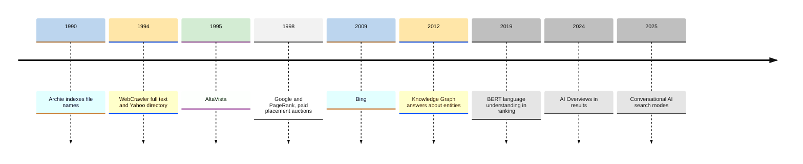
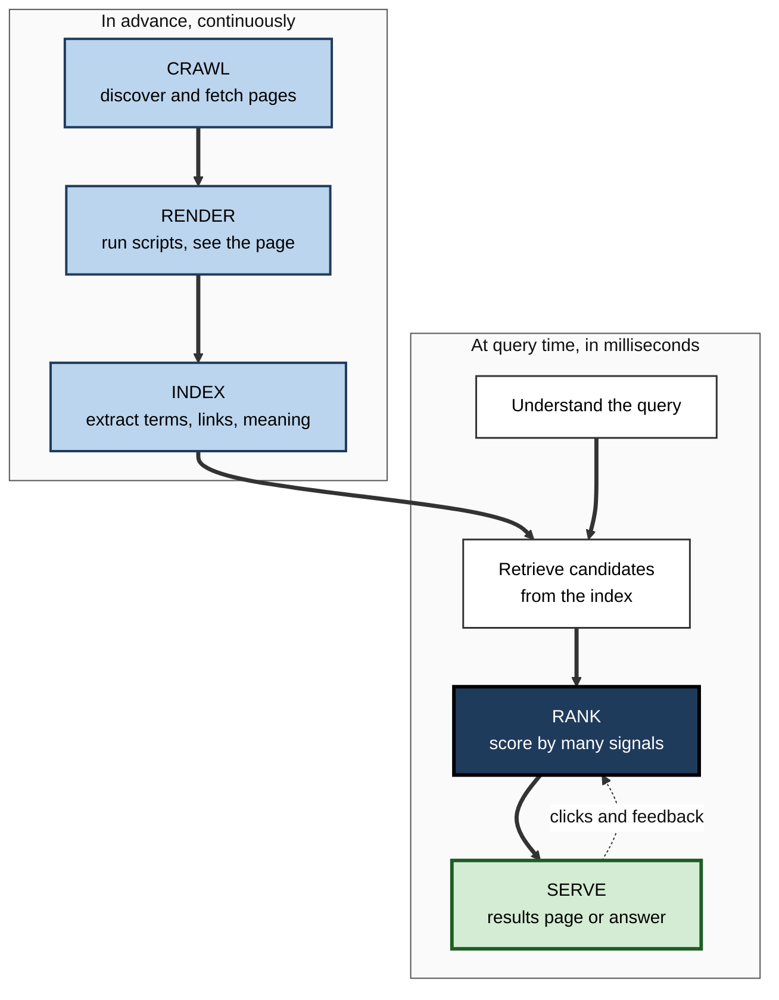
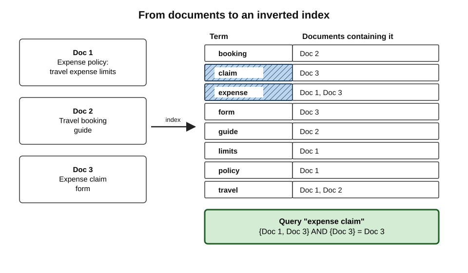
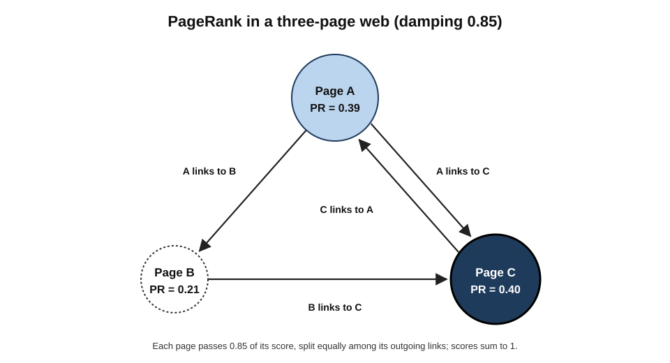
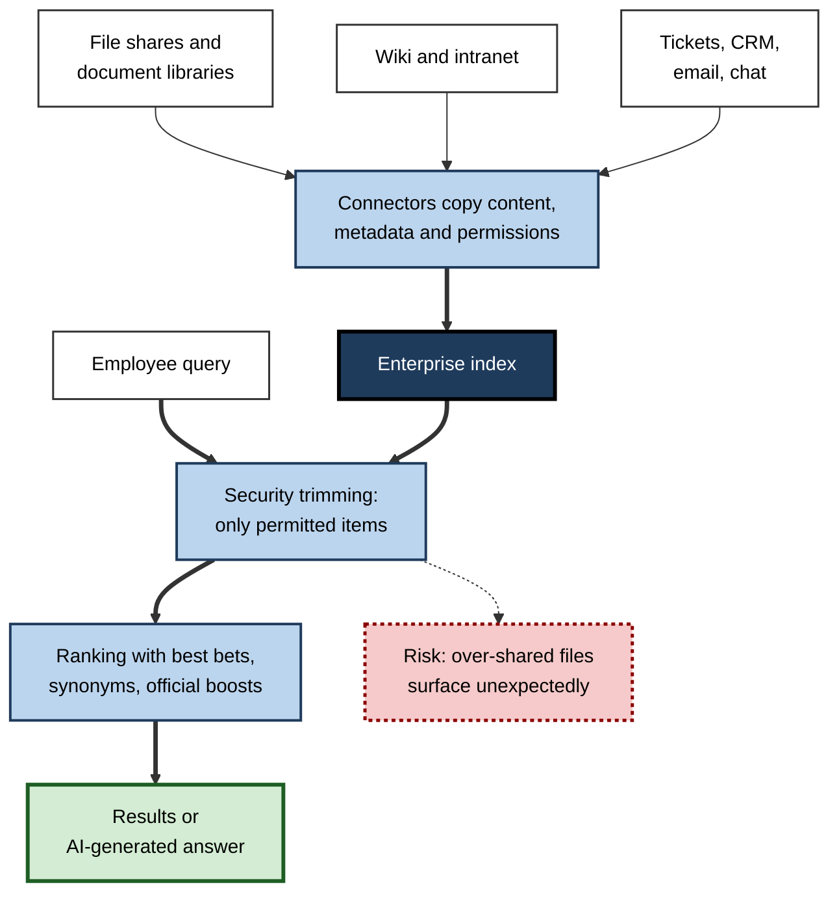

# C.7. Search Engines

A procurement officer types "sustainable packaging suppliers EU regulation" and, in under half a second, receives a ranked page drawn from hundreds of billions of documents. Nothing was searched at that moment in the sense most people imagine: the pages had been fetched, read and filed long before.

Understanding that machinery explains why some results appear first, why others never appear at all, and why the first result is not necessarily the best.

> **Definition — Search engine:** a system that collects documents in advance, builds an index of their contents, and in response to a query retrieves and ranks the documents it judges most relevant and useful, presenting them as a results page or a generated answer.

**Why it matters**

- **Search is the front door to information.** Most research, purchasing, job-hunting and problem-solving begins with a query.
- **Ranking is power.** Users rarely look beyond the first few results, so whatever ranks highly gets the attention, the traffic and the trust.
- **Search is an industry.** Search advertising is one of the largest advertising markets in the world, and optimising for search is a profession.
- **Organisations depend on internal search** to find their own documents, policies and expertise.

---

## Kinds of Search Engine

- **General web search engines** — index the public web broadly.
  - *e.g.* Google, Bing, Baidu (China), Yandex (Russia), Naver (South Korea).
- **Search front-ends on another's index** — offer their own interface, privacy policy or mission, but take many results from a larger engine.
  - *e.g.* DuckDuckGo, Ecosia and Yahoo draw heavily on Bing; a few, such as Brave Search and Mojeek, maintain their own indexes.
- **Vertical search** — specialised by content type or domain.
  - *e.g.* scholarly search, job boards, flight and hotel search, legal databases, product search inside shopping sites.
- **Site search** — the search box on a single website.
- **Enterprise search** — searches an organisation's internal documents, mail, intranet and systems, respecting permissions.
- **Answer engines** — systems that use a language model to compose an answer from retrieved documents, with citations.

> **Definition — Index:** a data structure built in advance that records which terms (and other features) occur in which documents, so that matching documents can be found without reading every document at query time.

> **Key point:** only a handful of organisations operate a **large independent web index**; many search brands are interfaces on top of someone else's index. The diversity of search brands is greater than the diversity of indexes.

---

## A Short History of Search

### Before the web giants

- **1990 — Archie.** Alan Emtage and colleagues at McGill University indexed the file names on public file-transfer servers — the first internet search tool.
- **1993–1994 — early web crawlers.** JumpStation and WebCrawler (1994) — WebCrawler was the first to index the **full text** of pages.
- **1994 — Yahoo.** Began as "Jerry and David's Guide to the World Wide Web" by two Stanford students: a **human-edited directory**, not a crawler.
- **1995 — AltaVista.** Digital Equipment Corporation's engine indexed a large share of the web with fast full-text search; it became the leading engine of the late 1990s.
- **1998 — the paid-placement model.** GoTo.com (later Overture) sold ranking positions in an auction, pioneering pay-per-click search advertising.

### Google and the link graph

- **1996–1998** — Larry Page and Sergey Brin at Stanford built "BackRub", then **Google**, described in their 1998 paper "The Anatomy of a Large-Scale Hypertextual Web Search Engine".
- Their key idea, **PageRank**, used the web's **link structure** as a signal of importance: a page linked to by many important pages is probably important.
- **2000** — Google launched AdWords, combining auction-based ads with a measure of ad quality.
- **2000s** — Google became dominant in most countries; Baidu (2000), Yandex (1997) and Naver (1999) led their home markets.
- **2009** — Microsoft launched **Bing**, succeeding MSN Search and Live Search.
- **2008** — DuckDuckGo launched with a privacy focus.

### The semantic and AI era

- **2012** — Google's **Knowledge Graph** began answering questions about entities (people, places, organisations) directly on the results page.
- **2015** — **RankBrain**, a machine-learning system for interpreting unfamiliar queries.
- **2019** — **BERT**, a neural language model applied to understand queries in context; Google said it affected about one in ten English-language searches in the US at launch.
- **2023** — Microsoft added a chat assistant to Bing; Google tested AI-generated answers.
- **2024** — Google launched **AI Overviews** in the US in May, then widely; AI chat products added web search.
- **2025** — Google introduced an **AI Mode**, a conversational search interface; AI-first browsers built search into an assistant.

**Figure 1.** Milestones in the development of web search.

---

## How a Search Engine Works

Every web search engine performs four tasks, the first three continuously and in advance, the last in milliseconds per query.

**Figure 2.** The four stages of web search: crawling, indexing, ranking and serving.

### Crawling

> **Definition — Crawler (spider, bot):** a program that fetches web pages automatically, extracts their links and adds new addresses to a queue for later fetching.

- **Discovery** — crawlers start from known addresses and follow links; site owners can also submit **sitemaps** listing their pages.
- **Scheduling** — popular and frequently changing pages are revisited often; obscure pages rarely.
- **Politeness** — crawlers limit their request rate to avoid overloading sites.
- **Crawl budget** — on very large sites, engines fetch only as many pages as they judge worthwhile.
- **Robots exclusion** — a `robots.txt` file at a site's root tells crawlers which paths they may not fetch.
  - Proposed by Martijn Koster in 1994 and formally standardised by the IETF in 2022.
  - It is a **request**, not a lock; reputable crawlers obey it, malicious ones need not.
- **Push notification** — protocols such as IndexNow let sites tell participating engines immediately when pages change.

> **Watch out:** `robots.txt` stops a page being **crawled**, not necessarily being **listed**. If other sites link to it, an engine may still show its address without a description. To keep a page out of results, sites use a `noindex` instruction — or, for anything confidential, a password.

> **Watch out:** since 2023 many sites have used `robots.txt` to block **AI crawlers** that gather text for training language models. Whether all AI companies honour such blocks, and whether search and AI-training crawlers can be separated, are live disputes.

### Rendering

- Many modern pages build their content with JavaScript; a crawler that read only the raw HTML would see an empty shell.
- Major engines therefore **render** pages in a headless browser, usually in a second pass, which costs far more computing than reading HTML.
- Content that appears only after user interaction — clicking a tab, scrolling far down — may never be seen.

### Indexing

The engine analyses each fetched page and files it.

1. **Parsing** — extract visible text, headings, links, image descriptions and structured data.
2. **Tokenising and normalising** — split text into terms; handle case, accents, plurals and word stems ("running", "runs" → "run").
3. **Language and entity detection** — identify the language and recognise names of people, places, products and organisations.
4. **Duplicate detection and canonicalisation** — group identical or near-identical pages and choose one **canonical** version to show.
5. **Inverted-index update** — for every term, record the documents containing it and the positions.
6. **Signals stored** — links in and out, freshness, page quality measures, mobile-friendliness, security.
7. **Embeddings** — modern engines also store numerical representations of meaning, allowing retrieval of pages that match a query's sense even without the same words.

> **Definition — Inverted index:** an index that maps each term to the list of documents (and positions) where it occurs — like the index at the back of a book, but for billions of documents.

**Figure 3.** An inverted index maps each term to the documents that contain it.

> **Key point:** at query time the engine looks up the query's terms in the inverted index and **intersects** their document lists — fast even at enormous scale, because no document is read in full.

- **Scale:** Google has described its index as containing **hundreds of billions** of web pages and well over 100 million gigabytes.
- **What is not indexed:** pages behind sign-in, most content in apps, pages blocked by `noindex`, many dynamically generated pages and low-value duplicates — the large "**deep web**", which is mostly ordinary private content, not something sinister.

> **Watch out:** the "deep web" (content not indexed by search engines — email, intranets, bank accounts, databases) is often confused with the "**dark web**" (sites reachable only through anonymity networks such as Tor). The deep web is vastly larger and mostly mundane.

---

## Ranking: How Results Are Ordered

### Understanding the query

- **Spelling correction** — "recieve" → "receive".
- **Synonyms and related terms** — "car hire" ≈ "rental car".
- **Intent classification** — is the user trying to **know** something, **go** to a particular site, **do** something (buy, download), or find a **local** service?
- **Entities** — "Mercury" the planet, the element or the band?
- **Context** — location, language, device and sometimes recent searches.

> **Definition — Search intent:** the goal behind a query — commonly classified as **informational** (learn), **navigational** (reach a known site), **transactional** (complete an action) or **local** (find something nearby).

### Classic relevance: term weighting

The oldest ranking idea is to reward documents that contain the query's words — especially **rare** words — and to discount very common ones.

> **Formula — TF-IDF:** score of a term in a document = term frequency (tf) × inverse document frequency, idf = log(N ÷ df), where N is the number of documents and df the number containing the term.

**Worked example — three internal documents, query "expense claim"**

- **Doc 1:** "Expense policy: travel expense limits" — contains *expense* twice.
- **Doc 2:** "Travel booking guide" — contains neither term.
- **Doc 3:** "Expense claim form" — contains *expense* once and *claim* once.

| Term | Documents containing it (df) | idf = log₁₀(3 ÷ df) |
|---|---|---|
| expense | 2 | log₁₀(1.5) ≈ 0.18 |
| claim | 1 | log₁₀(3) ≈ 0.48 |

| Document | expense score | claim score | Total |
|---|---|---|---|
| Doc 1 | 2 × 0.18 = 0.36 | 0 | **0.36** |
| Doc 2 | 0 | 0 | **0** |
| Doc 3 | 1 × 0.18 = 0.18 | 1 × 0.48 = 0.48 | **0.66** |

1. Doc 1 repeats the common term but lacks the distinctive one.
2. Doc 3 contains the **rarer**, more discriminating term, so it ranks first.
3. Real engines use refinements such as **BM25**, which caps the reward for repetition and adjusts for document length.

> **Watch out:** pure term counting rewards **keyword stuffing** — repeating words to rank. This is why engines added link analysis, quality signals and penalties for spam.

### Link analysis: PageRank

> **Definition — PageRank:** an algorithm that scores pages by the links pointing to them, weighting each link by the score of the linking page and dividing it among that page's outgoing links.

> **Formula — PageRank:** PR(p) = (1 − d) ÷ N + d × Σ [PR(q) ÷ L(q)] for every page q linking to p, where d is a damping factor (classically 0.85), N the number of pages and L(q) the number of links on q. The damping factor models a surfer who sometimes jumps to a random page instead of following a link.

**Worked example — three pages**

- **Links:** A links to B and C; B links to C; C links to A.
- **Equations** (d = 0.85, N = 3, so (1 − d) ÷ N = 0.05):
  - PR(A) = 0.05 + 0.85 × PR(C)
  - PR(B) = 0.05 + 0.85 × PR(A) ÷ 2
  - PR(C) = 0.05 + 0.85 × [PR(A) ÷ 2 + PR(B)]
- **Solution:** PR(A) ≈ **0.39**, PR(B) ≈ **0.21**, PR(C) ≈ **0.40** (the scores sum to 1).
- **Interpretation:** C receives links from two pages, including all of B's "vote"; A receives only C's link, but C is important, so A ranks well too; B receives half of A's vote and ranks lowest.

**Figure 4.** PageRank scores in a three-page web.

> **Key point:** PageRank treated a link as a **vote of confidence**. That made it powerful — and made links a target for manipulation through link farms and paid links, which engines later learned to discount.

### Modern ranking: many signals, learned models

Today's engines combine hundreds of signals using machine-learned models.

- **Relevance** — words, phrases, meaning (including neural language models that match concepts, not just words).
- **Quality and trust** — signs of expertise, reputation, original content and accuracy, especially on topics affecting health, money or safety.
- **Links** — still a signal of authority, heavily filtered for manipulation.
- **Freshness** — recent pages favoured for news and fast-changing topics.
- **Location and language** — "plumber" means plumbers nearby.
- **Usability** — mobile-friendliness, secure connection, page speed, absence of intrusive pop-ups.
- **User interaction** — aggregated behaviour, such as whether users quickly return from a result; the extent of its use has been disputed for years, and evidence in the US antitrust case showed Google uses interaction data substantially.
- **Personalisation** — modest for most web queries; stronger for location and language.

**Human quality raters**

- Google employs thousands of contracted **search quality raters** who assess sample results against published guidelines.
- Their ratings do not change individual rankings directly; they are used to **evaluate** proposed changes to the algorithms.
- The guidelines emphasise **E-E-A-T** — Experience, Expertise, Authoritativeness and Trust (the first "E" was added in December 2022) — with the strictest standards for "**Your Money or Your Life**" topics such as health, finance, law and safety.

> **Definition — E-E-A-T:** Google's framework for judging page quality by the creator's Experience, Expertise, Authoritativeness and Trustworthiness; a guideline for human raters, not a single ranking score.

| | Classic text retrieval (1990s) | Link-based ranking (2000s) | Learned, semantic ranking (2015 onward) |
|---|---|---|---|
| Main question | Does the page contain the words? | Do important pages link to it? | Does it satisfy the intent behind the query? |
| Key techniques | Term weighting, Boolean matching | PageRank, anchor text | Neural language models, embeddings, learning to rank |
| Typical weakness | Keyword stuffing | Link farms and paid links | Opaque decisions; favours large, established sites; vulnerable to mass-produced content |

### Serving the results

- The **results page (SERP)** now contains much more than ten links: advertisements, featured snippets, knowledge panels, "People also ask" boxes, maps and local listings, images, videos, news, shopping listings and AI-generated summaries.
- Each element is chosen and laid out by further ranking systems.

> **Definition — SERP:** the search engine results page — everything shown in response to a query, including organic results, advertisements and special features.

---

## How Search Makes Money

### Search advertising

- **Keyword auctions** — advertisers bid for queries ("accounting software for small business").
- **Ad rank** — position depends on the bid **and** an estimate of ad quality and expected clicks, so the highest bidder does not automatically win.
- **Pay per click** — advertisers usually pay only when someone clicks.
- **Labelling** — ads must be marked, now usually as "Sponsored"; over the years labels have become less visually distinct from organic results.

> **Formula — Simplified ad rank:** ad rank ≈ bid × quality score. An advertiser bidding £2.00 with quality 8 (rank 16) outranks one bidding £3.00 with quality 4 (rank 12).

> **Watch out:** for many commercial queries, the **top several results are advertisements**. Scammers buy ads for brand names — software downloads, customer-support numbers, banking — so the first result for "[bank] login" may be a lookalike site.

### Market structure

- Google has handled roughly **90 per cent** of worldwide searches for over a decade, by StatCounter's measure, with Bing a distant second; national leaders differ in China, Russia and South Korea.
- In **August 2024** a US federal court ruled that Google had unlawfully maintained its monopoly in general search, partly through exclusive default agreements with browser and phone makers.
- The **September 2025** remedies ruling barred exclusive deals and required sharing of some index and interaction data with qualified competitors, but did not require Google to sell Chrome.
- The EU's Digital Markets Act imposes obligations on Google Search, including not favouring its own services in results.

> **Key point:** search competition matters to users because **ranking decisions are editorial** — they decide which businesses, views and sources are seen. A market with one dominant engine concentrates that editorial power.

---

## Search Engine Optimisation: Awareness for Every User

### What SEO is

> **Definition — Search engine optimisation (SEO):** the practice of improving a website so that it ranks higher in unpaid search results, through technical work, content and reputation.

- **Technical SEO** — make pages crawlable, fast, mobile-friendly, correctly canonicalised, with sitemaps and structured data.
- **On-page SEO** — clear titles, headings and content matched to what searchers want.
- **Off-page SEO** — earning links and mentions from other sites.
- **Local SEO** — business profiles, reviews and consistent addresses for local searches.

### Legitimate and manipulative practice

- **Within guidelines ("white hat")** — useful content, clear structure, honest metadata, earned links.
- **Against guidelines ("black hat")** — engines' spam policies prohibit, among others:
  - **keyword stuffing** — unnatural repetition;
  - **cloaking** — showing crawlers different content from users;
  - **link schemes** — buying, exchanging or automating links;
  - **scaled content abuse** — mass-producing low-value pages, whether by people or AI;
  - **site reputation abuse** — publishing third-party content on a trusted site to borrow its ranking (named as a policy by Google in 2024);
  - **expired-domain abuse** — buying old domains to exploit their past reputation.
- **Engine responses** — major algorithm updates have targeted these practices, such as Google's **Panda** (2011, against thin "content farm" pages) and **Penguin** (2012, against manipulative links), and periodic "core updates" since.

> **Watch out:** a high ranking reflects **relevance plus optimisation**, not a certificate of accuracy. A well-optimised page from an interested party can outrank a better but poorly optimised source. Evaluating the result remains the user's job.

> **In practice:** professionals who publish — consultancies, public bodies, researchers — benefit from basic SEO hygiene: descriptive titles, a clear summary near the top, stable addresses, and pages that load quickly on phones. These help readers as much as engines.

---

## Search Inside Organisations

### How enterprise search differs

| | Web search | Enterprise search |
|---|---|---|
| Content | Public pages | Documents, email, chat, intranet, databases, business systems |
| Volume | Hundreds of billions of pages | Thousands to billions of items |
| Link signals | Rich | Weak — internal documents rarely link to each other |
| Permissions | Everything public | Each user may see only what they are permitted to — results must be **security-trimmed** |
| Quality signals | Popularity, links, reputation | Recency, authorship, official status, metadata |
| Who tunes it | The engine's engineers | The organisation's own administrators, often under-resourced |

> **Definition — Security trimming:** filtering search results so that each user sees only items they are authorised to open.

### How it works

- **Connectors** crawl repositories (file shares, document libraries, wikis, ticketing systems, CRM).
- **Indexing** extracts text and metadata (author, date, department, document type).
- **Permissions** are copied from each source and applied at query time.
- **Relevance tuning** — "best bets" (promoted answers for common queries), synonyms ("PTO" = "annual leave"), boosting official sources.
- **Analytics** — reports on top queries, **zero-result queries** and abandoned searches show where content is missing or badly titled.
- **AI layers** — assistants that answer questions from the organisation's own documents retrieve passages through the same index, then generate an answer.

> **Watch out:** AI assistants over enterprise search expose **over-sharing**. If a confidential spreadsheet was accidentally shared with "everyone in the organisation", search may not have surfaced it — but an assistant asked "what are the salary bands?" may find and summarise it. Permission hygiene must come before AI rollout.

> **Watch out:** a widely repeated estimate (from McKinsey in 2012) that knowledge workers spend nearly **a fifth of their time** searching for and gathering information is an estimate from survey data, not a precise measurement; it is plausible but should not be quoted as exact.

**Figure 5.** How an enterprise search system answers a query while respecting permissions.

### Case study (illustrative): an intranet search nobody trusted

- **Situation:** a 12,000-employee engineering company's intranet search returned outdated policies first; staff routinely asked colleagues instead.
- **Problem:** surveys showed most employees "never" used search; HR answered the same questions repeatedly.
- **Diagnosis:**
  1. Search analytics showed the twenty most common queries ("holiday", "expenses", "payslip", "VPN") returned drafts and superseded versions.
  2. Thousands of documents had titles like "Final_v3" and no owner or date metadata.
  3. Old project sites remained indexed, burying current content.
  4. Synonyms were missing — "annual leave" content was not found by "holiday".
- **Actions:**
  1. Best bets created for the top fifty queries, pointing to the official page.
  2. Superseded content archived and excluded from the index; owners required for every policy page.
  3. A synonym list built from zero-result queries.
  4. Official policy library boosted in ranking; document titles rewritten to plain language.
  5. Monthly review of search analytics by a named owner.
- **Result:** within six months the share of searches followed by a click on a result rose substantially, and routine HR queries fell.
- **Side effects / caveats:** archiving surfaced disputes over who owned old content; a few teams objected to their sites being excluded.
- **Lesson:** enterprise search quality depends less on the engine than on **content governance** — titles, ownership, currency and the weekly discipline of reading the search logs.

---

## Search and Generative AI

- **Retrieval-augmented generation** — an answer engine retrieves documents for a query, then a language model writes an answer grounded in them, with citations.
- **AI summaries on results pages** — Google's AI Overviews and similar features place a generated answer above the links.
- **Conversational search** — follow-up questions refine the answer without retyping.
- **Consequences:**
  - users can get synthesised answers to complex questions quickly;
  - generated answers can contain errors, misattribute sources or omit important qualifications;
  - fewer clicks reach the original sites, threatening the economics of publishing.

> **Definition — Retrieval-augmented generation (RAG):** a method in which a language model is given documents retrieved from an index for each query and asked to base its answer on them.

> **Key point:** AI answers are built **on top of** retrieval and ranking. If the index or ranking surfaces poor sources, the generated answer inherits their weaknesses — and presents them more fluently.

---

## Open Questions

- **Will generative answers sustain the open web?**
  - If fewer users click through, publishers lose income and may stop producing — or block crawlers — reducing what answers can draw on.
- **Can search competition be restored?**
  - Remedies such as data sharing may help rivals, but building and maintaining an index at web scale remains extraordinarily expensive.
- **How should ranking be held accountable?**
  - Ranking is consequential for businesses, elections and health, yet largely opaque; how far audits and transparency obligations should go is debated.
- **What does "relevant" mean for an AI answer?**
  - Traditional evaluation measured whether good documents ranked highly; measuring the correctness and fairness of a synthesised answer is harder.
- **How should AI crawling be governed?**
  - Consent, payment and attribution for content used to train or ground AI systems are unresolved in law and practice.

---

## Summary

- A **search engine** collects documents in advance, builds an **index** and ranks matches for each query. Types: general, front-end, vertical, site, enterprise, answer engines; few organisations run large independent indexes.
- History: Archie (1990) → WebCrawler and Yahoo (1994) → AltaVista (1995) → Google and **PageRank** (1998) → Knowledge Graph (2012), RankBrain (2015), BERT (2019) → AI Overviews (2024) and conversational AI search (2025).
- Four stages: **crawl** (with sitemaps and `robots.txt`), **render**, **index** (inverted index, canonicalisation, embeddings), **rank and serve**.
- Ranking moved from **term weighting (TF-IDF, BM25)** to **link analysis (PageRank)** to **learned, semantic models** using hundreds of signals; human raters evaluate changes against **E-E-A-T** guidelines.
- Search is funded by **keyword auctions** where ad rank ≈ bid × quality; ads can top commercial results and are abused by scammers.
- Google holds about **90%** of searches; a 2024 US ruling found illegal monopoly maintenance; 2025 remedies banned exclusive deals.
- **SEO** improves ranking legitimately or manipulatively; ranking reflects optimisation as well as merit.
- **Enterprise search** differs: weak link signals, **security trimming**, and dependence on content governance; AI assistants magnify over-sharing.
- **RAG** and AI summaries build on retrieval and ranking, inheriting their weaknesses.

---

## Self-Check

1. Define a search engine and explain why "searching the web" at query time is a misconception.
2. Distinguish a general search engine, a search front-end and an answer engine.
3. What did Archie, WebCrawler, Yahoo and AltaVista each contribute?
4. Describe the four stages of web search.
5. What does `robots.txt` do, and what does it not do?
6. Explain an inverted index with a simple example.
7. Using TF-IDF, explain why a document containing a rare query term can outrank one repeating a common term.
8. In the three-page PageRank example, why does page B score lowest?
9. Distinguish the deep web from the dark web.
10. What are search quality raters, and how is their work used?
11. Explain why the highest bidder does not always get the top advertisement.
12. Give three practices prohibited by search engines' spam policies.
13. List four ways enterprise search differs from web search.
14. An organisation plans to launch an AI assistant over its document stores next month. What search-related risk should it address first, and how?
15. Why might AI-generated answers threaten the sources they rely on?

### Answer Key

1. A system that pre-collects and indexes documents, then retrieves and ranks matches for queries. At query time it consults its index — built from earlier crawling — rather than visiting web pages live.
2. A general engine runs its own large index (Google, Bing); a front-end provides its own interface on another's index (DuckDuckGo, largely Bing); an answer engine generates a written answer from retrieved documents with citations.
3. Archie: first internet search, of file names (1990). WebCrawler: first full-text web index (1994). Yahoo: human-edited directory (1994). AltaVista: fast, large-scale full-text search (1995).
4. Crawl (discover and fetch pages); render (run scripts to see content); index (extract and store terms, links, signals and meaning); rank and serve (score candidates for a query and present results).
5. It asks crawlers not to fetch certain paths. It does not enforce anything, does not stop a page being listed if linked from elsewhere, and is no substitute for `noindex` or access control.
6. A map from each term to the documents containing it — for example, "claim" → Doc 3; "expense" → Docs 1 and 3. A query intersects the lists for its terms.
7. IDF gives rare terms a high weight because they discriminate between documents; a common term appears in many documents and carries little weight however often it is repeated. Doc 3 had the rare term "claim", scoring 0.66 against 0.36.
8. B receives only half of A's score (A splits its vote between B and C), whereas C receives the other half of A plus all of B, and A receives all of C's vote.
9. The deep web is anything not indexed — email, intranets, databases, signed-in pages — and is vast and mostly mundane. The dark web is the small set of sites reachable only through anonymity networks such as Tor.
10. Contracted people who rate sample results against published guidelines (including E-E-A-T). Their ratings evaluate proposed algorithm changes rather than directly altering individual rankings.
11. Position depends on ad rank, roughly bid × quality; a lower bid with a much higher quality score can outrank a higher bid.
12. Any three of: keyword stuffing, cloaking, link schemes, scaled content abuse, site reputation abuse, expired-domain abuse.
13. Content types (documents, mail, systems); weak link signals; permissions requiring security trimming; quality depending on metadata and governance; tuning by the organisation itself.
14. Over-sharing: the assistant will find and summarise anything a user technically has access to. Audit permissions on sensitive stores, remove "everyone" sharing, label sensitive content, and test with typical queries before launch.
15. Users who receive answers on the results page click less, reducing publishers' traffic and revenue; publishers may stop producing content or block crawlers, shrinking and degrading the material answers depend on.

---

## Glossary

| Term | Meaning |
|---|---|
| Ad rank | An advertisement's position score, roughly bid multiplied by quality. |
| Answer engine | A system that generates an answer from retrieved documents. |
| BM25 | A refined term-weighting formula that limits the reward for repetition. |
| Canonical page | The version chosen to represent a group of duplicate pages. |
| Crawl budget | The number of pages an engine is willing to fetch from a site. |
| Crawler | A program that fetches pages and follows links automatically. |
| Dark web | Sites reachable only through anonymity networks. |
| Deep web | Content not indexed by search engines. |
| E-E-A-T | Experience, Expertise, Authoritativeness, Trust: Google's quality-rating framework. |
| Embedding | A numerical representation of meaning used for semantic retrieval. |
| Enterprise search | Search across an organisation's internal content, respecting permissions. |
| Index | A pre-built structure recording which terms occur in which documents. |
| Inverted index | A mapping from terms to the documents containing them. |
| Noindex | An instruction asking engines not to list a page in results. |
| PageRank | Link-based scoring of page importance. |
| RAG | Retrieval-augmented generation: grounding a language model's answer in retrieved documents. |
| robots.txt | A file asking crawlers not to fetch certain paths. |
| Search intent | The goal behind a query: informational, navigational, transactional or local. |
| Security trimming | Showing users only results they are permitted to open. |
| SEO | Search engine optimisation: improving pages to rank higher in unpaid results. |
| SERP | Search engine results page. |
| Sitemap | A file listing a site's pages for crawlers. |
| TF-IDF | Term frequency multiplied by inverse document frequency. |
| Vertical search | Search specialised by content type or domain. |
| YMYL | "Your Money or Your Life": topics where poor information can cause serious harm. |
