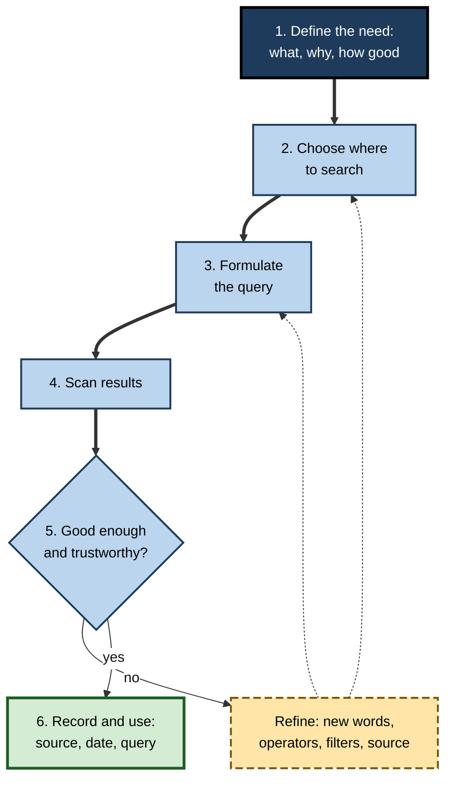
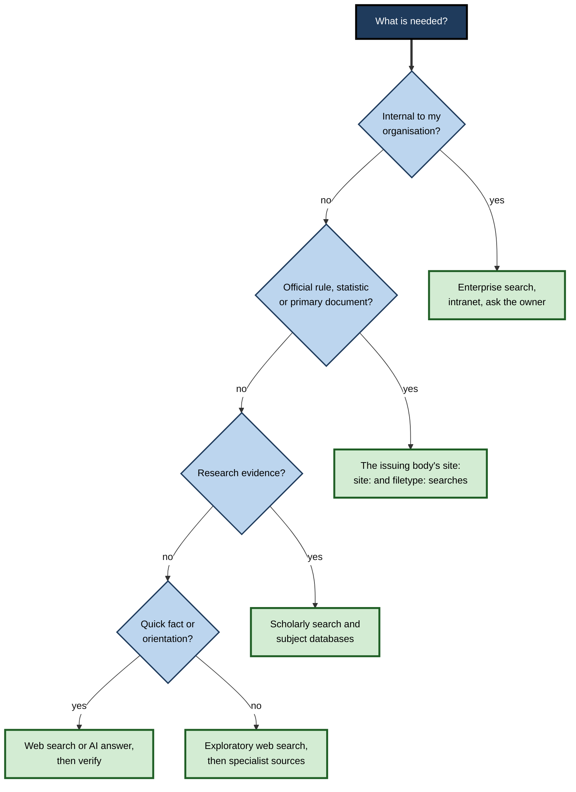
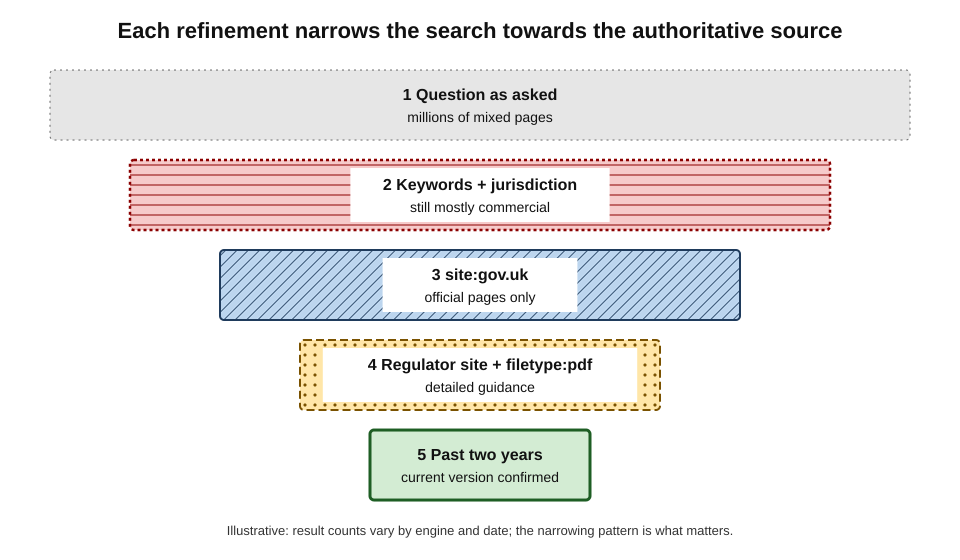
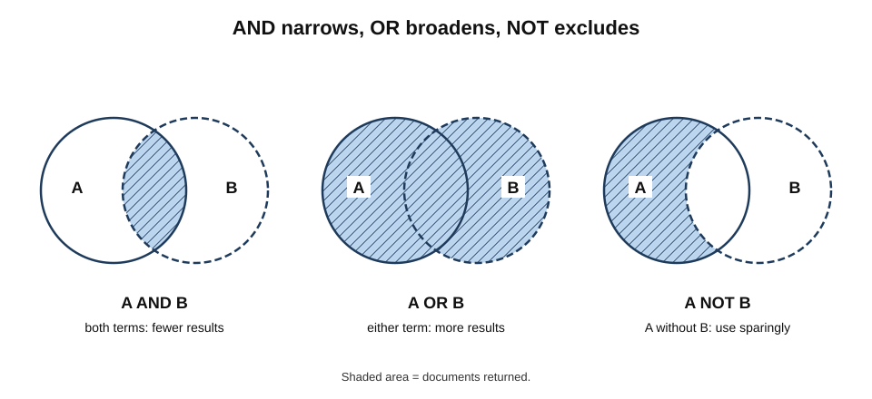
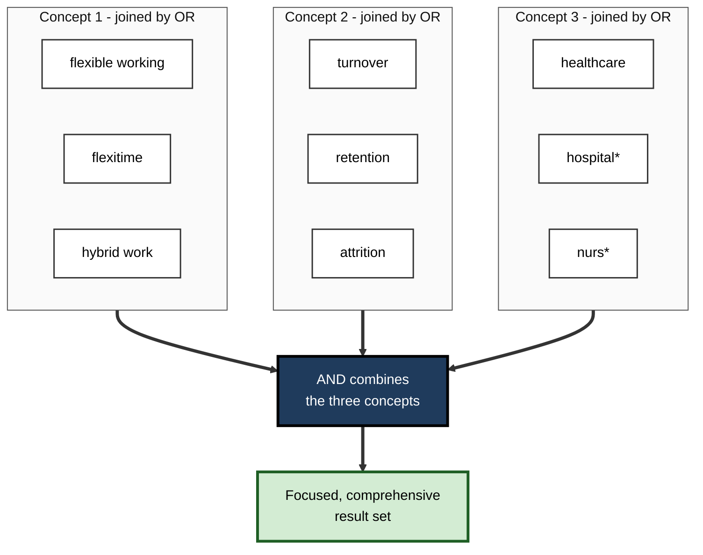
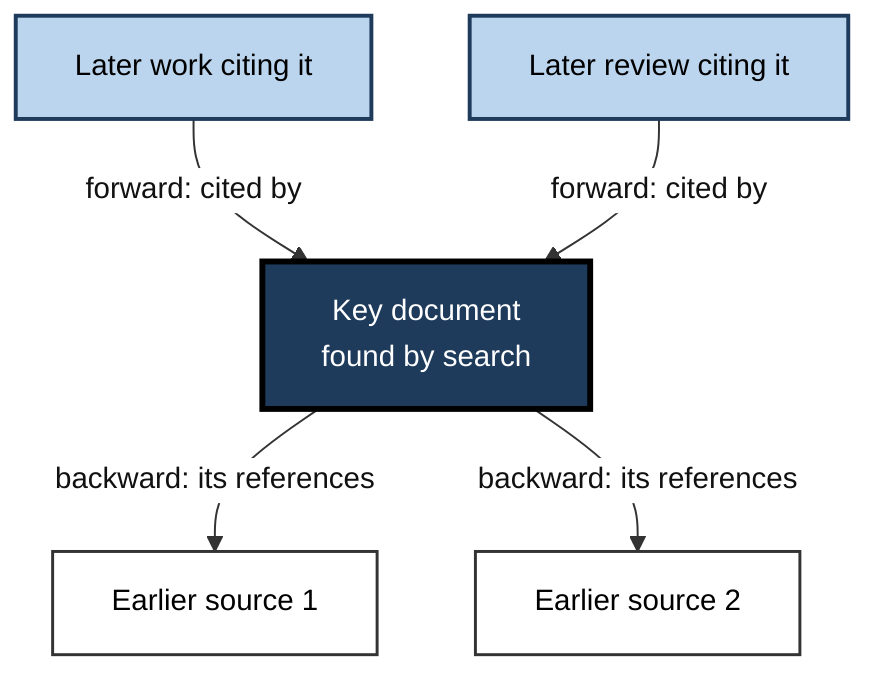

# C.8. Effective Search Techniques

Two colleagues are asked what the latest government guidance says about retaining employee records. One types the question into a search box, skims blogs and law-firm marketing, and an hour later reports an answer from a five-year-old article.

The other searches the government's own site for the right document type, filters to the past two years and finds the official guidance in four minutes. The difference is not intelligence or luck but **technique**.

> **Definition — Search technique:** a deliberate method for expressing an information need as queries, choosing where to search, and refining queries and sources until the need is met with acceptable confidence and effort.

**Why it matters**

- **Time** — knowledge workers search many times a day; small gains in efficiency compound.
- **Quality** — technique determines whether the best source is found or merely the most visible one.
- **Defensibility** — professionals often need to show *how* they found something, not only *what*.
- **AI era** — generated answers are only as good as the question and the checking; search skill remains the foundation.

---

## The Search Process

### Searching is iterative

Early models of information retrieval assumed a fixed question answered by a single query. Studies of real searchers showed something different.

- **Marcia Bates (1989), "berrypicking"** — searchers gather useful pieces from many sources, and their question **changes** as they learn; each query is shaped by what the previous one revealed.
- **Carol Kuhlthau (1991), the information search process** — searchers move through stages from uncertainty to focus, and feelings of confusion early in a search are normal, not a sign of failure.
- **Gary Marchionini (2006), lookup and exploratory search** — distinguishes quick **lookup** (a fact, an address) from **exploratory** search (learning about a topic, investigating), which needs different tactics.

> **Definition — Berrypicking:** a model of searching in which the user gathers information bit by bit from varied sources, with the query evolving as understanding grows.

> **Key point:** expect to **refine**. The first query is a probe that teaches the searcher the vocabulary, the main sources and the shape of the topic.

**Figure 1.** The iterative search process.

### Step 1: define the need

Before typing, answer three questions:

- **What exactly is needed?** A fact, a definition, a procedure, an overview, evidence for a decision, the original document?
- **What will it be used for?** A casual decision, a client deliverable, a legal filing?
- **What counts as good enough?** Authority required, recency required, jurisdiction, language, level of detail.

> **Example:** "Find out about remote-work tax rules" becomes "Find the official guidance on whether employees in India working remotely for a UK employer create a permanent establishment for corporate tax, published in the last three years."

---

## Choosing Where to Search

The general web engine is only one of many sources — and often not the best.

**Figure 2.** Choosing a source according to the kind of information needed.

| Source | Strengths | Weaknesses | Best for |
|---|---|---|---|
| General web search | Breadth, speed, freshness | Commercial and optimised content crowd the top | Orientation, known sites, recent events |
| Official sites (government, regulators, standards bodies) | Authority, primary documents | Poor internal search, complex structure | Rules, statistics, guidance |
| Scholarly search and databases | Peer-reviewed research, citation links | Paywalls, technical language | Evidence, methods, literature |
| Specialist databases (legal, patents, company filings, medical) | Controlled vocabulary, structured fields | Subscription cost, learning curve | Professional research |
| AI answer engines | Fast synthesis, natural language | Errors, misattributed sources | First orientation, drafting questions, summarising known sources |
| People (colleagues, librarians, experts) | Context, judgement, tacit knowledge | Availability | Internal know-how, where to look |

> **In practice:** expert researchers often go **directly to the authoritative source** — the regulator, the statistical office, the standards body — and search within it, rather than hoping a general search will surface it.

---

## Choosing the Words

### Think like the document, not the question

- **Use the words the answer would contain.** A page explaining a fault code contains the code; a contract template contains "agreement", "party", "clause".
- **Prefer distinctive nouns** — product names, error codes, legal terms, place names — over common verbs.
- **Use the expert's vocabulary.** A clinical source says "myocardial infarction", a lawyer says "constructive dismissal", an engineer says "thermal runaway".
- **Add context words** that the right document would contain and wrong ones would not ("guidance", "consultation", "annual report", "specification").
- **Drop filler** — "how do I find out about" adds nothing in keyword search.

> **Watch out:** modern engines handle natural-language questions well, but a question phrased as an opinion ("why is X bad?") retrieves pages arguing that X is bad. **Neutral wording** retrieves a wider range of views.

### Discovering vocabulary

- Scan the **first results** for terms experts use, then requery with them.
- Look at **headings** and **definitions** in an authoritative page.
- Use the **related searches** and "People also ask" sections as vocabulary hints.
- In databases, use the **controlled vocabulary** (subject headings) rather than guessing synonyms.

> **Definition — Controlled vocabulary:** a fixed list of preferred subject terms used to index a database consistently, such as Medical Subject Headings (MeSH) in medical literature databases.

---

## Search Operators

Operators give precise control over what an engine matches. Support differs between engines and changes over time; the most stable are listed first.

### Core operators

- **Quotation marks — exact phrase.** `"duty of care"` matches the phrase, not the separate words.
  - Also forces an engine to include a word it might otherwise treat as optional.
- **Minus — exclude.** `jaguar -car` removes pages mentioning cars.
- **OR (capitals) — either term.** `"annual leave" OR "holiday entitlement"`.
- **Parentheses — group** (supported by many engines): `(contractor OR freelancer) "IR35"`.
- **site: — restrict to a domain or part of one.** `site:gov.uk "data retention"`; `site:ac.uk`; `site:who.int`.
- **filetype: — restrict to a file format.** `filetype:pdf`, `filetype:xlsx`, `filetype:pptx`.
- **intitle: — word in the page title.** `intitle:"consultation response"`.
- **inurl: — word in the address.** `inurl:policy`.
- **before: and after: — publication date (Google).** `after:2024-01-01`.
- **Asterisk inside quotes — wildcard word.** `"the * of the matter"`.

**Operators that no longer work as many guides claim**

- **Plus sign** (`+word`) — removed by Google in 2011; quotation marks replaced it.
- **Tilde** (`~word`) for synonyms — removed; synonyms are applied automatically.
- **cache:** — Google removed links to cached pages in 2024; web archives are now the route to old versions.
- **link:** — finding pages that link to a page was retired years ago.

> **Watch out:** search guides copy one another, so outdated operator lists circulate for years. Test an operator on a known example before relying on it, and expect engines to **ignore** operators occasionally when they judge it helpful.

| Operator | Google | Bing | DuckDuckGo |
|---|---|---|---|
| "exact phrase" | Yes | Yes | Yes |
| -exclude | Yes | Yes (also NOT) | Yes |
| OR | Yes | Yes | Yes |
| site: | Yes | Yes | Yes |
| filetype: | Yes | Yes | Yes |
| intitle: | Yes | Yes | Yes |
| before:/after: dates | Yes | Use date filter | Use date filter |
| Shortcuts to other sites | — | — | "Bangs", for example `!w` for Wikipedia |

### Search tools and filters

- **Time range** — past day, week, year or a custom range; essential for current rules and prices.
- **Verbatim mode** (Google) — turns off automatic synonyms and corrections, so the exact words are matched.
- **Region and language** — results from a specific country or in a given language.
- **Result type** — news, images, videos, shopping, books, scholarly.
- **Image filters** — size, colour, type, and **usage rights** such as Creative Commons licences.

### Worked example (illustrative): from vague question to precise query

A human-resources adviser in the UK needs official guidance on how long to keep employee records.

| Attempt | Query | What happened |
|---|---|---|
| 1 | `how long should I keep employee records` | Blogs, software vendors and law-firm articles of mixed age; some about other countries |
| 2 | `employee records retention period UK` | Better, but still dominated by commercial pages |
| 3 | `site:gov.uk employee records retention` | Official government pages, including a short guidance page |
| 4 | `site:ico.org.uk "retention" employment records filetype:pdf` | The data-protection regulator's detailed employment guidance |
| 5 | Same query, filtered to the past two years | Confirms the current version and any recent updates |

1. The first query described the **asker's situation**, retrieving content written to attract such askers.
2. Adding the jurisdiction narrowed scope; restricting to **official domains** changed the kind of source entirely.
3. Naming the **regulator** and file type found the authoritative document.
4. The date filter guarded against superseded guidance.

> **Remember:** **who would publish the authoritative answer?** Search **their** site, in **their** vocabulary, for **their** document type, within the **right dates**.

**Figure 3.** How successive refinements narrow a broad search to the authoritative source (illustrative result counts).

---

## Boolean Logic and Database Searching

Specialist databases — legal, medical, patent, academic, company filings — reward systematic queries.

### Boolean operators

- **AND** — both concepts must appear; narrows.
- **OR** — either term; broadens, used for synonyms.
- **NOT** — excludes; use sparingly, because it can remove relevant items that mention the excluded term in passing.

**Figure 4.** The effect of AND, OR and NOT on two sets of results.

### The building-blocks strategy

1. **Split the question into concepts.** "Does flexible working reduce staff turnover in healthcare?" → *flexible working*, *turnover*, *healthcare*.
2. **List synonyms for each concept** — joined by OR inside parentheses.
3. **Combine concepts with AND.**
4. **Add truncation and proximity** where supported.

> **Example:** `("flexible working" OR "flexitime" OR "remote work" OR "hybrid work") AND (turnover OR retention OR attrition) AND (healthcare OR hospital* OR nurs*)`

**Figure 5.** The building-blocks strategy: synonyms joined by OR within each concept, concepts joined by AND.

### Database features worth knowing

- **Truncation** — `nurs*` matches nurse, nurses, nursing.
- **Proximity** — `NEAR/5` or similar finds terms within five words of each other.
- **Field searching** — restrict to title, abstract, author, date, jurisdiction or court.
- **Subject headings** — the database's controlled vocabulary, which catches items using different words.
- **Saved searches and alerts** — rerun automatically and notify of new items.
- **Search history** — combine earlier searches by number (`#1 AND #2`).

> **In practice:** in **systematic reviews** — formal syntheses of all research on a question, as in medicine and policy — search strategies are written down in full, run across several databases and reported so that others can reproduce them. Professionals in law, audit and due diligence adopt the same discipline for defensibility.

### Citation chaining

- **Backward chaining** — follow the references of a good document to earlier sources.
- **Forward chaining** — find later documents that cite it ("cited by" in scholarly search engines).
- **Similar items** — "related articles" features based on shared references or text.

**Figure 6.** Citation chaining from one strong source to earlier and later work.

> **Definition — Citation chaining (pearl growing):** expanding a search from one highly relevant document by following its references and the later works that cite it.

---

## Specialised Techniques

### Finding documents and data

- **Official reports** — `site:` the issuing body plus `filetype:pdf` plus a distinctive phrase from the report's likely title.
- **Spreadsheets and data** — `filetype:xlsx` or `filetype:csv` with the topic; statistical offices' own data portals.
- **Presentations** — `filetype:pptx` for conference slides with figures.
- **Company information** — annual reports on investor-relations pages; official company registers for filings.

### Searching with images

- **Reverse image search** (such as Google Lens, Bing Visual Search or TinEye) finds where an image appears online and earlier versions of it.
  - Uses: checking whether a "breaking news" photo is old, finding the source of a chart, identifying a product or plant.
- **Image search with filters** — usage rights for presentations; size for print quality.

### Searching inside sites, pages and files

- **When a site's own search is weak**, `site:` on a general engine is often better.
- **Find in page** (Ctrl+F) in long documents and PDFs; search for the defined term or the section number.
- **Search the address bar history** for pages already seen.

### Searching inside organisations

- Enterprise search tools support field queries similar to web operators — for example author, file type, date and site restrictions in Microsoft 365's Keyword Query Language, or `from:` and `in:` modifiers in team-chat tools.
- **Search where the record lives** — the system of record (HR system, contract repository) rather than copies in email.
- **Search by owner** — finding the person responsible is often faster than finding the document.

> **Example:** in a Microsoft 365 environment, `author:"Priya Shah" filetype:pptx "pricing"` narrows a search across SharePoint and OneDrive to pricing presentations by one colleague.

---

## Searching With AI Assistants

AI answer engines change how a search starts but not what makes it trustworthy.

- **Good uses**
  - Getting **orientation** on an unfamiliar topic and its vocabulary.
  - Generating **search terms and synonyms** for a database search.
  - Summarising or comparing **sources the user has already identified**.
- **Good practice**
  - State the **constraints** — jurisdiction, date range, type of source, level of detail.
  - Ask for **sources** and open them; check that each cited source actually says what the answer claims.
  - Use traditional search for **primary documents**, exact wording and the latest versions.
- **Limits**
  - Answers can be fluent and wrong; citations can be misattributed or invented.
  - Coverage of recent changes, paywalled sources and specialist databases is uneven.

> **Key point:** use AI to **think about the search**, and traditional search to **find and verify the source**. The professional is accountable for the source, not the summary.

---

## Recording and Stopping

### Knowing when to stop

- **Saturation** — new searches keep returning the same sources.
- **Sufficiency** — the need defined at the start has been met at the required standard.
- **Diminishing returns** — further effort is unlikely to change the decision.

### Keeping a search log

For work that may be challenged — legal research, audit, procurement, regulatory submissions, academic work — record:

- **date** of the search;
- **source** searched (engine or database);
- **query** exactly as typed, including operators and filters;
- **results** used, with their addresses and access dates;
- **notes** on what was excluded and why.

> **Remember:** a search that cannot be **repeated** cannot be **defended**.

---

### Case study (illustrative): due diligence under time pressure

- **Situation:** a consultant had one afternoon to assess the regulatory history of a mid-sized food manufacturer before a client meeting.
- **Problem:** general searches for the company's name returned its own marketing pages, recruitment sites and directory listings.
- **Actions:**
  1. **Defined the need:** enforcement actions, product recalls, court cases and significant news in the last ten years.
  2. **Went to authoritative sources:** the national food regulator's recall list (searched with `site:` and the company name), the official company register for filings and directors, and court-judgment databases.
  3. **Used exact names and variants:** the registered company name in quotes, trading names joined by OR, and the names of the two directors.
  4. **Excluded noise:** `-jobs -careers -vacancies`.
  5. **Dated the search:** news filtered to the past ten years; regulatory notices checked for the latest updates.
  6. **Reverse-searched** a factory photograph from the company's site, finding it was a stock image — a minor but telling point.
  7. **Logged** every query and source.
- **Result:** the consultant found two product recalls, a resolved labelling enforcement notice and a director's previous dissolved company, all from primary sources, and could show exactly how they were found.
- **Side effects / caveats:** absence of findings in some databases did not prove absence of issues; the report stated the sources covered.
- **Lesson:** technique converts an unfocused afternoon into a **defensible** finding: authoritative sources, exact names, structured exclusion, dates and a log.

---

## Common Search Mistakes and Their Fixes

| Mistake | Why it fails | Fix |
|---|---|---|
| Typing the question exactly as it occurred | Retrieves pages written to attract askers, often commercial | Use the words the answer would contain; name the authoritative publisher |
| Too many words | Engines treat some terms as optional and dilute focus | Keep distinctive terms; add others only if results are too broad |
| Too few words | Ambiguous terms return the wrong sense ("Mercury", "Java") | Add context words or a field ("Mercury planet atmosphere") |
| Ignoring dates | Superseded rules, prices and guidance rank well for years | Time filters; `after:`; check the page's own date |
| Ignoring jurisdiction | Advice for another country looks authoritative | Add the country, a national domain, or the regulator's name |
| Stopping at the first page that agrees | Confirmation bias | Search for the opposite view or for criticism of the source |
| Repeating the same query | The same index returns the same results | Change vocabulary, source or engine |
| Trusting a summary of a document | Summaries omit qualifications | Find and read the primary document |

> **Watch out:** searching to **confirm** an existing belief ("evidence that remote work improves productivity") retrieves supporting pages; searching **neutrally** ("remote work productivity evidence review") retrieves the range of findings.

---

## Searching Across Languages and Regions

- **Results differ by country.** Engines tailor results to location and language; the same query in another country can return different laws, prices and sources.
- **Regional engines** dominate some markets — Baidu in China, Yandex in Russia, Naver in South Korea — and index local sources better than global engines.
- **Searching in the source language** often finds primary documents that never appear in translation.
- **Machine translation** of foreign pages is now good enough to read primary sources in many languages, though legal and technical nuance should be checked.
- **Region settings** in search tools allow results "as seen" from another country.

> **In practice:** a market analyst researching a competitor in Germany searches in German, on the company's German site and in the German company register, then translates the key documents — finding filings and local press that English-language searches miss.

---

## Searching for Numbers and Statistics

- **Go to the producer** — national statistical offices, central banks, international organisations and regulators publish official figures with definitions.
- **Search for the table, not the headline** — "table", "dataset", "release" and the statistic's official name retrieve data rather than commentary.
- **Check the definition** — "unemployment", "inflation", "revenue" and "users" each have several definitions; figures are comparable only if definitions match.
- **Check the date and revisions** — statistics are revised; the latest release may differ from the figure quoted in an older article.
- **Record the exact source** — table name, release date and the address of the data file.

> **Remember:** a number found in an article is a **claim about a statistic**; the statistic itself lives with its producer, together with its definition and date.

---

## Open Questions

- **Will operators survive AI search?**
  - Conversational interfaces handle intent well but often ignore precise constraints; whether engines will preserve exact control is uncertain.
- **How much should searchers rely on automatic interpretation?**
  - Synonym expansion and spelling correction help most users but can override deliberate wording.
- **Can search be made reproducible?**
  - Personalisation, location and constant ranking changes mean the same query can return different results to different people on different days.
- **How should search skill be taught when answers are generated?**
  - If users rarely see result lists, the skills of scanning and comparing sources may weaken.

---

## Summary

- **Search is iterative:** berrypicking (Bates, 1989), stages of uncertainty to focus (Kuhlthau, 1991), and lookup versus exploratory search (Marchionini, 2006).
- **Define the need** first — what, for what purpose, to what standard.
- **Choose the source:** official sites, scholarly and specialist databases, enterprise search, people and AI each suit different needs.
- **Choose the words** the answer would contain; use expert vocabulary and neutral phrasing.
- **Core operators:** quotes, minus, OR, parentheses, `site:`, `filetype:`, `intitle:`, `inurl:`, `before:`/`after:`; some old operators no longer work. Use **time, verbatim, region and usage-rights** filters.
- In databases use **Boolean logic**, the **building-blocks** strategy, truncation, proximity, fields, subject headings and **citation chaining**.
- Specialised tactics: finding documents and data by type, **reverse image search**, site search through general engines, enterprise field queries.
- Use AI assistants for orientation and vocabulary; use search to find and **verify** primary sources.
- Know when to stop, and **log** searches that may be challenged.

---

## Self-Check

1. What is berrypicking, and how does it differ from the idea of a single perfect query?
2. Distinguish lookup search from exploratory search, with an example of each.
3. What three questions define an information need?
4. Why might a general web search be a poor first choice for an official statistic?
5. Explain "think like the document" with an example.
6. Write a query to find PDF reports on supply-chain emissions from the UK government published since 2024.
7. Which once-common operators no longer work in Google, and what replaced them?
8. What does Verbatim mode do, and when is it useful?
9. Explain the building-blocks strategy and apply it to "effects of four-day working weeks on productivity in software firms".
10. Why should NOT be used sparingly in database searches?
11. Distinguish backward and forward citation chaining.
12. Give two professional uses of reverse image search.
13. When is an AI answer engine a good starting point, and what must follow?
14. What should a search log contain, and why does it matter?
15. In the due-diligence case, which techniques made the findings defensible?

### Answer Key

1. Gathering information piece by piece from varied sources, with the question evolving as the searcher learns. It replaces the assumption that a fixed question is answered by one query.
2. Lookup: finding a known item quickly, such as a supplier's phone number. Exploratory: learning about a topic or investigating, such as understanding the market for heat pumps.
3. What exactly is needed; what it will be used for; what counts as good enough (authority, recency, jurisdiction, detail).
4. The top results are often secondary, commercial or out-of-date pages that are well optimised; the statistical office's own release is authoritative and may rank lower.
5. Use the words the target document contains rather than the asker's question — for example "error 0x80070005 access denied" instead of "why won't my update install".
6. For example: `site:gov.uk "supply chain" emissions filetype:pdf after:2024-01-01` (using a date filter where `after:` is unsupported).
7. The plus sign (replaced by quotation marks), the tilde for synonyms (now automatic), `cache:` (removed in 2024; use web archives) and `link:` (retired).
8. It turns off automatic synonyms, spelling corrections and personalised reinterpretation, matching the words as typed — useful for exact technical terms, names and codes.
9. Split into concepts, OR synonyms within each, AND across concepts: `("four-day week" OR "4-day week" OR "compressed hours") AND (productivity OR output OR performance) AND (software OR "technology compan*" OR developer*)`.
10. NOT removes every item mentioning the excluded term, including relevant items that mention it only in passing.
11. Backward: following a document's references to earlier work. Forward: finding later works that cite it.
12. Checking whether a news or social-media photo is old or from elsewhere; finding the original source of a chart or image to verify it or obtain permission.
13. For orientation, vocabulary and summarising known sources. It must be followed by locating and reading the primary sources and checking that cited sources say what the answer claims.
14. Date, source, exact query with operators and filters, results used with addresses and access dates, and exclusions with reasons. It makes the search repeatable and defensible.
15. Defining the need, going to authoritative primary sources, exact names and variants with OR, exclusions, date filtering, reverse image search, stating coverage limits and logging every query.

---

## Glossary

| Term | Meaning |
|---|---|
| Berrypicking | Gathering information from many sources as the question evolves. |
| Boolean operators | AND, OR and NOT, used to combine search terms logically. |
| Building-blocks strategy | Grouping synonyms with OR within concepts and combining concepts with AND. |
| Citation chaining | Following a document's references and the works that cite it. |
| Controlled vocabulary | A fixed set of preferred subject terms used to index a database. |
| Exploratory search | Searching to learn about or investigate a topic. |
| filetype: | An operator restricting results to a file format. |
| intitle: | An operator requiring a word in the page title. |
| Lookup search | Searching for a specific known item or fact. |
| Proximity operator | An operator requiring terms within a set distance of each other. |
| Reverse image search | Searching with an image to find where it appears. |
| Search log | A record of searches run, for reproducibility. |
| Search operator | A symbol or keyword that modifies how a query is matched. |
| site: | An operator restricting results to a domain. |
| Systematic review | A formal, reproducible synthesis of all research on a question. |
| Truncation | A symbol (often *) matching all endings of a word stem. |
| Verbatim mode | A setting matching the exact words typed, without automatic changes. |
