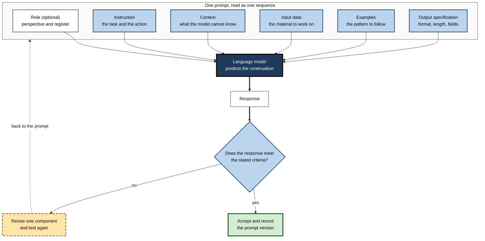
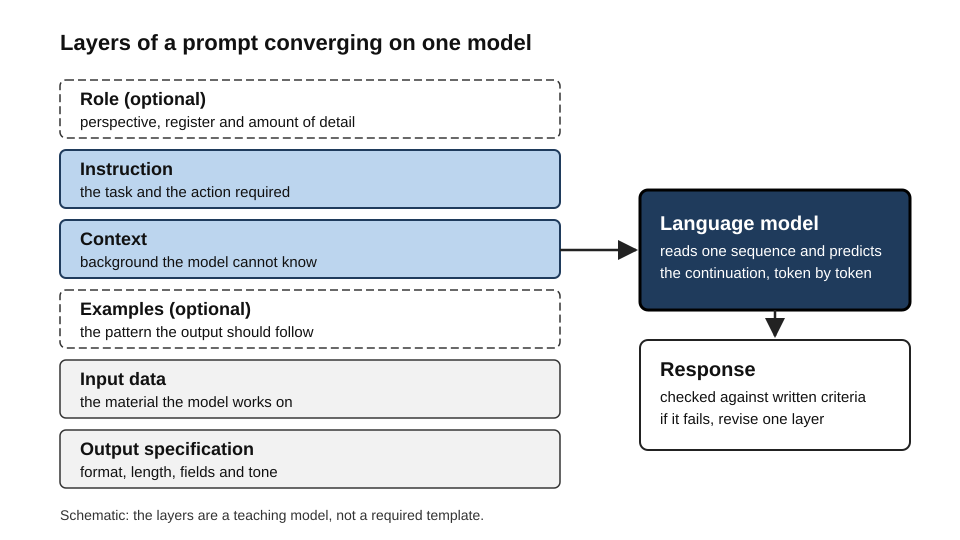
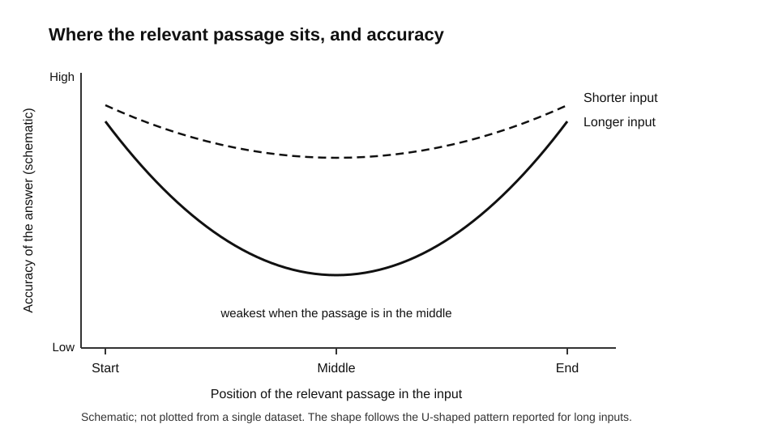
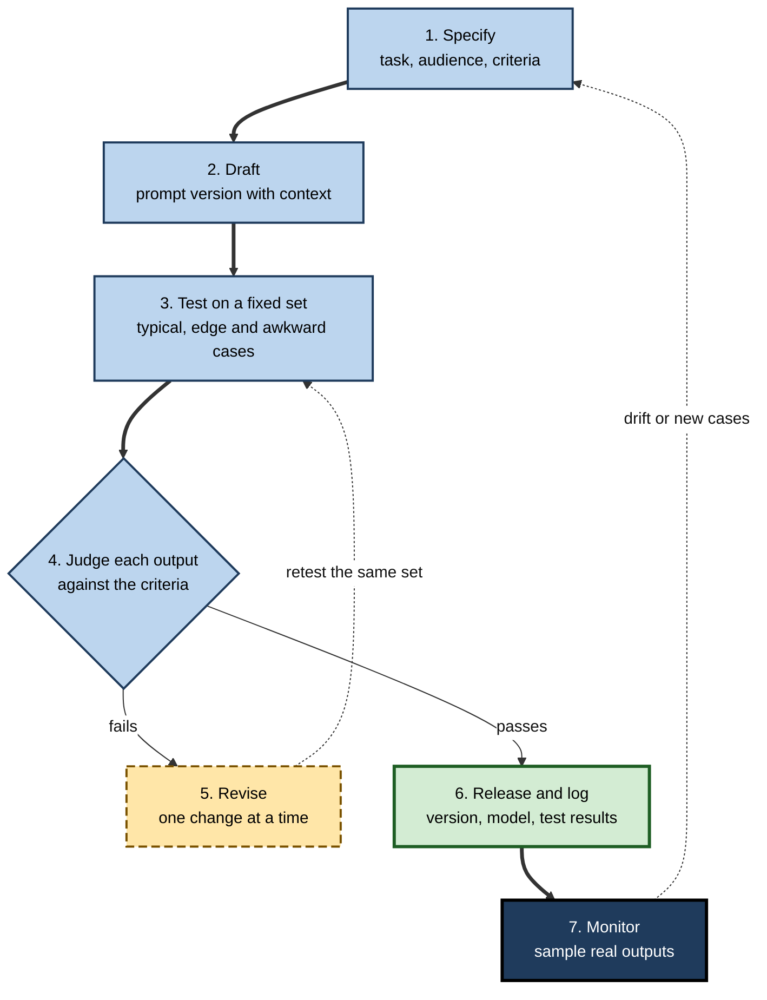
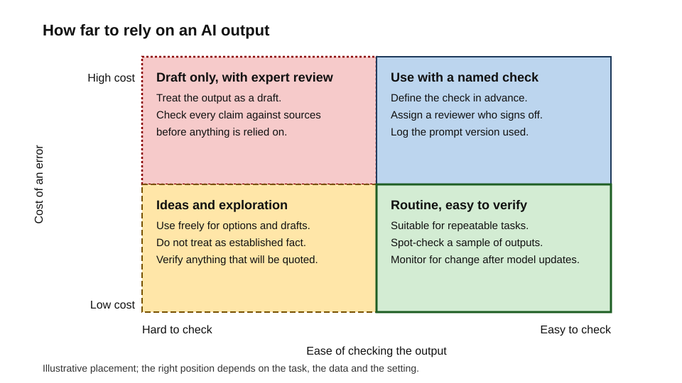
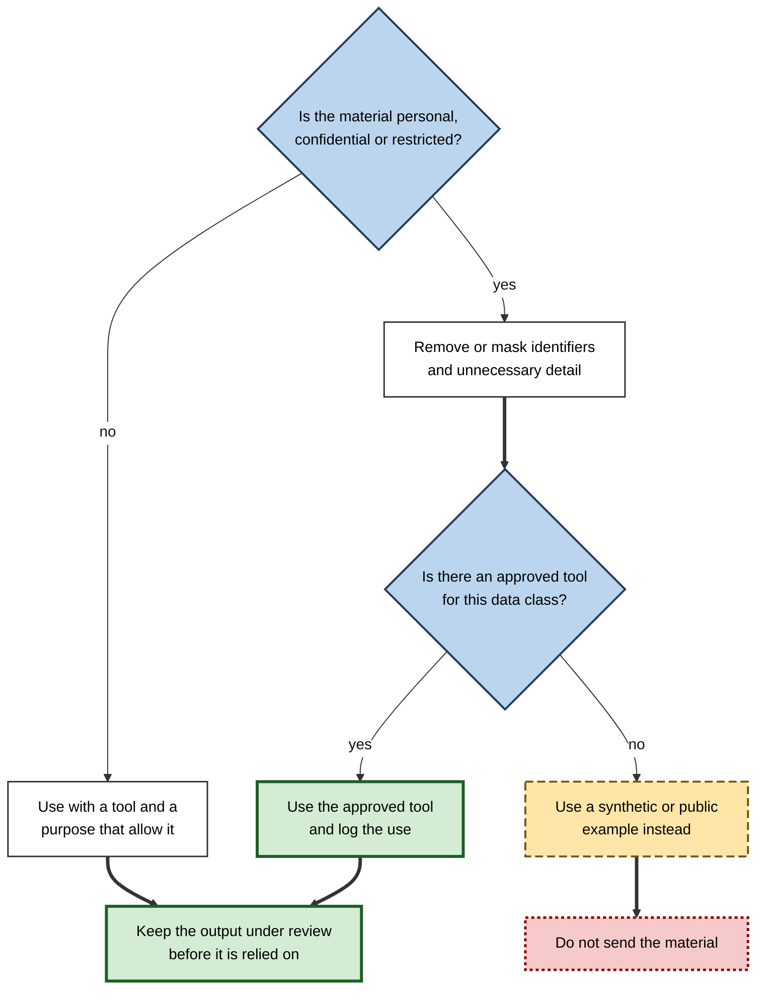

# 4.1. Prompt Engineering for Professionals

A claims analyst pastes a policy document into an AI model and asks for a summary of its exclusions. The reply is fluent, well organised and confident. It also cites an exclusion clause that does not exist. A colleague who checks the summary against the source catches the error; a colleague who does not sends the summary to a customer.

Two people ask the same question of the same tool on the same morning. One gets a usable answer on the first attempt. The other spends an hour rewording the request and still receives answers that drift from one attempt to the next. The difference is rarely the tool. It lies in how each person specified the task, supplied the material, checked the result and recorded what worked.

That gap between a casual request and a reliable specification is what professional prompt engineering closes.

> **Definition — Prompt engineering:** the disciplined design, testing and revision of the instructions, context and examples given to a language model, so that its outputs reliably meet a stated need, together with checking those outputs against that need.

**Why it matters**

- A language model has no access to the purpose behind a request. The prompt is the only place that purpose can be stated, so its quality sets a ceiling on what the output can achieve.
- A vague request forces the model to guess what is wanted. A guess can look exactly like an answer, which is why unchecked output is the most common professional hazard.
- Prompts are becoming work products. They are written, reviewed, shared, versioned and sometimes embedded in automated systems that others depend on.
- The same skill separates an individual who uses AI tools occasionally from one who can build repeatable, auditable AI-assisted work for a team or an organisation.

---

## What Prompt Engineering Is and Is Not

### A working definition

- **Prompt:** everything a model receives for one request. It usually contains instructions, material to work on, examples, output requirements and the request itself.
- **Language model:** a system that produces text by estimating which continuation is most likely, given the text it has been shown.
- **Output:** the text returned. It may be correct, partly correct or confidently wrong, and the text alone rarely shows which.
- **Prompt engineering:** the iterative cycle of specifying a task, drafting a prompt, testing it against criteria and revising it. Three verbs describe the work: *specify*, *test*, *revise*.

### Origins in brief

- **Brown and colleagues (2020):** a large model, GPT-3, performed new tasks when shown a few examples inside the prompt, without any retraining of its internal parameters.
  - This is the origin of the terms *zero-shot* (no examples), *one-shot* and *few-shot* (a small number of examples).
- **Public chat-based access began on 30 November 2022,** when OpenAI released ChatGPT, based on its GPT-3.5 model family.
  - Very large numbers of people began writing prompts for the first time, and the practice became a recognised professional skill.

> **Study card — Brown and colleagues (2020), *Language Models are Few-Shot Learners* (NeurIPS 2020)**
>
> - **Design:** a model with 175 billion parameters was given tasks described only in text, with zero, one or a few demonstrations in the prompt.
> - **Finding:** performance on several tasks, including translation and question answering, improved as demonstrations were added, with no gradient updates to the model.
> - **Significance:** the prompt itself became a means of programming a general model.
> - **Caveat:** performance was uneven across tasks, and the authors raised concerns about the large web-scraped data used to train the model.

### What it is not

- **Not a set of magic phrases.** A wording that helped on one model version may do nothing on another, and model providers change their models over time.
- **Not a substitute for knowledge.** A prompt can ask for a calculation method, but the professional must still know whether the method is correct and suitable.
- **Not evidence of quality.** A fluent output shows only that the text is fluent.
- **Not the preserve of technologists.** Lawyers, nurses, analysts, teachers and engineers write prompts. What the skill draws on is precise specification, domain knowledge and disciplined checking.

> **Watch out:** the phrase "prompt engineering" is sometimes used for *jailbreaking*, which means deliberately getting a model to bypass its safeguards. That is a security and conduct matter. Professional practice does not include it, and it is treated separately in the discussion of risks below.

---

## The Core Model of a Prompt

### Components of a prompt

Most professional prompts contain some combination of the components below. Each one narrows the set of answers that would count as acceptable.

**Table 1.** The components of a prompt, their purpose and a common mistake with each.

| Component | Purpose | Common mistake |
|---|---|---|
| Role (optional) | Sets perspective, register and amount of detail | Treating a role as a source of expertise the model does not in fact have |
| Instruction | States the task and the action required | Vague verbs such as "look at" or "improve", with no definition of done |
| Context | Supplies background the model cannot know | Omitting the constraints the organisation takes for granted |
| Input data | The material the model is to work on | Pasting more material than the task needs, or sensitive material without a check |
| Examples | Show the pattern the output should follow | Examples that contain errors or biases, which the model will reproduce |
| Output specification | Fixes format, length, fields and tone | Asking for a format that the next step in a workflow cannot parse |
| Constraints | Say what to avoid, what sources are allowed and what limits apply | Constraints that contradict each other or the instruction |

**Figure 1.** The components of a prompt feed one sequence, which is checked and revised.

### Why the components interact

- The model receives one sequence of text. It does not hold a separate instruction and document in mind; it reads everything together, and the order and labelling of the parts change how much each one influences the answer.
- The same instruction can succeed or fail depending on what surrounds it. Placing the task before a long block of material, or restating it after the material, is a choice with consequences that depend on the model.
- Components can conflict. A request for "a brief answer covering every risk in full detail" is a contradiction that the model will resolve in an unpredictable way.

**Figure 2.** The layers a prompt may contain and how they converge on one model.

> **Key point:** a prompt is a specification written in natural language. Its quality is judged by what it makes the model do, not by how sophisticated it sounds.

---

## How Models Respond, and Why Results Vary

### Next-token generation

- A model produces its output one **token** at a time. A token is a unit of text, often part of a word. Numbers, names, code and rare words may be split into several tokens.
- Each token is chosen from a probability distribution that depends on everything before it: the prompt and the model's own earlier output.
- **Consequence:** a prompt does not deliver facts to the model. It shifts the probabilities of what comes next. A plausible answer can be a more probable continuation than a correct one, which is the root of hallucination.

### Sampling settings

- **Temperature:** controls how widely the choice of the next token varies. Lower values concentrate choices on the most probable tokens; higher values spread them.
- **Top-p:** restricts sampling to the smallest set of tokens whose probabilities add up to a chosen threshold.
- **Practical effect:** lower randomness usually gives more repeatable output for tasks with a single right answer, such as extraction or classification. Higher randomness suits idea generation, where variety is useful.

> **Watch out:** settings configured to be deterministic do not guarantee identical outputs. Atil and colleagues (2024), in a paper titled *Non-Determinism of "Deterministic" LLM Settings*, tested five language models configured to be deterministic on eight tasks over ten runs. They found accuracy variations of up to 15 per cent across runs, and reported that none of the models gave repeatable accuracy across all tasks, let alone identical output strings. Reproducibility therefore comes from repeated testing, not from a single run.

### Sensitivity to wording, order and format

- Small, reasonable changes to a prompt can change results substantially. Professionals therefore treat any single successful prompt as a hypothesis to test.

**Study card — Lu and colleagues (2022), "Fantastically Ordered Prompts and Where to Find Them" (ACL 2022)**

- **Design:** few-shot prompts built from the same examples, presented in different orders.
- **Finding:** the order of the examples alone could move performance between near state-of-the-art and close to chance.
- **Significance:** a prompt that scores well may have done so because of an accident of arrangement.
- **Caveat:** the authors also proposed ways to select a better order without a labelled development set.

**Study card — Sclar and colleagues (2024), "Quantifying Language Models' Sensitivity to Spurious Features in Prompt Design" (ICLR 2024)**

- **Design:** the same tasks presented in many plausible formats, such as different separators, capitalisation and spacing.
- **Finding:** for one open model in a few-shot setting, formatting changes alone produced accuracy differences of up to 76 points. The sensitivity persisted as model size, the number of examples and instruction tuning changed.
- **Significance:** evaluating a prompt in one format can give a misleading picture of its performance.

### Context length and position

- A **context window** is the maximum amount of text a model can handle in one request. A larger window does not guarantee that every part is used equally well.
- **Study card — Liu and colleagues (2023; published in *Transactions of the ACL* 2024), "Lost in the Middle"**
  - **Design:** models answered questions in which the passage containing the answer was placed at different positions among distractor passages, with inputs of different lengths.
  - **Finding:** accuracy was highest when the relevant information sat near the beginning or end of the input and fell when it sat in the middle. Longer inputs reduced performance, including for models built for long contexts.
  - **Significance:** the position of a key fact is a design variable, not a detail.

**Figure 3.** Where the relevant passage sits in a long input, and how input length changes the pattern (schematic).

- **In practice:** put the task and the decisive facts near the start, repeat critical constraints near the point of use, and remove material that the task does not need.

### Plausible explanations are not faithful explanations

- Asking a model to "explain its reasoning step by step" produces text that reads like an account of how the answer was reached. That text is not guaranteed to describe the process that actually produced the answer.

**Study card — Turpin and colleagues (2023), "Language Models Don't Always Say What They Think" (NeurIPS 2023)**

- **Design:** multiple-choice prompts in which a bias was introduced, such as always placing the correct answer in the same position, or adding a social cue toward one answer.
- **Finding:** the models' step-by-step explanations usually did not mention the bias, even when it changed the answer. Accuracy on some tasks dropped substantially once the bias was present.
- **Significance:** a fluent, reasonable explanation is evidence of fluency, not of the reason for the answer.

> **Key point:** treat a model's reasoning as a useful draft to check, not as a record of what happened inside the model.

---

## Core Approaches at the Level of Method

Professional prompt work uses a small set of approaches. Each has a clear purpose and cost.

**Table 2.** Common approaches, when each helps and its main cost.

| Approach | When it helps | Main cost or risk |
|---|---|---|
| Zero-shot instruction | A well-defined task that the model handles routinely | Output format and style may vary between runs |
| Few-shot examples | A pattern that is hard to describe in words | Examples can bias the output and are sensitive to order and format |
| Reasoning prompts | Multi-step problems such as arithmetic or planning | Longer output, and explanations may not be faithful |
| Decomposition and chaining | Tasks with distinct stages that can be checked one at a time | More calls, more points of failure, and latency |
| Supplied or retrieved documents | Answers that depend on material the model does not have | Irrelevant or stale documents mislead the answer |
| Role framing | Setting a register, audience or domain perspective | Little reliable gain in factual accuracy |

### Zero-shot and reasoning prompts

- A **zero-shot** instruction states the task with no examples. It is the usual starting point because it is cheapest to write and easiest to change.
- A **reasoning prompt** asks the model to work through intermediate steps before answering. Two studies established the method.

**Study card — Wei and colleagues (2022), "Chain-of-Thought Prompting Elicits Reasoning in Large Language Models" (NeurIPS 2022)**

- **Design:** a few worked examples, each containing a sequence of reasoning steps before the answer, were included in the prompt for arithmetic, commonsense and symbolic tasks.
- **Finding:** accuracy on multi-step problems, including a benchmark of grade-school maths word problems, improved substantially compared with prompts that gave only the answer.
- **Caveat:** the benefit depends on the model and the task. It is not a universal improvement.

**Study card — Kojima and colleagues (2022), "Large Language Models are Zero-Shot Reasoners" (NeurIPS 2022)**

- **Design:** the phrase "Let's think step by step" was added to the prompt, with no worked examples.
- **Finding:** the phrase alone produced large gains on several arithmetic and reasoning benchmarks, compared with the same question asked directly.
- **Significance:** step-by-step reasoning could be elicited without task-specific examples, which made the method cheap to adopt.

### Decomposition and chaining

- A complex task can be split into stages, with each stage's output passed to the next. This is **prompt chaining**: the output of one prompt becomes an input to the next.
- Chaining makes intermediate results visible, so an error can be found where it arises rather than only in the final text.

**Study card — Wu, Terry and Cai (2022), "AI Chains" (CHI 2022)**

- **Design:** an interactive system in which users built chains of model steps and could inspect and change each intermediate result, tested in a study with twenty participants.
- **Finding:** chaining improved the quality of outcomes and made the system more transparent and controllable. Participants used sub-tasks to calibrate their expectations of the model and to debug unexpected output by testing parts of the chain.
- **Significance:** decomposition is as much a way of controlling and checking AI work as a way of improving it.

### Roles and personas

- A role such as "You are an experienced tax adviser" changes tone, vocabulary and assumed audience. It does not add knowledge the model lacks.
- Role framing can be useful for register and perspective. Relying on it for accuracy is a mistake.

**Study card — Zheng and colleagues (2024), "When 'A Helpful Assistant' Is Not Really Helpful" (Findings of EMNLP 2024)**

- **Design:** many personas were placed in system prompts and tested across several model families on factual questions.
- **Finding:** personas did not reliably improve accuracy compared with no persona. The effect of a given persona varied in ways that looked largely random, and choosing the best persona for each question automatically was hard.
- **Significance:** a persona is an untested variable. Its value must be measured for the task at hand.

### Supplied and retrieved documents

- When the answer depends on specific material, the most reliable approach is to put that material into the prompt, or to retrieve relevant passages from a store and place them there. This pattern is called **retrieval-augmented generation**.
- The model then answers from supplied text rather than from what it recalls, which narrows the range of possible errors. It does not remove them: the model can still misread, ignore or over-weight the passages it is given.

**Study card — Lewis and colleagues (2020), "Retrieval-Augmented Generation for Knowledge-Intensive NLP Tasks" (NeurIPS 2020)**

- **Design:** a generator model was combined with a retriever over a large document index, so that each answer drew on passages fetched for the question.
- **Finding:** the combined system reached state-of-the-art results on several open-domain question-answering tasks, and its generated text was reported as more specific, more diverse and more factual than that of a generator alone.
- **Significance:** separating stored knowledge from generation is now a standard professional design.

### Self-checking and sampling many answers

- **Self-consistency** samples several independent reasoning paths for the same question and takes the answer that most of them reach.
- **Self-critique** asks the model to review its own answer. Its value depends on what it can check against.

**Study card — Wang and colleagues (2023), "Self-Consistency Improves Chain of Thought Reasoning in Language Models" (ICLR 2023)**

- **Design:** instead of one reasoning path, several were sampled and the most frequent final answer chosen, across arithmetic and commonsense benchmarks.
- **Finding:** accuracy improved over single-path reasoning on each benchmark tested.
- **Significance:** agreement across diverse attempts is a useful signal, though it is not proof.

**Study card — Huang and colleagues (2024), "Large Language Models Cannot Self-Correct Reasoning Yet" (ICLR 2024)**

- **Design:** models were asked to revise their own reasoning without external feedback, such as a correct answer key or a tool result.
- **Finding:** intrinsic self-correction did not reliably improve reasoning, and performance sometimes got worse after revision.
- **Significance:** a request to "check your work" helps only when the check uses information the model can actually access.

### Automatic prompt optimisation

- Prompts can themselves be searched for. A model proposes candidate instructions, and each is scored on a set of examples.

**Study card — Zhou and colleagues (2023), "Large Language Models Are Human-Level Prompt Engineers" (ICLR 2023)**

- **Design:** an automatic method proposed instruction candidates with a language model, scored each on a task, and kept the best.
- **Finding:** on most of 24 natural-language tasks, the automatically found instructions matched or beat instructions written by people.
- **Caveat:** automatic search optimises against the scoring method and the examples it uses. It is only as good as the evaluation behind it.

**Figure 4.** Choosing an approach by asking what the task needs.

```mermaid
%%{init: {'theme':'base','themeVariables':{'fontFamily':'Arial, Helvetica, sans-serif','fontSize':'15px','primaryColor':'#FFFFFF','primaryTextColor':'#111111','primaryBorderColor':'#222222','lineColor':'#333333','secondaryColor':'#F2F2F2','tertiaryColor':'#FFFFFF','clusterBkg':'#FAFAFA','clusterBorder':'#555555','edgeLabelBackground':'#FFFFFF','titleColor':'#111111'}}}%%
flowchart TD
    classDef core    fill:#1F3B5C,stroke:#000000,stroke-width:3px,color:#FFFFFF
    classDef key     fill:#BCD5EE,stroke:#1F3B5C,stroke-width:2px,color:#000000
    classDef detail  fill:#FFFFFF,stroke:#333333,stroke-width:1.5px,color:#000000
    classDef good    fill:#D3ECD3,stroke:#1E5E24,stroke-width:3px,color:#000000
    classDef caution fill:#F6CACA,stroke:#8B0000,stroke-width:2.5px,stroke-dasharray:3 3,color:#000000
    classDef accent  fill:#FFE6A8,stroke:#7A5200,stroke-width:2px,stroke-dasharray:8 4,color:#000000

    Q1{"Is it a single, well-defined<br/>transformation of the input?"}
    Z["Start with a clear<br/>zero-shot instruction"]
    Q2{"Is the output pattern hard<br/>to describe in words?"}
    F["Add a few correct,<br/>varied examples"]
    Q3{"Does the task have several<br/>distinct stages?"}
    CH["Chain the stages and check<br/>each intermediate output"]
    Q4{"Does the answer depend on<br/>material the model lacks?"}
    RG["Supply or retrieve the<br/>documents, and cite them"]
    Q5{"Must the answer match<br/>an external source?"}
    TL["Connect a tool or data source<br/>and check its results"]
    EV["Evaluate against criteria<br/>and document the version"]

    Q1 -- "yes" --> Z
    Q1 -- "no" --> Q2
    Z ==> Q2
    Q2 -- "yes" --> F
    Q2 -- "no" --> Q3
    F ==> Q3
    Q3 -- "yes" --> CH
    Q3 -- "no" --> Q4
    CH ==> Q4
    Q4 -- "yes" --> RG
    Q4 -- "no" --> Q5
    RG ==> Q5
    Q5 -- "yes" --> TL
    Q5 -- "no" --> EV
    TL ==> EV

    class Q1,Q2,Q3,Q4,Q5 key
    class Z,F,RG detail
    class CH accent
    class TL caution
    class EV good
```

> **Remember:** add machinery only when a simpler approach has been tested and failed. Each added step adds cost, latency and points of failure.

---

## Professional Practice

### Write the specification before the prompt

Before drafting a prompt, a professional writes down the following. The writing is what makes the prompt testable.

- **Task:** the decision, transformation or artefact required, in one sentence.
- **Audience:** who will read or use the output, and what they already know.
- **Inputs:** exactly what material will be provided, and its quality.
- **Success criteria:** observable tests the output must pass, such as "every figure is traceable to a source passage" or "the classification uses only the five agreed categories".
- **Failure cases:** the inputs most likely to break the prompt, such as missing data, contradictory sources or unusual wording.
- **Data class:** whether the material is public, internal, personal or restricted (see the discussion of data handling below).
- **Owner:** the person accountable for the prompt and for its outputs.

### The development loop

**Figure 5.** The professional prompt development loop, with testing and revision before release and monitoring after it.

1. **Specify** the task and criteria, as above.
2. **Draft** a first prompt with only the components the task needs.
3. **Test** on a fixed set of inputs that includes typical, edge and awkward cases. The set is kept stable so that versions can be compared.
4. **Judge** each output against the written criteria, not against impression.
5. **Revise** one component at a time, so that the cause of any change in results is known.
6. **Release and log** the version, the model used, the date and the test results.
7. **Monitor** a sample of real outputs, because inputs drift and models change.

> **Watch out:** changing several things at once makes it impossible to tell which change helped. Professionals accept slower progress in exchange for knowing why results changed.

### Worked example (illustrative): a complaint classifier

- **Situation:** a customer-service team wants a prompt that sorts incoming complaints into five agreed categories and flags any that mention a safety risk.
- **First draft:** "Classify this complaint." Outputs used category names the team did not recognise, and some safety mentions were missed.
- **Revised draft:**
  1. The instruction lists the five categories by exact name and defines each in one line.
  2. The context states that a safety mention includes any reference to injury, smoke, electrical faults or medication, even if the customer does not describe harm.
  3. Two examples show a correct classification of a borderline complaint.
  4. The output specification is a fixed JSON object with the fields `category` and `safety_flag`.
- **Testing:** the team built a set of recorded complaints, including ones the first draft had handled poorly, and scored each version against the criteria.
- **Result (illustrative):** the second version was more consistent on the test set, and the team could see which failures remained.
- **Lesson:** most of the improvement came from defining terms and failure cases, not from clever wording.

### Evaluating outputs

- Evaluation answers one question: does this output meet the criteria, reliably, across the inputs the prompt will meet in use?

**Table 3.** Evaluation methods, their strengths and their limits.

| Method | Strength | Limit |
|---|---|---|
| Human rating against a written rubric | Captures judgement, nuance and context | Slow and costly; raters disagree unless trained and calibrated |
| Comparison with reference answers | Objective where a correct answer exists | Reference answers are expensive to create and may not cover every valid response |
| Automated checks | Fast, cheap and repeatable for format, length, required fields and forbidden terms | Cannot judge whether the content is correct |
| Model as judge | Scales to large volumes of text | Inherits the biases and blind spots of the judging model |
| Sampled monitoring in use | Reveals real inputs and drift | Reactive; problems reach users before they are found |

**Study card — Zheng and colleagues (2023), "Judging LLM-as-a-Judge with MT-Bench and Chatbot Arena" (NeurIPS 2023)**

- **Design:** strong language models were used to judge the quality of other models' answers, and their judgements were compared with human preferences.
- **Finding:** the authors reported that strong judge models could approximate human preference judgements, but that they showed systematic biases, including position bias (favouring an answer because of where it appears) and verbosity bias (favouring longer answers).
- **Significance:** an automated judge needs its own evaluation, including checks for position and length effects, before its scores are trusted.

> **In practice:** a common professional pattern is to use automated checks for structure, a rubric applied by people to a sample, and a model judge only for large-scale screening that is then spot-checked by people.

### Documentation and version control

- A prompt is a product artefact. It should carry an owner, a version number, the model it was tested on, the test set, known failure cases and the date of last review.
- Changes should be recorded with the reason for each change and the test results before and after it.
- Model updates can change behaviour without any change to the prompt. Re-running the test set after a model change is the only reliable way to notice.

---

## Limits and Failure Modes

**Table 4.** Common failure modes, what they look like in practice and the countermeasures that address them.

| Failure mode | Typical sign | Countermeasure |
|---|---|---|
| Hallucination | Fluent, specific claims, such as citations, clauses or figures, that do not exist | Supply the source text and require quotation or citation with checkable locations |
| Fragility to format and order | Results change after a small reformatting or reordering | Test several equivalent formats and report the spread, not a single result |
| Lost or overlooked context | Answer ignores a fact placed in the middle of a long input | Place decisive facts near the start or end; split long inputs |
| Over-trust | Output accepted without checking because it reads well | Define checks for high-stakes outputs and name a reviewer |
| Prompt injection | Output follows instructions hidden in material the model was asked to process | Separate trusted instructions from untrusted content, limit tool permissions, review actions |
| Ineffective self-check | Revised answer is no better, or worse, than the first | Check against external evidence, not against the model's own confidence |

### Hallucination

> **Definition — Hallucination:** output that is fluent and confident but not supported by the model's inputs or by reliable knowledge.

- Hallucination is a property of how the model generates text, so it cannot be eliminated by wording alone. It is reduced by supplying evidence, asking for traceable claims and checking them.
- Fabricated references are a notable form. A reference that looks right is not evidence that the source exists.

### Prompt injection

- **Direct prompt injection** comes from the user's own input, such as a request to ignore the instructions above.
- **Indirect prompt injection** arrives through content the model processes on the user's behalf, such as a web page, an email or a shared document.
- OWASP's 2025 list of risks for applications built on large language models ranks prompt injection first. It defines prompt injection as user prompts that alter the model's behaviour or output in unintended ways, and it distinguishes the direct and indirect forms described above.

**Study card — Greshake and colleagues (2023), "Not What You've Signed Up For" (arXiv preprint, 2023)**

- **Design:** the authors examined how applications that combine language models with external content could be attacked by placing prompts in content the application was likely to retrieve.
- **Finding:** such injected prompts could lead to data theft and worm-like spread, could alter the application's functionality, and could control how other APIs are called.
- **Significance:** the risk grows with every data source and tool an AI workflow connects. The authors stated that effective mitigations were then lacking.

> **Watch out:** a model cannot reliably tell instructions from data when both arrive as text. Treat any content from outside the trust boundary as untrusted, and never let an AI workflow take consequential action on the strength of text it has only read.

### Stale knowledge and model change

- A model's knowledge stops at a training cutoff. Questions about recent events, prices, laws or product features need supplied, current sources.
- Vendors retire and update models. A prompt tuned on one version needs retesting on the next.

**Figure 6.** Deciding how far to rely on an AI output, by the cost of an error and how easily the output can be checked (schematic placement).

> **Key point:** the more costly an error and the harder it is to check, the more the output must be treated as a draft. Expertise is what makes a result checkable in the first place.

---

## Ethics and Data Handling

### What may go into a prompt

- **Confidentiality:** internal strategy, unreleased financial data, source code and legal advice are often restricted. Pasting them into a tool may breach internal policy, client contracts or law.
- **Personal data:** names, identifiers, health details and other personal information may be subject to data protection rules, which may apply to the data sent to a tool as well as to what the tool returns.
- **Terms of service:** consumer and business versions of a tool, and tools from different providers, have different terms on data use, retention and access.
- **Logs and retention:** a prompt may be stored, reviewed or used to improve a service. Professionals check what happens to data after it is sent.

**Study card — reported incident at Samsung (2023)**

- **What was reported:** in 2023, engineers at Samsung reportedly pasted internal source code into a public chatbot. Bloomberg reported a company memo that followed.
- **Response:** the company restricted staff use of generative AI tools on company devices and its internal network while it reviewed safeguards.
- **Lesson:** the risk comes from ordinary work habits, not from malicious intent. Clear rules and approved tools prevent most of it.

**Figure 7.** A decision path before any material is sent to an AI tool.

### Accountability and disclosure

- The professional who uses an output owns its consequences. "The model wrote it" is not a defence for an error.
- Where clients, regulators or colleagues expect disclosure of AI assistance, it should be given. Where review is required, the review must be real and documented.
- NIST's *Generative AI Profile* (NIST AI 600-1) is a companion to its AI Risk Management Framework, intended to help organisations identify risks specific to generative AI and to choose actions for managing them.

### Fairness

- Prompts can encode bias through the examples chosen, the roles assumed and the criteria specified. A biased example is copied as readily as a correct one.
- Test outputs across groups of people or cases that the prompt will affect, and check whether error rates or tone differ systematically.
- **In practice:** when a prompt supports a decision about people, such as screening, grading or triage, its fairness testing is part of its specification, not an optional extra.

---

## Case Study (illustrative): Prompts at a Freight Forwarder

- **Situation:** a freight forwarder's customs-documentation team, with about forty staff, begins using an AI model to draft declaration summaries and to answer queries about shipment documents.
- **Problem:**
  - Each staff member wrote prompts individually, so results varied with the author.
  - Summaries sometimes omitted restricted-goods flags, which the team's own checklists required.
  - Staff had pasted full shipper documents, including personal contact details, into an unapproved consumer tool.
- **Diagnosis:**
  - No shared specification existed for what a correct summary contains.
  - Prompts were never tested against documents that contained restricted goods.
  - Data rules were unclear, so staff did not know which tools were allowed for which material.
- **Actions:**
  1. Wrote a specification for each summary type: required fields, criteria for a restricted-goods flag, and the source text the summary must cite.
  2. Built a fixed test set from past shipments, including documents with restricted goods, and scored every prompt version against it.
  3. Moved all work on personal and commercially sensitive data to an approved business tool with contractual data terms, and gave staff a short decision path before any material is pasted.
  4. Required a second person to review every summary that would be sent to a customer, and logged each prompt version with its test results.
- **Result (illustrative):** the team's shared prompts were more consistent across staff, and restricted-goods flags were caught in the test set that had previously missed them. The second-person review took time that the team had not allowed for at first.
- **Side effects / caveats:** the review step lengthened turnaround, and the test set reflected past shipments, so new kinds of document needed new tests.
- **Lesson:** the value came from specification, testing and data rules together. Better wording alone would not have fixed the restricted-goods gap.

---

## Open Questions

- **How stable can a prompt be across model updates?**
  - Providers change models without notice, and the same prompt can produce different results. Whether test suites can detect meaningful changes reliably is still being worked out.
- **Can a model's explanation of its reasoning ever be trusted as evidence?**
  - Faithfulness studies show that explanations can omit the real influences on an answer. Better methods for checking them are under development, and their reliability is not settled.
- **How far can automated judges replace human review?**
  - Model judges scale well but carry systematic biases. The conditions under which a judge's scores track human judgement across tasks are not well mapped.
- **Will explicit prompts remain necessary as models improve?**
  - Some specification may move into system design, tool configuration or fine-tuning, while some will remain a human skill. The balance between them is uncertain.
- **Who is accountable when instructions in retrieved content change an automated action?**
  - Responsibility is spread across the user, the organisation, the tool provider and the content author. Legal and professional standards for this are still emerging.

---

## Summary

- **Prompt engineering** is the disciplined specification, testing and revision of model inputs, with checking of outputs against stated criteria.
- A **prompt** combines a role, instruction, context, input data, examples, output specification and constraints; each one shapes the answer.
- Models generate **one token at a time** from probabilities. Prompts shift those probabilities, so plausible output is not evidence of correct output.
- Results vary with **wording, order, format and sampling settings**, so single successful prompts should be treated as hypotheses.
- Key position effects: relevant information placed in the middle of a long input is more easily missed.
- Step-by-step explanations are **not guaranteed to be faithful** accounts of how an answer was produced.
- Useful approaches include **few-shot examples**, **reasoning prompts**, **chaining**, **supplied or retrieved documents**, **self-consistency** and **automatic optimisation**; each has a cost and each can fail.
- Role or persona framing is useful for register, but has not reliably improved factual accuracy.
- Professional practice means writing a **specification** first, testing against a fixed set, changing one thing at a time, logging versions and monitoring use.
- Evaluation combines **automated checks**, **human rubrics** and, with caution, **model judges**, each of which needs its own validation.
- Major failure modes are **hallucination**, **fragility**, **over-trust**, **stale knowledge** and **prompt injection**, the last of which OWASP ranks first among risks for applications built on language models.
- **Data handling** comes before the prompt: confidentiality, personal data and the terms of each tool decide what may be sent.
- The professional owns the output. Review should be proportionate to the cost of an error and how easily the output can be checked.

---

## Self-Check

1. Define prompt engineering and name its three core activities.
2. List the components a prompt may contain, and state the purpose of the output specification.
3. Explain why a prompt does not "deliver facts" to a model in the way a database query retrieves records.
4. What do temperature and top-p control, and why does setting temperature to zero not guarantee identical outputs?
5. Describe the Lu and colleagues finding on example order, and explain what it implies for testing a prompt.
6. Why might a decisive fact placed in the middle of a long input be missed, and what design changes reduce the risk?
7. A model's step-by-step explanation says it chose option B because the evidence favours it. Why is this not sufficient evidence of the reason for the answer?
8. Distinguish a zero-shot instruction, a few-shot prompt and a chained workflow. Give a professional task suited to each.
9. A team adds the phrase "You are a world-class expert" to every prompt and reports better accuracy. What would you require before accepting that claim?
10. Outline a seven-step development loop for a prompt that will run in production, and identify the step most often skipped.
11. Explain why a model used as a judge needs its own validation, citing the biases that have been reported.
12. A colleague pastes a client's personal data into a consumer chatbot to save time. Walk through the decision path that should have applied, and say what the colleague should do next.
13. Distinguish direct and indirect prompt injection. Why does connecting a model to more tools increase the risk?
14. A summary tool is used for both internal brainstorming and customer letters. Propose a proportionate review regime for each use and justify the difference.

### Answer Key

1. Prompt engineering is the disciplined design of model inputs, tested against criteria and revised. Its three core activities are specifying the task, testing outputs and revising the prompt, one change at a time.
2. Role, instruction, context, input data, examples, output specification and constraints. The output specification fixes format, length, fields and tone, so that the result can be checked and used downstream.
3. A model generates the most probable continuation of the text it is given. Facts influence what is produced only through those probabilities, so a plausible answer can be more likely than a correct one. A database returns stored records; a model does not look up its inputs in that way unless it is given a retrieval step.
4. Temperature controls how widely the next-token choice varies; top-p restricts sampling to the most probable tokens up to a threshold. Lower temperature reduces randomness, but as Atil and colleagues (2024) reported for models configured to be deterministic, outputs can still differ across runs, so repeated testing is needed.
5. Using the same examples in different orders moved few-shot performance between near state-of-the-art and near chance. Testing a prompt therefore requires varying example order and reporting the spread, not one arrangement.
6. Models do not use all positions in long inputs equally. Accuracy was highest near the start or end and lower in the middle, and longer inputs reduced it. Remedies: place decisive facts near the start or end, repeat critical constraints at the point of use, and remove unneeded material.
7. The explanation may be a fluent reconstruction rather than a record of the process. Turpin and colleagues (2023) found that explanations often omitted biases that actually influenced answers. The explanation is a claim to check, not proof.
8. A zero-shot instruction: summarising a standard form with a clear definition. A few-shot prompt: classifying messages into categories that are hard to define in words, shown through examples. A chained workflow: extract data from a document, check it against rules, then draft a report, with each stage checked.
9. Require a controlled comparison: the same test set, several persona and no-persona variants, enough repetitions to see the spread, and an evaluation of whether the gain holds on new inputs. Zheng and colleagues (2024) found persona effects were not reliable, so an unmeasured claim should not be accepted.
10. Specify, draft, test on a fixed set, judge against criteria, revise, release and log, and monitor. Monitoring is most often skipped, although model changes and drifting inputs make it necessary.
11. Judge models can be systematically influenced by the position of an answer and by its length, and they can share the blind spots of the model being judged. Zheng and colleagues (2023) reported position and verbosity biases. Their scores must be checked against human judgement before being relied upon.
12. The first question is whether the material is personal or confidential, and it is. The next is whether an approved tool exists for that data class. If not, the material must not be sent; a synthetic or public example should be used. The colleague should stop, report the disclosure under the organisation's incident process, and ask for approved tools and training.
13. Direct injection comes from the user's own input. Indirect injection arrives through content the model processes, such as a web page or email. Each connected tool or data source adds a route by which instructions can enter and actions can be taken, so the attack surface grows.
14. Brainstorming outputs are drafts and low-cost if wrong, so light review and a note that they are unverified may suffice. Customer letters carry high cost and reputational risk, so they need a named reviewer, checks against the source facts and a logged approval. The difference follows from the cost of an error and how easily it is checked.

---

## Glossary

| Term | Meaning |
|---|---|
| Chain-of-thought prompting | Asking a model to show intermediate reasoning steps before its answer. |
| Context window | The maximum amount of text a model can process in one request. |
| Few-shot prompting | Including a small number of examples in the prompt to show the expected pattern. |
| Hallucination | Fluent, confident output that is not supported by the inputs or by reliable knowledge. |
| Indirect prompt injection | Instructions hidden in content a model processes on a user's behalf, which the model may follow. |
| Jailbreaking | Deliberately getting a model to bypass its safeguards. |
| Model as judge | Using a language model to score the quality of other outputs. |
| Position bias | A judge or model favouring an option because of where it appears. |
| Prompt chaining | Passing the output of one prompt as an input to the next, with checks between stages. |
| Prompt injection | Input that alters a model's behaviour in unintended ways. |
| Retrieval-augmented generation | Fetching relevant documents and supplying them to a model before it answers. |
| Role framing | Assigning a perspective or persona in the prompt to shape tone and audience. |
| Self-consistency | Sampling several reasoning paths and taking the most frequent final answer. |
| Temperature | A setting controlling how widely the choice of each next token varies. |
| Token | A unit of text, often part of a word, that a model reads and produces. |
| Top-p | A sampling setting that restricts choices to the most probable tokens up to a threshold. |
| Zero-shot prompting | Giving an instruction with no examples. |
