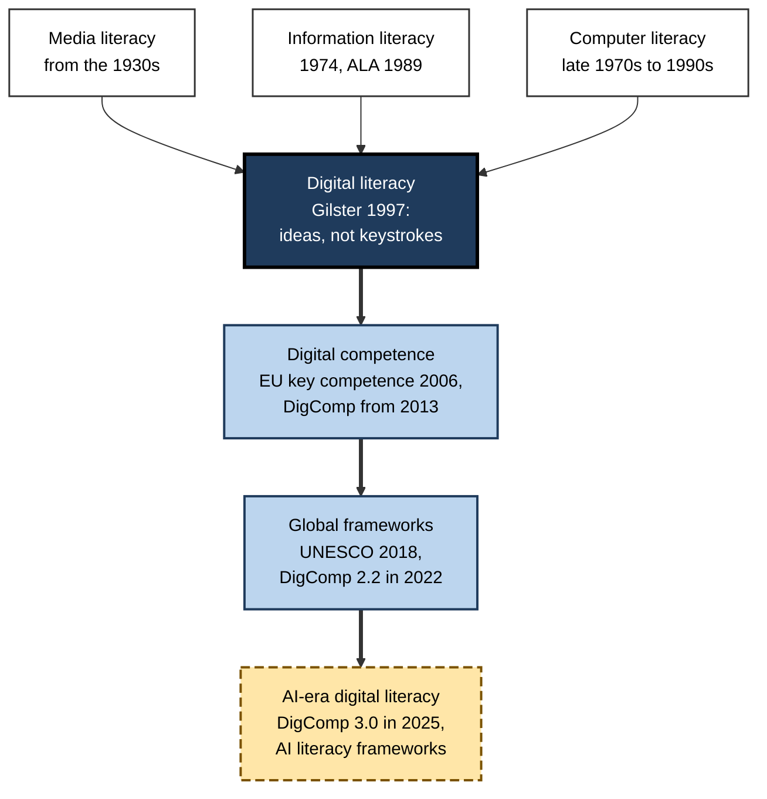
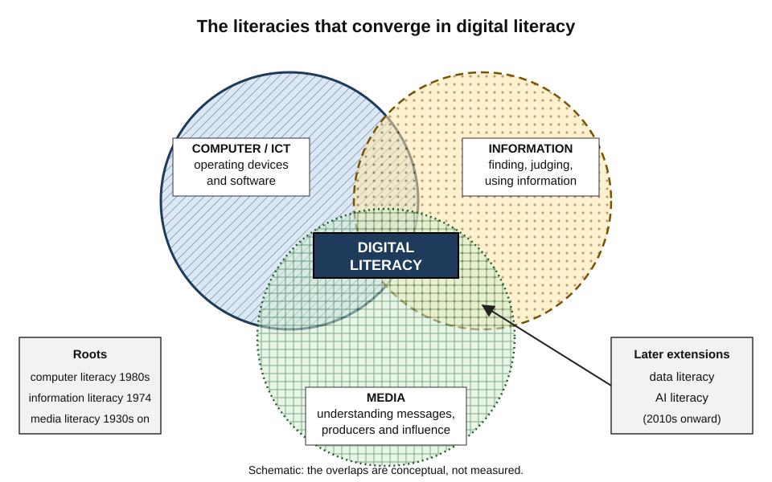
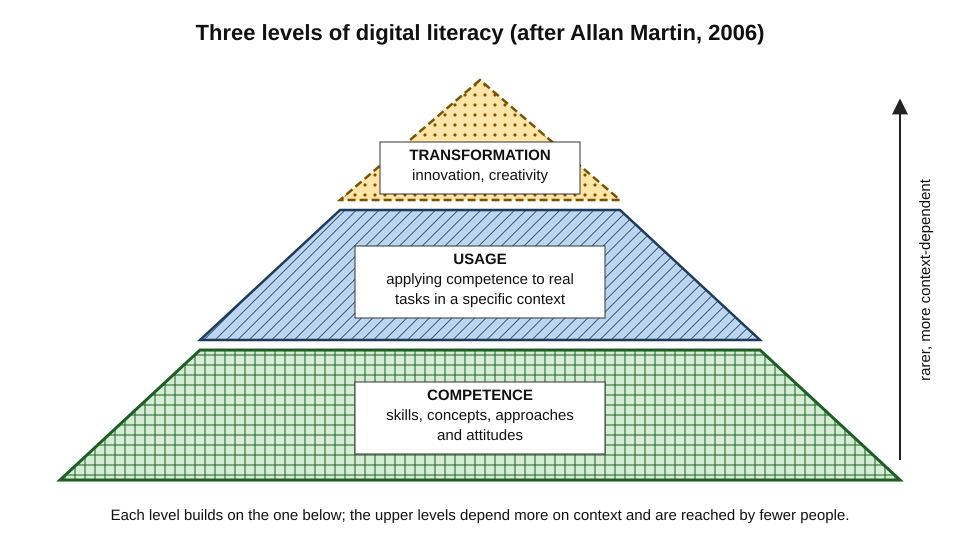
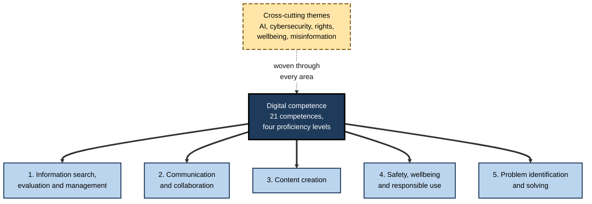
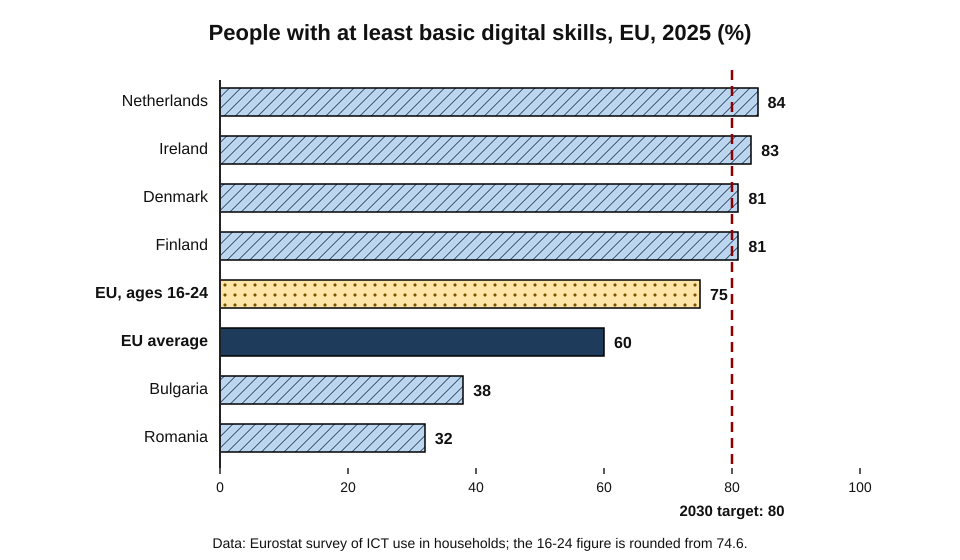
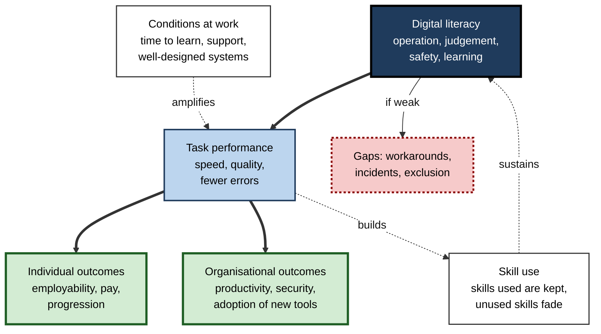
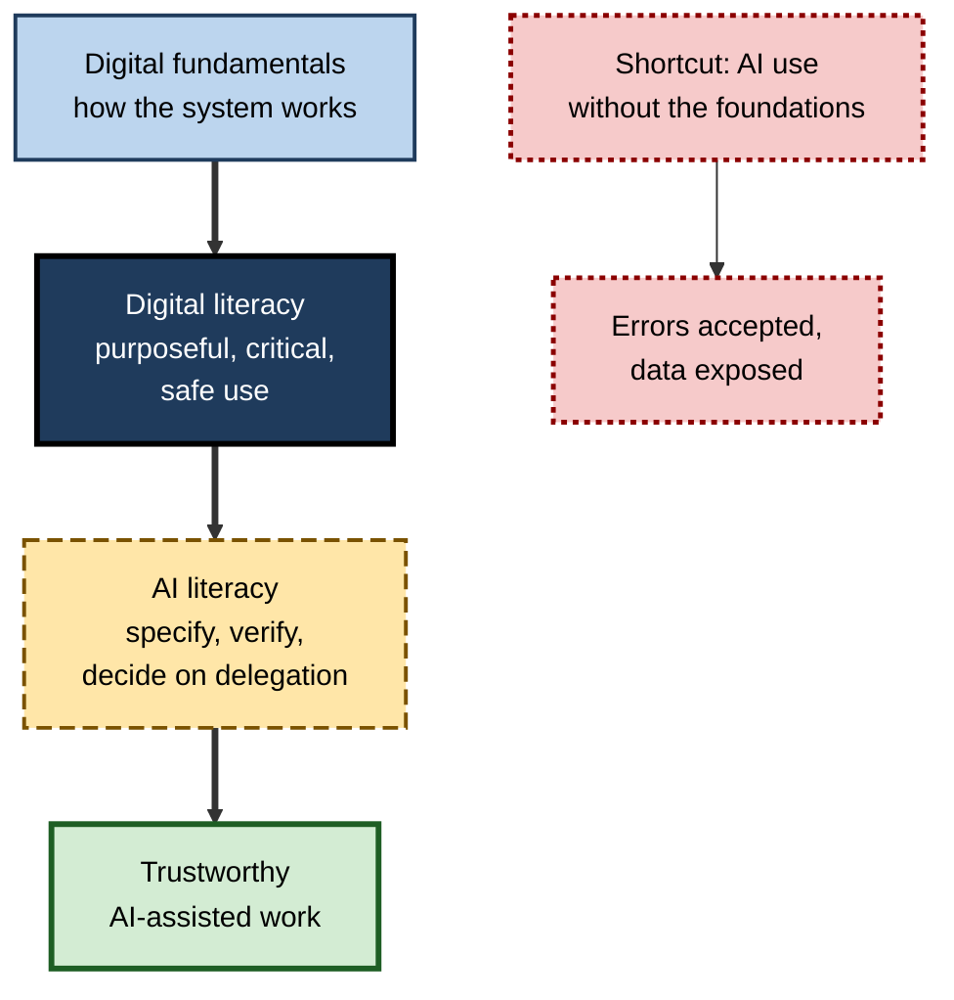

# 1.2. Digital Literacy

A ward nurse records observations on a handheld device, a plumber quotes and invoices from a phone, a solicitor reviews contracts in a shared cloud workspace, and a retired teacher renews a passport online. None of them would call themselves "technical". All of them depend, every working day, on a capability that barely had a name thirty years ago.

That capability is not knowing which button to press. It is the ability to use digital technology **purposefully, critically and safely** to get things done — and to keep doing so as the technology changes underneath.

> **Definition — Digital literacy:** the ability to use digital technologies to find, evaluate, create, manage and communicate information and to solve problems, combining technical operation with critical judgement, safe and responsible conduct, and the confidence to keep learning as tools change.

**Why it matters**

- **A condition of employment** — the large majority of advertised jobs in advanced economies now require some digital skill, including many once thought of as manual.
- **A condition of citizenship** — tax, health, benefits, banking, voting information and education are increasingly delivered digitally first.
- **A multiplier of other capabilities** — writing, analysis, collaboration and learning are now done largely through digital tools; weak digital literacy throttles all of them.
- **A safeguard** — fraud, misinformation and data loss target the gap between what people do online and what they understand.
- **A moving target** — each new wave of technology, most recently generative AI, redraws what counts as literate.

---

## Origins of the Idea

### From computer literacy to digital literacy

The concept grew from several older literacies, each answering a different worry about new media.

- **Media literacy (1930s onward)** — British critics F. R. Leavis and Denys Thompson (*Culture and Environment*, 1933) urged schools to train pupils to resist advertising and mass media; the idea later shifted from protection towards critical understanding and creative production.
- **Information literacy (1974 onward)** — Paul Zurkowski, president of the US Information Industry Association, coined the term for people "trained in the application of information resources to their work". The American Library Association's 1989 definition became standard: recognising when information is needed and being able to **locate, evaluate and use it effectively**.
- **Computer literacy (late 1970s–1990s)** — campaigns to teach the public to operate personal computers: keyboards, files, word processing, sometimes programming.
- **Digital literacy (1997)** — **Paul Gilster**, in his book *Digital Literacy*, defined it as the ability to understand and use information in multiple formats from a wide range of sources presented via computers. His central claim: digital literacy is about **mastering ideas, not keystrokes**.

> **Key point:** Gilster's move was decisive. He relocated literacy from the **machine** to the **mind** — from operating a computer to thinking critically about what arrives through it, assembling knowledge from scattered sources, and judging their reliability.

**Figure 1.** How the idea of digital literacy developed.

### Policy adopts the idea

- **2006** — the European Union named **digital competence** one of eight key competences for lifelong learning.
- **2013** — the European Commission's Joint Research Centre published **DigComp**, the first detailed digital competence framework for citizens.
- **2015** — the United Nations' Sustainable Development Goals included a target to increase the number of youth and adults with relevant skills, measured partly by **ICT skills**.
- **2018** — UNESCO published a **Digital Literacy Global Framework** to make the idea measurable worldwide.
- **2020s** — generative AI pushed frameworks to add competences for working with AI, and the European Union's AI Act made AI literacy an organisational obligation from February 2025.

### The "digital natives" episode

- **Marc Prensky (2001)** argued that young people raised with computers were **"digital natives"** who think and learn differently, while older people were **"digital immigrants"** who would always speak the digital language with an accent.
- The idea spread rapidly through education and management writing.

**Study card — Bennett, Maton and Kervin (2008)**

- **Design:** a critical review of the evidence behind claims about a "digital native" generation.
- **Findings:**
  - Young people's technology use and skill varied **widely** — by socio-economic background, interest and education — rather than forming a uniform generation.
  - Claims of fundamentally different learning styles had **little empirical support**.
- **Conclusion:** the debate resembled an "academic moral panic", driven by assertion more than data.

- Later reviews, notably **Paul Kirschner and Pedro De Bruyckere (2017)**, reached the same conclusion and added that the supposed native ability to **multitask** is also a myth: switching between tasks degrades performance for everyone.
- International tests of school students' computer and information literacy have repeatedly found that a substantial share of students reach only **low** levels, despite constant device use.

> **Watch out:** **familiarity is not literacy.** Fluent use of social apps says little about the ability to evaluate a source, structure a document, protect an account or solve a problem with an unfamiliar tool. Employers who assume young recruits "already know digital" routinely leave real gaps untaught.

---

## What Digital Literacy Involves

### A family of literacies

**Figure 2.** The older literacies that converge in digital literacy.

| Literacy | Central question | Typical capability | Limit if taken alone |
|---|---|---|---|
| **Computer / ICT literacy** | Can the person operate the tools? | Using devices, files, applications | Skilled operation without judgement |
| **Information literacy** | Can the person find and judge information? | Searching, evaluating, citing, synthesising | Assumes stable tools and library-like sources |
| **Media literacy** | Can the person understand messages and their makers? | Analysing purpose, framing, persuasion | Weaker on operation and problem solving |
| **Digital literacy** | Can the person act purposefully and critically with digital technology? | All of the above, plus creation, safety, collaboration | Broad enough to become vague |
| **Data and AI literacy** | Can the person reason with data and work with AI systems? | Interpreting data; using and checking AI | Recent; frameworks still settling |

- The judgement of sources and messages is substantial enough to be studied as its own discipline of **information and media literacy**.
- Digital literacy also sits on a base of **digital fundamentals** — a working model of how devices, software, storage and networks fit together.

### Two traditions

- **The competence tradition** — digital literacy as a set of **definable, assessable skills**.
  - Produces frameworks, levels, tests and certificates.
  - Favoured by governments and employers because it can be measured and taught at scale.
- **The practice tradition** — **digital literacies** (plural) as **social practices** that differ between communities.
  - Colin Lankshear and Michele Knobel (2008) argued that a gamer, a scientist and an activist are digitally literate in different ways shaped by their purposes and communities.
  - Emphasises meaning, identity and context over checklists of skills.

> **Key point:** both traditions are right about something. Skills frameworks make capability **visible and teachable**; the practice view explains why someone fluent in one digital setting can be lost in another, and why workplace training must be **anchored in real tasks**.

### Eshet-Alkalai's thinking skills

- Israeli researcher **Yoram Eshet-Alkalai (2004)** proposed that digital literacy is a set of distinct **thinking skills**, not one ability:
  - **Photo-visual** — reading meaning from icons, interfaces and images.
  - **Reproduction** — creating new meaning by combining and editing existing material.
  - **Branching** — navigating non-linear hypertext without losing direction.
  - **Information** — evaluating the quality and reliability of what is found.
  - **Socio-emotional** — understanding the norms, risks and relationships of online spaces.
  - **Real-time thinking** — added later (2012): handling many fast, simultaneous stimuli, as in games or live dashboards.

> **Mnemonic — "Pictures Reproduce Branches In Social Real-time":** Photo-visual, Reproduction, Branching, Information, Socio-emotional, Real-time.

### Three levels of digital literacy

- **Allan Martin (2006)**, working on the European DigEuLit project, described digital literacy as three levels.
  - **Digital competence** — the base of skills, concepts, approaches and attitudes.
  - **Digital usage** — applying competence to real tasks in a specific professional or life context.
  - **Digital transformation** — using digital means to innovate and change practice in a field.

**Figure 3.** Martin's three levels of digital literacy.

> **Example:** a teacher who can use a learning platform shows **competence**; one who designs a coherent online course for a particular class shows **usage**; one who redesigns how a whole department gives feedback through digital tools shows **transformation**.

---

## Frameworks That Define Digital Competence

### The European DigComp framework

> **Definition — DigComp:** the European Commission's Digital Competence Framework for Citizens, which defines the knowledge, skills and attitudes needed to use digital technologies confidently, critically and responsibly, organised by competence areas and proficiency levels.

- **Evolution:**
  - **2013** — first version: five areas, 21 competences, three proficiency levels.
  - **2016–2017** — versions 2.0 and 2.1 updated the vocabulary and introduced **eight proficiency levels**.
  - **2022** — version **2.2** added more than 250 examples of knowledge, skills and attitudes, including interaction with **AI systems**, remote working, accessibility and sustainability.
  - **November 2025** — version **3.0** integrated generative AI, cybersecurity, digital rights, wellbeing and the handling of misinformation throughout, and simplified proficiency to **four levels**: basic, intermediate, advanced and highly advanced.
- **Structure in version 3.0:** five areas containing 21 competences.

**Figure 4.** The five competence areas of DigComp 3.0.

> **Watch out:** DigComp is a **reference framework**, not a test or a curriculum. It describes what competence looks like; organisations still have to decide what level each role needs, how to assess it and how to teach it.

### Other major frameworks

- **UNESCO Digital Literacy Global Framework (2018)** — built on DigComp for worldwide monitoring of the Sustainable Development Goals; it added two areas:
  - **devices and software operations** — the basic operation that many people in lower-income settings still lack;
  - **career-related competences** — the specialised digital skills of particular occupations.
- **ISTE Standards for Students (2016)** — from the International Society for Technology in Education, describing seven roles for learners: Empowered Learner, Digital Citizen, Knowledge Constructor, Innovative Designer, Computational Thinker, Creative Communicator, Global Collaborator.
- **UK Essential Digital Skills framework (2018, revised 2019)** — the government's statement of what adults need for life and work: a **foundation** level, then communicating; handling information and content; transacting; problem solving; and being safe and legal online.
- **Professional ICT frameworks** — such as the European e-Competence Framework and SFIA — describe **specialist** technology roles; they mark the boundary where digital literacy ends and ICT expertise begins.

| | DigComp 3.0 | UNESCO global framework | ISTE Standards | UK Essential Digital Skills |
|---|---|---|---|---|
| **Owner and year** | European Commission, 2025 (first 2013) | UNESCO, 2018 | ISTE, 2016 | UK Department for Education, 2018–19 |
| **Audience** | All citizens | All citizens, worldwide monitoring | School students | Adults, for life and work |
| **Structure** | 5 areas, 21 competences, 4 levels | 7 areas (DigComp plus two) | 7 learner roles | Foundation plus 5 skill areas |
| **Distinctive feature** | AI, rights and misinformation integrated | Basic operation and career skills added | Learning and design dispositions | Concrete task statements for adult education |
| **Main use** | Policy, statistics, curricula, self-assessment | International comparison | School curricula | Funded adult qualifications |

> **In practice:** organisations rarely adopt a framework whole. The common pattern is to **select the competences that matter for each role family**, set a target level, describe them in the organisation's own tasks, and assess against real work samples.

---

## What the Evidence Shows About Adults

### European trends

- The European Union's indicator of people aged 16–74 with **at least basic digital skills** rose from about **54% in 2021** to about **56% in 2023** and **60% in 2025** — progress, but well short of the **80% target for 2030**.
- **Wide variation between countries:** the Netherlands, Ireland, Denmark and Finland exceeded 80% in 2025; Romania and Bulgaria were below 40%.
- **Younger people score higher** — about three in four 16–24-year-olds had at least basic skills — yet one young person in four did not.
- **Consistent gaps** appear by age, level of education, income, employment status and rural residence.

**Figure 5.** People with at least basic digital skills in selected EU countries, 2025.

> **Formula — distance to target:** gain needed per year = (target − current) ÷ years remaining. From 60% in 2025 to 80% in 2030: (80 − 60) ÷ 5 = **4 percentage points a year**, against roughly **1.5 points a year** achieved between 2021 and 2025. At the recent pace the target would be missed by a wide margin.

### Direct assessments

- Direct tests reveal more than surveys of activity, because they observe what adults can actually do.

**Study card — OECD Survey of Adult Skills, second cycle (2023)**

- **Design:** representative samples of adults aged 16–65 in 31 countries and economies, tested on tablets in literacy, numeracy and **adaptive problem solving** — solving problems whose conditions change as they unfold, often in digital settings.
- **Results:**
  - On average across OECD participants, **29%** of adults performed at **Level 1 or below** in adaptive problem solving: they could handle simple problems with few variables but struggled with multi-step problems or monitoring several variables.
  - Performance was strongly associated with education, age and how much people used their skills at work.
- **Conclusion:** a large minority of adults in rich countries lack the problem-solving capability that unfamiliar digital tasks demand — something activity statistics do not reveal.

- The survey's first cycle (2011–2017) had already found that a notable minority of adults had no computer experience or could not pass a basic computer-use screening, and that only a minority reached the higher levels of problem solving in technology-rich environments.

> **Watch out:** **self-ratings of digital skill are unreliable**, especially at the low end, and organisations relying on staff self-assessment typically overestimate readiness. Short practical tasks reveal far more.

---

## Digital Literacy at Work

### What employers demand

**Study card — "No Longer Optional" (UK, 2019)**

- **Design:** analysis for the UK's Department for Digital, Culture, Media and Sport of millions of online job advertisements, classifying the digital skills each required.
- **Findings:**
  - Occupations in which digital skills are an **essential entry requirement** accounted for about **82%** of online vacancies.
  - Roles requiring digital skills paid **more** than comparable roles that did not, and specific digital skills were associated with progression.
  - Demand was not confined to technology jobs: administrative, sales, care and skilled-trade roles routinely asked for software and data skills.
- **Conclusion:** digital skills have become a **baseline requirement** of most work, not a specialism.

> **Watch out:** online job adverts **over-represent** professional and office roles and say what employers ask for, not what jobs actually use. The direction of the finding is robust; the precise percentage is specific to its data.

### Three tiers of digital skill

| | Essential digital skills | Digital-plus skills | Specialist ICT skills |
|---|---|---|---|
| **What it is** | Baseline needed for almost any job and for daily life | Specific digital tools within a non-technology profession | Building, running and securing technology itself |
| **Examples** | Email, documents, online forms, safe passwords, video calls | Design software for an architect, CRM for sales, analytics for marketing | Software engineering, network administration, security operations |
| **Who needs it** | Everyone | Most professional and skilled roles | ICT professionals |
| **Typical source** | Adult education, onboarding | Professional training, on the job | Degrees, specialist certifications |
| **Consequence of a gap** | Exclusion from work and services | Lower productivity and progression | Projects fail, systems are insecure |

- **Fluent use of everyday productivity tools** — documents, spreadsheets, presentations, mail and calendars — is the largest single block of workplace digital skill and is often assumed rather than taught.
- **Security and privacy behaviour** is a growing share of workplace digital literacy: most successful attacks still exploit human actions such as clicking a link or reusing a password.
- **Cloud and collaboration skills** — shared files, permissions, co-editing, online meetings — became universal during and after the pandemic shift to hybrid work.
- The European Union pairs its basic-skills target with a second one: **20 million ICT specialists** by 2030, reflecting persistent shortages at the specialist tier.

**Figure 6.** How digital literacy turns into outcomes at work.

### Worked example: a team digital-skills baseline

- **Situation:** a finance operations team of 24 is moving to a new cloud accounting platform with AI-assisted reconciliation. The manager needs to know where to invest a limited training budget.

1. **Choose the competences that matter** — from a reference framework, select five relevant to the work: managing information, collaborating in shared files, content creation in spreadsheets, safety, and problem solving.
2. **Set target levels by role** — clerks at intermediate in all five; team leads at advanced in problem solving and safety.
3. **Assess with short practical tasks**, not self-ratings — *e.g.* restore an overwritten version of a shared file; identify a phishing message among five; fix a broken spreadsheet formula.
4. **Compare results with targets.**

| Competence | Target | Share meeting target | Priority |
|---|---|---|---|
| Managing information | Intermediate | 80% | Low |
| Collaborating in shared files | Intermediate | 45% | **High** |
| Spreadsheet content creation | Intermediate | 70% | Medium |
| Safety | Intermediate | 50% | **High** |
| Problem solving | Intermediate | 35% | **High** |

5. **Design the response** — short task-based sessions on version history and permissions; a phishing exercise with immediate feedback; paired troubleshooting with "digital champions" in the team; paid time during the migration.
6. **Re-test after three months** on new tasks of the same kind.

- **Conclusion:** the gaps lay not in operating the software but in **collaboration, safety and problem solving** — exactly the competences that self-assessment would have hidden and that the new platform's automation makes more, not less, important.

> **Watch out:** the common error is to buy generic training on the **new tool's features**. Features change with every release; the competences in the weak rows transfer to every tool.

---

## Digital Inclusion

> **Definition — Digital inclusion:** ensuring that all individuals and communities have the access, skills, confidence, motivation and support to use digital technology to take part fully in society and work.

- **Beyond access** — inclusion requires affordable devices and data, but also skills, trust, motivation and someone to ask for help.
- **"Digital by default"** — many governments have moved services online first; good practice keeps **assisted digital** support and non-digital routes for those who cannot or will not go online.
- **Groups most often excluded:**
  - older adults, especially those who left work before digital tools spread;
  - people with disabilities, where design ignores accessibility;
  - people with low literacy or limited proficiency in the dominant language;
  - low-income households relying on a phone and prepaid data;
  - **frontline and deskless workers** — in retail, care, logistics, cleaning and manufacturing — who may lack a work device, a work email address or paid time to learn.
- **Inclusion at work** is often neglected: digital systems are designed for office staff and imposed on frontline staff with little training.

> **In practice:** inclusive employers give **every** worker a working digital identity and account, provide devices or allowances, schedule paid learning time, recruit peer **digital champions**, design for accessibility, and keep a non-digital fallback for critical processes such as pay queries.

### Case study: bringing frontline staff into the digital workplace

- **Situation:** a hospital organisation of about 9,000 staff replaced paper rotas, payslips, policy binders and leave requests with a mobile staff app and electronic learning.
- **Problem:** six months after launch, uptake among porters, domestic staff, healthcare assistants and catering staff was low. Many missed mandatory training deadlines and shift changes; grievances about pay errors rose.
- **Diagnosis:**
  1. **Access** — many had no work device and were reluctant to use personal phones and data for work.
  2. **Identity** — some had never activated a work account; passwords were reset repeatedly.
  3. **Skills and confidence** — some staff had little experience of forms, multi-factor authentication or online learning; several had limited English.
  4. **Time** — training was expected "in spare moments" on busy shifts.
- **Actions:**
  1. Shared devices in staff rooms and a small data allowance for those choosing personal phones.
  2. Drop-in "digital cafés" at shift changeovers, run by trained peer champions, some speaking staff's community languages.
  3. Paid learning time and a simplified sign-in process.
  4. The app redesigned after observing frontline users; a staffed help point kept for pay queries.
- **Result:** account activation and on-time completion of mandatory training rose substantially over the following year; pay-query grievances fell.
- **Side effects:** office staff initially resented the extra support; managers had to protect the paid learning time against operational pressure.
- **Lesson:** digital exclusion at work is usually a **design and resourcing** failure, not a personal deficiency. Fixing access, identity, time and confidence together is what made the skills training effective.

---

## From Digital Literacy to AI Literacy

### A new layer of literacy

> **Definition — AI literacy:** a set of competences that enables individuals to critically evaluate AI technologies, communicate and collaborate effectively with AI, and use AI as a tool online, at home and in the workplace (Duri Long and Brian Magerko, 2020).

- **Why digital literacy is not enough:** conventional software is **deterministic** — the same input gives the same output — and its errors are visible as failures. Generative AI is **probabilistic**, fluent and sometimes confidently wrong, so its errors look like successes.
- **What AI literacy adds:**
  - a basic model of how AI systems are trained and why they err;
  - skill in specifying tasks and supplying context;
  - habits of **verification** proportional to the stakes;
  - judgement about **when not to use AI** — confidential data, decisions requiring accountability, learning that must be done unaided;
  - awareness of bias, intellectual property and environmental cost.
- **The policy response:**
  - **UNESCO (2024)** published AI competency frameworks for students and for teachers.
  - **DigComp 3.0 (2025)** wove AI into every competence area rather than adding a separate one.
  - **The European Commission and the OECD (2026)** published an AI literacy framework for primary and secondary education, organised around engaging with, creating with, managing and shaping AI, designed to inform the **PISA 2029** assessment of media and AI literacy.
- Applying AI assistants to everyday digital tasks — drafting, summarising, analysing and automating — is now part of ordinary workplace practice and demands both literacies at once.

| | Digital literacy | AI literacy |
|---|---|---|
| **Object** | Digital tools, information and environments | Systems that generate, predict and decide |
| **Typical failure** | Visible: errors, crashes, lost files | Hidden: plausible but wrong output |
| **Core judgement** | Is this source reliable? Is this action safe? | Is this output correct? Should AI be used here at all? |
| **Key skills** | Operate, find, evaluate, create, protect, solve | Specify, verify, attribute, decide on delegation |
| **Main risk of low literacy** | Exclusion, fraud, data loss | Over-reliance, error propagation, deskilling |

**Figure 7.** AI literacy builds on, rather than replaces, digital literacy.

> **Key point:** AI literacy is best understood as the **newest layer of digital literacy**. Someone who cannot judge a web source, manage file permissions or recognise a phishing attempt will not become a safe user of AI assistants by learning to write prompts.

> **Watch out:** claims that conversational AI makes digital skills unnecessary confuse **operation** with **literacy**. AI can lower the operational barrier; it raises the premium on judgement, verification and understanding what the system can access.

---

## Open Questions

- **Is "digital literacy" still one thing?**
  - It has expanded to cover operation, information, media, safety, data and AI; some argue it should be split into separate literacies, others that its unity is the point.
- **How should it be measured?**
  - Activity indicators are comparable but shallow; direct tests are deep but expensive and quickly dated; no measure yet captures judgement with AI well.
- **Will AI close or widen skill gaps?**
  - Natural-language interfaces may include people who struggled with conventional software, while the benefits accrue mostly to those who can evaluate outputs.
- **Who should pay for adult digital learning?**
  - Employers, governments and individuals each capture part of the value; workers in small firms and frontline roles receive the least training.
- **Is there a right not to be digital?**
  - Debates over access to cash, paper forms and in-person services ask how far societies may require digital participation.
- **What is the half-life of a digital competence?**
  - Frameworks are revised every few years; which competences remain stable across waves of technology is not well established.

---

## Summary

- **Digital literacy** is the ability to use digital technology purposefully, critically and safely to find, evaluate, create, manage and communicate information and solve problems.
- It grew from **media, information and computer literacies**; **Gilster (1997)** shifted the emphasis from keystrokes to **ideas and judgement**.
- The **"digital native"** claim is not supported: skill varies widely among young people; **familiarity is not literacy**.
- Two traditions coexist: the **competence** tradition (frameworks, levels, tests) and the **practice** tradition (context-specific digital literacies); models include **Eshet-Alkalai's** thinking skills and **Martin's** competence–usage–transformation levels.
- **DigComp** (2013 to 3.0 in 2025) defines five areas and 21 competences, now with AI integrated; UNESCO, ISTE and the UK Essential Digital Skills framework serve other audiences.
- In the EU about **60%** of adults had at least basic digital skills in 2025, against an **80%** target for 2030; direct tests show about **29%** of adults in OECD countries at the lowest levels of adaptive problem solving.
- Digital skills are a **baseline requirement** of most jobs; skills come in **essential, digital-plus and specialist** tiers; assess by practical tasks, not self-ratings.
- **Digital inclusion** requires access, identity, skills, confidence, time and support — at work as much as in society.
- **AI literacy** is the newest layer of digital literacy, adding specification, verification and judgement about delegation to AI.

---

## Self-Check

1. Define digital literacy and explain how it differs from computer literacy.
2. What was distinctive about Gilster's 1997 account of digital literacy?
3. Compare information literacy and media literacy. Why does digital literacy need both?
4. What evidence undermines the idea of "digital natives"? What follows for employers?
5. Distinguish the competence and practice traditions of digital literacy, with one strength of each.
6. Describe Martin's three levels and give a workplace example of each.
7. Outline the structure of DigComp 3.0 and explain what changed from version 2.2.
8. How does UNESCO's global framework differ from DigComp, and why?
9. The EU's basic-skills share was about 60% in 2025. Calculate the annual gain needed to reach 80% by 2030 and compare it with recent progress.
10. What did the 2023 Survey of Adult Skills find about adaptive problem solving, and why do such tests reveal more than activity surveys?
11. Distinguish essential, digital-plus and specialist ICT skills, with an example of each.
12. A manager plans to assess staff digital skills with a confidence questionnaire. Advise on a better approach.
13. In the hospital case study, why did skills training alone fail, and what made the difference?
14. Why is AI literacy described as a layer of digital literacy rather than a substitute for it?
15. A company announces that, with AI assistants, staff no longer need digital-skills training. Evaluate the claim.

### Answer Key

1. Digital literacy is the purposeful, critical and safe use of digital technology to handle information, communicate and solve problems. Computer literacy concerned operating machines and software; digital literacy adds judgement, creation, safety and adaptability.
2. Gilster located literacy in thinking rather than operation — "mastering ideas, not keystrokes": critically evaluating information from many sources and formats, assembling knowledge from fragments, and judging reliability.
3. Information literacy concerns recognising information needs and finding, evaluating and using information; media literacy concerns understanding messages, their producers and their persuasive purposes. Digital environments mix information and persuasion constantly, so both are needed.
4. Reviews (Bennett, Maton and Kervin, 2008; Kirschner and De Bruyckere, 2017) found wide variation in young people's skills linked to background and education, no evidence of fundamentally different learning styles, and that multitasking harms everyone. Employers should assess and train young recruits rather than assume competence.
5. The competence tradition defines measurable skills and levels, making capability visible and teachable at scale. The practice tradition sees digital literacies as context-specific social practices, explaining why skill does not transfer automatically and why training should be anchored in real tasks.
6. Competence: skills, concepts and attitudes (using a spreadsheet's functions). Usage: applying them to real tasks in context (building a reliable budget model for one's department). Transformation: innovating practice (redesigning the department's planning process around shared live models).
7. Five areas — information search, evaluation and management; communication and collaboration; content creation; safety, wellbeing and responsible use; problem identification and solving — with 21 competences and four proficiency levels. Version 3.0 integrated AI, cybersecurity, digital rights, wellbeing and misinformation, and reduced eight levels to four.
8. It adds devices and software operations and career-related competences to DigComp's areas, because worldwide monitoring must capture basic operation, still lacking for many people in lower-income settings, and occupation-specific digital skills.
9. (80 − 60) ÷ 5 = 4 percentage points a year. Between 2021 (about 54%) and 2025 (60%) the gain was about 1.5 points a year, so progress would need to more than double.
10. On average about 29% of adults scored at Level 1 or below, managing only simple problems with few variables. Direct tests observe actual performance, whereas activity surveys record exposure and self-reports are inflated.
11. Essential: using email, forms and safe passwords. Digital-plus: an architect's design software or a marketer's analytics tools. Specialist: software engineering or security operations.
12. Self-ratings are unreliable, particularly among the least skilled. Choose relevant competences from a framework, set target levels by role, assess with short practical tasks drawn from real work, analyse gaps by competence, then train and re-test.
13. Barriers lay in access (no device or data), identity (unactivated accounts), confidence and language, and lack of time. Shared devices, simplified sign-in, peer champions, paid time and redesign of the app around frontline users removed those barriers so training could work.
14. Using AI safely depends on digital foundations — evaluating sources, managing data and permissions, recognising security threats. AI literacy adds specification, verification and judgement about delegation on top of these; it cannot replace them.
15. The claim confuses operation with literacy. AI lowers the barrier to operating tools but raises the importance of judging output, protecting data, understanding access permissions and solving problems — all digital-literacy competences. Training should shift emphasis, not stop.

---

## Glossary

| Term | Meaning |
|---|---|
| Adaptive problem solving | Solving problems whose conditions change as they unfold, assessed in the 2023 Survey of Adult Skills. |
| AI literacy | Competences to critically evaluate, collaborate with and use AI systems. |
| Assisted digital | Support that helps people who cannot use a digital service independently. |
| Computer literacy | The ability to operate computers and common software. |
| Digital-plus skills | Specific digital tools used within a non-technology profession. |
| Digital champion | A trained peer who helps colleagues or neighbours build digital skills. |
| Digital competence | The EU's term for the knowledge, skills and attitudes for confident, critical digital use. |
| Digital inclusion | Ensuring everyone has the access, skills, confidence and support to use digital technology. |
| Digital literacy | Purposeful, critical and safe use of digital technology to handle information and solve problems. |
| Digital native | Prensky's term for a generation supposedly fluent in technology by upbringing; not supported by evidence. |
| DigComp | The European Commission's Digital Competence Framework for Citizens. |
| Essential digital skills | The baseline digital skills needed for everyday life and almost any job. |
| Information literacy | Recognising information needs and locating, evaluating and using information effectively. |
| ISTE Standards | Standards from the International Society for Technology in Education describing digital learner roles. |
| Media literacy | Understanding, analysing and creating media messages and recognising their purposes. |
| Practice tradition | The view of digital literacies as context-specific social practices. |
| Proficiency level | A defined degree of mastery of a competence, from basic to highly advanced. |
| Reference framework | A shared description of competences used to design curricula, assessments and policy. |
| Specialist ICT skills | Skills for building, running and securing technology itself. |
| UNESCO Digital Literacy Global Framework | UNESCO's 2018 framework for monitoring digital literacy worldwide. |
