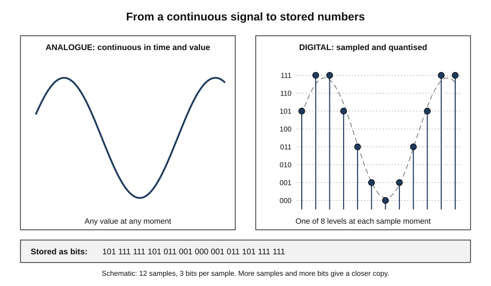
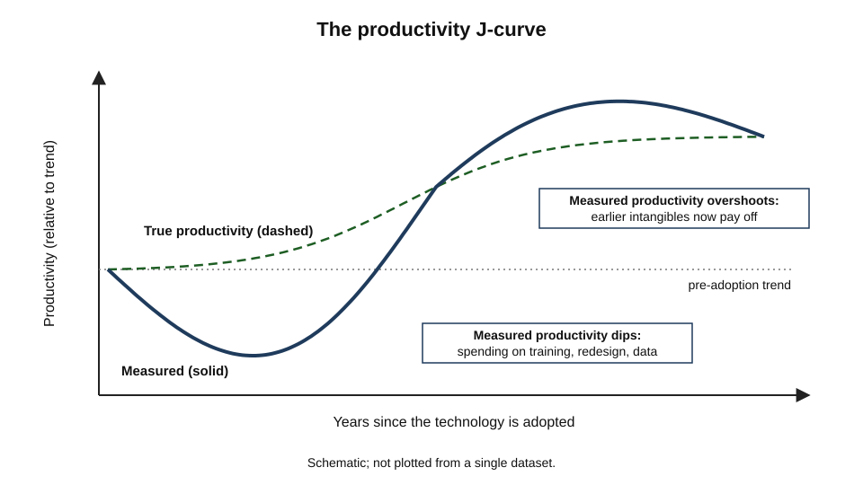
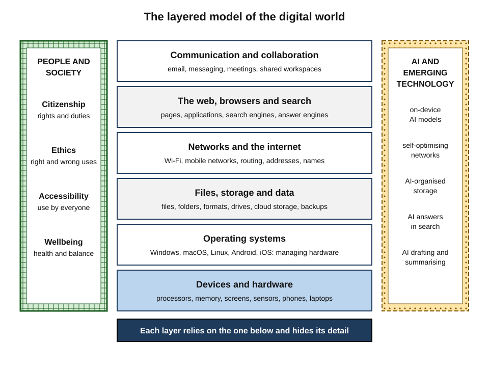
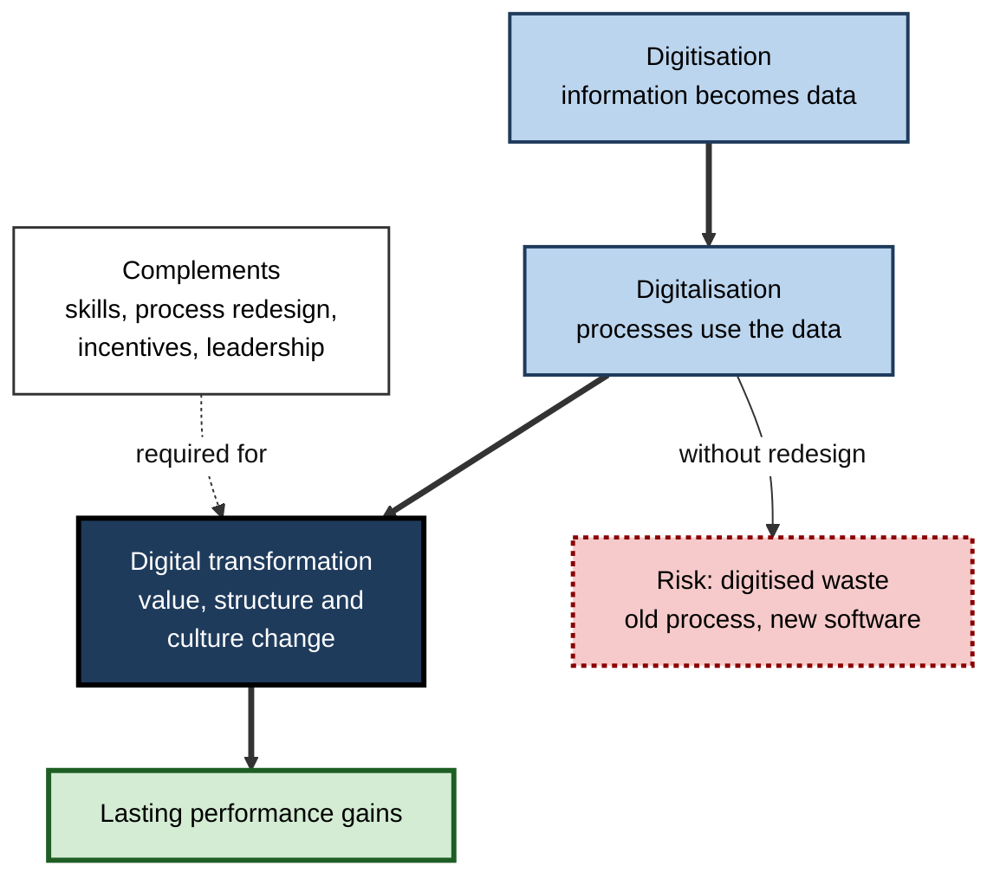
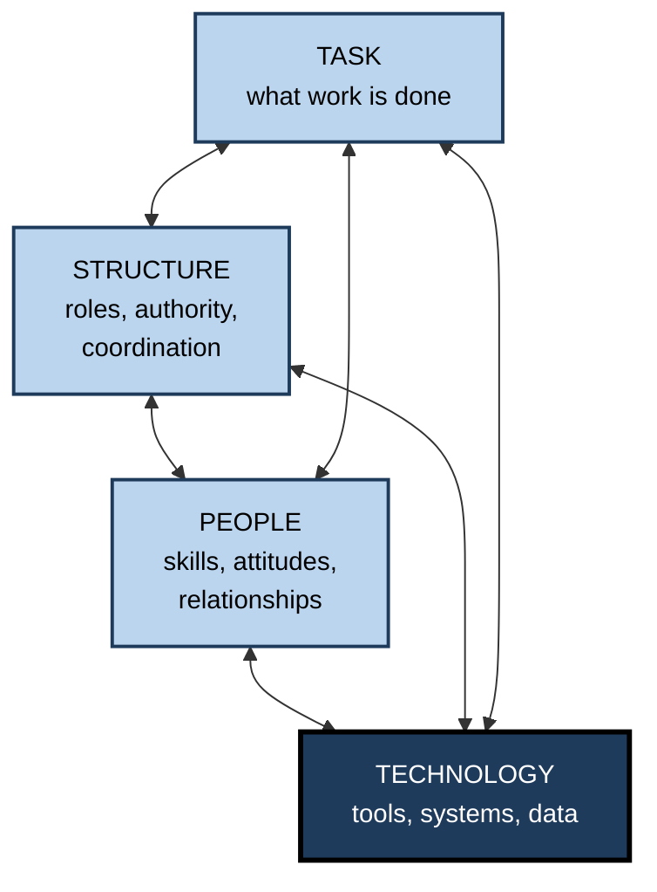
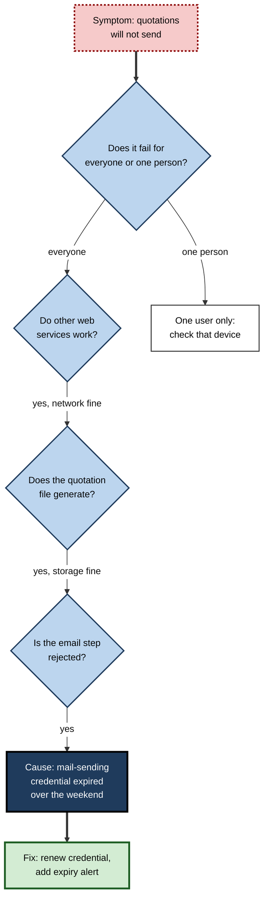
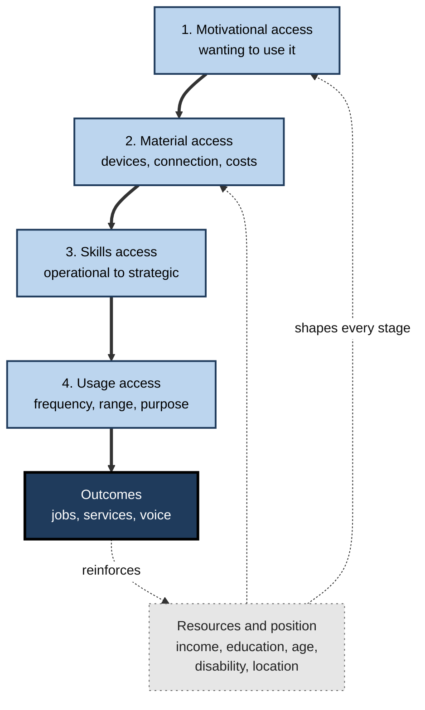

# 1.2.1. Digital Fundamentals

On the morning of 19 July 2024 a single faulty software update, pushed automatically by one security vendor, crashed about 8.5 million Windows computers. Airlines grounded flights, hospitals postponed operations, banks and broadcasters went dark. Nothing physical had broken. What failed was an invisible layer that almost every organisation on earth now stands on.

Most people use that layer for hours every day without being able to say what it is made of, how its parts depend on one another, or what to do when it fails. Digital fundamentals are the understanding that closes that gap.

> **Definition — Digital fundamentals:** the durable concepts, components and principles that explain how digital technology works as a whole — how information becomes data, how devices, software, storage, networks and services build on one another, and how people, organisations and societies live and work within the resulting system — together with the basic operating competence that this understanding makes possible.

**Why the fundamentals matter**

- **Digital technology is now infrastructure** — work, money, health, government and family life all run on it; not understanding it is like not understanding roads or electricity while depending on them.
- **Principles outlast products** — interfaces change every few years; the ideas beneath them (bits, layers, abstraction, networks, data persistence) have held for decades.
- **Reasoning beats recall** — someone who understands the system can work out an unfamiliar tool, an outage or a security warning instead of memorising steps.
- **Judgement depends on it** — deciding what to trust, what to share, what to automate and what to buy requires a working model of what is happening underneath.
- **Exclusion is costly** — people without these foundations are shut out of jobs, services and civic life that now assume them.

---

## What "Digital" Means

### Information as numbers

- **Digital** describes information represented as **discrete symbols** — ultimately sequences of 0s and 1s — rather than as continuously varying physical quantities.
- **Analogue** information varies smoothly: the groove of a vinyl record, the voltage from a microphone, the shade of a photograph's grain.
- **Claude Shannon (1948)**, in *A Mathematical Theory of Communication*, showed that any message can be measured in **bits** and transmitted reliably over a noisy channel if suitably encoded. The word *bit* (binary digit) was suggested by his colleague **John Tukey**.

> **Definition — Bit:** the smallest unit of digital information, a choice between two states written as 0 or 1. Eight bits make a **byte**, enough to store one simple character.

> **Definition — Digitisation (of information):** converting analogue information — sound, images, text on paper, measurements — into digital data.

### How continuous things become numbers

- **Sampling** — measuring the signal at regular moments.
  - *e.g.* CD audio takes 44,100 samples per second.
- **Quantisation** — rounding each measurement to the nearest of a fixed set of levels.
  - *e.g.* CD audio uses 16 bits per sample, giving 65,536 possible levels.
- **Encoding** — writing each level as a binary number and storing or sending it.
- **The trade-off** — more samples and more bits give a closer copy but larger files; **compression** reduces size by removing redundancy (lossless) or detail people are unlikely to notice (lossy).

**Figure 1.** How a continuous signal becomes a sequence of stored numbers.

> **Remember:** text, images, sound, video, money, medical records and machine-learning models are all, underneath, **long sequences of bits**. The meaning lies in the **encoding** that both writer and reader agree on — character sets such as ASCII and Unicode, image formats, file formats, protocols.

### Why digital information behaves differently

| Property | Analogue information | Digital information |
|---|---|---|
| **Copying** | Each copy degrades (a photocopy of a photocopy) | Copies are perfect and cost almost nothing |
| **Transmission** | Noise accumulates with distance | Errors can be detected and corrected |
| **Processing** | Needs special physical devices | Any general-purpose computer can process it |
| **Combining** | Hard to merge different media | Text, image, sound and data mix freely |
| **Traces** | Little record of use | Use typically leaves logs and metadata |
| **Permanence** | Decays physically but stays readable without tools | Can last indefinitely, or become unreadable when formats and devices disappear |

- These properties explain most of the economics and social effects of digital technology.
  - **Near-zero marginal cost** of copying underlies software businesses, streaming and piracy alike.
  - **Programmability** means one machine can become a typewriter, a cash register or a design studio by loading different instructions.
  - **Traces** make personalisation, analytics and surveillance possible.

> **Watch out:** "digital lasts forever" is only half true. Embarrassing posts can persist for decades, yet organisational records are routinely lost when file formats become obsolete, storage media fail or a service closes. Durability must be **managed**, not assumed.

---

## From Tool to Infrastructure

Digital technology began as a specialist's tool and became the ground on which ordinary life stands. The shift is the single most important fact about the digital world.

### A general-purpose technology

> **Definition — General-purpose technology (GPT):** a technology that spreads across most sectors, keeps improving, and spawns further innovations in the industries that use it — the steam engine, electricity and digital computing are the classic examples (Timothy Bresnahan and Manuel Trajtenberg, 1995).

- **Pervasive** — computing is now embedded in cars, tractors, pacemakers, payment cards and lifts.
- **Improving** — capability per unit of cost has risen roughly exponentially for decades.
- **Innovation-spawning** — every wave (personal computers, the web, smartphones, cloud, AI) opened new industries built on the previous one.

> **Formula — exponential improvement:** if capability doubles every two years, the gain after *n* years is 2^(n/2). Over 20 years: 2^10 = **1,024 times**. This is the pattern Gordon Moore described in 1965 for the number of components on a chip (revised in 1975 to a doubling about every two years).

> **Watch out:** "Moore's law" is an observation about an industry's progress, not a law of nature. Transistor density gains have **slowed** since the mid-2010s, and much recent improvement comes from specialised chips, parallelism and software rather than shrinking transistors.

### When infrastructure becomes invisible

- Sociologists **Susan Leigh Star and Karen Ruhleder (1996)** described infrastructure as something that **sinks into the background** of everyday work: it is embedded in other structures, taken for granted, and learned as part of belonging to a community.
- Its defining feature: infrastructure **becomes visible upon breakdown**.
- Digital technology now meets every part of that description.
  - *e.g.* national digital identity and real-time payment systems, such as India's Aadhaar and UPI, handle billions of transactions a month and are noticed only when they stop.
  - *e.g.* Estonia's public services run over a shared data-exchange layer through which almost every state interaction can be done online.

> **Key point:** once a technology becomes infrastructure, the important questions change from "should I use it?" to **"what depends on it, who controls it, and what happens when it fails?"** Digital fundamentals are the knowledge needed to ask those questions well.

### The productivity puzzle

- **Robert Solow (1987):** "You can see the computer age everywhere but in the productivity statistics." For two decades heavy investment in computers showed little in measured productivity.
- **Paul David (1990)** compared computers with the electric dynamo: factories took about forty years to gain from electricity, because they first had to be **redesigned** around individual electric motors rather than one central steam shaft.
- **Erik Brynjolfsson and Lorin Hitt (2000)** found that firms gained most from information technology when they also invested in **complementary changes** — decentralised decision-making, new processes, training and incentives. Technology alone produced little.

**Study card — the productivity J-curve (Brynjolfsson, Rock and Syverson, 2021)**

- **Problem:** why do general-purpose technologies seem to depress productivity at first?
- **Argument:** firms adopting them must invest heavily in **intangible assets** — new processes, skills, data and organisational know-how — that national accounts do not count as output.
- **Prediction:** measured productivity is **understated** while the intangibles are being built, then **overstated** later when they yield returns without being counted as inputs.
- **Conclusion:** the gains of a new GPT, including AI, may appear years after adoption, and only in organisations that make the complementary investments.

**Figure 2.** Measured productivity first dips, then overshoots, as organisations invest in the intangible complements of a new technology.

> **Definition — Automate and informate:** Shoshana Zuboff's distinction (*In the Age of the Smart Machine*, 1988). Technology can **automate** — replace human effort — or **informate** — generate new information about the work that people can use to understand and improve it. The choice between the two is organisational, not technical.

---

## The Layered Model of the Digital World

### Layers and abstraction

The digital world is best understood as a **stack of layers**. Each layer offers services to the one above and hides the complexity of the one below.

> **Definition — Abstraction:** hiding the details of a system behind a simpler interface, so that a user or another component can rely on *what* it does without knowing *how* it does it.

- **Hardware** at the base: processors, memory, storage, screens, sensors, radios.
- **Operating systems** manage that hardware and give applications a stable platform; they are why the same program runs on thousands of different machines.
- **Files, storage and data** give information a lasting, named, organised existence.
- **Networks and the internet** move data between devices anywhere in the world.
- **The web, browsers and search** turn networked data into documents and applications that anyone can reach and find.
- **Communication and collaboration services** — email, messaging, meetings, shared workspaces — are where most knowledge work now happens.
- Around the stack sits a **human and social layer**: how people should behave online as citizens, what is right and wrong to do with digital power, whether everyone can use the system, and what it does to health and attention.
- Running across all of it are **emerging technologies**, above all AI, which now appear inside every layer at once.

**Figure 3.** The layered model of the digital world.

### What the model explains

- **Why things are learnable** — a person can use email without knowing radio physics, because each layer hides the one below.
- **Why skills transfer** — someone who understands what an operating system, a file and a network address *are* can move between Windows and macOS, or between two cloud services, with little retraining.
- **Why failures cascade** — a problem in a low layer surfaces as a confusing symptom in a high one.
  - *e.g.* "the video call keeps freezing" may be a congested network, an overloaded laptop, a full disk or a misbehaving browser extension.
- **Why security is systemic** — an attacker needs only one weak layer; defenders must protect all of them.

> **Watch out:** **"All non-trivial abstractions are leaky"** (software engineer Joel Spolsky, 2002). Abstractions hide detail until something goes wrong — then the hidden layer matters. A user who knows only the top layer is helpless at exactly the moment help is most needed.

### Durable principles and perishable specifics

| | Durable principles | Perishable specifics |
|---|---|---|
| **Examples** | Bits and encoding; layering; addresses and names; files and formats; backups; authentication; the client–server pattern | Menu locations; app names; keyboard shortcuts of one version; a particular cloud console |
| **Lifespan** | Decades | Months to a few years |
| **How learned** | Explanation, mental models, varied practice | Short demonstrations, documentation, trial |
| **Value when the tool changes** | Retained and transferred | Mostly lost |
| **Typical training emphasis** | Under-taught | Over-taught |

> **Key point:** the most efficient digital learning invests in **principles first**, then picks up specifics as needed. Courses that teach "click here, then here" produce competence that expires with the next update.

### The parts, briefly

- **Devices** are best seen as an interdependent ecosystem rather than separate machines, and choosing one platform tends to commit a person or organisation to its services for years.
- **Operating systems** decide what a device can run, how it is updated and how securely it isolates programs from one another.
- **Storage** raises the professional questions of where data lives, who can reach it and how it survives loss.
- **The internet** is a network of independent networks held together by shared protocols rather than by any owner; **browsers and search** are the gateway through which most people meet it.
- **Communication** tools shape how quickly, clearly and courteously people work together at a distance.
- The human layer covers **citizenship** (rights, duties and participation online), **ethics** (fair and responsible uses of data and automation), **accessibility** (design that works for the estimated 1.3 billion people with significant disabilities) and **wellbeing** (sleep, attention, posture and balance).

---

## Digital Transformation in Organisations

### Three words often confused

| | Digitisation | Digitalisation | Digital transformation |
|---|---|---|---|
| **What changes** | The form of information | A process or task | The organisation's model of value, structure and culture |
| **Example** | Scanning paper invoices into PDFs | Automating invoice approval in a workflow system | Shifting from selling equipment to selling guaranteed uptime, monitored by sensors |
| **Main challenge** | Accuracy, formats, storage | Process redesign, integration | Strategy, leadership, skills, incentives |
| **Typical owner** | Records or operations team | Process owners and IT | Executive leadership |

> **Definition — Digital transformation:** a process that aims to improve an organisation by triggering significant changes to its properties through combinations of information, computing, communication and connectivity technologies (Gregory Vial's 2019 synthesis of the research literature).

**Figure 4.** From digitised information to a transformed organisation.

### Technology is only one corner

- **Harold Leavitt (1965)** described organisations as four interacting elements — **task, structure, people and technology**. Change one and the others push back.
- The **socio-technical systems** tradition, founded at London's Tavistock Institute, made the same point empirically.

**Study card — Trist and Bamforth (1951), longwall coal mining**

- **Setting:** British coal mines introducing mechanised "longwall" methods.
- **Change:** small, self-organising teams who shared the whole task were replaced by large shifts of specialists each doing one fragment.
- **Results:** productivity disappointed; absenteeism, stress and conflict rose.
- **Follow-up:** pits that kept the new machinery but restored **composite, self-regulating teams** performed better.
- **Conclusion:** the best results come from **jointly optimising** the technical and the social system, not from fitting people to machines.

**Figure 5.** Leavitt's four interacting elements of an organisation.

**What distinguishes successful transformations**

- **Strategy before tools** — a clear statement of what customers or citizens will experience differently.
- **Leadership capability as well as digital capability** — George Westerman, Didier Bonnet and Andrew McAfee (*Leading Digital*, 2014) found that firms they called "digital masters" combined strong technology use with strong leadership: vision, engagement and governance.
- **Process redesign** — removing steps rather than automating them.
- **Data foundations** — consistent definitions, ownership and quality before analytics or AI.
- **Workforce capability** — training in principles, not only clicks; time to learn; support at the point of need.
- **Iterative delivery** — small releases tested with real users.

> **Watch out:** the claim that **"70% of digital transformations fail"** is repeated everywhere but has no sound empirical basis. A 2011 review by Mark Hughes traced published "70% failure" claims for change programmes and found no valid, reliable evidence behind any of them. Consultancy surveys exist (one 2020 study of about 800 executives reported roughly 30% of transformations meeting their targets), but "failure" is defined inconsistently. Treat any single failure rate with caution.

### Case study: when a system is believed over people

- **Situation:** from 1999–2000 the UK Post Office introduced **Horizon**, a computerised accounting system supplied by Fujitsu, across thousands of branches run by self-employed sub-postmasters.
- **Problem:** branch accounts began showing **unexplained shortfalls**. The Post Office insisted the system was robust and held sub-postmasters liable.
- **What followed:**
  1. Hundreds of sub-postmasters were prosecuted over roughly fifteen years for theft, fraud and false accounting; many were imprisoned, bankrupted or ruined.
  2. Courts in England and Wales applied a **presumption that computers work correctly** unless shown otherwise, making it hard for defendants to challenge the data.
  3. In 2019 the High Court (Bates and others v Post Office) found that Horizon contained **bugs, errors and defects** capable of causing shortfalls, and that remote access to branch accounts had been possible.
  4. Convictions were overturned in large numbers; in 2024 Parliament passed legislation to quash the remaining Horizon-related convictions, and a statutory public inquiry examined the failures.
- **Diagnosis:**
  - **Technical** — defects in a complex system, and data that could be altered remotely.
  - **Organisational** — an institution defending its system and reputation over its people; weak escalation of known problems.
  - **Literacy** — decision-makers, lawyers and courts lacked the fundamental understanding that software routinely contains errors and that output is only as reliable as the system producing it.
- **Lesson:** digital systems are **socio-technical**. Treating computer output as unquestionable truth is not a technical failure but a failure of understanding — and the costs fall on the people with least power.

> **Key point:** one of the most important digital fundamentals is a **calibrated scepticism** about systems: computers are extraordinarily reliable at repeating what they were built to do, including their mistakes.

---

## Working With the Stack

### Worked example: tracing a failure through the layers

- **Situation:** a sales team cannot send quotations to customers from their customer-relationship system on Monday morning. The vendor reports no outage.

**Figure 6.** Tracing a fault down the layers, from symptom to cause.

1. **Scope** — it fails for every user, so the cause is shared, not a single device.
2. **Network layer** — other cloud services work, so connectivity is not the problem.
3. **Storage and data layer** — quotation documents are created and saved, so the application's data is intact.
4. **Communication layer** — the final step, handing the document to the email service, is rejected.
5. **Cause** — the security credential that lets the system send email on the company's behalf expired at the weekend.
6. **Fix and prevention** — renew it, record its expiry date, and set an alert well before the next one.

> **Watch out:** the common error is to start at the **top** — reinstalling the application, blaming the vendor — rather than **dividing the stack** to find which layer has failed. Halving the search space at each step finds faults fastest.

### What a fluent professional understands

| | Procedural knowledge only | Conceptual understanding of the stack |
|---|---|---|
| **New tool** | Waits for training | Maps it onto known concepts and explores |
| **Failure** | Repeats steps, then gives up | Isolates the failing layer |
| **Security prompt** | Clicks whatever makes it go away | Asks what is being requested and why |
| **Buying decision** | Compares features | Compares dependencies, lock-in, data location and exit costs |
| **Explaining to others** | Lists steps | Explains why the steps work |

- Fluency is not technical specialism. A finance director need not configure a firewall, but should know that one exists, what it protects and what question to ask the people who run it.

---

## Measuring Digital Skills

### Three ways to measure

| | Self-assessment | Activity-based indicators | Performance tests |
|---|---|---|---|
| **What is captured** | What people believe they can do | What people report having done recently | What people actually do on set tasks |
| **Example** | "How confident are you using spreadsheets?" | "In the last three months, have you used online banking?" | Completing a simulated booking or file task |
| **Cost and scale** | Cheap, large scale | Cheap, used in official statistics | Expensive, smaller samples |
| **Main weakness** | Inflated, especially among the least skilled | Doing is not the same as doing well | Narrow tasks; test anxiety; dates quickly |

### The European indicator

- The European Union's **Digital Skills Indicator** is built from Eurostat's annual household survey of internet use and is aligned with the European **DigComp** framework of digital competence.
- It scores people across **five areas**: information and data literacy; communication and collaboration; digital content creation; safety; and problem solving.
- A person counts as having **at least basic digital skills** only if they show at least basic activity in **all five** areas.
- **Results:** in 2025, about **60%** of people aged 16–74 in the EU had at least basic digital skills, against an EU target of **80% by 2030**. Shares ranged from the low 80s in the Netherlands, Ireland, Denmark and Finland to about a third in Romania.

> **Watch out:** activity-based indicators measure **exposure**, not quality. Someone who has shared a document counts as active in that area whether or not they did so securely and competently.

### Direct tests of adults

- The OECD's **Survey of Adult Skills** (PIAAC) first screened adults with a simple computer test — using a mouse, highlighting text — before its computer-based tasks.
  - In the first round (2011–2017), roughly **one adult in seven** across participating countries either had no computer experience or failed this basic test; in some countries the share was far higher.
- **Researchers Alexander van Deursen and Jan van Dijk** distinguished four kinds of internet skill:
  - **operational** — working the buttons, menus and settings;
  - **formal** — navigating the structure of sites and links without getting lost;
  - **information** — finding, selecting and evaluating information for a goal;
  - **strategic** — using the internet to achieve one's own goals and improve one's position.
- In their performance tests, operational skills were fairly widespread, but **information and strategic skills** were much weaker — and the gap did not close simply because people spent more time online.

> **Key point:** the hardest and most valuable digital skills are not about operating devices but about **using them for purposes** — finding the right information, judging it and turning it into results.

---

## The Digital Divide

### From access to outcomes

> **Definition — Digital divide:** the unequal distribution of access to digital technology, the skills to use it and the benefits that follow, between individuals, groups and countries.

- **First-level divide — access:** who has devices and connectivity.
  - The International Telecommunication Union estimated that about **6 billion** people were online in 2025 and about **2.2 billion** were not, overwhelmingly in lower-income countries and rural areas.
- **Second-level divide — skills and use:** among people with access, large differences in what they can and do achieve online.
- **Third-level divide — outcomes:** Alexander van Deursen and Ellen Helsper (2015) showed that people with the same access and use obtain **different benefits** — jobs, savings, health information, social ties — and that the advantaged gain most.

| | First level | Second level | Third level |
|---|---|---|---|
| **Question** | Can people get online? | Can they use it well? | Do they benefit? |
| **Typical measure** | Subscriptions, device ownership, coverage | Skill tests, usage surveys | Employment, income, services gained |
| **Typical remedy** | Infrastructure, affordability, devices | Training, support, simpler design | Targeted services, inclusive institutions |
| **Common blind spot** | Coverage mistaken for use | Frequency mistaken for skill | Benefits assumed to be equal |

### Van Dijk's sequential model

- **Jan van Dijk (*The Deepening Divide*, 2005)** described access as a sequence of four kinds, each a precondition for the next.

**Figure 7.** Four successive kinds of access to digital technology.

- **The loop matters** — those who gain most from digital technology improve their position, which improves their access further: a digital **Matthew effect**.
- **Meaningful connectivity** — advocacy and standards bodies now define adequate access as regular (daily) use, a suitable device, sufficient data and speed, and a usable place to connect, rather than mere coverage.

> **Watch out:** the belief that young people are uniformly "digital natives" is not supported. Studies of students repeatedly find wide variation in digital skill, closely linked to education and social background; growing up surrounded by devices builds familiarity, not necessarily competence.

> **In practice:** an organisation that moves a service "online only" should check all four kinds of access among its users — and keep an assisted route for those it would otherwise exclude.

---

## The AI-Era Picture

- **A new layer that touches all layers** — AI now sits on devices, inside operating systems, in storage and search, in communication tools and in the networks themselves.
- **Lower barriers to operation** — conversational interfaces let people achieve tasks by describing them, which reduces the need for operational skill.
- **Higher demand for judgement** — the same interfaces make it easier to produce plausible but wrong output, so information and strategic skills matter more.
- **More dependence on the stack** — an AI assistant relies on data in files, permissions in systems, networks and cloud services; it cannot be understood, governed or trusted without them.
  - *e.g.* an assistant that "can see everything in the shared drive" is only as safe as the drive's permissions.
- **Physical cost** — AI and cloud services run in data centres. The International Energy Agency estimated that data centres used about 1.5% of the world's electricity in 2024 and projected that demand could roughly double by 2030, driven largely by AI.
- **Changing trends** — quantum computing, spatial computing and new interfaces will add further layers, but the pattern — new layers on durable foundations — is likely to persist.

> **Watch out:** the projection of data-centre energy demand is uncertain and depends on efficiency gains, chip supply and how widely AI is adopted; the *direction* is clear, the *size* is not.

> **Key point:** AI does not make digital fundamentals obsolete. It moves the human contribution **up the stack** — from operating tools to specifying goals, checking results and understanding the dependencies that make the results trustworthy.

---

## Open Questions

- **What should everyone understand about how digital systems work?**
  - There is no agreed minimum conceptual curriculum for adults; most frameworks list activities rather than mental models.
- **How can skills be measured well at scale?**
  - Self-reports are inflated, activity counts measure exposure, and performance tests are costly and date quickly.
- **Will conversational AI narrow or widen the divide?**
  - It may lower the operational barrier for many, while rewarding those with stronger information and strategic skills even more.
- **When will AI's productivity gains appear?**
  - If the J-curve applies, early disappointments may precede large gains — but only for organisations that build the complements.
- **How should societies govern infrastructure that private firms own?**
  - Outages such as July 2024 show how concentrated dependencies have become; resilience, competition and accountability remain unsettled.
- **How should digital records be preserved?**
  - Formats, platforms and storage media change faster than the institutions that need their records for decades.

---

## Summary

- **Digital** information is information encoded as bits; **sampling, quantisation and encoding** turn continuous signals into data, and the **encoding** carries the meaning.
- Digital information copies perfectly, travels reliably, is programmable and leaves **traces** — the source of most of its economic and social effects; durability must be managed.
- Computing is a **general-purpose technology** that has become **infrastructure**: invisible until it breaks, as the July 2024 outage showed.
- Gains from digital technology depend on **complementary investments**; the **productivity J-curve** explains why benefits arrive late and unevenly.
- The digital world is a **layered stack** — devices, operating systems, storage, networks, the web, communication — surrounded by citizenship, ethics, accessibility and wellbeing; **abstraction** makes it usable, and **leaky abstractions** make understanding necessary.
- **Durable principles** outlast **perishable specifics** and should be taught first.
- **Digitisation, digitalisation and digital transformation** differ; organisations are **socio-technical** systems, and technology alone rarely transforms them; the "70% fail" statistic is unfounded.
- The **Horizon** case shows the danger of treating system output as unquestionable truth.
- Digital skills are measured by **self-report, activity indicators and performance tests**; about **60%** of EU adults had at least basic skills in 2025; **information and strategic** skills are the weakest.
- The **digital divide** runs from access through skills to outcomes; van Dijk's sequence and the reinforcing loop explain why it persists.
- AI moves the human role **up the stack**, raising the value of judgement and of understanding dependencies.

---

## Self-Check

1. What is the difference between analogue and digital information? Name three consequences of the difference.
2. Explain sampling, quantisation and encoding using the example of recorded sound.
3. What makes a technology "general-purpose"? Why does digital computing qualify?
4. What did Star and Ruhleder mean by saying infrastructure "becomes visible upon breakdown"? Give a recent digital example.
5. Explain the productivity J-curve and its implications for organisations adopting AI.
6. Distinguish automating from informating, with a workplace example of each.
7. Why is abstraction both the reason digital systems are usable and the reason fundamentals still matter?
8. Distinguish digitisation, digitalisation and digital transformation for a hospital's patient records.
9. What did Trist and Bamforth's study of coal mining show, and what does it imply for a software rollout?
10. A colleague says "70% of digital transformations fail". How should this claim be assessed?
11. Compare self-assessment, activity-based indicators and performance tests as measures of digital skill.
12. Describe the three levels of the digital divide and van Dijk's four kinds of access.
13. A council plans to make benefit applications online only. Using the divide models, what should it check and provide?
14. Analyse the Horizon case: which failures were technical, which organisational, and which were failures of digital understanding?
15. Why does conversational AI raise rather than lower the importance of digital fundamentals?

### Answer Key

1. Analogue information varies continuously; digital information is discrete, ultimately bits. Consequences: perfect near-free copying, error-correctable transmission, processing by general-purpose computers, easy mixing of media, and use that leaves traces.
2. Sampling measures the sound wave's amplitude at regular intervals (44,100 times a second for CDs); quantisation rounds each measurement to one of a fixed set of levels (65,536 for 16 bits); encoding writes each level as a binary number for storage or transmission.
3. It is pervasive across sectors, improves continuously, and spawns complementary innovations. Computing is embedded in nearly every industry, its cost-performance has improved exponentially, and each wave (PC, web, mobile, cloud, AI) created new industries.
4. Infrastructure fades into the background of everyday life and is noticed only when it fails. The July 2024 security-update failure, which crashed millions of Windows machines and halted airlines and hospitals, revealed how much depended on a single layer.
5. Adopting a general-purpose technology requires investment in intangibles — skills, processes, data — that are not counted as output, so measured productivity dips and later overshoots. Organisations should expect delayed gains, budget for complements and not judge AI on its first year alone.
6. Automating replaces human effort (software that matches invoices automatically); informating generates new information people can use (a dashboard showing where invoices get delayed so staff can redesign the process).
7. Abstraction hides lower layers so people can use systems without knowing their internals. But abstractions leak when things fail, and only someone with a model of the hidden layers can diagnose problems, judge risks or make sound decisions.
8. Digitisation: scanning paper notes into electronic files. Digitalisation: using electronic records to automate prescribing checks and referrals. Transformation: redesigning care around shared records, remote monitoring and new roles, changing how the hospital delivers and organises care.
9. Mechanisation that broke self-regulating teams into fragmented specialist roles lowered morale and performance; restoring composite teams with the new technology worked better. A software rollout should redesign roles, teamwork and processes together with the tool, not fit people around it.
10. Ask for the source, sample, definition of failure and method. Reviews have found no valid evidence for a universal 70% figure; consultancy surveys define success differently. The useful message — many programmes underdeliver, usually for organisational reasons — survives without the false precision.
11. Self-assessment is cheap but inflated, especially among the least skilled. Activity indicators are cheap and comparable but measure exposure, not quality. Performance tests show actual capability but are costly, narrow and date quickly. Combining methods gives the most reliable picture.
12. Levels: access, skills and use, outcomes. Van Dijk's sequence: motivational, material, skills and usage access, each depending on the one before, all shaped by personal and positional resources, with outcomes feeding back into those resources.
13. Check motivation and trust, device and data affordability, skills (including information and strategic skills), and actual patterns of use among likely applicants, especially older, disabled, low-income and rural people. Provide assisted digital help, a non-digital route, simple accessible design and support at the point of need.
14. Technical: software defects and the possibility of remote changes to branch data. Organisational: the Post Office's defence of its system and reputation, weak escalation, prosecutions without adequate disclosure. Understanding: a legal and managerial assumption that computer output is reliable, ignoring that complex software routinely contains errors.
15. It lowers operational barriers but makes plausible wrong output easy to produce, so evaluation and strategic skills matter more. It also depends on data, permissions, networks and cloud services; using it safely requires knowing what it can access and how its output was produced.

---

## Glossary

| Term | Meaning |
|---|---|
| Abstraction | Hiding a system's details behind a simpler interface. |
| Activity-based indicator | A measure of digital skill based on activities people report having done. |
| Analogue | Information represented by continuously varying physical quantities. |
| Automate | To use technology to replace human effort. |
| Bit | The smallest unit of digital information, a 0 or a 1. |
| Byte | Eight bits. |
| Compression | Reducing data size by removing redundancy or less noticeable detail. |
| Digital | Information represented as discrete symbols, ultimately bits. |
| Digital divide | Unequal access to digital technology, skills to use it and benefits from it. |
| Digital fundamentals | The durable concepts and principles explaining how digital technology works as a whole. |
| Digital Skills Indicator | The EU's measure of digital skills across five areas, based on reported activities. |
| Digital transformation | Significant organisational change triggered by combinations of digital technologies. |
| Digitalisation | Using digital technology to change a process or task. |
| Digitisation | Converting analogue information into digital data. |
| Encoding | The agreed rules for representing information as bits. |
| General-purpose technology | A pervasive, improving technology that spawns further innovation. |
| Infrastructure | Underlying systems taken for granted and noticed mainly when they fail. |
| Informate | To use technology to generate information that helps people understand and improve work. |
| Leaky abstraction | An abstraction whose hidden details surface when something goes wrong. |
| Meaningful connectivity | Regular use with a suitable device, sufficient data and speed and a usable place to connect. |
| Moore's law | The observation that chip component counts doubled about every two years. |
| Productivity J-curve | Measured productivity dipping then overshooting as firms build intangible complements. |
| Quantisation | Rounding measurements to one of a fixed set of levels. |
| Sampling | Measuring a continuous signal at regular intervals. |
| Socio-technical system | A system whose performance depends on the joint design of people and technology. |
| Strategic internet skill | Using the internet to achieve one's own goals and improve one's position. |
| Third-level digital divide | Unequal outcomes from the same digital access and use. |
