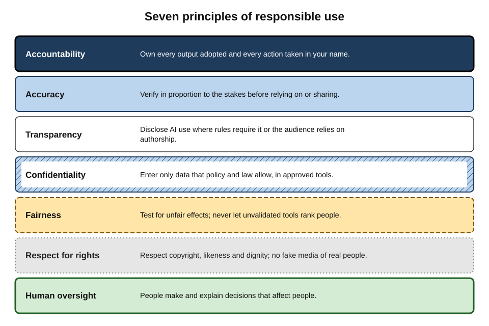
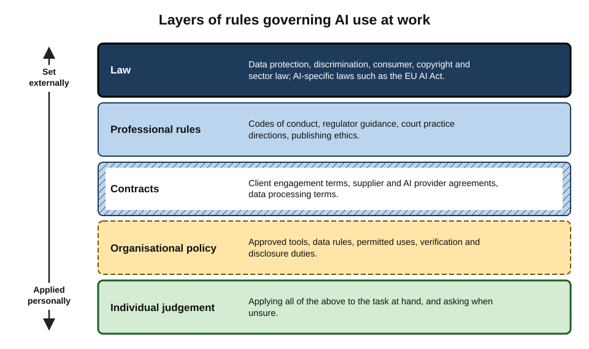
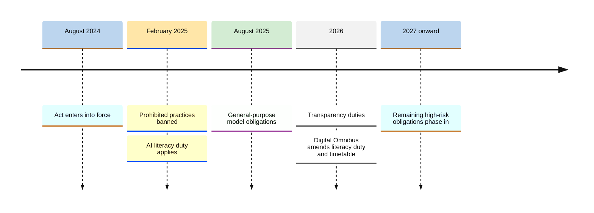
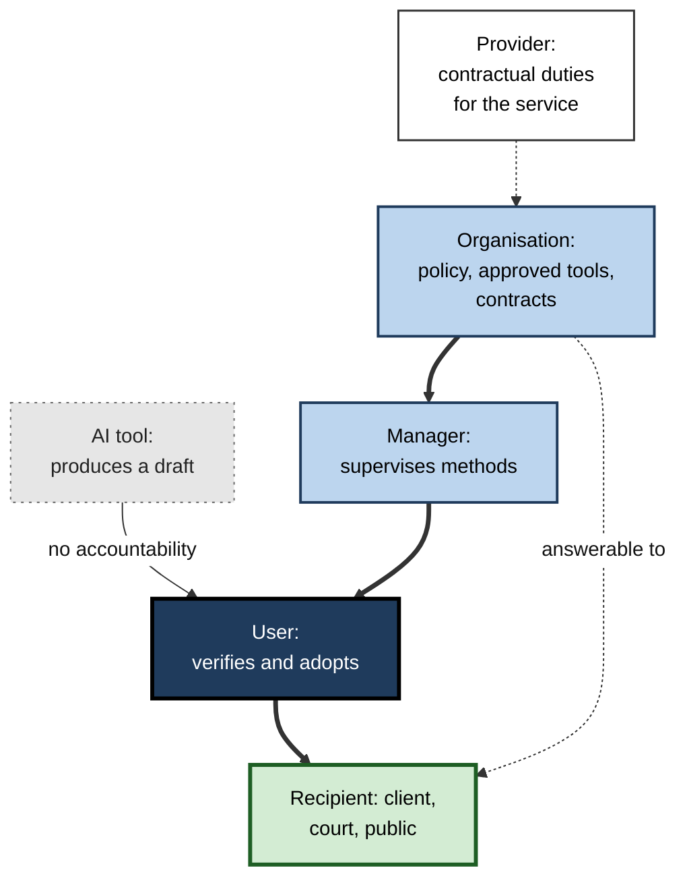
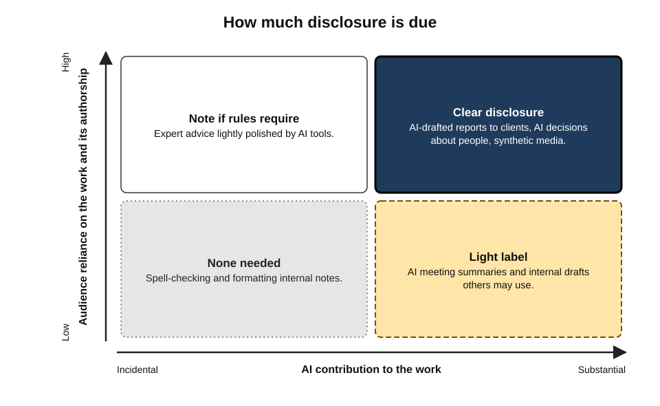
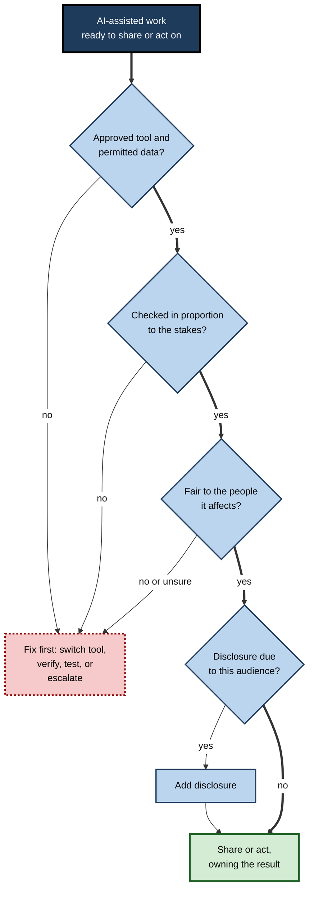

# A.10. Responsible use at work

In June 2025, two senior judges of the High Court of England and Wales issued an unusual public warning. In two separate cases, documents placed before the courts had cited legal authorities that did not exist, or misquoted real ones — material that appeared to have been produced with AI tools and not checked. The judges reminded the profession that lawyers who put such material before a court risk sanctions, regulatory referral and even criminal proceedings.

No new law was needed. Long-standing duties of honesty and competence simply applied to a new tool.

> **Definition — Responsible use of AI at work:** using AI tools in ways that are **lawful, honest, fair, secure and accountable** — consistent with professional duties and the employer's policies — with the person and organisation remaining answerable for every output they adopt and every action taken in their name.

**Why responsibility needs explicit attention**

- **Accountability does not transfer to software.** Courts, regulators, clients and employers hold people and organisations responsible.
- **AI makes some harms easier.** Fabricated sources, unfair screening, leaked confidences, misleading content and impersonation can all be produced at speed and scale.
- **Trust is the asset at stake.** One careless use can damage relationships built over years.
- **Rules are arriving.** Laws, professional guidance and employer policies increasingly set specific duties.

---

## Principles of Responsible Use

### Seven principles

- **Accountability** — the person who uses an output owns it.
  - *e.g.* a report goes out under an analyst's name; the analyst answers for every figure in it.
- **Accuracy and verification** — check outputs in proportion to the stakes before relying on or sharing them.
  - *e.g.* every citation in a legal brief opened and read.
- **Transparency and honesty** — do not mislead others about what AI did, where disclosure matters.
  - *e.g.* telling a client that a first draft was AI-assisted when the engagement terms require it.
- **Confidentiality and privacy** — put into AI tools only what policy and law allow.
  - *e.g.* no client data in unapproved tools.
- **Fairness** — avoid uses that discriminate or disadvantage people unjustly.
  - *e.g.* not using an unvalidated tool to rank job applicants.
- **Respect for rights** — respect intellectual property, likeness and personal dignity.
  - *e.g.* not generating images imitating a living artist's style for a commercial campaign without permission, or fake images of colleagues.
- **Human oversight** — keep meaningful human judgement over decisions that affect people.
  - *e.g.* a manager, not a model, decides on a performance rating.

> **Mnemonic — "A FAT CHR" ("A fat cat hunts rats"):** **A**ccountability, **F**airness, **A**ccuracy, **T**ransparency, **C**onfidentiality, **H**uman oversight, **R**espect for rights.

**Figure 1.** Seven principles of responsible AI use and the behaviour each requires.

### Where the principles come from

- **OECD AI Principles (2019, updated 2024)** — the first intergovernmental standard: inclusive growth and well-being; human rights and democratic values including fairness and privacy; transparency and explainability; robustness, security and safety; and accountability.
- **UNESCO Recommendation on the Ethics of Artificial Intelligence (2021)** — adopted by its member states, emphasising human rights, human oversight, fairness and environmental sustainability.
- **Professional codes** — older duties of competence, confidentiality, candour and supervision, now interpreted for AI.
- **Employer policies** — which turn principles into specific rules for specific tools and data.

> **Key point:** responsible use is not a new ethics invented for AI. It is the **ordinary duties of a professional** — competence, honesty, confidentiality, fairness, accountability — applied to a tool that makes them easier to breach without noticing.

---

## Layers of Rules

A professional's use of AI is governed by several layers at once, from law down to personal judgement.

**Figure 2.** The layers of rules that govern AI use at work.

### Law

- **Existing law applies in full** — data protection, discrimination, consumer protection, copyright, defamation, contract and sector regulation.
  - *e.g.* the Air Canada chatbot decision (2024): a company is responsible for what its chatbot tells customers.
- **AI-specific law is growing.** The most comprehensive is the **EU AI Act**:
  - entered into force **1 August 2024**;
  - **prohibited practices** and the **AI literacy** duty applied from **2 February 2025**;
  - obligations on providers of **general-purpose AI models** from **2 August 2025**;
  - **transparency duties** (telling people they are interacting with AI; labelling certain synthetic content) and most **high-risk** obligations were scheduled from **August 2026**;
  - in **2026** the EU adopted a "Digital Omnibus" package that, among other changes, softened the literacy duty — from ensuring a sufficient level of AI literacy to taking measures to support it — and postponed some high-risk deadlines.
- **Elsewhere:** sector regulators, data-protection authorities and courts in many countries issue AI-specific guidance; some jurisdictions regulate particular uses (*e.g.* New York City requires **bias audits** of automated employment-decision tools, enforced from **July 2023**).

> **Watch out:** the details of the EU AI Act's timetable and of the 2026 amendments were still being implemented and interpreted at the time of writing; obligations differ for **providers** (who build or place AI systems on the market) and **deployers** (who use them). Organisations should check the current text and guidance for their role.

**Figure 3.** Key application dates of the EU AI Act.

> **Definition — Deployer (EU AI Act):** a person or organisation using an AI system under its authority in a professional context — as distinct from the **provider** that develops it or places it on the market.

### Professional rules

**Study card — American Bar Association, Formal Opinion 512 (July 2024)**

- **Question:** what do existing ethics rules require of lawyers using generative AI?
- **Conclusions:**
  - **competence** — lawyers must understand the capabilities and limits of the tools they use, and verify outputs;
  - **confidentiality** — client information may be entered only where its protection is assured, and informed client consent may be needed for some tools;
  - **communication** — clients may need to be told about AI use that affects the representation;
  - **supervision** — firms must set policies and supervise staff use;
  - **fees** — lawyers may not bill for time saved as if it had been spent.
- **Significance:** a model for how professions translate old duties into AI-specific expectations.

**Study card — High Court of England and Wales, *Ayinde* and *Al-Haroun* (June 2025)**

- **Situation:** two cases referred to a Divisional Court because filings contained fictitious or misstated authorities.
- **Ruling:** the court set out that freely available generative AI tools "are not capable of conducting reliable legal research"; lawyers have a professional duty to check any research against authoritative sources before relying on it, and those responsible for supervising lawyers must ensure this happens.
- **Consequences signalled:** public admonition, regulatory referral, wasted-costs orders and, in serious cases, contempt proceedings.
- **Lesson:** the duty is old; the tool is new; the consequences are real.

- **Research and publishing** — publishing-ethics bodies and major journals state that AI tools **cannot be authors**, because they cannot take responsibility for the work; AI use must be disclosed, and authors remain accountable for accuracy and originality.
- **Healthcare, finance, engineering and other regulated fields** — regulators expect existing standards (patient safety, suitability of advice, safety-critical design) to be met whatever tools are used.

### Organisational policy

- **What a good AI acceptable-use policy covers:**
  - **approved tools and plans** — and how to request new ones;
  - **data rules** — what may and may not be entered, by data classification;
  - **permitted and prohibited uses** — *e.g.* no AI-only decisions about employees; no generation of images of real people without consent;
  - **verification duties** — proportionate to stakes;
  - **disclosure rules** — to clients, colleagues and the public;
  - **record-keeping** — when AI use must be noted;
  - **roles** — who approves, who owns each tool, who to ask;
  - **incident reporting** — how to report errors, leaks or misuse;
  - **training** — required before access to some tools.

> **Definition — AI acceptable-use policy:** an organisation's rules setting out which AI tools staff may use, for what purposes, with what data and under what safeguards.

> **In practice:** effective policies are **short, specific and enabling** — a page or two of clear rules with examples, backed by approved tools — rather than long prohibitions that staff ignore.

---

## Accuracy and Accountability

### Owning the output

- **Signing is adopting.** Anything sent, filed, published or acted on becomes the sender's statement.
- **"The AI said so" is not a defence** — in court, to a regulator, to a client or to a manager.
- **Verification in proportion to stakes:**
  - low stakes (internal brainstorming) — a read-through;
  - medium stakes (a client email) — check facts, figures, names and tone;
  - high stakes (advice, filings, publications, decisions about people) — check every claim against primary sources, with a second reviewer where appropriate.

### Supervision and juniors

- **Managers are responsible** for how their teams use AI, as for any other working method.
- **Juniors may over-rely** on AI precisely where they lack the expertise to spot errors.
- **Good practice:** agree which tasks juniors may use AI for, review their AI-assisted work more closely at first, and ask them to explain their reasoning — not only the output.

**Figure 4.** Responsibility for an AI-assisted output runs through people, not through the tool.

---

## Transparency and Disclosure

### When disclosure matters

- **When rules require it** — court practice directions, journal policies, client contracts, regulations on chatbots and synthetic media.
- **When the audience would reasonably expect to know** — a reader assumes a named columnist wrote the column; a client assumes a named expert reviewed the advice.
- **When AI shaped a decision about a person** — candidates, customers and employees may have rights to know, and to an explanation.
- **When content could mislead** — realistic synthetic images, audio or video of people or events.

### When disclosure matters less

- **Incidental assistance** — spell-checking, rephrasing a sentence, formatting a table.
- **Internal working drafts** — not relied on by others as the person's independent work.

| Use | Disclosure usually expected? | Why |
|---|---|---|
| Grammar and style suggestions on an email | No | Incidental; the author's content and judgement |
| AI first draft of a client report, substantially edited and verified | Often — check engagement terms | Client relies on the expert's work and may have views on AI |
| AI-generated image of a realistic event in marketing | Yes — label it | Could mislead; transparency duties increasingly apply |
| AI screening of job applications | Yes — to candidates, and often required by law | Decision affecting people; fairness and legal rights |
| Customer-service chatbot | Yes — users must know it is not a human | Required in many jurisdictions; basic honesty |
| Summary of meeting notes for internal use | Usually a light label | Others may rely on its accuracy |

**Figure 5.** How much disclosure is due, by how much the audience relies on the work and how much AI contributed.

> **Watch out:** disclosure has social costs as well as benefits. Experiments published in 2025 found that people who were known to use AI at work were sometimes judged **less competent or less hard-working** by others — a "disclosure penalty" that can tempt people to conceal use. Organisations that want honest disclosure need norms that treat appropriate AI use as legitimate.

### Case study: invented writers at a famous magazine

- **Situation:** in November 2023 the technology site Futurism reported that the US magazine *Sports Illustrated* had published product reviews under the bylines of writers who appeared not to exist — with author photographs available on a site selling AI-generated portraits.
- **The publisher's account:** the content came from a third-party contractor, which said it was written by humans using pen names; the publisher removed the content and ended the partnership.
- **Aftermath:** the episode drew wide criticism from the magazine's own journalists and readers, and the publisher's chief executive was dismissed weeks later amid wider troubles.
- **Diagnosis:**
  1. **Deceptive presentation** — invented personas presented as real experts.
  2. **Weak oversight of suppliers** — the organisation's name was on content it did not control.
  3. **Trust as the product** — for a publisher, credibility is the core asset.
- **Lesson:** whatever tools produce content, **honesty about authorship** and **oversight of suppliers** are the organisation's responsibility.

---

## Fairness and Decisions About People

### Why AI raises fairness risks

- **Models learn from historical data**, which may reflect past discrimination.
- **Patterns can be proxies** — postcode, name, school or gaps in employment history may stand in for protected characteristics.
- **Scale multiplies harm** — a biased tool applied to thousands of applicants harms thousands.
- **Opacity hinders challenge** — people affected may not know a tool was used, or why it rated them as it did.

**Study card — Amazon's experimental recruiting tool (reported 2018)**

- **Design:** an internal machine-learning system rated CVs, trained on about ten years of the company's past hiring data, which came mostly from men.
- **Finding:** the system learned to **penalise** CVs containing the word "women's" (as in "women's chess club captain") and to downgrade graduates of some all-women's colleges.
- **Outcome:** engineers tried to correct the specific terms but could not be sure other proxies were not at work; the project was abandoned and, according to Amazon, never used as the sole basis for hiring decisions.
- **Lesson:** a tool trained on past decisions can **automate past bias**, and removing obvious signals does not guarantee fairness.

- **Generative AI adds new forms** — assistants asked to draft performance feedback, rank candidates or summarise complaints can reproduce stereotypes in subtle wording.
- **Legal exposure** — employers remain liable under discrimination law for tools they use; litigation in the United States since 2023 has tested whether vendors of hiring software can also be held responsible.

> **Remember:** for **decisions about people** — hiring, promotion, pay, discipline, credit, access to services — AI may **assist** (drafting, organising, flagging) but a **human must decide**, with documented reasons, tested tools and a route for the person affected to challenge the outcome.

---

## Respect for Rights

### Intellectual property

- **Inputs:** uploading others' copyrighted material to AI tools may breach licences or confidentiality, even where it is not copyright infringement.
- **Outputs:**
  - may occasionally reproduce substantial parts of existing works, logos or characters;
  - may not be protected by copyright at all where there is no sufficient human authorship — the US Copyright Office has refused registration for purely AI-generated material, and a US federal appeals court upheld that position in **March 2025** (*Thaler v. Perlmutter*);
  - should be checked before commercial use, especially images, music and code.
- **Training disputes** — lawsuits by authors, artists, news organisations and music publishers against AI developers have tested whether training on copyrighted works is lawful; in **September 2025** Anthropic agreed a settlement of about **US$1.5 billion** with authors over books obtained from pirate sites. The law remains unsettled and differs by country.

> **Definition — Human authorship requirement:** the principle, applied by the US Copyright Office and courts, that copyright protects only works with sufficient human creative contribution.

### Likeness, dignity and colleagues

- **No synthetic media of real people without consent** — images, voice clones or videos of colleagues, clients or public figures, even "as a joke".
- **Recording and transcription** — meeting tools that record or transcribe require participants' knowledge and, in some jurisdictions, consent.
- **Monitoring** — using AI to analyse colleagues' messages, sentiment or productivity raises legal and ethical issues and usually requires a lawful basis, transparency and proportionality.
- **Harassment** — AI-generated demeaning content about colleagues is misconduct like any other.

### The wider footprint

- **Energy and water** — AI data centres consume substantial electricity and water for cooling, and their growth is a significant new source of demand.
- **Per-query estimates are contested** and have fallen with efficiency gains; in 2025 Google reported that a median text prompt to its Gemini apps used about 0.24 watt-hours — far less than many earlier outside estimates — while critics noted that such figures exclude training and depend on method.
- **Responsible practice:** use AI where it adds value rather than reflexively; prefer smaller, efficient models for simple tasks; avoid generating large volumes of unused content.

> **Watch out:** both "each AI query uses a bottle of water" and "AI's footprint is trivial" are oversimplifications. Estimates vary by an order of magnitude with assumptions about hardware, data-centre location, cooling and whether training is included.

---

## Worked Example: A Responsible-Use Review of a Marketing Campaign

**Situation:** a marketing team plans a campaign for a new financial product using AI for copy, images, a chatbot and audience targeting.

| Element | Principle at stake | Risk | Responsible approach |
|---|---|---|---|
| AI-drafted product copy | Accuracy, accountability | Overstated returns; missing risk warnings required by financial-promotion rules | Compliance review of every claim against product terms |
| AI-generated images of "customers" | Transparency, respect | Realistic fake people implying real testimonials | Label as illustrative or use real, consenting customers |
| Website chatbot answering product questions | Transparency, accuracy | Customers think they are talking to a person; wrong answers about fees | Disclose it is AI; ground answers in approved documents; human handover |
| AI-selected target audiences | Fairness | Excluding groups in ways that breach equality or consumer-duty rules | Test targeting outcomes; document criteria; human sign-off |
| Imitating a famous illustrator's style | Respect for rights | IP and reputational claims | Commission original work or use licensed styles |

1. **Map each element to principles.**
2. **Identify the specific risk** in this context, not in the abstract.
3. **Choose a safeguard** — review, disclosure, grounding, testing, alternative.
4. **Assign an owner** for each safeguard.

- **Conclusion:** the campaign can use AI extensively — responsibly — if each use has a **named owner** and a **proportionate safeguard**.

**Figure 6.** A quick responsible-use check before sharing or acting on AI-assisted work.

---

## Responsible Use at Organisational Scale

### Governance frameworks

- **NIST AI Risk Management Framework (US, January 2023)** — four functions:
  - **Govern** — culture, roles, policies;
  - **Map** — understand context and risks of each system;
  - **Measure** — assess and track risks with appropriate methods;
  - **Manage** — prioritise and act on risks.
  - A **Generative AI Profile** (July 2024) added risks specific to generative systems, such as confabulation, information integrity and harmful content.
- **ISO/IEC 42001 (2023)** — the first international management-system standard for AI, certifiable like ISO 27001 for information security.
- **Internal structures** — an AI governance committee, an AI register, risk tiers, review gates for high-risk uses, and incident processes.

> **Definition — AI governance:** the structures, policies, roles and processes by which an organisation directs, controls and is held accountable for its use of AI.

| | Individual responsibility | Organisational responsibility |
|---|---|---|
| Main question | Is this use appropriate, and is this output right? | Are the tools, rules and training adequate? |
| Key instruments | Judgement, verification, disclosure | Policy, approved tools, contracts, training, monitoring |
| Typical failure | Unchecked output; misuse of data | No policy; banned tools used anyway; no oversight of vendors |
| Evidence of good practice | Explainable, verified, honest work | AI register, risk tiers, audits, incident learning |

### Building a responsible culture

- **Make the responsible path the easy path** — good approved tools, clear rules, quick answers.
- **Train for judgement**, not just tool features — when not to use AI, how to verify, when to disclose.
- **Reward reporting** of errors and near-misses rather than punishing it.
- **Lead by example** — senior people disclosing and verifying their own AI use.
- **Revisit regularly** — tools, laws and risks change every few months.

---

## Common Misconceptions

- **"If the tool is approved, any use of it is responsible."**
  - Approval covers the tool and its data terms; the user still answers for accuracy, fairness, disclosure and the purpose of each use.
- **"Responsible AI is the job of the ethics or compliance team."**
  - Those teams set policy and oversee high-risk uses; most responsible-use decisions are made daily by ordinary users choosing what to enter, what to check and what to send.
- **"Disclosing AI use is admitting to cutting corners."**
  - Appropriate, verified use is a legitimate working method; concealment, when disclosure is expected, is what damages trust.
- **"If no law forbids it, it is fine."**
  - Professional standards, contracts and reputation often demand more than the law's minimum; a lawful use can still be a breach of a client's trust.
- **"Human in the loop solves everything."**
  - A reviewer who lacks time, expertise or authority to overrule the AI provides little protection; oversight must be **meaningful**.

> **In practice:** a useful personal test before adopting any AI-assisted output is the **newspaper test** — would the use, and the way it was checked, look reasonable if described on the front page alongside the person's name?

---

## Open Questions

- **What should disclosure norms be?**
  - Practice ranges from none to detailed labelling; the balance between transparency, privacy and the "disclosure penalty" is unsettled.
- **How will liability be shared along the AI supply chain?**
  - Between model providers, application builders, deployers and users — through contracts, product-liability law and AI-specific rules — the allocation is still developing.
- **Will copyright law permit training on protected works?**
  - Courts in different countries are reaching different conclusions; settlements and licensing deals are shaping practice ahead of law.
- **How strict will AI regulation become, and how consistent across countries?**
  - The EU's 2026 amendments, varied national approaches and fast-moving technology make the long-term regulatory picture uncertain.
- **What does "meaningful human oversight" require in practice?**
  - A human who rubber-stamps AI outputs provides little protection; how to design oversight that genuinely catches errors is an open research question.

---

## Summary

- **Responsible use** means lawful, honest, fair, secure and accountable use, with people and organisations answerable for outputs and actions.
- Seven principles — **A FAT CHR**: Accountability, Fairness, Accuracy, Transparency, Confidentiality, Human oversight, Respect for rights — rooted in the **OECD AI Principles**, **UNESCO's Recommendation** and existing professional duties.
- Rules come in layers: **law** (existing law plus the **EU AI Act** — in force 2024, prohibitions and literacy 2025, GPAI 2025, transparency and high-risk duties from 2026, amended by the 2026 Digital Omnibus), **professional rules** (**ABA Opinion 512**, the **2025 High Court warning**, publishing ethics), **organisational policy** and personal judgement.
- **Accuracy and accountability:** signing is adopting; verify in proportion to stakes; supervise juniors.
- **Disclosure** when rules require it, when audiences rely on authorship, when AI shapes decisions about people, or when content could mislead; beware the **disclosure penalty**.
- **Fairness:** AI can automate past bias (Amazon's recruiting tool); humans decide about people.
- **Respect for rights:** copyright and human-authorship limits; no synthetic media of real people without consent; lawful, proportionate monitoring; awareness of environmental footprint.
- Organisations govern with **NIST AI RMF** (Govern, Map, Measure, Manage), **ISO/IEC 42001**, an AI register, risk tiers and a culture that makes responsible use easy.

---

## Self-Check

1. Define responsible use of AI at work.
2. List the seven principles and give a workplace behaviour for each.
3. Why is responsible use described as "ordinary professional duties applied to a new tool"?
4. Summarise the EU AI Act's application timeline and the main effect of the 2026 amendments on the literacy duty.
5. Distinguish a provider from a deployer under the EU AI Act.
6. What did ABA Formal Opinion 512 conclude?
7. What did the High Court warn in June 2025, and what consequences did it signal?
8. Give three situations where disclosure of AI use is expected and two where it usually is not.
9. What is the "disclosure penalty", and how should organisations respond?
10. What does the Amazon recruiting tool show about fairness?
11. Can purely AI-generated content be protected by copyright in the United States? Explain.
12. Name the four functions of the NIST AI RMF.
13. Apply the responsible-use check to an AI-drafted performance review a manager plans to send to an employee.
14. A team wants to clone the chief executive's voice for an internal training video "to make it engaging". Advise.

### Answer Key

1. Using AI tools in ways that are lawful, honest, fair, secure and accountable, consistent with professional duties and employer policy, with the person and organisation remaining answerable for outputs adopted and actions taken.
2. Accountability — own every output sent. Fairness — no unvalidated ranking of people. Accuracy — verify facts before sharing. Transparency — disclose where audiences rely on authorship. Confidentiality — permitted data only. Human oversight — humans decide about people. Respect for rights — no imitation of artists or fake images of colleagues.
3. Competence, honesty, confidentiality, fairness and accountability already bind professionals; AI makes breaches easier and faster but does not change the duties, as courts and professional bodies confirm.
4. In force August 2024; prohibitions and AI literacy February 2025; general-purpose model obligations August 2025; transparency and most high-risk duties scheduled from August 2026, with further phasing. The 2026 Digital Omnibus changed the literacy duty from ensuring a sufficient level to taking measures to support AI literacy, and adjusted some deadlines.
5. A provider develops an AI system or places it on the market; a deployer uses it under its authority in a professional context.
6. Lawyers must understand tools and verify outputs (competence), protect client information and sometimes obtain consent (confidentiality), inform clients where relevant (communication), supervise staff and set policies, and not bill time saved as if spent.
7. Freely available generative AI cannot conduct reliable legal research; lawyers must check research against authoritative sources, and supervisors must ensure it. Consequences: admonition, regulatory referral, wasted-costs orders and potentially contempt proceedings.
8. Expected: AI screening of job applicants; customer-service chatbots; realistic AI images in marketing (also: client reports where terms require). Usually not: grammar suggestions; internal working drafts.
9. People known to use AI may be judged less competent or hard-working, tempting concealment. Organisations should set norms treating appropriate, verified AI use as legitimate and lead by example.
10. Trained on past hiring dominated by men, it penalised indicators of women; removing obvious terms could not ensure fairness — AI can automate historical bias through proxies.
11. Generally no: the Copyright Office requires sufficient human authorship, and the appeals court in Thaler v. Perlmutter (2025) upheld refusal for an AI-generated work; works with substantial human creative contribution may be protected for the human contribution.
12. Govern, Map, Measure, Manage.
13. Approved tool and permitted data? Personnel data needs an approved tool. Checked? Every statement about performance verified against evidence. Fair? Wording reviewed for bias and consistency with how others are treated. Disclosure? Consider whether policy requires it. The manager must decide and own the content; AI may help with structure and wording only.
14. Cloning a real person's voice raises consent, dignity and deepfake-risk issues; even with consent it normalises synthetic impersonation that fraudsters exploit. If pursued at all: explicit written consent, clear labelling as synthetic, restricted distribution, and security review — but a real recording or an obviously synthetic narrator is the more responsible choice.

---

## Glossary

| Term | Meaning |
|---|---|
| AI acceptable-use policy | Organisational rules on which AI tools may be used, for what and with what data. |
| AI governance | Structures, policies, roles and processes for directing and controlling AI use. |
| Bias audit | An assessment of whether an automated tool's outcomes differ unfairly between groups. |
| Deployer | Under the EU AI Act, an organisation using an AI system in a professional context. |
| Digital Omnibus | A 2026 EU legislative package amending the AI Act and other digital rules. |
| Disclosure penalty | Lower judgements of competence or effort toward people known to use AI. |
| EU AI Act | The European Union's comprehensive regulation of AI systems, in force from 2024. |
| Human authorship requirement | The principle that copyright protects only works with sufficient human creativity. |
| Human oversight | Meaningful human judgement over AI-influenced decisions, especially about people. |
| ISO/IEC 42001 | The international management-system standard for AI. |
| NIST AI RMF | The US framework for managing AI risk: Govern, Map, Measure, Manage. |
| OECD AI Principles | The first intergovernmental principles for trustworthy AI (2019, updated 2024). |
| Prohibited practice | An AI use banned outright under the EU AI Act. |
| Provider | Under the EU AI Act, the developer or entity placing an AI system on the market. |
| Proxy variable | A feature that indirectly stands in for a protected characteristic. |
| Responsible use | Lawful, honest, fair, secure and accountable use of AI with retained accountability. |
| Synthetic media | AI-generated or manipulated images, audio or video. |
