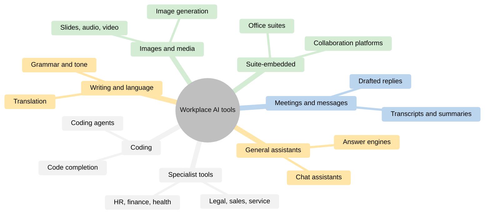
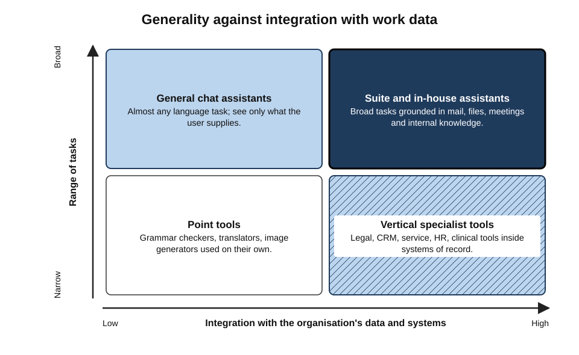
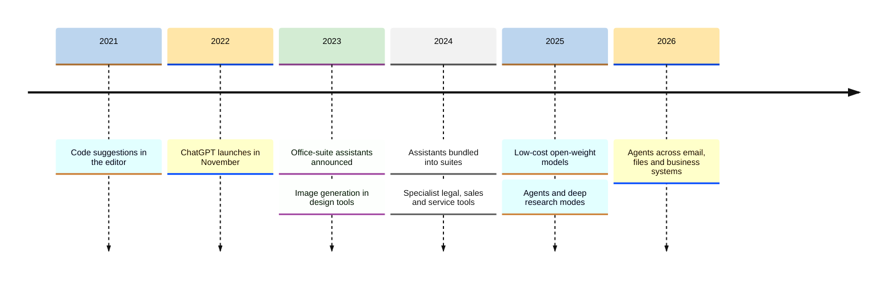
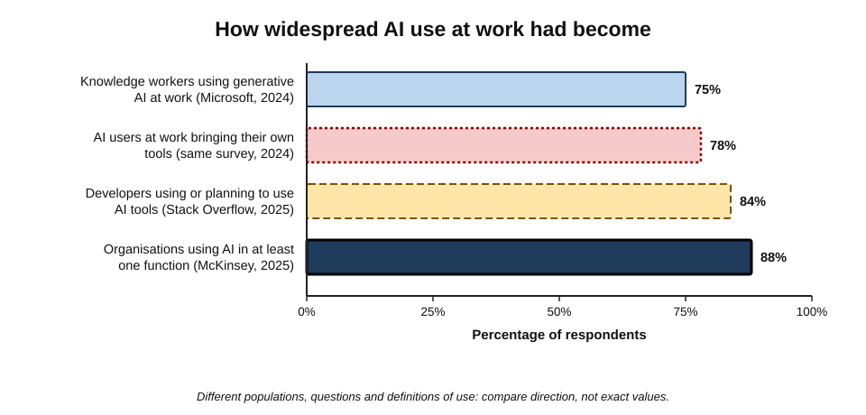
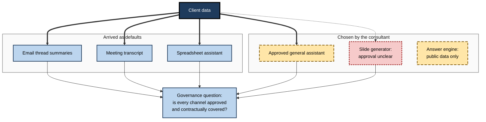
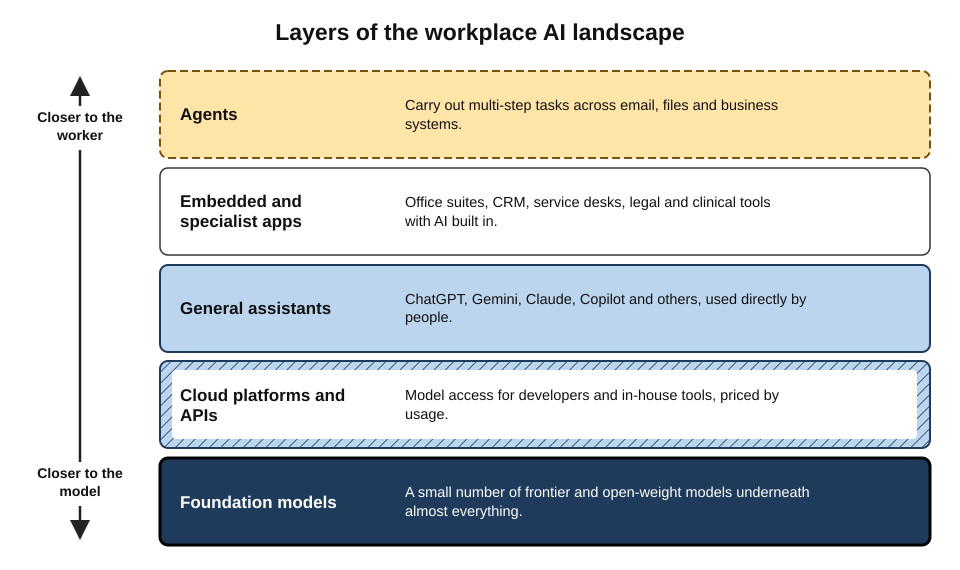

# A.3. Common AI tools in the workplace

On a single working day in 2026, an analyst may draft a briefing in a chat assistant, accept a formula suggested inside a spreadsheet, read a meeting summary written by the video-call software, ask an answer engine for the latest regulation, and approve a reply that the help-desk system drafted for a customer. That is five AI tools from five vendors, three of which the analyst never deliberately chose.

Knowing the landscape — what kinds of tool exist, who makes them, and how they reach people — is basic workplace literacy.

> **Definition — Workplace AI tool:** an AI-based product or feature used to carry out work tasks — whether chosen by an individual, supplied by an employer, or built into software the organisation already uses.

**Why knowing the landscape matters**

- **Recognition.** Many AI tools arrive unannounced, inside familiar software.
- **Choice.** Different categories suit different tasks and carry different data terms.
- **Compliance.** Employers increasingly approve some tools and forbid others; employees must know which is which.
- **Career value.** Fluency with the tools used in a profession is now part of being competent in it.

> **Watch out:** product names, prices and market positions in this field change every few months. The figures and examples below are dated; the **categories** are far more stable than the brands.

---

## The Main Categories

### A map of the landscape

Workplace AI tools fall into eight broad categories, distinguished by **how general** they are and **where they live**.

- **General-purpose assistants** — standalone chat assistants that can attempt almost any language task.
- **Suite-embedded assistants** — assistants built into office and collaboration suites, with access to the user's documents, mail and meetings.
- **Coding assistants** — tools that suggest, write, explain and review software code.
- **Meeting and communication tools** — transcription, summaries, translation and drafting inside calls, chat and email.
- **Writing and language tools** — grammar, style, tone and translation services.
- **Image, design and media tools** — generation and editing of images, slides, audio and video.
- **Search and research tools** — answer engines and "deep research" tools that search the web and compose cited reports.
- **Function-specific (vertical) tools** — AI built for one profession or business function: legal, sales, customer service, HR, finance, healthcare.

> **Mnemonic — "Good Staff Can Make Wise Images, Search, Specialise":** General, Suite, Coding, Meeting, Writing, Image, Search, Specialist.

**Figure 1.** The main categories of AI tools found in workplaces.

### The categories compared

| Category | Typical examples (2026) | Access to work data | Who usually chooses it | Main strength |
|---|---|---|---|---|
| General-purpose assistant | ChatGPT, Gemini, Claude, Microsoft Copilot | Only what is pasted, uploaded or connected | Individual, increasingly the employer | Breadth: almost any language task |
| Suite-embedded assistant | Microsoft 365 Copilot, Gemini in Google Workspace | The user's files, mail, calendar, chats | The organisation | Grounding in the user's own work |
| Coding assistant | GitHub Copilot, Cursor, Claude Code, OpenAI Codex | The code repository and terminal | Engineering teams | Speed on routine code |
| Meeting and communication | Teams, Zoom and Slack AI features; dedicated note-takers | Recordings, transcripts, threads | Usually the platform default | Capturing and condensing conversation |
| Function-specific | Legal research assistants, CRM and service agents | The function's systems of record | Department heads | Fit to one domain's tasks and rules |

---

## General-Purpose Assistants

### What they are

- **Standalone chat assistants** reached through a website, desktop app or phone app.
- **Built on a provider's own frontier models**, with features layered on top:
  - file and image upload;
  - web search with citations;
  - voice conversation;
  - code execution and data analysis;
  - image generation;
  - "projects" or workspaces that keep instructions and files together;
  - memory of the user's preferences;
  - connectors to email, calendars and cloud storage;
  - agent features that carry out multi-step tasks.

> **Definition — Frontier model:** one of the most capable general-purpose AI models available at a given time, typically developed by a small number of well-funded laboratories.

### The main providers (as of 2026)

- **OpenAI — ChatGPT.**
  - Launched 30 November 2022; the product that brought generative AI to the mass market.
  - OpenAI reported around **800 million weekly users** in October 2025; third-party estimates during 2026 put it near or above one billion.
- **Google — Gemini.**
  - Successor to Bard (2023); integrated across Android, Chrome, Search and Workspace.
  - Google reported its Gemini app in the high hundreds of millions of monthly users during 2026, approaching a billion.
- **Anthropic — Claude.**
  - Smaller consumer audience but strong in business and software-development use; surveys of enterprise spending in 2025–26 reported Anthropic's models leading or near-leading in enterprise use of model APIs.
- **Microsoft — Copilot.**
  - The consumer assistant built into Windows and Edge, distinct from the paid Microsoft 365 Copilot for organisations.
- **Others:**
  - **Meta AI** — inside WhatsApp, Instagram and Facebook;
  - **Grok** (xAI) — integrated with X;
  - **DeepSeek** (China) — drew global attention in January 2025 with a capable, low-cost reasoning model released with open weights;
  - **Mistral** (France) — Le Chat assistant and open-weight models, often chosen for European data residency;
  - **Perplexity** — an "answer engine" centred on cited web search.

> **Watch out:** usage statistics are mostly **self-reported by companies** or **estimated from web traffic**. Definitions of a "user" differ (weekly versus monthly; app versus web; deliberate use versus AI features shown automatically in search). Treat league tables as indications, not facts.

> **Key point:** the leading general assistants converge in features every few months. For most everyday tasks, the differences that matter at work are less about raw capability and more about **data terms, integration with the organisation's systems, and whether the employer has approved the tool**.

---

## Assistants Inside the Software People Already Use

### Office and collaboration suites

- **Microsoft 365 Copilot** — announced March 2023, generally available to large organisations from November 2023 as a paid add-on.
  - Works across Word, Excel, PowerPoint, Outlook and Teams.
  - Draws on the user's organisational data through **Microsoft Graph** — mail, files, chats and meetings the user is already permitted to see.
- **Gemini in Google Workspace** — AI features in Gmail, Docs, Sheets, Slides and Meet; bundled into Workspace business plans from early 2025.
- **Other platforms** — Slack, Zoom, Notion, Atlassian, Salesforce, Adobe and many more add assistants to their own products.

> **Definition — Grounding in work data:** supplying an AI tool with the user's own documents, messages and records at the moment of use, so that its outputs reflect the organisation's actual information.

### Why embedding changes the picture

- **Convenience** — no copying between windows; the assistant sees the document being edited.
- **Context** — "summarise what was agreed with this client last quarter" becomes possible.
- **Permission inheritance** — the assistant can surface anything the user is allowed to open.
  - **Benefit:** it respects existing access controls.
  - **Risk:** years of over-shared folders become instantly searchable.

> **Watch out:** a classic failure in early suite-assistant roll-outs was **oversharing**: staff asking innocent questions received answers drawn from salary spreadsheets or HR files that had been left accessible to "everyone" for years. The assistant did not break permissions — it exposed how loose they already were.

> **In practice:** before enabling a suite assistant, organisations audit sharing permissions, apply **sensitivity labels** to confidential content, and pilot with a small group whose questions are reviewed.

---

## Coding Assistants

### From autocomplete to agents

- **2021** — GitHub Copilot preview: line-by-line code suggestions in the editor; generally available in 2022.
- **2023–2024** — chat inside the editor; explanation, test-writing and refactoring.
- **2025–2026** — **coding agents** that read a whole repository, plan changes across many files, run tests and propose finished pull requests.
  - Examples: GitHub Copilot's agent mode, Cursor, Claude Code, OpenAI Codex, Google's Gemini tools.

### Adoption and trust

- **Stack Overflow Developer Survey (2025):** more than four in five respondents were using or planning to use AI tools in development — yet trust in the accuracy of AI output **fell** compared with earlier years, and more developers distrusted than trusted it.
- **Pattern:** high use, cautious trust — the healthy combination when tools are useful but fallible.

> **Watch out:** evidence on coding productivity is mixed. Controlled studies of simple tasks found large speed gains, while a 2025 randomised trial by the research group METR found experienced developers working on their own large, familiar codebases were about **19% slower** with early-2025 tools, despite believing they were faster. METR's later 2026 follow-up suggested improvement with newer tools but with wide uncertainty. Gains depend heavily on task, codebase and experience.

---

## Communication, Writing and Media Tools

These categories are the most visible to non-specialists; each deserves only a brief sketch here.

- **Meetings** — automatic transcripts, summaries, action lists and "catch me up" features in video-call platforms, plus dedicated note-taking bots that join calls.
- **Email and messaging** — summarising long threads, suggesting replies, adjusting tone, translating.
- **Writing and language** — grammar and style tools (such as Grammarly) and translation services (such as DeepL) now include generative rewriting.
- **Spreadsheets and data** — suggesting formulas, explaining tables, building charts and running analyses from a plain-language request.
- **Images, slides and media** — generating images (Midjourney, Adobe Firefly, image features inside the main assistants), building slide decks from outlines, editing photos, generating voice-overs and short videos.
- **Search and research** — answer engines and **deep research** modes that spend minutes browsing and return a long cited report.

> **Definition — Deep research tool:** an AI feature that autonomously runs many web searches, reads sources and writes a structured report with citations, typically over several minutes.

> **Key point:** in these categories AI is usually a **feature**, not a product — a button that appears inside a tool the user already relies on.

---

## Function-Specific Tools

### Built for one domain

- **Legal** — research and drafting assistants trained or grounded on case law and firm precedents (*e.g.* Harvey; Thomson Reuters CoCounsel; LexisNexis's assistant).
- **Sales and CRM** — lead scoring, email drafting, call analysis, and autonomous sales agents (*e.g.* Salesforce's Agentforce, launched in 2024).
- **Customer service** — chatbots and agent-assist tools that draft answers from knowledge bases (*e.g.* Zendesk, Intercom).
- **Human resources** — job-description drafting, CV screening, interview scheduling, employee self-service.
- **Finance** — invoice reading, reconciliation, anomaly detection, variance commentary.
- **Healthcare** — **ambient clinical scribes** that listen to consultations and draft clinical notes for the clinician to check.
- **Software operations** — incident summaries, log analysis, automated fixes.

> **Definition — Vertical AI tool:** an AI product built for a specific industry or professional function, combining a general model with domain data, workflows and safeguards.

### Generalist versus specialist

| | General-purpose assistant | Vertical (specialist) tool |
|---|---|---|
| Breadth | Very wide | Narrow |
| Domain knowledge | General; may be outdated or unspecific | Grounded in curated domain sources |
| Fit to workflow | User adapts the output | Built into the profession's systems |
| Cost | Lower per seat | Usually higher, priced for the profession |
| Typical risk | Confident errors on specialist questions | Over-trust because it "is built for us" |
| Best use | Varied drafting, thinking, explanation | Repeated, high-value domain tasks |

> **Watch out:** a specialist label does not remove the need to verify. Specialist legal research tools have also been shown, in independent testing published in 2024 by Stanford researchers, to produce incorrect or unsupported answers in a meaningful share of queries — fewer than general assistants, but far from none.

---

## In-House Tools and Platforms

- **Many large organisations build their own assistants** on models accessed through cloud platforms (*e.g.* Azure OpenAI, Amazon Bedrock, Google Vertex AI).
- **Why build:**
  - keep data within the organisation's own cloud agreements;
  - ground answers in internal knowledge (policies, product documents, case histories);
  - add company-specific guardrails and logging;
  - choose or switch between models.
- **What employees see:** a branded internal assistant ("Ask HR", "Policy Bot", a firm-wide assistant) that looks like any other chat tool.

### Open-weight, on-device and regional options

- **Open-weight models** — released for anyone to download and run (*e.g.* Meta's Llama family, Mistral's models, DeepSeek, Alibaba's Qwen, Google's Gemma and, from 2025, OpenAI's first open-weight releases).
  - Attractive where data must never leave the organisation's own servers, or where costs at high volume matter.
  - Require in-house skills to host, secure, evaluate and update.
- **On-device AI** — smaller models running on laptops and phones (*e.g.* features in recent Windows, macOS, iOS and Android devices).
  - Useful for private, offline or instant tasks such as transcription and text clean-up.
  - Less capable than the largest cloud models; complex requests may be passed to the cloud.
- **Regional and "sovereign" offerings** — providers and hosting arrangements chosen to keep data and control within a jurisdiction (*e.g.* European providers and EU-hosted versions of major models).
  - Driven by data-protection law, public-sector rules and geopolitical caution.

> **Definition — Sovereign AI:** AI capability — models, hosting and data — kept under the legal and operational control of a particular country or region.

| | Proprietary cloud assistant | Open-weight model, self-hosted | On-device model |
|---|---|---|---|
| Capability | Highest available | High, usually somewhat behind the frontier | Modest |
| Where data goes | Provider's cloud, under contract terms | Stays on the organisation's infrastructure | Stays on the device |
| Skills needed to run it | Almost none | Substantial engineering and security | None for the user |
| Cost pattern | Subscription or per-token fees | Hardware and staff, cheaper at high volume | Included in the device |
| Control over updates | Provider decides | Organisation decides | Device maker decides |

> **Watch out:** models from some jurisdictions raise additional concerns. In January 2025 Italy's data-protection authority ordered DeepSeek's consumer app blocked over unanswered questions about its handling of personal data, and several governments restricted its use on official devices. Running an open-weight model on one's own servers is a different matter from using the provider's hosted app — the data question depends on **where the model runs**, not only on who trained it.

**Figure 2.** Where workplace AI tools sit by how general they are and how deeply they connect to work data.

---

## How the Landscape Arrived

**Figure 3.** Milestones in the arrival of AI tools in everyday work.

### How workers actually adopted the tools

- **Bottom-up first.** Early use was driven by individuals experimenting with consumer accounts.
  - **Microsoft and LinkedIn Work Trend Index (May 2024):** about **three-quarters** of surveyed knowledge workers used generative AI at work, and most of those users brought their own tools rather than waiting for employer provision.
- **Top-down later.** From 2024 organisations licensed approved tools, often to bring this "shadow" use under control.
- **Organisational use broadened.** McKinsey's global survey published in late 2025 found that a large majority of organisations — close to nine in ten — reported regular AI use in at least one business function, but only a minority had scaled it across the enterprise.
- **Unapproved use persisted.** Security-industry surveys in 2025–26 consistently found that a large share of employees — often half or more — still used AI tools their employer had not approved.

> **Definition — Shadow AI:** use of AI tools at work without the knowledge or approval of the organisation's IT, security or risk functions.

**Figure 4.** Selected survey findings on AI use at work, 2024–2025.

> **Watch out:** survey percentages depend heavily on who was asked and how "use" was defined. Vendor-sponsored surveys tend to report higher adoption. The robust conclusion is directional: **use is widespread, uneven, and often ahead of policy**.

---

## Worked Example: Mapping One Professional's Day

**Situation:** a management consultant lists the AI tools that touched one working day.

| Time | Task | Tool category | Chosen by | Data involved |
|---|---|---|---|---|
| 08:30 | Catch up on overnight client emails | Suite-embedded (thread summaries) | Employer default | Client correspondence |
| 09:30 | Weekly team call | Meeting tool (transcript, action list) | Platform default | Spoken discussion, names |
| 11:00 | Draft an interview guide | General-purpose assistant (approved enterprise licence) | Individual, within policy | Project brief |
| 13:00 | Check a new regulation | Search and research (answer engine) | Individual | Public information only |
| 15:00 | Build a market-sizing model | Spreadsheet assistant | Employer default | Client figures |
| 17:00 | Turn findings into slides | Presentation generator | Individual | Draft findings |

1. **Count the tools:** six AI touchpoints, across at least four vendors.
2. **Note who chose them:** half arrived as defaults.
3. **Note the data:** client information passed through four of them.
4. **Ask the governance question:** which of these tools are covered by the firm's contracts and data terms, and which (if any) used a personal account?

- **Conclusion:** the day's real risk lies not in the one deliberate chat session but in the **number of channels** through which client data passed — each needs to be an approved, contractually covered tool.

**Figure 5.** One working day, many AI touchpoints, each a separate data channel.

---

## The Professional Picture

### What experienced users know about the landscape

- **Capabilities leapfrog.** The "best" model changes every few months; loyalty to a single brand is less useful than understanding categories and evaluating on one's own tasks.
- **Integration beats raw intelligence** for most work: a slightly weaker model that can see the right documents often outperforms a stronger one that cannot.
- **Data terms differ by plan, not by brand.** The same provider may train on consumer conversations by default while contractually excluding business data.
- **Defaults are decisions.** Features switched on by vendors still need an owner and a policy.
- **Specialist tools earn their price** only where tasks are frequent, high-value and well matched to the tool's domain data.

**Figure 6.** The layers of the workplace AI landscape, from models to the tools employees touch.

### Case study: a payments company's customer-service assistant

- **Situation:** in February 2024 the Swedish payments company Klarna announced that its AI customer-service assistant, built on OpenAI models, had handled about **2.3 million conversations in its first month** — around two-thirds of its service chats.
- **Claims made:**
  - the assistant did work equivalent to about **700 full-time agents**;
  - resolution times fell from around eleven minutes to under two;
  - customer satisfaction was reported to be on a par with human agents.
- **Subsequent course:**
  - The company slowed human hiring and promoted AI as central to its strategy.
  - By **2025**, its chief executive said publicly that a focus on cost had reduced quality in some interactions, and that customers should always be able to reach a human; the company began recruiting human agents again for a flexible service model.
- **Diagnosis:**
  1. The assistant handled **high-volume, well-documented** queries (refunds, payment dates) well.
  2. Complex, emotional or unusual cases still needed human judgement.
  3. Early metrics emphasised speed and volume more than quality and loyalty.
- **Lesson:** the strongest deployments **divide the work** — AI for routine, documented cases; people for judgement, empathy and exceptions — and measure quality, not only cost.

> **Watch out:** early announcements of AI replacing large numbers of staff are frequently revised. Treat headline figures as claims to examine — what tasks, measured how, over what period — rather than as settled evidence.

### Case study: a law firm's firm-wide roll-out

- **Situation:** in February 2023 the international law firm Allen & Overy (now A&O Shearman) announced a firm-wide roll-out of Harvey, a legal AI assistant built on OpenAI models, to about **3,500 lawyers** after a trial.
- **Approach:**
  - presented explicitly as a **first-draft and research aid**, not a source of final advice;
  - outputs to be checked by a lawyer before use;
  - a dedicated team to gather use cases and manage risk.
- **Significance:** one of the first large professional firms to make generative AI an approved, firm-wide tool rather than a forbidden one — a model later followed across legal, accounting and consulting.
- **Lesson:** professional adoption succeeds when the tool is **approved, supported and bounded** by explicit verification duties.

---

## Open Questions

- **Will general assistants absorb specialist tools?**
  - General models keep improving on domain tasks; specialists argue that curated data, workflow fit and liability arrangements will keep them distinct. The balance is unsettled.
- **How concentrated will the market become?**
  - A handful of model providers supply most tools; open-weight models and regional providers push the other way.
- **What is the real productivity effect at organisational scale?**
  - Task-level studies show gains; organisation-wide financial effects are harder to demonstrate, and 2025 reports that most enterprise pilots produced no measurable profit impact are contested on method.
- **How will usage be measured honestly?**
  - Vendor-reported user numbers and sponsored surveys dominate; independent measurement of actual workplace use remains thin.

---

## Summary

- Workplace AI tools fall into eight categories: **general-purpose assistants, suite-embedded assistants, coding assistants, meeting and communication tools, writing and language tools, image and media tools, search and research tools, and function-specific (vertical) tools**, plus **in-house** assistants built on cloud platforms.
- Leading general assistants (2026): **ChatGPT, Gemini, Claude, Microsoft Copilot**, with Meta AI, Grok, DeepSeek, Mistral and Perplexity; usage figures are company-reported or estimated and should be read cautiously.
- **Suite-embedded assistants** ground answers in the user's own data and inherit permissions — which can expose **oversharing**.
- **Coding assistants** have moved from autocomplete to agents; use is very high, trust cautious, productivity evidence mixed (METR 2025).
- **Vertical tools** fit domain workflows but still need verification.
- Adoption was **bottom-up** (most users brought their own tools, 2024) then **top-down**; **shadow AI** persists.
- Professionals focus on **categories, integration and data terms** more than brands; the strongest deployments **divide work** between AI and people (Klarna) and bound use with **verification duties** (A&O and Harvey).

---

## Self-Check

1. Name the eight main categories of workplace AI tools and give an example of each.
2. What distinguishes a suite-embedded assistant from a general-purpose assistant?
3. Explain "permission inheritance" and the oversharing problem it can expose.
4. Why should published user numbers for AI assistants be read with caution?
5. How have coding assistants changed between 2021 and 2026?
6. What did the 2025 METR trial find, and why does it not settle the question of coding productivity?
7. What is a vertical AI tool? Give two advantages and one risk compared with a general assistant.
8. Why do some organisations build in-house assistants on cloud model platforms?
9. What is shadow AI, and what did the 2024 Work Trend Index suggest about how it arose?
10. In the worked example, why is the governance risk not concentrated in the deliberate chat session?
11. What does the Klarna case teach about measuring AI customer-service deployments?
12. What made the A&O roll-out of Harvey significant, and what conditions supported it?
13. A team leader wants to pick "the best AI tool" by reading a ranking website. What would a more professional approach consider?
14. An organisation plans to switch on a suite assistant for all staff next week. What two preparatory steps are most important, and why?

### Answer Key

1. General-purpose assistants (ChatGPT); suite-embedded (Microsoft 365 Copilot); coding (GitHub Copilot); meeting and communication (call transcripts and summaries); writing and language (DeepL); image and media (Adobe Firefly); search and research (deep research tools); function-specific (legal research assistants, CRM agents).
2. A general assistant is standalone and sees only what the user provides; a suite-embedded assistant lives inside office software and can draw on the user's files, mail, calendar and chats, grounding its outputs in work data.
3. The assistant can access anything the user is permitted to open. If permissions are loose — sensitive files shared with everyone — the assistant makes that content easy to find, exposing pre-existing oversharing.
4. Most are self-reported or estimated from web traffic; definitions differ (weekly vs monthly, app vs web, deliberate vs automatic exposure); vendor-sponsored surveys inflate adoption.
5. From line-by-line suggestions (2021) to in-editor chat and explanation (2023–24) to agents that plan multi-file changes, run tests and propose finished pull requests (2025–26).
6. Experienced developers on large familiar codebases were about 19% slower with early-2025 tools while believing they were faster. It covered one setting, few developers and older tools; other studies show gains on different tasks, and METR's 2026 follow-up suggested improvement with wide uncertainty.
7. An AI product built for one industry or function. Advantages: grounding in curated domain sources; fit to the profession's workflow. Risk: over-trust because it is "built for us" — independent testing shows specialist tools still err.
8. To keep data within their own cloud agreements, ground answers in internal knowledge, add company-specific guardrails and logging, and retain the ability to choose or switch models.
9. Use of AI at work without IT, security or risk approval. The Work Trend Index found most AI users at work brought their own tools rather than waiting for employer provision — adoption ran ahead of policy.
10. Client data passed through several tools, half of them defaults; each is a separate data channel needing approval and contractual cover. Risk scales with the number of channels, not the visibility of the use.
11. Early metrics (volume, speed, cost) looked excellent, but quality on complex cases suffered; the company later re-emphasised human access. Measure quality and customer outcomes, not only efficiency, and divide work between AI and people.
12. One of the first large professional firms to approve a generative tool firm-wide (about 3,500 lawyers, 2023). Conditions: a trial first, framing as a draft and research aid, mandatory lawyer review, and a team managing use cases and risk.
13. Define the team's actual tasks and data; prefer tools already approved and contractually covered; test candidates on real tasks; weigh integration with existing systems and data terms by plan; plan for frequent change rather than a permanent winner.
14. Audit and tighten sharing permissions and apply sensitivity labels, because the assistant will surface anything users can access; and run a monitored pilot with a small group to find problems before universal roll-out. (Training staff on verification and policy is a close third.)

---

## Glossary

| Term | Meaning |
|---|---|
| Ambient clinical scribe | A tool that listens to consultations and drafts clinical notes for checking. |
| Answer engine | A search tool that composes a direct, cited answer rather than a list of links. |
| Coding agent | A coding tool that plans and carries out multi-file changes and runs tests. |
| Deep research tool | An AI feature that runs many searches and writes a long cited report. |
| Frontier model | One of the most capable general-purpose models available at a given time. |
| General-purpose assistant | A standalone AI assistant that can attempt almost any language task. |
| Grounding in work data | Supplying the user's own documents and records to an AI tool at the moment of use. |
| In-house assistant | An organisation's own AI assistant built on a model accessed through a cloud platform. |
| Open-weight model | A model whose trained parameters are published for others to run. |
| Oversharing | Content accessible to far more people than intended, exposed when an AI assistant searches it. |
| Permission inheritance | An embedded assistant's access matching whatever the user is allowed to see. |
| Sensitivity label | A tag on a document marking its confidentiality, used to control access and AI processing. |
| Shadow AI | AI use at work without approval from IT, security or risk functions. |
| Sovereign AI | AI models, hosting and data kept under a country's or region's control. |
| Suite-embedded assistant | An assistant built into an office or collaboration suite. |
| Vertical AI tool | An AI product built for one industry or professional function. |
| Work Trend Index | A Microsoft and LinkedIn survey series on how people work, including AI use. |
