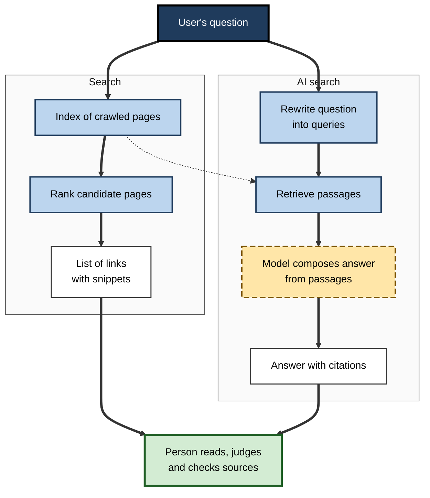
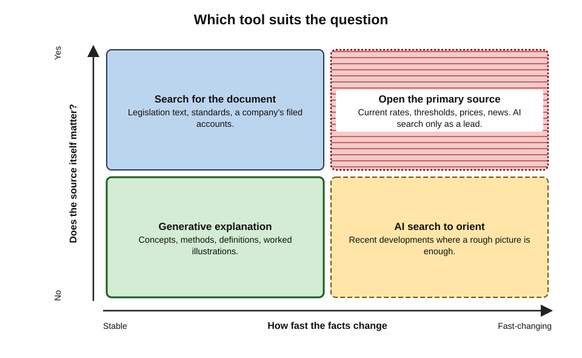
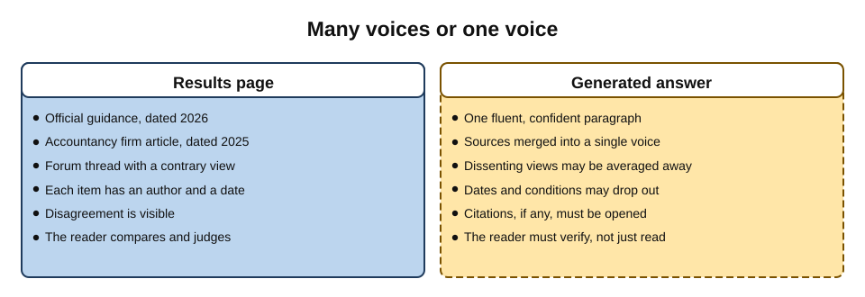
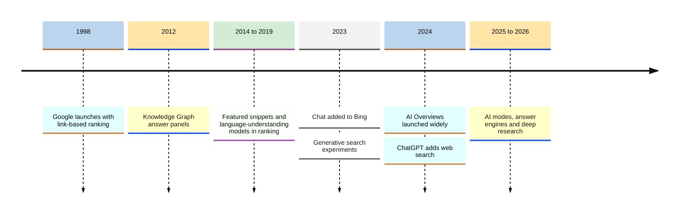
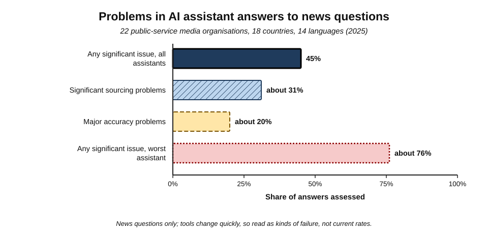
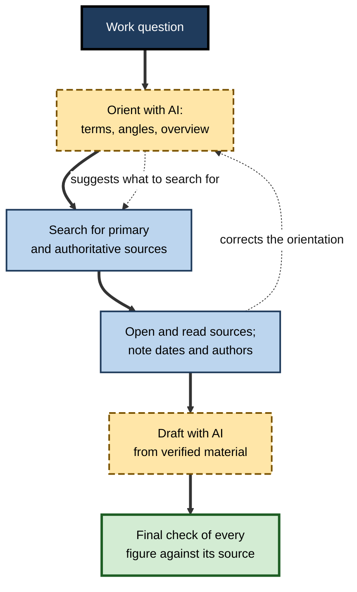

# A.5. How AI tools are different from search

Type "UK VAT registration threshold" into a search engine and it returns a page of links, with the government's own guidance near the top; the reader clicks, reads and checks the date. Type the same words into a chat assistant without web access and it replies in a confident sentence — which may quote a threshold that was correct when its training data was collected but has since changed. The two experiences look similar: a box, a question, an answer. Underneath, one tool **finds** documents and the other **composes** text.

> **Definition — Search engine:** a system that **retrieves and ranks existing documents** from an index of the web (or another collection) according to their estimated relevance to a query, and points the user to them.

> **Definition — Generative AI answer:** a response **composed by a language model** from patterns learned in training and, in some products, from documents retrieved at the time of the question — presented as new text rather than as a list of sources.

**Why the difference matters**

- **Provenance.** A search result has an author and a date; a generated sentence has neither unless the tool supplies sources.
- **Failure modes.** Search can surface bad pages; generation can produce statements that appear on no page at all.
- **Freshness.** Search indexes are updated continually; a model's built-in knowledge stops at its training cut-off.
- **Responsibility.** Professionals must know which kind of evidence they hold before they rely on it.

---

## How Search Works

### Crawl, index, rank

- **Crawling** — automated programs ("crawlers" or "spiders") follow links and download pages.
- **Indexing** — the engine records which words, entities and topics appear on which pages, like the index at the back of a book.
- **Ranking** — for each query, candidate pages are ordered by hundreds of signals:
  - relevance of the content to the query;
  - authority — notably links from other pages, the insight behind **PageRank** (Sergey Brin and Larry Page, 1998);
  - freshness, location, language, page quality and user behaviour.
- **Presentation** — a results page of links and snippets, increasingly with direct-answer boxes.

> **Definition — Index:** a data structure recording which documents contain which terms, allowing rapid retrieval of matching documents.

> **Definition — PageRank:** an early Google ranking method that treated links between pages as votes, weighting each vote by the importance of the linking page.

### What search guarantees — and what it does not

- **It guarantees** that every result is a real document that exists (or existed) somewhere.
- **It does not guarantee** that the document is true, current or unbiased.
  - Search engines rank by estimated usefulness, not verified accuracy.
  - Search-engine optimisation and paid placement shape what appears first.
- **The user's job:** open sources, judge their authority and date, and compare them.

> **Key point:** search delegates **finding** to the machine and leaves **judging** to the person — who can see exactly whose words they are reading.

---

## How Generative Answers Are Formed

### From the model alone

- A language model generates text that fits its learned patterns (the mechanism of next-token prediction).
- **No document is consulted.** The model reconstructs an answer from statistical regularities absorbed during training.
- **Consequences:**
  - excellent on stable, widely discussed knowledge (*e.g.* "explain compound interest");
  - unreliable on niche facts, exact figures, recent events and anything after the **training cut-off**;
  - no inherent link between a sentence and any source.

> **Definition — Training cut-off (knowledge cut-off):** the date after which a model has no information from its training data.

### With retrieval: AI search

- **AI search tools** combine both methods:
  1. the system rewrites the user's question into one or more search queries;
  2. a search engine retrieves candidate pages;
  3. relevant passages are passed to the model as context;
  4. the model composes an answer, ideally citing the passages it used.
- **Examples (2026):** Google's AI Overviews and AI Mode, ChatGPT search, Perplexity, Microsoft Copilot with web results, the search features of Claude and Gemini, and "deep research" modes that repeat the cycle many times.

> **Definition — AI search (answer engine):** a tool that retrieves web or document content and uses a language model to compose a direct answer, usually with citations.

**Figure 1.** Search retrieves and ranks documents; AI search adds a generation step that composes an answer from them.

### Grounded is not the same as correct

- **Retrieval helps:** answers rest on real, current documents and can be checked.
- **Retrieval does not solve everything:**
  - the retrieved pages may be poor, outdated, satirical or wrong;
  - the model may **misread** or **over-generalise** a passage;
  - the model may blend retrieved text with its own learned (and possibly outdated) knowledge;
  - citations may point to pages that do not support the sentence they are attached to.

> **Definition — Citation accuracy:** the extent to which a cited source actually exists, is correctly identified, and supports the specific claim it is attached to.

> **Watch out:** a citation is not evidence until it has been opened. Studies of AI search tools have repeatedly found citations to the wrong article, to syndicated copies rather than originals, to pages that do not contain the claim, and occasionally to URLs that do not exist.

---

## Search and Generation Compared

### The core contrast

| | Search engine | Generative AI (model alone) | AI search (retrieval plus generation) |
|---|---|---|---|
| What it returns | Ranked links to existing documents | Newly composed text | Composed text with cited sources |
| Source of information | The live index | Patterns learned in training | Retrieved pages plus learned patterns |
| Freshness | Continually updated | Frozen at training cut-off | Current, if retrieval works |
| Provenance visible? | Yes — every result has a source | No | Partly — depends on citation quality |
| Characteristic failure | Ranking poor or biased pages highly | Fabricated facts, outdated figures | Misread sources, unsupported citations |
| Effort for the user | High: open, read, compare | Low: read one answer | Low to read, but checking needs effort |
| Best for | Locating specific documents and primary sources | Explanation, drafting, brainstorming | Quick orientation on a current question |

> **Key point:** search outputs **documents to be judged**; generative tools output **claims to be verified**. The second is faster to read and harder to check.

### Different question types suit different tools

The information scientist **Andrei Broder (2002)** classified web queries by intent; the classification remains a useful guide.

- **Navigational** — reaching a specific site or document (*e.g.* "HMRC VAT registration page").
  - Search is best: the user needs the authoritative source itself.
- **Informational** — learning about a topic.
  - *Stable concepts* (*e.g.* "how does double-entry bookkeeping work?") — generative explanation is often excellent.
  - *Specific, current facts* (*e.g.* "today's base rate") — search or AI search with checked sources.
- **Transactional** — doing something (*e.g.* buying, downloading, booking).
  - Search and, increasingly, agents; generation alone cannot transact.

**Figure 2.** Which tool suits a question, by how fast the facts change and whether the source itself matters.

### What each experience does to the reader

- **Search** keeps the reader in contact with **many voices** — differing sources, visible disagreement, visible dates.
- **A generated answer** presents **one voice** — smooth, confident, apparently neutral.
  - Disagreement among sources may be averaged away.
  - Minority or dissenting positions may vanish.
  - The tone carries no signal of uncertainty unless the tool is designed to express it.

**Figure 3.** A results page shows many sources; a generated answer presents one voice.

> **Watch out:** fluency is persuasive. People tend to rate smooth, well-structured text as more credible than awkward text with the same content — so a generated answer can feel more authoritative than the sources it summarises.

---

## Matching Words and Matching Meaning

### Keyword retrieval

- **Classic search** matches the **words** of a query to the words in documents, then ranks.
  - Strength: precise for exact terms — a product code, a statute number, a person's name.
  - Weakness: misses documents that use different words for the same idea (*e.g.* "dismissal" versus "termination of employment").
- **Refinements** over decades: stemming (treating "invoice", "invoices" and "invoicing" as related), synonyms, spelling correction, phrase matching.

### Semantic retrieval

- **Modern AI-based retrieval** converts each passage and each query into a list of numbers — an **embedding** — that represents its meaning.
  - Passages with similar meaning have similar embeddings, even with no words in common.
  - The system retrieves passages whose embeddings are closest to the query's.
- **Strength:** finds conceptually relevant material phrased differently.
- **Weakness:** can retrieve passages that are *about* the topic but do not answer the question, and can blur precise distinctions (*e.g.* between two similarly worded contract clauses).

> **Definition — Embedding:** a numerical representation of a piece of text (or image) in which items with similar meaning are placed close together.

> **Definition — Semantic search:** retrieval based on similarity of meaning, typically using embeddings, rather than on matching exact words.

| | Keyword retrieval | Semantic retrieval |
|---|---|---|
| Matches on | Exact words and their variants | Similarity of meaning |
| Strong for | Codes, names, citations, exact phrases | Concepts expressed in varied language |
| Typical failure | Misses synonyms and paraphrases | Retrieves related but non-answering passages |
| Transparency | Easy to see why a result matched | Harder to explain why a passage was chosen |
| Common use | Traditional web and document search | AI search, assistants over company documents |

> **In practice:** most modern systems use **hybrid retrieval** — keyword and semantic together — because each catches what the other misses. When an AI tool overlooks a document that is known to exist, a keyword search for a distinctive term often finds it.

---

## Searching Inside the Organisation

### Enterprise search and workplace assistants

- **Enterprise search** — searching an organisation's own intranet, document stores, wikis and tickets — has long been notoriously weak: content is scattered, poorly titled, duplicated and governed by complex permissions.
- **Workplace assistants** connected to company content promise to fix this by answering questions directly ("What is our policy on contractor expenses?").
- **The same distinction applies:**
  - a search over the intranet returns the **policy document**, its owner and its date;
  - an assistant returns a **composed answer**, which may merge the current policy with a superseded draft stored in another folder.

### Characteristic internal failures

- **Version confusion** — old and new versions of a policy both retrieved; the answer blends them.
- **Draft contamination** — unapproved drafts, meeting notes or personal opinions treated as policy.
- **Permission surprises** — content the user can technically access, but should not rely on or share, appears in answers.
- **Gaps disguised as answers** — when no relevant document exists, the model may still produce a plausible general answer that sounds like company policy.

> **Watch out:** an assistant's answer about "our policy" is only as good as the organisation's **document hygiene**. Archiving superseded versions, marking drafts clearly and naming an owner for each policy matter more once AI is reading everything.

> **Key point:** inside an organisation, as on the web, the authoritative evidence is the **document of record** — the approved, current version with an owner — not the assistant's paraphrase of whatever it found.

---

## The Convergence of Search and AI

### A short history

**Figure 4.** Milestones in the convergence of search and generative AI.

- **1998** — Google's link-analysis ranking transformed web search.
- **2012** — Google's **Knowledge Graph** began showing facts about entities directly on results pages.
- **2014 onward** — **featured snippets** quoted a passage from one page as a direct answer.
- **2019** — Google began using the **BERT** language model to interpret queries.
- **February 2023** — Microsoft added a chat assistant to Bing.
- **May 2024** — Google launched **AI Overviews** — generated summaries above the links — to all US users, then many other countries.
- **October 2024** — OpenAI added web search to ChatGPT.
- **2025–2026** — conversational "AI modes" inside search engines; answer engines; deep research tools that read dozens of pages per question.

### Case study: AI Overviews at launch

- **Situation:** in May 2024 Google made AI-generated summaries the first thing many users saw for many queries.
- **What happened within days:**
  - one widely shared answer suggested adding **glue to pizza sauce** to stop cheese sliding off — traced to an old joke comment on a discussion forum;
  - another repeated a satirical article's claim that people should **eat a small rock daily** for minerals.
- **Google's response:**
  - acknowledged errors, while noting most answers were accurate and some viral examples were faked;
  - restricted satirical and user-generated content as sources for some queries;
  - limited AI Overviews for queries where they had proved unhelpful, and strengthened protections for health topics.
- **Diagnosis:**
  1. Retrieval found real pages — but **could not tell a joke from advice**.
  2. Generation removed the **context** (a forum thread, a satire site) that would have alerted a human reader.
  3. Rare query types ("data voids") had few reliable sources to retrieve.
- **Lesson:** grounding in retrieved pages makes an answer **traceable**, not **true**; stripping context away is the characteristic risk of summarised search.

> **Definition — Data void:** a query for which little reliable content exists, so whatever content does exist — including jokes, spam or disinformation — dominates the results.

---

## The Evidence on Accuracy

**Study card — Tow Center for Digital Journalism, Columbia University (March 2025)**

- **Design:** researchers took excerpts from real news articles and asked eight AI search tools to identify the original article, its publisher, date and URL — 1,600 queries in all.
- **Results:**
  - collectively, the tools gave **incorrect answers to more than 60%** of queries;
  - error rates varied widely — Perplexity was wrong on about **37%**, xAI's Grok 3 on about **94%**;
  - tools rarely declined to answer, preferring confident wrong answers;
  - premium versions were in some respects **more** confidently wrong than free ones;
  - several fabricated links or cited syndicated copies instead of originals.
- **Conclusion:** attribution — saying where information came from — was a weak point across the field.

**Study card — European Broadcasting Union and BBC, "News Integrity in AI Assistants" (October 2025)**

- **Design:** 22 public-service media organisations in 18 countries and 14 languages assessed several thousand answers from four widely used assistants (ChatGPT, Copilot, Gemini and Perplexity) to news questions.
- **Results:**
  - **45%** of answers had at least one **significant issue**;
  - **sourcing** problems — missing, misleading or incorrect attribution — were the largest category, at about **31%**;
  - about one answer in five contained major accuracy problems, including outdated or invented details;
  - one assistant (Gemini) had significant issues in about three-quarters of its answers, mainly through sourcing.
- **Conclusion:** problems were systemic, cutting across languages and countries, though some improvement was seen compared with an earlier BBC study in early 2025.

**Figure 5.** Share of AI assistant news answers with significant problems in the 2025 international study.

> **Watch out:** these studies tested **news** questions, which are especially hard (recent, contested, attribution-sensitive), and products improve quickly. They show the **kinds** of failure to expect, not a fixed error rate for any tool today.

---

## Worked Example: One Question, Three Tools

**Situation:** a sole trader asks, in 2026, "What turnover forces me to register for VAT in the UK?"

1. **Chat assistant, no web access**
   - May answer **£85,000** — the threshold for many years — if its training data predates or under-represents the change.
   - The threshold rose to **£90,000 from 1 April 2024**.
   - The answer is fluent, plausible and possibly outdated, with no date or source.
2. **Search engine**
   - Top results include the government's guidance page, accountancy articles and forum posts.
   - The reader opens the official page and finds the current figure, the effective date and the rules on how turnover is measured (a rolling twelve-month total).
3. **AI search tool**
   - Answers "£90,000" and cites the official page and an accountancy blog.
   - The reader opens the official citation and confirms both the figure and the rolling-period rule, which the summary mentioned only briefly.

| | Chat assistant alone | Search engine | AI search |
|---|---|---|---|
| Speed to an answer | Fastest | Slowest | Fast |
| Risk of an outdated figure | High | Low, if the official page is used | Low to moderate |
| Shows the authoritative source | No | Yes | Yes, if citations are accurate |
| Captures conditions and exceptions | Partly | Fully, in the source | Partly, in the summary |

- **Conclusion:** for a **regulatory threshold** — exact, dated, consequential — the authoritative source must be opened; the AI tools are useful for **orientation** and **explanation** ("what counts as taxable turnover?") but not as the final evidence.

> **Remember:** **Search finds; AI composes.** For facts that are **exact, current or consequential**, end at the **primary source**.

---

## Professional Practice

### Choosing the right instrument

- **Use generative AI to:**
  - understand an unfamiliar topic or term;
  - generate search terms, questions and angles to investigate;
  - summarise documents the user has already chosen and trusts;
  - draft from verified material.
- **Use search (or AI search, then open the sources) to:**
  - find primary sources — legislation, regulations, official statistics, company filings, original studies;
  - confirm current figures, dates, prices and names;
  - see the range of views on a contested question.

**Figure 6.** A professional workflow that uses both tools for what each does best.

### Wider consequences of answer-first search

- **For publishers:** when answers appear on the results page, fewer people click through.
  - A **Pew Research Center** analysis of US users' browsing in 2025 found that people who saw an AI summary clicked a traditional result in about **8%** of visits, against about **15%** when no summary appeared.
- **For the information ecosystem:** if fewer readers reach original sources, the incentive to produce them weakens — a concern raised by news organisations and regulators.
- **For organisations:** content strategy shifts from ranking in links to being **cited in answers** ("generative engine optimisation").
- **For professionals:** the shortcut is tempting; the habit of opening sources becomes a mark of rigour.

> **Definition — Zero-click search:** a search in which the user's need is met on the results page itself, without visiting any external site.

> **In practice:** careful researchers treat a generated answer as a **lead** — a hypothesis about what the sources say — and cite only the sources themselves in any professional work product.

---

### Telling which mode a tool is in

The same assistant may answer from its own model on one question and search the web on the next. Signs to look for:

- **Visible search activity** — a "searching the web" indicator, a list of queries, or a sources panel.
- **Citations attached to sentences** — numbered references or links beside specific claims.
- **Dates in the answer** — references to recent events or "as of" dates suggest retrieval.
- **Settings** — web access may be a toggle, a mode or a plan feature; organisations sometimes disable it.
- **Uploaded files** — when a document is attached, answers should draw on it, but the model may still mix in outside knowledge.

> **Key point:** before relying on an AI answer, establish its **mode**: model memory, web retrieval, or the user's own documents. Each has a different failure profile and needs a different check.

---

## Common Misconceptions

- **"A chat assistant searches the internet every time."**
  - Only if the product has web access switched on for that query; many answers come from the model alone. Look for visible citations or a "searched the web" indicator.
- **"If it gives a link, the claim is from that page."**
  - Links may be attached loosely; the page may say something different, or nothing relevant.
- **"Search results are neutral and AI answers are biased."**
  - Both reflect choices: ranking algorithms, advertising and optimisation shape search; training data and retrieval shape answers.
- **"AI answers will replace search."**
  - The two are converging, but the need to reach **original documents** — laws, filings, studies — remains for any work that must be evidenced.

---

## Open Questions

- **Can attribution be made reliable?**
  - Citation accuracy has improved but remained a persistent weakness in 2025 studies; whether answer engines can guarantee that each claim is supported by its cited source is unresolved.
- **What happens to the open web's economics?**
  - If answer engines reduce traffic to publishers, licensing deals, regulation or new business models may be needed; outcomes are uncertain and litigated.
- **How should uncertainty be shown?**
  - Answer engines rarely express doubt; designs that signal confidence and disagreement without overwhelming users are still experimental.
- **Will users keep checking?**
  - Convenience pushes toward accepting single answers; whether verification habits survive mass adoption is an open behavioural question.

---

## Summary

- **Search engines retrieve and rank existing documents** (crawl → index → rank → present); they guarantee documents exist, not that they are true.
- **Generative answers are composed** by a language model; from the model alone they have no source, may be outdated beyond the **training cut-off**, and can contain fabrications.
- **AI search** (answer engines) combines retrieval and generation; **grounded is not the same as correct** — sources can be poor, misread or wrongly cited.
- Search shows **many voices** with visible provenance; a generated answer presents **one fluent voice** that can hide disagreement.
- Search and AI converged from the **Knowledge Graph (2012)** and featured snippets to **Bing chat (2023)**, **AI Overviews (2024)** and AI modes (2025–26); the **AI Overviews launch** showed how stripping context makes jokes into advice.
- Evidence: the **Tow Center (2025)** found over 60% incorrect attributions across eight tools; the **EBU–BBC study (2025)** found **45%** of news answers had a significant issue, mostly sourcing.
- Match tool to question: **navigational** and exact-current facts → primary sources; **stable explanation** → generative AI; always **end at the primary source** for consequential facts.
- Answer-first search reduces click-through (Pew, 2025: about 8% vs 15%), with consequences for publishers and the information ecosystem.

---

## Self-Check

1. Define a search engine and a generative AI answer, and state the central difference.
2. Describe the three main stages of how a search engine works.
3. What does search guarantee about its results, and what does it not?
4. Why is a model's built-in knowledge unreliable on recent facts?
5. Describe the four steps by which an AI search tool forms an answer.
6. Explain why "grounded" does not mean "correct", with two examples.
7. What does "many voices versus one voice" mean, and why does it matter?
8. Classify these queries by Broder's intent types and choose a tool: "Companies House login"; "what is EBITDA?"; "current Bank of England base rate".
9. What happened at the AI Overviews launch in 2024, and what does it teach?
10. Summarise the main findings of the Tow Center study (2025).
11. What did the EBU–BBC study (2025) find, and why should its numbers not be applied directly to today's tools?
12. In the VAT worked example, why must the official source be opened even if the AI search answer is correct?
13. What is zero-click search, and what wider concern does it raise?
14. A colleague's report cites "ChatGPT" as the source for a market-size figure. Advise them.

### Answer Key

1. A search engine retrieves and ranks existing documents and points to them; a generative answer is new text composed by a model. Central difference: **finding documents** vs **composing claims** — with consequences for provenance, freshness and failure.
2. Crawling (downloading pages by following links); indexing (recording which terms and topics appear where); ranking (ordering candidates by relevance, authority, freshness and other signals) — then presenting results.
3. It guarantees results are real documents that exist(ed); it does not guarantee they are true, current, unbiased or authoritative.
4. Its knowledge is frozen at the training cut-off and recent facts may be absent or under-represented, so it reproduces older patterns confidently.
5. Rewrite the question into search queries; retrieve candidate pages; pass relevant passages to the model; compose an answer with citations.
6. Retrieved sources may be wrong or satirical (the glue-on-pizza answer); the model may misread a passage or attach a citation that does not support the claim.
7. Search shows multiple sources with authors, dates and disagreements; a generated answer merges them into one smooth voice, which can hide dissent and uncertainty and feels more authoritative than it is.
8. "Companies House login" — navigational → search. "What is EBITDA?" — informational, stable → generative explanation is fine. "Current base rate" — informational, current and exact → search or AI search, confirmed at the Bank of England's own page.
9. Generated summaries repeated a forum joke (glue on pizza) and satire (eating rocks). Retrieval cannot tell jokes from advice, and summarising strips context; Google restricted such sources. Lesson: traceable is not true.
10. Across 1,600 queries to eight AI search tools, over 60% of answers misidentified the source article; error rates ranged from about 37% (Perplexity) to about 94% (Grok 3); tools seldom declined; some fabricated links or cited syndicated copies.
11. 45% of news answers had at least one significant issue; sourcing problems (about 31%) were the largest; one assistant fared much worse. News questions are especially hard and tools change quickly, so the study shows kinds of failure rather than a current rate.
12. The figure has legal consequences; the summary may omit conditions (the rolling twelve-month measure, exceptions); citation accuracy is imperfect; professional work must cite the authoritative source, not a summary of it.
13. A search whose need is met on the results page without visiting a site. It reduces traffic to publishers, weakening the incentive to produce original content that both search and AI depend on.
14. A chat assistant is not a source. Find the figure's origin (a market-research report, official statistics, company filings), read its definitions and date, cite that source, and note the range if sources disagree; use the assistant only to help locate or explain sources.

---

## Glossary

| Term | Meaning |
|---|---|
| AI Overviews | Google's AI-generated summaries shown above search results, launched widely in 2024. |
| AI search (answer engine) | A tool that retrieves content and composes a direct, cited answer with a language model. |
| Citation accuracy | Whether a cited source exists, is correctly identified and supports the claim. |
| Crawler | A program that follows links and downloads web pages for indexing. |
| Data void | A query with little reliable content, so poor content dominates results. |
| Document of record | The approved, current, owned version of a document that counts as authoritative. |
| Embedding | A numerical representation of text in which similar meanings lie close together. |
| Enterprise search | Searching an organisation's own documents and systems. |
| Featured snippet | A passage quoted from one page as a direct answer on a results page. |
| Generative AI answer | A response composed by a language model rather than retrieved. |
| Generative engine optimisation | Shaping content so that AI answer engines cite it. |
| Hybrid retrieval | Combining keyword and semantic retrieval. |
| Index | A structure recording which documents contain which terms. |
| Knowledge Graph | Google's database of entities and facts used for answer panels. |
| PageRank | Link-based ranking treating links as weighted votes. |
| Primary source | The original document or data from which a fact derives. |
| Query intent | The purpose behind a search: navigational, informational or transactional. |
| Search engine | A system that retrieves and ranks existing documents for a query. |
| Semantic search | Retrieval based on similarity of meaning rather than exact words. |
| Training cut-off | The date after which a model has no training information. |
| Zero-click search | A search satisfied on the results page without visiting any site. |
