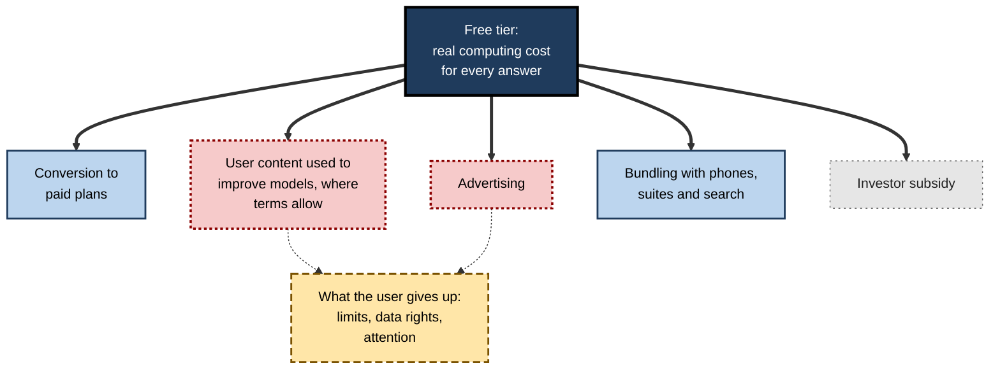
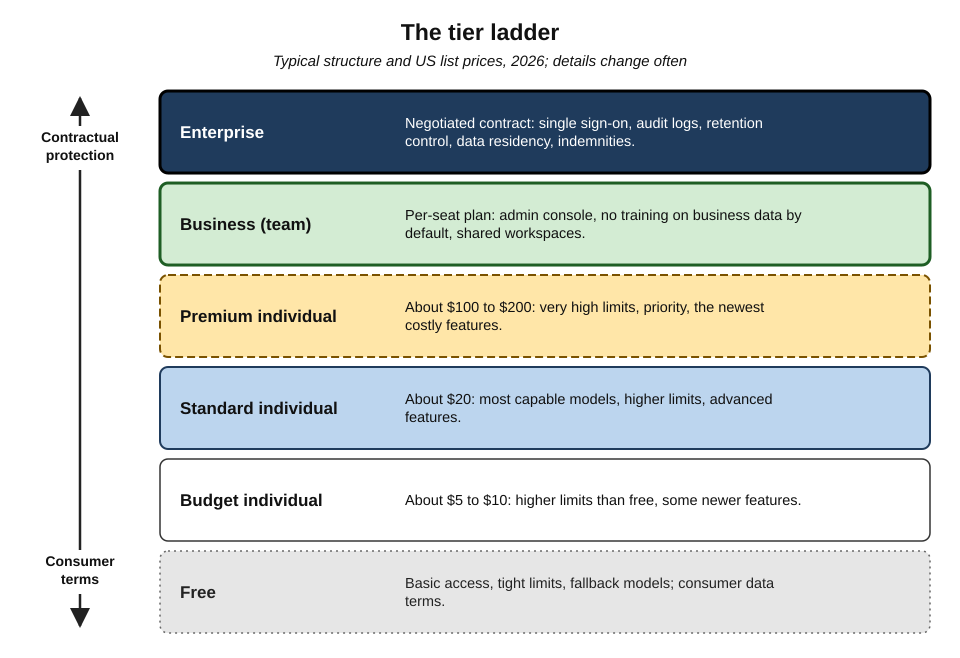
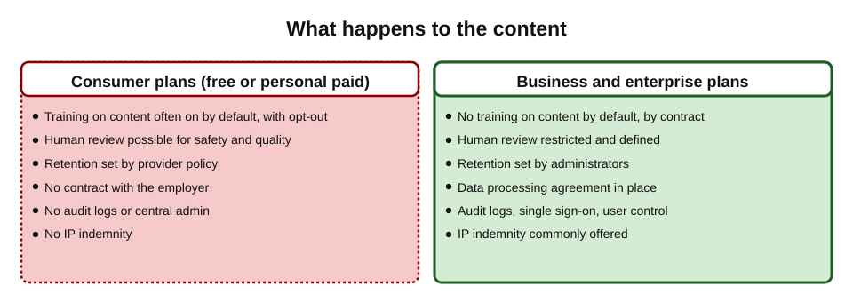
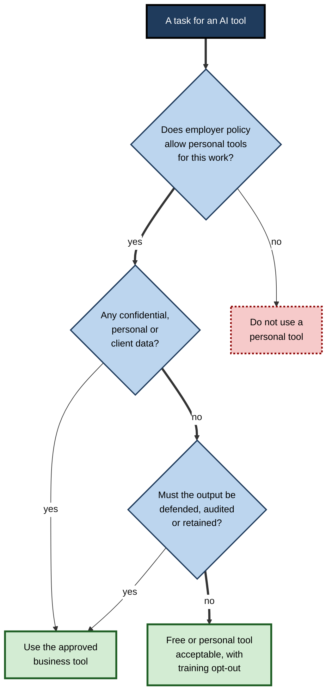
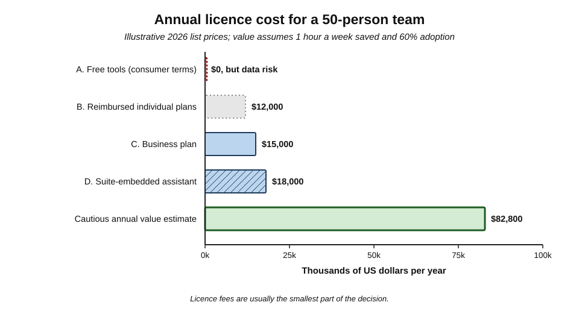
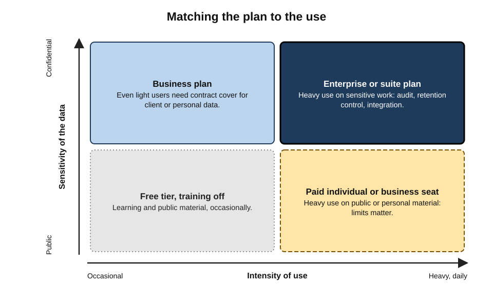

# A.6. Free vs paid AI tools

Two colleagues ask an AI assistant to tidy the same client report. One uses a free personal account; the other uses the licence their employer pays for. The replies look much the same. But one conversation may be stored for years and used to train future models, runs on a less capable model with a daily cap, and sits outside any contract with the client.

The other is covered by a business agreement that forbids training on the data, logs access for auditors and is backed by the provider's legal commitments. The difference between free and paid is rarely visible on the screen — and it is often the difference that matters most.

> **Definition — Free tier:** a version of an AI tool offered at no monetary charge, usually with limits on capability, usage and features, and with terms that may allow the provider to use the user's content.

> **Definition — Paid plan:** a version of an AI tool provided for a fee — per user per month (a **subscription** or **seat licence**), per unit of usage (**usage-based pricing**), or under a negotiated **enterprise agreement** — with greater capability, higher limits and, at business tiers, contractual protections.

**Why the distinction matters**

- **Capability** — paid tiers usually unlock the most capable models, longer documents and advanced features.
- **Data and confidentiality** — the decisive differences lie in what the provider may do with the content.
- **Legal and compliance cover** — contracts, audit logs, data-location commitments and indemnities exist only at business tiers.
- **Cost control** — organisations must compare licence fees with the value delivered and the risks avoided.

---

## Why AI Tools Cost Money to Run

### The economics behind every tier

- **Traditional software** costs a great deal to build but almost nothing to run once more; a word processor does not cost its maker more when the user types another page.
- **Generative AI** consumes significant computing power **every time** it answers.
  - Every token read and written requires calculations on specialised chips in data centres.
  - Longer documents, longer conversations, image and video generation, and "reasoning" models that think through many intermediate steps all cost more.
- **Consequence:** a free tier is never "free to provide". Providers must limit it, subsidise it or recover the cost some other way.

> **Definition — Inference:** running a trained model to produce an output; the ongoing computing cost of using AI, as distinct from the one-off cost of training it.

> **Definition — Reasoning model:** a model designed to generate extended internal working before answering, improving performance on complex problems at higher computing cost and slower response.

### How free tiers are paid for

- **Conversion (freemium)** — free use introduces people to the product; a share upgrade.
- **Data for improvement** — conversations, where terms permit, help train and evaluate future models.
- **Advertising** — long the economics of web search; AI providers began testing advertising in free and low-cost tiers in 2026.
- **Bundling** — AI included in products people already buy (phones, office suites, search), defending the larger business.
- **Investor subsidy** — leading AI companies have spent far more on computing than they earn, betting on future revenue.

**Figure 1.** How providers recover the cost of free AI tiers.

> **Key point:** "If the product is free, the user's data or attention is often part of the price" is a rule of thumb, not a law — but it is the right first question to ask about any free AI tool.

---

## What Changes Between Tiers

### The dimensions that differ

- **Model access** — which models the user can choose; free tiers often fall back to smaller models after a limit.
- **Usage limits** — messages per few hours, uploads per day, minutes of voice or video, deep-research runs per month.
- **Context size** — how long a document or conversation the tool can handle at once.
- **Features** — agents, deep research, advanced data analysis, image and video generation, custom assistants, connectors to work apps.
- **Speed and priority** — paid users are served first at busy times.
- **Data terms** — whether content may be used for training; how long it is retained; whether humans may review it.
- **Administration** — central management of users, single sign-on, audit logs, retention settings, data-loss prevention.
- **Legal terms** — confidentiality obligations, data-processing agreements, data-location options, and **intellectual-property indemnities** in which the provider defends business customers against certain copyright claims over outputs.
- **Assurance** — independent security certifications (*e.g.* SOC 2 reports, ISO/IEC 27001), uptime commitments, support.

> **Definition — Seat licence:** a subscription priced per named user.

> **Definition — Data processing agreement (DPA):** a contract in which a service provider commits to process personal data only on the customer's instructions and with specified safeguards, as data-protection laws such as the GDPR require.

> **Definition — IP indemnity:** a contractual promise by a provider to defend and compensate a customer if outputs of the service lead to certain intellectual-property claims, subject to conditions.

### The tier ladder (typical structure, 2026)

| Tier | Typical price (US list, per month) | Who it is for | What it typically adds |
|---|---|---|---|
| Free | $0 | Trying the tool; occasional personal use | Basic access with tight limits; fallback models |
| Budget individual | About $5–$10 | Regular light personal use | Higher limits, some newer features |
| Standard individual | About $20 | Frequent personal or freelance use | Most capable models, higher limits, advanced features |
| Premium individual | About $100–$200 | Heavy professional users | Very high limits, priority, newest and most expensive features |
| Business (team) | About $25–$30 per seat | Small and medium organisations | Admin console, no training on business data by default, shared workspaces |
| Enterprise | Negotiated; often similar or higher per seat | Large organisations, regulated sectors | Single sign-on, audit logs, retention controls, data residency, contracts and indemnities |

- **Examples in 2026 (US list prices, subject to frequent change):**
  - standard tiers around $20 a month — ChatGPT Plus, Claude Pro, Google AI Pro, Perplexity Pro;
  - budget tiers from about $5–$8 — Google's AI Plus, OpenAI's ChatGPT Go;
  - premium tiers at roughly $100 and $200 — ChatGPT Pro, Claude Max, Google AI Ultra;
  - Microsoft 365 Copilot for organisations launched at **$30 per user per month** (2023), with lower-priced business options introduced later;
  - Google folded Gemini features into its Workspace business plans in early 2025, raising plan prices rather than charging a separate add-on.

**Figure 2.** The tier ladder: what each step up typically adds.

> **Watch out:** prices, tier names and limits change several times a year, differ by country and are often discounted for annual billing, education or non-profits. Treat any table as a snapshot; compare **what the tier contractually provides**, not just the headline price.

---

## The Decisive Difference: Data Terms

### Consumer plans versus business plans

The most important line runs not between free and paid, but between **consumer** plans (free *and* paid individual plans) and **business** plans.

- **Consumer plans (free and individual paid)** — as of 2026, typical patterns include:
  - content **may be used to train future models by default**, with an opt-out setting (OpenAI's consumer ChatGPT; Anthropic's consumer Claude plans since a policy change in **September 2025**, which also extended retention to up to five years for users who allow training);
  - conversations may be **reviewed by people** for safety and quality (Google states this for Gemini apps activity);
  - retention periods set by the provider; deleted chats removed after a period, unless legal obligations require otherwise.
- **Business and enterprise plans** — typical commitments:
  - **no training on customer content by default**;
  - contractual confidentiality and a data processing agreement;
  - administrator control of retention, audit logs and user access;
  - options for data to be stored in specified regions.
- **Developer API use** — major providers state that API inputs are not used for training by default, with limited retention for abuse monitoring.

> **Watch out:** paying for a **personal** plan does not by itself buy business-grade data protection. A $20 individual subscription may still allow training on content unless the user changes the setting — and it never puts the user's employer into a contract with the provider.

**Figure 3.** Consumer and business plans differ most in what happens to the user's content.

### Retention can be overridden

- **Legal holds trump settings.** In **May 2025**, in the copyright case brought by The New York Times against OpenAI and Microsoft, a US court ordered OpenAI to preserve consumer ChatGPT output logs that would otherwise have been deleted — including deleted and temporary chats — for the duration of the dispute; the order was later narrowed, and business customers with zero-retention agreements were not covered.
- **Lesson:** "deleted" in a consumer product means "deleted according to policy, unless the law requires otherwise". Business agreements with defined retention give more certainty.

| | Consumer free | Consumer paid (individual) | Business or enterprise |
|---|---|---|---|
| Training on content | Often by default, with opt-out | Often by default, with opt-out | Off by default, by contract |
| Human review of content | Possible | Possible | Restricted; defined in agreement |
| Retention control | Provider's policy; user can delete chats | Same as free | Administrator-set; contractual |
| Contract with the employer | None | None | Yes, including data processing terms |
| Audit logs and admin | None | None | Yes |
| IP indemnity for outputs | No | No | Commonly offered, with conditions |

---

## Usage-Based Pricing and the API

### Paying by the token

- **Developers and in-house tools** usually pay per **million tokens** processed, with separate prices for input and output tokens; output tokens cost more.
- **Prices vary by model** by a factor of a hundred or more: small, fast models are very cheap; frontier and reasoning models are expensive.
- **Prices have fallen rapidly** for any given level of capability — by roughly an order of magnitude or more per year in 2023–2025 on several measures — while the newest frontier models remain costly.

> **Formula — API cost of a task:** cost = (input tokens × input price + output tokens × output price) ÷ 1,000,000. Example: summarising 1,000 documents of 4,000 tokens each into 300-token summaries, on a model priced at $2 per million input tokens and $8 per million output tokens: input 4,000,000 × $2 = $8; output 300,000 × $8 = $2.40; total ≈ **$10.40**.

| | Subscription (seat) | Usage-based (API) |
|---|---|---|
| Who uses it | People working directly in an app | Software and in-house tools |
| Cost predictability | High — fixed per user | Variable — depends on volume |
| Cost for light users | Can be wasteful | Very low |
| Cost for heavy automated use | Not permitted, or capped | Scales with volume; can be large |
| Data terms | Depend on plan (consumer or business) | Generally no training by default |

> **In practice:** organisations increasingly mix models — expensive models for hard tasks, cheap ones for routine classification and summarising — and monitor token spending as closely as cloud bills.

---

## When Free Is Fine, and When It Is Not

### Free tools are reasonable for

- **Learning** — exploring what AI can do, practising prompts, understanding concepts.
- **Public or personal, non-confidential material** — planning a holiday, explaining a public regulation, practising a language.
- **Low-stakes drafts** — a birthday message, a first outline of a public blog post.
- **Evaluation** — trying a tool before recommending that the organisation buy it.

### Free (and personal) tools are not appropriate for

- **Confidential business information** — client data, financials, unreleased plans, source code.
- **Personal data about others** — employees, customers, patients.
- **Regulated work** — where sector rules require contracts, audit trails or data-location guarantees.
- **Work outputs the organisation must defend** — where IP indemnity or record-keeping matters.
- **Anything the employer's policy forbids**, whatever the tool's terms say.

**Figure 4.** Deciding whether a free or personal tool is acceptable for a task.

> **Mnemonic — "Policy, Data, Defence":** check the **policy**, check the **data**, check whether the output must be **defended** — before using any free tool for work.

---

## Free Software That Is Not Free to Run

- **Open-weight models** can be downloaded at no licence cost (subject to licence conditions).
- **But running them is not free:**
  - powerful hardware or cloud computing;
  - engineers to deploy, secure, evaluate and update;
  - monitoring and incident response.
- **Small models on a laptop** can run free for individuals, with modest capability and complete local privacy.

| | Hosted free tier | Self-hosted open-weight model |
|---|---|---|
| Licence fee | None | None (licence terms apply) |
| Running cost | Borne by the provider | Borne by the user or organisation |
| Where data goes | Provider's servers, consumer terms | Stays on the organisation's own systems |
| Capability | Varies; often limited models | Strong, typically behind the frontier |
| Expertise required | None | Substantial |

> **Key point:** "free" has three meanings — free **of charge** to use, free **to download**, and free **of conditions**. AI tools are rarely all three at once.

---

## Worked Example: What Does a Team Licence Really Cost?

**Situation:** a 50-person professional-services team currently uses a mix of free and personal paid accounts. The manager compares options for one year.

**Step 1 — list the options (illustrative 2026 list prices)**

| Option | Annual licence cost | Data protection | Admin and audit |
|---|---|---|---|
| A. Leave staff on free tools | $0 | Consumer terms; possible training on client data | None |
| B. Reimburse individual $20 plans | 50 × $20 × 12 = **$12,000** | Still consumer terms | None |
| C. Business plan at $25 per seat | 50 × $25 × 12 = **$15,000** | No training by default; DPA | Yes |
| D. Suite-embedded assistant at $30 per seat | 50 × $30 × 12 = **$18,000** | Enterprise terms; grounded in work data | Yes, integrated |

**Step 2 — estimate value, cautiously**

> **Formula — Simple value estimate:** annual value = users × hours saved per week × working weeks × loaded hourly cost × adoption rate. Example: 50 × 1 hour × 46 weeks × $60 × 0.6 (only 60% use it regularly) = **$82,800**.

**Step 3 — add hidden costs**

- training time, policy writing, permission clean-up for a suite assistant, an administrator's time;
- for option A, the expected cost of a confidentiality incident — low probability, high impact.

**Step 4 — compare**

- Option B costs less than C but buys **no** business protections — the worst value for an organisation.
- Options C and D cost $15,000–$18,000 against a cautious value estimate several times larger; D's extra cost buys grounding in the team's own documents.

- **Conclusion:** the licence fee is usually the **smallest** part of the decision; data protection, integration and adoption rates dominate.

> **Watch out:** "hours saved" are usually **self-reported**, and self-reports of AI time savings have been shown to overestimate measured effects. Use a pilot with before-and-after measurement where possible, and apply an adoption discount.

**Figure 5.** Annual cost of each option for a 50-person team at illustrative list prices.

---

## Reading a Plan Before Relying on It

### Where the important terms live

- **Product pages** describe features and limits — and change often.
- **Terms of use** (or service terms) govern ownership of outputs, acceptable use and liability.
- **Privacy policy** explains what personal data is collected, how it is used and for how long.
- **Data-use settings** inside the product control training, memory and history.
- **Business agreements** — a master agreement, a data processing agreement and a security or trust documentation set — apply only to business and enterprise plans.

### Questions a careful professional asks

1. **Training** — may my content be used to train or improve models? Is that on or off by default, and where is the switch?
2. **Retention** — how long are conversations, files and outputs kept, including after deletion?
3. **Human review** — can provider staff or contractors read my content, and when?
4. **Location** — in which countries is data stored and processed?
5. **Sub-processors** — which other companies handle the data (cloud hosts, model providers behind a reseller)?
6. **Ownership of outputs** — who owns what the tool produces, and are there restrictions on its use?
7. **Indemnity and liability** — does the provider defend customers against claims over outputs, and on what conditions?
8. **Change** — how will I be told if terms change, and can I leave with my data?

> **Mnemonic — "THREE SOIL":** the questions in short — **T**raining, **H**uman review, **R**etention, **E**xit; **S**ub-processors, **O**wnership, **I**ndemnity, **L**ocation.

> **Watch out:** a tool built by a smaller company on top of a major provider's model has **two** sets of data terms — the reseller's and the underlying provider's. Its privacy promises are only as strong as both.

### Lock-in and switching

- **Data lock-in** — conversation history, custom assistants, saved projects and memories may not export cleanly.
- **Workflow lock-in** — templates, automations and agents built for one platform rarely move to another.
- **Skill lock-in** — staff learn one tool's habits.
- **Mitigation:** keep important prompts, instructions and outputs in the organisation's own documents; prefer tools supporting open standards; review the market at each renewal.

### Special pricing

- **Education** — many providers offer free or discounted plans to students and teachers, sometimes with special data terms.
- **Non-profits and public bodies** — discounts and, for governments, dedicated offerings with stricter data terms have become common since 2024–25.
- **Bundles** — AI features included in office suites, phones or cloud contracts may already be paid for; checking existing entitlements before buying a separate tool avoids paying twice.

---

## The Organisational Picture

### Why organisations pay

- **To end shadow AI** — staff will use AI anyway; an approved paid tool brings use inside the organisation's controls.
- **To meet legal duties** — data-protection law requires processors to be under contract; sector rules may require audit trails.
- **To get integration** — tools connected to the organisation's documents and systems produce more relevant outputs.
- **To get leverage** — enterprise agreements can negotiate retention, location, security reviews and indemnities.

### Case study: a small accountancy practice formalises its AI use

- **Situation:** a twelve-person accountancy practice discovered most staff used free chat assistants, some pasting client figures to draft commentary.
- **Risk identified:**
  - client financial data processed under consumer terms that allowed training by default;
  - no contract with the provider, contrary to the practice's own data-protection obligations as a controller of client personal data;
  - inconsistent use: some staff never used AI, others relied on it without checks.
- **Actions:**
  1. Short written policy: approved tools only for client work; no client data in personal accounts.
  2. Purchase of a business plan with no training on content and a data processing agreement.
  3. Training session on what to enter, how to check outputs, and how to switch off training on personal accounts used for non-client tasks.
  4. Three-month review of use, time saved on drafting, and errors caught.
- **Result:** annual licence cost under $4,000; client data moved inside a contracted service; measured time savings on routine drafting; one near-miss (a wrong figure in a draft) caught by the new review step.
- **Lesson:** for small firms, the paid tier is less about better answers and more about **putting the use under contract and policy**.

**Figure 6.** Matching the plan to how sensitive the data is and how heavily the tool is used.

> **Remember:** the line that matters is **consumer versus business**, not free versus paid. Personal paid plans buy **capability**; business plans buy **capability plus contractual data protection, control and accountability**.

---

## Open Questions

- **Will free tiers survive in their current form?**
  - High inference costs, advertising experiments and falling model prices pull in different directions; whether the future is ad-supported, bundled or premium-only is unclear.
- **Will advertising change answers?**
  - If ads appear in AI assistants, keeping commercial influence separate from answers — and visibly labelled — will be a regulatory and trust question.
- **Is the per-seat model sustainable?**
  - Agents doing work in the background make "per user" pricing awkward; outcome-based and usage-based pricing are being tried.
- **Do premium tiers create an AI divide?**
  - If the most capable tools cost $100–$200 a month, access to the best capabilities may track income and employer generosity.
- **How durable are data commitments?**
  - Providers have changed consumer data terms before; how stable business terms prove over time, and how regulators enforce them, is still being tested.

---

## Summary

- **Free tiers** are limited and may use content to improve models; **paid plans** come as subscriptions, usage-based (API) pricing or **enterprise agreements**.
- AI costs money **every time it runs** (**inference**), so free tiers are recovered through **conversion, data, advertising, bundling or subsidy**.
- Tiers differ in **models, limits, context size, features, speed, data terms, administration, legal terms and assurance**.
- Typical 2026 US list prices: **free**, **$5–$10 budget**, **about $20 standard**, **$100–$200 premium**, **$25–$30 per business seat**, negotiated **enterprise** — all subject to frequent change.
- The decisive line is **consumer versus business**: consumer plans (free and personal paid) often allow **training by default** with opt-out; business plans exclude training by contract and add **DPAs, audit logs, retention control** and often **IP indemnities**.
- Retention can be overridden by **legal holds** (the 2025 court preservation order in *New York Times v. OpenAI*).
- **API pricing** is per million tokens; costs vary greatly by model and have fallen fast.
- Free is fine for **learning, public material and low-stakes drafts**; not for **confidential, personal, regulated or defended** work — check **Policy, Data, Defence**.
- **Open-weight** models are free to download, not free to run.
- In licence decisions, **data protection, integration and adoption** usually matter more than the fee.

---

## Self-Check

1. Why does generative AI, unlike traditional software, cost its provider money every time it is used?
2. List five ways providers recover the cost of free tiers.
3. Name six dimensions on which AI tiers differ.
4. Why is the "consumer versus business" line more important than "free versus paid"?
5. What changed in Anthropic's consumer data terms in September 2025?
6. What did the 2025 court preservation order show about deleted chats?
7. What is a data processing agreement, and why does an organisation need one with an AI provider?
8. What is an IP indemnity, and at which tiers is it typically offered?
9. Calculate the API cost of processing 2,000 documents of 2,500 tokens into 200-token outputs at $1 per million input and $4 per million output tokens.
10. Give three tasks for which a free tool is reasonable and three for which it is not.
11. Why is reimbursing staff for individual paid plans often poor value for an organisation?
12. What hidden costs should a licence comparison include?
13. Why can self-reported time savings mislead a business case?
14. A start-up founder says, "We'll self-host an open-weight model — it's free." What would you point out?

### Answer Key

1. Each answer requires computation on specialised chips (inference) proportional to tokens processed; traditional software costs almost nothing to run again once built.
2. Conversion to paid plans; using content to improve models (where terms allow); advertising; bundling with other products; investor subsidy.
3. Model access; usage limits; context size; features; speed and priority; data terms; administration; legal terms; assurance (any six).
4. Personal paid plans often share consumer data terms (training by default, no contract with the employer); business plans add contractual exclusion of training, DPAs, admin control and audit — the protections that matter for work.
5. Consumer users were asked to choose whether their chats could be used for training, with the setting on by default, and retention for those allowing training was extended to up to five years.
6. Legal obligations can override retention settings: OpenAI was ordered to preserve consumer output logs, including deleted and temporary chats, during litigation — "deleted" means deleted per policy unless the law requires otherwise.
7. A contract in which the provider commits to process personal data only on the customer's instructions with defined safeguards; data-protection law (e.g. GDPR) requires one when a processor handles personal data for a controller.
8. A provider's promise to defend and compensate the customer against certain IP claims arising from outputs, subject to conditions; typically offered at business and enterprise tiers, not consumer plans.
9. Input: 5,000,000 × $1 ÷ 1,000,000 = $5. Output: 400,000 × $4 ÷ 1,000,000 = $1.60. Total ≈ $6.60.
10. Reasonable: learning concepts; planning a personal trip; drafting a public blog outline. Not: summarising client contracts; analysing employee performance data; drafting regulated advice that must be retained.
11. It costs nearly as much as a business plan but leaves staff on consumer terms, without a contract, audit logs or admin control — capability without protection.
12. Training time; policy writing; permission clean-up and administration; integration work; monitoring; and, for unprotected options, the expected cost of a data incident.
13. People tend to overestimate AI time savings; studies comparing perception with measurement have found large gaps. A pilot with measured before-and-after times and an adoption discount is more reliable.
14. The licence is free but hardware or cloud compute, engineering to deploy and secure it, evaluation, updates and monitoring are not; capability is usually behind the frontier. It may still be right for data control or high volume, but the total cost must be compared honestly with a business plan or API.

---

## Glossary

| Term | Meaning |
|---|---|
| API pricing | Charging for model use per million input and output tokens. |
| Bundling | Including AI features within another product's price. |
| Business plan | A plan for organisations with contractual data protections and administration. |
| Consumer plan | A free or paid plan for individuals, under consumer terms. |
| Data processing agreement (DPA) | A contract binding a processor to handle personal data only as instructed, with safeguards. |
| Enterprise agreement | A negotiated contract covering pricing, security, retention and legal terms. |
| Free tier | A no-charge version of a tool with limits and often broader data-use terms. |
| Freemium | A model in which free use encourages upgrades to paid plans. |
| Inference | Running a trained model to produce output; the ongoing cost of AI use. |
| IP indemnity | A provider's promise to defend customers against certain IP claims over outputs. |
| Legal hold | An obligation to preserve data for litigation, overriding normal deletion. |
| Reasoning model | A model that generates extended internal working before answering, at higher cost. |
| Retention | How long a provider keeps user content. |
| Seat licence | A subscription priced per named user. |
| SOC 2 report | An independent audit report on a service provider's security controls. |
| Training opt-out | A setting preventing a user's content from being used to train models. |
| Usage limit | A cap on messages, uploads or features within a time period. |
