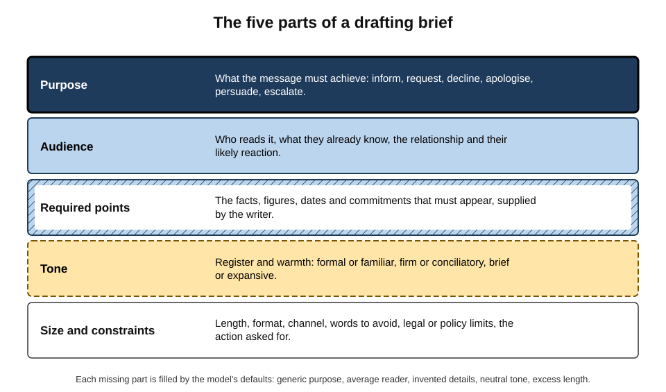
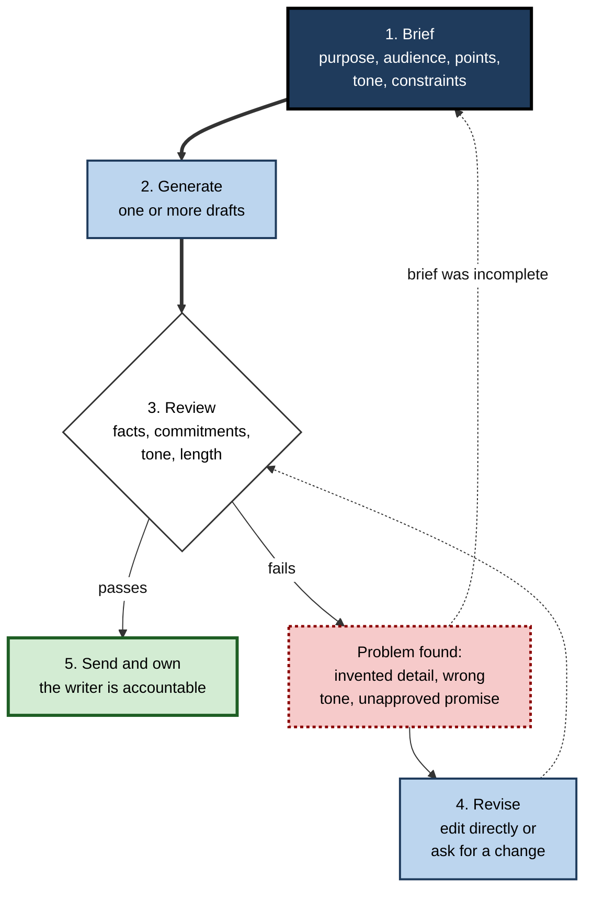
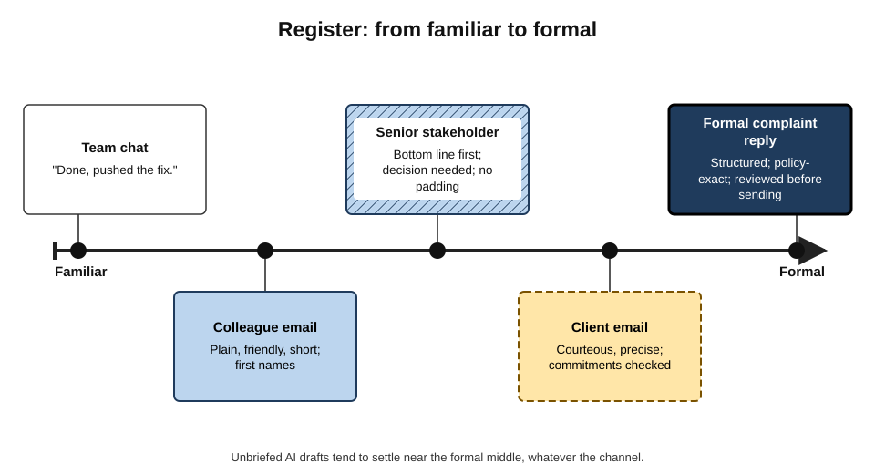
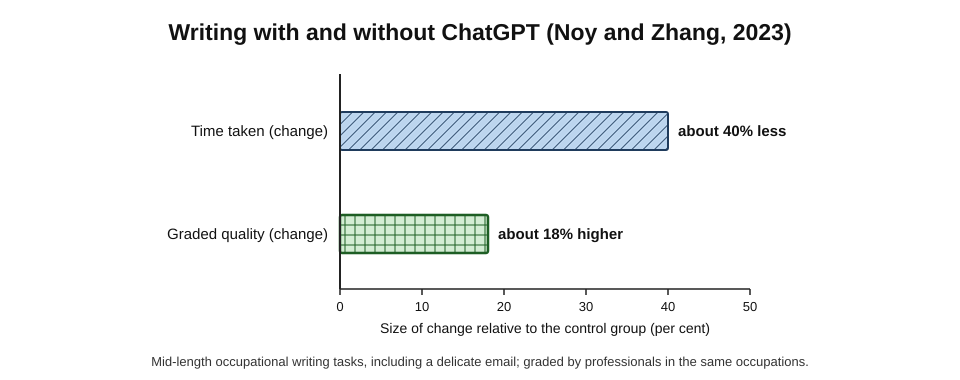
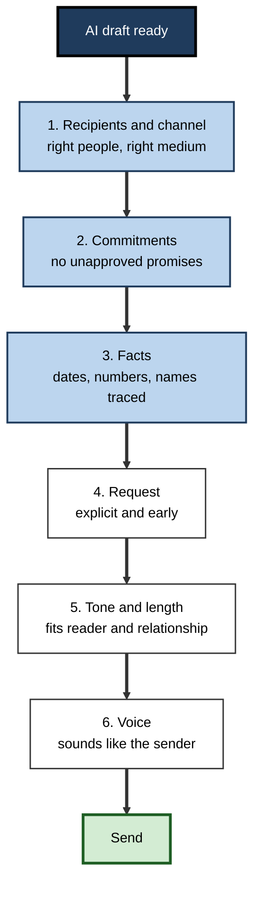
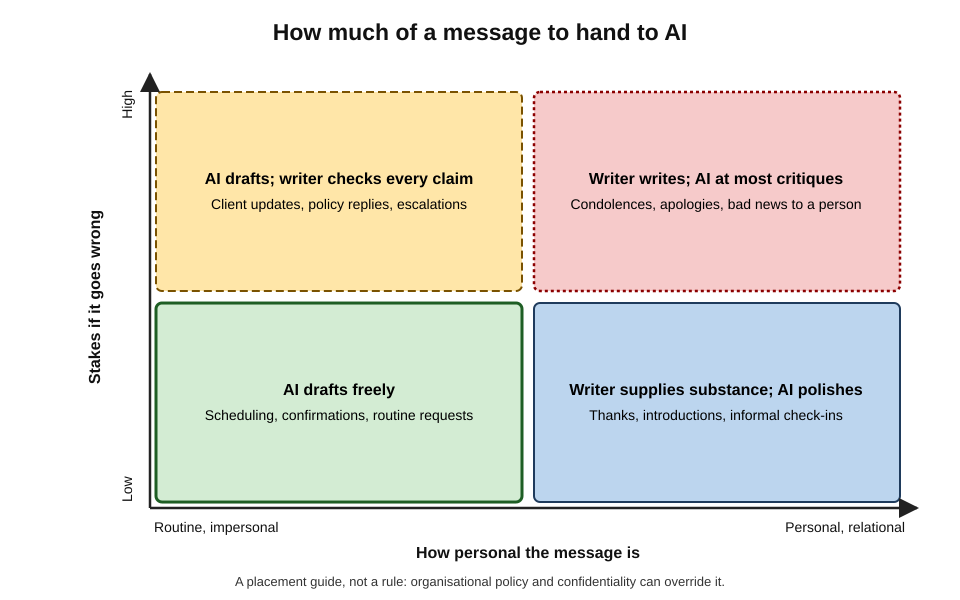

# B.1. Drafting emails and messages

A project manager has to tell a client that a delivery will slip by two weeks. She knows the facts, the reason and the new date, but the message has sat half-written for an hour because the tone keeps coming out either defensive or grovelling. An AI assistant produces a clear, calm draft in seconds — and also, unasked, promises a discount that nobody has approved. Drafting with AI is fast; drafting **well** with AI is a skill.

> **Definition — AI-assisted drafting:** producing a written message — email, chat reply, letter, announcement or note — by giving a generative AI model a brief and then reviewing, correcting and owning the text it proposes.

**Why it matters**

- Knowledge workers spend a large share of the working week reading and writing messages; small gains per message add up across hundreds of messages a month.
- Messages carry **commitments, relationships and reputation**: a wrong fact or tone in one email can cost more than the time saved on a hundred.
- AI drafting is the most widely used workplace application of generative AI and usually the first one people try.
- The habits formed here — briefing precisely, reviewing critically, keeping ownership — transfer to every other use of AI at work.

---

## What a Message Must Do

Before any tool is involved, a message is a small act of **purposeful communication**: one person wants another person to know, feel or do something.

### The four jobs of a message

- **Inform** — transfer facts the reader needs.
  - *e.g.* "The server migration is complete; the new address is in the attached note."
- **Request** — ask for an action, a decision or information.
  - *e.g.* "Please approve the revised budget by Thursday."
- **Relate** — maintain or repair a working relationship.
  - *e.g.* thanking a colleague, apologising for a missed deadline, welcoming a new hire.
- **Record** — create a written trace of what was agreed.
  - *e.g.* a follow-up email confirming the scope agreed on a call.

> **Key point:** most professional messages do several jobs at once. A delay notice informs (new date), requests (agreement), relates (keeps trust) and records (the revised commitment). A good draft serves all of them; a generic AI draft usually serves only the first.

### What readers actually do with messages

- **Readers skim.** Busy people read the subject line, the first two sentences and anything that looks like a question or a date.
- **Readers act on the first clear request.** A request buried in the fourth paragraph is often missed.
- **Readers infer intent from tone.** Short can read as curt; long can read as evasive or anxious.
- **Readers keep and forward messages.** A message written for one reader may end up in front of a manager, a lawyer or a regulator.

> **Remember:** **bottom line up front** — put the purpose and any request in the first two sentences, then the supporting detail.

---

## The Drafting Brief

### Why a brief is needed

A language model writes the most **probable** text that fits its instructions. When an instruction is vague, the model fills the gaps with averages: an average reader, an average purpose, an average tone and, where facts are missing, plausible-sounding details.

> **Definition — Drafting brief:** the instructions and material given to an AI model before it drafts: what the message is for, who will read it, what it must contain, how it should sound and what limits apply.

**Figure 1.** The five parts of a drafting brief.

### The five parts

- **Purpose** — the one outcome the message must achieve.
  - Weak: "write an email about the delay".
  - Strong: "tell the client the go-live moves from 3 to 17 March and get their agreement to the revised test window".
- **Audience** — who reads it and what they know.
  - Their role, seniority, technical depth, relationship history and likely mood.
  - *e.g.* "The client's operations director; not technical; frustrated by a previous slip in January."
- **Required points** — the facts the writer supplies.
  - Dates, figures, names, reasons, options, commitments.
  - The model must never be left to supply these; it will invent them if they are missing.
- **Tone** — register and emotional colour.
  - *e.g.* "Calm and accountable; no excessive apology; no blame on the client's team."
- **Size and constraints** — length, format and limits.
  - *e.g.* "Under 150 words; no discount or compensation offered; mention that the root cause report follows on Friday."

> **Mnemonic — PARTS:** Purpose, Audience, Required points, Tone, Size and constraints — the parts of a brief that stop a model guessing.

### Giving examples and voice

- **Paste a previous message** the writer is happy with and ask for "the same voice".
  - Models imitate examples more reliably than they follow adjectives such as "warm" or "professional".
- **State dislikes explicitly.**
  - *e.g.* "No 'I hope this email finds you well'; no exclamation marks; British spelling."
- **Provide the thread.** For a reply, include the message being answered, so the draft addresses what was actually asked.

> **Watch out:** pasting a thread or attachment into an AI tool shares its contents with the tool's provider. Client data, personal data and confidential material belong only in tools the organisation has approved for that class of information.

---

## The Drafting Loop

AI drafting is not a single request but a short loop: brief, generate, review, revise, send — and the writer stays responsible at every step.

**Figure 2.** The drafting loop.

### Generate: one draft or several

- **One draft** — fastest; fine for routine messages.
- **Two or three variants** — useful when tone is the hard part.
  - *e.g.* "Give me three versions: one very brief, one warmer, one more formal."
  - Choosing between options is easier than describing the ideal in advance.
- **Outline first** — for long or complex messages, ask for the structure (opening, points, request, close) before the prose.

### Review: what to read for

1. **Facts** — every date, number, name and reason matches the source.
2. **Commitments** — no promise, offer, admission or deadline the writer has not authorised.
3. **The request** — the action wanted is explicit and early.
4. **Tone** — appropriate for this reader and this relationship.
5. **Length** — no padding, repetition or generic pleasantries.
6. **Voice** — it sounds like the writer, not like a template.

> **Key point:** review **commitments** as carefully as facts. Models are trained to be helpful and agreeable, and helpfulness in a complaint reply often takes the form of an apology, a refund or a promise — none of which the writer may be entitled to give.

### Revise: edit or re-prompt?

- **Edit directly** when the change is small and specific — usually faster than explaining it.
- **Re-prompt** when the problem is structural.
  - *e.g.* "Move the new date to the first line; cut the background to one sentence."
- **Restart with a better brief** when the draft is wrong in purpose or audience — the fault is in the brief, not the wording.

### Send and own

- The sender's name is on the message. Responsibility does not transfer to the tool.
- Auto-send features, scheduled AI replies and "agent" tools that send on the user's behalf remove the review step and therefore raise the stakes of every error.

---

## Kinds of Drafting Help

AI can help with a message in three fundamentally different ways, each with its own risks.

### Generating, transforming and critiquing

> **Definition — Generative drafting:** the model writes new text from a brief.

> **Definition — Transformative drafting:** the model rewrites text the writer has already produced — shortening, restructuring, changing tone or converting notes into prose.

> **Definition — Critique:** the model comments on a draft — clarity, tone, missing points, likely reader reaction — without rewriting it.

| | Generating | Transforming | Critiquing |
|---|---|---|---|
| Who supplies the substance | The model, guided by the brief | The writer | The writer |
| Speed gain | Largest | Moderate | Small |
| Risk of invented content | Highest | Low to moderate — models still add details | Lowest |
| Effect on writer's voice | Replaced by the model's | Partly preserved | Fully preserved |
| Best for | Routine messages, first drafts under time pressure | Rough notes, overlong drafts, tone problems | High-stakes or personal messages |

### Common transformations

- **Notes to prose** — bullet points from a call into a follow-up email.
- **Shorten** — "cut this to five sentences without losing the dates".
- **Restructure** — "lead with the decision we need".
- **Change register** — a technical explanation rewritten for a non-technical manager.
- **Soften or firm up** — "make this less blunt" or "make the deadline unmistakable".
- **Channel conversion** — an email turned into a two-line chat message, or a chat thread summarised into an email for someone who missed it.
- **Language and audience** — a message adapted for a reader working in a second language: shorter sentences, no idioms.

> **Example:** a support engineer types "cust says export broken since upd, repro'd, fix in next patch thurs, workaround = csv" and asks for a customer reply. The model produces three polite sentences explaining the fault, the Thursday fix and the CSV workaround — the substance is the engineer's; only the wording is the model's.

### Critique as a safer default

- Ask "How might the recipient read this?" or "What is unclear or missing?"
- Critique keeps the writer thinking and keeps the voice authentic.
- It is especially useful for **difficult messages**: refusals, feedback, escalations, negotiations.

> **In practice:** many experienced writers draft difficult messages themselves and use AI only to ask, "Where does this sound defensive?" — gaining a second reader without surrendering the message.

---

## Worked Example: The Delayed Delivery

**Situation:** a software supplier must tell a client that go-live moves from 3 March to 17 March because integration testing found a data-mapping defect. The client's operations director was annoyed by a previous slip in January. No compensation has been approved.

**Step 1 — the weak prompt and its result**

- Prompt: "Write an email telling the client the project is delayed."
- Result: a 260-word message that opens "I hope this email finds you well", apologises three times, gives no date, blames "unforeseen technical challenges", and closes by offering "a goodwill gesture to make up for the inconvenience".

**Step 2 — the PARTS brief**

1. **Purpose:** inform of the new go-live date (17 March) and obtain agreement to move user testing to 10–12 March.
2. **Audience:** operations director; not technical; frustrated by the January slip.
3. **Required points:** a data-mapping defect found in integration testing; fixed and being retested; root-cause report on Friday.
4. **Tone:** calm, accountable, factual; one apology at most; no blame on the client.
5. **Size and constraints:** under 150 words; no compensation; request reply by Wednesday.

**Step 3 — compare the drafts**

| | Weak-prompt draft | PARTS-brief draft |
|---|---|---|
| First sentence | Pleasantry | The new date and the reason |
| Length | 260 words | 128 words |
| Facts | Vague; no date | Defect, fix status, date, report day |
| Request | None | Agree revised test window by Wednesday |
| Unauthorised commitment | "Goodwill gesture" | None |
| Tone | Over-apologetic, evasive | Accountable, calm |

**Step 4 — human review** finds one remaining problem: the draft says the defect "has been fixed", whereas retesting is still under way. The writer edits it to "a fix is in place and being retested".

- **Conclusion:** the brief did most of the work; the review caught the one claim that would have damaged trust if the retest had failed.

> **Watch out:** models often turn uncertain facts into certain ones — "being retested" becomes "fixed", "we expect" becomes "we will". Read every verb that describes the state of work.

---

## Tone, Register and Relationship

### Register

> **Definition — Register:** the variety of language suited to a particular situation and relationship — from familiar to formal — shown through vocabulary, sentence length, directness and politeness.

**Figure 3.** Register: from familiar to formal.

- **Channel sets expectations.**
  - Chat tools reward brevity; a five-paragraph chat message reads as strange or anxious.
  - Formal letters and complaint responses need structure and exact wording.
- **Relationship sets warmth.** Long-standing colleagues expect informality; new clients expect courtesy.
- **Unbriefed models drift to a default register** — polite, slightly formal, enthusiastic and long. This suits few real situations.

### Politeness and face

- **Penelope Brown and Stephen Levinson (1987)** described politeness as managing **face** — a person's public self-image.
  - **Positive face** — the wish to be liked and approved of.
  - **Negative face** — the wish not to be imposed upon.
- Requests, refusals and criticism are **face-threatening acts**; writers soften them with hedges, thanks, reasons and options.
- **Application to AI drafting:**
  - Models soften heavily by default — sometimes so much that the request disappears.
  - For a firm deadline, the brief must say so: "polite but unambiguous".

> **Definition — Face-threatening act:** a communicative act — such as a request, refusal or criticism — that risks the reader's self-image or freedom of action.

### Directness across cultures

- **Edward Hall (1976)** distinguished **low-context** communication (meaning carried mostly by explicit words) from **high-context** communication (meaning carried by relationship and setting).
- **Erin Meyer (2014)** placed national business cultures on scales such as direct versus indirect negative feedback.
- **Implications:**
  - A blunt message suitable for one culture may read as rude in another; a heavily hedged one may read as evasive.
  - Models trained mostly on English-language web text may default to an Anglo-American register.
  - The brief should name the reader's context when it matters: "The reader is in Japan and prefers indirect refusals."

> **Watch out:** national-culture scales describe **tendencies across groups**, not individuals. The relationship history with the actual reader is a better guide than a stereotype.

---

## What the Evidence Shows

### Speed and quality of professional writing

**Study card — Noy and Zhang (2023), *Science***

- **Design:** online experiment with **453** college-educated professionals — marketers, grant writers, consultants, data analysts, human-resource professionals and managers.
  - Each completed two occupation-specific writing tasks (press releases, short reports, analysis plans and **delicate emails**).
  - Half were given access to ChatGPT before the second task.
  - Work was graded blind by experienced professionals in the same occupations.
- **Results:**
  - time taken fell by about **40%**;
  - graded quality rose by about **18%**;
  - lower-performing writers gained most, so the spread of quality narrowed;
  - participants spent less time producing rough drafts and relatively more time editing.
- **Conclusion:** for mid-length, self-contained writing, AI substantially reduced effort and raised average quality.
- **Limits:** short, well-specified tasks; no real recipients; no measure of downstream errors or relationships.

**Figure 4.** Writing with and without ChatGPT (Noy and Zhang, 2023).

### How AI-written messages change relationships

> **Definition — AI-mediated communication:** communication between people in which an AI system modifies, augments or generates messages on a sender's behalf (term developed by Jeffrey Hancock, Mor Naaman and Karen Levy, 2020).

**Study card — Hohenstein and colleagues (2023), *Scientific Reports***

- **Design:** pairs of participants discussed a policy issue by chat; some could use AI-generated "smart replies".
- **Results:**
  - smart-reply use made conversations faster and more positive in emotional tone;
  - partners of heavy users rated them as more cooperative — **when they did not suspect AI**;
  - when participants **believed** their partner was using AI replies, they rated that partner as less cooperative and less warm.
- **Conclusion:** AI help can improve the surface of a conversation while making the sender look worse if detected.

**Study card — Jakesch and colleagues (2019): the "replicant effect"**

- **Design:** participants rated the trustworthiness of host profiles on a home-sharing platform, told that some were AI-written.
- **Result:** profiles **suspected** of being AI-written were rated less trustworthy — but only when mixed with profiles believed to be human-written.
- **Conclusion:** suspicion of AI authorship, not AI authorship itself, damages trust.

**The disclosure dilemma**

- Oliver Schilke and Martin Reimann (2025), across a series of experiments, found that people who **disclosed** using AI for a task were trusted less than those who did not disclose.
- Yet undisclosed use that is later discovered can damage trust more severely.
- **Practical resolution in organisations:** clear norms about when AI help is expected and acceptable, so disclosure is neither shameful nor required for routine messages.

> **Watch out:** these trust studies are mostly short online experiments. The size of the effects in long-standing working relationships is not established, and norms are shifting quickly as AI drafting becomes common.

### The cost of unchecked drafts: "workslop"

**Study card — BetterUp Labs and Stanford Social Media Lab (survey, September 2025)**

- **Sample:** **1,150** full-time US desk workers.
- **Findings:**
  - about **40%** said they had received "workslop" in the previous month;
  - they estimated that about **15%** of the content they received met that description;
  - each incident took close to **two hours** to deal with, on average;
  - recipients viewed senders of such work as less capable and less reliable.

> **Definition — Workslop:** AI-generated work content that looks polished but lacks the substance to advance the task, shifting the effort of interpretation and correction onto the recipient.

> **Key point:** time saved by the sender can be time lost by the reader. A message's productivity is measured at **both** ends of the exchange.

---

## Failure Modes and Their Checks

### Content failures

- **Invented detail** — plausible but false facts filled into gaps.
  - *e.g.* a meeting "next Tuesday" when none was arranged; a reference number that does not exist.
  - **Check:** every specific — date, number, name, reference — traced to a source.
- **Certainty inflation** — tentative states turned into firm ones.
  - **Check:** read the verbs describing status ("completed", "approved", "fixed").
- **Unauthorised commitments** — apologies, refunds, discounts, admissions of fault, deadlines.
  - **Check:** search the draft for promises; delete any not authorised.
- **Misread thread** — replying to the wrong question in a long chain.
  - **Check:** reread the latest message being answered.

### Form failures

- **Length inflation** — unbriefed drafts run long. **Check:** "Could this be half the length?"
- **Generic filler** — stock openings and closings that signal machine authorship.
- **Over-hedging** — so many softeners that the request vanishes.
- **Homogenised voice** — every message sounding alike; colleagues notice.
- **Wrong register for channel** — email prose pasted into chat; chat curtness in a client letter.

### Process failures

- **Wrong recipient or reply-all** — speed encourages careless addressing.
- **Auto-send without review** — agent features that act on drafts directly.
- **Sensitive data in the wrong tool** — confidential threads pasted into unapproved services.

**Figure 5.** A review pass in order of consequence.

> **Mnemonic — "Really Clever Folk Request Their Voice":** Recipients, Commitments, Facts, Request, Tone, Voice — the review order, from most to least costly error.

---

## Messages That Should Stay Human

### Stakes and personal content

Two questions decide how much of a message to hand over: **how costly is an error**, and **how much does the message's value depend on its coming personally from the sender?**

**Figure 6.** How much of a message to hand to AI.

- **Low stakes, impersonal** — confirmations, scheduling, routine requests: AI can draft freely.
- **High stakes, impersonal** — client updates, policy answers, escalations: AI drafts, the writer verifies every claim and commitment.
- **Low stakes, personal** — thanks, introductions: the writer supplies the substance; AI may polish.
- **High stakes, personal** — condolences, apologies for personal failings, bad news to an individual, sensitive feedback: the writer writes; AI at most critiques.

### Case study: the condolence message drafted by a chatbot

- **Situation:** in February 2023, after a mass shooting at Michigan State University, an office at Vanderbilt University's Peabody College emailed students a message of support.
- **Problem:** the email ended with a line stating that it was paraphrased from OpenAI's ChatGPT.
- **Reaction:**
  - students criticised the use of a chatbot for a message about grief and community care;
  - the message's sentiments were read as hollow once their origin was known;
  - administrators apologised, and two officials temporarily stepped back from their roles while the matter was reviewed.
- **Diagnosis:**
  - the message's whole value lay in its being a **personal act of care** — exactly the kind of content that cannot be delegated;
  - the attribution line, intended as honesty, exposed the mismatch.
- **Lesson:** where the act of writing is itself the message — sympathy, apology, recognition — delegation changes the meaning, not just the wording.

> **Key point:** for relational messages, the reader values **evidence of the sender's attention**. AI can improve the wording while destroying the very thing the reader values.

---

## Drafting at Professional Scale

### Personal systems

- **A personal style sheet** — a short paragraph describing the writer's voice, preferred spelling, sign-offs and dislikes, reused in every brief.
- **Reusable briefs for recurring messages** — weekly updates, meeting follow-ups, interview invitations.
- **Snippets for fixed wording** — legal disclaimers, policy statements and approved phrases inserted exactly, never paraphrased by the model.

> **In practice:** fixed, approved wording — data-protection notices, regulated risk warnings, contract clauses — should be inserted verbatim. Asking a model to "include our disclaimer" invites a paraphrase that may no longer be compliant.

### Team and organisational practice

- **Shared prompt libraries** for common message types keep tone consistent across a team.
- **Norms about disclosure and use** — which messages may be AI-drafted, which must be personal, and whether AI drafting is noted.
- **Customer service** — AI-suggested replies reviewed by agents; the best-known field study found the largest gains among the least experienced agents, because suggestions carried top performers' phrasing to everyone.
- **Sales outreach** — AI personalisation at volume.
  - Risks: messages that are generic despite surface personalisation; breaches of electronic-marketing law (such as the UK's Privacy and Electronic Communications Regulations or the US CAN-SPAM Act); damage to sender reputation with email filters.
- **Regulated communications** — financial promotions, clinical messages and legal correspondence often require approved wording, record-keeping and sign-off; AI drafting must fit into those controls, not bypass them.

### Case study: a support team adopts reply drafting

- **Situation:** a 40-person software support team introduced AI-suggested replies inside its ticketing system.
- **First month:** average handling time fell, but customer complaints about "robotic" answers and two incorrect refund promises appeared.
- **Diagnosis:**
  1. agents were sending suggestions with light edits under time pressure;
  2. suggestions defaulted to apologetic, refund-friendly phrasing learned from general text;
  3. no rule distinguished routine tickets from sensitive ones.
- **Actions:**
  1. a team style sheet and approved refund wording were added to every brief;
  2. suggestions on billing, legal and complaint tickets were switched to **critique mode** — the agent writes, the AI flags gaps;
  3. quality sampling of sent replies each week, scoring accuracy and tone.
- **Result:** handling time stayed lower than before adoption; incorrect commitments stopped; complaint rates returned to their earlier level.
- **Lesson:** the gain came from matching the **mode of help** to the **type of message**, and from measuring quality as well as speed.

---

## Drafting and the Writer's Own Skill

### What may be lost

- **Writing is thinking.** Drafting forces the writer to decide what they actually mean; delegating the draft can delegate the thinking.
- **Novices may never build the skill.** A junior professional who always starts from AI drafts may not develop the judgement to see when a draft is wrong in tone or substance.
- **Homogenisation.** When many people use the same models, messages converge on similar phrasing; distinctiveness of voice becomes rarer and more noticeable.

### What may be gained

- **Second-language writers** can communicate with less effort and less fear of error.
- **Writers with dyslexia or other difficulties** gain a powerful aid for transforming notes into fluent prose.
- **Time for substance** — less time on wording, more on deciding what to say.

> **In practice:** a sound personal rule is to draft yourself the messages you are still learning to write well, and to delegate the ones you can already write but no longer learn from.

---

## Open Questions

- **Will AI drafting norms settle, and where?**
  - Expectations about disclosure and acceptability are shifting year by year; studies from 2019–2023 may not describe 2026 attitudes.
- **Does long-term AI drafting erode writing skill?**
  - Plausible from learning research, but there is little longitudinal evidence on professional writers.
- **How large are the hidden downstream costs?**
  - Survey evidence on low-quality AI content is self-reported; rigorous measures of rework at the recipient's end are scarce.
- **What happens when both sides use AI?**
  - Messages drafted by one model and summarised by another may lose nuance in both directions; effects on misunderstanding are largely unmeasured.
- **How should agents that send messages be governed?**
  - Tools that draft and send without review shift accountability questions that organisations have not yet resolved.

---

## Summary

- **AI-assisted drafting** = briefing a model, reviewing its draft and owning the message; the sender remains accountable.
- Messages **inform, request, relate and record**; put the purpose and request first.
- A good brief covers **PARTS**: Purpose, Audience, Required points, Tone, Size and constraints. Missing parts are filled with averages or invention.
- The **drafting loop**: brief → generate → review → revise → send; incomplete briefs are the commonest root cause of bad drafts.
- Three modes of help — **generating, transforming, critiquing** — trade speed against risk of invented content and loss of voice.
- **Register** must fit channel, relationship and culture; politeness theory explains why models over-soften requests.
- Evidence: **Noy and Zhang (2023)** — about 40% less time, about 18% higher quality on mid-length writing; **AI-mediated communication** studies show that *suspected* AI use lowers trust; **workslop** shifts costs to recipients.
- Review in order of consequence: **recipients, commitments, facts, request, tone, voice**.
- Relational, high-stakes messages should stay human; the **Vanderbilt** case shows delegation can change a message's meaning.
- At scale: style sheets, verbatim approved wording, team norms, mode matched to message type, and quality sampling as well as speed measures.

---

## Self-Check

1. Define AI-assisted drafting and explain why responsibility does not transfer to the tool.
2. Name the four jobs a message can do and show how a single delay notice does all four.
3. List the five parts of a PARTS brief and give a strong example of each for a request to a manager.
4. Why does a vague prompt tend to produce long, generic messages with invented details?
5. Distinguish generative drafting, transformative drafting and critique. Which carries the highest risk of invented content, and why?
6. What is certainty inflation? Give two examples.
7. Explain positive and negative face, and how they bear on AI drafts of requests.
8. Summarise the design and main findings of Noy and Zhang (2023) and two limitations.
9. What did Hohenstein and colleagues find about smart replies and perceived cooperation?
10. What is workslop, and why does it complicate claims that AI saves time?
11. Place these on the stakes–personal grid and state the AI role for each: a meeting confirmation; a reply to a regulator; a thank-you note to a mentor; feedback to an under-performing team member.
12. Why should approved legal or regulatory wording be inserted verbatim rather than requested from a model?
13. A colleague's AI-drafted client email promised "a full refund if you are not satisfied". Diagnose how this probably happened and propose two process changes.
14. A team lead wants all customer replies AI-drafted to cut handling time. Design a policy that preserves speed while controlling quality, and say how you would measure success.

### Answer Key

1. Producing a message by briefing a model, then reviewing, correcting and owning its draft. The message goes out under the sender's name, the recipient relies on the sender, and organisations and law hold people — not tools — accountable for commitments made.
2. Inform, request, relate, record. A delay notice informs (new date and reason), requests (agreement to a revised plan), relates (preserves trust through accountability) and records (documents the revised commitment).
3. Purpose: "get approval to hire a contractor for six weeks". Audience: "my manager; knows the project; worried about budget". Required points: "cost £18,000; covered by the unused training budget; start 1 May". Tone: "concise, confident, not pleading". Size and constraints: "under 120 words; ask for a yes or no by Friday".
4. The model produces the most probable text fitting the instruction; with gaps it uses average purposes, readers and tones, adds common pleasantries and padding, and fills missing facts with plausible ones.
5. Generative: the model writes from a brief. Transformative: the model rewrites the writer's text. Critique: the model comments without rewriting. Generative carries the highest risk because the model supplies the substance and fills gaps itself.
6. Turning tentative facts into certain ones: "being retested" → "fixed"; "we expect to deliver" → "we will deliver"; "under review" → "approved".
7. Positive face is the wish to be approved of; negative face the wish not to be imposed on. Requests threaten negative face, so writers soften them. Models soften heavily by default, which can bury the request; the brief should say "polite but unambiguous" when firmness is needed.
8. 453 professionals did occupational writing tasks; half got ChatGPT for the second. Time fell about 40%, quality rose about 18%, weaker writers gained most. Limits: short, self-contained tasks without real recipients; no measure of downstream errors or relationship effects.
9. Smart replies made conversations faster and more positive and made users appear more cooperative — unless partners suspected AI use, in which case users were rated less cooperative and less warm.
10. Polished-looking AI content lacking substance, which shifts interpretation and correction work to the recipient. Senders save time while recipients lose it, so net productivity can fall even when individual drafting is faster.
11. Meeting confirmation: low stakes, impersonal — AI drafts freely. Regulator reply: high stakes, impersonal — AI may draft, every claim and commitment verified, often with formal sign-off. Mentor thank-you: low stakes, personal — writer supplies substance, AI may polish. Feedback to an under-performer: high stakes, personal — writer writes, AI at most critiques.
12. Models paraphrase; a paraphrase of a disclaimer or risk warning may change its legal meaning or omit required elements. Verbatim insertion preserves the approved text exactly.
13. Likely a vague brief on a complaint, with the model's agreeable default supplying a remedy, and light review under time pressure. Changes: add constraints to the brief ("no refunds or compensation unless stated") or approved refund wording; switch complaint and billing messages to critique mode or require a commitments check before sending.
14. Route routine tickets to generative drafting with review; route billing, legal, complaint and vulnerable-customer tickets to critique mode; maintain a style sheet and verbatim approved wording; block auto-send. Measure handling time, plus weekly quality sampling for accuracy and tone, rates of incorrect commitments, reopen rates and customer satisfaction — against a pre-adoption baseline.

---

## Glossary

| Term | Meaning |
|---|---|
| AI-assisted drafting | Producing a message by briefing an AI model and reviewing, correcting and owning its draft. |
| AI-mediated communication | Communication in which AI modifies, augments or generates messages on a sender's behalf. |
| Bottom line up front | Placing the purpose and any request at the start of a message. |
| Certainty inflation | A drafting error that turns tentative facts into certain ones. |
| Critique | AI commentary on a draft's clarity, tone or gaps, without rewriting it. |
| Drafting brief | The instructions and material given to a model before it drafts. |
| Face | A person's public self-image, which politeness protects. |
| Face-threatening act | A request, refusal or criticism that risks the reader's self-image or freedom. |
| Generative drafting | The model writes new text from a brief. |
| High-context communication | Communication in which meaning relies heavily on relationship and setting. |
| Low-context communication | Communication in which meaning is carried mainly by explicit words. |
| PARTS | Purpose, Audience, Required points, Tone, Size and constraints. |
| Register | The variety of language suited to a situation and relationship. |
| Replicant effect | Lower trust in texts suspected of AI authorship when mixed with texts believed human-written. |
| Style sheet | A short description of a writer's or team's voice and conventions reused in briefs. |
| Transformative drafting | The model rewrites text the writer has already produced. |
| Unauthorised commitment | A promise, offer or admission in a draft that the sender is not entitled to make. |
| Workslop | AI-generated work content that looks polished but lacks substance, shifting effort to the recipient. |
