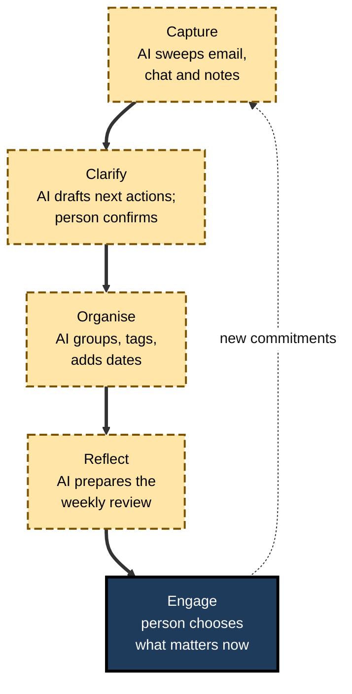
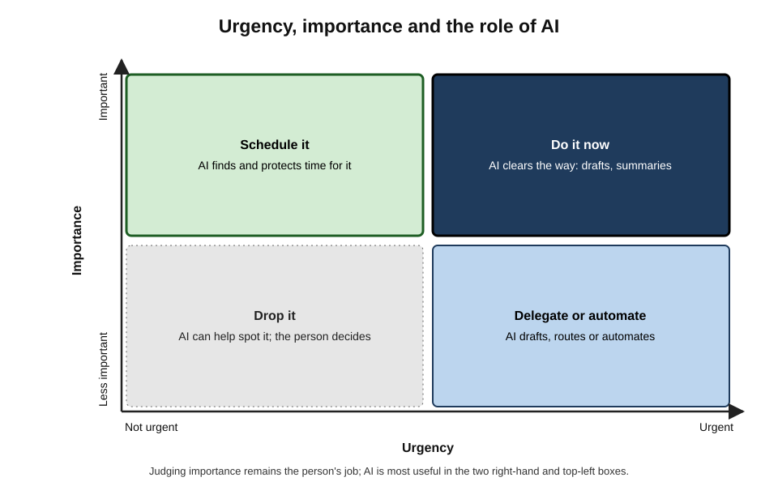
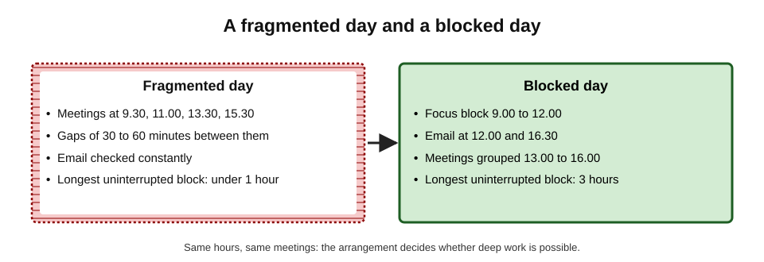
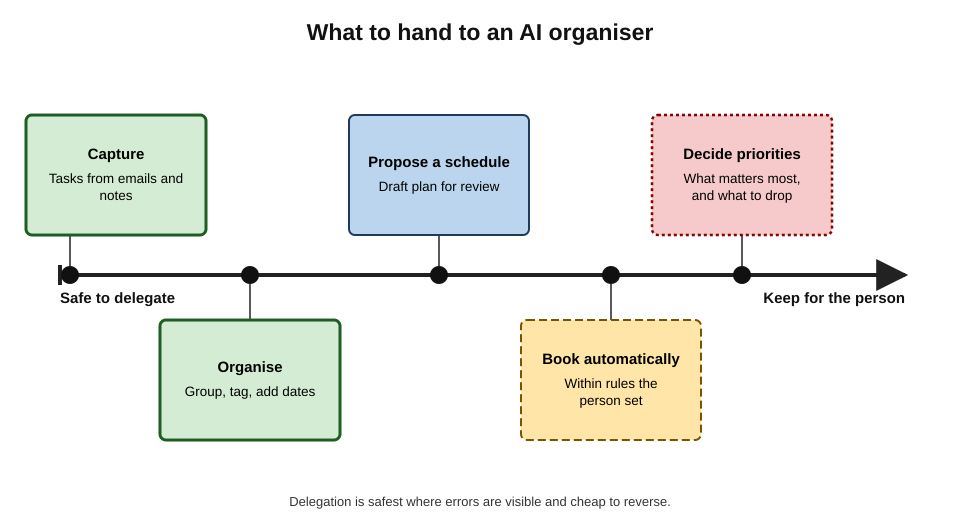
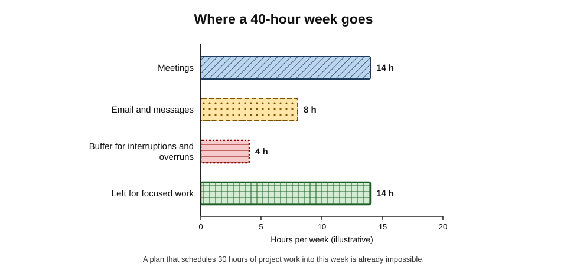
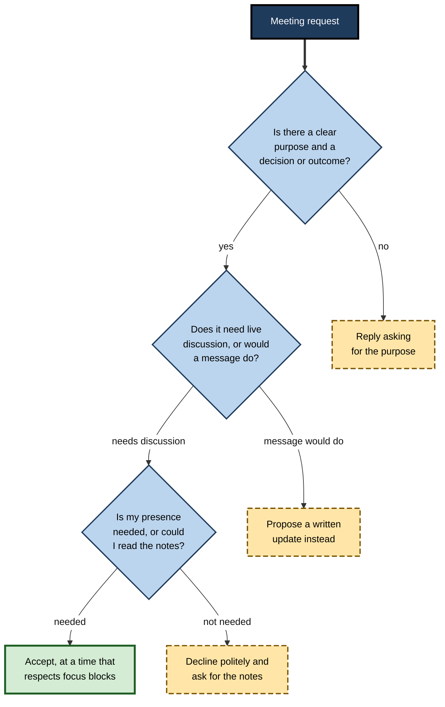

# B.11. AI for scheduling and organisation

A team leader starts Monday with 140 unread emails, eleven meetings and a stale task list. An AI assistant extracts 23 tasks, proposes a schedule and fills every calendar gap with "focus time". By Wednesday the plan has collapsed: it assumed every estimate was right, no meeting would overrun and all 23 tasks mattered equally. AI can take over much of the clerical work of organisation; deciding what matters, and how much really fits, remains a human judgement.

> **Definition — Personal organisation:** the methods a person uses to capture commitments, decide what to work on, and arrange time so that important work is done.

> **Definition — AI-assisted scheduling and organisation:** using AI tools to capture tasks, organise information, propose or book time in calendars, find meeting slots and remind, while the person sets priorities and limits.

**Why it matters**

- Most knowledge workers juggle more commitments than they can remember, across email, chat, meetings and documents.
- Lost commitments damage trust; overloaded calendars destroy the time needed for deep work.
- AI is well suited to **clerical** organising: extracting tasks, summarising, finding times, sorting, reminding.
- It is poorly suited to — and can quietly distort — the **judgemental** part: what matters, what to drop, and how much a person can really do.

---

## The Foundations of Personal Organisation

### Getting things out of the head

- **David Allen, *Getting Things Done* (2001)** — five stages:
  1. **Capture** — collect every commitment into trusted inboxes.
  2. **Clarify** — decide what each item means and what the next action is.
  3. **Organise** — put actions into lists, calendars and projects.
  4. **Reflect** — review regularly, especially weekly.
  5. **Engage** — choose what to do now.
- **The two-minute rule** — if an action takes under two minutes, do it at once rather than organising it.

**Figure 1.** The organising cycle, and where AI fits.

- AI can carry most of the load in the first four stages; the fifth — choosing — is the person's.

> **Definition — Next action:** the next physical, visible step that moves a commitment forward — "email Priya for the Q3 figures", not "budget".

**Study card — Masicampo and Baumeister (2011)**

- **Design:** participants were reminded of an unfinished goal; some then made a specific plan for completing it.
- **Results:** unfinished goals produced intrusive thoughts that disrupted an unrelated task — but making a specific plan largely **removed** the disruption, even though the goal was not yet achieved.
- **Conclusion:** a credible plan frees the mind from unfinished business.

> **Watch out:** single laboratory studies of this kind have had mixed replication records in psychology; the finding fits everyday experience and Allen's practice, but its size should not be overstated.

### Urgency and importance

- **The Eisenhower matrix** — after a remark attributed to US President Dwight Eisenhower, popularised by Stephen Covey (1989).
  - **Important and urgent** — do now.
  - **Important, not urgent** — schedule; this is where most valuable work lives.
  - **Urgent, not important** — delegate or automate.
  - **Neither** — drop.

**Figure 2.** Urgency, importance and the role of AI.

> **Key point:** urgency is visible in the inbox; importance is not. An AI tool that ranks tasks by how often they are mentioned, who sent them or how soon they are due will systematically favour the **urgent** over the **important**.

### Turning intentions into action

> **Definition — Implementation intention:** a plan in the form "when situation X arises, I will do Y" (Peter Gollwitzer, 1999).

- **Gollwitzer and Sheeran (2006)** — a meta-analysis of 94 studies found that forming implementation intentions had a **medium-to-large** positive effect on goal attainment (an average effect size of about d = 0.65).
- **Application:** "At 9.00 on Tuesday, in the small meeting room, I will draft the risk section" works better than "work on the report this week".
- AI can help **convert** vague tasks into when-then plans — but only the person can commit to them.

### Attention and fragmentation

- **Maker's schedule and manager's schedule** — Paul Graham (2009): managers work in one-hour units; makers — writers, programmers, designers — need half-days, and a single meeting can break one.
- **Attention residue** — Sophie Leroy (2009) found that switching from an unfinished task leaves part of attention stuck on it, lowering performance on the next.
- **The cost of interruption** — Gloria Mark and colleagues (2008) found that interrupted people often completed tasks just as fast, by working faster — at the cost of more stress, frustration and effort.

> **Definition — Attention residue:** persistent thoughts about a previous task that reduce performance on the current one after switching.

**Figure 3.** A fragmented day and a blocked day.

> **Definition — Time-blocking:** reserving specific blocks of calendar time for particular tasks or kinds of work, treating them as appointments.

---

## What AI Can Do

### Capture and clarify

- **Extracting tasks** from emails, chat threads, meeting notes and documents.
  - *e.g.* "List every request made of me in these 40 emails, with who asked and any deadline."
- **Clarifying next actions** — turning "the supplier issue" into "call Mark at Acme about the delayed parts; ask for a revised date".
- **Summarising** what changed since the last review.

### Organise

- Grouping tasks by project, context or person; adding dates and tags.
- Merging duplicates — the same request arriving by email and chat.
- Drafting a project list from scattered notes.

### Schedule

- **Proposing a week** — placing tasks into time blocks around meetings.
- **Auto-scheduling tools** — software that books and moves focus time, tasks and habits automatically within rules.
- **Finding meeting times** across several people's calendars and time zones.
- **Rescheduling** when plans change.

### Remind and review

- Reminders based on time, place or events.
- A weekly review prepared automatically: overdue items, next week's commitments, items with no next action.

> **In practice:** the highest-value, lowest-risk use is often the **weekly review**: AI assembles the raw material — open requests, upcoming deadlines, stalled items — and the person decides what matters.

### What to hand over

**Figure 4.** What to hand to an AI organiser.

- **Capture** — safe to delegate; errors are visible (a missed task can be added).
- **Organise** — safe; easy to correct.
- **Propose a schedule** — useful, if reviewed.
- **Book automatically** — only within rules the person sets, and visible to colleagues.
- **Decide priorities** — keep for the person: it depends on goals, relationships and politics the tool cannot see.

> **Remember:** let AI do the **filing**, not the **choosing**.

---

## Capacity: How Much Really Fits

### The arithmetic of a week

**Figure 5.** Where a 40-hour week goes.

> **Formula — Focus capacity:** working hours − meetings − communication time − buffer. Example: 40 − 14 − 8 − 4 = **14 hours** of focused work available. A plan scheduling 30 hours of project tasks is impossible before the week starts.

- **Buffer** — time for overruns, interruptions and the unexpected; experienced planners reserve 10–20% or more, depending on the role.
- **Estimates** — the planning fallacy applies to a single week as much as to projects: people (and AI tools that take their estimates at face value) underestimate tasks.
  - Correction: multiply estimates by a personal factor learned from experience — "my tasks usually take 1.5 times my estimate".

> **Watch out:** auto-schedulers fill every gap because empty calendar time looks like unused capacity. Gaps are often **real work** — thinking, recovering, helping colleagues, handling the unexpected. A calendar at 100% utilisation has no capacity left for reality.

### Parkinson's law and the opposite problem

- **C. Northcote Parkinson (1955):** "work expands so as to fill the time available for its completion."
- Time-boxing — fixing the time for a task — counters it; but boxes that are too small simply move the overrun elsewhere.

---

## Worked Example: Planning a Week With AI

**Situation:** a project manager has 11 meetings (13 hours), a report due Friday, a hiring decision by Thursday, a budget review and about 20 small requests in the inbox.

**Step 1 — AI capture:** the assistant extracts 24 tasks from email, chat and last week's notes, each with source, requester and deadline. Two duplicates are merged; three items are flagged as "unclear — what is the next action?".

**Step 2 — the person sets priorities:** the three outcomes that matter this week are the report, the hiring decision and unblocking the supplier issue. Seven requests are declined, delegated or deferred.

**Step 3 — AI proposes a schedule; the person corrects it**

| | AI's first proposal | After the person's review |
|---|---|---|
| Report | Four 45-minute slots between meetings | Two 2.5-hour morning blocks, Tuesday and Thursday |
| Hiring decision | Not scheduled — no deadline in the source email | One hour Wednesday with the panel's notes; decision sent Thursday |
| Small requests | All 20 scheduled, 15 minutes each | 13 kept, batched into two 45-minute slots |
| Buffer | None | Friday afternoon kept free |
| Total scheduled | 41 hours of a 40-hour week | 34 hours, leaving buffer |

**Step 4 — when-then plans** for the two report blocks: "At 9.00 on Tuesday, notifications off, in the quiet room, I will draft sections 1–3."

- **Conclusion:** AI did the capture and the arithmetic; the person supplied **priorities, realistic estimates and blocks sized for deep work**. The original proposal was clerically perfect and practically impossible.

> **Watch out:** the hiring decision vanished from the AI schedule because its deadline was stated in a meeting, not an email. AI organises **what it can see**; commitments made in conversation must be captured by the person.

---

## Scheduling With Other People

### Finding times

- AI and scheduling tools can propose slots across calendars and time zones and draft invitations.
- **Time zones** — errors are common around daylight-saving changes, which occur on different dates in different countries; check the invitation in both zones.
- **Fairness across time zones** — rotating early and late meetings so the same people do not always bear the cost.

### Norms and courtesy

- **Auto-accepting and auto-declining** — tools that accept meetings on a person's behalf can commit them to things they would refuse; tools that decline can offend.
- **Protected time** — visible focus blocks signal unavailability; teams need shared rules about whether they may be booked over.
- **Calendar visibility** — sharing free/busy information is usually enough; sharing full details exposes sensitive meetings (medical appointments, HR matters, deal names).

> **In practice:** many teams agree simple rules: core collaboration hours, meeting-free mornings on set days, a default meeting length of 25 or 50 minutes, and no meetings booked over focus blocks without asking.

### Should a meeting happen at all?

**Figure 6.** Deciding whether a meeting request should become a meeting.

- AI can draft each kind of reply; the person decides which applies.

---

## Organising Information, Not Just Time

Organisation covers the material of work — notes, files, references, decisions — as well as the calendar.

### How people keep and find their files

- **Ofer Bergman and Steve Whittaker (2016)**, summarising years of studies of how people manage personal digital information, found that most people prefer **navigating** familiar folders to searching, even when search tools are good — because navigation uses the memory of where things were put.
- **Implication for AI:** AI search across personal files and notes is powerful for finding things that were never filed, but it does not replace a simple, stable structure for current work.

### A simple structure

- **Tiago Forte's PARA method (2022)** — four top-level categories:
  - **Projects** — work with a goal and an end date;
  - **Areas** — ongoing responsibilities (budget, team, a client relationship);
  - **Resources** — reference material on topics of interest;
  - **Archives** — inactive items from the other three.
- **Consistent file names** — date first in ISO format (2026-10-08), then subject and version, so files sort correctly.

> **Example:** "2026-10-08 Acme renewal proposal v3.docx" sorts by date, says what it is and shows the version; "proposal final FINAL (2).docx" does none of these.

### Where AI helps

- **Suggesting names and folders** for incoming documents.
- **Summarising and tagging** notes so they can be found later.
- **Answering questions across notes** — "What did we decide about the Acme pricing in the spring?"
- **Building decision logs** — extracting decisions from meeting notes into a dated list.

> **Watch out:** AI answers drawn from personal notes inherit their gaps and errors, and may blend an old note with a newer one. For decisions that matter, open the source note and check its date.

---

## Logistics: Travel and Events

- **Itineraries** — AI can assemble flights, trains, hotels and meetings into a single timeline and draft travel requests.
- **Checks that remain human:**
  - **times and time zones** — arrival times are local; connections across midnight are easy to misread;
  - **entry rules** — visa and passport requirements change and differ by nationality; check official government sources, never an AI summary alone;
  - **bookings** — a proposed itinerary is not a booking; confirm each reservation directly.
- **Events** — AI can draft run-sheets, attendee communications and checklists of commonly forgotten items (accessibility, dietary needs, room set-up, contingency plans).
- **Agents that book** — tools able to purchase travel need spending limits and approval steps; errors cost money and are not always refundable.

> **In practice:** treat an AI-built itinerary as a **draft to verify**, line by line, against the actual confirmations — the same discipline as checking a summary against its source.

---

## Shared Task Lists

- Team task boards fail when items lack owners, dates or clear next actions — the same failures as meeting actions.
- **AI helps** by turning messages into draft tasks, flagging stale items and summarising progress for stand-ups.
- **Team rules** keep boards useful:
  - every item has **one** owner;
  - items not updated in two weeks are reviewed or closed;
  - AI-created items are marked until a person confirms them.

---

## What the Evidence Shows

- **Self-reported benefits** — in large government trials of AI assistants built into office software (UK, 2024), participants valued help with summarising and organising information, and self-reported time savings.
- **A cautionary measurement** — the UK Department for Business and Trade's evaluation (published August 2025) found that, for **scheduling** tasks, participants using the AI assistant took **longer** than without it — one of a few task types where the tool slowed people down.
- **Telemetry of the working day** — workplace software providers' analyses of their own usage data in 2024–2025 described working days fragmented by very frequent interruptions from meetings, email and chat, and workdays extending into evenings.

> **Watch out:** vendor telemetry studies are informative about patterns but are produced by companies selling productivity tools; their figures are not independently verified and should be treated as indicative.

> **Key point:** scheduling looks simple and is full of tacit constraints — who must attend, which meetings can move, who prefers mornings, what is politically sensitive. That is why AI scheduling often saves less time than expected, and sometimes costs time.

---

## Risks and Failure Modes

- **Priority distortion** — tools that rank by recency, sender or due date favour urgent trivia over important work.
- **Over-scheduling** — every gap filled; no buffer; plans that fail by Tuesday.
- **Invisible commitments** — promises made in conversation, which no tool captured.
- **Fragmentation by optimisation** — algorithms that fit tasks into every 30-minute gap destroy the long blocks that deep work needs.
- **Automation of social signals** — auto-accepted meetings, auto-generated "I'll get back to you" replies and AI reminders that feel impersonal to colleagues.
- **Privacy** — calendars and task lists reveal health, family, legal and commercial information; AI tools given access need to be approved and limited.
- **Surveillance** — organisational tools that analyse calendars and activity can be used to monitor employees, with legal and trust implications.
- **Dependence** — a person who cannot plan without the tool is stranded when it fails or changes.

> **Mnemonic — "POISE":** Priority distortion, Over-scheduling, Invisible commitments, Surveillance and privacy, Excessive fragmentation — the risks of AI organisation.

---

## Case Study: The Team That Auto-Scheduled Itself

- **Situation:** a 15-person product team adopted an auto-scheduling tool that placed each person's tasks and focus time into their calendars and rearranged them automatically as meetings appeared.
- **First month:**
  - individuals reported feeling more in control; task completion rose;
  - but colleagues found calendars **solid** for days ahead and could not book urgent discussions;
  - focus blocks moved so often that people stopped trusting them;
  - two client meetings were accepted automatically at times the account manager had promised to keep free.
- **Diagnosis:**
  1. optimising each person's calendar separately made the **team's** coordination worse;
  2. the tool treated all blocks as movable and all gaps as available;
  3. auto-accept rules had been left at their defaults.
- **Actions:**
  1. team-wide meeting-free mornings on Tuesday and Thursday, protected from automatic moves;
  2. daily "open" windows that the tool could not fill;
  3. auto-accept disabled for external invitations;
  4. tasks scheduled automatically only up to 70% of each person's free time.
- **Result:** colleagues could book each other again; focus time became predictable; individuals kept most of the benefit.
- **Lesson:** schedules are **shared resources**. Organising individuals optimally can disorganise the team; rules set by the team must constrain the tools.

---

## Professional Practice

### A sound personal method

1. **Capture** everything into one trusted place — AI can sweep email, chat and notes.
2. **Clarify** next actions; ask AI to flag vague items.
3. **Choose** three outcomes for the week — the person's job.
4. **Calculate capacity** honestly, with buffer.
5. **Block** time for important work in long blocks, using when-then plans.
6. **Batch** small tasks and communication.
7. **Review** weekly with an AI-prepared summary; adjust.

| | Paper or simple lists | Digital task tools | AI-assisted organisation |
|---|---|---|---|
| Capture effort | High — manual | Moderate | Low — extracted automatically |
| Risk of missing commitments | High if not reviewed | Moderate | Lower for written, higher for spoken commitments |
| Scheduling | Manual | Manual with reminders | Proposed or automatic |
| Priority setting | Person | Person | Person — at risk of being displaced |
| Main failure | Things forgotten | Lists grow unmanageable | Over-scheduling, priority distortion |

### Organisational practice

- **Approved tools** with appropriate access to email and calendars.
- **Team norms** for focus time, meeting defaults and response expectations.
- **Limits on monitoring** — clarity about whether calendar and activity data are analysed, by whom and for what.
- **Accessibility** — AI reminders and task extraction can help people with ADHD or other executive-function difficulties; such adjustments deserve support rather than suspicion.

---

## Boundaries and the Always-On Day

Tools that make it easy to schedule anything, anywhere, also make it easy for work to spread into every hour.

- **The extending workday** — workplace telemetry and surveys since 2020 have described more messages and meetings outside core hours, particularly across time zones.
- **Right-to-disconnect laws** — France required larger employers to negotiate rules on out-of-hours digital contact from 2017; Australia introduced a statutory right for employees to refuse unreasonable out-of-hours contact in 2024. Other countries have debated similar measures.
- **AI's double edge:**
  - it can **protect** boundaries — scheduling messages to arrive in the recipient's working hours, batching notifications, summarising what was missed instead of demanding real-time attention;
  - it can **erode** them — agents that reply instantly at any hour set expectations of constant availability.

> **In practice:** two small settings do much good: **send-later by default** for messages composed outside the recipient's hours, and an AI-prepared **"while you were away" summary** in place of reading every message on return.

> **Key point:** organisation exists to make important work possible **and** to make rest possible. A system that fills every hour has failed at the second task, however efficient it looks.

---

## Open Questions

- **Do AI organisers improve outcomes or just feelings of control?**
  - Evidence is mostly self-report; measured effects on completed important work are scarce.
- **How should team-level scheduling be optimised?**
  - Most tools optimise individuals; coordination costs across teams are poorly modelled.
- **Will agents that negotiate meetings with each other help or harm?**
  - Agent-to-agent scheduling may save time or multiply meetings; there is little evidence.
- **Where is the line between support and surveillance?**
  - Calendar and activity analytics raise unresolved questions of consent and trust.
- **Does outsourcing organisation weaken self-management skills?**
  - Plausible, especially for early-career professionals, but unmeasured.

---

## Summary

- **Personal organisation** captures commitments, decides priorities and arranges time; AI helps most with **clerical** organising and least with **judging importance**.
- Foundations: **GTD** (capture, clarify, organise, reflect, engage; next actions; two-minute rule); the **Eisenhower matrix**; **implementation intentions** (Gollwitzer and Sheeran, 2006: about d = 0.65); planning relieves the mental load of unfinished goals (Masicampo and Baumeister, 2011).
- Attention: **maker's and manager's schedules**, **attention residue**, interruption costs; **time-blocking** protects deep work.
- AI can capture, clarify, organise, propose schedules, find times, remind and prepare weekly reviews. **Let AI do the filing, not the choosing.**
- **Focus capacity** = hours − meetings − communication − buffer; plans beyond it fail. Auto-schedulers fill gaps that are needed for reality.
- Scheduling with others needs norms: time zones, auto-accept rules, visibility and protected time.
- Evidence: self-reported benefits; a UK evaluation found AI scheduling **slower** than without it.
- Risks (**POISE**): Priority distortion, Over-scheduling, Invisible commitments, Surveillance and privacy, Excessive fragmentation.
- Schedules are **shared resources**: team rules must constrain individual optimisation.

---

## Self-Check

1. Define AI-assisted scheduling and organisation and identify which part should remain with the person.
2. Describe the five stages of Getting Things Done and the meaning of a "next action".
3. What did Masicampo and Baumeister (2011) find, and what caution applies?
4. Explain the Eisenhower matrix and why AI ranking tends to favour urgency.
5. What is an implementation intention? Rewrite "work on the budget" as one.
6. Explain the maker's and manager's schedules and attention residue.
7. Calculate focus capacity for a 37.5-hour week with 12 hours of meetings, 7 hours of communication and 10% buffer.
8. Why do auto-schedulers often produce plans that fail?
9. In the worked example, what did the AI miss and why?
10. Name three norms that make shared calendars work well.
11. What did the Department for Business and Trade evaluation find about scheduling?
12. List the POISE risks.
13. Analyse the auto-scheduling case study: why did individual optimisation harm the team?
14. Design a weekly routine for a manager that uses AI for capture and review while protecting deep work.

### Answer Key

1. Using AI to capture tasks, organise information, propose or book time, find meeting slots and remind. Setting priorities, deciding what to drop and judging capacity should remain with the person.
2. Capture, clarify, organise, reflect, engage. A next action is the next concrete, visible step that moves a commitment forward.
3. Unfinished goals caused intrusive thoughts that impaired other tasks; making a specific plan largely removed the effect. Caution: a single laboratory finding with an uncertain replication record; its size should not be overstated.
4. Tasks are sorted by urgency and importance: do, schedule, delegate, drop. AI sees signals of urgency (deadlines, frequency, senders) but not importance, which depends on goals and context.
5. A when-then plan. "At 14.00 on Wednesday, at my desk with notifications off, I will reconcile the Q3 budget lines against actuals."
6. Managers work in hour-long units; makers need long uninterrupted blocks, which meetings break. Attention residue is the lingering focus on a previous unfinished task after switching, reducing performance.
7. Buffer = 3.75 h; 37.5 − 12 − 7 − 3.75 = 14.75 hours.
8. They take estimates at face value, include no buffer, treat gaps as free, fragment time into small slots and cannot see priorities or tacit constraints.
9. The hiring decision, because its deadline had been set in a meeting rather than an email; the AI could only organise what it could see.
10. Core collaboration hours; protected focus blocks not booked over; default meeting lengths with gaps; auto-accept off for external invitations; free/busy rather than full calendar sharing.
11. Participants took longer to complete scheduling tasks with the AI assistant than without it.
12. Priority distortion, Over-scheduling, Invisible commitments, Surveillance and privacy, Excessive fragmentation.
13. Each calendar was optimised separately, filling gaps and moving blocks, so colleagues could not find shared time; focus blocks became unpredictable; defaults auto-accepted meetings that conflicted with commitments. Team rules — protected mornings, open windows, limits on automatic filling, auto-accept off — restored coordination.
14. Monday: AI sweeps inbox, chat and notes into a task list and flags unclear items; manager picks three weekly outcomes, declines or delegates the rest, calculates capacity with buffer, books two or three long focus blocks with when-then plans. Daily: email batched twice; small tasks batched. Friday: AI prepares a review of open, overdue and stalled items; manager adjusts next week. Rules: auto-scheduling only into a set share of free time; auto-accept off.

---

## Glossary

| Term | Meaning |
|---|---|
| AI-assisted scheduling and organisation | Using AI to capture, organise, schedule and remind while the person sets priorities. |
| Attention residue | Lingering thoughts about a previous task that reduce performance on the next. |
| Auto-scheduling | Software that books and moves tasks and focus time automatically within rules. |
| Buffer | Reserved time for overruns, interruptions and the unexpected. |
| Eisenhower matrix | A grid sorting tasks by urgency and importance. |
| Focus capacity | Working hours minus meetings, communication time and buffer. |
| Getting Things Done (GTD) | David Allen's method: capture, clarify, organise, reflect, engage. |
| Implementation intention | A when-then plan linking a situation to an action. |
| Maker's schedule | A way of working that needs long uninterrupted blocks. |
| Manager's schedule | A way of working in short, hour-long units. |
| Next action | The next concrete step that moves a commitment forward. |
| PARA | Projects, Areas, Resources, Archives — a simple structure for files and notes. |
| Parkinson's law | Work expands to fill the time available for its completion. |
| Personal organisation | Methods for capturing commitments, choosing work and arranging time. |
| Right to disconnect | A legal or contractual right to ignore unreasonable work contact outside working hours. |
| Time-blocking | Reserving calendar blocks for specific work. |
| Two-minute rule | Doing at once any action that takes under two minutes. |
