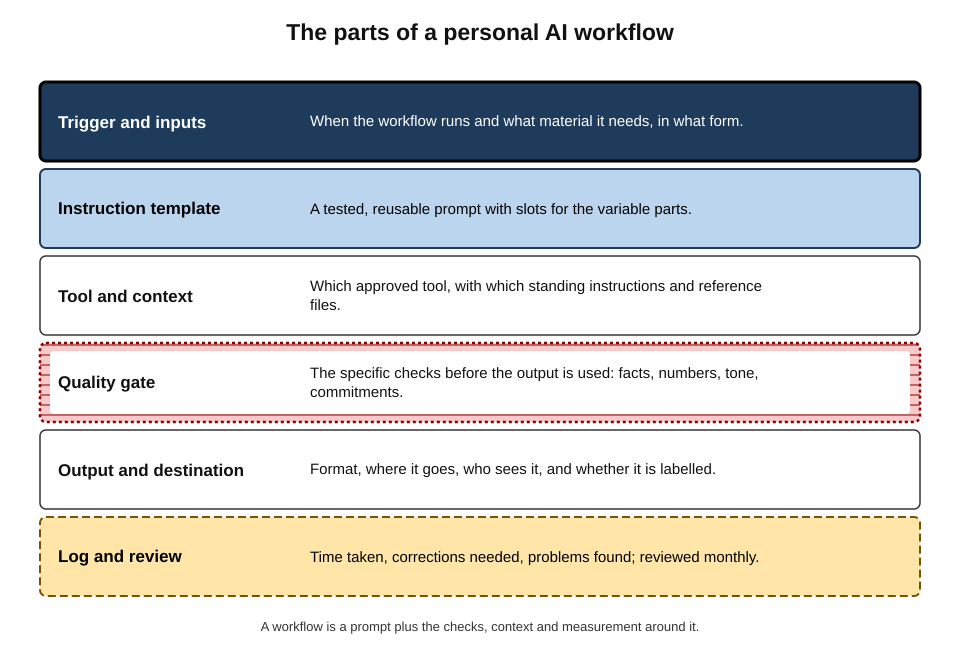
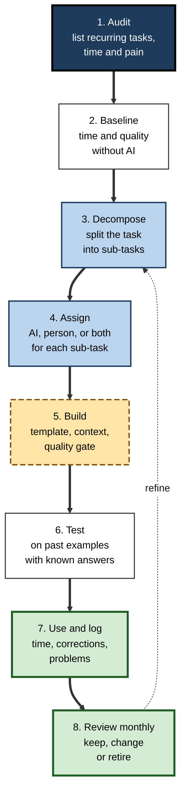
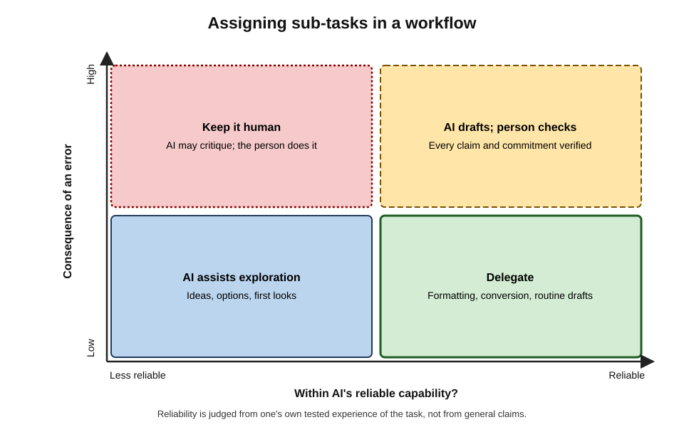
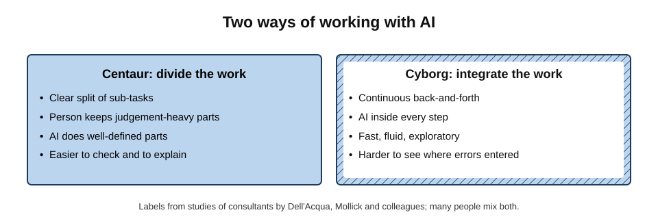
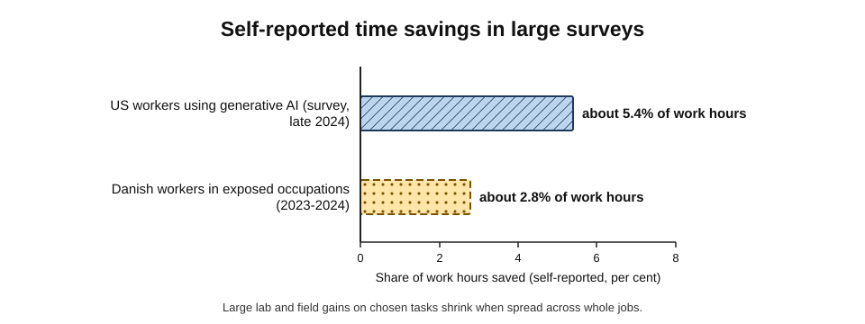
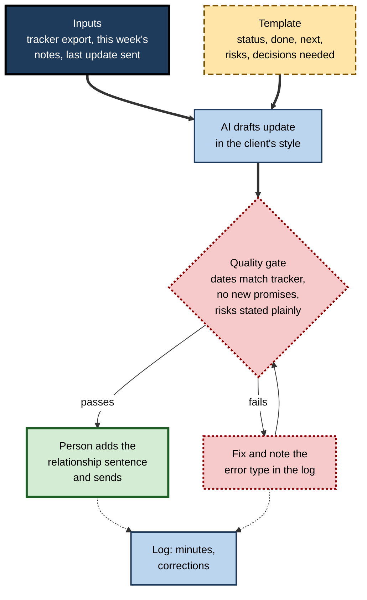

# B.12. Building personal AI workflows

Two analysts in the same team both use AI daily. One opens a chat window whenever a task feels tedious and pastes in whatever comes back. The other has built five small, tested workflows, each with a standard instruction, reference material, a checklist and a time log. Asked how much time AI saves, the first says "loads, I think". The second can say, task by task, how many hours are saved, how often errors occur and where AI is not worth using.

> **Definition — Workflow:** a repeatable sequence of steps that turns defined inputs into a defined output.

> **Definition — Personal AI workflow:** a workflow, designed and maintained by an individual, in which specific steps are assigned to AI tools under standing instructions, with defined human checks and a way of measuring whether it works.

**Why it matters**

- Ad-hoc AI use is easy to start and hard to improve: every request is a fresh experiment, results vary and errors recur.
- Designed workflows make AI use **consistent, checkable and measurable** — the difference between occasional convenience and a durable professional capability.
- Large surveys find that, across whole jobs, AI time savings are modest; the gains are concentrated in particular tasks. Knowing **which** tasks requires measurement.
- A workflow is also where judgement is protected: it fixes in advance where the person checks, decides and stays responsible.

---

## From Prompts to Workflows

### Three levels of AI use

- **Ad hoc** — a one-off request, improvised each time.
  - Useful for exploration; unreliable for repeated work.
- **Templated** — a reusable instruction for a recurring task, with slots for what changes.
  - *e.g.* a saved request for weekly status updates.
- **Workflow** — template plus context, defined inputs, checks, output rules and measurement.

> **Definition — Prompt template:** a tested, reusable instruction with placeholders for the parts that change each time.

> **Key point:** most of the value of a workflow lies **outside the prompt** — in the inputs prepared, the checks applied and the measurement kept. A brilliant prompt with no check is still an error generator.

### The parts of a workflow

**Figure 1.** The parts of a personal AI workflow.

- **Trigger and inputs** — when it runs; what material it needs, in what form.
- **Instruction template** — the standing request, with placeholders.
- **Tool and context** — which approved tool; standing instructions; reference files such as a style guide, glossary or previous examples.
- **Quality gate** — the specific checks before use.
- **Output and destination** — format, where it goes, how it is labelled.
- **Log and review** — time taken, corrections, problems; reviewed regularly.

> **Mnemonic — "TITQOL" ("This Is The Quality Of Life"):** Trigger, Instructions, Tool and context, Quality gate, Output, Log.

---

## Designing a Workflow

**Figure 2.** Designing and improving a personal workflow.

### 1. Audit recurring tasks

- List the tasks done weekly or monthly, with rough time and how tedious or error-prone each is.
- **Candidates:** frequent, time-consuming, mostly language- or structure-based, with clear inputs and outputs.
  - *e.g.* status reports, meeting follow-ups, first drafts of standard documents, literature scans, data clean-ups, reformatting.

### 2. Establish a baseline

- Before changing anything, record **how long** the task takes and **how good** the result is — even roughly, for three or four instances.
- Without a baseline, any later claim of time saved is a guess.

### 3. Decompose the task

> **Definition — Task decomposition:** breaking a task into smaller sub-tasks, each with its own input, output and quality standard, so that each can be assigned and checked separately.

- *e.g.* a monthly performance commentary:
  1. gather figures from the reporting system;
  2. compute changes against last month and budget;
  3. identify the three largest variances;
  4. find explanations (from managers' notes);
  5. draft commentary;
  6. check numbers and tone;
  7. send.

### 4. Assign each sub-task

**Figure 3.** Assigning sub-tasks in a workflow.

- **Delegate** — inside AI's reliable capability and low consequence: reformatting, first drafts of routine text.
- **AI drafts, person checks** — reliable but consequential: commentary for managers, client updates.
- **AI assists exploration** — less reliable but low consequence: brainstorming explanations, suggesting angles.
- **Keep it human** — less reliable and consequential: judgements about people, final numbers, commitments.

> **Watch out:** "inside AI's reliable capability" is a question about **this task, with this tool, for this person** — answered by testing, not by general claims. Studies of consultants found that tasks of similar apparent difficulty can fall on opposite sides of the frontier of what AI does well.

- In the commentary example: steps 1–2 → conventional tools (spreadsheet formulas, not AI); step 3 → formula; step 4 → person; step 5 → AI drafts; step 6 → person; step 7 → person.

> **Key point:** decomposition often reveals that the **best tool for most steps is not AI**. Calculations belong in spreadsheets; AI belongs in the steps involving language and structure.

### 5. Build the template, context and gate

- **Template** — the standing instruction with placeholders.
- **Context** — standing instructions (audience, style, spelling), reference files (last month's approved commentary, a glossary), examples of good output.
- **Quality gate** — a short list of checks specific to this output.
  - *e.g.* every figure matches the spreadsheet; every explanation comes from a manager's note; no blame language; under 300 words.

> **Example — a commentary template:** "Using the variance table and managers' notes below, draft commentary for the monthly report to department heads. For each of the three largest variances, give the figure exactly as in the table, the explanation from the notes, and one implication. Do not add explanations not in the notes; write [EXPLANATION NEEDED] instead. British spelling; neutral tone; under 300 words. [VARIANCE TABLE] [MANAGERS' NOTES]"

### 6. Test on past examples

- Run the workflow on three to five **past** instances where the right answer is known.
- Compare outputs with what was actually sent; note every error.
- Adjust the template, context or gate until the errors that remain are ones the gate catches.

> **Definition — Test set (personal):** a small collection of past inputs with known good outputs, used to check a workflow before relying on it and after any change to the tool.

### 7–8. Use, log and review

- **Log** each run: minutes spent (including checking), corrections made, problems found.
- **Review monthly**: keep, refine or retire each workflow.

---

## Chaining Steps

### Why one big request is fragile

- A single request asking a model to "read these notes, work out the issues, draft the update and check it" mixes several tasks; errors in the early ones are hidden in the final text.
- Splitting the work into **separate requests**, each with its own output that can be inspected, makes errors visible where they occur.

> **Definition — Prompt chaining:** breaking a task into a sequence of AI steps in which the output of one step becomes the input of the next, with the option to inspect or edit between steps.

**Study card — Wu, Terry and Cai (2022), "AI Chains"**

- **Design:** participants completed writing and analysis tasks either with a single model request or with a chain of smaller steps they could view and edit.
- **Results:** chaining produced better-rated results and gave participants a greater sense of transparency, control and collaboration with the model.
- **Conclusion:** decomposition helps not only the person's planning but the model's performance and the person's ability to correct it.

### A typical chain

1. **Extract** — "List every decision and open issue in these notes, with the line it came from."
2. **Check** — the person confirms or edits the list.
3. **Draft** — "Using only the confirmed list, draft the update in the template."
4. **Critique** — "Compare the draft with the list: anything added, missing or overstated?"
5. **Finalise** — the person edits and sends.

> **In practice:** the **inspection point after extraction** is the most valuable step in most chains. Errors caught in a list of facts take seconds to fix; the same errors buried in polished prose take far longer to find.

> **Watch out:** a model asked to critique its own draft shares the blind spots that produced it. Self-critique catches some omissions and inconsistencies; it does not replace the person's gate.

---

## A Personal Library

- **Name templates by task and version** — "Client update v4 (2026-09)" — so changes can be traced.
- **Store with each template:** its purpose, required inputs, the quality gate, and a note of known weaknesses.
- **Keep good examples** — approved past outputs make the best context for future runs.
- **Retire stale templates** — outdated instructions (old product names, previous managers' preferences) cause quiet errors.
- **Share deliberately** — templates passed to colleagues should travel with their gates and examples; a template without its checklist spreads speed without safety.

> **Remember:** a template is a piece of **working equipment**. Like any equipment, it needs a label, a maintenance record and an owner.

---

## Deciding Where Not to Use AI

A mature set of workflows includes deliberate decisions **not** to use AI.

- **Where checking costs as much as doing** — short, high-precision tasks such as entering a figure into a contract.
- **Where the value is personal** — thanks, condolences, feedback on someone's work.
- **Where the person is still learning** — drafting it oneself builds the skill the workflow would otherwise hide.
- **Where errors are costly and hard to detect** — legal commitments, safety instructions, decisions about people — unless a qualified reviewer checks.
- **Where conventional tools are better** — calculations, lookups in a known system, mail-merge.

> **Example:** after two months of logging, an HR adviser retired her workflow for drafting answers to policy questions: checking each draft against the policy took as long as writing the answer, and two drafts had paraphrased eligibility rules incorrectly. She kept a workflow for **finding** the relevant policy section, which saved time without that risk.

> **Key point:** the log is as useful for showing where AI does **not** pay as for showing where it does. Retiring a workflow on the evidence is a sign of a well-run practice, not a failure.

---

## Ways of Working With AI

### Centaurs and cyborgs

**Figure 4.** Two ways of working with AI.

- In the Boston Consulting Group experiment with Harvard and other researchers (Dell'Acqua and colleagues, 2023), observers distinguished two successful patterns:
  - **Centaurs** — divided the work, handing defined sub-tasks to AI and keeping others, switching deliberately between the two.
  - **Cyborgs** — integrated AI continuously into every step, working in rapid back-and-forth.
- A follow-up analysis also identified people who handed over whole tasks with little engagement — and who learned least from the experience.

> **Definition — Centaur working:** dividing a task between person and AI along clear lines, with the person retaining judgement-heavy sub-tasks.

> **Definition — Cyborg working:** integrating AI continuously within sub-tasks, in a fluid exchange.

- **Design implication:** workflows for consequential, repeated work tend to be **centaur-like** — the division of labour makes checking possible. Exploration and creative work are often **cyborg-like**.

### AI as a teammate

**Study card — Dell'Acqua and colleagues (2025), "The Cybernetic Teammate"**

- **Design:** field experiment with **776** professionals at Procter & Gamble working on real product-development challenges, either alone or in two-person cross-functional teams, with or without AI.
- **Results:**
  - individuals **with** AI produced solutions of quality comparable to **teams without** AI;
  - teams with AI were the most likely to produce top-quality solutions;
  - AI helped people produce ideas that bridged their own functional specialism — commercial and technical — and participants reported more positive emotions when working with AI.
- **Conclusion:** AI can provide some of the benefits of a teammate — breadth, a second perspective — within an individual's workflow.
- **Limits:** one company, one-day tasks, quality judged by experts at the time; long-term effects on teams and collaboration are unknown.

---

## Measuring Honestly

### Why self-reports mislead

- In METR's 2025 trial with experienced software developers, participants **believed** AI had made them about 20% faster while measured task time was about 19% **longer**.
- People notice the fast part (generation) and discount the slow parts (prompting, waiting, checking, fixing).
- Enjoyment and novelty colour judgement: tasks feel easier, and easier feels faster.

> **Watch out:** "it saves me hours" is a hypothesis, not a measurement. Treat any personal estimate of AI time savings — including one's own — as unverified until it is logged.

### What the large surveys find

**Study card — Humlum and Vestergaard (2025), Denmark**

- **Design:** surveys of about **25,000** workers in **7,000** workplaces across **11** occupations considered highly exposed to AI chatbots, linked to official records of earnings and hours, 2023–2024.
- **Results:**
  - adoption was widespread, often encouraged by employers;
  - users reported average time savings of about **2.8%** of work hours;
  - no significant effect on earnings or recorded hours could be detected — effects larger than about 1% were ruled out;
  - AI also **created new tasks** for some workers, such as checking AI output and writing prompts.
- **Conclusion:** across whole jobs, early gains were modest, partly offset by new work and not (yet) passed on in pay.

- **Bick, Blandin and Deming (US surveys, 2024):** among workers who used generative AI, self-reported time savings averaged about **5.4%** of work hours — equivalent to about 1.4% across all workers once non-users are included.

**Figure 5.** Self-reported time savings in large surveys.

> **Key point:** dramatic gains measured on **selected tasks** in experiments (often 25–55%) shrink to a few per cent across **whole jobs**, because AI helps only some tasks, adds checking work and creates new tasks. Personal workflows earn their gains task by task.

### The arithmetic of net saving

> **Formula — Net time saved per run:** (time without AI) − (time with AI, including prompting and waiting) − (checking time) − (expected rework time). Example: a client update takes 50 minutes by hand. With the workflow: 10 minutes preparing inputs and generating, 12 minutes checking, and rework averaging 5 minutes (one run in four needs 20 minutes of fixes). Net = 50 − 10 − 12 − 5 = **23 minutes** saved per run — not the 40 minutes it "feels" like.

### What to log

- **Minutes per run**, with AI and (for the baseline) without.
- **Corrections** — how many, of what kind (fact, number, tone, omission).
- **Escapes** — errors that got past the gate and were noticed later.
- **Downstream effects** — questions from recipients, rework requested by others.

| Measure | What it shows | Common distortion |
|---|---|---|
| Self-estimated time saved | Perceived benefit | Overstates — ignores checking and rework |
| Logged minutes per run | Actual effort | Accurate if checking is included |
| Corrections per run | Quality of AI output | Falls as the template improves; rises after tool changes |
| Escaped errors | Effectiveness of the quality gate | Under-counted unless recipients' feedback is tracked |
| Recipients' rework | Costs shifted to others | Usually invisible to the workflow's owner |

---

## Worked Example: A Weekly Client Update Workflow

**Situation:** an account manager sends five clients a weekly project update. Baseline: about 45 minutes each, 3.75 hours a week; occasional errors in dates.

**Figure 6.** The weekly client update workflow.

**Results after six weeks**

| | Baseline | With the workflow |
|---|---|---|
| Minutes per update, including checks | 45 | 22 |
| Weekly total | 3.75 hours | 1.8 hours |
| Date errors reaching clients | About one a month | None |
| Corrections per update | — | 1.4 on average, falling to 0.6 |
| Client feedback | Occasional "can you clarify?" | Unchanged |

- **Design choices that mattered:**
  1. **inputs from the tracker**, not from memory, so dates were right at source;
  2. the gate's "**no new promises**" check, after the AI twice added "we will deliver by…" lines;
  3. a **human-written sentence** in each update about the relationship — "thanks for turning round the test data so quickly" — that the AI was not asked to write.
- **Conclusion:** the workflow halved the time and removed a recurring error, while keeping the part of the message that depends on the account manager's own attention.

---

## Maintaining Workflows

### When tools change

- AI providers update models frequently; behaviour on a given prompt can change without notice.
- **Lingjiao Chen, Matei Zaharia and James Zou (2023)** compared versions of the same widely used models released a few months apart and found substantial changes in performance and behaviour on several tasks — some better, some worse.
- **Practice:** rerun the personal test set after any noticeable tool change, and whenever outputs start to look different.

> **Definition — Model drift:** changes in an AI system's behaviour over time, caused by updates to the model or its surrounding system, that can alter a workflow's results.

### Keeping it safe

- **Approved tools only** for work data; standing instructions and reference files must not contain material the tool should not hold.
- **Labelling** — outputs shared with others are clear about AI involvement where norms or policy require.
- **Documentation** — a short description of each workflow (purpose, inputs, template, checks), so a colleague can cover during absence.

### Keeping skills

- Workflows that do the drafting can erode the ability to draft.
- **Deliberate practice** — doing the task by hand occasionally, or drafting first and comparing with the AI's version.
- **Rotation** — for junior staff, workflows should leave room to learn the underlying task before automating it.

> **In practice:** a useful rule is to automate a task only once you can do it well yourself — and to keep doing it yourself occasionally, so that you can still recognise when the workflow's output is wrong.

---

## Case Study: The Finance Analyst's Monthly Pack

- **Situation:** an analyst in a mid-sized firm spent about two days each month preparing a management pack: figures, charts and eight pages of commentary.
- **Design:**
  1. **audit and baseline** — 15 hours a month, of which about 6 were commentary;
  2. **decomposition** — figures and charts kept in the spreadsheet (no AI); commentary drafted by AI from a variance table and managers' notes; final review by the analyst;
  3. **template and context** — last quarter's approved commentary as a style example; a glossary of the firm's terms;
  4. **gate** — every figure traced to the spreadsheet; every explanation traced to a note; "[EXPLANATION NEEDED]" placeholders resolved with managers.
- **Results (first three months):** commentary time fell from about 6 hours to about 2.5; managers reported clearer commentary; one escaped error (a sign reversed in a variance) was caught by the finance director.
- **Response:** the gate was extended to check the direction of every variance ("over" or "under" budget) against the sign in the table.
- **Month five:** after a tool update, drafts began rounding figures to one decimal place. The test set — three past months with approved commentary — exposed the change before anything was sent; an instruction to "quote figures exactly as in the table" fixed it.
- **Lesson:** the gains came from **decomposition** (AI only where language mattered), the safety from **gates that grew with experience**, and the resilience from a **test set** that caught tool drift.

---

## Open Questions

- **How large are the real gains from personal workflows?**
  - Survey evidence shows modest savings across jobs; well-measured individual workflows may do better, but rigorous evidence is scarce.
- **Who captures the benefit?**
  - Time saved may become more work, more leisure, higher pay or none of these; early Danish evidence found no pay effect.
- **Will tools absorb personal workflows?**
  - Assistants increasingly offer saved instructions, projects and agents; whether this makes individual design skill more or less important is unclear.
- **How should workflows be shared?**
  - Personal workflows that work could become team standards; how to share them without losing the judgement embedded in them is little studied.
- **What happens to skill and learning?**
  - Workflows protect quality but may hide the underlying task from newcomers; the long-term effect on expertise is unknown.

---

## Summary

- A **personal AI workflow** is a repeatable sequence with AI assigned to specific steps under standing instructions, with human checks and measurement. Three levels: **ad hoc, templated, workflow**.
- Parts (**TITQOL**): Trigger and inputs, Instruction template, Tool and context, Quality gate, Output, Log.
- Design: **audit → baseline → decompose → assign → build → test → use and log → review**.
- **Task decomposition** often shows that most steps need conventional tools, not AI. Assign by reliability and consequence: delegate; AI drafts and person checks; AI assists exploration; keep human.
- Working styles: **centaurs** divide the work; **cyborgs** integrate it (Dell'Acqua et al., 2023). AI can act as a **cybernetic teammate** (P&G study, 2025).
- **Measure honestly**: self-reports overstate (METR, 2025); surveys show modest whole-job savings — about **2.8%** (Denmark) and **5.4%** among US users. **Net saving** = time without − time with − checking − rework.
- Log minutes, corrections, escaped errors and recipients' rework.
- Maintain: **personal test sets** catch **model drift**; approved tools; documentation; deliberate practice to keep skills.

---

## Self-Check

1. Define a personal AI workflow and distinguish it from ad-hoc and templated use.
2. List the six parts of a workflow (TITQOL) and explain why most of the value lies outside the prompt.
3. Describe the eight steps of designing a workflow.
4. Why is a baseline essential?
5. Decompose "preparing a weekly sales report" into sub-tasks and assign each.
6. What does the assignment grid recommend for a high-consequence sub-task inside AI's reliable capability?
7. Distinguish centaur and cyborg working, and say which suits consequential repeated work.
8. Summarise the P&G "Cybernetic Teammate" findings and their limits.
9. Why do self-reported time savings mislead? Use the METR finding.
10. Summarise Humlum and Vestergaard (2025) and explain why whole-job savings are much smaller than task-level gains.
11. Calculate net time saved: a task takes 60 minutes by hand; with AI, 15 minutes generating, 15 checking, and rework of 30 minutes in one run out of three.
12. What is model drift, and how does a personal test set protect against it?
13. In the finance case study, what three design features produced gains, safety and resilience?
14. Design a workflow for producing a monthly newsletter for internal staff, specifying all six parts and how you would measure its success.

### Answer Key

1. A repeatable sequence turning defined inputs into outputs, with AI assigned to specific steps under standing instructions, human checks and measurement. Ad hoc is improvised each time; templated reuses an instruction; a workflow adds inputs, context, gates and measurement.
2. Trigger and inputs, Instruction template, Tool and context, Quality gate, Output, Log. Prepared inputs, checks and measurement determine reliability; a good prompt without them still produces unchecked errors.
3. Audit recurring tasks; baseline time and quality; decompose; assign sub-tasks; build template, context and gate; test on past examples; use and log; review monthly.
4. Without it, claims of time saved are guesses; perception is biased, so measurement against a pre-change level is needed.
5. Export data (system), calculate changes (spreadsheet), identify notable movements (formula), gather explanations (person), draft narrative (AI), check figures and tone (person), send (person).
6. AI drafts and a person checks every claim and commitment.
7. Centaurs divide work into AI and human sub-tasks; cyborgs interleave continuously. Centaur-like division suits consequential repeated work because it makes checking possible.
8. 776 professionals; individuals with AI matched teams without AI; teams with AI most likely to produce top solutions; ideas bridged specialisms; positive emotions. Limits: one company, short tasks, immediate expert judgements, long-term effects unknown.
9. People notice fast generation and discount prompting, waiting, checking and fixing; enjoyment feels like speed. METR developers believed they were 20% faster but were 19% slower.
10. 25,000 Danish workers in exposed occupations: about 2.8% of hours saved, no detectable effect on earnings or hours, new tasks created. Whole jobs include many tasks AI does not help, plus new checking work, so selected-task gains dilute.
11. Expected rework = 30 ÷ 3 = 10 minutes. Net = 60 − 15 − 15 − 10 = 20 minutes saved per run.
12. Changes in AI behaviour after updates. Rerunning past inputs with known good outputs reveals changes before they affect real work.
13. Decomposition (AI only for commentary), gates extended after an escaped error (variance direction check), and a test set that detected rounding changes after a tool update.
14. Trigger: first Monday monthly. Inputs: items submitted via a form, calendar of events, last issue. Template: sections, tone, length, placeholders. Tool and context: approved assistant, style guide, past issues. Gate: names, dates and links checked; nothing confidential; inclusive language; under 800 words. Output: draft to communications lead, labelled per policy. Log: minutes, corrections, open rates and staff feedback compared with a baseline.

---

## Glossary

| Term | Meaning |
|---|---|
| Ad-hoc use | Improvised one-off AI requests. |
| Baseline | Time and quality of a task measured before a change. |
| Centaur working | Dividing a task between person and AI along clear lines. |
| Cyborg working | Integrating AI continuously within sub-tasks. |
| Escaped error | An error that passed a quality gate and was found later. |
| Model drift | Changes in AI behaviour over time that alter workflow results. |
| Net time saved | Time without AI minus time with AI, checking and expected rework. |
| Personal AI workflow | An individually designed workflow assigning steps to AI with checks and measurement. |
| Prompt chaining | A sequence of AI steps where each output feeds the next, with inspection between. |
| Prompt template | A tested, reusable instruction with placeholders. |
| Quality gate | Specific checks applied before an output is used. |
| Task decomposition | Breaking a task into sub-tasks that can be assigned and checked separately. |
| Test set (personal) | Past inputs with known good outputs, used to test a workflow. |
| TITQOL | Trigger, Instructions, Tool and context, Quality gate, Output, Log. |
| Workflow | A repeatable sequence of steps turning inputs into an output. |
