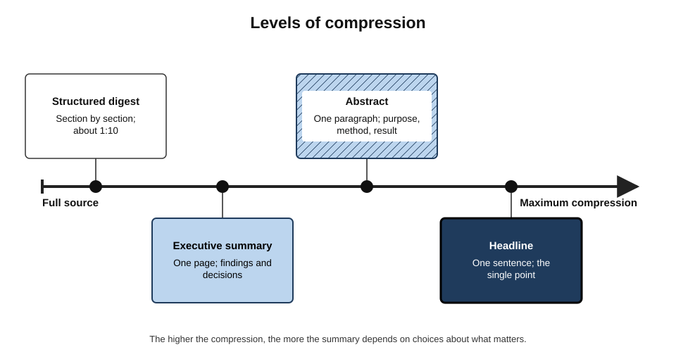
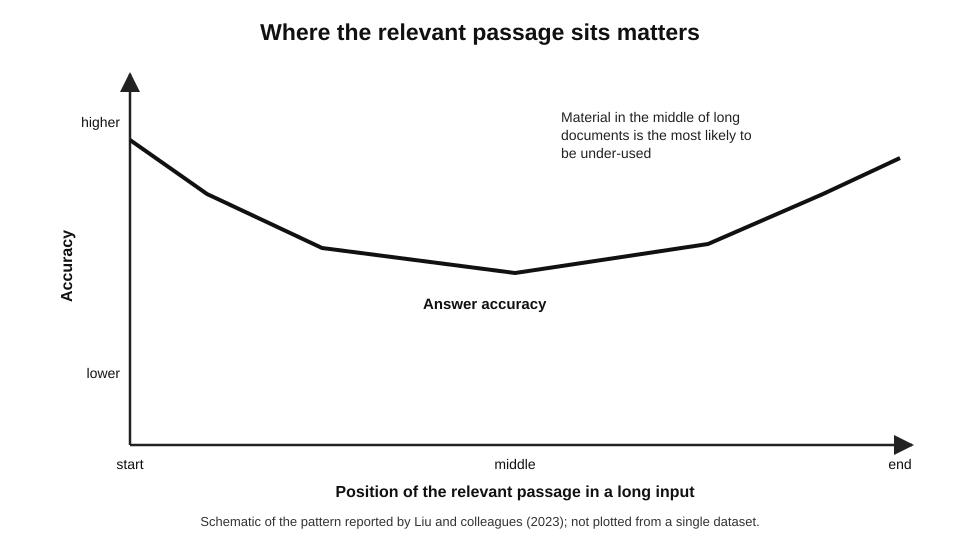
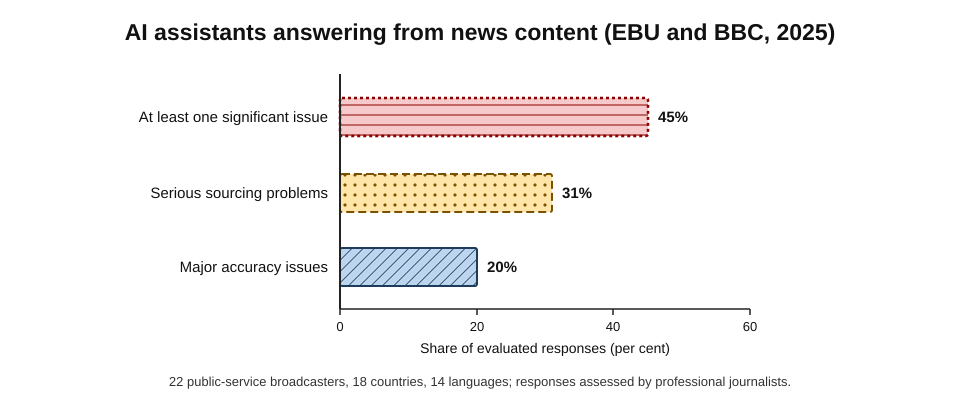
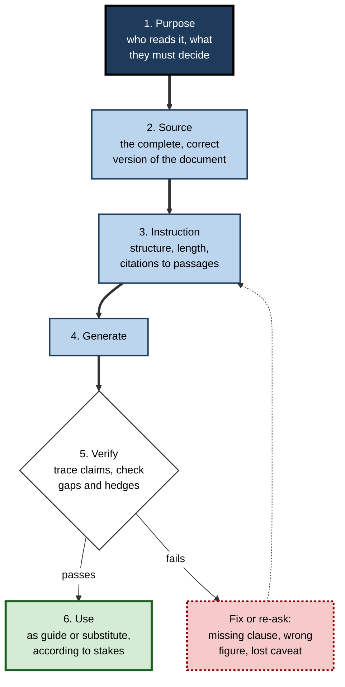
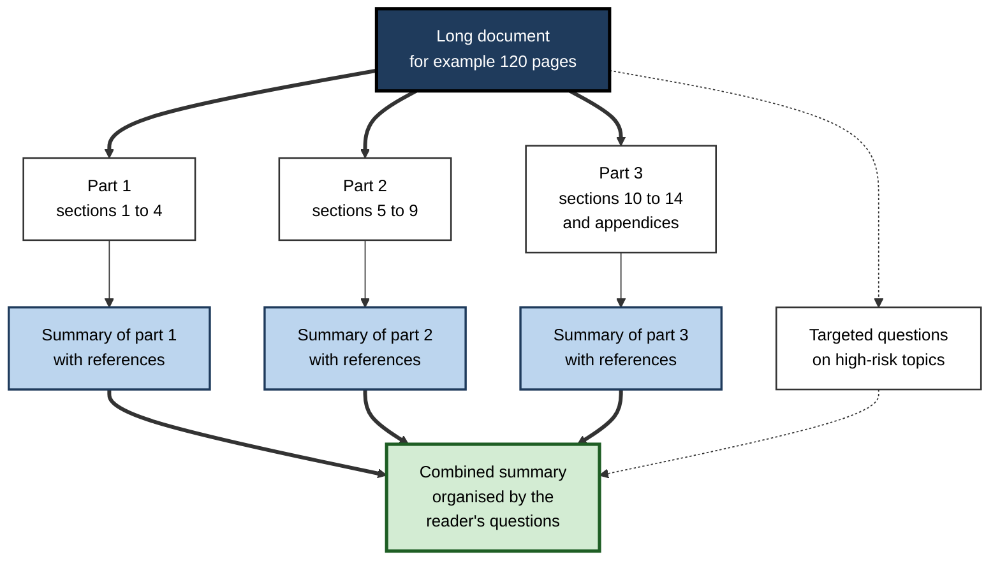
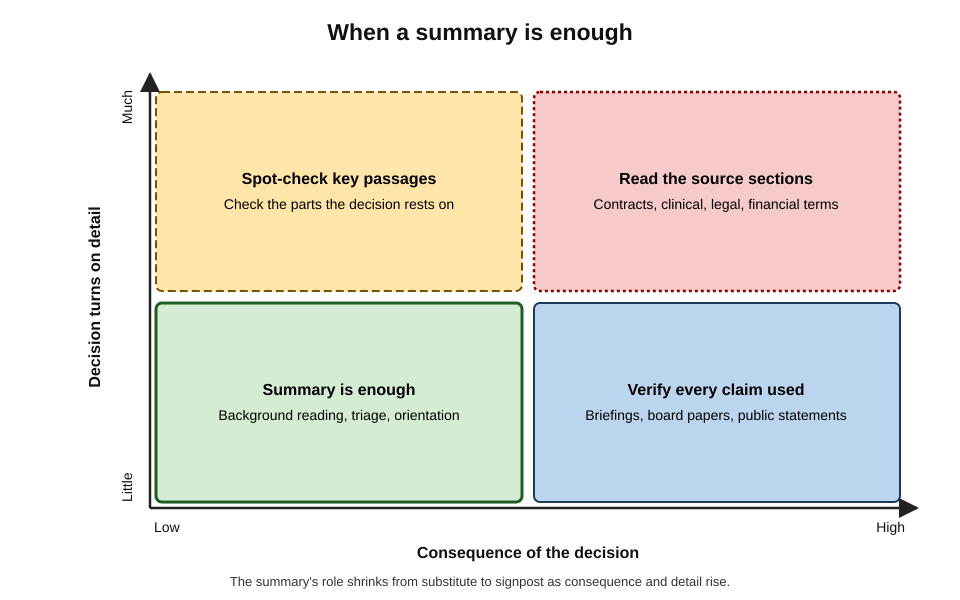

# B.2. Summarising documents

A manager has twenty minutes before a steering meeting and an 80-page supplier report she has not read. An AI assistant returns a tidy one-page summary in under a minute. The summary is fluent, well organised and mostly right — but it never mentions the clause on page 61 that allows the supplier to raise prices mid-contract. Summarising is the most natural thing to ask of a language model, and the place where a confident omission does the most quiet damage.

> **Definition — Summary:** a shorter text that conveys the content of a source most relevant to a particular reader and purpose, without adding claims the source does not support.

> **Definition — AI summarisation:** using a language model to produce a summary of one or more documents, which the user then checks and uses as a guide to — or, where justified, a substitute for — the source.

**Why it matters**

- Professionals face far more reading than they can do: reports, contracts, papers, policies, transcripts, email threads, regulatory updates.
- A good summary lets a reader **decide what to read**, **prepare quickly** and **share understanding** across a team.
- A bad summary is worse than none: it gives the reader false confidence that they know what the document says.
- Summarising is where AI's strengths (fluent compression) and weaknesses (invention, omission, distortion) meet most directly.

---

## What a Summary Is For

### Summaries serve readers, not documents

There is no single correct summary of a document. A summary is a set of **choices about what matters**, and those choices depend on who will read it and what they must do.

- **A lawyer** reading a supply contract wants obligations, liabilities, termination rights and deadlines.
- **A finance manager** wants prices, payment terms and penalties.
- **An operations lead** wants service levels, hand-over dates and named contacts.
- Each needs a different summary of the same document.

> **Key point:** the first question is never "summarise this" but "**what does the reader need to know or decide**?" The answer determines what the summary keeps, what it drops and how it is organised.

### Indicative and informative summaries

> **Definition — Indicative summary:** a summary that tells the reader what a document is about and whether it is worth reading, without conveying its findings in detail.

> **Definition — Informative summary:** a summary that conveys the document's main content — findings, arguments, figures — so that the reader can, for some purposes, use it instead of the source.

- **Indicative** — triage: "Is this paper relevant to our question?"
- **Informative** — substitution: "What did the audit find, and what does it recommend?"
- **Critical or evaluative** — adds judgement: "How strong is the evidence?" — the summariser's view, clearly separated from the source's claims.

### Compression

> **Formula — Compression ratio:** summary length ÷ source length. Example: a 400-word summary of a 16,000-word report = 400 ÷ 16,000 = **1:40**, or 2.5% of the original.

**Figure 1.** Levels of compression.

- **Low compression** (structured digest, about 1:10) — keeps most points, section by section.
- **Medium** (executive summary, one page) — findings, implications, decisions needed.
- **High** (abstract, one paragraph) — purpose, approach, main result.
- **Extreme** (headline, one sentence) — the single most important point.

> **Remember:** the higher the compression, the more the summary depends on **judgement about what matters** — and the more that judgement should be the reader's, stated in the brief, not the model's default.

---

## How Machines Summarise

### Extractive and abstractive summarisation

> **Definition — Extractive summarisation:** selecting and stitching together sentences or phrases taken directly from the source.

> **Definition — Abstractive summarisation:** generating new sentences that paraphrase and condense the source's meaning.

- **Origins:** Hans Peter Luhn at IBM (1958) produced the first automatic "abstracts" by selecting sentences containing the document's most frequent significant words — a purely extractive method.
- **For decades** automatic summarisation was mostly extractive: safe from invention but often choppy and redundant.
- **Neural abstractive models** (from the mid-2010s) and then large language models (from about 2020) produced fluent, human-like summaries — and a new failure: **content not in the source**.

| | Extractive | Abstractive |
|---|---|---|
| Wording | Source's own sentences | New sentences |
| Fluency | Often choppy | Usually smooth |
| Risk of invented content | Very low | Real and sometimes high |
| Risk of distortion by omission | Present | Present |
| Ease of checking | Easy — find the sentence | Harder — must find support for a paraphrase |
| Typical modern use | Quotations, highlights, evidence trails | Executive summaries, briefings, digests |

### What a language model does when it summarises

- It reads the document as input text within its **context window** — the amount of text it can take in at once.
- It generates, word by word, the text most likely to be a good summary **given the instruction and the input**.
- It has **no separate fact-checking step**: if a sentence is plausible, fluent and roughly consistent with the input, it can be generated whether or not the source supports it.
- It also draws on what it learned in training — useful for context, dangerous when it blends outside "knowledge" into a summary of a specific document.

> **Definition — Context window:** the maximum amount of text, measured in tokens, that a model can process in a single request.

> **Watch out:** a large context window means a model *can* take in a long document, not that it attends equally to every part. Fitting a document into the window is not the same as reading it carefully.

---

## How Summaries Go Wrong

### Hallucination: adding what is not there

**Study card — Maynez and colleagues (2020)**

- **Design:** human annotators examined summaries produced by several neural abstractive models of news articles.
- **Findings:**
  - a large share of summaries contained **hallucinated** content — information not supported by the source;
  - they distinguished **intrinsic** hallucinations (misrepresenting information in the source) from **extrinsic** ones (adding information absent from the source);
  - some extrinsic additions were true in the world but still unsupported by the document.
- **Conclusion:** fluency and faithfulness are different properties; standard automatic metrics did not capture faithfulness well.

> **Definition — Faithfulness:** the degree to which every claim in a summary is supported by the source.

> **Definition — Intrinsic hallucination:** a summary statement that contradicts or distorts the source. **Extrinsic hallucination:** a statement that adds information the source does not contain.

- **Typical intrinsic errors:** wrong figures, swapped names, reversed relationships ("A acquired B" for "B acquired A"), merged events.
- **Typical extrinsic errors:** background facts from training, plausible conclusions the author never drew, invented quotations.

### Omission: leaving out what matters

- The model decides what is "important" using general patterns — headings, repetition, emphasis — not the reader's interests.
- Clauses, caveats and exceptions are short and unremarkable in form, so they are often dropped.
  - *e.g.* "except where the customer has given notice under clause 14" vanishes from a summary of renewal terms.
- **Omission is harder to detect than invention:** checking a summary against the source finds false statements; finding what is *missing* requires knowing the source.

### Position effects: the lost middle

**Study card — Liu and colleagues (2023), "Lost in the Middle"**

- **Design:** models answered questions from long inputs in which the relevant passage was placed at different positions.
- **Results:**
  - accuracy was highest when the relevant information was at the **beginning or end** of the input;
  - accuracy fell markedly when it was in the **middle**;
  - longer inputs made the effect worse.
- **Conclusion:** models do not use long contexts uniformly; material in the middle of long documents is at greatest risk.

**Figure 2.** Where the relevant passage sits matters.

> **Watch out:** newer models with longer context windows have reduced but not eliminated position effects. Long contracts, appendices and the middle chapters of reports remain places to check by hand.

### Distortion: changing the strength of claims

**Study card — Peters and Chin-Yee (2025)**

- **Design:** thousands of AI-generated summaries of scientific abstracts and articles, from ten widely used models, compared with the original texts and with human-written summaries.
- **Findings:**
  - most models **overgeneralised** — turning cautious, qualified findings into broader claims (*e.g.* "was associated with improvement in this sample" became "improves outcomes");
  - AI summaries were several times more likely than expert-written summaries to contain such broad generalisations;
  - asking explicitly for accuracy did **not** solve the problem and in some tests made it worse;
  - several newer models overgeneralised more than older ones.
- **Conclusion:** summarisation can silently strip hedges and scope limits — the very qualifications that make a finding trustworthy.

> **Definition — Overgeneralisation:** a summary error in which a qualified or limited claim is restated as broader, more certain or more widely applicable than the source supports.

### Attribution and sourcing errors

**Study card — European Broadcasting Union and BBC (October 2025)**

- **Design:** journalists from **22** public-service broadcasters in **18** countries, working in **14** languages, evaluated more than **3,000** responses from four widely used AI assistants answering questions about news.
- **Findings:**
  - **45%** of responses had at least one significant issue;
  - **31%** had serious sourcing problems — missing, misleading or incorrect attributions;
  - **20%** had major accuracy issues, including invented details and outdated information;
  - the problems appeared across languages and countries.
- **Context:** an earlier BBC study (February 2025) of 100 questions found significant issues in just over half of answers, including altered or invented quotations.

**Figure 3.** AI assistants answering from news content (EBU and BBC, 2025).

> **Watch out:** these studies tested assistants answering news questions — a mix of search and summarisation — not summaries of a document the user supplied. Summaries of a pasted document are usually more faithful, but the same failure types appear.

### Sycophancy to the request

- A request framed as "summarise the case **for** this proposal" yields a one-sided summary — as intended.
- A request framed neutrally but by an evidently enthusiastic user can tilt the summary towards what the user seems to want.
- **Remedy:** ask explicitly for arguments against, limitations and unresolved issues.

> **Mnemonic — "HOLDS":** Hallucination, Omission, Lost middle, Distortion of claim strength, Sourcing errors — the five ways a summary misleads.

---

## How Good Summaries Are Judged

### Quality dimensions

- **Faithfulness** — every claim supported by the source.
- **Coverage** — the points the reader needs are present.
- **Relevance** — material chosen for this reader's purpose.
- **Concision** — no padding or repetition.
- **Coherence** — logically ordered and readable.
- **Calibration** — the source's certainty and hedges preserved.

| Dimension | What failure looks like | How to check |
|---|---|---|
| Faithfulness | A figure, name or conclusion not in the source | Trace each specific claim to a passage |
| Coverage | A key clause or finding missing | Compare against the source's headings and the reader's questions |
| Relevance | Background given more space than decisions | Ask whether each sentence serves the stated purpose |
| Calibration | "May reduce" becomes "reduces" | Compare verbs and qualifiers with the source |
| Coherence | Points in an order that obscures the argument | Read the summary alone: does it make sense? |

### What the research says about AI summary quality

- **Goyal, Li and Durrett (2022):** human readers strongly preferred zero-shot GPT-3 news summaries to those of systems trained specifically for summarisation — even though the older automatic metric **ROUGE** (word-overlap with reference summaries, Chin-Yew Lin, 2004) scored GPT-3 lower.
  - Lesson: word-overlap metrics poorly reflect what readers value.
- **Zhang and colleagues (2024):** in a large human evaluation of news summarisation, the best instruction-tuned language models produced summaries judged comparable to those written by freelance writers.
- **Van Veen and colleagues (2024), *Nature Medicine*:** in a reader study with physicians, summaries of clinical text from the best adapted models were judged equivalent to or better than medical experts' summaries in most cases on completeness and correctness.

> **Key point:** at their best, AI summaries match competent human summaries — while still producing errors of a kind and at a rate that make **unchecked** use unsafe for consequential decisions. Both statements are true.

---

## The Summarising Method

### A reliable workflow

**Figure 4.** A reliable summarising workflow.

### 1. Purpose

- State the reader, their role and the decision.
  - *e.g.* "For the finance director deciding whether to renew; focus on cost, price-change rights and exit terms."
- State what to leave out.
  - *e.g.* "Ignore the supplier's marketing section."

### 2. Source

- Supply the **whole** document in a readable form.
  - Scanned PDFs, tables rendered as images and tracked-changes files are often partly unreadable to the tool; the summary then covers only what was readable, without saying so.
- Confirm the **version** — summarising last month's draft is a common, costly error.

### 3. Instruction

- **Structure:** headings that match the reader's questions.
  - *e.g.* "Obligations / Prices and changes / Service levels / Termination / Risks."
- **Length:** a word limit, or a compression level.
- **Anchoring:** ask for a section, clause or page reference for every point, and direct quotations for critical terms.
- **Calibration:** "Preserve the author's qualifications and level of certainty."
- **Gaps:** "List any of these topics the document does not address."

> **In practice:** asking for **references to passages** is the single most useful instruction. It turns verification from re-reading the document into checking a list of locations.

### 4. Generate — and for long documents, divide

- **Section-by-section summarising** — summarise each chapter or section separately, then combine.
  - Reduces lost-middle effects; makes checking easier.
- **Question-led extraction** — ask specific questions ("What are the termination rights?") rather than one general summary.
- **Layered summaries** — one line, one paragraph, one page, produced together, so different readers can stop at the level they need.

**Figure 5.** Summarising a long document in parts.

### 5. Verify

1. **Trace specifics** — every figure, date, name and defined term to its passage.
2. **Check calibration** — compare the summary's verbs ("shows", "proves", "will") with the source's ("suggests", "may", "is expected to").
3. **Hunt for omissions** — scan the source's headings and any clauses on money, liability, deadlines and exceptions.
4. **Check the middle and the appendices** — the parts most likely under-used.
5. **Check for outside material** — anything in the summary that sounds like general knowledge rather than this document.

### 6. Use according to stakes

**Figure 6.** When a summary is enough.

- **Low consequence, little detail** — background reading, triage: the summary can stand in for the source.
- **Low consequence, much detail** — spot-check the passages the decision rests on.
- **High consequence, little detail** — verify every claim that will be used or repeated.
- **High consequence, much detail** — contracts, clinical notes, regulatory filings: the summary is a **map** to the source sections, which must be read.

---

## Worked Example: Summarising a Supplier Contract

**Situation:** a 42-page software-services contract (about 16,000 words) is due for renewal. The finance director must decide within a week whether to renew, renegotiate or exit.

**Step 1 — the naive request**

- "Summarise this contract."
- Result: a 500-word narrative covering the parties, scope, service levels and governance meetings; one sentence on "fees as set out in Schedule 3"; nothing on price changes or exit.

**Step 2 — the purposeful request**

1. Reader and decision: finance director; renew, renegotiate or exit.
2. Structure: total cost; price-change rights; payment terms; service credits; renewal and notice; termination rights and costs; data return on exit.
3. Anchoring: clause number for every point; quote any clause on price changes or termination fees verbatim.
4. Gaps: "State explicitly if the contract is silent on any of these."
5. Length: under 400 words (compression about 1:40).

**Step 3 — compare the results**

| | Naive request | Purposeful request |
|---|---|---|
| Organised by | The contract's order | The reader's decision |
| Price-change right (clause 9.4) | Absent | Quoted: supplier may raise fees annually by up to inflation plus 3% |
| Notice for non-renewal | Absent | 90 days before term end (clause 2.3) |
| Exit costs | Absent | Termination fee equal to three months' fees (clause 17.2) |
| Data return on exit | Absent | "Contract is silent" — flagged as a gap |
| Verifiable | Hard | Every point has a clause reference |

**Step 4 — verification** finds one error: the summary states the notice period as 60 days; clause 2.3 says 90. The model had taken "60" from a different clause about service-credit claims.

- **Conclusion:** the purposeful request surfaced the three terms that drive the decision and one important gap; verification by clause reference caught the one error in under ten minutes.

> **Watch out:** a summary that says "the contract does not mention X" is a claim like any other. Check it with a search of the document before relying on it — models sometimes miss what is there.

---

## Summarising Different Kinds of Material

- **Reports and papers** — ask for purpose, method, findings, limitations and implications; insist on preserved hedges.
- **Contracts and policies** — organise by obligations, rights, money, time and exceptions; quote critical clauses.
- **Email threads** — ask for the current state: decisions made, open questions, who owes what by when. Long threads often contain reversed decisions; ask the model to give the **latest** position and note changes.
- **Transcripts and recordings** — speech is repetitive and disordered; summaries must separate what was decided from what was merely discussed.
- **Spreadsheets and data tables** — summaries of numbers are risky; ask for figures quoted exactly with cell references, and compute totals separately.
- **Multiple documents** — comparative summaries ("how do these three proposals differ on cost and timing?") are powerful but multiply attribution errors: require a source tag on each point.

> **Example:** asked to summarise a 60-message thread about an office move, a model reported that "the team agreed on the Leeds site". The thread had agreed on Leeds in message 12 and switched to Manchester in message 47. A request for "the latest position, with the message where each decision was made" exposed the change.

---

## Professional Practice

### Across professions

- **Law** — first-pass review of large document sets, chronologies from correspondence, summaries of judgments; professional rules require the lawyer to verify anything relied on, and confidentiality rules limit which tools may be used.
- **Medicine** — discharge summaries and record digests; clinical summaries must preserve negatives ("no history of allergy") and uncertainties, which AI summaries can drop.
- **Finance** — earnings-call and filing summaries; numbers must be quoted exactly and sourced.
- **Consulting and research** — literature scans and interview syntheses; source tags on every point keep synthesis honest.
- **Public sector** — consultation responses summarised at scale; the risk is that minority views, phrased unusually, are averaged away.

### Case study: due diligence at speed

- **Situation:** a consultancy team had five days to review 300 documents in a data room for an acquisition.
- **Approach:** AI summaries of every document, organised into a standard template (parties, money, term, change of control, liabilities, open issues), each with page references.
- **Problem discovered:** in a sample check, a senior reviewer found that summaries of three customer contracts said "no change-of-control provisions", but two of the three contained such clauses in their schedules.
- **Diagnosis:**
  1. schedules were appended as scanned images, which the tool could not read;
  2. the summaries did not say that part of the document was unreadable;
  3. "absence" claims had been treated as findings.
- **Actions:**
  1. text extraction was checked for every document before summarising;
  2. every "not found" claim was confirmed by keyword search of the extracted text;
  3. all contracts above a value threshold were read in full by a lawyer for the high-risk topics.
- **Result:** two material change-of-control clauses were identified and priced into the deal; the team still finished on time because AI summaries handled the low-risk majority.
- **Lesson:** a summary is only as complete as the text the model could read, and **absence claims need their own check**.

### Organisational practice

- **Templates for recurring summaries** keep structure and reader focus consistent.
- **Mandatory references** for any summary used in decisions.
- **Labelling** — summaries passed to others should say they are AI-generated and checked to what extent.
- **Retention of the source** — a summary must always be traceable to the exact version it summarised.

> **In practice:** a summary forwarded to a senior reader acquires authority it did not earn. Saying "AI summary, figures checked, clauses 9 and 17 read in full" tells the next reader how far to trust it.

---

## Summaries and Understanding

### What reading a summary does — and does not — give

- **Gives:** orientation, the main points, a map of where to look.
- **Does not give:** the author's full reasoning, the texture of the evidence, the details that only matter in hindsight.
- **Risk of illusory understanding:** fluent summaries feel like comprehension; readers may believe they "know" a document they have never read.

### Learning and expertise

- Experts summarise well because they know what matters; novices who only ever read AI summaries may not develop that sense.
- **Summarising as a learning strategy** — writing one's own summary improves understanding and memory; reading a machine's does much less.

> **In practice:** where the purpose is to **learn** a body of material, write a summary first and then compare it with the AI's. Where the purpose is to **act** on a document quickly, use the AI's summary — and verify according to stakes.

---

## Open Questions

- **Can faithfulness be measured automatically and reliably?**
  - Automatic faithfulness checkers exist but disagree with human judgements often enough that human checking remains necessary for consequential uses.
- **Why do newer models sometimes overgeneralise more?**
  - One hypothesis is that training for helpfulness and decisiveness rewards confident statements; the mechanism is not settled.
- **Will long-context models remove position effects?**
  - Effects have shrunk with newer models but have not been shown to disappear across document types.
- **How should omission be detected at scale?**
  - Checking for what is missing still depends largely on human knowledge of the source.
- **What happens to institutional knowledge when summaries replace reading?**
  - Organisations may lose the deep familiarity with key documents that comes only from reading them; effects are unmeasured.

---

## Summary

- A **summary** conveys what matters in a source **for a particular reader and purpose**, adding nothing unsupported; there is no single correct summary.
- **Indicative** summaries aid triage; **informative** ones can, for some purposes, replace the source. **Compression ratio** = summary length ÷ source length.
- **Extractive** methods select source sentences (safe but choppy); **abstractive** methods, including language models, paraphrase (fluent but can invent).
- Summaries mislead through **HOLDS**: Hallucination (intrinsic and extrinsic), Omission, Lost middle, Distortion of claim strength (overgeneralisation), Sourcing errors.
- Key evidence: **Maynez et al. (2020)** on hallucination; **Liu et al. (2023)** on the lost middle; **Peters and Chin-Yee (2025)** on overgeneralisation; **EBU and BBC (2025)** — 45% of news answers with a significant issue; at their best, AI summaries match competent humans.
- Judge summaries on **faithfulness, coverage, relevance, concision, coherence and calibration**.
- Method: purpose → complete, correct source → structured, anchored instruction → generate (in parts for long documents) → verify → use according to stakes.
- **Ask for passage references** — they make verification fast. **Absence claims** need their own check.
- As consequence and detail rise, the summary's role shifts from **substitute** to **map**.

---

## Self-Check

1. Define a summary and explain why there is no single correct summary of a document.
2. Distinguish indicative, informative and critical summaries with an example of when each is needed.
3. Calculate the compression ratio of a 300-word summary of a 12,000-word report and say what level of summary this is.
4. Contrast extractive and abstractive summarisation on fluency, invention risk and ease of checking.
5. What is the difference between intrinsic and extrinsic hallucination? Give an example of each.
6. Why is omission harder to detect than invention?
7. Describe the "lost in the middle" finding and two practical responses to it.
8. What did Peters and Chin-Yee (2025) find, and why does it matter for summaries of research?
9. Summarise the EBU and BBC (2025) findings and one limitation in applying them to document summaries.
10. List the six quality dimensions of a summary and how to check calibration.
11. Why is asking for passage references the most useful single instruction?
12. A colleague's AI summary of a lease says "no break clause". What should be done before relying on this, and why?
13. Using the stakes–detail grid, decide how to use summaries of: a competitor's press release; a clinical trial protocol for an ethics review; a 70-message project thread for a status update; an employment tribunal judgment cited in a client letter.
14. Design a summarising process for a team that must review 200 supplier contracts in two weeks, explaining where AI is used, where humans read in full and how errors are caught.

### Answer Key

1. A shorter text conveying the content of a source most relevant to a particular reader and purpose, without unsupported additions. Different readers need different content — a lawyer, a finance manager and an operations lead need different summaries of the same contract.
2. Indicative: says what a document is about, for triage ("is this paper relevant?"). Informative: conveys findings so it can partly replace the source ("what did the audit find?"). Critical: adds an evaluation of the source ("how strong is the evidence?"), separated from the source's claims.
3. 300 ÷ 12,000 = 1:40 (2.5%) — roughly an executive-summary level.
4. Extractive: source sentences, choppy, very low invention risk, easy to check. Abstractive: new sentences, fluent, real invention risk, harder to check because each paraphrase needs supporting text.
5. Intrinsic: contradicts or distorts the source — "revenue fell 4%" when it fell 14%. Extrinsic: adds unsupported information — naming a CEO the document never mentions.
6. A false statement can be checked against the source; detecting a missing point requires knowing what the source contains, which is what the reader lacked in the first place.
7. Models use information at the start and end of long inputs better than information in the middle. Responses: summarise in sections; ask targeted questions on high-risk topics; check middle sections and appendices by hand.
8. Many models overgeneralised scientific findings — stripping hedges and widening scope — more often than human summarisers; asking for accuracy did not fix it. Research findings depend on their qualifications, so such summaries mislead about what was shown.
9. 45% of 3,000+ news answers had a significant issue; 31% serious sourcing problems; 20% major accuracy issues; across languages. Limitation: assistants answered news questions (search plus summarisation) rather than summarising a document supplied by the user.
10. Faithfulness, coverage, relevance, concision, coherence, calibration. Check calibration by comparing the summary's verbs and qualifiers with the source's.
11. It makes every claim traceable, turning verification from re-reading into checking a list of locations, and exposes points with no support.
12. Search the full text for "break", "terminate", "early termination" and similar terms; confirm the whole document (including schedules) was readable; read the termination provisions. Absence claims are claims, and models miss content — especially in unreadable or middle sections.
13. Press release: low consequence, little detail — summary enough. Trial protocol for ethics review: high consequence, much detail — summary as map, read relevant sections. Project thread for status: low consequence, moderate detail — spot-check decisions and dates, ask for the latest position. Tribunal judgment cited to a client: high consequence — verify every claim used, read the cited passages.
14. Extract and check text for every contract; AI summaries in a fixed template with clause references and verbatim quotation of key clauses; keyword confirmation of every "not found"; risk tiers — full human reading of high-value or unusual contracts for high-risk topics; sample checking of low-risk summaries by a senior reviewer with error rates tracked; a log linking each summary to the exact document version.

---

## Glossary

| Term | Meaning |
|---|---|
| Abstractive summarisation | Generating new sentences that condense a source's meaning. |
| AI summarisation | Using a language model to produce a summary that the user checks and uses. |
| Calibration | Preservation of the source's level of certainty and qualifications. |
| Compression ratio | Summary length divided by source length. |
| Context window | The maximum text a model can process in one request. |
| Coverage | The extent to which a summary contains the points the reader needs. |
| Extractive summarisation | Selecting and joining sentences taken directly from the source. |
| Extrinsic hallucination | A summary statement adding information the source does not contain. |
| Faithfulness | The degree to which every claim in a summary is supported by the source. |
| Indicative summary | A summary saying what a document is about, for triage. |
| Informative summary | A summary conveying main content so it can partly replace the source. |
| Intrinsic hallucination | A summary statement that contradicts or distorts the source. |
| Layered summary | Summaries at several lengths produced together for different readers. |
| Lost in the middle | The tendency of models to under-use information in the middle of long inputs. |
| Omission | Leaving out content the reader needs. |
| Overgeneralisation | Restating a qualified claim as broader or more certain than the source supports. |
| ROUGE | An automatic metric scoring word overlap between a summary and reference summaries. |
| Summary | A shorter text conveying what matters in a source for a particular reader and purpose. |
