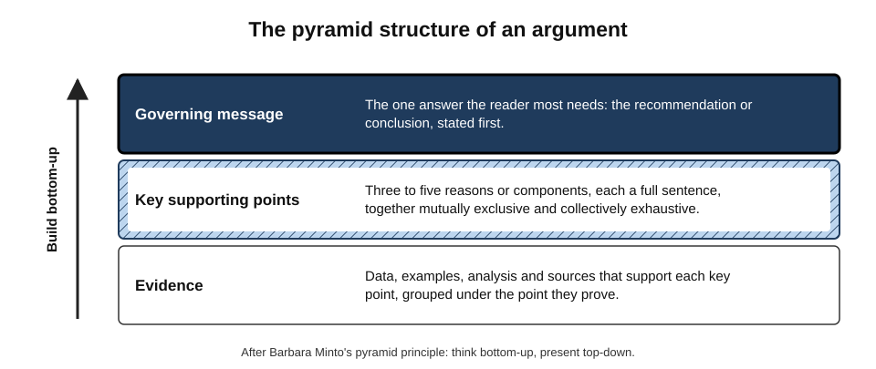
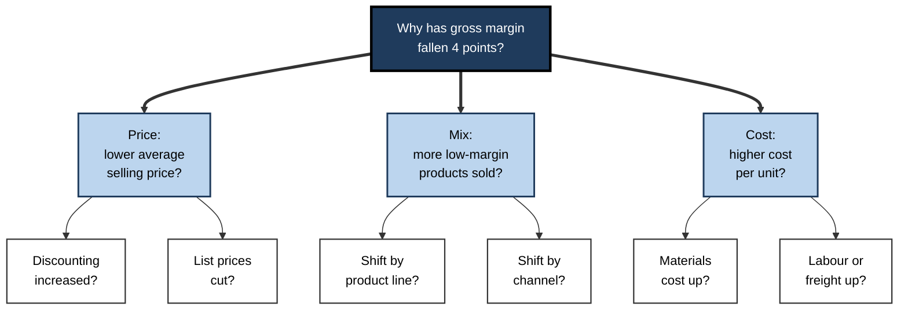
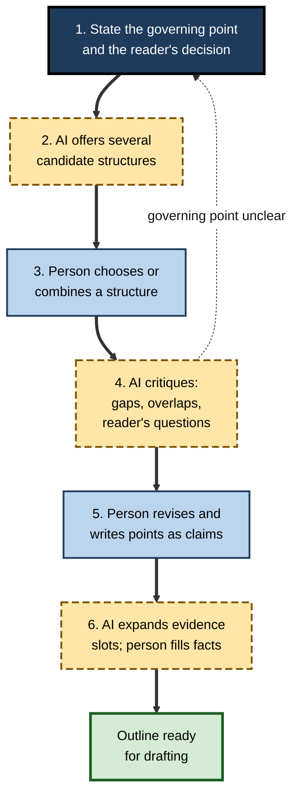
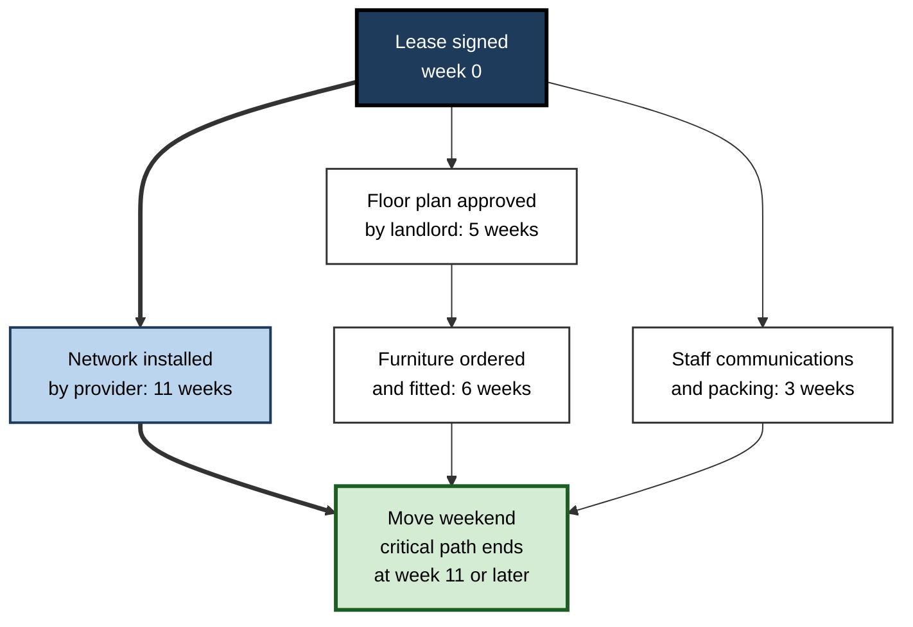
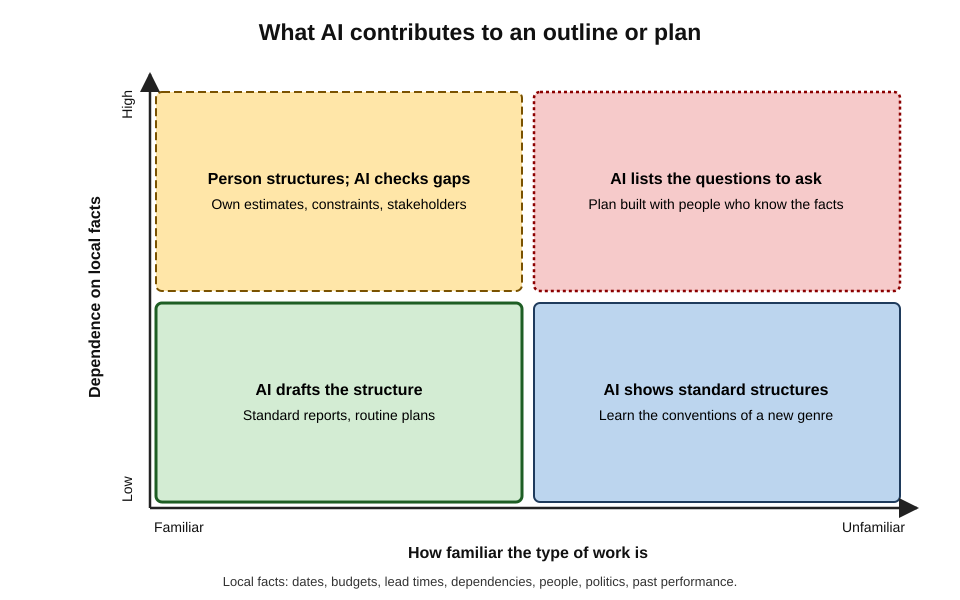
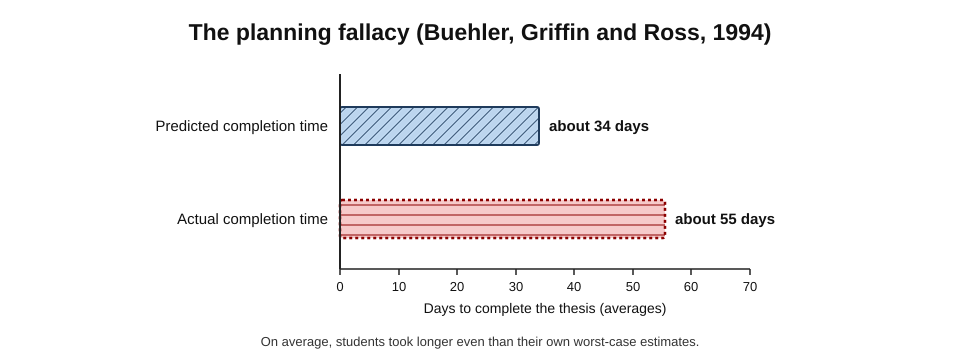

# B.5. Creating outlines and plans

Asked to "outline a proposal for a new customer-onboarding process", an AI assistant returns eight tidy headings: Introduction, Background, Objectives, Scope, Approach, Timeline, Risks, Conclusion. It is a perfectly respectable skeleton — for any proposal on any subject. What it lacks is the one thing an outline exists to provide: an **argument** shaped to this reader's decision. AI is an excellent generator of structures; deciding which structure fits the problem remains the thinker's job.

> **Definition — Outline:** a hierarchical arrangement of the main points of a document, talk or argument, showing what will be said, in what order and how the points relate.

> **Definition — Plan:** an ordered set of activities, with owners, durations, dependencies and milestones, intended to achieve a defined goal.

**Why it matters**

- Structure determines whether a reader understands, and whether a project finishes. Most weak documents fail in their structure, not their sentences; most failed projects fail in their plans, not their effort.
- Outlining and planning are **thinking tasks**: they force decisions about what matters, what comes first and what depends on what.
- AI can produce outlines and plans in seconds — useful starting points and checklists of what is usually included.
- It can also produce the **look of thinking without the thinking**: generic structures, plausible timelines and estimates with no basis in local facts.

---

## Why Structure Comes First

### Outlining and the writer's mind

- Writing makes heavy demands on **working memory** — the limited mental workspace for holding and manipulating information.
- Writers must juggle ideas, structure, wording, audience and mechanics at once.
- **Ronald Kellogg (1988)** found that writers who prepared an outline before drafting produced documents of higher quality.
  - His explanation: outlining separates **deciding what to say** from **deciding how to say it**, reducing overload.

> **Definition — Working memory:** the limited-capacity system that holds and manipulates information during thinking.

> **Key point:** an outline is a device for **thinking in stages**. If AI produces the outline, the stage it removes is the deciding — unless the person still makes the structural choices.

### What a good outline does

- **States the governing point** — what the whole document argues or recommends.
- **Groups related ideas** — points at the same level are the same kind of thing.
- **Orders them** — by logic, time, importance or the reader's questions.
- **Shows dependencies** — which points support which.
- **Exposes gaps** — a heading with nothing under it is a question still to be answered.

---

## Structures Worth Knowing

### The pyramid principle

**Barbara Minto**, a consultant at McKinsey from the 1960s, codified a structure for business writing later published as *The Pyramid Principle*.

**Figure 1.** The pyramid structure of an argument.

- **Governing message at the top** — the answer, stated first.
- **Key supporting points** — usually three to five, each a full-sentence claim.
- **Evidence beneath each point** — data, examples, analysis.
- **Think bottom-up, present top-down** — build the argument from evidence, then present it starting with the answer.

> **Definition — MECE:** "mutually exclusive, collectively exhaustive" — a grouping in which items do not overlap and together cover the whole.

> **Example:** "Why are margins falling?" — grouped MECE as **price** (lower average selling price), **volume** (fewer units), **cost** (higher unit cost). Each cause sits in exactly one group, and together they cover every way margin can fall.

### SCQA: openings that earn attention

- **Situation** — what the reader already accepts.
- **Complication** — what has changed or gone wrong.
- **Question** — the question this raises.
- **Answer** — the governing message.

> **Mnemonic — SCQA:** Situation, Complication, Question, Answer — "Since Change Questions Assumptions".

### Issue trees

> **Definition — Issue tree:** a hierarchical breakdown of a problem into sub-questions, each split MECE, until the sub-questions can be answered with analysis.

**Figure 2.** An issue tree for falling margins.

### Other common structures

- **Chronological** — events or steps in time order; natural for histories, incident reports and procedures.
- **Problem–solution** — the problem, its causes, options, the recommendation.
- **Compare and contrast** — options assessed against the same criteria.
- **Topical** — sections by subject; easiest to produce, weakest at carrying an argument.

| Structure | Best for | Typical weakness when AI produces it |
|---|---|---|
| Pyramid | Recommendations to busy decision-makers | Supporting points that are topics, not claims |
| SCQA opening | Gaining attention for a proposal | A "complication" that is generic rather than specific |
| IMRaD | Introduction, Methods, Results and Discussion — the standard structure of research papers. |
| Issue tree | Diagnosing a problem | Branches that overlap — not truly MECE |
| Chronological | Incidents, procedures, histories | Steps in plausible but wrong order |
| Topical | Reference documents, reports | No governing message at all |

---

## How AI Helps With Outlines

### Roles AI can play

- **Generator** — several candidate structures for the same material.
  - *e.g.* "Give me three alternative outlines for this paper: one pyramid, one chronological, one problem–solution."
- **Convention guide** — the standard sections of an unfamiliar genre.
  - *e.g.* a grant application, a business case, a data-protection impact assessment.
- **Critic** — tests an outline the person has written.
  - *e.g.* "Is this grouping MECE? Which points overlap? What would a sceptical finance director ask that this does not answer?"
- **Expander** — proposes sub-points under each heading, for the person to keep, cut or rewrite.
- **Converter** — turns rough notes, a transcript or a brainstorm into a first structure.

> **In practice:** the most valuable single request is often critique, not generation: "Here is my outline and my reader. What is missing, what overlaps and what would you put first?"

### The outlining loop

**Figure 3.** Building an outline with AI.

### From topics to claims

- **Topic headings** — "Background", "Market", "Costs" — say what a section is *about*.
- **Claim headings** — "Demand has doubled since 2022", "The pilot cut costs by 12%" — say what a section *argues*.
- AI outlines default to topics; converting them to claims is where the thinking happens.

> **Remember:** if every heading could appear in any proposal, the outline contains **no argument yet**.

---

## Worked Example: Outlining a Proposal

**Situation:** an operations manager must persuade the executive committee to fund a redesigned customer-onboarding process. New business customers currently wait 19 working days on average to go live; competitors are known to take about a week.

**Step 1 — the generic AI outline:** Introduction / Background / Objectives / Scope / Approach / Timeline / Risks / Conclusion.

**Step 2 — state the reader and the governing point**

- Reader: executive committee; decision: fund or not.
- Governing message: "Investing £240,000 to redesign onboarding will cut go-live time from 19 to 7 days and reduce first-year churn, paying back within 18 months."

**Step 3 — ask AI for a pyramid structure and critique it**

| | Generic outline | Argument-led outline |
|---|---|---|
| Opening | Introduction | SCQA: growth targets (S); slow onboarding losing customers (C); should we fix it? (Q); yes — £240k, 18-month payback (A) |
| Key point 1 | Background | "Slow onboarding is costing customers": 19 days vs ~7 for competitors; churn twice as high among slow starts |
| Key point 2 | Approach | "Three changes remove most of the delay": digital forms, parallel credit checks, a named onboarding lead |
| Key point 3 | Timeline, Risks | "The plan is low-risk and phased": pilot in one region first; stop-points if targets missed |
| Ending | Conclusion | The decision required today and its cost |
| Headings | Topics | Claims |

**Step 4 — AI critique of the argument-led outline**

- "The churn link is asserted but its evidence is not shown — what data supports it?"
- "A finance reader will ask how the £240,000 was estimated and what the downside case is."
- Both points added as evidence slots, to be filled from the manager's own data.

- **Conclusion:** AI supplied conventions and critique; the manager supplied the governing point, the facts and the choice of structure.

> **Watch out:** in Step 3, the AI also filled the evidence slots with plausible figures ("industry studies show onboarding delays increase churn by 30%"). Unsourced figures in an outline become "facts" in the final document unless removed at once.

---

## How AI Helps With Plans

### The anatomy of a plan

> **Definition — Work breakdown structure (WBS):** a hierarchical decomposition of a project's total scope into deliverables and work packages small enough to estimate and assign.

- **Goal and scope** — what "done" means, and what is excluded.
- **Work breakdown** — deliverables split into tasks.
- **Dependencies** — which tasks cannot start until others finish.
- **Estimates** — duration and effort for each task.
- **Owners** — one person accountable per task.
- **Milestones** — checkpoints with visible outcomes.
- **Risks** — what could derail the plan, with responses.

> **Definition — Critical path:** the longest chain of dependent tasks through a project, which sets the shortest possible completion time; any delay on it delays the whole project (the critical path method was developed in the late 1950s).

**Figure 4.** Dependencies and the critical path in a small office-move plan.

- Two chains run in parallel: **network installation** (11 weeks) and **floor-plan approval followed by furniture** (5 + 6 = 11 weeks).
- Both take 11 weeks, so **both are critical**: a slip on either delays the move.
- A plan showing "network: 3 weeks", as a generic estimate might, hides the true critical path entirely.

### What AI is good and bad at in planning

- **Good at:**
  - proposing a work breakdown for familiar kinds of project;
  - listing commonly forgotten tasks — approvals, training, communications, data migration, decommissioning;
  - suggesting typical risks;
  - restructuring a plan into phases or a different format.
- **Poor at:**
  - **local facts** — real lead times, budgets, people's availability, organisational politics;
  - **estimates** — durations it proposes are guesses from general text, not from this organisation's history;
  - **reliable dependency reasoning** in large plans.

**Study card — Valmeekam, Kambhampati and colleagues (2023–2024)**

- **Design:** language models were given classic planning problems — such as rearranging stacks of blocks to reach a goal — and asked to produce valid plans.
- **Findings:**
  - early general-purpose models produced valid plans in only a minority of cases, and performance collapsed when object names were disguised, suggesting pattern-matching rather than reasoning;
  - later reasoning-focused models (2024) performed much better on standard problems but still made errors, especially on longer or disguised problems.
- **Conclusion:** models can **propose** plans usefully, but a plan's validity should be **checked** — by a person or a tool — rather than assumed.

**Figure 5.** What AI contributes to an outline or plan.

---

## The Planning Fallacy and How to Correct It

### Optimism in estimates

> **Definition — Planning fallacy:** the tendency to underestimate the time, cost and risk of future actions while overestimating their benefits, even when similar past tasks have overrun (named by Daniel Kahneman and Amos Tversky, 1979).

**Study card — Buehler, Griffin and Ross (1994)**

- **Design:** final-year psychology students predicted when they would finish their theses — a best guess, a best case and a worst case.
- **Results:**
  - average prediction: about **34 days**; average actual: about **55 days**;
  - on average, students took longer even than their own worst-case estimates.
- **Explanation:** people plan by imagining the specific steps of *this* task going smoothly, and neglect the record of how similar tasks actually went.

**Figure 6.** The planning fallacy (Buehler, Griffin and Ross, 1994).

- **At scale:** Bent Flyvbjerg's database of thousands of major projects found that only a small minority — under one in ten — were delivered on budget and on time.

> **Watch out:** AI-generated estimates do not escape the planning fallacy; they often embody it. Models trained on plans, proposals and project write-ups learn the **optimistic** durations people write down, not the durations projects actually took.

### Correctives

- **Reference-class forecasting** (Flyvbjerg, building on Kahneman and Tversky) — estimate from the actual outcomes of similar past projects, then adjust.
  - *e.g.* "Our last five system migrations took 1.4 to 2.1 times their planned duration."
- **Three-point estimating** — optimistic, most likely and pessimistic estimates.

> **Formula — PERT estimate:** expected duration = (optimistic + 4 × most likely + pessimistic) ÷ 6. Example: optimistic 4 days, most likely 6, pessimistic 14 → (4 + 24 + 14) ÷ 6 = **7 days** — longer than the "most likely" figure, because the pessimistic tail is long.

- **The premortem** — Gary Klein (2007): imagine the project has failed, and ask everyone to write down why.
  - Legitimises dissent; surfaces risks optimism hides.
  - **AI as premortem partner:** "It is twelve months later and this project has failed. List the ten most likely reasons, specific to this plan." The person then judges which are real.

> **Definition — Premortem:** a planning exercise in which a team imagines that a project has failed and works backwards to identify what could cause the failure.

> **Mnemonic — "RTP":** Reference class, Three-point estimates, Premortem — three correctives for optimistic plans.

---

## Case Study: The Office Move Planned in an Afternoon

- **Situation:** a 120-person firm had to move offices within four months. An office manager used an AI assistant to produce a project plan in an afternoon: 46 tasks, phases, owners by role and a timeline that finished two weeks early.
- **Problem:** six weeks in, the plan had slipped by a month.
- **Diagnosis:**
  1. **lead times were generic** — the plan allowed three weeks for network installation; the telecoms provider's actual lead time was ten to twelve weeks;
  2. **a dependency was missing** — furniture could not be ordered until the landlord approved the floor plan, which took five weeks;
  3. **owners were roles, not people** — "IT lead" was a role nobody had been assigned;
  4. **estimates were optimistic** across the board, with no buffer.
- **Actions:**
  1. lead times confirmed with each supplier and entered as fixed constraints;
  2. dependencies reviewed with the facilities, IT and finance leads in one workshop;
  3. every task assigned to a named person;
  4. a premortem — with AI generating a first list of failure causes and the team adding local ones — produced three new risks, including a lift-booking restriction at the new building;
  5. the critical path was identified and monitored weekly.
- **Result:** the move happened three weeks later than the original AI plan, but on the revised date, without disruption to client work.
- **Lesson:** AI produced a useful **skeleton** quickly; the plan became real only when local facts, named owners and honest estimates replaced generic ones.

---

## Ideas, Diversity and Ownership

### Brainstorming with AI

**Study card — Doshi and Hauser (2024), *Science Advances***

- **Design:** participants wrote short stories, some with access to AI-generated story ideas.
- **Results:**
  - AI ideas made individual stories more creative and better written — especially for less creative writers;
  - but stories written with AI help were **more similar to one another** than stories written without it.
- **Conclusion:** AI can raise individual quality while reducing **collective diversity** — a social dilemma for teams and organisations.

- **Related findings:**
  - Karan Girotra and colleagues (2023) found that GPT-4 generated product ideas faster and with higher average rated appeal than a group of business students.
  - Lennart Meincke, Ethan Mollick and Christian Terwiesch (2024) found AI ideas less varied than those of human groups — though prompting strategies that asked the model to reason step by step and deliberately vary its ideas narrowed the gap.

> **Key point:** use AI to **widen** the option set, not to choose from it. Ask for many, deliberately different structures or plans; then let people with local knowledge choose.

### Ownership and understanding

- A person who did not build the outline or plan may not understand **why** it is shaped as it is — and cannot defend it under questioning.
- In planning, ownership drives commitment: people who helped estimate are more likely to meet the estimate.
- **Practice:** AI drafts; the team reviews, amends and commits in person.

> **Watch out:** a 2025 MIT Media Lab preprint reported lower measured brain engagement and poorer recall of their own essays among students who wrote with a chatbot. The study was small, not yet peer-reviewed when widely reported and is contested; the broader point — that outsourcing structure can reduce engagement with the material — is consistent with learning research but not proven by it.

---

## Conventional Structures of Professional Documents

Many professional genres have settled structures that readers expect. AI knows these conventions well, which makes it a fast guide to an unfamiliar genre — provided the content is then made specific.

- **Business case** — strategic context; the problem or opportunity; options considered (including "do nothing"); costs and benefits of each; recommended option; risks; implementation and review.
  - The "do nothing" option is the one most often omitted, and the one finance readers most want.
- **Design document (software and engineering)** — context; goals and non-goals; proposed design; alternatives considered and why rejected; risks; testing and roll-out.
  - "Non-goals" prevent scope creep; "alternatives considered" shows the decision was examined.
- **Incident report** — summary; impact; timeline; root cause and contributing factors; what went well; actions with owners.
  - A blameless format focuses on systems rather than individuals.
- **Research paper (IMRaD)** — Introduction, Methods, Results and Discussion; the standard in most sciences since the mid-twentieth century.
- **Briefing note for a senior reader** — issue; recommendation; background; considerations; next steps — typically on one or two pages.
- **Status report** — overall status; progress since last report; next steps; risks and issues needing decisions.
  - The decisions needed belong at the top, not at the end.

> **In practice:** ask AI for "the conventional structure of a [genre] in [sector or organisation type], with one line on the purpose of each section". The purposes matter more than the headings — they tell the writer what each section must achieve.

> **Watch out:** conventions vary by organisation, regulator and country. A business case for a UK public body is usually expected to follow the government's "five case model" (strategic, economic, commercial, financial and management cases); a generic AI structure would miss it. Check the template the reader actually uses.

### Requests that produce better structures

- **Name the reader and decision** — "for a board deciding whether to approve £2m".
- **Ask for alternatives** — "three different structures, with the trade-offs of each".
- **Demand claims** — "write each heading as a full-sentence claim".
- **Ask for the sceptic** — "what would the most sceptical reader ask, and where does the outline answer it?"
- **Prohibit invented facts** — "leave evidence slots as [DATA NEEDED] rather than filling them".

---

## Professional Practice

- **Consulting and strategy** — issue trees and pyramid storylines: AI for alternatives and MECE checks; the team for the governing message and the evidence.
- **Project management** — AI-drafted work breakdowns as a checklist of commonly forgotten tasks; estimates from the organisation's own history; critical path and dependencies verified in a planning tool.
- **Engineering** — design documents outlined by convention (context, goals, non-goals, design, alternatives, risks); AI is useful for "what alternatives have we not considered?".
- **Writing and communications** — talk and report outlines; AI to test the order against the audience's questions.
- **Personal planning** — breaking a vague goal into concrete next steps; turning a week's tasks into an ordered list.

| | Outline | Plan |
|---|---|---|
| Purpose | Structure what will be said | Structure what will be done |
| Units | Points and evidence | Tasks, owners, durations |
| Key relation | Supports / belongs under | Depends on / precedes |
| Test of quality | Does the reader follow and agree? | Does the work finish as predicted? |
| AI's main weakness | Generic topics instead of claims | Generic estimates and missing local constraints |

---

## Open Questions

- **Does relying on AI for structure weaken people's ability to think structurally?**
  - Plausible from learning research; direct long-term evidence in professionals is lacking.
- **How much does AI homogenise organisational thinking?**
  - Experiments show reduced diversity of outputs; effects on real strategy and innovation are unmeasured.
- **Can AI estimates be calibrated?**
  - Models connected to an organisation's own project history might produce reference-class estimates; evidence of accuracy is limited.
- **How reliable is AI planning as models improve?**
  - Reasoning-focused models plan much better on benchmarks; reliability on messy, real projects with hidden constraints is unknown.
- **Who owns an AI-structured plan?**
  - Commitment and accountability depend on people feeling that a plan is theirs; how AI drafting affects this is little studied.

---

## Summary

- An **outline** structures what will be said; a **plan** structures what will be done. Both are **thinking tasks**.
- Outlining reduces writers' cognitive overload (**Kellogg, 1988**) by separating what to say from how to say it.
- Key structures: the **pyramid** (governing message, MECE supporting points, evidence), **SCQA** openings, **issue trees**, chronological, problem–solution, compare–contrast, topical.
- AI roles: generator, convention guide, **critic**, expander, converter. Critique is often the most valuable.
- Convert **topic headings to claim headings**; if every heading fits any proposal, there is no argument yet.
- Plans need scope, a **WBS**, dependencies, estimates, owners, milestones, risks; the **critical path** sets the finish date.
- AI is good at skeletons and forgotten tasks, weak at **local facts and estimates**; its plans should be checked, not assumed valid.
- The **planning fallacy** (Buehler et al., 1994: about 34 days predicted, about 55 taken) affects AI estimates too. Correct with **reference classes, three-point (PERT) estimates and premortems**.
- AI raises individual idea quality but can reduce **collective diversity** (Doshi and Hauser, 2024); use it to widen options, not choose among them.
- Ownership matters: people must understand and commit to the structure.

---

## Self-Check

1. Define an outline and a plan, and state how they differ.
2. Why does outlining improve writing, according to Kellogg's explanation?
3. Describe the pyramid principle and the meaning of "think bottom-up, present top-down".
4. What is MECE? Give a MECE breakdown of "Why has customer satisfaction fallen?"
5. Write an SCQA opening for a proposal to replace a team's spreadsheet-based reporting.
6. Name five roles AI can play in outlining and say which is often most valuable and why.
7. Convert these topic headings into claim headings for a business case: "Current state", "Costs", "Risks".
8. What is a work breakdown structure, and what is the critical path?
9. What did planning-benchmark studies find about language models' ability to plan?
10. Explain the planning fallacy and the Buehler et al. (1994) results.
11. Why might AI-generated estimates embody the planning fallacy?
12. Calculate a PERT estimate for a task with optimistic 3 days, most likely 5 and pessimistic 13.
13. Describe a premortem and how AI can contribute to one.
14. A manager presents an AI-generated project plan that finishes early, with role-based owners and no supplier lead times. Diagnose four weaknesses and propose corrections.
15. A strategy team uses AI to generate all its options for a market-entry decision. What risk does Doshi and Hauser's finding suggest, and how should the team work instead?
16. A new hire must write their first design document and asks AI for an outline. How should they use the result, and what should they check before drafting?

### Answer Key

1. An outline is a hierarchical arrangement of a document's points; a plan is an ordered set of activities with owners, durations, dependencies and milestones. One structures what is said; the other what is done.
2. It separates deciding what to say from how to say it, reducing working-memory overload so each stage gets more attention.
3. A governing message at the top, three to five MECE supporting claims beneath, evidence under each. Build the argument from evidence upwards; present it starting from the answer.
4. Mutually exclusive, collectively exhaustive. E.g. product (quality, features), service (speed, helpfulness), price (level, perceived value) — or by journey stage: buying, using, getting support.
5. S: the team produces weekly reports from twelve spreadsheets. C: errors and three days of effort each week; two reporting mistakes reached clients this quarter. Q: should we automate? A: yes — a £30,000 reporting tool will cut effort to half a day and remove manual errors, paying back within a year.
6. Generator, convention guide, critic, expander, converter. Critique is often most valuable: it keeps the person's thinking and argument while finding gaps and overlaps.
7. "Manual processes cost 600 staff hours a year"; "Automation pays back within 14 months"; "The main risk — data migration — can be contained by a phased cut-over".
8. A WBS decomposes scope into deliverables and work packages small enough to estimate and assign. The critical path is the longest chain of dependent tasks, setting the earliest completion date.
9. Early general models produced valid plans only in a minority of cases, collapsing when names were disguised; later reasoning models improved substantially but still erred on longer or disguised problems — plans should be checked.
10. Underestimating time, cost and risk despite past overruns. Students predicted about 34 days for their theses, took about 55, exceeding even their average worst-case estimate.
11. Models learn from written plans and proposals, which record optimistic intended durations rather than the durations projects actually took, and they lack local history.
12. (3 + 20 + 13) ÷ 6 = 6 days.
13. Imagining the project has failed and listing why. AI can generate a broad first list of plausible failure causes specific to the plan; the team judges which are real and adds local ones.
14. Optimistic estimates without buffer; role-based owners nobody holds; missing supplier lead times; probably unverified dependencies. Corrections: reference-class estimates and three-point estimating; named owners; confirmed lead times as constraints; dependency workshop and critical-path analysis; premortem.
15. AI may raise individual option quality but make options converge, so the team explores a narrower space. Instead: generate options independently first, use AI deliberately to widen (asking for very different alternatives and contrarian options), and choose with people who hold local knowledge.
16. Use it as a guide to the genre's conventions and the purpose of each section, not as the finished structure. Check the organisation's own template and recent approved examples; state goals and non-goals specifically; list real alternatives considered; replace any invented details with [DATA NEEDED]; and ask a senior engineer to review the outline before drafting, since structure errors are cheapest to fix at this stage.

---

## Glossary

| Term | Meaning |
|---|---|
| Business case | A document setting out options, costs, benefits and risks to justify an investment decision. |
| Claim heading | A heading stating what a section argues rather than what it is about. |
| Critical path | The longest chain of dependent tasks, setting the earliest completion date. |
| Five case model | A UK public-sector business-case structure: strategic, economic, commercial, financial and management cases. |
| Governing message | The single main answer or recommendation of a document. |
| IMRaD | Introduction, Methods, Results and Discussion — the standard structure of research papers. |
| Issue tree | A hierarchical MECE breakdown of a problem into answerable sub-questions. |
| MECE | Mutually exclusive, collectively exhaustive. |
| Outline | A hierarchical arrangement of a document's main points. |
| PERT estimate | (Optimistic + 4 × most likely + pessimistic) ÷ 6. |
| Plan | An ordered set of activities with owners, durations, dependencies and milestones. |
| Planning fallacy | Underestimating time, cost and risk despite evidence from past tasks. |
| Premortem | Imagining a project has failed and identifying why, before it starts. |
| Pyramid principle | Structuring an argument with the answer first, supported by grouped points and evidence. |
| Reference-class forecasting | Estimating from the actual outcomes of similar past projects. |
| SCQA | Situation, Complication, Question, Answer. |
| Three-point estimating | Using optimistic, most likely and pessimistic estimates. |
| Topic heading | A heading naming what a section is about, without stating a claim. |
| Work breakdown structure (WBS) | A hierarchical decomposition of project scope into deliverables and work packages. |
| Working memory | The limited-capacity system holding information during thinking. |
