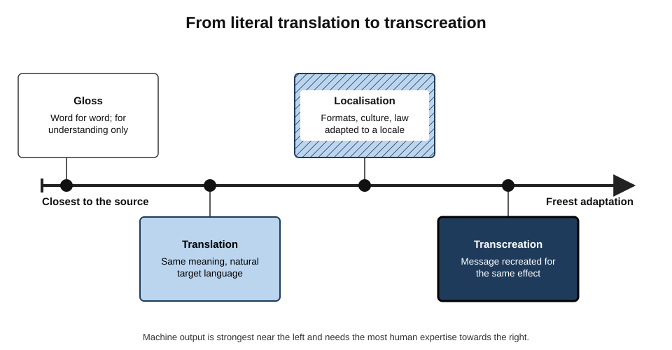
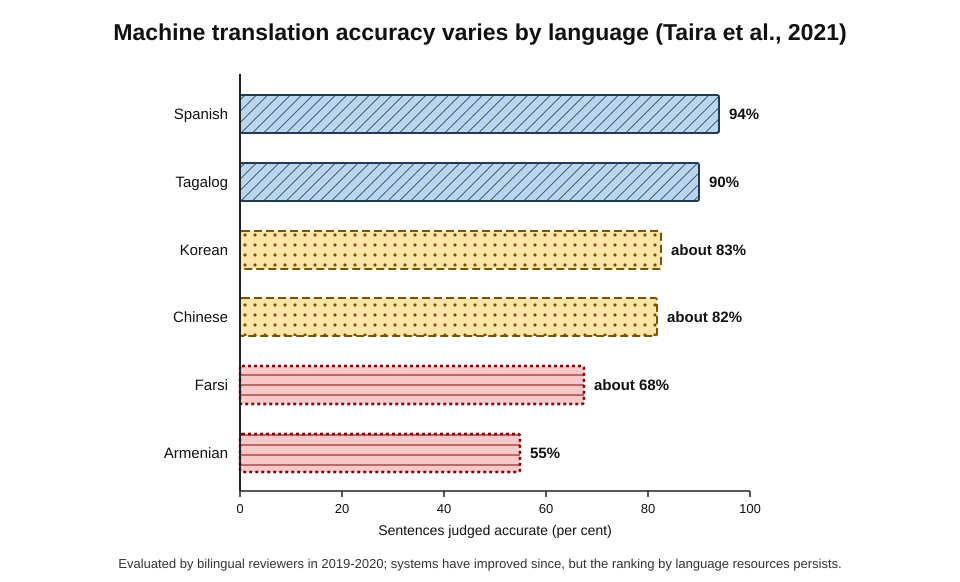
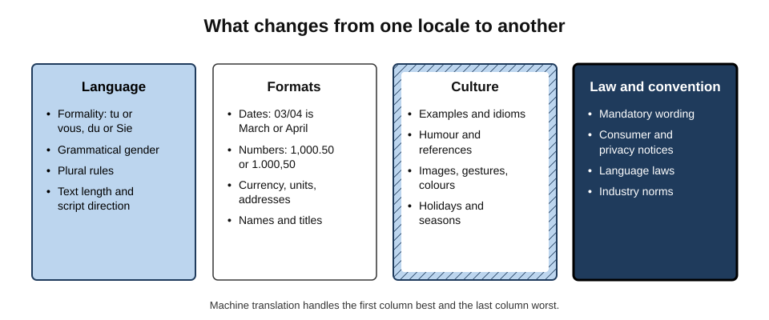
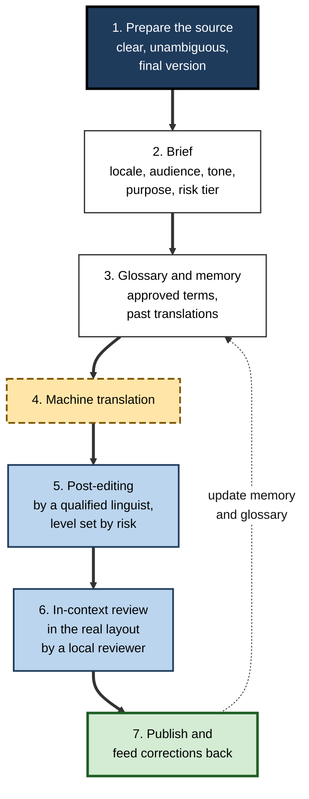
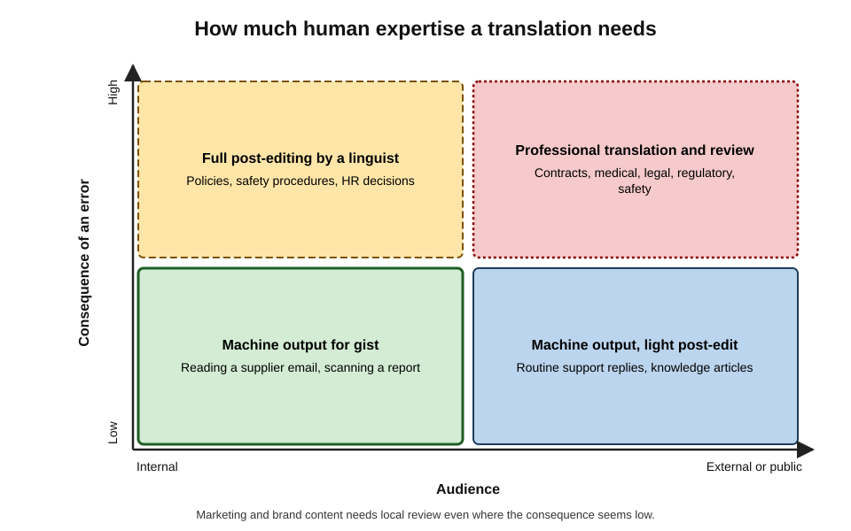
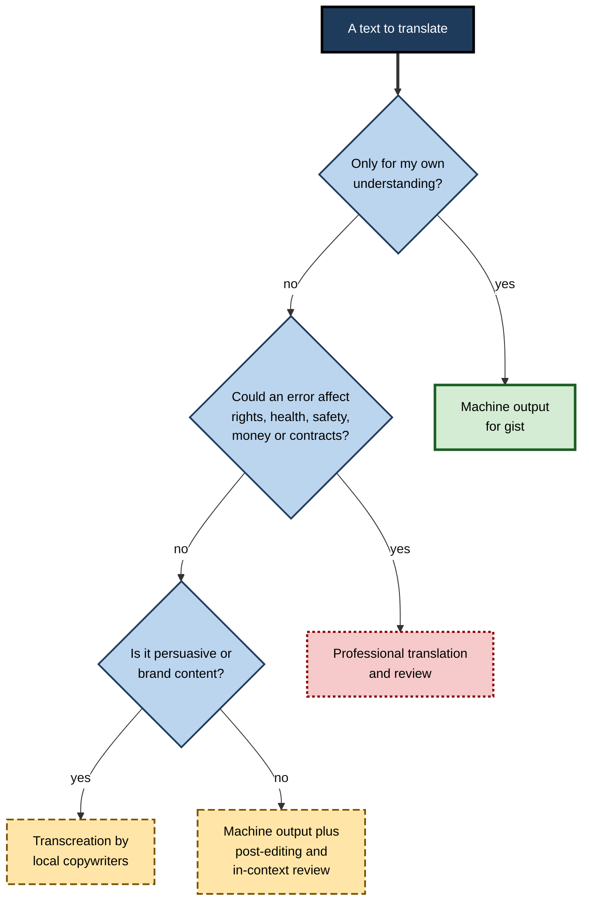

# B.7. Translating and localising content

A procurement officer in Manchester receives a supplier's terms in Portuguese and reads a fluent English version within seconds. A support team answers customers in eleven languages without a single bilingual agent. A product launch in Germany stumbles because buttons are truncated, prices show the wrong decimal separator and the marketing slogan, faithfully translated, means nothing to German readers. Machine translation has made understanding across languages nearly effortless; making content **work** in another language and culture still takes judgement.

> **Definition — Translation:** rendering the meaning of a text in one language (the source) into another (the target), so that it reads naturally to target-language readers.

> **Definition — Localisation:** adapting content or a product for a particular **locale** — a combination of language, region and culture — including formats, cultural references, legal requirements and design, not only words.

**Why it matters**

- Professional work crosses languages constantly: suppliers, customers, colleagues, regulators, research and markets.
- AI translation — first neural machine translation, now large language models — is fast, cheap and, for major language pairs, often very good.
- Its errors are **fluent**: a mistranslation reads as naturally as a correct translation, so readers who do not know the source language cannot see it.
- Localisation failures cost revenue, credibility and, in medicine, law and safety, can cause real harm.

---

## Core Vocabulary

> **Definition — Locale:** a specific combination of language and region, such as French (Canada) or Spanish (Mexico), that determines conventions for language, formats and culture.

> **Definition — Internationalisation (i18n):** designing content or software so that it can be adapted to different locales without redesign — for example, storing text separately from code and supporting different scripts and formats.

> **Definition — Transcreation:** recreating a message — typically marketing or creative content — in another language so that it has the same effect on the target audience, even if the words and images change.

> **Definition — Post-editing:** a human linguist reviewing and correcting machine-translated output to an agreed quality level (described in the international standard ISO 18587, 2017).

- **Light post-editing** — fix errors of meaning so the text is understandable and accurate; style may remain imperfect.
- **Full post-editing** — bring the text to the quality of a professional human translation.

> **Definition — Translation memory:** a database of previously translated segments, reused to keep wording consistent and avoid retranslating the same sentences.

> **Definition — Termbase (glossary):** an approved list of terms and their translations — product names, legal terms, technical vocabulary — to be used consistently.

**Figure 1.** From literal translation to transcreation.

- **Gloss** — word-for-word rendering for understanding only.
- **Translation** — the same meaning, in natural target language.
- **Localisation** — translation plus adaptation of formats, culture and legal content to a locale.
- **Transcreation** — the message recreated for the same effect.

> **Key point:** the further right on this scale, the more the task is about **culture and persuasion** rather than language — and the more human local expertise it needs.

---

## How Machines Came to Translate

### A brief history

- **1954 — the Georgetown–IBM experiment** translated about sixty Russian sentences into English using a small vocabulary and a few grammar rules; its organisers predicted that machine translation would be solved within a few years.
- **1966 — the ALPAC report** to the US government concluded that machine translation was slower, less accurate and more expensive than human translation; funding collapsed for a generation.
- **1990s–2000s — statistical machine translation** learned translation probabilities from large collections of human-translated texts, such as parliamentary proceedings published in several languages.
- **2016 — neural machine translation** systems, using deep neural networks, were deployed at scale by major providers, producing markedly more fluent output.
- **2017 — the Transformer architecture** (Vaswani and colleagues) was introduced in a paper on translation; it became the basis of today's large language models.
- **2020s — large language models** translate as one of many abilities, and can follow instructions about tone, terminology and audience.

> **Watch out:** the 1954 prediction is a lasting lesson. Fluent demonstrations on selected sentences have repeatedly overstated how close machines were to reliable translation of real, varied texts.

### What modern systems do well and badly

- **Strong:**
  - high-resource language pairs (English with Spanish, French, German, Chinese, Portuguese and others);
  - standard, well-formed prose: business email, documentation, news;
  - getting the gist of almost anything.
- **Weaker:**
  - **low-resource languages** with little digital text;
  - idioms, humour, wordplay, poetry and slogans;
  - specialised terminology without a glossary;
  - ambiguous source text, where the machine silently chooses one meaning;
  - formality and politeness systems;
  - gender, when the source language does not mark it and the target does.

> **Definition — Low-resource language:** a language with relatively little digitised text available for training, so that AI systems perform less well in it.

### Large language models compared with dedicated translation engines

- Annual shared evaluations of translation systems (the Conference on Machine Translation, WMT) from 2023 onwards found that leading large language models were competitive with, and on some high-resource pairs better than, dedicated systems.
- **LLM advantages:** instructions about tone and audience; explanations of choices; handling of context across a long document.
- **LLM risks:** occasional additions or omissions, unrequested "improvements" to the content, and inconsistent terminology without a glossary.

| | Dedicated translation engine | Large language model |
|---|---|---|
| Consistency across documents | High, especially with translation memory | Variable unless a glossary is supplied |
| Follows tone and audience instructions | Limited | Strong |
| Risk of adding or omitting content | Low | Moderate |
| Explains choices or ambiguities | No | Yes, if asked |
| Integration with professional workflows | Mature | Developing |

---

## How Translation Goes Wrong

### Fluent but wrong

- **Mistranslated meaning** — a term rendered with a plausible but incorrect equivalent.
  - *e.g.* "the contract may be terminated" rendered as "the contract will be terminated".
- **Omission** — a clause, a negation or a qualifier quietly dropped.
- **Addition** — content not in the source, sometimes a helpful-seeming explanation.
- **Ambiguity resolved wrongly** — "the bank" as financial institution or riverbank; "you" as singular or plural, formal or informal.
- **False friends** — words that look alike across languages but mean different things.
  - *e.g.* Spanish *embarazada* means "pregnant", not "embarrassed"; German *eventuell* means "possibly", not "eventually".

> **Key point:** the danger is not bad output but **convincing** bad output. A reader who cannot read the source has no signal that anything is wrong.

### Evidence from medicine

**Study card — Khoong and colleagues (2019), *JAMA Internal Medicine***

- **Design:** emergency-department discharge instructions were translated by a free online machine-translation service into Spanish and Chinese and assessed by bilingual reviewers.
- **Results:**
  - about **92%** of Spanish sentences and **81%** of Chinese sentences were accurate;
  - a small share of inaccurate sentences had the potential to cause **significant harm** — more often in Chinese than in Spanish.
- **Conclusion:** usable as a supplement, not a replacement for professional translation of medical instructions.

**Study card — Taira and colleagues (2021), *Journal of General Internal Medicine***

- **Design:** discharge-instruction sentences translated into seven languages by the same kind of service, assessed by native speakers.
- **Results:** accuracy ranged from **94%** for Spanish down to about **55%** for Armenian.
- **Conclusion:** accuracy follows the **resources** available for each language; speakers of less-resourced languages — often the most vulnerable patients — receive the worst translations.

**Figure 2.** Machine translation accuracy varies by language (Taira et al., 2021).

> **Watch out:** these studies evaluated systems from 2018–2020. Accuracy has improved since, especially with large language models, but no study has shown that the gap between high- and low-resource languages has closed — or that error rates are low enough for unsupervised use in clinical or legal settings.

### Marketing and brand

- Slogans depend on wordplay, rhythm and cultural associations — exactly what literal translation loses.
- A widely reported case: in 2009, the bank HSBC replaced its long-running "Assume nothing" campaign after it had been rendered in several markets as "Do nothing"; the rebranding was reported to cost around US$10 million.

> **Example:** a British retailer's slogan "Bang for your buck" depends on an English idiom; translated word for word into French it becomes a puzzling phrase about a noise and a dollar. Transcreation asks instead: what phrase in French conveys "excellent value, with energy"?

---

## Localisation: More Than Words

**Figure 3.** What changes from one locale to another.

### Language features

- **Formality** — French *tu/vous*, German *du/Sie*, Spanish *tú/usted*, Japanese levels of polite speech (*keigo*).
  - A brand addressing German customers as *du* signals informality that suits some markets and offends others.
- **Gender** — many languages mark gender in nouns, adjectives and verbs; translating "the user" may force a choice.
- **Plural rules** — English has two forms (1 file, 2 files); Polish, Russian and Arabic have several; software that builds "%n files" breaks.
- **Text expansion** — translations from English into many European languages are often noticeably longer; interface labels must have room.
- **Script direction** — Arabic and Hebrew run right to left; layouts may need mirroring.

### Formats

- **Dates** — 03/04/2026 is 3 April in the UK and 4 March in the US; ISO 8601 (2026-04-03) is unambiguous.
- **Numbers** — 1,000.50 in the UK and US; 1.000,50 in Germany; 1 000,50 in France.
- **Currency** — symbol position, spacing and decimal conventions.
- **Units** — metric or imperial; paper sizes (A4 or US Letter).
- **Addresses, phone numbers and names** — order, components, family name first or last.

### Culture

- Examples, idioms, humour, sports and holiday references.
- Images and gestures — a thumbs-up or an "OK" hand sign is offensive in some cultures.
- Colours — white for weddings in some places, mourning in others.
- Seasons — "summer sale" in July means winter in Australia.

### Law and convention

- **Mandatory wording** — consumer rights, product safety warnings, privacy notices.
- **Language laws** — for example, Quebec's Charter of the French Language requires French in commerce, strengthened by reforms in 2022.
- **Regulated content** — financial promotions, medicine labelling and contracts often require approved or certified translations.

> **Mnemonic — "LFCL" ("Locales Frequently Confuse Launches"):** Language, Formats, Culture, Law — the four layers of localisation.

---

## The Translation Workflow

**Figure 4.** A professional AI-assisted translation workflow.

### 1. Prepare the source

- **Write for translation** — short sentences, one idea each, no idioms, consistent terms, explicit subjects.
- **Resolve ambiguity in the source** — it is far cheaper than finding it in eleven translations.
- **Freeze the version** — translating drafts multiplies rework.
- **Controlled language** — some industries write source text in a restricted vocabulary and grammar to make translation safer.
  - *e.g.* Simplified Technical English (the ASD-STE100 specification), developed for aircraft maintenance documentation, limits words to approved meanings and sentences to set lengths.
  - The same principles help any text bound for machine translation: one term per concept, active voice, no idioms.

### 2. Brief

- Target **locale**, not just language: "Spanish for Mexico", not "Spanish".
- **Audience and register**: consumers, engineers, regulators; formal or informal address.
- **Purpose and risk tier** (see below).

### 3. Glossary and memory

- Supply approved terms; tell the model not to translate product names and defined legal terms.
- Reuse previous translations for consistency.

### 4. Machine translation

- With a large language model, a good instruction includes the locale, register, glossary and "flag any sentence that is ambiguous in the source rather than guessing".

> **Example — a translation instruction:** "Translate the text below into French for Canada (fr-CA). Audience: hospital procurement managers. Register: formal, *vous*. Use the attached glossary exactly; do not translate product names. Keep numbers, dates and units unchanged except for format: dates as 3 avril 2026, decimals with a comma. Do not add or remove content. After the translation, list any source sentences that were ambiguous and the interpretation you chose."

- **Why each part matters:**
  - the **locale** sets vocabulary and formats — Canadian French differs from French in France;
  - the **audience and register** fix formality;
  - the **glossary** prevents inconsistent terms;
  - "**do not add or remove**" counters the model's tendency to improve the content;
  - the **ambiguity list** turns silent guesses into visible questions for the author.

### 5. Post-editing

- By a linguist fluent in the target language and competent in the subject.
- Light or full, according to the risk tier.

### 6. In-context review

- Reviewing text **in place** — in the interface, the printed leaflet, the slide — catches truncation, layout, wrong formats and tone problems invisible in a spreadsheet of strings.

### 7. Feed back

- Corrections update the translation memory and glossary, so errors are not repeated.

---

## Matching Effort to Risk

**Figure 5.** How much human expertise a translation needs.

- **Gist (internal, low consequence)** — reading a supplier email or a foreign-language report: machine output alone.
- **Routine external (low consequence)** — knowledge-base articles, routine support replies: machine output with light post-editing or sampling.
- **Internal, high consequence** — policies, safety procedures, HR communications: full post-editing.
- **External, high consequence** — contracts, medical information, legal notices, regulatory filings, safety labelling: professional translation and review, and certification where required.
- **Brand and marketing** — transcreation by local copywriters; machine output at most as a starting point.

> **Remember:** the question is not "is the machine translation good?" but "**what happens if one sentence in it is wrong, and who would notice?**"

**Figure 6.** Deciding how far to rely on a machine translation.

---

## Checking a Translation

### Methods

- **Bilingual review** — a fluent reader compares source and target sentence by sentence. The only reliable method for high-stakes content.
- **Back-translation** — translating the target text back into the source language to see whether the meaning survived.
- **Model self-check** — asking a model to compare source and target and flag discrepancies.
- **Native-speaker read-through** — a target-language reader checks naturalness and tone without the source.
- **Spot-checks of critical items** — numbers, dates, negations, names, legal terms.

| Method | Catches | Misses | Cost |
|---|---|---|---|
| Bilingual review | Meaning, omission, terminology, tone | Little, if the reviewer is expert | High |
| Back-translation | Gross meaning changes | Unnatural phrasing; errors that reverse cleanly | Low with AI |
| Model self-check | Some omissions and mistranslations | Errors the model shares with itself | Very low |
| Native read-through | Unnatural phrasing, tone, cultural problems | Meaning errors that read naturally | Moderate |
| Critical-item spot-check | Numbers, dates, negations, names | Everything else | Low |

> **Watch out:** back-translation and model self-checks can both be fooled. A wrong translation may back-translate "correctly" because the same model makes the same assumption in both directions. Use them as screens, not as proof.

### Worked example: a supplier notice in Spanish

**Situation:** a UK manufacturer must tell a Mexican supplier that a quality inspection failed and shipments are suspended until corrective action is approved.

1. **Source cleaned:** "Shipments are suspended from 1 June until we approve your corrective-action plan. Please send the plan by 15 June." (No idioms; explicit dates.)
2. **Brief:** Spanish (Mexico); formal *usted*; firm but courteous; glossary — "corrective-action plan" → *plan de acciones correctivas* (the supplier's own contract term).
3. **Machine translation** produced fluent Spanish.
4. **Critical-item check** found:
   - the date "1 June" rendered correctly, but "15 June" given as *15/06* — acceptable in Mexico, but the brief requested written-out dates to avoid confusion;
   - "until we approve" rendered as "until we **receive**" — a meaning change that would imply shipments resume as soon as a plan is sent.
5. **Bilingual review** by a Spanish-speaking colleague corrected the verb and confirmed tone.

- **Conclusion:** a fluent translation contained a single-word error that changed the commercial position. A five-minute check of the critical items caught it.

---

## Case Study: Launching a Product in Germany and the Gulf

- **Situation:** a UK software firm used machine translation for its app interface, help centre and launch campaign in German and Arabic, aiming to launch in both markets within a month.
- **Problems in the first week:**
  1. German labels, often much longer than English, were truncated on buttons ("Einstellungen speich…");
  2. prices displayed as "€1,299.00" instead of "1.299,00 €";
  3. the interface addressed German users with informal *du*, at odds with the firm's business-customer positioning;
  4. the Arabic interface was translated but not mirrored, so text ran right to left inside left-to-right layouts;
  5. the campaign slogan, a pun in English, became a flat literal sentence in both languages;
  6. a plural message read "1 Dateien" ("1 files") because the code assumed English plural rules.
- **Diagnosis:**
  - the product had not been **internationalised** — strings, formats and layouts were hard-coded for English;
  - translation was treated as the whole of localisation;
  - no in-context review by local reviewers.
- **Actions:**
  1. engineering work to externalise strings, support locale formats, plural rules and right-to-left layouts;
  2. a termbase and register decision (*Sie* for German business users);
  3. in-context review by native-speaking reviewers before each release;
  4. slogans transcreated by local copywriters;
  5. machine translation retained for help-centre articles, with light post-editing and customer feedback links.
- **Result:** relaunch six weeks later; support tickets about language fell sharply; translation costs remained far below fully human translation because machine output still did most of the volume.
- **Lesson:** machine translation solved the **words**; localisation required **engineering, culture and review**.

---

## Professional Practice

### Everyday use

- **Reading** — gist translation of emails, documents and websites is low-risk when nothing important depends on fine detail.
- **Writing to a foreign-language colleague** — consider writing in clear, simple English and letting the reader translate, or offering both; for important points, ask a fluent colleague to check.
- **Meetings** — live AI interpretation and captions help, but nuance, humour and disagreement are easily lost; confirm key points in writing.

### Organisational use

- **Risk tiers** written into policy — which content may be machine-only, which needs post-editing, which needs professional translation.
- **Language-service partners** for high-risk content, with post-editing contracts that specify quality levels.
- **Confidentiality** — documents pasted into free translation services may be retained or used by the provider; approved tools apply to translation as to any other AI use.
- **Accessibility and inclusion** — machine translation can widen access to information for staff and customers who do not speak the main language — but critical information (health and safety, employment rights) deserves verified translation.

### Ethics and fairness

- The people most dependent on machine translation — migrants, patients, asylum seekers, users of low-resource languages — often receive the least accurate output and have the least ability to detect errors.
- **Professional interpreters and translators** carry accountability, confidentiality duties and subject expertise that a tool does not.

> **In practice:** in healthcare, legal proceedings and public services, a sound rule is that machine translation may **support** communication but must not be the **only** channel for information on which rights, safety or health depend.

---

## Translation Skill and the Profession

- **The translator's role is shifting** from producing first drafts to post-editing, terminology management, quality assurance and transcreation.
- **Pay and working conditions** — many freelance translators report downward pressure on rates as clients substitute post-editing for translation.
- **Language learning** — instant translation reduces the incentive to learn languages, yet fluency remains essential for relationships, negotiation and detecting translation errors.
- **Judgement remains human** — choosing register, resolving ambiguity, recognising cultural risk and accepting accountability.

---

## Open Questions

- **Will low-resource languages catch up?**
  - Multilingual models have improved them, but data scarcity remains; evaluation itself is harder where few qualified reviewers exist.
- **How should quality be measured?**
  - Automatic metrics such as BLEU (word overlap with reference translations, introduced in 2002) correlate imperfectly with human judgement; newer learned metrics are better but still contested for high-stakes use.
- **When is machine translation safe in clinical and legal settings?**
  - Evidence is limited to particular systems, languages and document types; no general threshold of safety is agreed.
- **What happens to human translation expertise?**
  - If fewer people train as translators, the supply of qualified post-editors and reviewers may shrink just as demand for checking grows.
- **How should AI translation be disclosed?**
  - Norms for telling readers that a text was machine-translated vary widely; regulations on AI transparency may require more disclosure.

---

## Summary

- **Translation** renders meaning in another language; **localisation** adapts content to a **locale** — language, formats, culture and law; **transcreation** recreates the message for the same effect.
- Supporting concepts: **internationalisation**, **post-editing** (light or full), **translation memory**, **termbase**.
- History: Georgetown–IBM (1954) optimism, the ALPAC report (1966), statistical then **neural** MT (2016), the **Transformer** (2017), and LLM translation.
- Modern systems excel at high-resource pairs and standard prose; struggle with **low-resource languages**, idioms, slogans, ambiguity, formality and gender. LLMs follow instructions well but may add or omit.
- Errors are **fluent**: mistranslation, omission, addition, wrong disambiguation, false friends.
- Medical evidence: accuracy from about 94% (Spanish) to 55% (Armenian) in 2019–2020 systems (**Taira et al., 2021**); the gap follows language resources.
- Localisation covers **Language, Formats, Culture, Law**.
- Workflow: prepare source → brief → glossary and memory → MT → post-edit → in-context review → feed back.
- Match effort to **risk tier**: gist, light post-edit, full post-edit, professional translation; marketing needs transcreation.
- Checks: bilingual review is the gold standard; back-translation and self-checks are screens only; always check numbers, dates, negations and terms.

---

## Self-Check

1. Distinguish translation, localisation, internationalisation and transcreation.
2. What is a locale? Why is "Spanish" an insufficient target?
3. Explain light and full post-editing and when each is appropriate.
4. Summarise the main milestones in machine translation from 1954 to the present.
5. Name four kinds of text that modern machine translation handles poorly.
6. Why are fluent translation errors especially dangerous?
7. What did Khoong et al. (2019) and Taira et al. (2021) find, and what fairness concern follows?
8. Give two examples each of language, format, cultural and legal localisation issues.
9. Why is 03/04/2026 risky in international content, and what is the remedy?
10. Describe the seven steps of a professional AI-assisted translation workflow.
11. Why is back-translation not proof that a translation is correct?
12. Place these in risk tiers and state the method: a German supplier's newsletter read for interest; an employee safety procedure for a factory in Poland; a product page in French for a consumer website; consent forms for a clinical study in Spanish.
13. In the supplier-notice example, why did the change from "approve" to "receive" matter?
14. A company plans to launch its app in Japanese and Arabic next month using machine translation alone. Identify the risks and propose a plan.
15. What ethical concerns arise when public services rely on machine translation?

### Answer Key

1. Translation renders meaning in another language. Localisation adapts content to a locale, including formats, culture and law. Internationalisation designs content or software so it can be localised without redesign. Transcreation recreates a message for the same effect, changing words and images as needed.
2. A combination of language and region with its own conventions. Spanish for Spain, Mexico and Argentina differs in vocabulary, formality and formats.
3. Light: fix meaning errors so the text is accurate and understandable — internal or routine content. Full: bring to professional human quality — published, external or important content.
4. Georgetown–IBM demonstration (1954); ALPAC report ends funding (1966); statistical MT (1990s–2000s); neural MT at scale (2016); Transformer architecture (2017); LLM translation (2020s).
5. Low-resource languages; idioms and wordplay; slogans and creative text; specialised terminology without a glossary; ambiguous source text; formality systems; gender.
6. They read naturally, so readers who cannot read the source receive no signal that something is wrong.
7. Accuracy of discharge instructions was high for Spanish and lower for Chinese and especially less-resourced languages such as Armenian; some errors could harm patients. Speakers of less-resourced languages, often vulnerable, get the worst translations.
8. Language: formality (du/Sie), plural rules. Formats: dates, decimal separators. Culture: gestures in images, seasonal references. Law: mandatory consumer wording, language laws such as Quebec's.
9. It means 3 April in the UK and 4 March in the US. Use ISO 8601 (2026-04-03) or write the month in words.
10. Prepare the source; brief with locale, audience, tone and risk tier; supply glossary and memory; machine-translate; post-edit by a qualified linguist; in-context review; publish and feed corrections back.
11. The same model may make the same assumption in both directions, so a wrong translation can return to the original wording; back-translation also misses unnatural phrasing.
12. Newsletter: gist, machine only. Safety procedure: internal, high consequence — full post-editing by a qualified linguist, in-context check. French product page: external — machine output with post-editing and local review, transcreation for marketing copy. Clinical consent forms: external, high consequence — professional translation, review and any required certification or ethics-committee approval.
13. "Until we receive" implies shipments resume once a plan is sent; "until we approve" makes resumption conditional on approval — a different commercial and contractual position.
14. Risks: no internationalisation (truncation, formats, right-to-left layout, plurals), wrong register (Japanese polite-speech levels), cultural problems in images and copy, legal wording, untranslatable slogans. Plan: internationalisation work first; termbase and register decisions; MT plus post-editing by linguists; in-context review by native speakers; transcreated marketing; a pilot release; customer feedback channels.
15. Those most reliant on MT often get the least accurate output and cannot detect errors; rights, health and safety may depend on accuracy; interpreters' accountability and confidentiality are absent; MT should supplement, not replace, verified translation and interpretation for critical information.

---

## Glossary

| Term | Meaning |
|---|---|
| Back-translation | Translating a target text back into the source language to check meaning. |
| BLEU | An automatic metric scoring word overlap between a translation and reference translations. |
| Controlled language | A restricted vocabulary and grammar used to make source text clearer and safer to translate. |
| False friend | A word resembling one in another language but with a different meaning. |
| Full post-editing | Correcting machine translation to the quality of professional human translation. |
| Internationalisation (i18n) | Designing content or software so it can be adapted to locales without redesign. |
| Light post-editing | Correcting machine translation for accuracy and understandability only. |
| Locale | A combination of language and region with its own conventions. |
| Localisation | Adapting content or a product to a locale, beyond translating words. |
| Low-resource language | A language with little digitised text for training AI systems. |
| Neural machine translation | Translation by deep neural networks trained on parallel texts. |
| Post-editing | Human review and correction of machine-translated output. |
| Source language | The language a text is translated from. |
| Target language | The language a text is translated into. |
| Termbase | An approved list of terms and their translations. |
| Transcreation | Recreating a message in another language for the same effect. |
| Translation | Rendering the meaning of a text in another language. |
| Translation memory | A database of previously translated segments reused for consistency. |
