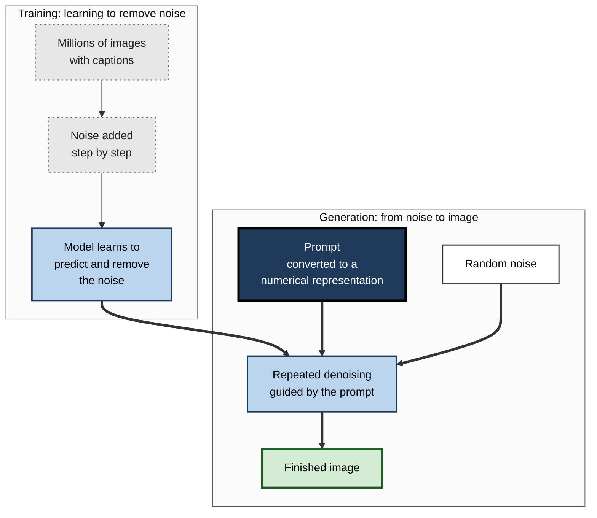
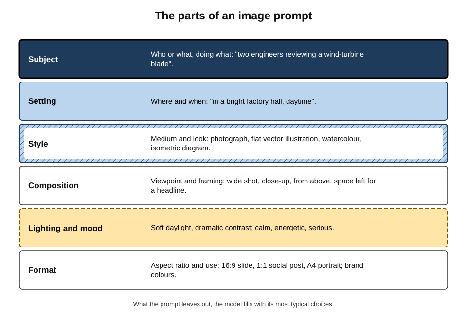
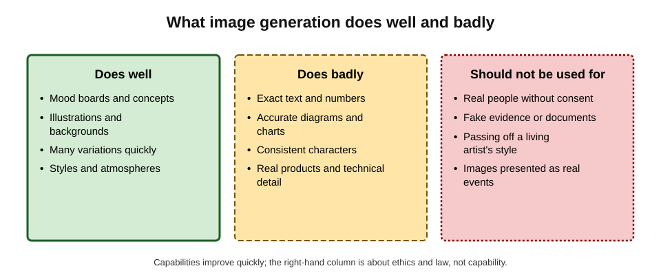
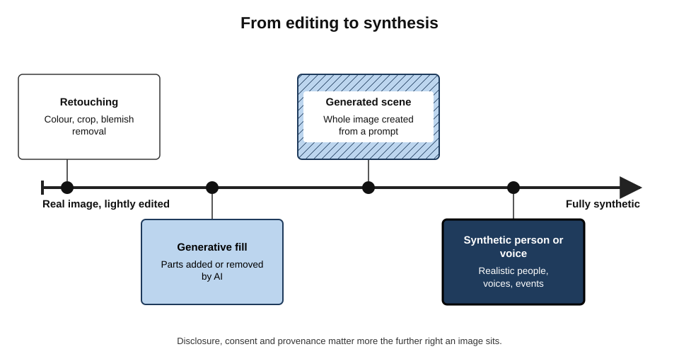
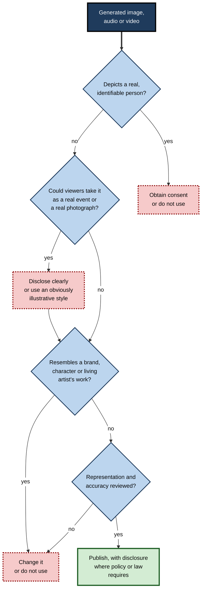
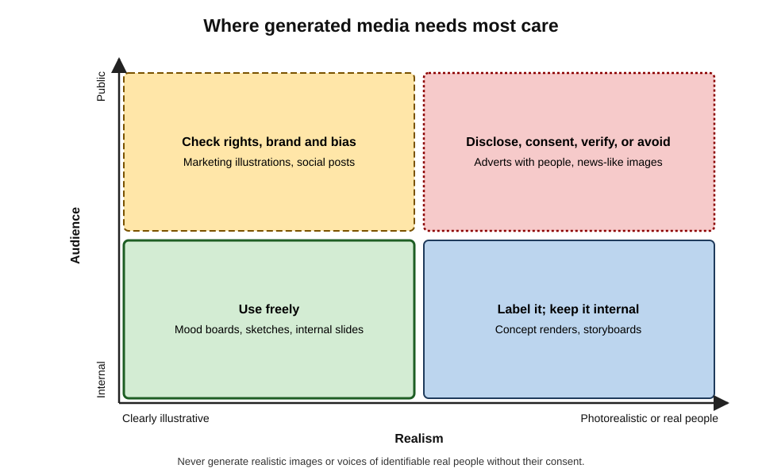

# B.9. Image and media generation basics

A charity's communications officer needs an image of volunteers planting trees at dawn by noon. An image generator produces a dozen options in a minute. The best one is nearly perfect — except that one volunteer has six fingers, the logo on a T-shirt is gibberish and every volunteer looks alike. Media generation is a powerful new capability; using it well means knowing what it does, what it gets wrong and what it should never be used for.

> **Definition — Generative media:** images, video, audio, music or voices created by AI models from instructions (prompts), examples or existing media.

> **Definition — Text-to-image model:** an AI model that generates an image from a written description.

**Why it matters**

- Visual and audio content is part of everyday work: slides, reports, social posts, training materials, product mock-ups, podcasts, internal videos.
- Generators remove much of the cost and delay of producing illustrations, concept images and draft media.
- They also create new risks: misleading realism, bias, intellectual-property disputes, reputational damage and fraud using synthetic people and voices.
- Professionals are increasingly expected to know when generated media is appropriate, how to disclose it and how to recognise when it is being used against them.

---

## How Generators Work

### A short history

- **2014 onward — generative adversarial networks (GANs)**: two networks competing — one generating images, one judging whether they are real; capable of realistic faces by the late 2010s.
- **2020 — diffusion models** (Jonathan Ho and colleagues, building on earlier work) produced high-quality images by learning to reverse a process of adding noise.
- **2021–2022 — text-to-image goes public**: OpenAI's DALL·E (2021) and DALL·E 2 (2022), Midjourney (2022) and the openly released Stable Diffusion (August 2022) made generation from text widely available.
- **2023 onward** — image generation built into office, design and chat tools; generative fill in photo editors; voice cloning and music generation.
- **2024 onward** — text-to-video models capable of short realistic clips.

### Diffusion in plain terms

> **Definition — Diffusion model:** a generative model trained to remove noise from images step by step; generation starts from random noise and repeatedly "denoises" it, guided by a prompt, until an image emerges.

**Figure 1.** How a diffusion model turns a prompt into an image.

- **What this explains:**
  - **Typicality** — the model produces what is *statistically typical* of images matching the prompt; unusual requests drift towards the typical.
  - **Bias** — the typical reflects the training images, including their stereotypes.
  - **Weak precision** — exact text, counts and spatial relations were historically hard because the model learns visual patterns, not rules; newer models are much better at text but still make errors.
  - **No memory of facts** — the model knows how things *look*, not whether a depicted event happened.

> **Key point:** a generated image is not a picture *of* anything. It is a picture of what images matching a description **tend to look like**.

---

## Prompting and Iterating

### The parts of a prompt

**Figure 2.** The parts of an image prompt.

- **Subject** — who or what, doing what.
- **Setting** — place and time.
- **Style** — photograph, illustration, watercolour, isometric diagram, line drawing.
- **Composition** — viewpoint, framing, empty space for text.
- **Lighting and mood** — soft daylight, dramatic contrast; calm or energetic.
- **Format** — aspect ratio, intended use, brand colours.

> **Mnemonic — "SSSCLF" ("Six Simple Steps Create Lovely Figures"):** Subject, Setting, Style, Composition, Lighting, Format.

### Diversity and representation must be specified

- Unspecified people default to the most typical depiction in the training data.
- The brief should say who should appear when it matters: "a diverse group of volunteers of different ages and ethnicities, one using a wheelchair".

### Iterating

1. **Generate several options** — compare, pick the closest.
2. **Refine the prompt** — change one element at a time to see its effect.
3. **Edit locally** — modern tools allow changing part of an image.

> **Definition — Inpainting:** regenerating a selected part of an image — for example, fixing a hand or removing an object — while keeping the rest.

> **Definition — Outpainting:** extending an image beyond its original borders with generated content.

4. **Finish conventionally** — add exact text, logos and figures in a design or presentation tool, not in the generator.

> **In practice:** generate the **picture**, add the **words** yourself. Text, logos, prices and data belong in editable layers on top of the image, where they can be checked and corrected.

### Worked example: an image for a fundraising email

**Situation:** the charity needs a 16:9 header image of volunteers planting trees at dawn, with space on the left for a headline.

| | First prompt | Refined prompt |
|---|---|---|
| Prompt | "Volunteers planting trees" | "Wide photograph-style image, 16:9, of eight volunteers of different ages and ethnicities planting saplings on a hillside at dawn, soft golden light, calm and hopeful mood, empty sky on the left third for a headline, no text or logos" |
| Composition | Centred crowd, no space for text | Space on the left as requested |
| People | Young, similar-looking | Varied ages and backgrounds |
| Text and logos | Gibberish slogan on T-shirts | None — added later in the email tool |
| Errors | Extra fingers on one hand | One distorted hand, fixed by inpainting |

**Final checks before use:**

1. **Hands, faces, objects** inspected at full size.
2. **No real identifiable person** depicted.
3. **No imitation** of a recognisable brand, artwork or photographer's style.
4. **Disclosure** — a small "AI-generated illustration" credit in line with the charity's policy, because the image might be read as a photograph of real volunteers.

- **Conclusion:** two rounds of prompting and one local edit produced a usable image in about fifteen minutes; disclosure was needed because the image was realistic and placed where readers expect documentary photographs.

> **Watch out:** a realistic image in a charity appeal, news-style article or customer testimonial invites viewers to believe it shows real people and events. Undisclosed, that is deception — however good the intention.

---

## What Generators Do Well and Badly

**Figure 3.** What image generation does well and badly.

- **Does well:** mood boards, concept images, illustrations, backgrounds, icons, variations of an idea, storyboards.
- **Does badly:**
  - **exact text and numbers** — improved greatly in recent models, but still error-prone;
  - **diagrams and charts** — a generated "bar chart" is a picture of a chart, not a chart of data;
  - **consistency** — the same character or product across several images;
  - **technical accuracy** — machinery, anatomy, maps, scientific detail;
  - **real products and logos** — distortions that can mislead or infringe.
- **Should not be used for:** realistic depictions of real people without consent; fake evidence, documents or screenshots; passing off a living artist's distinctive work; images presented as real events.

> **Watch out:** never use a generator to produce a chart, map or diagram that will be read as data. The shapes may look right while the values, proportions and labels are invented.

### Audio, voice and video

- **Text-to-speech and voice cloning** — natural narration for training videos and accessibility; some systems can imitate a voice from a short sample.
- **Music generation** — background tracks; licensing terms vary by service.
- **Video generation** — short clips and animations; realistic footage of events that never happened.
- **Translation and dubbing** — lip-synced translated video of real speakers.

> **Definition — Voice cloning:** generating speech that imitates a specific person's voice, from recordings of that person.

---

### Narration and voice in practice

A common workplace use of generated audio is narration for training, explainer and accessibility content.

1. **Write the script first** — short sentences, written for the ear, with abbreviations spelt out.
2. **Choose a stock synthetic voice**, or a cloned voice only with the speaker's written consent covering this use, its duration and its withdrawal.
3. **Check pronunciation** of names, technical terms and acronyms; most tools allow phonetic spelling or pronunciation dictionaries.
4. **Listen to the whole output** — synthetic speech can skip words, mispronounce numbers or place emphasis wrongly.
5. **Disclose** synthetic narration where listeners might assume a real person is speaking.
6. **Caption** — captions and transcripts make the content accessible and searchable.

> **Example:** a compliance team converts a 20-page policy into a six-minute narrated video. Synthetic narration reads "s. 172" as "s one hundred seventy-two"; the script is changed to "section one-seven-two of the Companies Act" — a fix that took seconds once someone listened.

### Video

- **Explainer animations and short clips** — useful for concepts, product mock-ups and storyboards.
- **Avatar presenters** — synthetic presenters reading a script, increasingly used for training in many languages.
  - Audiences may find them less engaging or trustworthy for sensitive topics; a real leader speaking matters for change announcements and difficult news.
- **Consistency and continuity** — characters, settings and products still drift between shots in many tools, so longer narratives require careful editing.

---

## Recognising Synthetic Media

### Why detection is hard

- Visible artefacts — distorted hands, warped text, odd reflections, inconsistent shadows — were once reliable signs; newer models make far fewer.
- **Automated detectors** give probabilistic judgements, perform worse on new models and on compressed or edited files, and produce false positives on genuine images.
- Absence of provenance information does not prove an image is genuine; most authentic photographs also lack it.

> **Watch out:** "an AI detector said it was fake" is weak evidence on its own, and so is "an AI detector said it was real". Use detectors, if at all, as one signal among several.

### What to check instead

- **Source** — who first published it, and are they credible? Lateral reading applies to images as to text.
- **Context** — does the image appear elsewhere with a different caption? Reverse image search finds earlier versions.
- **Provenance** — are Content Credentials present, and what do they say?
- **Plausibility** — do weather, signage, uniforms and landmarks fit the claimed place and time?
- **Corroboration** — do independent photographs or reports of the same event exist?
- **Process** — for requests involving money or data, **verify the request**, not the media: call back on a known number.

---

## Cost and Environmental Footprint

- **Compute cost** — generating images, and especially video, uses far more computation per output than generating short text.
- **Energy** — studies of AI energy use, such as work by Sasha Luccioni and colleagues (2023), found image generation among the most energy-intensive common AI tasks per request, with large variation between models.
- **Practical habits:**
  - generate a few well-specified options rather than hundreds of random ones;
  - reuse approved images;
  - prefer smaller models or lower resolutions for drafts.

> **Watch out:** published per-image energy estimates vary widely with model, hardware and data-centre efficiency, and change quickly as systems improve. Treat any single figure as indicative, not definitive.

---

## Bias and Representation

**Study card — Bloomberg analysis of an open image generator (2023)**

- **Design:** journalists generated more than 5,000 images with Stable Diffusion for prompts naming occupations and other categories, and analysed perceived skin tone and gender.
- **Findings:**
  - images for **higher-paid** occupations were dominated by lighter-skinned men;
  - images for lower-paid occupations and for some crime-related prompts over-represented darker-skinned people;
  - for some occupations, the generated images showed **fewer women** than the real workforce.
- **Conclusion:** generators can **amplify** existing stereotypes rather than merely reflect them.

- **Responses by providers:**
  - adjustments to diversify default outputs;
  - these have sometimes over-corrected — in early 2024, one major provider paused generation of people after its tool produced historically inaccurate images, such as diverse depictions of groups that were historically homogeneous.
- **Practical implications:**
  - specify representation deliberately;
  - review image sets for patterns — who is shown leading, serving, helping, being helped;
  - be especially careful in recruitment, health, finance and public-sector material.

> **Key point:** representation in generated media is a **choice the user makes**, explicitly or by default. The default is not neutral.

---

## Rights, Law and Disclosure

### Copyright in generated outputs

- **United States:**
  - copyright requires **human authorship**; the Copyright Office's 2025 report on AI-generated works concluded that prompts alone do not make the user an author, while human selection, arrangement and modification can be protected;
  - in 2023, for a comic book combining human-written text with AI-generated images, the Office protected the text and arrangement but not the images themselves;
  - in March 2025, a federal appeals court (*Thaler v. Perlmutter*) upheld the refusal to register a work listing an AI system as its author.
- **United Kingdom:** the law has a provision for "computer-generated works" with no human author, giving protection to the person who made the arrangements for its creation — a provision whose application to modern generative AI is uncertain and under government review.
- **Practical consequence:** an organisation may not own exclusive rights in a purely generated image; competitors may be free to copy it.

### Training data and infringement

- Lawsuits by artists, photographers, news organisations and stock-image companies challenge whether training on their works without permission is lawful.
- **Getty Images v. Stability AI (High Court of England and Wales, November 2025):** Getty abandoned its main claims about training, for lack of evidence that training took place in the UK; the court rejected its claim that the model itself was an infringing copy, finding that it did not store the training images; only a limited trade-mark infringement was found, relating to watermark-like marks in some outputs of early versions.
- Many questions remain open in other cases and jurisdictions, especially in the United States.

> **Watch out:** outputs can sometimes closely resemble specific training images, characters or logos. Recognisable characters, brands and an artist's distinctive style carry legal and reputational risk regardless of how the image was made.

### Likeness and consent

- Using a real person's face or voice without consent may breach data-protection, privacy, defamation, advertising or personality-rights laws, depending on jurisdiction.
- **Employment** — staff images or voices used in training or marketing videos require clear consent covering AI use.

### Disclosure and provenance

> **Definition — Provenance (of media):** information about the origin and edit history of a piece of media — who made it, with what tools and how it was changed.

- **Content Credentials** — an open standard developed by the Coalition for Content Provenance and Authenticity (C2PA), founded in 2021 by technology and media organisations, attaches signed provenance information to files.
- **Invisible watermarks** — some providers embed signals in generated images or audio (for example, Google DeepMind's SynthID, announced in 2023).
- **Limits:** metadata is often stripped when files are uploaded to platforms; watermarks can be degraded; absence of a label does not prove an image is real.
- **Regulation:** the European Union's AI Act requires, from August 2026, that providers mark synthetic content in machine-readable ways and that deployers disclose "deepfakes" — realistic synthetic depictions of people, places or events.

> **Definition — Deepfake:** realistic synthetic media that depicts a person saying or doing something they did not say or do, or an event that did not happen.

**Figure 4.** From editing to synthesis.

**Figure 5.** Checks before publishing generated media.

---

## Synthetic Media Used Against Organisations

### Case study: the deepfake video call

- **Situation:** in early 2024, an employee in the Hong Kong office of the engineering firm Arup received a message, apparently from the company's UK-based chief financial officer, about a confidential transaction.
- **What happened:**
  1. the employee was initially suspicious of the message;
  2. he then joined a video call in which the "CFO" and several "colleagues" appeared and spoke — all of them deepfakes generated from public footage;
  3. reassured, he made a series of transfers totalling about **HK$200 million** (roughly **US$25 million**) to accounts controlled by the fraudsters.
- **Discovery:** the fraud came to light only when the employee later checked with the company's head office.
- **Diagnosis:**
  - a video call, previously treated as strong confirmation of identity, was itself synthetic;
  - payment controls relied on the instruction appearing to come from a senior person.
- **Lesson:** **seeing and hearing are no longer proof of identity.** Payment and data-access controls must use independent verification — a call-back to a known number, a second approver, a pre-agreed code.

### Other patterns

- **Voice-clone fraud** — calls imitating a manager or family member asking for urgent payment.
- **Political and public deception** — in January 2024, robocalls with an AI-generated imitation of the US President's voice urged voters not to vote in a primary election; the US communications regulator subsequently confirmed that AI-generated voices in robocalls fall under existing restrictions.
- **Fake evidence** — fabricated receipts, screenshots, damage photographs in insurance claims, or identity documents.

> **In practice:** organisations increasingly train staff that any **unusual request involving money, credentials or confidential data** must be verified through a separate, known channel — however convincing the voice or face.

---

## Professional Practice

**Figure 6.** Where generated media needs most care.

| | Internal use | Public use |
|---|---|---|
| Illustrative style | Use freely: mood boards, sketches, internal slides | Check rights, brand fit and representation; disclose per policy |
| Photorealistic, no real people | Label as AI-generated; keep internal | Disclose clearly; avoid where viewers expect documentary images |
| Real people's likeness or voice | Only with consent | Only with explicit consent and legal review |

- **Policy** — which tools are approved; which uses are allowed; disclosure rules; prohibited uses (real people, fake evidence, competitor brands).
- **Brand consistency** — style guides for generated imagery; approved prompts or reference images.
- **Records** — keep prompts, tool versions and dates for published media, to answer later questions about provenance and rights.
- **Accessibility** — alt text for generated images, written by a person who knows the image's purpose.
- **Commissioning** — generated images are often best used as **briefs** for designers and photographers rather than as final assets for important campaigns.

> **Key point:** the cheapest image is not always the right one. For flagship campaigns, documentary content and anything depicting the organisation's real people and work, authentic photography carries credibility that generated imagery cannot.

---

## Editing Real Images

Generative editing of real photographs raises distinct questions, because viewers assume a photograph records something that happened.

- **Ordinary corrections** — colour, exposure, cropping, removing dust — are long-accepted practice.
- **Generative removal or addition** — removing a person from a team photo, adding a crowd, replacing a grey sky with a blue one — changes what the image claims.
- **Where it matters most:**
  - **news and documentary** — journalistic codes generally prohibit altering the content of news photographs;
  - **property and product listings** — an "enhanced" image that hides damage or adds features can mislead buyers and breach consumer-protection rules;
  - **evidence and records** — insurance, inspection and safety photographs must not be altered at all;
  - **people's appearance** — reshaping bodies or faces in advertising has attracted regulatory attention in several countries.

> **Example:** an estate agency's AI tool "tidies" listing photos by removing clutter — and, unnoticed, a damp patch on a ceiling. The image now misrepresents the property; the agency, not the tool, is responsible.

> **Remember:** edit the **presentation** of a real image freely; do not edit its **claims** without saying so.

### A consistent house style

- **Reference images and style descriptions** — a short written style guide (palette, illustration style, lighting, what never to show) reused in every prompt keeps a body of images coherent.
- **Approved libraries** — once generated and approved, images are stored with their prompts and reused rather than regenerated.
- **Review by a designer** for anything external: brand fit, accessibility contrast, representation and rights.

---

## Open Questions

- **Will training on copyrighted works be found lawful?**
  - Cases in several jurisdictions are unresolved; outcomes may differ by country.
- **Can provenance standards work at scale?**
  - Content Credentials and watermarks help, but stripping, adoption gaps and open models limit them.
- **How should disclosure work in practice?**
  - Labels may be ignored, or may make audiences distrust authentic content; the effect of disclosure on trust is still being studied.
- **What happens to creative professions?**
  - Illustrators, stock photographers and voice actors report lost work; the long-term balance of displacement and new demand is unclear.
- **How will organisations verify identity?**
  - As synthetic video and voice improve, the evidential value of calls, recordings and photographs declines; new verification norms are emerging.

---

## Summary

- **Generative media**: images, video, audio, music and voices created by AI from prompts or examples. Text-to-image became public in 2021–2022; **diffusion models** generate by step-by-step denoising guided by the prompt.
- Generated images show what matching images **tend to look like** — hence typicality, bias, weak precision with text, counts and diagrams, and no relation to real events.
- Prompts: **Subject, Setting, Style, Composition, Lighting, Format**; specify representation; iterate; use **inpainting**; add text and logos afterwards in editable layers.
- Good for mood boards, concepts, illustrations, backgrounds; bad for exact text, charts, consistency and technical accuracy; **not for** real people without consent, fake evidence or passing off artists' work.
- **Bias**: generators can amplify stereotypes (Bloomberg, 2023); over-correction is also possible.
- **Law**: human authorship needed for US copyright (Copyright Office, 2025; *Thaler v. Perlmutter*, 2025); UK computer-generated works provision uncertain; *Getty v. Stability* (2025) rejected the main UK claims; training-data cases continue.
- **Provenance and disclosure**: Content Credentials (C2PA), watermarks (SynthID); EU AI Act transparency duties from August 2026; labels can be stripped.
- **Deepfake fraud** (Arup, 2024: about US$25 million): verify unusual requests through independent channels.
- Practice: policy, brand guides, records of prompts, alt text, consent, and authentic media where credibility matters.

---

## Self-Check

1. Define generative media and a text-to-image model.
2. Explain in plain terms how a diffusion model generates an image.
3. Why do generated images tend towards the typical, and what follows for bias?
4. List the six parts of an image prompt and write a complete prompt for a slide illustrating "remote teamwork".
5. Why should text, logos and data be added after generation rather than in the prompt?
6. What are inpainting and outpainting?
7. Name three things generators do badly and three uses that should be avoided altogether.
8. Summarise the Bloomberg (2023) analysis and its implications for workplace imagery.
9. What is the position on copyright in purely AI-generated images in the United States, and why does it matter commercially?
10. What did the High Court decide in *Getty Images v. Stability AI* (2025)?
11. What are Content Credentials and watermarks, and what are their limits?
12. Describe the Arup deepfake fraud and the controls that would have prevented it.
13. Classify these uses and the care each needs: an AI image of a "typical customer" in a bank's public advert; a storyboard for an internal training video; a generated photo of the company's new office in a press release before it is built; a synthetic voice of the CEO for an internal announcement.
14. Draft five rules for a generated-media policy in a public-sector organisation.

### Answer Key

1. Generative media is AI-created images, video, audio, music or voices; a text-to-image model generates an image from a written description.
2. It is trained to remove noise from images; to generate, it starts with random noise and repeatedly denoises it, guided by a numerical representation of the prompt, until an image forms.
3. It learns the statistical patterns of images matching descriptions, so outputs drift to the most common depiction — including stereotypes in the training data, which it may amplify.
4. Subject, Setting, Style, Composition, Lighting and mood, Format. E.g. "Flat vector illustration, 16:9, of four colleagues of different ages and backgrounds on a video call from home offices, connected by a simple network of lines, calm blue palette, empty space on the right for a title, no text."
5. Generators render text and figures unreliably, and they cannot be edited or checked inside the image; editable layers allow exact, correctable content.
6. Inpainting regenerates a selected part of an image; outpainting extends an image beyond its borders.
7. Badly: exact text, charts and diagrams, consistent characters (also technical detail, real logos). Avoid: realistic images of real people without consent, fake evidence or documents, passing off a living artist's style, images presented as real events.
8. Over 5,000 Stable Diffusion images showed higher-paid jobs dominated by lighter-skinned men and stereotyped depictions elsewhere, sometimes more skewed than reality. Workplace imagery should specify representation and be reviewed for patterns.
9. Human authorship is required; prompts alone do not create authorship, though human selection, arrangement and modification may be protected. Organisations may not own exclusive rights in purely generated images, so others could reuse them.
10. Getty dropped its main training claims for lack of evidence that training occurred in the UK; the court found the model did not store copies and so was not an infringing copy; only limited trade-mark infringement relating to watermark-like marks in early outputs was found.
11. Content Credentials attach signed provenance metadata; watermarks embed hidden signals. Limits: metadata is often stripped, watermarks can be degraded, adoption is incomplete, and unlabelled content is not proven real.
12. An employee joined a video call with deepfaked senior colleagues and transferred about US$25 million. Prevention: independent verification by call-back to known numbers, dual approval for large or unusual payments, pre-agreed verification codes, training that video is not proof of identity.
13. Bank advert "customer": public, photorealistic — disclose or use an illustrative style, check representation. Storyboard: internal, illustrative — use freely. Unbuilt office photo in a press release: public, could be read as real — label clearly as an artist's impression. CEO synthetic voice: real person's likeness — only with explicit consent and disclosure to staff.
14. Approved tools only; no realistic depiction of real people or voices without written consent; all public realistic media labelled as AI-generated; no generated charts, maps or documents presented as factual; representation reviewed against equality duties; prompts, tools and dates recorded; alt text written by staff; authentic photography for documentary content.

---

## Glossary

| Term | Meaning |
|---|---|
| Content Credentials | An open standard (C2PA) for attaching signed provenance information to media files. |
| Deepfake | Realistic synthetic media depicting people or events that did not occur. |
| Diffusion model | A model generating media by step-by-step denoising guided by a prompt. |
| Generative adversarial network (GAN) | Two competing networks — a generator and a judge — used to create realistic media. |
| Generative media | AI-created images, video, audio, music or voices. |
| Inpainting | Regenerating a selected part of an image. |
| Outpainting | Extending an image beyond its borders with generated content. |
| Provenance | Information about a media item's origin and edit history. |
| Text-to-image model | A model that generates images from written descriptions. |
| Voice cloning | Generating speech imitating a specific person's voice. |
| Watermark (invisible) | A hidden signal embedded in generated media to mark its origin. |
